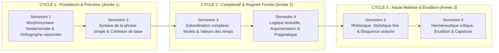

# Cahier des Charges Académique — World-Class French

> **Statut** : [STATUT : PROPOSÉ — EN ATTENTE DE VALIDATION]  
> **Date de création** : 2026-10-11  
> **Dernière révision** : 2026-10-11  
> **Rôle** : Directeur de programme académique, linguiste et ingénieur pédagogique

---

## 1. Vision et Finalité

### 1.1 Vision
Le projet **World-Class French** a pour ambition de concevoir un cursus de référence pour l'acquisition d'une maîtrise approfondie, élégante, autonome et vivante de la langue française.

Le cursus refuse la réduction du français à un ensemble de règles mécaniques apprises par cœur, tout comme il refuse l'illusion d'une communication fluide dénuée de rigueur structurelle. Il aborde la langue française sous une quadruple dimension indissociable :
1. **Un système linguistique rigoureux** : une architecture cohérente régie par des principes phonologiques, morphologiques et syntaxiques explicables.
2. **Un outil d'émancipation intellectuelle** : un instrument de structuration de la pensée logique, d'affûtage de l'esprit critique et de précision conceptuelle.
3. **Un vecteur d'action et d'éloquence** : un moyen de communication persuasif, capable d'adapter ses registres pour convaincre, émouvoir et débattre avec autorité.
4. **Un patrimoine vivant et pluriel** : une langue en partage, enrichie par son histoire et la vitalité de l'espace francophone international.

### 1.2 Finalité opérationnelle
Amener l'apprenant d'une pratique usuelle ou fonctionnelle du français jusqu'à une maîtrise d'élite (comparable aux exigences des concours universitaires, de la haute rédaction administrative, juridique ou littéraire), capable de rédiger sans faute, d'analyser la complexité des textes et d'exprimer une pensée nuancée avec aisance et clarté.

---

## 2. Public Cible, Contexte et Hypothèses de Départ

### 2.1 Contexte et ancrage géographique
Le cursus est pensé en priorité pour un apprenant francophone vivant au **Bénin** (Afrique de l'Ouest), tout en s'ouvrant organiquement à l'ensemble de la francophonie (France, Québec, Belgique, Suisse, Afrique subsaharienne, Maghreb, Caraïbes).

Ce contexte impose de prendre en compte les réalités sociolinguistiques effectives :
- **Environnement de multilinguisme** : Le français y est la langue officielle, la langue de scolarisation et des échanges formels, coexistant avec des langues nationales vivantes (fon, yoruba, baatonu, etc.).
- **Distinction rigoureuse des plans linguistiques** :
  - La *norme prescriptive standard du français écrit formel* (objet central de la certification et des exigences académiques).
  - Les *usages oraux courants* et les *variations régionales légitimes* (usages ouest-africains et béninois reconnus, collocations spécifiques, traits prosodiques) qui doivent être compris et respectés sans être confondus avec la norme écrite soutenue.
  - La prévention de l'insécurité linguistique par la clarification scientifique des écarts entre oral local, oral standard et écrit soutenu.

### 2.2 Hypothèses de départ sur l'apprenant
Le cursus ne présume **pas** d'emblée d'un niveau C1 ou C2 chez l'apprenant à l'entrée :
- **Prérequis d'entrée minimaux** : Savoir lire couramment, écrire de façon intelligible et comprendre des énoncés de complexité moyenne (niveau seuil indicatif B1/B2 acquis dans la scolarité secondaire).
- **Constat diagnostique courant** : Présence fréquente de lacunes fondamentales masquées (confusion homophonique, doutes récurrents sur l'accord du participe passé, syntaxe calquée sur l'oral, maîtrise empirique mais non formalisée des connecteurs).
- **Implication pédagogique** : Le cursus intègre un **test diagnostique initial étalonné** en amont de toute avancée pour identifier le profil réel de l'apprenant et activer des parcours de révision individualisés.

---

## 3. Compétences Finales Attendues

Au terme des 3 années de cursus, l'apprenant démontre les compétences observables suivantes :

### 3.1 Expression écrite et correction éditoriale
- Rédiger des textes longs (dissertations, essais, synthèses, rapports d'expertise, correspondances d'apparat) avec une correction grammaticale et orthographique irréprochable (taux d'erreur inférieur à 0,2 % sur corpus non préparé).
- Déployer une syntaxe ample, équilibrée et variée, maniant la phrase complexe et la période oratoire sans rupture de construction (anacoluthe, zeugma fautif).
- Exercer des compétences de révision éditoriale et de correction d'épreuves : repérer, catégoriser et corriger les maladresses et fautes dans des textes tiers en formulant une justification grammaticale exacte.

### 3.2 Précision lexicale et sémantique
- Mobiliser un vocabulaire étendu et châtié, en sélectionnant toujours le terme propre et en bannissant le vocabulaire passe-partout.
- Maîtriser le champ sémantique, l'étymologie, la polysémie, les nuances synonymiques et les réseaux de collocations idiomatiques.

### 3.3 Rhétorique, argumentation et prise de parole
- Construire une argumentation rigoureuse : identifier les sophismes, structurer une démonstration déductive ou inductive, réfuter une objection avec courtoisie et vigueur.
- Prononcer un discours public avec une prosodie soignée (débit régulé, accents d'insistance, articulation nette, liaisons scrupuleusement respectées selon la norme formelle).
- Adapter instantanément le registre de langue (technique, académique, soutenu, professionnel) à la situation d'énonciation.

### 3.4 Analyse métalinguistique et posture critique
- Analyser formellement la phrase française (nature et fonction, propositions, hiérarchies syntaxiques, modes et valeurs d'aspect).
- Expliquer scientifiquement la raison d'un accord ou d'un tour syntaxique en s'appuyant sur les grammaires de référence.
- Développer une autonomie linguistique absolue : être capable de vérifier ses doutes linguistiques à l'aide des dictionnaires savants et des traités spécialisés sans dépendre d'un tiers.

---

## 4. Périmètre Disciplinaire (14 Composantes)

Le curriculum embrasse 14 composantes interconnectées :

1. **Orthographe lexicale et grammaticale** : régularités graphiques, étymologie, pluriels complexes, accords du verbe et de ses satellites.
2. **Grammaire et analyse grammaticale** : morphosyntaxe, délimitation des syntagmes, arborescences de la phrase, analyse en constituants immédiats.
3. **Conjugaison et valeurs des temps et modes** : morphologie verbale intégrale, distinction temps/aspect, système modal (subjonctif, conditionnel, infinitif, participe).
4. **Syntaxe et construction de phrases** : subordination, coordination, corrélation, incises, inversions du sujet, macro-syntaxe textuelle.
5. **Vocabulaire, sémantique et précision lexicale** : dérivation, composition, néologie, antonymie, synonymie fine, registres et connotations.
6. **Ponctuation et typographie** : règles de l'Imprimerie nationale, pauses oratoires vs démarcations logiques, point-virgule, tirets d'incise, guillemets et italiques.
7. **Lecture et compréhension analytique de textes** : décodage des sous-entendus, présupposés, polyphonie énonciative et structures narratives.
8. **Expression écrite, composition et réécriture** : genres académiques (synthèse, dissertation, compte rendu, essai), protocoles de réécriture et d'élagage.
9. **Compréhension et expression orales, phonétique et prosodie** : Alphabet Phonétique International (API), voyelles nasales, e caduc, liaisons obligatoires/interdites/facultatives, débit oratoire.
10. **Argumentation, rhétorique et éloquence** : genres oratoires (délibératif, judiciaire, épidictique), parties du discours (inventio, dispositio, elocutio, actio, memoria), réfutation des biais argumentatifs.
11. **Stylistique et littérature** : analyse des figures de style (tropes, figures de construction, de pensée), rythmes de prose, harmonies imitative et vocalique.
12. **Linguistique et histoire de la langue** : du latin au français moderne, évolution de l'orthographe, formation du français classique, grandes réformes.
13. **Diversité des usages francophones** : variations diatopiques, contact de langues, français parlé en Afrique subsaharienne et spécificités lexicales béninoises, norme vs écart.
14. **Analyse des erreurs et autonomie linguistique** : typologie des erreurs fréquentes, diagnostic réflexif, méthode de consultation des ouvrages de référence.

---

## 5. Organisation sur Trois Ans et Six Semestres



### Année 1 (Semestres 1 et 2) — Cycle Fondamental : Le Socle et la Précision
- **Semestre 1 (S1) — Morphosyntaxe élémentaire et orthographe raisonnée** :
  - Diagnostic initial et remédiation individualisée.
  - Classes de mots invariables et variables, accord sujet-verbe canonique et inversé.
  - Conjugaison des régularités et verbes fréquents irréguliers (indicatif).
  - Dictées fondamentales et ateliers de phonétique/liaisons.
- **Semestre 2 (S2) — Syntaxe fonctionnelle de la phrase simple et cohésion textuelle** :
  - Fonctions syntaxiques essentielles (sujet, COD, COI, attributs, compléments circonstanciels).
  - Ponctuation de base et construction du paragraphe.
  - Premiers accords du participe passé (auxiliaire être et avoir simple).
  - Vocabulaire conceptuel de base et élimination des termes vagues.

### Année 2 (Semestres 3 et 4) — Cycle d'Approfondissement : Complexité et Registres
- **Semestre 3 (S3) — Subordination complexe, système temporel et modal** :
  - Propositions subordonnées complétives, relatives, circonstancielles.
  - Concordance des temps et valeurs du subjonctif et du conditionnel.
  - Accords complexes (verbes pronominaux, participes passés suivis d'infinitif).
  - Ateliers d'analyse grammaticale approfondie.
- **Semestre 4 (S4) — Logique textuelle, argumentation et diversité des registres** :
  - Connecteurs logiques, progression thématique (linéaire, constante, éclatée).
  - Rhétorique argumentative : thèse, argument, exemple, concession, réfutation.
  - Les registres de langue : familier, courant, soutenu, solennel.
  - Prise en compte de la francophonie plurielle et des contextes ouest-africains.

### Année 3 (Semestres 5 et 6) — Cycle d'Excellence : Haute Maîtrise et Éloquence
- **Semestre 5 (S5) — Stylistique avancée, rhétorique classique et genres académiques** :
  - Traité des figures de rhétorique (Fontanier, Molinié), cadences et périodes oratoires.
  - Méthodologie de la dissertation littéraire, de la synthèse de documents et de l'essai critique.
  - Laboratoire d'éloquence orale : art oratoire, déclamation, débat contradictoire.
- **Semestre 6 (S6) — Critique textuelle, histoire de la langue et projet terminal (Capstone)** :
  - Histoire de la langue française et sociolinguistique comparée.
  - Correction éditoriale professionnelle (révision d'épreuves, détection de coquilles subtiles).
  - Rédaction et soutenance du *Capstone Project* (travail de synthèse personnel d'envergure).

---

## 6. Principes Pédagogiques

Pour articuler rigueur scientifique et efficacité didactique, le cursus sépare nettement les exigences impératives des choix méthodologiques proposés :

### 6.1 Exigences indispensables (Non négociables)
1. **Évaluation diagnostique obligatoire** : Aucun apprenant n'entame un module avancé sans que ses prérequis réels aient été mesurés.
2. **Ordre strict des prérequis** : Une notion B ne peut être enseignée si la notion A dont elle dépend n'est pas maîtrisée.
3. **Preuve observable systématique** : Toute notion transmise doit faire l'objet d'un exercice d'application directe et d'une validation par une production mesurable.
4. **Ancrage normatif exact** : Chaque règle enseignée s'appuie sur une source linguistique reconnue (Grevisse, Riegel, etc.) ; les tolérances orthographiques et controverses sont obligatoirement signalées.
5. **Absence d'artifices et d'inventions** : Exemples authentiques tirés de corpus littéraires, journalistiques ou académiques, exclusion de faux exemples absurdes.

### 6.2 Choix pédagogiques proposés (Méthodologie retenue)
1. **Démarche inductive puis déductive** : Partir de l'observation intuitive d'un corpus ou d'un texte modèle, faire émerger la régularité, puis formaliser rigoureusement la règle savante.
2. **Pratique délibérée et exercices gradués** : Séquences d'exercices structurées en 3 niveaux de difficulté (Niveau 1 : Reconnaissance et discrimination ; Niveau 2 : Application guidée ; Niveau 3 : Production libre et cas limites).
3. **Rappel actif et répétition espacée** : Réactivation systématique des notions clés lors des semaines 1, 3, 7 et 12 de chaque semestre.
4. **Dictées d'apprentissage et correction raisonnée** : La dictée n'est pas un instrument de sanction aveugle mais un laboratoire d'analyse où l'apprenant commente et justifie chaque graphie à haute voix ou par écrit.
5. **Atelier d'écriture et protocole de réécriture** : Tout texte rédigé est relu à travers une grille critériée puis soumis à au moins un cycle complet de réécriture (élagage, substitution de vocabulaire, resserrement de la syntaxe).
6. **Entraînement prosodique oral régulier** : Enregistrements audio réguliers de l'apprenant pour travailler la diction, les pauses respiratoires et la clarté oratoire.

---

## 7. Méthode d'Évaluation

Le système d'évaluation poursuit une double visée : certifier la maîtrise et guider la remédiation continue.

```text
SYSTÈME D'ÉVALUATION DU CURSUS
├── Évaluation Diagnostique (Semaine 0 de chaque cycle)
│   └── Bilan de positionnement, identification des angles morts, orientation individualisée.
├── Évaluation Formative Continue (Hebdomadaire)
│   └── Tests courts de rappel actif (QCM ciblés, dictées flash de 50 mots, manipulation syntaxique).
├── Évaluation Sommative Semestrielle (Mi-parcours et Fin de Semestre)
│   ├── Épreuve 1 : Dictée de contrôle sans document (200 à 400 mots)
│   ├── Épreuve 2 : Analyse grammaticale et linguistique de corpus
│   ├── Épreuve 3 : Épreuve de composition écrite formelle (dissertation ou synthèse)
│   └── Épreuve 4 : Soutenance ou déclamation orale en temps limité
└── Évaluation Cumulative de Fin d'Année (Porte de passage)
    └── Vérification de la rétention à long terme des notions des semestres précédents.
```

### Règles de validation et de notation
- **Seuil de maîtrise minimal** : 14/20 (70 %) sur chaque épreuve composante pour valider une unité d'enseignement.
- **Règle de remédiation** : Toute note inférieure à 14/20 déclenche un protocole de révision ciblée dans [`04-practical-work/`](file:///f:/Formation/world-class-french/04-practical-work/) suivi d'une épreuve de rattrapage équivalente.
- **Élimination des complaisances** : Zéro arrondi artificiel de note ; évaluation scrupuleuse des accords et de la logique discursive.

---

## 8. Critères de Qualité (World-Class Standards)

Tout contenu produit dans le cadre du projet doit respecter la grille de conformité suivante :

| Dimension | Standard de qualité exigé |
| :--- | :--- |
| **Exactitude scientifique** | Conformité stricte aux grammaires de référence (*Le Bon Usage*, *GMF*). Aucune affirmation empirique non étayée. |
| **Clarté pédagogique** | Pas de jargon gratuit : chaque terme technique de linguistique est défini avant d'être utilisé. |
| **Progression cognitive** | Respect strict du niveau des apprenants : charge cognitive maîtrisée (interdiction de cumuler plus de 3 concepts nouveaux par sous-section). |
| **Qualité des corpus** | Textes d'appui de haute tenue issus de la littérature classique et contemporaine, ainsi que des grands auteurs francophones africains (Senghor, Césaire, Kourouma, Laye, etc.). |
| **Fiabilité des corrigés** | 100 % des exercices sont accompagnés d'un corrigé intégral et explicatif, précisant le raisonnement à tenir pour éviter le piège. |

---

## 9. Limites et Périmètre d'Exclusion du Projet

Pour préserver l'intégrité et la clarté de sa mission, le projet définit explicitement ce qu'il **n'est pas** :

1. **Pas d'accréditation ni de diplôme d'État** : Le cursus constitue un parcours d'excellence et d'auto-formation de haut niveau. Il n'octroie aucun diplôme universitaire officiel (licence, master) ni certification d'État sans conventionnement préalable.
2. **Pas d'alphabétisation ni d'initiation FLE débutant (A1-A2)** : Le programme ne s'adresse pas aux personnes ne parlant ni n'écrivant pas encore le français.
3. **Pas de dogmatisme puriste anti-francophone** : Le cursus promeut la norme standard pour l'écrit soutenu, mais s'interdit tout mépris envers les particularismes régionaux vivants de l'Afrique de l'Ouest ou d'autres territoires francophones. Il enseigne la sociolinguistique des variations plutôt que la stigmatisation.
4. **Pas de génération massive non vérifiée** : Aucun cours ne sera publié sous forme de brouillon généré à la hâte. La qualité prévaut en permanence sur le volume ou la vitesse de livraison.

---

## 10. Critères Mesurables de Réussite du Projet

La réussite du programme **World-Class French** sera mesurée à l'aune d'indicateurs objectifs et quantifiables :

1. **Taux de maîtrise orthographique** :
   - Capacité pour un apprenant ayant complété le cursus de réussir une dictée de niveau concours universitaire avec moins de 2 fautes pour 400 mots.
2. **Vitesse et fluidité de composition** :
   - Capacité à rédiger une dissertation ou un essai de 1 500 mots en 3 heures, structurellement rigoureux, stylistiquement soutenu, sans rupture syntaxique.
3. **Indicateur d'autonomie linguistique** :
   - Capacité à identifier 95 % des erreurs insérées dans un texte témoin (épreuve de relecture-correction) et à en justifier la correction en renvoyant à la règle idoine.
4. **Taux d'achèvement et de rétention** :
   - Taux de rétention des concepts clés supérieur à 85 % lors des évaluations cumulatives à 6 mois et 12 mois.

---

## 11. Décisions Soumises à Validation Humaine

Avant d'engager les étapes ultérieures (architecture fine et rédaction des modules), les arbitrages suivants requièrent votre validation explicite :

1. **Rythme d'apprentissage hebdomadaire cible** :
   - *Option A* : Rythme intensif (10 à 12 heures/semaine d'étude personnelle et pratique).
   - *Option B* : Rythme régulier modéré (5 à 6 heures/semaine).
2. **Intégration du corpus littéraire et discursif** :
   - Valider la proportion souhaitée entre le patrimoine littéraire classique (XVIIe-XXe siècles) et les grands textes de la francophonie d'Afrique de l'Ouest (littérature, essais politiques, discours académiques).
3. **Format des supports d'exercices** :
   - Confirmer si les exercices doivent être conçus sous forme de fiches Markdown textuelles autonomes avec corrigés cachés/séparés, ou sous forme de scripts interactifs de vérification (ex. petits scripts Python de validation).
