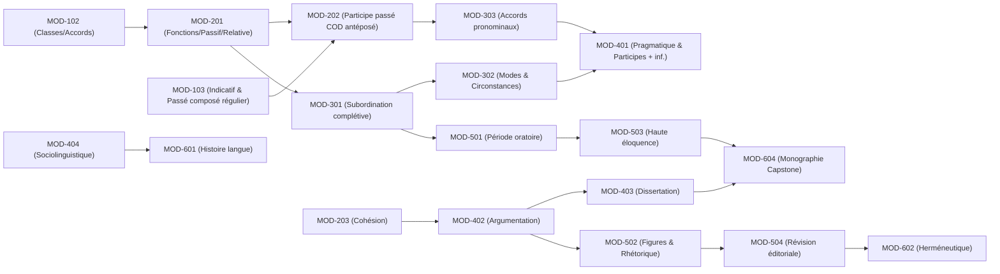

# Cartographie Globale du Cursus — Curriculum Map

> **Statut** : [STATUT : PROPOSÉ — EN ATTENTE DE VALIDATION]  
> **Date de création** : 2026-10-11  
> **Dernière révision** : 2026-10-11  
> **Alignement** : Cahier des charges validé ([DEC-005](file:///f:/Formation/world-class-french/00-governance/decisions-log.md#dec-005-cahier-des-charges-académique-et-prise-en-compte-du-contexte-béninoisfrancophone), [DEC-006](file:///f:/Formation/world-class-french/00-governance/decisions-log.md#dec-006-calibrage-du-rythme-hebdomadaire-option-b-5-à-6-heures-semaine), [DEC-007](file:///f:/Formation/world-class-french/00-governance/decisions-log.md#dec-007-politique-de-sélection-des-corpus-détude-équilibre-classique-et-francophone), [DEC-008](file:///f:/Formation/world-class-french/00-governance/decisions-log.md#dec-008-format-des-supports-pédagogiques-et-laboratoires-dexercices-markdown-autonome))

---

## 1. Organisation en 13 Grands Domaines d'Apprentissage

Le cursus **World-Class French** structure l'étude approfondie de la langue à travers 13 domaines complémentaires. Cette organisation dépasse la grammaire scolaire traditionnelle pour embrasser le français comme système formel, outil de pensée et pratique vivante :

| N° | Domaine | Champ d'étude et Justification | Répartition dans le cursus |
| :--- | :--- | :--- | :--- |
| **DOM-01** | **Fondations et diagnostic** | Évaluation initiale de positionnement, repérage des angles morts, désamorçage de l'insécurité linguistique, métacognition. | S1 (initial), fil rouge à chaque début de semestre (S2 à S6). |
| **DOM-02** | **Phonétique, phonologie et orthographe** | Système phonologique français (API), liaisons, e caduc, prosodie de base, régularités et graphies étymologiques, rectifications de 1990. | Central en S1 et S2 ; approfondi en S3 (exceptions) et S5 (déclamation). |
| **DOM-03** | **Grammaire et morphologie** | Catégories grammaticales (parties du discours), morphologie nominale et adjectivale, accord sujet-verbe, relations syntaxiques de base. | S1 (fondements) et S2 (consolidation) ; réinvesti en S3 à S6. |
| **DOM-04** | **Conjugaison et syntaxe** | Morphologie verbale intégrale, système aspectuo-temporel, subordination (complétives, relatives, circonstancielles), concordance des temps. | S1 (indicatif de base), S2 (phrase simple), S3 (subordination & modes), S4 (périodes). |
| **DOM-05** | **Lexique et sémantique** | Formation des mots (dérivation, composition), polysémie, synonymie fine, collocations, nuances conceptuelles, évitement des termes passe-partout. | Continu de S1 à S6 avec gradation : concret/abstrait (S1-S2) vers érudition/nuances (S3-S6). |
| **DOM-06** | **Compréhension écrite et orale** | Décodage analytique de textes littéraires et d'idées, structure argumentative, repérage de l'implicite, écoute critique d'allocutions et débats. | Continu de S1 à S6 : de l'explication littérale à l'herméneutique critique. |
| **DOM-07** | **Expression écrite** | Du paragraphe argumenté à la dissertation académique, l'essai critique, la synthèse de documents et la correspondance d'apparat. | Continu de S1 à S6 : ateliers d'écriture hebdomadaires gradués. |
| **DOM-08** | **Expression orale** | Articulation, projection vocale, diction, prise de parole impromptue, allocution préparée, joutes oratoires et débat contradictoire. | Continu de S1 à S6 : ateliers d'éloquence et enregistrements réguliers. |
| **DOM-09** | **Argumentation et rhétorique** | Logique informelle, typologie des arguments (inductif, déductif, analogique), détection des sophismes, parties de la rhétorique classique (*inventio*, *dispositio*, *elocutio*). | Introduit en S2, déployé en S4 (discours argumenté) et S5 (haute éloquence). |
| **DOM-10** | **Littérature, stylistique et analyse de textes** | Figures de style (tropes, pensée, construction), cadences de la prose, esthétique textuelle, commentaire stylistique appuyé sur corpus classiques et francophones. | Initié en S2, développé en S4, culminant en S5 et S6. |
| **DOM-11** | **Linguistique et histoire de la langue** | Évolution diachronique (du latin vulgaire au français contemporain), sociolinguistique, variations régionales (Afrique subsaharienne, Bénin), norme vs usage. | Sensibilisation en S1-S3, formalisation en S4 et S6. |
| **DOM-12** | **Correction, révision et autonomie** | Posture de relecteur-correcteur professionnel, protocole de réécriture en 3 passes, utilisation critique des dictionnaires savants et grammaires (*TLFi*, *Grevisse*). | Présent dès S1 (autocorrection) et spécialisé en S4 et S6 (correction d'épreuves). |
| **DOM-13** | **Intégration et évaluation** | Épreuves de synthèse, examens sommatifs cumulatifs, projets intégrateurs et épreuve terminale du Grand Oral / Capstone. | Semaines bilans de chaque semestre (S1 à S6), Capstone en S6. |

---

## 2. Carte Globale des Trois Années et Six Semestres

```mermaid
graph TD
    subgraph Y1["ANNÉE 1 : FONDATIONS STRUCTURALES & MAÎTRISE NORMATIVE"]
        direction TB
        S1["<b>SEMESTRE 1 : Socle Morphosyntaxique & Orthographe Raisonnée</b><br/>• DOM-01 : Diagnostic initial & profilage contrastif (nasales/apertures)<br/>• DOM-02 : Phonétique (API, liaisons) & Graphies régulières<br/>• DOM-03 : Parties du discours & Ponctuation terminale<br/>• DOM-04 : Indicatif présent/passé/futur, périphrases & Passé composé régulier/être<br/>• DOM-05 : Morphologie lexicale & Familles de mots<br/>• DOM-07/08 : Paragraphe calibré, diction & Épreuve orale (5 min)"]
        
        S2["<b>SEMESTRE 2 : Syntaxe Fonctionnelle & Cohésion Textuelle</b><br/>• DOM-03 : Fonctions syntaxiques, voix passive & impersonnelles<br/>• DOM-04 : Participe passé avec avoir (COD antéposé) & Relative simple<br/>• DOM-05 : Polysémie, collocations & Registre standard<br/>• DOM-06/07 : Résumé analytique & Paragraphe argumenté<br/>• DOM-08 : Restitution orale de résumé sans notes (5 min)<br/>• DOM-09 : Connecteurs logiques & Ponctuation interne (virgule, deux-points)"]
    end

    subgraph Y2["ANNÉE 2 : COMPLEXITÉ SYNTAXIQUE, MODES & LOGIQUE TEXTUELLE"]
        direction TB
        S3["<b>SEMESTRE 3 : Subordination Noun/Circumstantial, Modes & Temps</b><br/>• DOM-04 : Complétives conjonctives, interrogatives & infinitives<br/>• DOM-04 : Circonstancielles, subjonctif, conditionnel & concordance<br/>• DOM-02/04 : Accord des verbes pronominaux (réfléchis, réciproques, essentiels)<br/>• DOM-06/07 : Synthèse comparative de documents & compte rendu guidé<br/>• DOM-12 : Laboratoire d'analyse d'erreurs récurrentes"]
        
        S4["<b>SEMESTRE 4 : Pragmatique, Argumentation & Registre Soutenu</b><br/>• DOM-02/04 : Participes suivis d'infinitif (fait/laissé) & Rectifications 1990<br/>• DOM-05 : Nuances sémantiques, faux-amis & Vocabulaire abstrait<br/>• DOM-08/09 : Débat contradictoire, réfutation des sophismes (15 min oral)<br/>• DOM-07 : Dissertation littéraire/philosophique (méthodologie)<br/>• DOM-10 : Figures de style fondamentales & Registres de langue<br/>• DOM-11 : Français en Afrique de l'Ouest & Variations sociolinguistiques"]
    end

    subgraph Y3["ANNÉE 3 : HAUTE MAÎTRISE, STYLISTIQUE & ÉRUDITION DISCURSIVE"]
        direction TB
        S5["<b>SEMESTRE 5 : Stylistique Avancée, Rhétorique & Période Oratoire</b><br/>• DOM-04 : Macro-syntaxe, dislocations & Grande période oratoire<br/>• DOM-08/09 : L'art oratoire classique (dispositio, actio, mémoire)<br/>• DOM-10 : Traités de rhétorique (Fontanier, Molinié), cadences<br/>• DOM-07 : Essai d'érudition, critique littéraire, discours d'apparat<br/>• DOM-12 : Correction éditoriale professionnelle d'épreuves complexes"]
        
        S6["<b>SEMESTRE 6 : Herméneutique, Histoire de la Langue & Capstone</b><br/>• DOM-11 : Histoire de la langue (du latin médiéval au français moderne)<br/>• DOM-06/10 : Herméneutique savante & Explication de texte de concours<br/>• DOM-12 : Autonomie linguistique absolue (consultation experte Grevisse/TLFi)<br/>• DOM-13 : Capstone Project (Monographie d'érudition : 3 filières)<br/>• DOM-13 : Grand Oral terminal devant jury simulé"]
    end

    S1 --> S2
    S2 --> S3
    S3 --> S4
    S4 --> S5
    S5 --> S6
```

---

## 3. Matrice Modulaire Complète des Six Semestres

Chaque semestre comprend 4 modules d'enseignement de 15 à 18 heures d'apprentissage chacun, totalisant 60 à 72 heures par semestre (soit 5 à 6 heures hebdomadaires sur 12 semaines d'enseignement effectif + 2 semaines d'évaluations/remédiations) :

| Semestre | Code Module | Intitulé du Module | Domaines mobilisés |
| :--- | :--- | :--- | :--- |
| **S1** | `MOD-101` | Positionnement diagnostique, contrastes phonologiques ciblés (API, nasales, apertures) et alphabet orthographique | DOM-01, DOM-02 |
| **S1** | `MOD-102` | Morphologie des parties du discours, ponctuation terminale et mécanique des accords fondamentaux | DOM-02, DOM-03 |
| **S1** | `MOD-103` | Le verbe à l'indicatif : morphologie des régularités, passé composé régulier/être et périphrases aspectuelles | DOM-04 |
| **S1** | `MOD-104` | Précision lexicale de base, lecture fluide, paragraphe narratif/descriptif et oralité prosodique | DOM-05, DOM-06, DOM-07, DOM-08 |
| **S2** | `MOD-201` | Syntaxe fonctionnelle de la phrase simple, voix passive, constructions impersonnelles et relative simple | DOM-03, DOM-04 |
| **S2** | `MOD-202` | Accord du participe passé avec avoir (COD antéposé) et ponctuation interne/démarcative | DOM-02, DOM-04 |
| **S2** | `MOD-203` | Logique du paragraphe, connecteurs, progression thématique et cohésion textuelle | DOM-05, DOM-07, DOM-09 |
| **S2** | `MOD-204` | Lecture analytique, résumé de texte, restitution orale synthétique et auto-révision | DOM-06, DOM-07, DOM-08, DOM-12, DOM-13 |
| **S3** | `MOD-301` | Architecture de la subordination : complétives conjonctives, interrogatives indirectes et infinitives | DOM-04 |
| **S3** | `MOD-302` | Subordination circonstancielle, système modal (subjonctif/conditionnel) et concordance des temps | DOM-04 |
| **S3** | `MOD-303` | Orthographe grammaticale avancée : accords des verbes pronominaux et pièges morphologiques | DOM-02, DOM-04, DOM-12 |
| **S3** | `MOD-304` | Synthèse comparative de documents, compte rendu critique et argumentation logique | DOM-06, DOM-07, DOM-12, DOM-13 |
| **S4** | `MOD-401` | Pragmatique discursive, énonciation, cas limites d'accord (participe + infinitif, rectifications 1990) et registres | DOM-02, DOM-04, DOM-05, DOM-10 |
| **S4** | `MOD-402` | Rhétorique argumentative : construction des thèses, réfutation et détection des sophismes | DOM-08, DOM-09 |
| **S4** | `MOD-403` | Méthodologie rigoureuse de la dissertation et de l'essai académique | DOM-07, DOM-10 |
| **S4** | `MOD-404` | Sociolinguistique francophone : norme écrite standard vs dynamiques ouest-africaines | DOM-08, DOM-11, DOM-12, DOM-13 |
| **S5** | `MOD-501` | Macro-syntaxe, dislocations, incises et structure de la grande période oratoire | DOM-04, DOM-10 |
| **S5** | `MOD-502` | Traité complet des figures de rhétorique (Fontanier/Molinié) et cadences de la prose | DOM-09, DOM-10 |
| **S5** | `MOD-503` | Haute éloquence : art de la déclamation, rythme oratoire et joute verbale | DOM-08, DOM-09 |
| **S5** | `MOD-504` | Révision éditoriale professionnelle d'épreuves complexes et haute stylistique écrite | DOM-07, DOM-10, DOM-12, DOM-13 |
| **S6** | `MOD-601` | Diachronie et histoire de la langue française : des origines aux traités classiques | DOM-11 |
| **S6** | `MOD-602` | Herméneutique littéraire et philosophique : explication savante de grands textes | DOM-06, DOM-10 |
| **S6** | `MOD-603` | Autonomie philologique : méthode de recherche avancée dans Grevisse et le TLFi | DOM-01, DOM-12 |
| **S6** | `MOD-604` | Capstone Project (3 filières d'érudition : philologie, littérature, éloquence) et Grand Oral | DOM-07, DOM-08, DOM-13 |

---

## 4. Relations et Dépendances Inter-Modules

