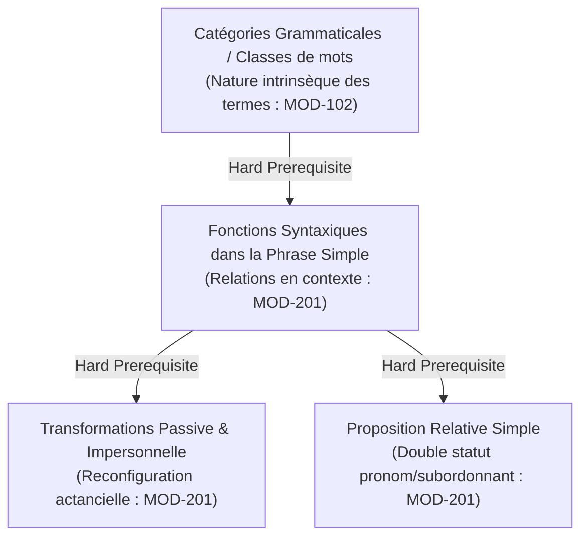
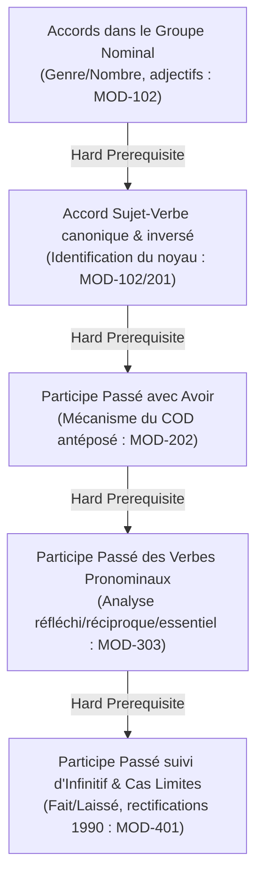
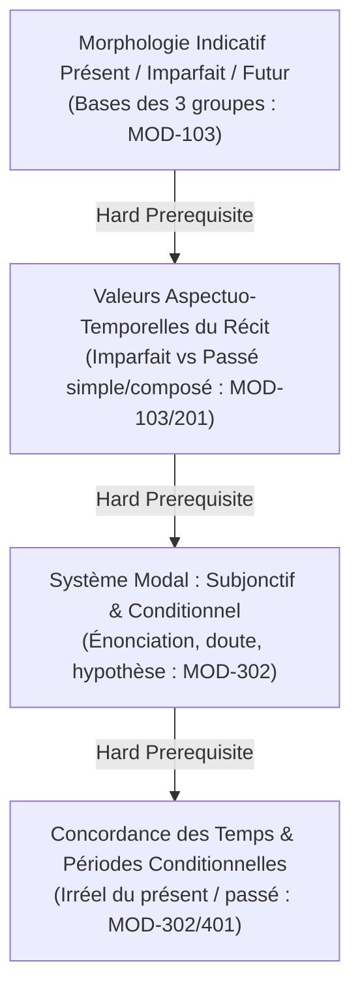
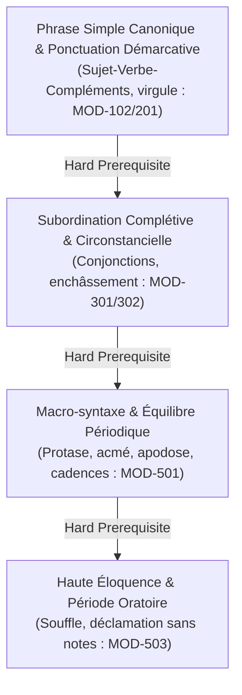
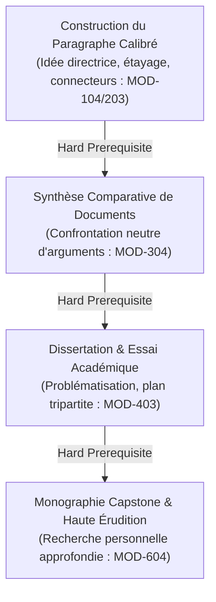
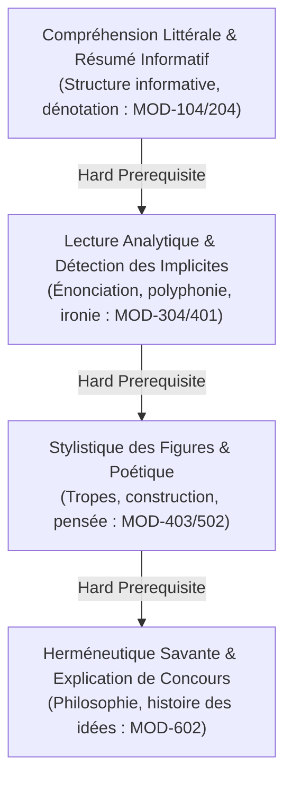
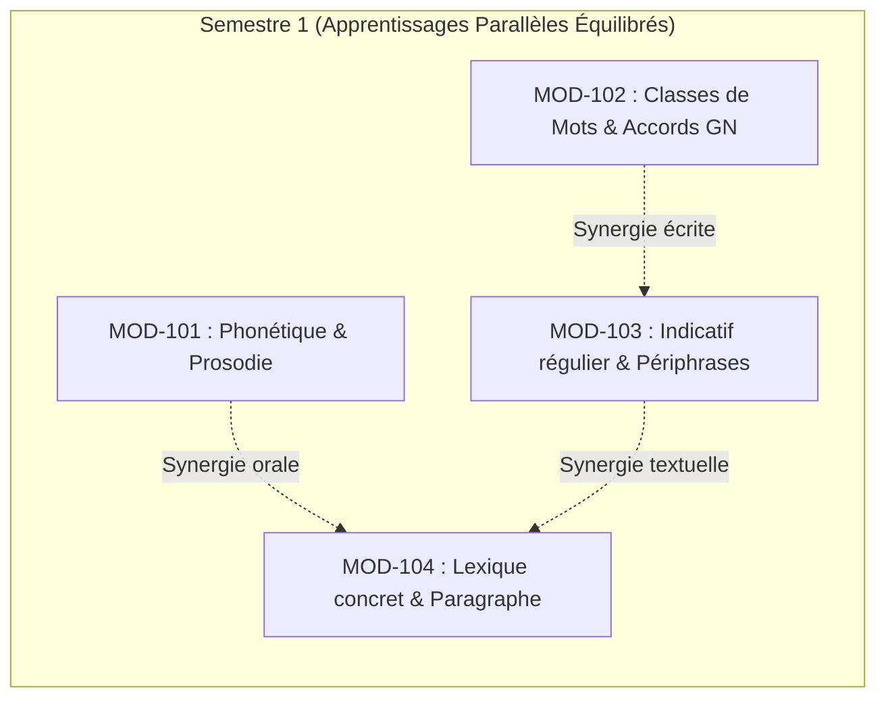

# Graphe des Dépendances Pédagogiques — World-Class French

> **Statut** : [STATUT : PROPOSÉ — EN ATTENTE DE VALIDATION]  
> **Date de création** : 2026-10-11  
> **Dernière révision** : 2026-10-11  
> **Alignement** : Architecture académique ([`academic-structure.md`](file:///f:/Formation/world-class-french/01-architecture/academic-structure.md)), Progression d'apprentissage ([`learning-progression.md`](file:///f:/Formation/world-class-french/01-architecture/learning-progression.md)), Référentiel de compétences ([`competency-framework.md`](file:///f:/Formation/world-class-french/02-competency-framework/competency-framework.md))

---

## 1. Principes Directeurs et Typologie des Relations

L'efficacité didactique du cursus **World-Class French** repose sur une modélisation explicite de l'ordre d'acquisition linguistique. Maîtriser une langue de manière experte n'est pas une simple accumulation de savoirs atomisés, mais l'édification d'un réseau cognitif où chaque compétence supérieure prend appui sur des fondations automatisées.

Le graphe repose sur une typologie rigoureuse à quatre niveaux d'interaction :

```text
TYPOLOGIE DES RELATIONS D'APPRENTISSAGE
├── 1. PRÉREQUIS INDISPENSABLE [HARD PREREQUISITE] (Bloquant)
│   └── La notion A est structurellement nécessaire à la compréhension de B. 
│       Toute inversion génère un blocage cognitif ou un psittacisme stérile.
├── 2. PRÉREQUIS FACILITATEUR [SOFT PREREQUISITE] (Accélérateur)
│   └── La maîtrise de A n'est pas indispensable pour aborder B, mais elle en 
│       accroît exponentiellement la vitesse d'assimilation et la précision.
├── 3. APPRENTISSAGE CONCOMITANT [CONCURRENT LEARNING] (Parallèle / Synergique)
│   └── Les notions A et B n'ont pas de lien de précédence directe et peuvent 
│       être menées de front au sein d'un même semestre pour créer une saine variété cognitive.
└── 4. CYCLE SPIRALAIRE [SPIRALED REINVESTMENT] (Réactivation & Approfondissement)
    └── La notion A est introduite sous forme canonique (palier L2/L3), puis reprise 
        dans un semestre ultérieur confrontée à des cas limites, exceptions ou stylistique (palier L4/L5).
```

---

## 2. Matrice Exhaustive des Dépendances Pédagogiques Clés

Cette section examine méthodiquement les chaînes causales fondamentales de l'apprentissage linguistique réparties selon les axes majeurs du cursus.

### 2.1 Axe Morphosyntaxe : Des Catégories aux Fonctions



| N° | Préalable ($A$) | Cible ($B$) | Nature du lien | Raison linguistique & didactique | Niveau de $A$ requis | Amorce intuitive possible ? | Risque en cas d'inversion |
| :--- | :--- | :--- | :--- | :--- | :--- | :--- | :--- |
| **DEP-SYN-01** | **Catégories grammaticales** (nom, verbe, adj., pronom, préposition, etc.) | **Fonctions syntaxiques** (sujet, COD, COI, attribut, CC) | **Indispensable (Hard)** | La fonction est un rôle syntaxique exercé par une catégorie dans un énoncé donné. On ne peut attribuer un rôle à un mot dont on ignore la nature catégorielle. | L2 (Identification 100% sans contexte) | Oui : intuition sémantique du « qui fait quoi » dans la phrase. | Confusion permanente entre nature et fonction (ex. croire que « adverbe » ou « pronom » est une fonction, ou qu'un « adjectif » est forcément attribut). |
| **DEP-SYN-02** | **Fonction Sujet & Objets directs/indirects** | **Voix passive et compléments d'agent** | **Indispensable (Hard)** | La voix passive permute les rôles actanciels : le COD actif devient sujet passif, le sujet devient complément d'agent. Sans identification exacte du COD actif, la transformation passive est impossible. | L3 (Distinction immédiate sujet/COD/COI) | Non : manipulation mécanique formelle requise. | Génération de passifs aberrants sur des verbes intransitifs ou transitifs indirects (*« il a été pardonné par la cour »* au lieu de *« la cour lui a pardonné »*). |
| **DEP-SYN-03** | **Pronoms relatifs et fonction antécédent** | **Proposition relative simple (*qui, que, où, dont*)** | **Indispensable (Hard)** | Le pronom relatif assume une double nature : subordonnant de proposition et substitut anaphorique ayant sa propre fonction syntaxique interne par rapport au verbe subordonné. | L3 (Fonction du nom dans la phrase simple) | Oui : emboîtement intuitif pour éviter une répétition (*j'ai vu un homme, cet homme marchait*). | Erreurs massives d'emploi des pronoms relatifs (*« l'homme que je parle »* au lieu de *« dont je parle »* ; confusion *qui/que* dès qu'un pronom objet s'intercale). |

---

### 2.2 Axe Orthographe Grammaticale & Accords : Du Canonique aux Cas Limites



| N° | Préalable ($A$) | Cible ($B$) | Nature du lien | Raison linguistique & didactique | Niveau de $A$ requis | Amorce intuitive possible ? | Risque en cas d'inversion |
| :--- | :--- | :--- | :--- | :--- | :--- | :--- | :--- |
| **DEP-ORT-01** | **Morphologie du genre et du nombre dans le GN** | **Accord du verbe avec le sujet** | **Indispensable (Hard)** | Le sujet est un syntagme nominal ou pronominal dont la tête impose ses traits de personne et de nombre au verbe. | L2 (Accords réguliers et pluriels irréguliers) | Oui : accord à l'oreille au singulier/pluriel. | Fautes d'accord sur sujets pluriels complexes, collectifs ou coordonnés (*l'ensemble des membres*). |
| **DEP-ORT-02** | **Identification exacte du COD et de sa position** | **Accord du participe passé avec avoir (`FR-ORTHO-003`)** | **Indispensable (Hard)** | La règle de Clément Marot est une règle purement positionnelle liée au COD. L'absence de maîtrise de la fonction COD rend l'application de la règle purement probabiliste. | L3 (Identification infaillible du COD antéposé vs postposé) | Non : toute intuition conduit à accorder fautivement avec le sujet ou avec le mot le plus proche. | Fautes d'accord systématiques : accord avec le sujet (*« elles ont mangées »*) ou omission d'accord sur COD antéposé (*« les lettres que j'ai écrit »*). |
| **DEP-ORT-03** | **Accord du participe passé avec avoir + Transitivité** | **Accord des verbes pronominaux (`FR-ORTHO-004`)** | **Indispensable (Hard)** | Les verbes accidentellement pronominaux appliquent la règle d'accord d'avoir : le pronom réfléchi est analysé en COD ou COI. Si le participe avec avoir n'est pas automatisé, le calcul est impossible. | L3 (Maîtrise complète de DEP-ORT-02) | Partielle : intuition de l'accord avec le sujet pour les verbes essentiellement pronominaux (*s'enfuir*). | Catastrophe normative : accorder systématiquement avec le sujet des verbes à pronom COI (*« ils se sont téléphonés »*, *« ils se sont succédés »*). |
| **DEP-ORT-04** | **Accord des pronominaux et statut actanciel de l'objet** | **Participe passé suivi d'un infinitif (*fait, laissé, verbes de perception*)** | **Indispensable (Hard)** | L'accord dépend de la question de savoir si le COD fait ou subit l'action exprimée par l'infinitif subséquent. | L4 (Maîtrise éprouvée des accords complexes) | Non : nécessite une décomposition syntaxique rigoureuse. | Accords arbitraires ou erronés (*« les violonistes que j'ai entendus jouer »* vs *« les morceaux que j'ai entendu jouer »* ; faute lourde sur *« je les ai fait venir »*). |

---

### 2.3 Axe Conjugaison : De la Morphologie Verbale aux Nuances Modales



| N° | Préalable ($A$) | Cible ($B$) | Nature du lien | Raison linguistique & didactique | Niveau de $A$ requis | Amorce intuitive possible ? | Risque en cas d'inversion |
| :--- | :--- | :--- | :--- | :--- | :--- | :--- | :--- |
| **DEP-VRB-01** | **Conjugaison mécanique des temps usuels de l'indicatif** | **Valeurs aspectuelles des temps (sécant, accompli, premier plan)** | **Indispensable (Hard)** | L'apprenant ne peut réfléchir au choix stylistique ou sémantique d'un temps s'il bute sur la confection matérielle de ses terminaisons (*-ai* vs *-ais*, radicaux irréguliers). | L2 (Orthographe des formes verbales courantes) | Oui : sensibilité naturelle à la différence entre action brève et description continue. | Surcharge cognitive menant à des incohérences de temps dans le texte et à des confusions morphologiques (*j'aurai / j'aurais*). |
| **DEP-VRB-02** | **Opposition Réel / Virtuel et statut de l'indicatif** | **Emploi normé du subjonctif et du conditionnel (`FR-VERB-002`)** | **Indispensable (Hard)** | Le subjonctif et le conditionnel ne sont pas de simples « temps », mais des modes exprimant la non-assertion, la dépendance ou le potentiel. Ils s'opposent à l'indicatif (mode du réel). | L3 (Maîtrise de l'indicatif sous subordonnant) | Oui : perception du doute, du vœu ou de la politesse (*je voudrais*). | Systématisation fautive du subjonctif par automatisme phonétique (*« après qu'il soit venu »*) ou du conditionnel dans la proposition en *si* (*« si j'aurais su »*). |
| **DEP-VRB-03** | **Morphologie du subjonctif imparfait/plus-que-parfait & conditionnel** | **Concordance des temps au style soutenu et littéraire** | **Facilitateur (Soft)** | La concordance des temps dans le subordonnant dépend du temps de la proposition rectrice (présent vs passé). | L3 (Modes simples consolidés) | Non : règle prescriptive exigeant une logique formelle rigoureuse. | Rupture temporelle dans les discours formels ou textes d'érudition (*« il fallut qu'il vienne »* au lieu de *« qu'il vînt »*). |

---

### 2.4 Axe Syntaxe Complexe & Rhétorique : De la Phrase Simple à la Période Oratoire



| N° | Préalable ($A$) | Cible ($B$) | Nature du lien | Raison linguistique & didactique | Niveau de $A$ requis | Amorce intuitive possible ? | Risque en cas d'inversion |
| :--- | :--- | :--- | :--- | :--- | :--- | :--- | :--- |
| **DEP-PRD-01** | **Structure de la phrase simple et maîtrise de la virgule démarcative** | **Architecture de la subordination complexe (`FR-SYNTAX-002`)** | **Indispensable (Hard)** | Une subordonnée n'est jamais qu'un constituant expansé (sujet, objet ou circonstance) venant se greffer sur une matrice principale. Sans délimitation de la matrice, l'enchâssement est ingérable. | L3 (Découpage propositionnel et ponctuation de base) | Oui : juxtaposition et coordination simples (*mais, ou, et, donc*). | Phrases interminables sans verbe principal, anacoluthes, virgules erronées entre le verbe et son COD ou autour des relatives déterminatives. |
| **DEP-PRD-02** | **Subordination complexe et maîtrise des connecteurs de liaison** | **Macro-syntaxe, dislocations et grande période oratoire (`FR-SYNTAX-003`)** | **Indispensable (Hard)** | La grande période oratoire orchestre un équilibre rythmique et syntaxique entre plusieurs propositions subordonnées et incidentes sans jamais rompre la complétude grammaticale. | L4 (Zéro phrase bancale dans la phrase complexe) | Partielle : mimétisme oratoire ou poétique. | Prose boursouflée, illisible, perte complète de l'accord du verbe avec son sujet distant de 30 mots, ridicule stylistique. |

---

### 2.5 Axe Expression Écrite & Argumentation : Du Paragraphe à la Dissertation



| N° | Préalable ($A$) | Cible ($B$) | Nature du lien | Raison linguistique & didactique | Niveau de $A$ requis | Amorce intuitive possible ? | Risque en cas d'inversion |
| :--- | :--- | :--- | :--- | :--- | :--- | :--- | :--- |
| **DEP-RED-01** | **Paragraphe élémentaire unitaire (Idée + Argument + Exemple)** | **Paragraphe argumenté complexe et synthèse de documents** | **Indispensable (Hard)** | Le texte long n'est pas un bloc amorphe mais une constellation ordonnée de paragraphes. Si l'unité de base (le paragraphe) est désarticulée, le texte entier s'effondre. | L3 (Paragraphe cohérent de 100 mots sans rupture) | Oui : structure logique naturelle d'une explication. | Écrits désordonnés, juxtaposition d'idées contradictoires dans le même paragraphe, absence totale de lisibilité cognitive pour le lecteur. |
| **DEP-RED-02** | **Synthèse neutre de documents tiers (`MOD-304`)** | **Dissertation et prise de position critique personnelle (`MOD-403`)** | **Facilitateur (Soft)** | Savoir restituer objectivement la pensée d'autrui sans contresens est un préalable hygiénique indispensable avant de prétendre formuler une thèse personnelle argumentée. | L3 (Capacité de reformulation exacte sans plagiat) | Oui : envie immédiate de donner son avis. | Sophismes d'épouvantail, déformation caricaturale des thèses adverses, péremptoire non étayé par des preuves textuelles. |
| **DEP-RED-03** | **Logique formelle & détection des sophismes (`FR-ARGUM-001`)** | **Réfutation et débat contradictoire de haut niveau** | **Indispensable (Hard)** | Pour réfuter validement une position, il faut pouvoir qualifier précisément la faille formelle de son raisonnement (*non sequitur*, pétition de principe, faux dilemme). | L3 (Identification des principaux sophismes) | Non : tendance naturelle à l'invective ou à l'argument d'autorité (*ad verecundiam*). | Débats stériles, attaques personnelles (*ad hominem*), dialogue de sourds et incapacité à convaincre un contradicteur éclairé. |

---

### 2.6 Axe Compréhension de Textes : Du Décodage Littéral à l'Herméneutique Savante



| N° | Préalable ($A$) | Cible ($B$) | Nature du lien | Raison linguistique & didactique | Niveau de $A$ requis | Amorce intuitive possible ? | Risque en cas d'inversion |
| :--- | :--- | :--- | :--- | :--- | :--- | :--- | :--- |
| **DEP-LEC-01** | **Compréhension littérale et dénotation des mots** | **Lecture analytique et détection de l'ironie / implicite** | **Indispensable (Hard)** | L'implicite et l'ironie reposent sur un écart délibéré par rapport au sens premier. Si le sens premier n'est pas déchiffré, l'écart ne peut être mesuré. | L3 (Capacité de résumer fidèlement le texte) | Partielle : intuition tonale ou contextuelle. | Contresens littéraires catastrophiques (prendre un pamphlet satirique au premier degré ; contresens sur Montesquieu ou Voltaire). |
| **DEP-LEC-02** | **Lecture analytique de la forme textuelle** | **Commentaire stylistique sans étiquetage mécanique (`FR-STYLE-001`)** | **Indispensable (Hard)** | Une figure de style ne prend de valeur que reliée à la dynamique du texte. L'étiquetage isole la figure ; l'analyse la replace dans la production du sens. | L3 (Analyse grammaticale du passage) | Non : le réflexe scolaire est de collectionner les figures comme des papillons morts. | Bavardage impressionniste ou catalogue stérile (*« l'auteur fait une métaphore car cela embellit le texte »*) sanctionné sévèrement aux examens universitaires. |
| **DEP-LEC-03** | **Commentaire stylistique formel** | **Herméneutique philosophique et littéraire (`MOD-602`)** | **Facilitateur (Soft)** | Les grands textes philosophiques et littéraires fondent leur portée spéculative dans les replis mêmes de la syntaxe et de la métaphore conceptuelle. | L4 (Maîtrise stylistique confirmée) | Partielle : sensibilité thématique spontanée. | Dissociation entre fond et forme : plaquer des théories philosophiques plaquées sur un texte sans jamais prouver par le texte ce qu'on affirme. |

---

### 2.7 Axe Linguistique & Philologie : Du Fonctionnement Synchronique à la Diachronie

```mermaid
flowchart TD
    SYNC["Linguistique Synchronique de Base<br/>(Phonème/Graphème, signifiant/signifié, norme : MOD-101/404)"] -->|Hard Prerequisite| SOCIO["Sociolinguistique Francophone & Variations<br/>(Diatopie, registres, français ouest-africain : MOD-404)"]
    SOCIO -->|Facilitateur (Soft)| DIACH["Histoire Diachronique de la Langue<br/>(Latin populaire, ancien français, réformes : MOD-601)"]
    DIACH -->|Hard Prerequisite| PHILOL["Autonomie Philologique Complète<br/>(Recherche avancée Grevisse/TLFi : MOD-603)"]
```

| N° | Préalable ($A$) | Cible ($B$) | Nature du lien | Raison linguistique & didactique | Niveau de $A$ requis | Amorce intuitive possible ? | Risque en cas d'inversion |
| :--- | :--- | :--- | :--- | :--- | :--- | :--- | :--- |
| **DEP-LIN-01** | **Conscience des registres et de la norme formelle** | **Sociolinguistique francophone et contextes africains (`FR-SOCIOL-001`)** | **Indispensable (Hard)** | Pour analyser avec rigueur scientifique les variations régionales, il faut déjà maîtriser le référentiel normatif international standard. Sans étalon, on confond variation et faute involontaire. | L3 (Norme standard écrite maîtrisée) | Oui : conscience des usages oraux béninois au quotidien. | Insécurité linguistique accrue ou relativisme absolu où toute incorrection est justifiée comme « variation », interdisant l'accès aux standards professionnels internationaux. |
| **DEP-LIN-02** | **Connaissance de la morphologie et de la grammaire moderne** | **Histoire diachronique de la langue française (`MOD-601`)** | **Facilitateur (Soft)** | Comprendre l'évolution phonétique et syntaxique (déclinaison à deux cas, diphtongaisons, évolution des désinences) exige de connaître parfaitement la forme d'arrivée en français moderne. | L3 (Morphologie verbale et nominale moderne solide) | Partielle : intérêt pour l'étymologie des mots isolés. | Érudition confuse, incapacité à faire le pont entre l'ancienne langue et les survivances modernes dans l'orthographe actuelle. |
| **DEP-LIN-03** | **Histoire de la langue et sociolinguistique** | **Autonomie philologique et maniement expert de Grevisse (`FR-PHILOL-001`)** | **Indispensable (Hard)** | *Le Bon Usage* de Grevisse n'est pas un catéchisme normatif rigide, mais un recueil historique et descriptif des usages des grands écrivains. Sa lecture critique exige d'avoir compris l'historicité de la langue. | L4 (Analyse syntaxique experte) | Non : ouvrage trop monumental et complexe pour un débutant. | Erreur d'arbitrage : prendre une citation archaïque ou une tolérance poétique du XVIIe siècle répertoriée par Grevisse pour une règle générale du français formel contemporain. |

---

## 3. Matrice des Apprentissages en Parallèle (Synergies Concomitantes)

Certains domaines ou modules ne présentent aucune dépendance hiérarchique directe entre eux et **doivent impérativement être conduits de front** au sein d'un même semestre pour préserver l'équilibre cognitif, éviter l'ennui et favoriser la plasticité intellectuelle :



| Semestre | Paire de Modules / Compétences menées en Parallèle | Justification pédagogique de la simultanéité | Risque si l'on tente de les sérialiser |
| :--- | :--- | :--- | :--- |
| **S1** | `MOD-101` (Phonétique/Prosodie) **//** `MOD-102` (Morphologie/Accords du GN) | L'un travaille l'oralité et la perception acoustique, l'autre la décomposition morphologique visuelle. Les deux voies sensorielles se renforcent sans saturer la même mémoire de travail. | Monotonie scolaire extrême ; retard inutile de l'oralité au détriment de l'expression vivante. |
| **S2** | `MOD-202` (Participe passé avec avoir) **//** `MOD-203` (Logique du paragraphe & connecteurs) | L'accord est une tâche micro-syntaxique de précision extrême ; la logique du paragraphe est une tâche macro-structurelle de raisonnement. Elles sollicitent des hémisphères cognitifs distincts. | Blocage de la créativité rédactionnelle par fixation obsessionnelle sur la règle d'accord. |
| **S3** | `MOD-302` (Système modal : subjonctif) **//** `MOD-304` (Synthèse comparative de documents) | L'étude du subjonctif affine la manipulation des nuances de doute et d'opinion, qui sont précisément réinvesties immédiatement dans la neutralité de la synthèse documentaire. | Déconnexion entre apprentissage grammatical formel et utilité documentaire concrète. |
| **S4** | `MOD-402` (Rhétorique & Sophismes) **//** `MOD-404` (Sociolinguistique francophone) | L'analyse critique des arguments (logique) et l'analyse critique des usages sociolinguistiques (société) développent conjointement la posture de discernement intellectuel. | Vision étroite du français comme code purement rhétorique abstrait, coupée des réalités régionales. |
| **S5** | `MOD-502` (Figures de style & Poétique) **//** `MOD-504` (Révision éditoriale d'épreuves) | L'art de la création esthétique (créateur) s'équilibre avec l'exigence de la traque de la coquille et du non-sens grammatical (correcteur-censeur). | Développement d'un style verbeux incontrôlé ou, à l'inverse, d'un perfectionnisme inhibant toute inventivité. |

---

## 4. Traçabilité des Cycles de Révision Spiralaire

Une notion n'est jamais définitivement « acquise » par un cours unique. Le graphe de dépendance organise la réactivation programmée selon trois vagues d'approfondissement successives :

| Notions Clés | Vague 1 : Initiation & Canon (S1 / S2) | Vague 2 : Complexité & Enchâssement (S3 / S4) | Vague 3 : Haute Expertise & Stylistique (S5 / S6) |
| :--- | :--- | :--- | :--- |
| **Accord du participe passé** | **S1-S2** : Participe avec *être* et régulier ; participe avec *avoir* et COD antéposé évident (`MOD-202`). | **S3-S4** : Verbes pronominaux réciproques/réfléchis (`MOD-303`) ; participes suivis d'infinitif (*fait, laissé*) et rectifications 1990 (`MOD-401`). | **S5-S6** : Arbitrage des cas limites controversés de la littérature classique dans *Le Bon Usage* de Grevisse (`MOD-603`). |
| **Système des modes & temps** | **S1-S2** : Morphologie indicatif présent/passé/futur ; alternance narrative imparfait / passé simple (`MOD-103`). | **S3-S4** : Subjonctif et conditionnel dans les complétives et circonstancielles ; irréel du passé ; concordance des temps (`MOD-302`). | **S5-S6** : Subjonctif imparfait/plus-que-parfait de concours ; valeurs modales rares (subjonctif de souhait oratoire, conditionnel d'atténuation oratoire : `MOD-501`). |
| **Syntaxe de la phrase** | **S1-S2** : Phrase simple canonique, syntagmes, constituants majeurs et ponctuation terminale/virgule (`MOD-201`). | **S3-S4** : Subordination multiple, enchâssement à 3 degrés, ponctuation des incidentes et propositions relatives explicatives (`MOD-301`). | **S5-S6** : Macro-syntaxe de la période oratoire classique (protase/apodose, cadences majeure/mineure, anacoluthes concertées : `MOD-501`). |
| **Expression écrite** | **S1-S2** : Paragraphe narratif et argumenté court (150 mots) ; résumé de texte fidèle sans contresens (`MOD-104`, `MOD-204`). | **S3-S4** : Synthèse de documents (600 mots) et dissertation académique tripartite en 3 parties et 3 sous-parties (`MOD-403`). | **S5-S6** : Essai d'érudition, discours d'apparat, commentaire littéraire de haut vol et Monographie Capstone de 4 000 mots (`MOD-604`). |
| **Prise de parole orale** | **S1-S2** : Précision articulatoire, phonèmes de l'API, voyelles nasales et lecture prosodique de 5 minutes (`MOD-101`, `MOD-204`). | **S3-S4** : Prise de parole impromptue sans béquilles verbales ; joute contradictoire et réfutation des sophismes (`MOD-402`). | **S5-S6** : Déclamation oratoire classique, présence physique, rythme vocal, et Grand Oral terminal de 30 minutes sans notes (`MOD-503`, `MOD-604`). |

---

## 5. Audit Topologique du Graphe : Détection des Risques et Alertes Didactiques

L'analyse de connectivité du graphe de dépendances a été soumise à un audit rigoureux pour traquer les failles courantes de conception de cursus :

### 5.1 Absence absolue de cycle (Acyclicité stricte)
- **Constat** : Le graphe est un graphe orienté acyclique (DAG). Aucun module ne requiert comme prérequis une notion dont il serait lui-même la condition préalable, directe ou indirecte.
- **Vérification type** : La rédaction de la dissertation (`MOD-403`) s'appuie sur la syntaxe (`MOD-301`), le lexique (`MOD-203`) et l'argumentation (`MOD-402`), sans que ces derniers ne demandent la dissertation pour être enseignés.

### 5.2 Traitement des prématurités cognitives potentielles (Notions introduites trop tôt)
- **Alerte 1 : Le piège de l'accord des verbes pronominaux dès l'Année 1** :
  - *Risque* : Introduire les verbes pronominaux en S1 ou S2 conduirait l'apprenant à une surcharge insurmontable, car il ignore encore la distinction entre verbe intransitif, pronom réfléchi COD et pronom COI.
  - *Verrou architectural* : Confiné strictement en S3 (`MOD-303`), après la consolidation intégrale de la phrase simple (`MOD-201`) et du participe avec *avoir* (`MOD-202`).
- **Alerte 2 : Le saut prématuré dans la dissertation sans synthèse préalable** :
  - *Risque* : Exiger une dissertation en début d'Année 2 conduirait à du verbiage scolaire creux.
  - *Verrou architectural* : La dissertation est précédée en S2 par le résumé (`MOD-204`), puis en S3 par la synthèse de documents (`MOD-304`), garantissant la maîtrise de la reformulation avant la créativité démonstrative.

### 5.3 Sécurisation des compétences fondamentales (Zéro « savoir orphelin »)
- **Alerte : L'API et la phonétique (S1) risquent-elles d'être oubliées en Année 2 et 3 ?** :
  - *Vérification* : L'API introduite en `MOD-101` n'est pas un savoir isolé. Elle est continuellement réinvestie :
    - En S3 lors de la diction des rimes et assonances ;
    - En S4 dans l'analyse sociolinguistique des accents régionaux (`MOD-404`) ;
    - En S5 lors du travail de déclamation oratoire et de pose de la voix (`MOD-503`) ;
    - En S6 dans l'étude diachronique des lois phonétiques de l'ancien français (`MOD-601`).
  - *Conclusion* : Aucun savoir orphelin détecté.

---

## 6. Graphe Visuel Global des Dépendances (Architecture Complète)

```mermaid
flowchart TD
    %% Semestre 1
    subgraph SEM1["SEMESTRE 1 : Socle Morphosyntaxique & Phonétique"]
        M101["MOD-101<br/>Phonétique (API), voyelles nasales & Alphabet orthographique"]
        M102["MOD-102<br/>Classes de mots, accords fondamentaux du GN & Ponctuation terminale"]
        M103["MOD-103<br/>Verbe indicatif régulier, passé composé simple & périphrases"]
        M104["MOD-104<br/>Lexique concret, familles de mots, lecture fluide & paragraphe narratif"]
    end

    %% Semestre 2
    subgraph SEM2["SEMESTRE 2 : Syntaxe Fonctionnelle & Cohésion Textuelle"]
        M201["MOD-201<br/>Syntaxe phrase simple, voix passive, impersonnelles & relative simple"]
        M202["MOD-202<br/>Participe passé avec avoir (COD antéposé) & ponctuation interne"]
        M203["MOD-203<br/>Cohésion textuelle, connecteurs logiques & paragraphe argumenté"]
        M204["MOD-204<br/>Lecture analytique, résumé de texte & restitution orale synthétique"]
    end

    %% Semestre 3
    subgraph SEM3["SEMESTRE 3 : Subordination Complexe, Modes & Logique"]
        M301["MOD-301<br/>Architecture subordination : complétives & interrogatives indirectes"]
        M302["MOD-302<br/>Circonstancielles, système modal (subjonctif/conditionnel) & concordance"]
        M303["MOD-303<br/>Orthographe grammaticale : accord des verbes pronominaux"]
        M304["MOD-304<br/>Synthèse comparative de documents & argumentation logique"]
    end

    %% Semestre 4
    subgraph SEM4["SEMESTRE 4 : Pragmatique, Dissertation & Sociolinguistique"]
        M401["MOD-401<br/>Pragmatique discursive, participes + infinitif & rectifications 1990"]
        M402["MOD-402<br/>Rhétorique argumentative, réfutation des sophismes & débat contradictoire"]
        M403["MOD-403<br/>Méthodologie de la dissertation académique & essai critique"]
        M404["MOD-404<br/>Sociolinguistique francophone : norme écrite standard vs dynamiques ouest-africaines"]
    end

    %% Semestre 5
    subgraph SEM5["SEMESTRE 5 : Haute Stylistique, Période & Éloquence"]
        M501["MOD-501<br/>Macro-syntaxe, dislocations & grande période oratoire"]
        M502["MOD-502<br/>Traité complet des figures de rhétorique & cadences de la prose"]
        M503["MOD-503<br/>Haute éloquence : déclamation classique, souffle & joute oratoire"]
        M504["MOD-504<br/>Révision éditoriale professionnelle d'épreuves complexes"]
    end

    %% Semestre 6
    subgraph SEM6["SEMESTRE 6 : Diachronie, Herméneutique & Capstone"]
        M601["MOD-601<br/>Histoire diachronique de la langue française"]
        M602["MOD-602<br/>Herméneutique littéraire, philosophique & explication de concours"]
        M603["MOD-603<br/>Autonomie philologique : recherche experte dans Grevisse et le TLFi"]
        M604["MOD-604<br/>Capstone Project (3 filières d'érudition) & Grand Oral terminal"]
    end

    %% Hard Dependencies (Liaisons pleines)
    M102 ==>|Classes vers Fonctions| M201
    M103 ==>|Passé composé régulier vers COD antéposé| M202
    M201 ==>|Identification du COD vers Accord du participe| M202
    M104 ==>|Paragraphe narratif vers Cohésion| M203
    M104 ==>|Lecture fluide vers Résumé analytique| M204

    M201 ==>|Phrase simple vers Subordination complétive| M301
    M201 ==>|Fonction du COD vers Accord pronominal| M303
    M202 ==>|Accord avec avoir vers Accord pronominal| M303
    M301 ==>|Subordination vers Circonstancielles & Modes| M302
    M203 ==>|Cohésion du paragraphe vers Synthèse documentaire| M304
    M204 ==>|Résumé analytique vers Synthèse documentaire| M304

    M302 ==>|Subordination modalisée vers Pragmatique & Cas limites| M401
    M303 ==>|Accords pronominaux vers Participe + infinitif| M401
    M304 ==>|Logique & Synthèse vers Rhétorique argumentative| M402
    M304 ==>|Synthèse de documents vers Dissertation académique| M403
    M203 ==>|Connecteurs logiques vers Dissertation académique| M403

    M301 ==>|Subordination complexe vers Période oratoire| M501
    M402 ==>|Réfutation & Logique vers Traité des figures| M502
    M501 ==>|Période oratoire vers Haute éloquence| M503
    M401 ==>|Cas limites d'accord vers Révision éditoriale| M504
    M403 ==>|Dissertation vers Révision éditoriale| M504

    M404 ==>|Sociolinguistique vers Histoire de la langue| M601
    M502 ==>|Figures stylistiques vers Herméneutique savante| M602
    M504 ==>|Révision éditoriale vers Autonomie philologique| M603
    M403 ==>|Maîtrise de la dissertation vers Monographie Capstone| M604
    M503 ==>|Haute éloquence vers Grand Oral terminal| M604

    %% Soft Dependencies & Synergies (Liaisons en tirets)
    M101 -.->|API vers Restitution orale| M204
    M101 -.->|API vers Sociolinguistique| M404
    M402 -.->|Débat contradictoire vers Haute éloquence| M503
    M601 -.->|Histoire de la langue vers Autonomie philologique| M603

    %% Styles
    classDef hard stroke:#b91c1c,stroke-width:2px;
    classDef soft stroke:#0284c7,stroke-width:1.5px,stroke-dasharray: 5 5;
