# Principes de Progression, Graphe des Dépendances et Pédagogie de la Maîtrise

> **Statut** : [STATUT : PROPOSÉ — EN ATTENTE DE VALIDATION]  
> **Date de création** : 2026-10-11  
> **Dernière révision** : 2026-10-11  
> **Alignement** : Cahier des charges validé ([DEC-005](file:///f:/Formation/world-class-french/00-governance/decisions-log.md#dec-005-cahier-des-charges-académique-et-prise-en-compte-du-contexte-béninoisfrancophone))  
> **Graphe d'ordonnancement** : Modélisation complète dans [`dependency-graph.md`](file:///f:/Formation/world-class-french/01-architecture/dependency-graph.md)

---

## 1. Les Quatre Stades d'Acquisition Cognitive

Pour chaque notion ou compétence du cursus **World-Class French**, l'apprentissage s'organise selon une trajectoire rigoureuse en quatre stades cumulatifs :

```text
TRAJECTOIRE D'ACQUISITION COGNITIVE
├── STADE 1 : DÉCOUVERTE & DISCRIMINATION
│   ├── Démarche inductive à partir d'exemples modèles.
│   ├── Repérage du phénomène et formulation intuitive du problème.
│   └── Formalisation rigoureuse de la règle et de ses conditions d'application.
├── STADE 2 : CONSOLIDATION & PRATIQUE DÉLIBÉRÉE
│   ├── Exercices décontextualisés puis contextualisés à difficulté graduée.
│   ├── Automatisation des réflexes morphosyntaxiques.
│   └── Justification orale ou écrite systématique du choix opéré.
├── STADE 3 : APPROFONDISSEMENT & CAS LIMITES
│   ├── Confrontation aux exceptions notables, aux tournures ambiguës et aux textes littéraires réels.
│   ├── Étude comparée des normes et des tolérances académiques.
│   └── Intégration dans des productions complexes (synthèse, dissertation, discours).
└── STADE 4 : MAÎTRISE AUTONOME & POSTURE D'EXPERTISE
    ├── Capacité à détecter, expliquer et corriger les erreurs chez autrui (révision éditoriale).
    ├── Manipulation stylistique virtuose (inversions, modulations de registre, cadence).
    └── Recours indépendant aux instruments philologiques de référence (Grevisse, TLFi).
```

### Règle d'or de l'ordonnancement didactique
> **Principe de précédence fondamentale** : Aucune exception complexe, archaïsme ou tournure rare n'est enseigné avant que la règle générale et son mécanisme sous-jacent ne soient pleinement consolidés (Stade 2 validé).  
> *Exemple d'application* : L'accord des participes passés des verbes pronominaux réciproques ou réfléchis avec COD interne (*ils se sont lavé les mains*) est formellement interdit en S1 et S2 ; il n'est introduit qu'en S3 après la maîtrise intégrale de la fonction COD et de l'antéposition du COD avec l'auxiliaire avoir.

---

## 2. Piliers Linguistiques Répartis Tout au Long du Cursus

Le cursus refuse l'écueil consistant à « faire la grammaire en Année 1, la littérature en Année 2 et l'oral en Année 3 ». Les quatre activités cardinales sont exercées de manière continue de S1 à S6, selon une spirale d'exigence croissante :

| Pilier d'activité | Année 1 (Fondations) | Année 2 (Complexité & Logique) | Année 3 (Haute Maîtrise & Érudition) |
| :--- | :--- | :--- | :--- |
| **Lecture** | Lecture littérale, compréhension de textes d'idées, repérage des connecteurs, résumé informatif. | Lecture analytique, détection des implicites, polyphonie énonciative, synthèse comparative de textes. | Herméneutique critique, analyse stylistique approfondie, explication de textes philosophiques et classiques. |
| **Écriture** | Paragraphes narratifs, descriptifs et argumentés courts ; respect scrupuleux de la phrase simple. | Dissertations en 3 parties, synthèses de documents, essais critiques ; maîtrise de la phrase complexe. | Discours oratoires d'apparat, essais d'érudition, monographie personnelle de recherche (Capstone). |
| **Oral & Éloquence** | Phonétique (API), voyelles nasales, liaisons obligatoires, lecture prosodique à voix haute. | Joutes oratoires, débat contradictoire, réfutation courtoise des sophismes, débit régulé. | Déclamation classique, art oratoire d'apparat, soutenance publique sans notes (Grand Oral). |
| **Correction & Révision** | Chasse aux homophones et accords fautifs dans ses propres textes (autocorrection en deux passes). | Laboratoire d'analyse d'erreurs récurrentes, détection d'anacoluthes et d'impropriétés lexicales. | Révision éditoriale professionnelle d'épreuves, justification savante des corrections, consultation de Grevisse. |

---

## 3. Système des Portes de Progression (Progression Gates)

Aucun apprenant ne passe d'un cycle ou d'un semestre au suivant sans satisfaire aux critères de la porte de passage correspondante :

```mermaid
flowchart TD
    D0["PORT-0 : Test Diagnostique Initial (S1)<br/>• Orthographe, Syntaxe, Oral"] --> S1["Semestre 1 : Morphosyntaxe, Ponctuation & Orthographe"]
    S1 --> G1{"PORTE 1 : Validation du Socle Normatif<br/>• Dictée 200 mots : note >= 14/20<br/>• Analyse des parties du discours : 100%<br/>• Épreuve orale de lecture prosodique : note >= 14/20"}
    
    G1 -- Validé --> S2["Semestre 2 : Phrase Simple, Passif & Relative"]
    G1 -- Échec --> REM1["Laboratoire de Remédiation S1 (3 semaines)"]
    REM1 --> G1

    S2 --> G2{"PORTE 2 : Validation de la Phrase Simple<br/>• Participe passé avec avoir (COD antéposé) : note >= 14/20<br/>• Analyse fonctionnelle (sujet, objets, attributs, agent)<br/>• Épreuve orale de restitution synthétique : note >= 14/20"}
    
    G2 -- Validé --> S3["Semestre 3 : Subordination Noun/Circumstantial & Modes"]
    G2 -- Échec --> REM2["Laboratoire de Remédiation S2 (3 semaines)"]
    REM2 --> G2

    S3 --> G3{"PORTE 3 : Validation de la Subordination<br/>• Complétives, circonstancielles, subjonctif<br/>• Verbes pronominaux : zéro erreur d'analyse<br/>• Synthèse comparative écrite conforme"}
    
    G3 -- Validé --> S4["Semestre 4 : Argumentation, Cas Limites & Registres"]
    G3 -- Échec --> REM3["Laboratoire de Remédiation S3 (3 semaines)"]
    REM3 --> G3

    S4 --> G4{"PORTE 4 : Validation de la Dissertation & Débat<br/>• Dissertation académique complète : note >= 14/20<br/>• Participes + infinitif & rectifications 1990 maîtrisés<br/>• Joute oratoire de réfutation (15 min) : note >= 14/20"}
    
    G4 -- Validé --> S5["Semestre 5 : Stylistique & Rhétorique"]
    G4 -- Échec --> REM4["Laboratoire de Remédiation S4 (3 semaines)"]
    REM4 --> G4

    S5 --> G5{"PORTE 5 : Validation Stylistique & Révision<br/>• Grande période oratoire maîtrisée<br/>• Traité des figures assimilé<br/>• Épreuve de correction éditoriale réussie"}
    
    G5 -- Validé --> S6["Semestre 6 : Capstone (3 Filières) & Érudition"]
    G5 -- Échec --> REM5["Laboratoire de Remédiation S5 (3 semaines)"]
    REM5 --> G5

    S6 --> G6{"PORTE FINALE : Certification World-Class<br/>• Monographie Capstone (3 filières) validée par double correction<br/>• Grand Oral 30 min réussi (note >= 16/20)<br/>• Dictée d'excellence 400 mots réussie"}
    
    G6 -- Validé --> CERT["Certification World-Class French"]
```



---

## 4. Protocole des Révisions Cumulatives Inter-Semestrielles

Pour contrer la courbe de l'oubli (Ebbinghaus) et garantir la rétention sur 3 ans :
1. **La règle des 20 % cumulatifs** : Chaque contrôle hebdomadaire comporte au moins 20 % de questions portant sur des notions acquises lors des semestres antérieurs.
2. **La semaine de réactivation (Semaine 1 de chaque semestre)** : Avant d'entamer les nouveaux modules, chaque début de semestre (S2 à S6) s'ouvre par une séance de rappel actif portant sur les acquis charnières du semestre précédent.
3. **Le fil rouge de la dictée** : La dictée n'est jamais cantonnée aux leçons de la semaine ; elle mobilise cumulativement l'ensemble des règles vues depuis le premier jour.

---

## 5. Précautions Pédagogiques Fondamentales

### 5.1 Ne pas réduire le français à la grammaire scolaire
La grammaire n'est pas une fin en soi, mais la charpente de l'expression. Toute étude grammaticale débouche immédiatement sur une exploitation expressive :
- On n'étudie pas la voix passive pour « transformer des phrases », mais pour comprendre comment effacer l'agent ou focaliser l'attention sur le résultat dans une démonstration juridique ou scientifique.
- On n'étudie pas les propositions subordonnées relatives déterminatives vs explicatives pour un exercice abstrait, mais pour apprendre à ponctuer avec exactitude et éviter les contre-sens logiques dans un contrat ou un plaidoyer.

### 5.2 Distinguer registre de langue, intelligence et rigueur de pensée
Le cursus proscrit formellement tout mépris de classe ou préjugé linguistique :
- Un registre populaire ou familier n'est pas un signe d'infériorité cognitive ; il possède sa propre logique sociolinguistique.
- Inversement, un style pompeux ou surchargé de vocabulaire rare (*le style contourné ou prétentieux*) peut masquer un raisonnement creux ou fallacieux.
- **Principe d'enseignement** : Enseigner que la véritable élégance (*World-Class*) réside dans la **clarté du concept**, la **rigueur du raisonnement** et la **justesse absolue de l'adéquation entre la pensée et le mot**.

### 5.3 Respect des contextes francophones d'Afrique de l'Ouest et du Bénin
- Reconnaître les variations diatopiques et régionales légitimes comme une richesse vivante de la francophonie.
- Apprendre à l'apprenant à naviguer en toute sécurité entre ses usages quotidiens locaux et les exigences internationales de la norme écrite formelle, sans culpabilité ni insécurité linguistique.

---

## 6. Zones d'Incertitude et Points d'Attention Méthodologique

Avant la mise en œuvre fine des fiches de cours, trois points d'attention devront faire l'objet d'un suivi scrupuleux :

1. **Charge cognitive des premières semaines de S1** : Le passage du diagnostic initial à l'apprentissage de l'API et des parties du discours peut susciter une surcharge pour un apprenant peu habitué à la métalangue grammaticale. Il conviendra de prévoir des sas d'assimilation progressifs.
2. **Transition entre S2 et S3 (Le saut de la subordination complexe)** : L'écart entre la phrase simple (S2) et l'analyse des complétives/circonstancielles avec subjonctif (S3) constitue le principal goulet d'étranglement conceptuel du cursus. Les exercices d'entraînement de transition devront être particulièrement abondants.
3. **Évaluation de l'expression orale à distance / en auto-formation** : L'évaluation de la déclamation et de l'art oratoire requiert un guidage d'écoute très précis (enregistrements témoins, critères acoustiques objectifs) pour que l'apprenant puisse s'auto-évaluer ou être évalué sans ambiguïté.
