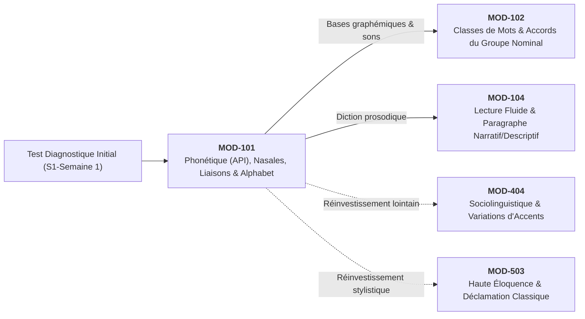

# Fiche Pédagogique Opérationnelle — Module MOD-101

> **Identifiant** : `MOD-101`  
> **Titre** : *Positionnement Diagnostique, Phonétique Appliquée (API) et Alphabet Orthographique*  
> **Semestre** : Année 1 — Semestre 1 (S1)  
> **Domaines mobilisés** : DOM-01 (Fondations et diagnostic), DOM-02 (Phonétique, phonologie et orthographe)  
> **Volume horaire estimé** : 16 heures (Étude : 4 h | Pratique : 6 h | Correction : 3 h 30 | Révision : 2 h 30)  
> *Statut* : [STATUT : VALIDÉ]  
> **Alignement** : [`syllabus.md` (S1)](file:///f:/Formation/world-class-french/03-curriculum/year-1/semester-1/syllabus.md), [`dependency-graph.md`](file:///f:/Formation/world-class-french/01-architecture/dependency-graph.md), [`source-registry.md`](file:///f:/Formation/world-class-french/07-resources/source-registry.md)

---

## 1. Présentation et Intérêt du Module

Le module `MOD-101` constitue la porte d'entrée inaugurale du cursus **World-Class French**. Il repose sur un constat didactique fondamental : la majorité des blocages orthographiques et des insécurités à l'écrit comme à l'oral proviennent d'une confusion entre le son produit (phonème) et la lettre écrite (graphème). 

Ce module a pour vocation :
1. De dresser un bilan clinique individuel des compétences de départ sans complaisance ni stigmatisation, afin de personnaliser le parcours d'apprentissage ;
2. D'armer l'apprenant d'un instrument scientifique de haute précision : **l'Alphabet Phonétique International (API)**, permettant d'objectiver la prononciation du français standard sans ambiguïté orthographique ;
3. De sécuriser les contrastes vocaliques sensibles (voyelles orales vs nasales, degrés d'aperture) particulièrement vulnérables aux interférences linguistiques en contexte francophone ouest-africain et béninois ;
4. De formaliser la mécanique des **liaisons** (obligatoires, facultatives, interdites) pour éliminer les fautes de jonction sonore (*pataquès*) et asseoir une diction irréprochable ;
5. De poser les bases matérielles du code écrit à travers l'étude raisonnée de l'alphabet graphique et des signes diacritiques.

---

## 2. Place dans le Cursus

- **Position séquentielle** : Premier module du Semestre 1 (Semaines 1 à 4).
- **Rôle architectural** : Module de fondation absolue (nœud racine du graphe de dépendances).
- **Relations amont/aval** :
  - *En amont* : Aucun prérequis académique formel ; s'appuie sur la pratique usuelle d'un locuteur francophone scolarisé.
  - *En aval* : Conditionne directement `MOD-102` (les classes de mots et les marques d'accord graphiques) et `MOD-104` (la lecture prosodique et l'oralité expressive).
  - *Fil conducteur* : L'API et la conscience phonologique introduites ici seront réinvesties jusqu'au Semestre 6 (prosodie poétique, sociolinguistique régionale en S4, déclamation d'apparat en S5, lois phonétiques diachroniques en S6).

---

## 3. Prérequis et Diagnostic

### 3.1 Prérequis
- Maîtrise de la lecture courante en langue française.
- Capacité d'écoute attentive et accès à un dispositif d'enregistrement audio de base (smartphone ou ordinateur).

### 3.2 Protocole Diagnostique Initial (Semaine 1)
Avant toute leçon théorique, l'apprenant passe une batterie diagnostique en trois épreuves calibrées :
1. **Épreuve A — Dictée diagnostique de positionnement (150 mots)** : Texte standard comportant 20 pièges d'orthographe lexicale, d'accords fondamentaux et d'homophones.
2. **Épreuve B — Test de perception et discrimination auditive (20 paires minimales)** : Reconnaissance acoustique des oppositions vocaliques (/ɑ̃/ vs /ɔ̃/, /e/ vs /ɛ/, /y/ vs /u/).
3. **Épreuve C — Enregistrement audio de lecture à voix haute (2 minutes)** : Lecture d'un texte modèle pour relever les liaisons naturelles, les omissions de liaisons obligatoires et les éventuelles fausses liaisons.
- **Livrable du diagnostic** : Rédaction d'une *Fiche de profilage phonético-orthographique* identifiant les 3 priorités absolues de l'apprenant.

---

## 4. Objectifs Pédagogiques Mesurables

Au terme du module, l'apprenant doit être capable de :
1. Transcrire phonétiquement en API et lire sans hésitation n'importe quel mot du français standard comportant des difficultés de prononciation courantes [Réf. SRC-PHON-01].
2. Discriminer acoustiquement et réaliser à 100 % à l'oral les oppositions entre voyelles nasales (/ɑ̃, ɛ̃, ɔ̃/) et timbres d'aperture (/e/ vs /ɛ/, /o/ vs /ɔ/).
3. Classifier et appliquer avec une exactitude constante les liaisons obligatoires et respecter scrupuleusement l'interdiction des liaisons fautives dans la lecture d'un texte suivi.
4. Justifier historiquement et fonctionnellement la présence de chaque signe diacritique (accents, tréma, cédille, apostrophe) sur un mot donné.

---

## 5. Compétences Visées et Niveaux de Maîtrise Attendus

| Identifiant | Formulation de la Compétence | Palier Entrée | Palier Cible MOD-101 |
| :--- | :--- | :---: | :---: |
| [`FR-PHON-001`](file:///f:/Formation/world-class-french/02-competency-framework/competency-framework.md#fr-phon-001-maîtrise-des-contrastes-phonologiques-et-de-la-prosodie-formelle) | Maîtrise des contrastes phonologiques et de la prosodie formelle | L1 | **L3 (Autonomie)** |
| [`FR-ORTHO-001`](file:///f:/Formation/world-class-french/02-competency-framework/competency-framework.md#fr-ortho-001-maîtrise-de-lorthographe-lexicale-et-flexionnelle) | Maîtrise de l'alphabet orthographique et du rapport son/graphie | L1 | **L3 (Autonomie)** |

---

## 6. Plan Détaillé des Chapitres

```text
ARCHITECTURE DES CHAPITRES DU MODULE MOD-101
├── CHAPITRE 1 : LA DOUBLE NATURE DU CODE LINGUISTIQUE (PHONÈME VS GRAPHÈME)
│   ├── 1.1 Le malentendu orthographique : pourquoi le français ne s'écrit pas comme il se prononce.
│   ├── 1.2 Le système phonologique du français standard : inventaire des 36 phonèmes.
│   └── 1.3 Initiation pratique à l'Alphabet Phonétique International (API) pour le français.
├── CHAPITRE 2 : LE SYSTÈME VOCALIQUE ET SES PIÈGES DISCRIMINATIFS
│   ├── 2.1 Les voyelles orales : triangle vocalique, antériorité, arrondissement et degrés d'aperture.
│   ├── 2.2 Les quatre voyelles nasales (/ɑ̃, ɛ̃, ɔ̃, œ̃/) et la neutralisation moderne de /œ̃/.
│   └── 2.3 Focus sociolinguistique ouest-africain : sécurisation du contraste /ɑ̃/ (*vent*) vs /ɔ̃/ (*vont*).
├── CHAPITRE 3 : LES CONSONNES, LA SYLLABATION ET L'ENCHAÎNEMENT
│   ├── 3.1 Inventaire des 17 consonnes et 3 semi-consonnes (/j, w, ɥ/).
│   ├── 3.2 La structure syllabique du français : syllabe ouverte vs syllabe fermée (la loi de position).
│   └── 3.3 L'enchaînement consonantique et vocalique : la fluidité du continuum sonore.
├── CHAPITRE 4 : LE SYSTÈME FORMEL DES LIAISONS EN FRANÇAIS STANDARD
│   ├── 4.1 Nature linguistique de la liaison : consonne latente rendue prononçable.
│   ├── 4.2 Les liaisons obligatoires en registre soutenu et standard.
│   ├── 4.3 Les liaisons interdites absolues (après *et*, devant *h* aspiré, après nom singulier).
│   └── 4.4 Les liaisons facultatives, la modulation de registre et la proscription des fausses liaisons.
└── CHAPITRE 5 : L'ALPHABET ORTHOGRAPHIQUE ET LES SIGNES DIACRITIQUES
    ├── 5.1 Les 26 lettres et les combinaisons graphémiques complexes (digrammes, trigrammes).
    ├── 5.2 Les accents sur la voyelle *e* : règle morphophonologique de l'accent aigu et de l'accent grave.
    ├── 5.3 L'accent circonflexe : trace historique d'amuïssement consonantique et rôle distinctif.
    └── 5.4 La cédille, le tréma et l'apostrophe d'élision : rôles démarcatifs et phonétiques.
```

---

## 7. Concepts Fondamentaux et Notions Avancées

### 7.1 Concepts Fondamentaux
- **Phonème** : Plus petite unité distinctive sonore de la langue (dépourvue de sens en soi mais capable de créer une distinction de sens entre deux mots : *pain* /pɛ̃/ vs *bain* /bɛ̃/) [Réf. SRC-PHON-01, chap. 1].
- **Graphème** : Plus petite unité distinctive du système d'écriture représentant un phonème (ex. le phonème /o/ peut être représenté par les graphèmes *o*, *au*, *eau*) [Réf. SRC-GRAM-02, chap. 2].
- **Paire minimale** : Couple de deux mots qui ne se distinguent que par un seul phonème situé dans le même contexte phonétique (*brin* /bʁɛ̃/ vs *brun* /bʁœ̃/ ; *champ* /ʃɑ̃/ vs *son* /sɔ̃/) [Réf. SRC-PHON-02].
- **Liaison** : Phénomène par lequel la consonne finale d'un mot, muette lorsqu'il est isolé, se prononce devant la voyelle ou le *h* muet initial du mot suivant [Réf. SRC-GRAM-01, § 42].

### 7.2 Notions Avancées
- **Loi de position** : Tendance générale du français selon laquelle les voyelles moyennes ont tendance à être ouvertes (/ɛ, ɔ, œ/) en syllabe fermée (se terminant par une consonne prononcée : *mer* /mɛʁ/) et fermées (/e, o, ø/) en syllabe ouverte (se terminant par une voyelle : *nez* /ne/) [Réf. SRC-PHON-01, chap. 3].
- **Consonne latente vs consonne d'enchaînement** : L'enchaînement lie une consonne toujours prononcée au mot suivant (*avec_elle* /a-vɛ-kɛl/), tandis que la liaison réactive une consonne sous-jacente latente (*les_amis* /le-za-mi/).
- **Pataquès, Cuir et Velours** :
  - *Cuir* : Fausse liaison fautive réalisée avec le son /t/ (*« il a-t-été »*, *« moi-t-aussi »*).
  - *Velours* : Fausse liaison fautive réalisée avec le son /z/ (*« vingt-z-euros »*, *« moi-z-aussi »*).

---

## 8. Erreurs et Confusions Fréquentes

| Type d'erreur | Manifestation erronée | Forme correcte et justification | Source de référence |
| :--- | :--- | :--- | :--- |
| **Confusion nasale** | Prononcer *en attendant* comme */ɔ̃ n-atɑ̃dɑ̃/* ou *fond* comme */fɑ̃/*. | /ɑ̃ n-atɑ̃dɑ̃/ vs /fɔ̃/ : distinction nette entre la voyelle postérieure ouverte /ɑ̃/ et la postérieure fermée /ɔ̃/. | [Réf. SRC-PHON-01, p. 88] |
| **Liaison après "et"** | Prononcer *« et_ensuite »* /e-tɑ̃-sɥit/. | Interdiction absolue : la conjonction *et* n'est JAMAIS liée (/e ɑ̃sɥit/). | [Réf. SRC-GRAM-01, § 46] |
| **Liaison sur nom singulier** | Prononcer *« un avocat_éminent »* /ɛ̃-na-vɔ-ka-t-e-mi-nɑ̃/. | En français standard soigné, le nom singulier ne se lie pas à l'adjectif postposé (/ɛ̃ na-vɔ-ka e-mi-nɑ̃/). | [Réf. SRC-GRAM-02, chap. 3] |
| **Liaison devant h aspiré** | Prononcer *« les_héros »* /le-ze-ʁo/. | Présence d'un *h* disjoint (aspiré) : disjonction obligatoire (/le e-ʁo/). À distinguer de *les_héroïnes* /le-ze-ʁɔ-in/ (*h* muet). | [Réf. SRC-LEX-01, s.v. "héros"] |
| **Accentuation sur consonne géminée** | Écrire *« appeller »*, *« éffort »*, *« intélligent »*. | Règle morphologique : on ne met jamais d'accent sur un *e* suivi d'une consonne double (*effort, intelligent, appeler*). | [Réf. SRC-GRAM-01, § 98] |

---

## 9. Exemples Progressifs

### 9.1 Niveau Simple (Canonique)
- *Graphème vs phonème direct* : *bateau* [bato] (6 lettres, 4 graphèmes *b-a-t-eau*, 4 phonèmes /b-a-t-o/).
- *Liaison obligatoire déterminant + nom* : *les enfants* [lezɑ̃fɑ̃], *un ami* [œ̃nami].
- *Accents réguliers* : *été* [ete], *père* [pɛʁ].

### 9.2 Niveau Intermédiaire (Contextes Complexes)
- *Opposition aperture en syllabe fermée vs ouverte* : *poirier* [pwaʁje] (/e/ fermé) vs *poire* [pwaʁ] ; *fête* [fɛt] vs *fée* [fe].
- *Liaisons au sein du syntagme verbal* : *ils ont aimé* [ilzɔ̃tɛme] (liaison obligatoire pronom-auxiliaire et auxiliaire-participe en registre standard).
- *Le tréma et la diérèse* : *naïf* [naif] (le tréma sépare deux voyelles contiguës pour éviter le digramme *ai* = /ɛ/).

### 9.3 Niveau Complexe (Cas Limites et Haute Tenue)
- *Liaison avec modification de consonne* : *neuf ans* [nœvɑ̃] (le /f/ devient /v/), *grand homme* [gʁɑ̃tɔm] (le /d/ devient /t/).
- *Distinguer h aspiré et h muet sur mots étymologiquement voisins* :
  - *Les haines* [le ɛn] (*h* aspiré, disjonction).
  - *Les hivers* [lezivɛʁ] (*h* muet, liaison).
  - *Les héros* [le eʁo] (*h* aspiré) vs *Les héroïnes* [lezeʁɔin] (*h* muet).

---

## 10. Activités d'Observation et de Découverte

1. **Atelier "L'oreille absolue du français"** :
   - Écoute d'un extrait de journal télévisé international confronté à un enregistrement de débat informel ouest-africain.
   - Relevé et classification des voyelles nasales dans un tableau acoustique.
2. **Atelier "La dissection de l'API"** :
   - À partir d'un poème court (ex. Baudelaire ou Senghor), transcrire les deux premières strophes en API sans consulter de dictionnaire, puis confronter sa transcription au *TLFi*.
3. **Chasse aux fausses liaisons** :
   - Écoute d'un corpus audio contenant 10 liaisons, dont 4 sont fautives (*cuirs*, *velours*, liaison après *et*). Les repérer et nommer la règle enfreinte.

---

## 11. Exercices Progressifs

### 11.1 Exercices de Discrimination et d'Automatisation (Niveau 1)
- **Exercice 1.1** : Associer 20 mots à leur transcription exacte en API parmi trois propositions pièges.
- **Exercice 1.2** : Classer 30 mots selon la nature du *h* initial (*h* muet autorisant la liaison vs *h* aspiré l'interdisant) : *haricot, honneur, havre, herbe, halte, hommage, hache, horizon*.

### 11.2 Exercices de Manipulation et de Règle (Niveau 2)
- **Exercice 2.1** : Indiquer pour chaque groupe de mots si la liaison est obligatoire [O], interdite [I] ou facultative [F] :
  1. *C'est / évident* [ ]
  2. *Un marchand / ambulant* [ ]
  3. *Très / aimable* [ ]
  4. *Donnez-en / à Pierre* [ ]
  5. *Pain / et / eau* [ ]
- **Exercice 2.2** : Rétablir les accents manquants sur un texte de 100 mots en justifiant chaque ajout par la syllabation (*e* en syllabe ouverte vs fermée).

### 11.3 Exercices de Haute Rigueur (Niveau 3)
- **Exercice 3.1** : Transcription intégrale en API d'un paragraphe classique de 50 mots comportant des liaisons, des élisions et des e caducs.
- **Exercice 3.2** : Justifier pour 10 mots savants la présence d'une consonne double étymologique (*apparaître, souffler, attirer, différer*) par leur préfixe latin.

---

## 12. Ateliers de Correction et de Révision

- **Laboratoire d'autocorrection audio (Hebdomadaire)** :
  - L'apprenant enregistre sa lecture d'un texte de 200 mots.
  - Il réécoute son propre enregistrement muni de la grille phonétique critériée et note :
    - Taux d'exactitude des liaisons obligatoires ;
    - Présence éventuelle de liaisons interdites ;
    - Netteté des timbres nasaux /ɑ̃/ vs /ɔ̃/.
  - Tout écart fait l'objet d'un ré-enregistrement immédiat de la phrase fautive.

---

## 13. Production Intégratrice

- **Nature de la production** : **Épreuve Intégrée Phonétique et Diction Prosodique (Double Enregistrement)**.
- **Modalité** :
  1. *Partie Écrite* : Transcription en API intégrale de 10 phrases pièges sélectionnées pour leurs difficultés phonologiques (nasales, liaisons en /t/ et /z/, voyelles d'aperture).
  2. *Partie Orale* : Enregistrement audio chronométré (3 minutes) de la lecture prosodique à voix haute d'un extrait de prose classique (Chateaubriand ou Flaubert) préparé sans notes phonétiques.

---

## 14. Évaluation et Barème

L'évaluation sommative du module `MOD-101` est notée sur **20 points** :

| Épreuve / Critère | Description et barème de notation | Seuil éliminatoire |
| :--- | :--- | :---: |
| **1. Transcription API (sur 6 pts)** | Transcription exacte de 12 termes à difficultés ciblées (-0,5 pt par symbole erroné). | $< 4/6$ |
| **2. Test des Liaisons (sur 6 pts)** | Épreuve écrite de classification de 20 contextes de liaison (-0,5 pt par erreur de statut obligatoire/interdit). | $< 4/6$ |
| **3. Lecture Prosodique Orale (sur 8 pts)** | Évaluation acoustique de l'enregistrement de 3 minutes :<br/>• Articulation et timbres vocaliques distincts (3 pts)<br/>• Respect absolu des liaisons obligatoires (2 pts)<br/>• Absence totale de liaison interdite ou fautive (2 pts — -1 pt par infraction)<br/>• Débit régulier et pauses conformes à la ponctuation (1 pt) | $< 6/8$ |

- **Note globale de validation du module** : **14/20 (70 %)** minimum requis.

---

## 15. Critères de Maîtrise

Le module est validé au niveau **L3 (Autonomie)** si et seulement si l'apprenant :
- Lit couramment un texte en API standard ;
- Ne commet **aucune liaison interdite** lors d'une lecture à voix haute ;
- Discrimine sans hésitation les paires minimales nasales /ɑ̃/ et /ɔ̃/ à l'audition et à la prononciation ;
- Sait restituer sans erreur les accents graphiques sur les voyelles en justifiant son choix par la structure de la syllabe.

---

## 16. Révisions Espacées Recommandées

Pour ancrer ces réflexes dans la mémoire à long terme :
- **J+2 après le module** : Flashcards de discrimination des paires minimales API (10 minutes).
- **J+7** : Test de 10 contextes de liaison rapide sans document (10 minutes).
- **J+21** : Ré-enregistrement d'une lecture prosodique de 2 minutes avec grille d'auto-évaluation.
- **Semestre 2 (S2)** : Réactivation lors de la restitution orale de résumé (`MOD-204`).
- **Semestre 4 (S4)** : Réactivation lors de l'étude sociolinguistique des accents régionaux (`MOD-404`).

---

## 17. Sources de Référence Vérifiées

Toutes les prescriptions de ce module s'appuient sur les sources savantes suivantes :
1. **Léon, Pierre (2011)**. *Phonétique du français contemporain*. Paris : Armand Colin.  
   $\rightarrow$ Référence pour l'inventaire des 36 phonèmes de l'API, les lois d'aperture et le système acoustique des nasales [Réf. `SRC-PHON-01`].
2. **Wioland, François (1991)**. *Prononcer les mots du français : des sons et des rythmes*. Paris : Hachette FLE.  
   $\rightarrow$ Référence pour la pédagogie des paires minimales, du rythme syllabique et des enchaînements [Réf. `SRC-PHON-02`].
3. **Tranel, Bernard (1987)**. *The Sounds of French: An Introduction*. Cambridge : Cambridge University Press.  
   $\rightarrow$ Référence pour l'analyse phonologique de la liaison et des consonnes latentes [Réf. `SRC-PHON-03`].
4. **Grevisse, Maurice & Goosse, André (2016)**. *Le Bon Usage* (16e éd.). Bruxelles : De Boeck Supérieur.  
   $\rightarrow$ Référence pour les règles des liaisons obligatoires et interdites (§ 42 à § 47) et des signes graphiques (§ 95 à § 115) [Réf. `SRC-GRAM-01`].
5. **Riegel, Martin, Pellat, Jean-Christophe & Rioul, René (2016)**. *Grammaire méthodique du français*. Paris : PUF.  
   $\rightarrow$ Référence pour la relation phonème-graphème et la description morphophonologique [Réf. `SRC-GRAM-02`, chap. 2 et 3].

---

## 18. Liens avec les Modules Précédents et Suivants


