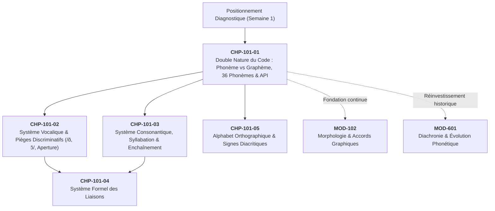
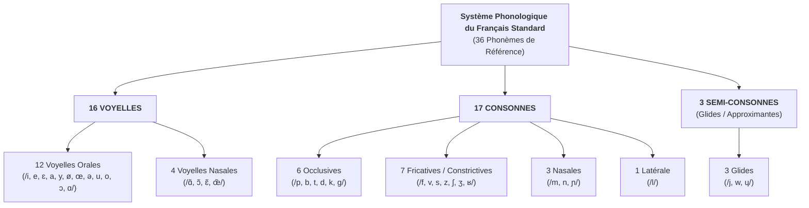
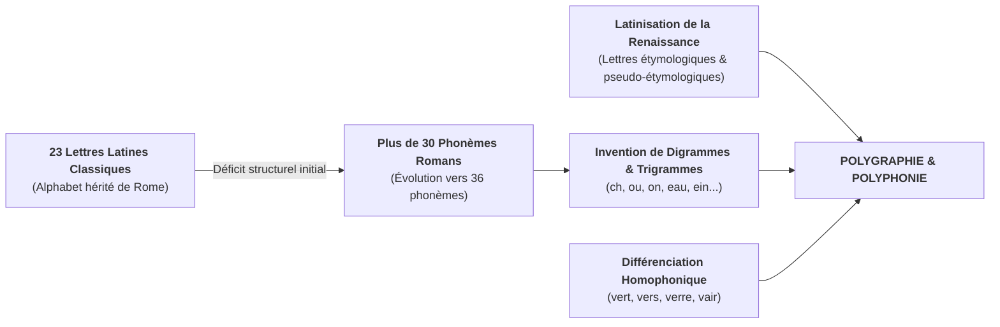

# Chapitre 1 — La Double Nature du Code Linguistique : Phonème vs Graphème, Inventaire des 36 Phonèmes et Initiation à l'API

> **Identifiant du chapitre** : `CHP-101-01`  
> **Module de rattachement** : [`MOD-101` — Positionnement Diagnostique, Phonétique Appliquée (API) et Alphabet Orthographique](file:///f:/Formation/world-class-french/03-curriculum/year-1/semester-1/mod-101-diagnostic-phonetique-alphabet.md)  
> **Semestre** : Année 1 — Semestre 1 (S1)  
> **Volume horaire estimé** : 5 à 6 heures d'apprentissage autonome délibéré et d'ateliers d'application (Étude : 1 h 30 | Pratique : 1 h 30 | Correction : 1 h | Évaluation : 1 h)  
> **Statut** : [STATUT : VALIDÉ]  
> **Compétences associées** : [`FR-PHON-001`](file:///f:/Formation/world-class-french/02-competency-framework/competency-framework.md#fr-phon-001-maîtrise-des-contrastes-phonologiques-et-de-la-prosodie-formelle) (L3), [`FR-ORTHO-001`](file:///f:/Formation/world-class-french/02-competency-framework/competency-framework.md#fr-ortho-001-maîtrise-de-lorthographe-lexicale-et-flexionnelle) (L3)  
> **Sources scientifiques de référence** : `SRC-PHON-01` (Léon, 2011), `SRC-ORTHO-01` (Catach, 1980/2011), `SRC-PHON-02` (Wioland, 1991), `SRC-PHON-03` (Tranel, 1987), `SRC-GRAM-02` (Riegel et al., 2016), `SRC-GRAM-01` (Grevisse & Goosse, 2016)

---

## 1. Titre et Place dans le Cursus

### 1.1 Intitulé Officiel
**Chapitre 1 : La Double Nature du Code Linguistique : Phonème vs Graphème, Inventaire des 36 Phonèmes et Initiation à l'API** (`CHP-101-01`).

### 1.2 Insertion Architecturale dans le Cursus
Ce premier chapitre est la porte d'entrée scientifique de l'ensemble du cursus **World-Class French**. Situé à l'ouverture du Semestre 1, il pose le socle épistémologique indispensable à toute réflexion linguistique ultérieure : la distinction radicale entre le **son parlé** et la **lettre écrite**.



- **En amont** : Ce chapitre ne requiert aucun prérequis universitaire formalisé. Il prend appui sur la compétence de lecture d'un locuteur francophone scolarisé et déconstruit d'emblée ses automatismes naïfs.
- **Au sein du module `MOD-101`** : Il outille l'apprenant en lui fournissant la grille d'analyse (l'API) dont il aura besoin dès le chapitre 2 pour explorer les voyelles et leurs contrastes d'aperture, au chapitre 3 pour comprendre la structure syllabique, au chapitre 4 pour analyser la réactivation des consonnes latentes lors des liaisons, et au chapitre 5 pour rationaliser le système des accents.
- **En aval dans le cursus** : L'Alphabet Phonétique International introduit ici restera l'outil de référence constant jusqu'aux modules de stylistique et de déclamation (Année 3 / `MOD-503`) et d'histoire de la langue (Année 3 / `MOD-601`).

---

## 2. Objectifs Mesurables

Au terme de l'étude autonome et des travaux pratiques de ce chapitre, l'apprenant doit être capable de :

1. **Distinguer sans hésitation la chaîne sonore de la chaîne graphique** : face à un mot ou un syntagme donné, dénombrer avec exactitude le nombre de lettres, le nombre de graphèmes et le nombre de phonèmes, en justifiant les écarts [Réf. `SRC-GRAM-02`, chap. 2].
2. **Définir et mobiliser les concepts opératoires de la phonologie** : expliciter avec précision les notions de *phonème*, *allophone*, *graphème* et *paire minimale*, et administrer le test de commutation pour isoler un phonème.
3. **Identifier et classifier les 36 phonèmes du français standard** : réciter et repérer sans omission les 16 voyelles, les 17 consonnes et les 3 semi-consonnes du système phonologique de référence, en indiquant leurs traits articulatoires cardinaux [Réf. `SRC-PHON-01`, chap. 1].
4. **Décoder et encoder en Alphabet Phonétique International (API)** :
   - Transcrire phonologiquement entre barres obliques `/ /` n'importe quel vocable du français standard ne comportant pas d'ambiguïté de prononciation lexicale ;
   - Lire couramment et restituer oralement un texte simple rédigé en symboles API sans recourir au texte orthographique d'origine.

---

## 3. Prérequis et Test de Préparation (Auto-Diagnostic)

### 3.1 Prérequis Cognitifs
- Maîtrise de la lecture fluide du français standard à l'écrit.
- Connaissance élémentaire des 26 lettres de l'alphabet latin.
- Aptitude à l'écoute attentive et à la distinction auditive des syllabes.

### 3.2 Test de Préparation Immédiat
Répondez aux cinq questions suivantes avant d'entamer la lecture du chapitre. Vérifiez immédiatement vos réponses dans le corrigé ci-dessous.

1. Combien de **sons distincts** entendez-vous dans le mot *oiseau* ?
2. Dans le mot *champ*, combien comptez-vous de lettres et combien de sons prononcés ?
3. Le son /s/ peut-il s'écrire autrement qu'avec la lettre *s* ? Citez deux exemples.
4. Dans la phrase *Ils mangent du pain*, combien de sons entendez-vous à la fin du verbe *mangent* ? La terminaison *-ent* se prononce-t-elle ?
5. Que signifie le mot *phonème* par rapport au mot *lettre* ?

---

#### Corrigé de l'Auto-Diagnostic
1. **4 sons** : /w/ + /a/ + /z/ + /o/ (malgré 6 lettres écrites).
2. **5 lettres** (*c-h-a-m-p*) pour seulement **2 sons** : la consonne /ʃ/ (notée par le digramme *ch*) et la voyelle nasale /ɑ̃/ (notée par *am*, la lettre *p* étant muette).
3. **Oui, absolument** : par exemple avec la lettre *c* devant *e/i* (*cerise*), avec *ç* (*façon*), avec *t* (*action*), ou avec *ss* (*poisson*).
4. Le verbe *mangent* se prononce /mɑ̃ʒ/ (3 sons). La terminaison grammaticale *-ent* de la 3e personne du pluriel est une marque morphologique purement muette à l'oral ; elle ne produit **aucun son**.
5. La **lettre** est un signe graphique tracé sur une feuille ou affiché sur un écran (destiné à l'œil) ; le **phonème** est une unité sonore distinctive de la langue parlée (destinée à l'oreille).

> [!NOTE]
> Si vous avez hésité sur la question 1, 2 ou 4, ce chapitre est précisément conçu pour transformer ces intuitions confuses en certitudes scientifiques mesurables.

---

## 4. Situation de Départ ou Problème Concret : Le Piège du Déchiffrage Lettre-à-Lettre

### 4.1 Le Paradoxe Orthographique du Français
Considérez les trois mots suivants :
- **vert** (la couleur)
- **vers** (la direction ou la ligne poétique)
- **verre** (le récipient transparent)

À l'œil, ces trois mots sont morphologiquement distincts : ils comptent respectivement 4, 4 et 5 lettres. Ils portent des significations radicalement différentes et s'inscrivent dans des réseaux lexicaux étanches. Pourtant, dans l'air qui vibre entre la bouche du locuteur et l'oreille de l'auditeur, ces trois mots correspondent à une seule et même réalité sonore : **la séquence phonique unique /vɛʁ/**.

À l'inverse, observez la lettre **c** dans la phrase suivante :
> *Ce garçon candide cache un secret.*

La même lettre graphique **c** y prend successivement quatre valeurs différentes :
1. Le son /s/ dans *ce* (devant la voyelle *e*) ;
2. Le son /s/ dans *garçon* (grâce à la cédille *ç*) ;
3. Le son /k/ dans *candide* (devant la voyelle *a*) ;
4. Elle s'associe à la lettre *h* pour former le digramme *ch* produisant le son /ʃ/ dans *cache*.

Enfin, examinez le mot :
> **oiseaux**

Ce mot compte **7 lettres** consécutives. Or, si vous demandez à un synthétiseur vocal ou à un phonéticien d'analyser l'onde acoustique émise par sa prononciation, vous constaterez qu'il ne contient que **4 sons** élémentaires :
$$\text{lettres : } o - i - s - e - a - u - x \quad (7\text{ lettres})$$
$$\text{sons : } /w/ - /a/ - /z/ - /o/ \quad (4\text{ sons})$$

Aucune des voyelles écrites (*o, i, e, a, u*) n'y est prononcée selon sa valeur isolée. La lettre *s* se sonorise en /z/ entre deux voyelles, le groupe *oi* produit le diphtongue sonore /wa/, le trigramme *eau* se contracte en une voyelle unique /o/, et la lettre *x* finale est rigoureusement muette.

### 4.2 L'Origine des Insécurités et des Fautes
Ce hiatus entre la lettre et le son est le piège central de la langue française. 
- L'apprenant qui tente de **prononcer en déchiffrant chaque lettre** produit une diction heurtée, non naturelle et erronée (sur-articulation des *e* caducs, prononciation indue des consonnes finales muettes, hésitation sur les digrammes).
- L'apprenant qui tente d'**écrire en se fiant uniquement à ce qu'il entend** commet d'innombrables fautes d'homophonie (*il mange* confondu avec *ils mangent*, *j'ai chanté* avec *je chantais* ou *chanter*).

Pour briser ce cercle vicieux, il faut cesser de confondre le costume écrit de la langue avec son corps sonore.

---

## 5. Explication Intuitive : Les Deux Codes de la Langue

Pour saisir la dualité du langage humain, imaginons une analogie musicale rigoureuse : **l'œuvre orchestrale et sa partition d'imprimerie**.

```text
       RÉALITÉ DU LANGAGE
       ├── 1. LE CODE PHONIQUE (LA PAROLE)
       │      • Vibration de l'air, onde acoustique, mouvements musculaires de la bouche.
       │      • Reçu par l'OREILLE.
       │      • C'est la réalité première, vivante et historique de la langue.
       │
       └── 2. LE CODE GRAPHIQUE (L'ÉCRITURE)
              • Tracés d'encre, pixels sur un écran, arrangements spatiaux de caractères.
              • Reçu par l'ŒIL.
              • C'est un système de codage secondaire, conventionnel, tardif et partiel.
```

L'humanité a parlé pendant des dizaines de millénaires avant de concevoir le moindre système d'écriture alphabétique. Un enfant maîtrise l'ensemble du système phonologique de sa langue maternelle vers l'âge de 4 ou 5 ans, bien avant d'apprendre que le son /o/ peut se matérialiser par les lettres *o*, *au*, ou *eau*.

L'écriture n'est pas la langue elle-même ; elle n'en est qu'une **représentation graphique conventionnelle**. En français, cette représentation ressemble à un vieil édifice médiéval remanié au XVIIe siècle :
- Certaines pierres d'origine correspondent fidèlement à la structure sonore (la lettre *b* transcrit presque toujours le son /b/) ;
- D'autres pierres ne sont là que pour rappeler l'histoire ou l'étymologie (le *p* de *corps* rappelle le latin *corpus*, le *g* de *doigt* rappelle *digitus*) ;
- D'autres encore ont été ajoutées pour éviter que deux mots différents ne se ressemblent trop à l'œil (*sang*, *cent*, *sans*, *sens* se prononcent tous /sɑ̃/, mais l'écriture offre à l'esprit un confort visuel instantané pour identifier le sens).

Pour travailler avec la rigueur d'un linguiste et ne plus jamais être dupé par les caprices de l'orthographe, nous avons besoin d'un outil de mesure indépendant : **l'Alphabet Phonétique International**.

---

## 6. Définitions Précises et Terminologie Fondamentale

Chaque terme ci-dessous doit être assimilé avec une rigueur opératoire méthodique.

### 6.1 Signifiant Phonique vs Signifiant Graphique
Selon la théorie linguistique inaugurée par Ferdinand de Saussure et formalisée dans la *Grammaire méthodique du français* [Réf. `SRC-GRAM-02`, chap. 2] :
- Le **signe linguistique** unit un concept (**le signifié**) à une image sensorielle (**le signifiant**).
- Dans la langue orale, le signifiant est une réalité acoustique et articulatoire : c'est le **signifiant phonique**.
- Dans la langue écrite, ce signifiant est transposé dans l'espace visuel sous la forme de lettres et de symboles diacritiques : c'est le **signifiant graphique**.

### 6.2 Le Phonème
> **Définition** : Le **phonème** est la plus petite unité sonore distinctive de la chaîne parlée. Il est **dépourvu de sens en lui-même**, mais il permet de **distinguer un mot d'un autre mot** [Réf. `SRC-PHON-01`, chap. 1].

Par convention internationale, tout phonème ou ensemble de phonèmes s'écrit obligatoirement **entre barres obliques** :
$$\text{Exemple : } /p/, \quad /b/, \quad /a/, \quad /o/$$

Si l'on remplace le phonème /p/ par le phonème /b/ dans la séquence sonore `/pɛ̃/` (*pain*), on obtient la séquence `/bɛ̃/` (*bain*). Cette simple permutation sonore entraîne un changement complet de signification. C'est la preuve phonologique concluante que /p/ et /b/ sont deux phonèmes distincts du français.

### 6.3 L'Allophone (ou Variante Combinatoire / Libre)
> **Définition** : Un **allophone** est une réalisation phonétique concrète, particulière d'un même phonème. Il varie selon le locuteur (variante libre) ou selon les sons voisins (variante combinatoire), mais **sans jamais créer de distinction de sens** dans la langue considérée.

Par convention internationale, la transcription phonétique concrète d'un allophone s'écrit **entre crochets** :
$$\text{Exemple : } [ʁ] \quad \text{vs} \quad [r]$$

*Illustration* : Qu'un locuteur prononce le mot *rat* avec un /ʁ/ uvulaire standard $[ʁa]$ ou avec un /r/ apical roulé $[ra]$ (fréquent dans diverses régions ou en contexte ouest-africain), le mot reste reconnu sans ambiguïté comme désignant le même animal. Le son $[ʁ]$ et le son $[r]$ sont deux allophones du même et unique phonème fonctionnel **/ʁ/** en français contemporain.

### 6.4 Le Graphème et le Plurisystème Graphique
> **Définition** : Selon la théorie du plurisystème graphique de Nina Catach [Réf. `SRC-ORTHO-01`] et de la *Grammaire méthodique du français* [Réf. `SRC-GRAM-02`, chap. 2], le **graphème** est la plus petite unité distinctive du système d'écriture.

Le graphème ne se réduit pas à une équivalence mécanique « une lettre pour un phonème » :
1. **Phonogrammes** : ils transcrivent directement des phonèmes :
   - Monogrammes : la lettre *p* dans *pile* représente /p/ ;
   - Digrammes : *ch* dans *chat* représente /ʃ/, *ou* dans *loup* représente /u/ ;
   - Trigrammes : *eau* dans *beau* représente /o/, *ein* dans *plein* représente /ɛ̃/.
   - Notations condensées : la lettre *x* transcrit à elle seule deux phonèmes consécutifs (/ks/ dans *taxi*, /gz/ dans *examen*), tandis que le digramme *oi* note la suite semi-consonne + voyelle /wa/.
2. **Morphogrammes** : signes écrits sans équivalent sonore autonome à l'oral, indiquant une fonction lexicale (le *t* de *lait* rappelant *laitage*, le *d* de *lourd* rappelant *lourdeur*) ou grammaticale (le *-s* du pluriel, la désinence verbale *-ent* dans *ils chantent*).
3. **Logogrammes et lettres historiques** : signes distinguant visuellement les homophones (*cent* vs *sang* vs *sans*) ou conservant une trace étymologique (*doigt*, *temps*).

Le graphème est à l'écrit une unité fonctionnelle autonome, régie par des lois plurisystémiques spécifiques.

### 6.5 La Paire Minimale
> **Définition** : Une **paire minimale** est un couple de deux mots de sens différents qui ne se distinguent que par **un seul phonème**, situé exactement à la même position dans la séquence sonore [Réf. `SRC-PHON-02`, chap. 1].

La méthode des paires minimales est l'instrument scientifique fondamental de la phonologie (la commutation) :
- `/pɑ̃/` (*pan*) vs `/vɑ̃/` (*vent*) $\rightarrow$ prouve la distinction phonologique entre **/p/** et **/v/**.
- `/vɑ̃/` (*vent*) vs `/vɔ̃/` (*vont*) $\rightarrow$ prouve la distinction phonologique capitale entre **/ɑ̃/** et **/ɔ̃/**.
- `/bu/` (*boue*) vs `/by/` (*bu*) $\rightarrow$ prouve la distinction phonologique entre **/u/** et **/y/**.

### 6.6 L'Alphabet Phonétique International (API / IPA)
> **Définition** : L'**API** (Alphabet Phonétique International) est un système universel de notation phonétique créé en 1886 par l'Association Phonétique Internationale. Il repose sur un principe biunivoque absolu : **un symbole unique pour un son unique, et un son unique pour un symbole unique** [Réf. `SRC-PHON-01`, chap. 1].

Dans l'API :
- Il n'y a **jamais de lettres muettes**.
- Il n'y a **jamais d'ambiguïté de lecture**.
- La graphie ne dépend d'aucune tradition nationale : le symbole `/u/` désigne universellement le son de la voyelle de *loup*, que ce soit en français, en allemand (*gut*), en italien (*luna*) ou en espagnol (*uno*).

---

## 7. Règles et Mécanismes Fondamentaux : L'Inventaire des 36 Phonèmes du Français Standard

Le français standard de référence (décrit par Pierre Léon dans `SRC-PHON-01` et Martin Riegel dans `SRC-GRAM-02`) repose sur un inventaire canonique de **36 phonèmes** :
$$\mathbf{36\text{ Phonèmes}} = \mathbf{16\text{ Voyelles}} + \mathbf{17\text{ Consonnes}} + \mathbf{3\text{ Semi-consonnes (Glides)}}$$



---

### 7.1 Le Système Vocalique : Les 16 Voyelles de Référence

Une **voyelle** est un son musical continu produit par la vibration des cordes vocales dans le larynx, sans qu'aucun obstacle ne vienne interrompre ou frotter le passage de l'air à travers le canal buccal.

Les voyelles du français se classifient selon quatre critères physiologiques et acoustiques objectifs :
1. **L'antériorité** : la position de la masse de la langue dans la bouche :
   - *Antérieure* (langue projetée vers l'avant, pointée vers les incisives) ;
   - *Postérieure* (langue rétractée vers l'arrière, vers le voile du palais).
2. **Le degré d'aperture** : la distance entre le dos de la langue et le palais :
   - *Fermée* (1er degré : passage très étroit) ;
   - *Mi-fermée* (2e degré) ;
   - *Mi-ouverte* (3e degré) ;
   - *Ouverte* (4e degré : bouche largement béante).
3. **La labialité (arrondissement)** : la position des lèvres :
   - *Non arrondie (écartée)* : lèvres tirées vers les commissures (sourire) ;
   - *Arrondie (labialisée)* : lèvres projetées en avant en forme de cercle.
4. **La nasalité** : la position du voile du palais (la luette) :
   - *Orale* : le voile du palais est relevé contre la paroi pharyngée ; l'air s'échappe exclusivement par la bouche ;
   - *Nasale* : le voile du palais est abaissé ; l'air s'échappe simultanément par la bouche et par les fosses nasales.

#### Table Complète des 16 Voyelles du Français Standard

| Symbole API | Type | Antériorité | Aperture | Labialité | Mot-repère canonique | Graphies usuelles |
| :---: | :---: | :---: | :---: | :---: | :--- | :--- |
| **/i/** | Orale | Antérieure | Fermée (1) | Non arrondie | *lit* `/li/` | *i, y, î, ï* (*ici, lyre, île, maïs*) |
| **/e/** | Orale | Antérieure | Mi-fermée (2) | Non arrondie | *blé* `/ble/` | *é, er, ez, ed, es* (*été, chanter, nez, pied, les*) |
| **/ɛ/** | Orale | Antérieure | Mi-ouverte (3) | Non arrondie | *mer* `/mɛʁ/` | *è, ê, ai, ei, e+cons.* (*père, fête, lait, reine, sel*) |
| **/a/** | Orale | Antérieure | Ouverte (4) | Non arrondie | *patte* `/pat/` | *a, à* (*ami, papa, là*) |
| **/y/** | Orale | Antérieure | Fermée (1) | **Arrondie** | *su* `/sy/` | *u, û, eu* (forme verbale) (*mur, flûte, j'ai eu*) |
| **/ø/** | Orale | Antérieure | Mi-fermée (2) | **Arrondie** | *peu* `/pø/` | *eu, œu* (fin de mot) (*feu, vœu, deux, nœud*) |
| **/œ/** | Orale | Antérieure | Mi-ouverte (3) | **Arrondie** | *peur* `/pœʁ/` | *eu, œu* (+ cons. prononcée) (*sœur, fleur, cœur*) |
| **/ə/** | Orale | Centrale | Moyenne | Neutre | *le* `/lə/` | *e* caduc (*je, te, me, premier*) |
| **/u/** | Orale | Postérieure | Fermée (1) | Arrondie | *loup* `/lu/` | *ou, où, oû* (*tout, où, voûte*) |
| **/o/** | Orale | Postérieure | Mi-fermée (2) | Arrondie | *pot* `/po/` | *o, ô, au, eau* (*mot, dôme, saut, beau*) |
| **/ɔ/** | Orale | Postérieure | Mi-ouverte (3) | Arrondie | *port* `/pɔʁ/` | *o* (+ cons. prononcée) (*robe, botte, corps*) |
| **/ɑ/** | Orale | Postérieure | Ouverte (4) | Non arrondie | *pâte* `/pɑt/` | *â, as* final (*pâte, classe, bas*) |
| **/ɑ̃/** | **Nasale** | Postérieure | Ouverte | Arrondie/Neutre | *sans* `/sɑ̃/` | *an, am, en, em* (*vent, banc, chambre, temps*) |
| **/ɔ̃/** | **Nasale** | Postérieure | Mi-fermée | Arrondie | *son* `/sɔ̃/` | *on, om* (*bon, ombre, pont*) |
| **/ɛ̃/** | **Nasale** | Antérieure | Mi-ouverte | Non arrondie | *brin* `/bʁɛ̃/` | *in, im, ain, aim, ein* (*fin, train, faim, plein*) |
| **/œ̃/** | **Nasale** | Antérieure | Mi-ouverte | Arrondie | *brun* `/bʁœ̃/` | *un, um* (*un, parfum, humble*) |

> [!IMPORTANT]
> **Observation sociolinguistique sur /œ̃/ et /ɑ/** :
> En français contemporain spontané (notamment dans la région parisienne et le nord de la France), la voyelle nasale arrondie **/œ̃/** (*brun*) tend à être absorbée par la nasale non arrondie **/ɛ̃/** (*brin*), réduisant le système à 3 voyelles nasales dans l'usage quotidien. De même, la voyelle postérieure **/ɑ/** (*pâte*) tend à se confondre avec l'antérieure **/a/** (*patte*). 
> Cependant, le système classique de référence enseigné dans le cursus **World-Class French** retient l'intégralité des 16 distinctions afin de garantir une diction exemplaire, la maîtrise des textes poétiques et la compréhension des variétés régionales où ces oppositions restent vivaces [Réf. `SRC-PHON-01`, chap. 2].

---

### 7.2 Le Système Consonantique : Les 17 Consonnes de Référence

Une **consonne** est un son caractérisé par la présence d'un **obstacle** (fermeture totale ou rétrécissement étroit) rencontré par le flux d'air expiratoire le long du conduit vocal.

Les consonnes du français se définissent selon trois coordonnées physiologiques strictes :
1. **Le mode d'articulation** :
   - *Occlusive (momentanée)* : fermeture totale et hermétique du conduit vocal, suivie d'un brusque relâchement (explosion) ;
   - *Fricative ou constrictive (continue)* : rétrécissement du conduit sans fermeture complète ; l'air passe en produisant un frottement ou sifflement continu ;
   - *Nasale* : occlusion dans la bouche, mais abaissement du voile du palais permettant l'échappement continu de l'air par le nez ;
   - *Latérale* : occlusion centrale sur la ligne médiane de la bouche, l'air s'échappant librement par les deux côtés de la langue.
2. **Le point d'articulation (lieu d'obstruction)** :
   - *Bilabiale* : les deux lèvres se touchent ;
   - *Labio-dentale* : les incisives supérieures appuient sur la lèvre inférieure ;
   - *Apico-dentale / Alvéolaire* : la pointe ou la lame de la langue touche les dents supérieures ou les alvéoles ;
   - *Palato-alvéolaire (chuintante)* : la partie antérieure de la langue s'élève vers l'avant du palais dur ;
   - *Palatale* : le dos de la langue s'applique contre le milieu du palais dur ;
   - *Vélaire* : l'arrière de la langue s'applique contre le voile du palais (palais mou) ;
   - *Uvulaire* : l'arrière de la langue frotte contre la luette (uvule).
3. **Le voisement (ou sonorité)** :
   - *Sourde (non voisée)* : les cordes vocales restent écartées et immobiles (pas de vibration laryngée) ;
   - *Sonore (voisée)* : les cordes vocales sont rapprochées et vibrent au passage de l'air.

#### Table Complète des 17 Consonnes du Français Standard

| Symbole API | Mode | Point d'articulation | Voisement | Mot-repère canonique | Graphies usuelles |
| :---: | :---: | :---: | :---: | :--- | :--- |
| **/p/** | Occlusive | Bilabiale | Sourde | *pont* `/pɔ̃/` | *p, pp* (*pas, appel*) |
| **/b/** | Occlusive | Bilabiale | Sonore | *bon* `/bɔ̃/` | *b, bb* (*beau, abbé*) |
| **/t/** | Occlusive | Dentale / Alvéolaire | Sourde | *tout* `/tu/` | *t, tt, th* (*tas, dette, thé*) |
| **/d/** | Occlusive | Dentale / Alvéolaire | Sonore | *dos* `/do/` | *d, dd* (*dans, addition*) |
| **/k/** | Occlusive | Vélaire | Sourde | *car* `/kaʁ/` | *c, k, qu, ch, ck* (*clé, kilo, qui, chaos, ticket*) |
| **/g/** | Occlusive | Vélaire | Sonore | *gare* `/gaʁ/` | *g, gu* devant e/i (*gant, guide, bague*) |
| **/f/** | Fricative | Labio-dentale | Sourde | *fou* `/fu/` | *f, ff, ph* (*fil, affaire, photo*) |
| **/v/** | Fricative | Labio-dentale | Sonore | *vous* `/vu/` | *v, w* (*voie, wagon*) |
| **/s/** | Fricative | Alvéolaire (sifflante) | Sourde | *si* `/si/` | *s, ss, c, ç, t(+ion), sc* (*sac, tasse, ciel, façon, nation, scie*) |
| **/z/** | Fricative | Alvéolaire (sifflante) | Sonore | *zoo* `/zo/` | *z, s intervocalique* (*zèbre, rose, poison*) |
| **/ʃ/** | Fricative | Palato-alvéolaire (chuintante) | Sourde | *chat* `/ʃa/` | *ch, sh, sch* (*chien, short, schéma*) |
| **/ʒ/** | Fricative | Palato-alvéolaire (chuintante) | Sonore | *jeu* `/ʒø/` | *j, g devant e/i/y* (*jour, girafe, geste*) |
| **/ʁ/** | Fricative / Vibrante | Uvulaire | Sonore | *rat* `/ʁa/` | *r, rr, rh* (*rouge, terre, rhume*) |
| **/m/** | Nasale | Bilabiale | Sonore | *mot* `/mo/` | *m, mm* (*mère, pomme*) |
| **/n/** | Nasale | Dentale / Alvéolaire | Sonore | *non* `/nɔ̃/` | *n, nn* (*nid, année*) |
| **/ɲ/** | Nasale | Palatale | Sonore | *vigne* `/viɲ/` | *gn* (*ligne, montagne, gagner*) |
| **/l/** | Latérale | Alvéolaire | Sonore | *lit* `/li/` | *l, ll* (*lune, ville*) |

> [!NOTE]
> **Consonne marginale d'emprunt /ŋ/** :
> Le phonème nasal vélaire **/ŋ/** apparaît exclusivement dans les emprunts modernes à l'anglais terminés par *-ing* (*parking* `/paʁkiŋ/`, *camping* `/kɑ̃piŋ/`). Il n'appartient pas au noyau historique du français mais figure aujourd'hui dans l'usage lexical courant répertorié par le *TLFi* et Pierre Léon [Réf. `SRC-PHON-01`, chap. 3].

---

### 7.3 Les 3 Semi-consonnes (Semi-voyelles ou Glides)

Les **semi-consonnes** (également désignées sous le terme d'approximantes ou de glides) occupent une place charnière : sur le plan articulatoire, ce sont des voyelles très fermées prononcées rapidement sans atteindre la tenue stable d'un sommet vocalique ; sur le plan fonctionnel, elles se comportent comme des consonnes en s'appuyant obligatoirement sur une voyelle pleine pour former une syllabe.

| Symbole API | Voyelle correspondante | Mot-repère canonique | Graphies usuelles | Exemple en API |
| :---: | :---: | :--- | :--- | :--- |
| **/j/** (yod) | Dérive de **/i/** | *yeux* | *y, i devant voyelle, ill, il final* | *yeux* `/jø/`, *hier* `/jɛʁ/`, *fille* `/fij/`, *soleil* `/sɔlɛj/` |
| **/w/** | Dérive de **/u/** | *oui* | *ou devant voyelle, w, oi (= /wa/)* | *ouest* `/wɛst/`, *oui* `/wi/`, *loi* `/lwa/`, *web* `/wɛb/` |
| **/ɥ/** | Dérive de **/y/** | *huit* | *u devant voyelle* | *nuit* `/nɥi/`, *lueur* `/lɥœʁ/`, *suer* `/sɥe/` |

---

## 8. Raisonnement Détaillé : L'Asymétrie Historique Son/Lettre

Pour quelles raisons le français présente-t-il une telle complexité de transcription ? Pourquoi n'écrit-on pas tout simplement les 36 sons avec un alphabet rigoureusement phonétique de 36 lettres ?

La réponse réside dans la rencontre conflictuelle entre une boîte à outils graphique trop étroite et des siècles de sédimentation historique [Réf. `SRC-GRAM-02`, chap. 2 ; `SRC-PHON-01`, chap. 1].



### 8.1 Le Déficit Initial : Un Alphabet Restreint pour un Système Sonore en Expansion
Lorsque le latin vulgaire a évolué en gallo-roman puis en ancien français au cours du haut Moyen Âge, le système phonologique s'est considérablement enrichi : création de consonnes palatales nouvelles (/ʃ, ʒ, ɲ/), diversification des apertures vocaliques et apparition progressive des voyelles nasales.

Or, les clercs et copistes médiévaux ne disposaient à l'origine que des **23 lettres de l'alphabet latin classique** (A, B, C, D, E, F, G, H, I, K, L, M, N, O, P, Q, R, S, T, V, X, Y, Z ; les lettres Y et Z n'ayant été ajoutées à Rome qu'à la fin de la République pour transcrire les emprunts grecs) :
- La lettre **I** y notait à la fois la voyelle /i/ et la consonne/semi-consonne /j/ ;
- La lettre **V** notait indifféremment la voyelle /u/ et la semi-consonne /w/ (devenue plus tard la consonne fricative /v/) ;
- Les lettres **J** et **U** ne seront formellement différenciées de **I** et **V** qu'au XVIe siècle (notamment par le grammairien Pierre de La Ramée, d'où leur appellation traditionnelle de « lettres ramistes »), et le **W** fut importé plus tardivement du domaine germanique.

Face à un système sonore roman qui développait plus de 30 phonèmes distincts (culminant avec les 36 phonèmes du français classique), les scripteurs se sont heurtés à un déficit structurel mathématique évident : l'outil graphique initial comportait moins de signes que la langue n'avait de sons ($23 < 36$).

Pour résoudre cette insuffisance, ils ont combiné deux artifices fondamentaux :
1. **La polyphonie graphique** : assigner plusieurs sons différents à une même lettre selon son entourage (la lettre *g* se prononce /g/ devant *a, o, u*, mais /ʒ/ devant *e, i, y*) ;
2. **La composition graphémique** : assembler deux ou trois lettres pour forger des symboles nouveaux (**digrammes** et **trigrammes** : *ch, ou, gn, an, in, on, eau*).

### 8.2 Les Trois Principes Structurants de l'Orthographe Française
Selon la typologie fondatrice de Nina Catach reprise par la *Grammaire méthodique du français* [Réf. `SRC-GRAM-02`], notre code écrit n'obéit pas à un seul maître, mais arbitre en permanence entre trois logiques concurrentes :

#### 1. Le Principe Phonologique (ou Phonogrammique)
C'est la vocation première de l'écriture alphabétique : noter la parole. Environ 80 % à 85 % des lettres d'un texte ordinaire transcrivent directement des phonèmes.

#### 2. Le Principe Morphologique (ou Morphogrammique)
L'écriture française refuse de sacrifier l'unité de la famille de mots et les distinctions grammaticales à la simple sonorité :
- *Morphogrammes lexicaux* : on écrit *lait* avec un *t* muet et *laid* avec un *d* muet afin de rendre visible à l'œil la parenté avec *laitage/laiterie* et *laideur/laidir*. Si l'on écrivait phonétiquement *lè*, cette mémoire lexicale serait anéantie.
- *Morphogrammes grammaticaux* : on écrit *ils chantent* avec un *-ent* final muet pour signaler visuellement la marque de la troisième personne du pluriel, alors même que l'oreille n'entend rigoureusement que `/il ʃɑ̃t/`.

#### 3. Le Principe Historique et Distinctif (ou Logogrammique)
- *Volonté étymologique* : À partir du XIVe siècle et surtout à la Renaissance, des lettrés et des imprimeurs ont réintroduit des lettres latines disparues de la prononciation afin d'ennoblir la langue : le *b* dans *doute* (latin *dubitare*), le *p* dans *temps* (latin *tempus*), ou le *g* dans *doigt* (latin *digitus*). Parfois même, par erreur d'érudition, on a forgé de fausses étymologies : le mot *poids* s'est vu affubler d'un *d* parce qu'on croyait à tort qu'il venait du latin *pondus*, alors qu'il descend du latin *pensum* !
- *Différenciation des homophones* : L'écriture compense l'appauvrissement acoustique en attribuant des silhouettes graphiques distinctes à des mots de même sonorité :
  $$\text{Son unique } /sɑ̃/ \iff \begin{cases} \text{sang (le fluide vital)} \\ \text{cent (le nombre 100)} \\ \text{sans (la préposition de privation)} \\ \text{sens (du verbe sentir)} \end{cases}$$

### 8.3 Les Deux Grandes Conséquences Systémiques
Cette sédimentation historique engendre deux phénomènes majeurs qu'il faut maîtriser pour ne plus commettre d'erreur :
- **La polygraphie** : un seul phonème est transcrit par de multiples graphies distinctes.
  $$\text{Phonème } /o/ \rightarrow \textit{o} \text{ (vélo)}, \textit{au} \text{ (chaud)}, \textit{eau} \text{ (eau)}, \textit{ô} \text{ (côte)}, \textit{ot} \text{ (mot)}, \textit{op} \text{ (trop)}, \textit{aux} \text{ (chevaux)}$$
- **La polyphonie** : une seule lettre écrite produit des sons radicalement divergents selon son environnement.
  $$\text{Lettre } \mathbf{x} \rightarrow \begin{cases} /ks/ & \text{dans } \textit{axe, taxi} \\ /gz/ & \text{dans } \textit{examen, exemple} \\ /s/ & \text{dans } \textit{six, dix} \\ /z/ & \text{dans } \textit{deuxième, dixième} \\ \text{muette} & \text{dans } \textit{paix, voix, choux} \end{cases}$$

---

## 9. Exemples Corrects Commentés avec Transcriptions API Exactes

L'analyse linguistique d'un mot exige de toujours dresser en parallèle le décompte de ses **lettres**, de ses **graphèmes** et de ses **phonèmes**.

### Exemple 1 : *château*
- **Texte orthographique** : *c - h - a - t - e - a - u* (7 lettres)
- **Découpage graphémique** :
  1. *ch* : digramme consonantique $\rightarrow$ note le phonème /ʃ/
  2. *â* : monogramme vocalique diacrité $\rightarrow$ note le phonème /a/ (ou /ɑ/)
  3. *t* : monogramme consonantique $\rightarrow$ note le phonème /t/
  4. *eau* : trigramme vocalique $\rightarrow$ note le phonème /o/
- **Décompte** : 7 lettres $\rightarrow$ 4 graphèmes $\rightarrow$ **4 phonèmes**
- **Transcription phonologique** : **/ʃato/** (ou `/ʃɑto/`)
- **Transcription phonétique** : `[ʃa.to]`

### Exemple 2 : *printemps*
- **Texte orthographique** : *p - r - i - n - t - e - m - p - s* (9 lettres)
- **Découpage graphémique** :
  1. *p* : monogramme $\rightarrow$ /p/
  2. *r* : monogramme $\rightarrow$ /ʁ/
  3. *in* : digramme nasalisé $\rightarrow$ /ɛ̃/
  4. *t* : monogramme $\rightarrow$ /t/
  5. *emps* : graphème complexe comportant la voyelle nasale *em* (/ɑ̃/) et les consonnes étymologiques muettes *p* et *s*
- **Décompte** : 9 lettres $\rightarrow$ 5 graphèmes $\rightarrow$ **5 phonèmes**
- **Transcription phonologique** : **/pʁɛ̃tɑ̃/**
- **Transcription phonétique** : `[pʁɛ̃.tɑ̃]`

### Exemple 3 : *oiseau*
- **Texte orthographique** : *o - i - s - e - a - u* (6 lettres)
- **Découpage graphémique** :
  1. *oi* : digramme diphtongal $\rightarrow$ suite semi-consonne + voyelle /wa/ (2 phonèmes)
  2. *s* : monogramme consonantique intervocalique $\rightarrow$ /z/
  3. *eau* : trigramme vocalique $\rightarrow$ /o/
- **Décompte** : 6 lettres $\rightarrow$ 3 blocs graphémiques $\rightarrow$ **4 phonèmes**
- **Transcription phonologique** : **/wazo/**
- **Transcription phonétique** : `[wa.zo]`

### Exemple 4 : *Ils chantaient une chanson*
Analysons la phrase mot à mot pour observer l'effet des marques grammaticales muettes :
- *Ils* $\rightarrow$ 3 lettres, 2 phonèmes : **/il/** (le *s* du pluriel est muet devant consonne).
- *chantaient* $\rightarrow$ 10 lettres, 4 phonèmes :
  - *ch* = /ʃ/
  - *an* = /ɑ̃/
  - *t* = /t/
  - *aient* = /ɛ/ (le groupe *aient* est un polymorphogramme : *ai* note la voyelle de l'imparfait /ɛ/, tandis que *-ent* est la marque muette du pluriel).
  - Soit **/ʃɑ̃tɛ/** !
- *une* $\rightarrow$ 3 lettres, 2 phonèmes : **/yn/** (le *e* final est un *e* caduc amuï en fin d'énoncé).
- *chanson* $\rightarrow$ 7 lettres, 4 phonèmes : *ch* (/ʃ/) + *an* (/ɑ̃/) + *s* (/s/) + *on* (/ɔ̃/) $\rightarrow$ **/ʃɑ̃sɔ̃/**.
- **Transcription phonologique globale de l'énoncé** :
  $$\mathbf{/\text{il ʃɑ̃tɛ yn ʃɑ̃sɔ̃}/}$$
- **Bilan comparatif** : L'énoncé compte **23 lettres écrites** ($3 + 10 + 3 + 7 = 23$), réparties en **16 graphèmes**, mais ne produit que **12 phonèmes prononcés**. Cet écart ne signifie pas que les lettres sont arbitraires, mais illustre le fonctionnement du plurisystème : l'usage de digrammes phonogrammiques (*ch, an, ai, on*) requiert deux caractères pour un phonème unique, tandis que des morphogrammes grammaticaux (*-s* pluriel de *ils*, *-ent* verbal de *chantaient*) et des lettres caduques (*-e* de *une*) demeurent muets à l'oral.

---

## 10. Contre-Exemples et Erreurs Fréquentes

L'analyse de copies et d'enregistrements d'apprenants permet d'isoler six fautes récurrentes de modélisation linguistique :

```text
PIÈGES ET ERREURS CARDINALES SUR LE RAPPORT SON / LETTRE
├── 1. L'illusion du dénombrement égalitaire (croire que : 1 lettre = 1 son).
├── 2. La sur-articulation des lettres muettes grammaticales (lire *-ent* comme une nasale).
├── 3. La confusion entre consonne graphique nasale et voyelle nasale (/ɑ̃/ vs /a/+/n/).
├── 4. La transcription phonétique "sauvage" (inventer des notations avec l'alphabet français).
├── 5. L'oubli des conventions d'encadrement (/ / vs [ ] vs < >).
└── 6. L'assimilation erronée d'un digramme à deux sons distincts successifs.
```

### Erreur n° 1 : L'illusion du dénombrement égalitaire
- **Manifestation erronée** : Affirmer que le mot *temps* comporte 5 sons parce qu'il s'écrit avec 5 lettres.
- **Vérité linguistique** : Le mot *temps* ne comporte que **2 phonèmes** : la consonne occlusive sourde **/t/** et la voyelle nasale **/ɑ̃/** $\rightarrow$ `/tɑ̃/`. Les lettres *m, p, s* ne sont pas des sons isolés ; *em* forme un digramme nasal, et *p* et *s* sont des graphèmes étymologiques muets.

### Erreur n° 2 : La sur-articulation des lettres muettes flexionnelles
- **Manifestation erronée** : Prononcer la terminaison verbale *-ent* dans *ils marchent* comme la voyelle nasale /ɑ̃/ (*marchent* prononcé comme *marchant*).
- **Vérité linguistique** : En français standard, la désinence verbale de 3e personne du pluriel *-ent* est strictement **amuïe** (muette). *Ils marchent* se transcrit **/il maʁʃ/** et rime rigoureusement avec *la marche* `/maʁʃ/`.

### Erreur n° 3 : La confusion entre consonne nasale et voyelle nasale
- **Manifestation erronée** : Croire que dans *banc* `/bɑ̃/`, on prononce une consonne /n/ à la fin.
- **Vérité linguistique** : La lettre *n* ne transcrit ici aucune consonne ! Elle fonctionne comme un **diacritique graphique** qui avertit le lecteur que la voyelle précédente *a* doit être nasalisée. Si l'on prononce une consonne /n/, on prononce *banne* `/ban/` et non *banc* `/bɑ̃/`.

### Erreur n° 4 : La transcription phonétique "sauvage"
- **Manifestation erronée** : Pour noter la prononciation du mot *châssis*, écrire *chaci* ou *cha-si*.
- **Vérité linguistique** : Utiliser l'alphabet orthographique pour décrire des sons reproduit l'ambiguïté qu'on cherche à éliminer (la lettre *c* ou *s* étant elle-même polyphonique). La seule notation scientifique rigoureuse est l'API : **/ʃɑsi/** ou **/ʃasi/**.

### Erreur n° 5 : L'omission des conventions de délimitation
- **Manifestation erronée** : Écrire `ʃato` ou `[ʃato]` au lieu de `/ʃato/` pour désigner l'entrée phonologique d'un mot.
- **Vérité linguistique** :
  - `<château>` (entre chevrons) désigne la **forme graphique écrite**.
  - `/ʃato/` (entre barres obliques) désigne la **représentation phonologique abstraite**.
  - `[ʃa.to]` (entre crochets) désigne la **réalisation phonétique acoustique concrète**.
  Toute absence de balisage invalide la rigueur de l'analyse linguistique.

### Erreur n° 6 : L'assimilation erronée d'un digramme à deux sons successifs
- **Manifestation erronée** : Tenter de prononcer séparément les deux lettres d'un digramme, par exemple décomposer le digramme *ch* comme un /k/ suivi d'un /h/, ou *ou* comme la succession de /o/ et /y/.
- **Vérité linguistique** : Un digramme forme une unité graphémique indissociable (un phonogramme complexe selon Catach [Réf. `SRC-ORTHO-01`]). *ch* note le phonème unique /ʃ/, *ou* note la voyelle unique /u/, et *an* note la voyelle nasale /ɑ̃/. L'œil doit apprendre à identifier le bloc graphémique avant que le conduit vocal ne déclenche l'articulation.

---

## 11. Cas Particuliers et Limites

### 11.1 Les Mots à Anomalies Grapho-Phoniques Spectaculaires
La langue française compte un ensemble restreint de mots d'usage fréquent dont la prononciation actuelle est le vestige fossilisé d'accidents historiques [Réf. `SRC-GRAM-01`, § 28] :
- **monsieur** $\rightarrow$ s'écrit avec *mon-* (/mɔ̃/) et *-sieur*, mais se prononce rigoureusement **/məsjø/** (la voyelle nasale s'est dénasalisée en un schwa /ə/ dès le XVIIe siècle par affaiblissement proclitique).
- **femme** $\rightarrow$ s'écrit avec *e*, mais se prononce **/fam/**. Durant la période de l'ancien français et du moyen français (entre le XIe et le XIVe siècle), la voyelle /ɛ/ devant consonne nasale s'est ouverte en /a/ dans plusieurs vocables usuels (*femme* /fam/, *solennel* /sɔlanɛl/, *couenne* /kwan/) [Réf. `SRC-GRAM-01`, § 28 — À VÉRIFIER pour la chronologie précise selon les dialectes]. L'orthographe a conservé la graphie étymologique en *e*.
- **faon, paon, taon** $\rightarrow$ les lettres *ao* n'y transcrivent pas une diphtongue, mais la voyelle nasale unique **/ɑ̃/** : *faon* `/fɑ̃/`, *paon* `/pɑ̃/`, *taon* `/tɑ̃/`.
- **oignon** $\rightarrow$ s'écrit traditionnellement avec *oi*, mais se prononce **/ɔɲɔ̃/**. Le digramme *oi* n'y vaut pas /wa/, le *i* servait jadis à marquer la mouillure du *gn*. Les rectifications orthographiques de 1990 recommandent la graphie rationnelle *ognon*.
- **second** $\rightarrow$ la lettre *c* s'y sonorise exceptionnellement en **/g/** : **/səgɔ̃/**.

### 11.2 Les Variations Régionales et le Traitement Didactique de /œ̃/ et /ɑ/
Le système phonologique n'est pas un bloc d'acier figé dans l'éternité ; il évolue :
1. **La fusion /œ̃/ $\rightarrow$ /ɛ̃/** :
   Dans l'Hexagone (notamment à Paris), la quasi-totalité des locuteurs de moins de 50 ans prononce *un bon vin blanc* comme `/ɛ̃ bɔ̃ vɛ̃ blɑ̃/`. Néanmoins, dans le sud de la France, en Belgique, au Québec et dans plusieurs pays de la francophonie africaine, l'opposition entre *brin* `/bʁɛ̃/` et *brun* `/bʁœ̃/` demeure vivante et distincte.
2. **La fusion /ɑ/ $\rightarrow$ /a/** :
   L'opposition entre le /a/ antérieur (*patte, tache*) et le /ɑ/ postérieur vélaire (*pâte, tâche*) s'est largement neutralisée au profit de l'antérieur /a/.

> [!TIP]
> **Règle méthodologique World-Class French** :
> En tant qu'apprenant d'élite, vous devez **connaître et savoir discriminer les 16 voyelles de référence** à l'écrit en API et en diction surveillée. Dans votre pratique spontanée, vous pouvez tolérer la fusion contemporaine sans que cela ne constitue une faute d'élocution, mais vous devez savoir restituer la distinction formelle dans un exercice de phonétique normative.

---

## 12. Approfondissement Adapté : La Double Articulation du Langage Humain

Pourquoi le système phonologique du français (et de toute langue humaine) s'organise-t-il ainsi ? La réponse théorique la plus magistrale a été formulée par le linguiste français **André Martinet** dans ses *Éléments de linguistique générale* (1960) : le principe de la **double articulation du langage**.

```text
              LA DOUBLE ARTICULATION DU LANGAGE (André Martinet)
              ══════════════════════════════════════════════════
              
              ÉNONCÉ : "La petite fille dort"
                         │
                         ▼
   ┌─────────────────────────────────────────────────────────────┐
   │ 1re ARTICULATION : UNITÉS SIGNIFICATIVES (MORPHÈMES)         │
   │ [la] + [petit-] + [-e] + [fill-] + [-e] + [dor-] + [-t]    │
   │ • Chaque unité possède une forme sonore ET un sens propre.  │
   │ • Nombre : Plusieurs dizaines de milliers d'unités (lexique).│
   └─────────────────────────────┬───────────────────────────────┘
                                 │
                                 ▼
   ┌─────────────────────────────────────────────────────────────┐
   │ 2e ARTICULATION : UNITÉS DISTINCTIVES (PHONÈMES)            │
   │ /l/ - /a/ - /p/ - /ə/ - /t/ - /i/ - /t/ - /f/ - /i/ - /j/...│
   │ • Chaque unité est DÉPOURVUE DE SENS en elle-même.          │
   │ • Elle ne sert qu'à OPPOSER et DIFFÉRENCIER les unités de 1re.│
   │ • Nombre : Économie extrême (36 phonèmes seulement !).      │
   └─────────────────────────────────────────────────────────────┘
```

### Le Génie Économique de la Seconde Articulation
Imaginez une langue qui ne posséderait pas de seconde articulation : chaque idée, chaque objet, chaque relation devrait être désignée par un son global indivisible et différent. La mémoire humaine serait incapable de stocker et d'émettre des millions de cris distincts.

Grâce à la seconde articulation, la nature humaine réalise une prouesse d'une rentabilité mathématique prodigieuse : **avec seulement 36 atomes sonores dépourvus de sens (les 36 phonèmes)**, combinés selon des lois de distribution rigoureuses, nous pouvons fabriquer :
- Des centaines de milliers de mots distincts ;
- Une infinité de phrases et d'idées poétiques, philosophiques et scientifiques.

Comprendre le phonème, c'est toucher du doigt l'atome fondamental sur lequel repose tout le génie de la communication humaine.

---

## 13. Comparaisons Permettant de Distinguer les Notions Proches

Pour fixer définitivement les concepts, voici trois tableaux de confrontation différentielle bilatérale.

### Tableau 1 : Son vs Phonème vs Allophone
| Critère | Son (acoustique) | Phonème (phonologie) | Allophone (phonétique) |
| :--- | :--- | :--- | :--- |
| **Nature** | Phénomène physique mesurable (onde, hertz, décibels). | Unité mentale abstraite et fonctionnelle du système. | Réalisation sonore concrète d'un phonème en contexte. |
| **Rôle distinctif** | Aucun en soi. | **Capital** : crée une différence de sens (*pain* vs *bain*). | **Nul** : ne change jamais le sens du mot (*[ʁa]* vs *[ra]*). |
| **Nombre** | Infini (chaque être humain a une voix unique). | **Strictement fini** (36 en français standard). | Multiple selon les accents et l'entourage phonétique. |
| **Notation** | Oscillogramme / Spectrogramme. | Entre **barres obliques** `/ /`. | Entre **crochets** `[ ]`. |

### Tableau 2 : Lettre vs Graphème
| Critère | Lettre (typographie) | Graphème (linguistique) |
| :--- | :--- | :--- |
| **Définition** | Caractère matériel de l'alphabet (26 lettres de *a* à *z*). | Plus petite unité graphique minimale transcrivant un phonème. |
| **Composition** | Toujours simple (un caractère typographique isolé). | Peut être simple (*p*), double (*ch, ou*) ou triple (*eau, ein*). |
| **Nombre dans l'alphabet** | Exactement 26. | Plus d'une centaine de combinaisons graphémiques en français. |
| **Exemple dans *eau*** | 3 lettres (*e, a, u*). | **1 seul graphème** (le trigramme *eau* valant le phonème /o/). |

### Tableau 3 : Signifiant Phonique vs Signifiant Graphique
| Critère | Signifiant Phonique | Signifiant Graphique |
| :--- | :--- | :--- |
| **Organe de réception** | L'**oreille** (audition). | L'**œil** (vision). |
| **Vecteur matériel** | Onde de pression dans l'air (temporel). | Encre, pigments, pixels sur surface (spatial). |
| **Antériorité** | Première dans l'histoire de l'humanité et de l'individu. | Seconde, conventionnelle, acquise par instruction formelle. |
| **Cas des homophones** | Identiques : `/vɛʁ/` ne distingue pas les sens. | Différenciés : *vert, vers, verre, vair* éclairent la lecture. |

---

## 14. Exercices Progressifs

Appliquez les règles exposées à travers ces trois paliers d'entraînement délibéré.

### Niveau 1 : Reconnaissance et Discrimination

#### Exercice 1.1 — Dénombrement comparatif
Pour chacun des 10 mots suivants, indiquez dans un tableau le nombre exact de **lettres**, de **graphèmes** et de **phonèmes**, puis fournissez la transcription en API :
1. *ami*
2. *chou*
3. *temps*
4. *oiseau*
5. *pomme*
6. *bain*
7. *fille*
8. *sept*
9. *beau*
10. *chaton*

#### Exercice 1.2 — Validation de paires minimales
Pour chaque couple de mots, indiquez s'il s'agit d'une paire minimale valide (OUI ou NON). Si OUI, identifiez l'opposition phonologique en jeu ; si NON, justifiez pourquoi.
1. *pont* `/pɔ̃/` — *bon* `/bɔ̃/`
2. *mer* `/mɛʁ/` — *mère* `/mɛʁ/`
3. *pas* `/pa/` — *plat* `/pla/`
4. *vent* `/vɑ̃/` — *vont* `/vɔ̃/`
5. *feu* `/fø/` — *fou* `/fu/`

---

### Niveau 2 : Transcription et Analyse

#### Exercice 2.1 — Décodage de l'API vers l'orthographe
Reconstituez la phrase orthographique standard qui correspond à chacune des transcriptions phonologiques suivantes :
1. `/le zɑ̃fɑ̃ ʒu dɑ̃ lə ʒaʁdɛ̃/`
2. `/il a vɛ̃ky tu se zɛnmi/`
3. `/lɔʁskə lə vɑ̃ suflə la fɔʁɛ tʁɑ̃bl/`
4. `/setyn eʁœʁ kapital/`

#### Exercice 2.2 — Détection et classification des lettres muettes
Dans la phrase suivante, soulignez toutes les lettres qui ne produisent **aucun phonème** (lettres muettes), puis classez-les dans un tableau selon leur nature (morphologique grammaticale, morphologique lexicale, ou historique/étymologique) :
> *Les grands marchands apportent leurs lourds paquets d'autrefois.*

---

### Niveau 3 : Résolution de Pièges et Production

#### Exercice 3.1 — Transcription phonologique intégrale
Transcrivez phonologiquement (entre barres obliques `/ /`) les phrases suivantes en veillant particulièrement aux voyelles nasales, aux voyelles d'aperture, aux consonnes muettes et aux semi-consonnes :
1. *Monsieur Blanc prend son bain chaud.*
2. *Les femmes choisissent un parfum subtil.*
3. *Ils peignent de magnifiques oiseaux de nuit.*

#### Exercice 3.2 — Autopsie phonétique de mots piégés
Expliquez précisément pourquoi chacun des vocables suivants constitue une difficulté majeure pour l'apprenant en précisant l'écart exact entre ses lettres et ses phonèmes :
1. *condamner*
2. *sculpteur*
3. *automne*
4. *aiguille*

---

### Corrigé Intégral et Justifié des Exercices

#### Corrigé de l'Exercice 1.1
| Mot | Nombre de lettres | Nombre de graphèmes | Nombre de phonèmes | Transcription API | Justification des écarts |
| :--- | :---: | :---: | :---: | :---: | :--- |
| 1. *ami* | 3 | 3 (*a-m-i*) | 3 | `/ami/` | Correspondance biunivoque parfaite 1 pour 1. |
| 2. *chou* | 4 | 2 (*ch-ou*) | 2 | `/ʃu/` | Deux digrammes (*ch* = /ʃ/, *ou* = /u/). |
| 3. *temps* | 5 | 2 (*t-emps*) | 2 | `/tɑ̃/` | Digramme nasal *em* + lettres muettes étymologiques *p, s*. |
| 4. *oiseau* | 6 | 3 (*oi-s-eau*) | 4 | `/wazo/` | *oi* = 2 phonèmes (/w/+/a/), *s* = /z/, *eau* = /o/. |
| 5. *pomme* | 5 | 3 (*p-o-mm*) | 3 | `/pɔm/` | Consonne double *mm* valant un seul phonème /m/, *e* muet. |
| 6. *bain* | 4 | 2 (*b-ain*) | 2 | `/bɛ̃/` | Trigramme vocalique nasal *ain* valant le phonème unique /ɛ̃/. |
| 7. *fille* | 5 | 3 (*f-i-lle*) | 3 | `/fij/` | *ille* vaut la voyelle /i/ + la semi-consonne /j/. |
| 8. *sept* | 4 | 3 (*s-e-pt*) | 3 | `/sɛt/` | La lettre *p* (étymologique du latin *septem*) est muette. |
| 9. *beau* | 4 | 2 (*b-eau*) | 2 | `/bo/` | Trigramme vocalique *eau* = phonème unique /o/. |
| 10. *chaton* | 6 | 4 (*ch-a-t-on*) | 4 | `/ʃatɔ̃/` | Digramme *ch* (/ʃ/) + *a* (/a/) + *t* (/t/) + digramme *on* (/ɔ̃/). |

#### Corrigé de l'Exercice 1.2
1. *pont* `/pɔ̃/` — *bon* `/bɔ̃/` : **OUI**. Paire minimale opposant l'occlusive bilabiale sourde **/p/** à l'occlusive bilabiale sonore **/b/** en position initiale.
2. *mer* `/mɛʁ/` — *mère* `/mɛʁ/` : **NON**. Ce ne sont pas des paires minimales, mais de parfaits **homophones** (même séquence phonologique identique `/mɛʁ/`).
3. *pas* `/pa/` — *plat* `/pla/` : **NON**. Il y a insertion d'un phonème supplémentaire (/l/) et non substitution d'un phonème par un autre à la même position.
4. *vent* `/vɑ̃/` — *vont* `/vɔ̃/` : **OUI**. Paire minimale cruciale opposant la voyelle nasale ouverte **/ɑ̃/** à la voyelle nasale mi-fermée **/ɔ̃/**.
5. *feu* `/fø/` — *fou* `/fu/` : **OUI**. Paire minimale opposant la voyelle orale antérieure arrondie **/ø/** à la voyelle postérieure arrondie **/u/**.

#### Corrigé de l'Exercice 2.1
1. `/le zɑ̃fɑ̃ ʒu dɑ̃ lə ʒaʁdɛ̃/` $\rightarrow$ *Les enfants jouent dans le jardin.* (Notez la marque plurielle *-ent* de *jouent* et le *s* de *enfants/dans* muets à l'oral).
2. `/il a vɛ̃ky tu se zɛnmi/` $\rightarrow$ *Il a vaincu tous ses ennemis.* (Le substantif *ennemis* a pour première voyelle le /ɛ/ ouvert ; avec la liaison obligatoire après le déterminant pluriel *ses*, on obtient la séquence /se zɛnmi/).
3. `/lɔʁskə lə vɑ̃ suflə la fɔʁɛ tʁɑ̃bl/` $\rightarrow$ *Lorsque le vent souffle, la forêt tremble.*
4. `/setyn eʁœʁ kapital/` $\rightarrow$ *C'est une erreur capitale.*

#### Corrigé de l'Exercice 2.2
Phrase analysée : *Les grands marchands apportent leurs lourds paquets d'autrefois.*
- Lettres muettes identifiées :
  - *Le**s*** (s)
  - *gran**ds*** (d, s)
  - *marchan**ds*** (d, s)
  - *appor**tent*** (e, n, t)
  - *leur**s*** (s)
  - *lour**ds*** (d, s)
  - *paque**ts*** (t, s)
  - *d'autrefoi**s*** (s)
- Classification méthodique :
  - **Morphologique grammaticale** : le *-s* pluriel de *les, grands, marchands, leurs, lourds, paquets* ; la désinence verbale *-ent* de 3e personne du pluriel dans *apportent*.
  - **Morphologique lexicale** :
    - Le *d* de *grands* (rappelle la famille dérivationnelle : *grandeur, grandir*) ;
    - Le *d* de *marchands* (rappelle *marchandise*) ;
    - Le *d* de *lourds* (rappelle *lourdeur*) ;
    - Le *t* de *paquets* (marque morphologique du suffixe diminutif *-et*, audible dans les dérivés *paqueter, paquetage*).
  - **Historique / Autre** : le *s* de *autrefois* (marque graphique de pluriel ou *s* adverbial fossilisé dans la locution figée *autre* + *fois* [Réf. `SRC-GRAM-01`, § 29 — À VÉRIFIER]).

#### Corrigé de l'Exercice 3.1
1. *Monsieur Blanc prend son bain chaud.*  
   $\rightarrow$ **/məsjø blɑ̃ pʁɑ̃ sɔ̃ bɛ̃ ʃo/**
2. *Les femmes choisissent un parfum subtil.*  
   $\rightarrow$ **/le fam ʃwazis œ̃ paʁfœ̃ sybtil/** (ou en système contemporain avec fusion de la nasale /œ̃/ : `/le fam ʃwazis ɛ̃ paʁfɛ̃ sybtil/` ; attention : le verbe *choisissent* se termine par la consonne fricative sourde **/s/** et non par /z/ !)
3. *Ils peignent de magnifiques oiseaux de nuit.*  
   $\rightarrow$ **/il pɛɲ də maɲifik wazo də nɥi/**

#### Corrigé de l'Exercice 3.2
1. *condamner* `/kɔ̃dane/` : La lettre *m* est totalement muette. Elle rappelle l'étymologie latine (*condemnare*), mais ne se prononce pas devant la nasale /n/. L'apprenant naïf risque de prononcer */kɔ̃damne/*.
2. *sculpteur* `/skyltœʁ/` : La lettre *p* est muette (reprise savante du latin *sculptor*). Prononcer le *p* constitue une faute d'hypercorrection.
3. *automne* `/otɔn/` : Le groupe *mn* se prononce simplement /n/, le *m* étymologique (*autumnus*) étant muet.
4. *aiguille* `/ɛgɥij/` : Le *u* ne forme pas ici le digramme *gu* = /g/ habituel (*comme dans guide*), mais se prononce comme la semi-consonne **/ɥ/** suivie du groupe *ille* = /ij/.

---

## 15. Activité de Correction Raisonnée

### Le Cas Soumis à Votre Expertise
Un étudiant débutant a préparé la fiche d'analyse phonologique suivante pour un exposé universitaire. Son document est criblé de **6 erreurs théoriques et méthodologiques sévères**. 

Examinez son texte, identifiez chaque erreur, expliquez la cause de l'erreur en mobilisant les concepts du cours, et rétablissez l'analyse exacte.

> **Extrait de la fiche de l'étudiant :**  
> 1. Dans le mot *compagnon*, il y a 9 lettres et donc 9 sons : [c-o-m-p-a-g-n-o-n].  
> 2. Le mot *banc* se termine par la consonne nasale /n/.  
> 3. La transcription phonologique de la phrase *Les oiseaux chantent* s'écrit : `[les oiseaux chantent]`.  
> 4. Dans le mot *cahier*, le son /a/ est séparé du son /j/ par la consonne /h/.  
> 5. Le mot *mille* et le mot *fille* contiennent exactement la même semi-consonne /j/.  
> 6. *Pain* et *pin* constituent une paire minimale car ils s'écrivent différemment.

---

### Corrigé de l'Activité de Correction Raisonnée

#### Erreur 1 : Confusion absolue entre lettres et phonèmes
- **Diagnostic** : L'étudiant postule l'égalité naïve 1 lettre = 1 son et découpe l'orthographe entre crochets.
- **Réfutation théorique** : Le mot *compagnon* compte 9 lettres, mais seulement **6 phonèmes** :
  - *om* est un digramme nasal transcrivant la voyelle unique **/ɔ̃/** ;
  - *gn* est un digramme consonantique transcrivant la consonne nasale palatale unique **/ɲ/** ;
  - *on* final est un digramme nasal transcrivant **/ɔ̃/**.
- **Correction exacte** : 9 lettres $\rightarrow$ 6 graphèmes $\rightarrow$ 6 phonèmes : **/kɔ̃paɲɔ̃/**.

#### Erreur 2 : Fausse attribution d'une consonne nasale
- **Diagnostic** : L'étudiant prend la lettre diacritique *n* pour une consonne prononcée.
- **Réfutation théorique** : Dans *banc*, l'air ne rencontre aucun obstacle occlusif buccal dentale. Le voile du palais s'abaisse pour permettre l'émission de la voyelle nasale **/ɑ̃/**. Aucune consonne /n/ n'est articulée.
- **Correction exacte** : *banc* se transcrit **/bɑ̃/** (2 phonèmes : /b/ + /ɑ̃/).

#### Erreur 3 : Méconnaissance totale des conventions de transcription de l'API
- **Diagnostic** : L'étudiant a simplement recopié les mots français en lettres courantes entre crochets.
- **Réfutation théorique** : Une transcription phonologique exige des symboles normalisés de l'API et doit être rigoureusement délimitée par des barres obliques `/ /`. De plus, les marques grammaticales muettes (*s* de *les*, *x* de *oiseaux*, *-ent* de *chantent*) doivent disparaître.
- **Correction exacte** : **/le zwazo ʃɑ̃t/** (ou avec liaison obligatoire : **/le zwa.zo ʃɑ̃t/**).

#### Erreur 4 : Croyance erronée en l'existence d'un son consonantique pour la lettre *h*
- **Diagnostic** : L'étudiant croit que la lettre *h* produit un son dans *cahier*.
- **Réfutation théorique** : En français standard, la lettre *h* est rigoureusement muette ; elle ne transcrit **aucun phonème** (le français ne possède pas de fricative glottale /h/ comme l'anglais *hat* ou l'arabe). Dans *cahier*, le *h* n'est qu'un séparateur étymologique graphique.
- **Correction exacte** : *cahier* se transcrit **/kaje/** (**4 phonèmes** : occlusive /k/ + voyelle /a/ + semi-consonne /j/ + voyelle /e/).

#### Erreur 5 : Fausse analogie graphique sur le groupe *-ille*
- **Diagnostic** : L'étudiant déduit la prononciation de la graphie identique *-ille*.
- **Réfutation théorique** : Le groupe graphique *-ille* est polyphonique :
  - Dans *fille, bille, famille*, il transcrit la voyelle /i/ suivie de la semi-consonne yod **/j/** $\rightarrow$ *fille* `/fij/` ;
  - Dans *mille, ville, tranquille*, il transcrit historiquement la voyelle /i/ suivie de la consonne latérale **/l/** $\rightarrow$ *mille* `/mil/`.
- **Correction exacte** : *fille* contient la semi-consonne `/j/` (`/fij/`), tandis que *mille* contient la consonne `/l/` (`/mil/`).

#### Erreur 6 : Confusion entre homophonie graphique et paire minimale
- **Diagnostic** : L'étudiant définit la paire minimale par la différence d'écriture.
- **Réfutation théorique** : Une paire minimale exige que deux mots s'opposent par **un phonème distinct à l'oral**. Or, *pain* et *pin* se prononcent de façon rigoureusement identique en français standard : **/pɛ̃/**. Ce sont des **homophones parfaits**, non une paire minimale.
- **Correction exacte** : Une paire minimale valide serait par exemple *pain* `/pɛ̃/` vs *bain* `/bɛ̃/` (opposition /p/ vs /b/), ou *pain* `/pɛ̃/` vs *pan* `/pɑ̃/` (opposition /ɛ̃/ vs /ɑ̃/).

---

## 16. Mise en Pratique dans une Production Réelle : Transcription Intégrale de Corpus Littéraire

### Le Texte Modèle
Voici la première strophe (4 vers, 33 mots) du célèbre poème *L'Albatros* de Charles Baudelaire (*Les Fleurs du Mal*, 1857) :

> *Souvent, pour s'amuser, les hommes d'équipage*  
> *Prennent des albatros, vastes oiseaux des mers,*  
> *Qui suivent, indolents compagnons de voyage,*  
> *Le navire glissant sur les gouffres amers.*

---

### Guide d'Analyse Phonologique Préalable
Avant de coucher les symboles API, nous appliquons une démarche méthodique en 4 étapes :
1. **Élision des e caducs et liaisons** :
   - *équipage* en fin de vers $\rightarrow$ le *e* s'amuït totalement : `/ekipaʒ/`.
   - *les hommes d'équipage* $\rightarrow$ liaison obligatoire déterminant + nom en /z/ : `/le zɔm dekipaʒ/`.
   - *des albatros* $\rightarrow$ liaison obligatoire déterminant + nom en /z/ : `/de zalbatʁɔs/` (le *s* final de *albatros* se prononce /s/ en français standard).
   - *vastes oiseaux* $\rightarrow$ liaison obligatoire adjectif antéposé + nom. En diction courante comme en diction poétique classique, le *e* s'élide obligatoirement devant l'initiale vocalique : le *-s* pluriel est réactivé en /z/ et fait l'attaque de la syllabe suivante (`/vast zwazo/`). Aucun schwa fantôme ne doit être inséré (la prononciation `*vastə zwazo*` serait une erreur métrique et phonétique).
2. **Identification des voyelles nasales** :
   - *Souvent* $\rightarrow$ *ou* (/u/) + *en* (/ɑ̃/) $\rightarrow$ `/suvɑ̃/` (*t* final muet).
   - *Prennent* $\rightarrow$ attention : devant consonne double *nn*, la voyelle *e* n'est pas nasale mais ouverte /ɛ/, et le morphogramme verbal *-ent* est muet $\rightarrow$ `/pʁɛn/`.
   - *indolents* $\rightarrow$ nasale *in* (/ɛ̃/) + *do* (/dɔ/) + nasale *len* (/lɑ̃/), *ts* muets $\rightarrow$ `/ɛ̃dɔlɑ̃/`.
   - *compagnons* $\rightarrow$ nasale *om* (/ɔ̃/) + *pa* (/pa/) + nasale palatale *gn* (/ɲ/) + nasale *ons* (/ɔ̃/) $\rightarrow$ `/kɔ̃paɲɔ̃/`.
   - *glissant* $\rightarrow$ *gli* (/gli/) + nasale *ssan* (/sɑ̃/), *t* muet $\rightarrow$ `/glisɑ̃/`.
3. **Traitement des semi-consonnes (glides)** :
   - *suivent* $\rightarrow$ le *u* devant voyelle forme la semi-consonne labio-palatale **/ɥ/** : `/sɥiv/`.
   - *oiseaux* $\rightarrow$ le digramme *oi* produit la suite semi-consonne vélaire **/w/** + voyelle /a/ : `/wazo/`.
   - *voyage* $\rightarrow$ *v* = /v/, *oy* = /waj/ (semi-consonne /w/ + voyelle /a/ + yod **/j/**), *age* = /aʒ/ $\rightarrow$ `/vwajaʒ/`.
   *(Remarque : le mot équipage /ekipaʒ/ ne contient aucune semi-consonne).*
4. **Consonnes finales muettes** :
   - *mers* $\rightarrow$ le *r* se prononce, le *-s* pluriel est muet : `/mɛʁ/`.
   - *amers* $\rightarrow$ le *r* se prononce, le *-s* pluriel est muet : `/amɛʁ/`.

---

### Transcription Phonologique Intégrale de Référence (API)

**1. En diction poétique soutenue (avec liaisons régulières complètes)** :
```text
/ suvɑ̃ puʁ samyze le zɔm dekipaʒ /
/ pʁɛn de zalbatʁɔs vast zwazo de mɛʁ /
/ ki sɥiv ɛ̃dɔlɑ̃ kɔ̃paɲɔ̃ də vwajaʒ /
/ lə naviʁ glisɑ̃ syʁ le gufʁ z‿amɛʁ /
```

**2. En diction courante soignée (prose standard)** :
```text
/ suvɑ̃ puʁ samyze le zɔm dekipaʒ /
/ pʁɛn de zalbatʁɔs vast wazo de mɛʁ /
/ ki sɥiv ɛ̃dɔlɑ̃ kɔ̃paɲɔ̃ də vwajaʒ /
/ lə naviʁ glisɑ̃ syʁ le gufʁ amɛʁ /
```

---

## 17. Résumé Structuré : Tableau Synthétique Complet des 36 Phonèmes

Conservez ce tableau à portée de main : il résume l'intégralité du système phonologique du français standard.

```text
════════════════════════════════════════════════════════════════════════════════════════════════════
                     TABLEAU SYNOPTIQUE DES 36 PHONÈMES DU FRANÇAIS STANDARD
════════════════════════════════════════════════════════════════════════════════════════════════════
SYMBOLE  CLASSE LINGUISTIQUE                MOT-REPÈRE     GRAPHIES USUELLES     GRAPHIES RARES / EXCEPTIONNELLES
────────────────────────────────────────────────────────────────────────────────────────────────────
[1] VOYELLES ORALES (12)
/i/      Antérieure fermée non arrondie     lit            i, y, î, ï            -
/e/      Antérieure mi-fermée non arrondie  blé            é, er, ez, ed, es     -
/ɛ/      Antérieure mi-ouverte non arrondie mer            è, ê, ai, ei, e+cons. ais, ait, aient
/a/      Antérieure ouverte non arrondie    patte          a, à                  -
/y/      Antérieure fermée arrondie         su             u, û                  eu (forme de avoir: "j'ai eu")
/ø/      Antérieure mi-fermée arrondie      peu            eu, œu (fin mot)      -
/œ/      Antérieure mi-ouverte arrondie     peur           eu, œu (+ consonne)   œ (œil)
/ə/      Centrale moyenne neutre (schwa)    le             e caduc               -
/u/      Postérieure fermée arrondie        loup           ou, où, oû            aoû (août)
/o/      Postérieure mi-fermée arrondie     pot            o, ô, au, eau         ot, op, aux
/ɔ/      Postérieure mi-ouverte arrondie    port           o (+ cons. prononcée) um (album = /albɔm/)
/ɑ/      Postérieure ouverte non arrondie   pâte           â, as (fin mot)       -
────────────────────────────────────────────────────────────────────────────────────────────────────
[2] VOYELLES NASALES (4)
/ɑ̃/      Postérieure ouverte nasalisée      sans           an, am, en, em        aon (paon), taon
/ɔ̃/      Postérieure mi-fermée nasalisée    son            on, om                -
/ɛ̃/      Antérieure mi-ouverte nasalisée    brin           in, im, ain, aim, ein ym (sympa), en (moyen)
/œ̃/      Antérieure mi-ouverte arrondie nas. brun          un, um                eun (à jeun)
────────────────────────────────────────────────────────────────────────────────────────────────────
[3] CONSONNES (17)
/p/      Occlusive bilabiale sourde         pont           p, pp                 -
/b/      Occlusive bilabiale sonore         bon            b, bb                 -
/t/      Occlusive alvéolaire sourde        tas            t, tt, th             -
/d/      Occlusive alvéolaire sonore        dos            d, dd                 -
/k/      Occlusive vélaire sourde           car            c, k, qu, ck          ch (chaos, chœur)
/g/      Occlusive vélaire sonore           gare           g, gu (devant e/i)    c (second)
/f/      Fricative labio-dentale sourde     fou            f, ff, ph             -
/v/      Fricative labio-dentale sonore     vous           v, w                  -
/s/      Fricative alvéolaire sourde        si             s, ss, c, ç, sc, t(ion) x (dix, six)
/z/      Fricative alvéolaire sonore        zoo            z, s intervocalique   x (deuxième)
/ʃ/      Fricative chuintante sourde        chat           ch, sh, sch           -
/ʒ/      Fricative chuintante sonore        jeu            j, g (devant e/i/y)   ge (devant a/o)
/ʁ/      Fricative uvulaire sonore          rat            r, rr, rh             -
/m/      Nasale bilabiale sonore            mot            m, mm                 -
/n/      Nasale alvéolaire sonore           non            n, nn                 -
/ɲ/      Nasale palatale sonore             vigne          gn                    -
/l/      Latérale alvéolaire sonore         lit            l, ll                 -
────────────────────────────────────────────────────────────────────────────────────────────────────
[4] SEMI-CONSONNES (GLIDES) (3)
/j/      Glide palatale (dérivée de /i/)    yeux           y, i+voyelle, ill, il -
/w/      Glide vélaire (dérivée de /u/)     oui            ou+voyelle, oi (=/wa/) w (web)
/ɥ/      Glide labio-palatale (dér. /y/)    huit           u+voyelle             -
════════════════════════════════════════════════════════════════════════════════════════════════════
```

---

## 18. Questions de Rappel Actif (Active Recall)

Répondez mentalement ou par écrit à ces six questions de haute précision avant de consulter les solutions.

1. **Question 1** : Pourquoi le phonème est-il qualifié d'unité distinctive et non signifiante ?
2. **Question 2** : Quel est le protocole expérimental rigoureux permettant d'attester scientifiquement l'existence d'un phonème dans une langue ?
3. **Question 3** : Citez les 4 coordonnées articulatoires qui définissent sans ambiguïté une voyelle française.
4. **Question 4** : Donnez la définition exacte d'un graphème et illustrez votre réponse par un mot contenant un trigramme et un digramme.
5. **Question 5** : Quelles sont les trois logiques concurrentes (ou principes historiques) qui régissent le système orthographique du français selon Nina Catach ?
6. **Question 6** : Pourquoi les transcriptions phonologiques s'écrivent-elles entre barres obliques `/ /` alors que les transcriptions phonétiques s'écrivent entre crochets `[ ]` ?

---

### Réponses aux Questions de Rappel Actif

1. **Réponse 1** : Le phonème ne possède **aucun sens par lui-même** (le son /p/ ou le son /b/ ne signifie rien isolément). Il est dit **distinctif** parce que sa seule substitution permet de **différencier un signifié d'un autre** dans la chaîne parlée (*pont* vs *bon*).
2. **Réponse 2** : C'est le **test de commutation au sein d'une paire minimale**. On commute un segment sonore par un autre dans le même entourage phonologique strict ; si le sens du mot change, les deux segments sont formellement des phonèmes distincts de la langue.
3. **Réponse 3** : Les 4 critères sont :
   - L'**antériorité** (antérieure vs postérieure) ;
   - Le **degré d'aperture** (fermée, mi-fermée, mi-ouverte, ouverte) ;
   - La **labialité** (arrondie vs non arrondie) ;
   - La **nasalité** (orale vs nasale).
4. **Réponse 4** : Le **graphème** est la plus petite unité distinctive du code écrit représentant un phonème. *Illustration* : dans le mot *château*, on trouve le digramme *ch* (2 lettres pour /ʃ/) et le trigramme *eau* (3 lettres pour /o/).
5. **Réponse 5** :
   - Le principe **phonologique** (noter les sons) ;
   - Le principe **morphologique** (conserver les marques d'accord et les liens de famille lexicale) ;
   - Le principe **historique et distinctif** (rappeler l'étymologie latine/grecque et différencier visuellement les homophones).
6. **Réponse 6** : Les barres obliques `/ /` signalent une **abstraction phonologique** (les unités fonctionnelles distinctives de la langue, indépendamment de la voix ou de l'accent). Les crochets `[ ]` signalent une **réalisation phonétique acoustique concrète** (avec les variantes allophoniques réelles produites par l'appareil phonatoire).

---

## 19. Mini-Évaluation Sommative avec Corrigé Justifié

Cette épreuve est calibrée pour être réalisée en **30 minutes sans document**. Elle est notée sur **20 points**.

---

### Sujet de l'Évaluation

#### Partie I : Maîtrise Conceptuelle et Terminologique (4 points)
1. Définissez la notion d'*allophone* et donnez un exemple concret en français standard (2 pts).
2. Expliquez pourquoi le groupe de lettres *-ent* dans la phrase *Les feuilles tombent lentement* reçoit deux traitements phonétiques radicalement opposés (2 pts).

#### Partie II : Décomposition Structurale (4 points)
Dressez le bilan quantitatif (lettres, graphèmes, phonèmes) des deux mots suivants :
1. *sculpture* (2 pts)
2. *oignons* (2 pts)

#### Partie III : Transcription et Résolution API (6 points)
Transcrivez en API phonologique `/ /` les trois expressions suivantes :
1. *Un grand chapeau blanc* (2 pts)
2. *Ils craignent le froid* (2 pts)
3. *Vingt joyeux écureuils* (2 pts)

#### Partie IV : Analyse de Traits et Paires Minimales (6 points)
1. Prouvez, par une paire minimale rigoureuse, l'existence de l'opposition phonologique entre la voyelle nasale /ɑ̃/ et la voyelle nasale /ɔ̃/ (2 pts).
2. Donnez le symbole API et les trois traits articulatoires de la consonne qui s'oppose à /t/ uniquement par le voisement (2 pts).
3. Quelle est la différence phonologique majeure entre la voyelle /u/ (*loup*) et la voyelle /y/ (*lu*) ? (2 pts).

---

### Corrigé Détaillé et Barème de Notation

#### Partie I (4 points)
1. **Définition de l'allophone (2 pts)** :
   - Un allophone est une variante de réalisation concrète d'un même phonème, déterminée par le contexte phonétique ou le locuteur, qui **n'entraîne aucun changement de sens** (1 pt).
   - *Exemple* : la réalisation roulée $[r]$ et la réalisation uvulaire $[ʁ]$ pour le phonème unique **/ʁ/** (1 pt).
2. **Traitement de *-ent* (2 pts)** :
   - Dans *tombent*, *-ent* est un morphogramme grammatical verbal (3e personne du pluriel) : il est **strictement muet** à l'oral $\rightarrow$ `/tɔ̃b/` (1 pt).
   - Dans *lentement*, *-ent* est un graphème lexical appartenant au suffixe adverbial : il se prononce obligatoirement comme la voyelle nasale **/ɑ̃/** $\rightarrow$ `/lɑ̃tmɑ̃/` (1 pt).

#### Partie II (4 points)
1. *sculpture* (2 pts) :
   - 9 lettres (*s-c-u-l-p-t-u-r-e*).
   - 7 graphèmes (*s - c - u - l - t - u - r* ; *p* et *e* étant des lettres muettes).
   - **7 phonèmes** : **/skyltyʁ/** (2 pts : -0,5 pt par erreur de décompte ou de transcription).
2. *oignons* (2 pts) :
   - 7 lettres (*o-i-g-n-o-n-s*).
   - 3 graphèmes (*oi* = /ɔ/ ; *gn* = /ɲ/ ; *ons* = /ɔ̃/ avec *s* muet).
   - **3 phonèmes** : **/ɔɲɔ̃/** (2 pts).

##### Partie III (6 points)
1. *Un grand chapeau blanc* $\rightarrow$ **/œ̃ gʁɑ̃ ʃapo blɑ̃/** (ou **/ɛ̃ gʁɑ̃ ʃapo blɑ̃/**) (2 pts).
2. *Ils craignent le froid* $\rightarrow$ **/il kʁɛɲ lə fʁwa/** (2 pts : -0,5 pt si *-ent* est transcrit comme une nasale).
3. *Vingt joyeux écureuils* $\rightarrow$ **/vɛ̃ ʒwajø zekyʁœj/** (2 pts : liaison obligatoire adjectif antéposé + nom en /z/ ; devant la consonne de *joyeux*, la consonne latente de *vingt* ne se lie pas $\rightarrow$ /vɛ̃/).

#### Partie IV (6 points)
1. **Paire minimale /ɑ̃/ vs /ɔ̃/ (2 pts)** :
   - Couple valide : *vent* `/vɑ̃/` vs *vont* `/vɔ̃/` (ou *pan* `/pɑ̃/` vs *pont* `/pɔ̃/`, *banc* `/bɑ̃/` vs *bon* `/bɔ̃/`).
   - Attribution : 1 pt pour la paire exacte, 1 pt pour la transcription API correcte.
2. **Consonne opposée à /t/ (2 pts)** :
   - Symbole API : **/d/** (1 pt).
   - Traits : Occlusive, apico-dentale/alvéolaire, **sonore (voisée)** (1 pt).
3. **Opposition /u/ vs /y/ (2 pts)** :
   - Toutes deux sont des voyelles fermées et arrondies (1 pt).
   - L'opposition réside exclusivement dans l'**antériorité** : **/y/** est **antérieure** (langue en avant), tandis que **/u/** est **postérieure** (langue rétractée vers l'arrière) (1 pt).

---

### Grille d'Appréciation Globale
- **18 à 20 / 20** : Maîtrise exceptionnelle. Les concepts sont parfaitement intégrés, la transcription API est sûre et rigoureuse.
- **15 à 17 / 20** : Très bon niveau. Quelques imprécisions mineures de notation, mais les mécanismes fondamentaux sont acquis.
- **14 / 20** : **Seuil minimal de validation (L3 Autonomie)**.
- **Moins de 14 / 20** : Reprise indispensable des sections 6, 7 et 8 avant de passer au Chapitre 2.

---

## 20. Critères Observables de Maîtrise (Indicateurs L3 Autonomie)

L'apprenant est réputé avoir atteint le niveau **L3 (Autonomie)** sur la matière de ce chapitre si et seulement si les quatre comportements observables suivants sont validés sans étayage extérieur :

| N° | Comportement Observable | Indicateur de Réussite Mesurable | Seuil de Tolérance |
| :---: | :--- | :--- | :--- :
| **IND-01** | Décodage fluide de l'API | Lecture à voix haute sans hésitation d'un paragraphe de 50 mots rédigé exclusivement en symboles phonétiques API. | Taux d'exactitude $\ge 95\,\%$ |
| **IND-02** | Encodage phonologique actif | Transcription exacte en symboles API d'une liste de 20 mots français comportant des pièges d'orthographe lexicale. | $\le 1\text{ erreur sur 20}$ |
| **IND-03** | Dénombrement tripartite instantané | Capacité à énoncer, pour tout mot soumis, le nombre de lettres, de graphèmes et de phonèmes en explicitant la nature des écarts. | Zéro confusion lettre/son |
| **IND-04** | Neutralisation des lettres muettes en lecture courante | Lecture fluide d'un texte littéraire ou administratif en prose standard sans aucune sur-articulation des consonnes finales muettes ni de la terminaison verbale *-ent*. | 100 % de conformité en lecture courante (la diction poétique classique relevant d'un protocole métrique spécifique) |

---

## 21. Sources et Lectures Complémentaires

Les règles, données et analyses présentées dans ce chapitre s'appuient rigoureusement sur les travaux universitaires suivants, répertoriés au registre des sources du cursus :

1. **Léon, Pierre (2011)**. *Phonétisme et prononciations du français* (6e éd. refondue). Paris : Armand Colin.  
   - Chapitre 1 : *Phonétique et phonologie : le phonème et l'API* [Réf. `SRC-PHON-01` — À VÉRIFIER pour pagination exacte de l'édition].  
   - Chapitre 2 : *Le système vocalique du français*.  
   - Chapitre 3 : *Le système consonantique*.  
   $\rightarrow$ Ouvrage de référence pour la nomenclature des 36 phonèmes et le système de notation API.
2. **Catach, Nina (1980 / 2011)**. *L'orthographe française : traité théorique et pratique*. Paris : Nathan / *L'orthographe*, PUF, coll. « Que sais-je ? ».  
   - Typologie fondatrice du plurisystème graphique : phonogrammes, morphogrammes, logogrammes [Réf. `SRC-ORTHO-01`].  
   $\rightarrow$ Référence fondamentale pour la définition scientifique du graphème et la déconstruction du rapport son/lettre.
3. **Wioland, François (1991)**. *Prononcer les mots du français : des sons et des rythmes*. Paris : Hachette FLE.  
   - Chapitre 1 : *La démarche de discrimination auditive par les paires minimales* [Réf. `SRC-PHON-02`].  
   $\rightarrow$ Ouvrage de référence pour la didactique de la commutation phonologique.
4. **Tranel, Bernard (1987)**. *The Sounds of French: An Introduction*. Cambridge : Cambridge University Press.  
   - Chapitres 1 à 4 : *The Sound System and Phonological Units* [Réf. `SRC-PHON-03`].  
   $\rightarrow$ Référence pour la modélisation formelle du décalage graphie-phonie.
5. **Riegel, Martin, Pellat, Jean-Christophe & Rioul, René (2016)**. *Grammaire méthodique du français*. Paris : PUF, coll. « Quadrige ».  
   - Chapitre 2 : *De la parole à l'écriture : les unités phonologiques et graphiques* (pp. 63-95) [Réf. `SRC-GRAM-02`].  
   $\rightarrow$ Référence majeure pour la théorie du graphème et l'analyse morpho-phonologique.
6. **Grevisse, Maurice & Goosse, André (2016)**. *Le Bon Usage* (16e éd.). Bruxelles : De Boeck Supérieur.  
   - Première partie : *Les sons et les signes graphiques* (§ 1 à § 30) [Réf. `SRC-GRAM-01`].  
   $\rightarrow$ Référence pour l'inventaire historique des anomalies orthographiques.

---

## Annexe Pédagogique : Classification et Traçabilité du Contenu

Afin de garantir la transparence didactique du cursus et d'éviter toute surcharge cognitive prématurée, les notions abordées dans ce premier chapitre sont formellement classées selon la grille d'arbitrage pédagogique de **World-Class French** :

| Étiquette | Notion / Contenu concerné | Justification didactique & Destination |
| :--- | :--- | :--- |
| **CORE-NOW** | • Distinction phonème / graphème / lettre.<br/>• Inventaire canonique des 36 phonèmes du français standard.<br/>• Initiation aux symboles fondamentaux de l'API.<br/>• Notion de paire minimale et test de commutation. | Socle absolu indispensable dès le premier jour pour tout travail d'orthographe et de diction. Exigé au niveau L3 dès ce chapitre. |
| **INTRODUCTION-NOW** | • Principe de la double articulation du langage (Martinet).<br/>• Typologie du plurisystème orthographique (Catach).<br/>• Distinction transcription large `/ /` vs étroite `[ ]`.<br/>• Aperçu des 4 degrés d'aperture et de la matrice des nasales. | Posé pour ancrer le cadre conceptuel intellectuel sans exiger une virtuosité technique immédiate. |
| **DEFER** | • L'entraînement musculaire, proprioceptif et acoustique des degrés d'aperture (/e/ vs /ɛ/, /o/ vs /ɔ/).<br/>• La sécurisation du contraste /ɑ̃/ (*vent*) vs /ɔ̃/ (*vont*). | **Reporté à [`CHP-101-02`](file:///f:/Formation/world-class-french/03-curriculum/year-1/semester-1/mod-101/chp-101-02-systeme-vocalique-pieges.md)** pour un travail d'ancrage approfondi. |
| **DEFER** | • La structure syllabique interne (attaque, noyau, coda) et la loi de position.<br/>• L'enchaînement consonantique et vocalique continu sans coup de glotte parasite. | **Reporté à [`CHP-101-03`](file:///f:/Formation/world-class-french/03-curriculum/year-1/semester-1/mod-101/chp-101-03-consonnes-syllabation-enchainement.md)**. |
| **DEFER** | • La mécanique formelle des liaisons (obligatoires, interdites, facultatives) et l'éradication des cuirs et velours. | **Reporté à [`CHP-101-04`](file:///f:/Formation/world-class-french/03-curriculum/year-1/semester-1/mod-101/chp-101-04-systeme-formel-liaisons.md)**. |
| **DEFER** | • L'évolution diachronique des lois phonétiques du gallo-roman au français moderne. | **Reporté au Semestre 6 ([`MOD-601`](file:///f:/Formation/world-class-french/03-curriculum/year-3/semester-6/mod-601-diachronie-histoire-langue-francaise.md))**. |
| **OPTIONAL-ADVANCED** | • Statut de la consonne nasale vélaire d'emprunt `/ŋ/`.<br/>• Analyse spectrographique des formants acoustiques (F1, F2). | Destiné aux apprenants visant le niveau L4/L5 ou une spécialisation universitaire en sciences du langage. |
| **REMOVE** | • Digressions sur les systèmes d'écriture non alphabétiques (idéogrammes, syllabaires).<br/>• Débats phonologiques hautement abstraits sur l'existence sous-jacente du phonème /ə/. | Éliminé de ce chapitre pour préserver l'efficacité opérationnelle et la clarté pédagogique du cursus initial. |
