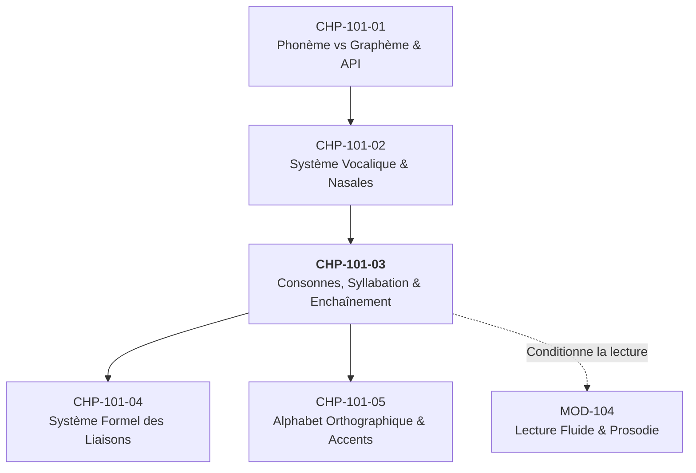
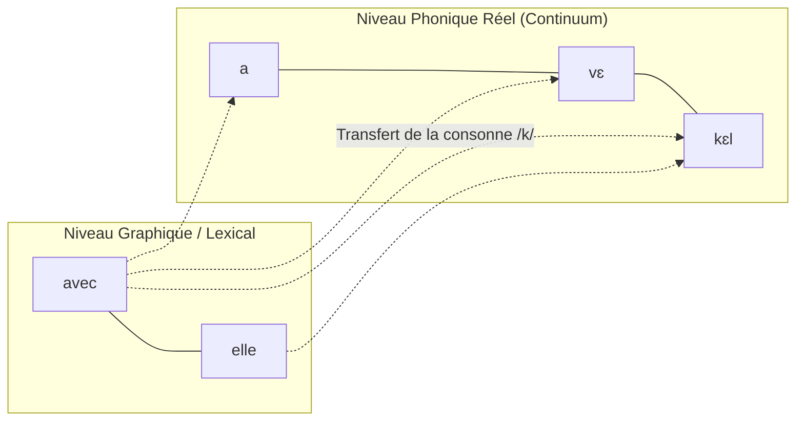

# Chapitre 3 — Les Consonnes, la Syllabation et l'Enchaînement : Du Segment Isolé au Continuum Sonore

> **Identifiant du chapitre** : `CHP-101-03`  
> **Module** : `MOD-101` (*Positionnement Diagnostique, Phonétique Appliquée (API) et Alphabet Orthographique*)  
> **Semestre** : Année 1 — Semestre 1 (S1)  
> **Volume horaire estimé** : 5 à 6 heures (Phase 1 — Étude théorique et appropriation : 1 h 30 | Phase 2 — Pratique syllabique et enchaînements actifs : 2 h | Phase 3 — Ateliers de correction raisonnée et lecture continue : 1 h | Phase 4 — Consolidation, rappel actif et évaluation : 1 h)  
> **Statut** : [STATUT : VALIDÉ]  
> **Alignement référentiel** : [`FR-PHON-001` (Palier L3 Autonomie)](file:///f:/Formation/world-class-french/02-competency-framework/competency-framework.md#fr-phon-001-maîtrise-des-contrastes-phonologiques-et-de-la-prosodie-formelle), [`academic-structure.md`](file:///f:/Formation/world-class-french/01-architecture/academic-structure.md), [`source-registry.md`](file:///f:/Formation/world-class-french/07-resources/source-registry.md)

---

## 1. Titre et Place dans le Cursus

### 1.1 Intitulé officiel
**CHP-101-03 : Les Consonnes, la Syllabation et l'Enchaînement : Du Segment Isolé au Continuum Sonore**

### 1.2 Insertion architecturale
Au sein du module `MOD-101`, ce troisième chapitre succède immédiatement à l'étude de la double nature du code linguistique (`CHP-101-01`) et à celle du trapèze vocalique et des voyelles nasales (`CHP-101-02`). Il constitue la clé de voûte de la phonétique segmentale et suprasegmentale fondamentale :



Tandis que les voyelles représentent le centre vibratoire et l'énergie acoustique du français, les consonnes en délimitent les contours et rythment le flux sonore. Mais le français oral soigné présente une particularité structurale déterminante : **les consonnes ne restent pas captives de leurs frontières lexicales graphiques**. Elles s'organisent en syllabes ouvertes selon un principe de resyllabation mécanique continue appelé *enchaînement*.

Sans la maîtrise de ce chapitre, l'apprenant ne peut ni comprendre la mécanique phonologique des liaisons (`CHP-101-04`), ni maîtriser la règle morphophonologique de placement des accents (`CHP-101-05`), qui découle directement de la structure de la syllabe ouverte ou fermée (Loi de position).

---

## 2. Objectifs Mesurables

Au terme de ce chapitre, l'apprenant démontrera de manière observable qu'il est capable de :

1. **Classifier et discriminer** l'intégralité des 17 consonnes du français standard et des 3 semi-consonnes selon leurs trois traits phonétiques cardinaux : mode d'articulation, point d'articulation et voisement (corrélation de sonorité) [Réf. `SRC-PHON-01`, chap. 4].
2. **Découper rigoureusement** des énoncés en syllabes phonétiques conformément au principe de maximalisation de l'attaque et à la préférence structurale pour la syllabe ouverte canonique (CV).
3. **Appliquer la Loi de position** pour justifier et réaliser la fermeture ou l'ouverture des voyelles moyennes (/e/ vs /ɛ/, /o/ vs /ɔ/, /ø/ vs /œ/) selon que la syllabe est ouverte ou fermée [Réf. `SRC-PHON-01`, chap. 3].
4. **Réaliser impeccablement l'enchaînement consonantique** (resyllabation d'une consonne fixe finale en attaque vocalique) et **l'enchaînement vocalique** dans la chaîne parlée continue, sans rupture glottale parasite (coup de glotte [ʔ]) [Réf. `SRC-PHON-02`, p. 45-52].
5. **Distinguer sans équivoque** l'enchaînement consonantique (resyllabation d'une consonne toujours audible) de la liaison (réactivation d'une consonne latente conditionnée par la syntaxe) [Réf. `SRC-PHON-03`, chap. 6].

---

## 3. Prérequis et Test de Préparation

### 3.1 Prérequis académiques
- Connaissance des symboles API fondamentaux du français (`CHP-101-01`).
- Reconnaissance des degrés d'aperture vocalique (voyelles fermées, mi-fermées, mi-ouvertes, ouvertes) (`CHP-101-02`).
- Capacité d'enregistrer et de réécouter sa propre voix sur support numérique.

### 3.2 Test diagnostique de préparation (Auto-évaluation en 3 minutes)

Répondez mentalement ou par écrit aux 3 questions suivantes avant d'aborder la leçon :

1. *Parmi ces trois mots, lequel se termine par une voyelle phonétique à l'oral ?*  
   a) *table*  
   b) *chocolat*  
   c) *porte*  
   *(Réponse attendue : b — chocolat se transcrit /ʃɔ.kɔ.la/, alors que table se termine par la consonne /l/ et porte par /t/).*
2. *Quelle est la différence mécanique entre le son /p/ et le son /b/ ?*  
   *(Réponse attendue : Le voisement — les cordes vocales vibrent pour /b/ [sonore], mais restent inertes pour /p/ [sourde]).*
3. *Dans la suite « une amie », la lettre « e » de « une » s'entend-elle à l'oral ? Que devient le son /n/ ?*  
   *(Réponse attendue : Non, le « e » graphique est caduc ; la consonne /n/ s'attache directement à la voyelle /a/ du mot suivant : /y.na.mi/).*

---

## 4. Situation de Départ ou Problème Concret

### Le syndrome de la lecture hachée et du coup de glotte parasite

Considérons la phrase suivante prononcée par un orateur lors d'une allocution officielle :
> *« Elle arrive avec un immense espoir. »*

Dans une élocution défaillante, marquée par l'insécurité linguistique ou par le calque de langues à découpage rigide (comme l'anglais, l'allemand ou certaines langues ouest-africaines tonales), l'orateur découpe chaque mot selon son unité lexicale graphique :
> `[ɛl | ʔa.ʁiv | a.vɛk | ʔœ̃ | ʔi.mɑ̃.sɛs.pwaʁ]`

Que s'est-il produit acoustiquement ?
1. L'orateur a inséré un arrêt brusque de l'air au niveau du larynx, appelé **coup de glotte** (`[ʔ]`), devant chaque mot commençant par une voyelle (*arrive*, *un*, *immense*).
2. Il a isolé la consonne finale de *avec* (`[a.vɛk]`), relâchant brutalement la pression d'air au lieu de la projeter vers la voyelle suivante.
3. Le résultat acoustique est heurté, syncopé, fatigant pour l'auditeur, et détruit totalement l'isochronie syllabique et l'élégance mélodique du français standard.

À l'opposé, un locuteur formé à la diction académique et à la phonétique formelle produit un **ruban sonore ininterrompu** :
> `[ɛ.la.ʁi.va.vɛ.kœ̃.ni.mɑ̃.sɛs.pwaʁ]`  
> Découpage syllabique : `[ɛ - la - ʁi - va - vɛ - kœ̃ - ni - mɑ̃ - sɛs - pwaʁ]`

Toutes les consonnes finales fixes ont migré pour ouvrir la syllabe suivante. Le continuum sonore français n'est pas une simple juxtaposition de mots autonomes : c'est une succession de syllabes rythmées articulées sans à-coups [Réf. `SRC-PHON-02`, p. 48].

---

## 5. Explication Intuitive

Imaginons le flux de parole en français comme une rame de train en mouvement continu.
- Les **voyelles** sont les wagons : elles ont du volume, de la résonance, elles transportent la sonorité.
- Les **consonnes** sont les essieux et les roues motrices : elles marquent les articulations et propulsent les wagons.

Dans beaucoup d'autres langues, chaque mot est un train autonome qui s'arrête net avant que le suivant ne démarre. En français standard, dès que plusieurs mots se suivent dans un même groupe de souffle (le groupe rythmique), la frontière entre les mots disparaît phonétiquement. 

Si un wagon se termine par une roue (une consonne prononcée, comme le /k/ de *avec*) et que le wagon suivant commence par un espace vide (une voyelle, comme le /ɛ/ de *elle*), **la consonne saute la frontière lexicale pour venir porter la voyelle suivante**. On n'entend pas *« avec... elle »*, mais *« a-vé-kelle »*. 

Le français déteste terminer ses syllabes par des consonnes encombrantes quand il a l'occasion de les transformer en syllabes ouvertes légères. C'est ce principe d'économie musculaire et de fluidité cinétique que nous appelons **l'enchaînement**.

---

## 6. Définitions Précises et Terminologie

Pour analyser scientifiquement ce continuum sonore, nous devons nous doter d'une terminologie phonétique exacte et standardisée [Réf. `SRC-PHON-01`, chap. 4 ; `SRC-GRAM-02`, chap. 2] :

### 6.1 Les critères articulatoires des consonnes
Une **consonne** est un son du langage produit par une obstruction totale ou partielle du passage de l'air dans le conduit vocal (par opposition à la voyelle, où le passage reste libre). Elle se caractérise par trois axes :

1. **Mode d'articulation** :
   - *Occlusive (ou plosive)* : Fermeture totale et hermétique du canal vocal, suivie d'un relâchement brusque (explosion). Ex. : /p, b, t, d, k, g/ et les nasales /m, n, ɲ, ŋ/.
   - *Fricative (ou constrictive)* : Rétrécissement étroit du canal vocal créant une friction ou un frottement d'air continu. Ex. : /f, v, s, z, ʃ, ʒ, ʁ/.
   - *Latérale* : L'air s'échappe librement par les côtés de la langue tandis que le centre est en contact avec les alvéoles. Ex. : /l/.
2. **Point (ou lieu) d'articulation** :
   - Endroit précis où s'opère le contact ou le resserrement :
     - *Bilabial* (les deux lèvres) : /p, b, m/
     - *Labio-dental* (lèvre inférieure contre incisives supérieures) : /f, v/
     - *Apico-dental / alvéolaire* (pointe de la langue contre les dents ou les alvéoles) : /t, d, n, l, s, z/
     - *Palatal / post-alvéolaire* (dos ou lame de la langue contre le palais dur) : /ʃ, ʒ, ɲ/
     - *Vélaire* (dos de la langue contre le voile du palais) : /k, g, ŋ/
     - *Uvulaire* (postérieur de la langue contre la luette) : /ʁ/
3. **Voisement (ou sonorité)** :
   - *Sourde (ou non voisée)* : Les cordes vocales ne vibrent pas lors de l'émission. Ex. : /p, t, k, f, s, ʃ/.
   - *Sonore (ou voisée)* : Les cordes vocales entrent en vibration périodique. Ex. : /b, d, g, v, z, ʒ, ʁ, l, m, n, ɲ, ŋ/.

### 6.2 Les semi-consonnes (ou glides / semi-voyelles / spirantes)
- Sons de transition articulatoire rapide présentant la résonance acoustique d'une voyelle très fermée, mais la fonction syllabique non nucléaire d'une consonne.
- Elles ne peuvent jamais constituer le sommet d'intensité (noyau) d'une syllabe.
- Le français possède trois semi-consonnes : **/j/** (glide palatal correspondant à /i/), **/w/** (glide labio-vélaire correspondant à /u/), **/ɥ/** (glide labio-palatal correspondant à /y/).

### 6.3 Structure interne de la syllabe
Une syllabe phonétique ($\sigma$) est une unité de groupement articulatoire centrée sur un noyau vocalique. Elle est constituée de :
$$\sigma = \text{Attaque} + \text{Rime} \quad (\text{avec } \text{Rime} = \text{Noyau} + \text{Coda})$$

- **Attaque (Onset)** : Consonne(s) précédant le noyau vocalique.
- **Noyau (Nucleus)** : Centre obligatoire de la syllabe, toujours formé par une voyelle en français.
- **Coda** : Consonne(s) fermant la syllabe après le noyau vocalique.
- **Syllabe ouverte** : Syllabe dont la coda est vide ($\text{Coda} = \emptyset$). Elle se termine phonétiquement par une voyelle prononcée (ex. : *pas* /pa/, *café* /ka.fe/).
- **Syllabe fermée** : Syllabe dont la coda est occupée par une ou plusieurs consonnes prononcées (ex. : *porte* /pɔʁt/, *mer* /mɛʁ/).

---

## 7. Règles ou Mécanismes Fondamentaux

### 7.1 Inventaire articulatoire des 17 consonnes et 3 semi-consonnes

Le système consonantique du français standard repose sur un équilibre rigoureux de correspondances sourde/sonore [Réf. `SRC-PHON-01`, chap. 4] :

| Mode d'articulation | Bilabiale | Labio-dentale | Apico-dentale / Alvéolaire | Post-alvéolaire / Palatale | Dorso-vélaire | Dorso-uvulaire |
| :--- | :---: | :---: | :---: | :---: | :---: | :---: |
| **Occlusive sourde** | **/p/** (*pas*) | | **/t/** (*tas*) | | **/k/** (*car*) | |
| **Occlusive sonore** | **/b/** (*bas*) | | **/d/** (*dos*) | | **/g/** (*gare*) | |
| **Fricative sourde** | | **/f/** (*feu*) | **/s/** (*sou*) | **/ʃ/** (*chou*) | | |
| **Fricative sonore** | | **/v/** (*vœu*) | **/z/** (*zoo*) | **/ʒ/** (*joue*) | | **/ʁ/** (*rue*) |
| **Occlusive nasale** | **/m/** (*mot*) | | **/n/** (*nid*) | **/ɲ/** (*vigne*) | **/ŋ/** (*parking*) | |
| **Latérale liquide** | | | **/l/** (*lit*) | | | |
| **Semi-consonnes** | | | | **/j/** (*yeux*) | **/w/** (*oui*) | **/ɥ/** (*huit*) |

> [!NOTE]
> La consonne nasale vélaire **/ŋ/** provient d'emprunts lexicaux modernes (anglicismes en *-ing* : *camping, footing, parking*). Bien que périphérique historiquement, elle est pleinement intégrée au système perceptif du français contemporain [Réf. `SRC-PHON-01`, p. 112]. La consonne latérale **/l/** et la fricative uvulaire **/ʁ/** sont traditionnellement appelées *liquides*.

### 7.2 La structure syllabique canonique et le principe d'ouverture
Le français se distingue des langues germaniques par une forte répugnance pour les syllabes fermées et les codas consonantiques lourdes :
- **Préférence statistique absolue** : Plus de 75 % des syllabes émises en français standard spontané ou soigné sont des **syllabes ouvertes** de type CV (Consonne + Voyelle) [Réf. `SRC-PHON-02`, p. 28].
- **Principe de maximalisation de l'attaque** : Entre deux voyelles successives, toute consonne simple est systématiquement attirée comme attaque de la syllabe suivante plutôt que comme coda de la précédente.  
  *Exemple* : *aimer* est découpé `/e.me/` (V.CV) et **jamais** `/em.e/` (VC.V).

### 7.3 La Loi de position (Aperture vocalique et fermeture syllabique)
La Loi de position est une tendance phonologique cardinale du français qui conditionne l'aperture des voyelles moyennes (/e - ɛ/, /o - ɔ/, /ø - œ/) par la structure de la syllabe [Réf. `SRC-PHON-01`, chap. 3] :

$$\begin{cases}
\text{En syllabe ouverte} & \longrightarrow \text{Voyelle MI-FERMÉE } (/e, o, ø/) \\
\text{En syllabe fermée} & \longrightarrow \text{Voyelle MI-OUVERTE } (/ɛ, ɔ, œ/)
\end{cases}$$

1. **Série d'antériorité non arrondie (/e/ vs /ɛ/)** :
   - Syllabe ouverte : *clé* `/kle/`, *donner* `/dɔ.ne/` (voyelle mi-fermée `/e/`).
   - Syllabe fermée : *mer* `/mɛʁ/`, *sec* `/sɛk/`, *fête* `/fɛt/` (voyelle mi-ouverte `/ɛ/`).
2. **Série de postériorité arrondie (/o/ vs /ɔ/)** :
   - Syllabe ouverte : *pot* `/po/`, *bateau* `/ba.to/` (voyelle mi-fermée `/o/`).
   - Syllabe fermée : *porte* `/pɔʁt/`, *bol* `/bɔl/`, *botte* `/bɔt/` (voyelle mi-ouverte `/ɔ/`).
3. **Série d'antériorité arrondie (/ø/ vs /œ/)** :
   - Syllabe ouverte : *peu* `/pø/`, *deux* `/dø/` (voyelle mi-fermée `/ø/`).
   - Syllabe fermée : *peur* `/pœʁ/`, *neuf* `/nœf/`, *seul* `/sœl/` (voyelle mi-ouverte `/œ/`).

### 7.4 L'Enchaînement consonantique (Resyllabation frontière)
**Règle fondamentale** : Lorsqu'un mot se termine par une consonne finale **qui est toujours prononcée** (même lorsque le mot est isolé ou devant consonne), et que le mot suivant commence par une voyelle ou une semi-consonne, cette consonne quitte la coda lexicale pour devenir **l'attaque phonétique** de la première syllabe du mot suivant [Réf. `SRC-PHON-02`, p. 48 ; `SRC-GRAM-01`, § 39].

- Formule de transfert : `[... C] + [V ...]  ⟶  [... - C V ...]`
- *avec elle* : `/a.vɛk/ + /ɛl/  ⟶  /a.vɛ.kɛl/` (syllabation : `[a - vɛ - kɛl]`)
- *pour un homme* : `/puʁ/ + /œ̃/ + /ɔm/  ⟶  /pu.ʁœ̃.nɔm/` (syllabation : `[pu - ʁœ̃ - nɔm]`)
- *sept ans* : `/sɛt/ + /ɑ̃/  ⟶  /sɛ.tɑ̃/` (syllabation : `[sɛ - tɑ̃]`)

### 7.5 L'Enchaînement vocalique (Continuum trans-lexical)
**Règle fondamentale** : Lorsque deux voyelles se trouvent en contact immédiat à la frontière de deux mots dans le même groupe rythmique, le passage d'une voyelle à la suivante s'effectue par une **transition d'aperture continue sans arrêt d'air glottal** [Réf. `SRC-PHON-01`, p. 125].

- *il a eu* : `/i.la.y/` (et non `/il a ʔ y/`)
- *j'ai été* : `/ʒe.e.te/`
- *tu as osé* : `/ty.a.o.ze/`

---

## 8. Raisonnement Détaillé Permettant de Comprendre ces Règles

Pourquoi la langue française fonctionne-t-elle ainsi ? Rien dans cette mécanique n'est arbitraire ; tout procède d'une convergence articulatoire et acoustique historique :

### 8.1 L'impératif de dépense d'énergie et la tension musculaire croissante
La phonétique française est caractérisée par ce que Pierre Léon appelle une **tension musculaire croissante** au cours de l'émission de la syllabe [Réf. `SRC-PHON-01`, p. 34]. 
- Dans une syllabe ouverte (CV), la consonne d'attaque prépare et projette l'explosion d'air, et la voyelle s'épanouit pleinement jusqu'au sommet de tension.
- Dans une syllabe fermée (CVC), la consonne finale vient freiner brusquement le flux d'air. Ce freinage force les organes phonateurs à relâcher prématurément la tension vocalique. C'est précisément pour cela que les voyelles moyennes s'ouvrent en syllabe fermée : **une voyelle ouverte exige une position de langue plus basse, plus proche du repos articulatoire**, s'adaptant ainsi au temps réduit que lui laisse la consonne de coda.

### 8.2 La genèse de l'enchaînement : La syllabe syntaxique vs la syllabe lexicale
Le français moderne n'a pas d'accent de mot lexical : il a un **accent de groupe** (accent tonique oxytonique, frappant la toute dernière syllabe sonore du groupe rythmique). 

Puisque le mot isolé ne possède pas d'indépendance accentuelle en français, il perd son identité phonétique isolée dès qu'il entre dans un énoncé. Le groupe rythmique se comporte phonologiquement exactement comme s'il était **un seul mot géant**. 
Par conséquent, lorsqu'une consonne finale rencontre une voyelle initiale au sein de ce mot géant, elle obéit au principe universel du français : *maximiser l'attaque*. Elle s'accroche à la voyelle suivante pour fabriquer ce que le français préfère par-dessus tout : **une syllabe ouverte CV**.



---

## 9. Exemples Corrects Commentés avec Transcriptions API et Découpages Syllabiques

Examinons 6 énoncés modèles illustrant le jeu combiné des consonnes, de la resyllabation et de la Loi de position :

### Exemple 1 : Enchaînement consonantique simple
- **Graphie** : *Une robe élégante.*
- **Analyse lexicale isolée** : *une* `/yn/`, *robe* `/ʁɔb/`, *élégante* `/e.le.gɑ̃t/`.
- **Transcription API continue** : `/yn.ʁɔ.be.le.gɑ̃t/`
- **Découpage syllabique** : `[yn - ʁɔ - be - le - gɑ̃t]`
- **Commentaire articulatoire** : Le `/b/` de *robe* est une consonne fixe (prononcée même si l'on s'arrête là). Devant la voyelle initiale `/e/` d'*élégante*, le `/b/` devient l'attaque de la troisième syllabe `[be]`. Par ailleurs, dans *robe*, la voyelle `/ɔ/` reste ouverte parce que dans la racine lexicale et sous accent, elle était en syllabe fermée avant resyllabation.

### Exemple 2 : Chaîne d'enchaînements consonantiques multiples
- **Graphie** : *Par un bel après-midi d'été.*
- **Analyse lexicale isolée** : *par* `/paʁ/`, *un* `/œ̃/`, *bel* `/bɛl/`, *après-midi* `/a.pʁɛ.mi.di/`, *d'été* `/de.te/`.
- **Transcription API continue** : `/pa.ʁœ̃.bɛ.la.pʁɛ.mi.di.de.te/`
- **Découpage syllabique** : `[pa - ʁœ̃ - bɛ - la - pʁɛ - mi - di - de - te]`
- **Commentaire articulatoire** : Deux enchaînements consonantiques consécutifs s'opèrent :
  1. Le `/ʁ/` de *par* ouvre la syllabe du déterminant indéfini : `[pa - ʁœ̃]`.
  2. Le `/l/` de *bel* ouvre la syllabe initiale d'*après-midi* : `[bɛ - la]`.
  Chaque syllabe résultante est une syllabe ouverte, assurant une parfaite aisance respiratoire.

### Exemple 3 : Enchaînement vocalique pur
- **Graphie** : *Il a oublié.*
- **Analyse lexicale isolée** : *il* `/il/`, *a* `/a/`, *oublié* `/u.bli.je/`.
- **Transcription API continue** : `/i.la.u.bli.je/`
- **Découpage syllabique** : `[i - la - u - bli - je]`
- **Commentaire articulatoire** : Le `/l/` de *il* s'enchaîne consonantiement sur *a* (`[i - la]`). Ensuite, la voyelle `/a/` glisse sans à-coup vers la voyelle `/u/` (`[la - u]`). Les cordes vocales maintiennent leur vibration sans interruption glottale : aucun coup de glotte `[ʔ]` ne doit séparer *a* et *oublié*.

### Exemple 4 : Application stricte de la Loi de position sur les voyelles moyennes
- **Graphie** : *Ce premier hiver sévère.*
- **Analyse syllabique et transcription** :
  - *premier* : `/pʁə.mje/` $\rightarrow$ Le mot finit par une voyelle prononcée (syllabe ouverte) : réalisation `/e/` mi-fermée.
  - *hiver* : `/i.vɛʁ/` $\rightarrow$ Le mot finit par la consonne `/ʁ/` prononcée (syllabe fermée) : réalisation `/ɛ/` mi-ouverte.
  - *sévère* : `/se.vɛʁ/` $\rightarrow$ Première syllabe ouverte (`/se/`), deuxième syllabe fermée (`/vɛʁ/`).
- **Ensemble de l'énoncé en chaîne parlée** : `/sə.pʁə.mje.i.vɛʁ.se.vɛʁ/` $\rightarrow$ `[sə - pʁə - mje - i - vɛʁ - se - vɛʁ]`.

### Exemple 5 : Les trois semi-consonnes en action
- **Graphie** : *La nuit, huit oiseaux fuyaient.*
- **Transcription API continue** : `/la.nɥi . ɥi.twa.zo . fɥi.jɛ/`
- **Découpage syllabique** : `[la - nɥi - ɥi - twa - zo - fɥi - jɛ]`
- **Commentaire articulatoire** :
  - Dans *nuit* (`/nɥi/`) et *huit* (`/ɥi/`), la semi-consonne labio-palatale `/ɥ/` anticipe la voyelle `/i/` avec projection et arrondissement des lèvres.
  - Dans *oiseaux* (`/wa.zo/`), la semi-consonne labio-vélaire `/w/` amorce la voyelle `/a/`.
  - Dans *fuyaient* (`/fɥi.jɛ/`), nous observons le glide labio-palatal `/ɥ/` en attaque suivi d'un glide palatal `/j/` liant le `/i/` et le `/ɛ/`.

### Exemple 6 : Resyllabation complexe avec groupe consonantique
- **Graphie** : *Un autre arbre.*
- **Transcription API continue** : `/œ̃.no.tʁaʁbʁ/`
- **Découpage syllabique** : `[œ̃ - no - tʁaʁbʁ]` (ou avec allègement familier `/œ̃.no.tʁaʁb/`)
- **Commentaire articulatoire** : Dans *autre* `/otʁ/`, le groupe consonne + liquide `/tʁ/` s'enchaîne solidairement à l'initiale d'*arbre* : le `/t/` et le `/ʁ/` migrent vers la syllabe suivante pour former l'attaque complexe `[tʁaʁbʁ]`.

---

## 10. Contre-Exemples et Erreurs Fréquentes

L'analyse clinique des erreurs chez les apprenants universitaires et les professionnels révèle trois déviances majeures qu'il convient de proscrire formellement [Réf. `SRC-PHON-01`, chap. 5 ; `SRC-PHON-02`] :

### 10.1 Le coup de glotte parasite à l'attaque vocalique (`*[ʔ]*`)
- **Manifestation fautive** : Prononcer *« un grand espoir »* comme `[œ̃ gʁɑ̃t ʔ ɛspwaʁ]` ou *« elle adore »* comme `[ɛl ʔ adɔʁ]`.
- **Diagnostic phonétique** : L'apprenant referme ses cordes vocales avant d'attaquer la voyelle, croyant marquer la « propreté » ou la frontière du mot.
- **Correction raisonnée** : Le coup de glotte `[ʔ]` n'est pas un phonème du français standard. Il constitue une faute de prosodie qui rompt le flux respiratoire continu. La glotte doit rester détendue et prête à vibrer immédiatement lors du passage de la consonne à la voyelle : prononcez `[ɛ.la.dɔʁ]`.

### 10.2 La confusion grave entre enchaînement consonantique et liaison
- **Manifestation fautive** : Déclarer que dans *« avec un ami »*, la prononciation du `/k/` est une « liaison ». Ou inversement, prononcer la consonne finale d'un mot au singulier isolé (*« un grand »* prononcé `*[gʁɑ̃t]*`).
- **Correction raisonnée** :
  - Dans *avec*, la consonne `/k/` est **intrinsèque et fixe** : elle existe dans *avec Pierre* (`/a.vɛk.pjɛʁ/`) comme dans *avec Anne* (`/a.vɛ.kan/`). C'est un **enchaînement consonantique**.
  - Dans *grand*, le *d* final est **muet** devant consonne (*un grand pont* `/œ̃.gʁɑ̃.pɔ̃/`) et ne se réveille comme consonne `/t/` que devant voyelle (*un grand arbre* `/œ̃.gʁɑ̃.taʁbʁ/`). C'est une **liaison formelle** (consonne latente).

```text
Tableau de Démarcation Absolue :
┌────────────────────────┬─────────────────────────┬─────────────────────────┐
│ Propriété              │ Enchaînement            │ Liaison                 │
├────────────────────────┼─────────────────────────┼─────────────────────────┤
│ Nature de la consonne  │ Fixe et stable          │ Latente (muette isolée) │
│ Prononcée devant cons. │ OUI (avec Paul /a.vɛk/) │ NON (les ponts /le/)    │
│ Modification de timbre │ JAMAIS (/k/ reste /k/)  │ POSSIBLE (d->/t/, s->/z/)│
│ Condition syntaxique   │ Purement mécanique      │ Conditionnée grammatical│
└────────────────────────┴─────────────────────────┴─────────────────────────┘
```

### 10.3 La substitution de /w/ à la semi-consonne /ɥ/
- **Manifestation fautive** : Prononcer *huit* `*[wit]*` au lieu de `/ɥit/`, *nuit* `*[nwi]*` au lieu de `/nɥi/`, *saluer* `*[salwe]*` au lieu de `/sa.lɥe/`.
- **Diagnostic phonétique** : La semi-consonne `/ɥ/` est le correspondant semi-vocalique de la voyelle antérieure arrondie `/y/` (*tu*). Beaucoup de langues étrangères ou de langues d'Afrique de l'Ouest (qui possèdent la voyelle postérieure `/u/`, mais pas `/y/`) rapatrient le glide vers `/w/`.
- **Correction raisonnée** : Pour produire `/ɥ/`, avancez les lèvres en cul-de-poule et tendez la langue vers l'avant contre les incisives inférieures (position de `/y/`), puis ouvrez instantanément vers la voyelle suivante. Si la langue recule vers le voile du palais, vous produisez fautivement `/w/`.

### 10.4 L'assourdissement ou voisement erroné par contact (Assimilation fautive)
- **Manifestation fautive** : Prononcer *« une tasse de thé »* comme `*[yn tas tə te]*` ou *« chemin de fer »* comme `*[ʃmɛ̃ d fɛʁ]*` avec chute désordonnée des consonnes.
- **Règle** : L'assimilation en français standard est généralement **régressive** (la deuxième consonne impose son voisement à la première). Exemple : *médecin* `/med.sɛ̃/` $\rightarrow$ le `/d/` (sonore) s'assourdit au contact de `/s/` (sourde) pour donner `[mɛt.sɛ̃]`. Mais cette assimilation ne doit pas être exagérée au point de défigurer le lexique en registre soigné.

---

## 11. Cas Particuliers et Limites

### 11.1 Les consonnes géminées : phénomène réel ou illusion graphique ?
En français standard non méridional, la double consonne orthographique (*lettre, année, apporter*) ne se prononce pas double : elle se prononce comme **une consonne simple unique** (*lettre* `/lɛtʁ/`, *année* `/a.ne/`, *apporter* `/a.pɔʁ.te/`).

Il existe cependant deux cas précis où la gémination phonétique (prolongation de la tenue de la consonne) est authentique et fonctionnelle [Réf. `SRC-PHON-01`, p. 118] :
1. **Gémination distinctive morphologique** :
   - À l'indicatif imparfait vs conditionnel présent des verbes *mourir*, *courir*, *acquérir* :
     - *Il mourait* `/il.mu.ʁɛ/` (consonne simple).
     - *Il mourrait* `/il.muʁ.ʁɛ/` ou `[il.mu.ʁːɛ]` (consonne géminée : opposition distinctive de mode !).
2. **Gémination de contact syntaxique** :
   - Lorsque la consonne finale d'un mot est identique à la consonne initiale du mot suivant :
     - *Une grande dame* $\rightarrow$ `/yn.gʁɑ̃d.dam/` `[yn.gʁɑ̃.dːam]`. L'occlusion linguale sur `/d/` est maintenue deux fois plus longtemps.
     - *Pour rien* $\rightarrow$ `/puʁ.ʁjɛ̃/`.

### 11.2 Le statut du phonème marginal /ŋ/ dans le lexique d'emprunt
Le français a intégré au XXe siècle une série d'emprunts lexicaux à l'anglais terminés par le digramme graphique *-ing* (*parking, meeting, brushing, bowling, jogging, camping*).
- En français standard contemporain, la terminaison se prononce par l'occlusive nasale dorso-vélaire pure **/ŋ/** : `/paʁ.kiŋ/`, `/kam.piŋ/`.
- Deux dérives sont à éviter :
  1. La prononciation provinciale ou archaïsante avec appendice occlusif dur : `*[paʁ.kiŋg]*` (rejetée en diction soignée).
  2. La francisation complète par la voyelle nasale : `*[paʁ.kɛ̃n]*` ou `*[paʁ.kɛ̃]*`.

### 11.3 La consonne /ɲ/ : résistance ou régression vers /nj/ ?
La nasale palatale pure `/ɲ/` (*vigne* `/viɲ/`, *campagne* `/kɑ̃.paɲ/`) tend, dans l'usage relâché ou sous l'influence de certains accents régionaux, à se décomposer en deux segments : une nasale alvéolaire suivie d'un glide palatal `[nj]` (*panier* `/pa.nje/`). 
En diction soignée et en lecture formelle, le maintien du point d'articulation palatal pur `/ɲ/` (dos de la langue étalé contre la voûte du palais dur sans frottement secondaire) demeure la norme de référence académique [Réf. `SRC-PHON-01`, p. 110].

---

## 12. Approfondissement Adapté au Niveau du Chapitre

### 12.1 La théorie de la force articulatoire et de la sonorité syllabique
En phonologie générative et métrique [Réf. `SRC-PHON-03`, chap. 2], les segments de la parole sont ordonnés selon une **échelle de sonorité intrinsèque** universelle :

$$\text{Occlusives sourdes } (0) < \text{Occlusives sonores } (1) < \text{Fricatives } (2) < \text{Nasales } (3) < \text{Liquides } (4) < \text{Glides } (5) < \text{Voyelles } (6)$$

Toute syllabe canonique bien formée obéit au **Principe de la Pente de Sonorité (Sonority Sequencing Principle)** :
- La sonorité doit **augmenter** depuis l'attaque vers le noyau vocalique (sommet d'intensité).
- La sonorité doit **décroître** depuis le noyau vers la coda.

*Exemple d'attaque complexe conforme en français* :
- Dans le mot *train* `/tʁɛ̃/` : `/t/` (occlusive = 0) $\rightarrow$ `/ʁ/` (liquide = 4) $\rightarrow$ `/ɛ̃/` (voyelle = 6). La pente monte régulièrement : la syllabe est stable et naturelle.
- À l'inverse, une suite `/ʁt/` en attaque violerait la pente de sonorité (la liquide a une sonorité supérieure à l'occlusive). Le français refuse `/ʁte/` et requiert une voyelle d'appui ou une resyllabation.

### 12.2 L'amuïssement des liquides finales dans la chaîne parlée familière vs standard
Dans la parole relâchée ou familière, les groupes consonantiques finaux formés d'une obstruante suivie d'une liquide (`/tʁ/`, `/kʁ/`, `/bʁ/`, `/pl/`, `/bl/`) ont tendance à perdre leur liquide devant consonne ou en fin d'énoncé :
- *« Notre père »* prononcé familièrement `*[nɔt.pɛʁ]*` au lieu de `/nɔ.tʁə.pɛʁ/` ou `/nɔ.tʁ.pɛʁ/`.
- *« Une table basse »* prononcé `*[yn.tab.bas]*` au lieu de `/yn.tabl.bas/`.

En **français standard soutenu et formel**, cet amuïssement est formellement **proscrit** : la liquide finale doit être maintenue et articulée légèrement, sans voyelle parasite mais avec une détente consonantique nette.

---

## 13. Comparaisons Permettant de Distinguer les Notions Proches

Pour éviter les confusions didactiques les plus pernicieuses, voici deux analyses comparatives détaillées :

### 13.1 Enchaînement consonantique vs Liaison formelle

| Critère d'analyse | Enchaînement consonantique | Liaison formelle |
| :--- | :--- | :--- |
| **Statut de la consonne à l'état isolé** | **Toujours audible et réalisée**.<br/>Ex. : *avec* `/a.vɛk/`, *pour* `/puʁ/`. | **Muette et latente**.<br/>Ex. : *les* `/le/`, *grand* `/gʁɑ̃/`, *deux* `/dø/`. |
| **Comportement devant consonne** | **Reste prononcée**.<br/>*avec Paul* $\rightarrow$ `/a.vɛk.pɔl/`. | **Disparaît totalement**.<br/>*les ponts* $\rightarrow$ `/le.pɔ̃/`. |
| **Modification du son consonne** | **Aucune** : le phonème reste identique.<br/>/k/ reste /k/, /ʁ/ reste /ʁ/. | **Fréquente altération phonétique** :<br/>*d* devient `/t/` (*grand homme*) ;<br/>*s/x* devient `/z/` (*deux amis*). |
| **Nature du conditionnement** | **Purement articulatoire et mécanique** (dès qu'une consonne fixe précède une voyelle). | **Morphosyntaxique et stylistique** (dépend de la catégorie grammaticale et du registre). |
| **Nature de l'infraction si omis** | Diction heurtée avec coup de glotte parasite (faute prosodique). | Erreur grammaticale (omission de liaison obligatoire ou liaison interdite). |

### 13.2 Voyelle pleine vs Semi-consonne (Glide)

| Propriété | Voyelle pleine (ex. /i/, /u/, /y/) | Semi-consonne (ex. /j/, /w/, /ɥ/) |
| :--- | :--- | :--- |
| **Rôle dans la syllabe** | **Noyau obligatoire** : forme le centre énergétique de la syllabe. | **Attaque ou Coda** : ne peut jamais constituer un noyau de syllabe. |
| **Accentuation** | Peut porter l'accent tonique principal de fin de groupe. | Ne porte **jamais** l'accent tonique. |
| **Durée acoustique** | Sons tenus, stables et stables en fréquence. | Sons ultra-brefs, articulés en transition dynamique vers ou depuis une voyelle. |
| **Paire minimale distinctive** | *abbaye* `/a.bɛ.i/` (3 syllabes : /i/ est une voyelle pleine). | *abeille* `/a.bɛj/` (2 syllabes : /j/ est une semi-consonne en coda). |
| | *pays* `/pe.i/` (2 syllabes). | *paye* `/pɛj/` (1 syllabe). |

---

## 14. Exercices Progressifs

### Niveau 1 : Découpage syllabique et classement consonantique

#### Exercice 1.1 — Découpage syllabique phonétique
Découpez les mots et syntagmes suivants en syllabes phonétiques conformément au principe de maximalisation de l'attaque. Pour chaque syllabe, indiquez si elle est **ouverte [O]** ou **fermée [F]** :
1. *Capacité*
2. *Atmosphère*
3. *Septembre*
4. *Une amie*

*Corrigé 1.1 :*
1. *Capacité* : `/ka - pa - si - te/` $\rightarrow$ [O] - [O] - [O] - [O] (4 syllabes ouvertes).
2. *Atmosphère* : `/at - mɔs - fɛʁ/` $\rightarrow$ [F] - [F] - [F] (3 syllabes fermées).
3. *Septembre* : `/sɛp - tɑ̃bʁ/` $\rightarrow$ [F] - [F] (2 syllabes fermées).
4. *Une amie* : `/y - na - mi/` $\rightarrow$ [O] - [O] - [O] (l'enchaînement transforme la consonne finale de *une* en attaque : 3 syllabes ouvertes).

#### Exercice 1.2 — Matrice articulatoire des consonnes
Pour chacun des symboles phonétiques suivants, donnez sa description articulatoire complète (Mode, Point d'articulation, Voisement) :
1. `/b/`
2. `/s/`
3. `/ɲ/`
4. `/ɥ/`

*Corrigé 1.2 :*
1. `/b/` : Occlusive bilabiale sonore (voisée).
2. `/s/` : Fricative alvéolaire sourde (non voisée).
3. `/ɲ/` : Occlusive nasale palatale sonore (voisée).
4. `/ɥ/` : Semi-consonne (glide) labio-palatale sonore (voisée).

---

### Niveau 2 : Détection des enchaînements et application de la loi de position

#### Exercice 2.1 — Enchaînement ou Liaison ?
Indiquez pour chacune des séquences soulignées s'il s'agit d'un **Enchaînement consonantique [EC]**, d'une **Liaison [L]** ou d'un **Enchaînement vocalique [EV]** :
1. *Il dort $\underline{\text{encore}}$.*
2. *Ils $\underline{\text{ont}}$ marché.*
3. *Tu $\underline{\text{as}}$ attendu.*
4. *Par $\underline{\text{ordre}}$ alphabétique.*
5. *Un grand $\underline{\text{édifice}}$.*

*Corrigé 2.1 :*
1. *Il dort encore* : **[EC]** (la consonne `/ʁ/` de *dort* est toujours prononcée à l'oral).
2. *Ils ont* : **[L]** (le *s* de *ils* est muet isolément et se prononce `/z/` devant voyelle).
3. *Tu as attendu* : **[EV]** (passage continu de la voyelle `/a/` à la voyelle `/a/` ou `/y/` à `/a/` sans consonne).
4. *Par ordre* : **[EC]** (le `/ʁ/` de *par* est une consonne fixe).
5. *Un grand édifice* : **[L]** (le *d* de *grand* est muet isolément et se réalise `/t/` ici).

#### Exercice 2.2 — Application de la Loi de position sur les voyelles moyennes
Pour chaque paire de mots, transcrivez la voyelle moyenne en API (`/e/` vs `/ɛ/`, `/o/` vs `/ɔ/`, `/ø/` vs `/œ/`) et justifiez le choix par la structure de la syllabe (ouverte vs fermée) :
1. *Chanter* vs *Chantent*
2. *Sot* vs *Sotte*
3. *Nœud* vs *Neuf*

*Corrigé 2.2 :*
1. *Chanter* : `/ʃɑ̃.te/` (syllabe ouverte $\rightarrow$ `/e/` mi-fermée) vs *Chantent* : `/ʃɑ̃t/` (syllabe fermée par `/t/` $\rightarrow$ ici voyelle nasale, mais pour *céder* `/se.de/` [ouverte] vs *cède* `/sɛd/` [fermée par `/d/` $\rightarrow$ `/ɛ/` mi-ouverte]).
2. *Sot* : `/so/` (syllabe ouverte $\rightarrow$ `/o/` mi-fermée) vs *Sotte* : `/sɔt/` (syllabe fermée par `/t/` $\rightarrow$ `/ɔ/` mi-ouverte).
3. *Nœud* : `/nø/` (syllabe ouverte $\rightarrow$ `/ø/` mi-fermée) vs *Neuf* : `/nœf/` (syllabe fermée par `/f/` $\rightarrow$ `/œ/` mi-ouverte).

---

### Niveau 3 : Transcription phonétique intégrale et resyllabation de phrases liées

#### Exercice 3.1 — Transcription intégrale en chaîne parlée continue
Transcrivez intégralement la phrase suivante en API standard en respectant rigoureusement les resyllabations par enchaînement consonantique, l'absence de coup de glotte et la Loi de position :
> *« Chaque homme arrive avec un espoir immense et une réelle ardeur. »*

*Corrigé 3.1 :*
- Analyse par mot isolé :
  - *Chaque* `/ʃak/`
  - *homme* `/ɔm/`
  - *arrive* `/a.ʁiv/`
  - *avec* `/a.vɛk/`
  - *un* `/œ̃/`
  - *espoir* `/ɛs.pwaʁ/`
  - *immense* `/i.mɑ̃s/`
  - *et* `/e/`
  - *une* `/yn/`
  - *réelle* `/ʁe.ɛl/`
  - *ardeur* `/aʁ.dœʁ/`
- **Transcription en continuum sonore resyllabé** :
  `[ʃa - kɔ - ma - ʁi - va - vɛ - kœ̃ - nɛs - pwa - ʁi - mɑ̃ - se - y - nə - ʁe - ɛ - laʁ - dœʁ]`
  En symboles API continus :
  `/ʃa.kɔ.ma.ʁi.va.vɛ.kœ̃.nɛs.pwa.ʁi.mɑ̃.se.y.nʁe.ɛ.laʁ.dœʁ/`
- *Points d'attention vérifiés* :
  - *Chaque homme* : `/k/` s'enchaîne $\rightarrow$ `[ʃa - kɔm]`.
  - *homme arrive* : `/m/` s'enchaîne $\rightarrow$ `[kɔ - ma - ʁiv]`.
  - *arrive avec* : `/v/` s'enchaîne $\rightarrow$ `[ʁi - va - vɛk]`.
  - *avec un* : `/k/` s'enchaîne $\rightarrow$ `[vɛ - kœ̃]`.
  - *un espoir* : liaison obligatoire en `/n/` $\rightarrow$ `[kœ̃ - nɛs - pwaʁ]`.
  - *espoir immense* : `/ʁ/` s'enchaîne $\rightarrow$ `[pwa - ʁi - mɑ̃s]`.
  - *immense et* : `/e/` après *et* (interdiction absolue de lier le *t* de *et* !), enchaînement vocalique direct de `/s/` ou `/e/` $\rightarrow$ `[mɑ̃ - se]`.
  - *et une* : enchaînement vocalique pur `/e/` vers `/y/` sans coup de glotte `[e - y]`.
  - *réelle ardeur* : `/l/` s'enchaîne $\rightarrow$ `[ʁe - ɛ - laʁ - dœʁ]`.

---

## 15. Activité de Correction Raisonnée

### Corpus fautif soumis à l'expertise phonétique
Un étudiant allophone en master a soumis la transcription suivante d'un extrait de discours académique. Elle comporte **quatre erreurs scientifiques graves** :

> *Texte original* : *« Cet illustre avocat arrive à huit heures. »*  
> *Transcription erronée soumise* :  
> `*[sɛt - ʔi - lys - tʁa - vɔ - ka - ʔa - ʁi - va - wi - tœʁ]*`

### Grille d'analyse et de correction clinique

| Segment fautif | Erreur identifiée | Nature linguistique de l'erreur | Correction justifiée |
| :--- | :--- | :--- | :--- |
| **`[sɛt - ʔi]`** | Coup de glotte parasite `[ʔ]`. | L'étudiant a interrompu le flux d'air au lieu d'enchaîner la consonne fixe `/t/` de *cet* sur la voyelle `/i/`. | **`[sɛ - ti]`** : Le `/t/` ouvre la syllabe suivante par enchaînement consonantique régulier. |
| **`[ka - ʔa]`** | Coup de glotte entre deux voyelles contiguës. | Absence d'enchaînement vocalique fluide entre le `/a/` d'*avocat* et le `/a/` d'*arrive*. | **`[ka - a]`** : Transition vocalique continue sans occlusion laryngée. |
| **`[wi]`** | Substitution de la semi-consonne labio-vélaire `/w/` à la labio-palatale `/ɥ/`. | Prononciation erronée de *huit* comme s'il s'agissait du mot *« oui »*. | **`[ɥi]`** : Le mot commence par la semi-consonne labio-palatale `/ɥ/` (antérieure arrondie). |
| **`[va - wi - tœʁ]`** | Enchaînement incorrect et coupure. | Dans *huit heures*, le *t* est une consonne fixe prononcée qui doit s'enchaîner sur *heures*. | **`[va - ɥi - tœʁ]`** : Le `/t/` de *huit* s'enchaîne sur *heures* (`[ɥi - tœʁ]`). |

**Transcription phonétique impeccable restituée** :
`/sɛ.ti.lys.tʁa.vɔ.ka.a.ʁi.va.ɥi.tœʁ/`  
Découpage syllabique : `[sɛ - ti - lys - tʁa - vɔ - ka - a - ʁi - va - ɥi - tœʁ]`

---

## 16. Mise en Pratique dans une Production Réelle

### Protocole de laboratoire audio : « Le Ruban Sonore Continu »
- **Nature de la production** : Enregistrement vocal continu d'un texte étalon de 40 mots à haute densité d'enchaînements consonantiques et vocaliques.
- **Support d'enregistrement** : Smartphone ou ordinateur (format audio WAV ou MP3 de qualité claire).
- **Consigne** : Lisez le texte suivant à voix haute à un débit moyen (environ 120 mots/minute), en visant **zéro coup de glotte** et une resyllabation intégrale de toutes les consonnes finales fixes.

### Texte étalon d'entraînement (40 mots) :
> *« Cet après-midi, chaque illustre auteur arrive avec une immense ardeur pour animer un atelier unique. Nul obstacle n'arrête leur élan : ils ont acquis huit œuvres rares et admirent une admirable élégance sans aucun arrêt respiratoire. »*

### Grille d'auto-évaluation et d'audit acoustique :

| Critère d'évaluation | Indicateur observable | Validation (Oui/Non) |
| :--- | :--- | :---: |
| **1. Enchaînements consonantiques** | Le `/t/` de *cet*, le `/k/` de *chaque*, le `/ʁ/` de *auteur/ardeur/pour*, le `/v/` de *arrive*, le `/k/` de *avec*, le `/n/` de *une*, le `/l/` de *nul*, le `/ʁ/` de *leur* forment-ils tous des attaques de syllabes ouvertes ? | [ ] |
| **2. Absence totale de coup de glotte** | Les attaques de *après-midi, illustre, auteur, arrive, immense, ardeur, animer, atelier, unique, obstacle, élan, œuvres, admirent, admirable, aucun, arrêt* sont-elles produites sans aucun claquement laryngé `[ʔ]` ? | [ ] |
| **3. Exactitude de la semi-consonne /ɥ/** | Le mot *huit* est-il prononcé avec le son `/ɥ/` (lèvres arrondies, langue avancée) et non `/w/` (*« oui-t »*) ? | [ ] |
| **4. Respect de la Loi de position** | La voyelle de *œuvres* `/œvʁ/` et de *ardeur* `/aʁ.dœʁ/` est-elle bien mi-ouverte `/œ/` en syllabe fermée ? | [ ] |

---

## 17. Résumé Structuré : Tableau Articulatoire Complet

Ce tableau récapitulatif constitue la matrice de référence absolue pour l'analyse articulatoire des consonnes et semi-consonnes du français standard [Réf. `SRC-PHON-01`, chap. 4] :

```text
========================================================================================================
                      TABLEAU ARTICULATOIRE DU SYSTÈME CONSONANTIQUE FRANÇAIS
========================================================================================================
POINTS D'ARTICULATION ──►  Bilabial   Labio-dental   Apico-dent. /   Post-alvéol.   Dorso-     Dorso-
MODES D'ARTICULATION ▼                                Alvéolaire      / Palatal      vélaire    uvulaire
────────────────────────────────────────────────────────────────────────────────────────────────────────
OCCLUSIVES   • Sourde       /p/                         /t/                         /k/
             • Sonore       /b/                         /d/                         /g/
────────────────────────────────────────────────────────────────────────────────────────────────────────
FRICATIVES   • Sourde                     /f/           /s/             /ʃ/
             • Sonore                     /v/           /z/             /ʒ/                    /ʁ/
────────────────────────────────────────────────────────────────────────────────────────────────────────
NASALES      • Sonore       /m/                         /n/             /ɲ/         (/ŋ/)*
────────────────────────────────────────────────────────────────────────────────────────────────────────
LATÉRALE     • Sonore                                   /l/
────────────────────────────────────────────────────────────────────────────────────────────────────────
SEMI-CONSONNES (GLIDES)                  /ɥ/ (labio-pal.)              /j/ (palat.) /w/ (labio-vél.)
========================================================================================================
* Note : /ŋ/ est un phonème d'emprunt lexical périphérique (ex. parking).
```

### Synthèse des 3 principes directeurs de la prononciation continue :
1. **Préférence syllabique** : Le français privilégie structurellement la syllabe ouverte `CV`.
2. **Loi de position** : Les voyelles moyennes s'ouvrent en syllabe fermée (`[ɛ, ɔ, œ]`) et se ferment en syllabe ouverte (`[e, o, ø]`).
3. **Resyllabation par enchaînement** : Toute consonne fixe finale devient l'attaque de la voyelle suivante (`C_V ⟶ .CV`), créant un continuum sonore sans rupture glottale.

---

## 18. Questions de Rappel Actif (Active Recall)

Répondez sans consulter le texte du cours pour vérifier l'ancrage mnésique :

1. **Question 1** : Quels sont les trois critères articulatoires permettant de définir de manière univoque n'importe quelle consonne ?
2. **Question 2** : Pourquoi la suite de mots *« avec elle »* est-elle découpée phonétiquement en `[a - vɛ - kɛl]` plutôt qu'en `[a.vɛk - ɛl]` ? Nommez le principe structural sous-jacent.
3. **Question 3** : Énoncez précisément la Loi de position concernant les voyelles moyennes du français. Donnez un exemple contrastif pour la paire `/o/` et `/ɔ/`.
4. **Question 4** : Quelle différence fondamentale existe-t-il entre la consonne finale de *« pour »* dans *« pour elle »* et la consonne finale de *« les »* dans *« les enfants »* ?
5. **Question 5** : Comment définit-on une semi-consonne (glide) par rapport à une voyelle pleine ? Citez les 3 glides du français.
6. **Question 6** : Pourquoi le coup de glotte `[ʔ]` est-il considéré comme un défaut de diction en français standard devant une voyelle initiale ?

---

## 19. Mini-Évaluation Somnative avec Corrigé Justifié (Notée sur 20)

### Énoncé de l'épreuve

#### Partie A : Découpage syllabique et analyse articulatoire (6 points)
1. Donnez la description articulatoire complète (mode, point, voisement) des trois consonnes suivantes : `/d/`, `/ʃ/`, `/v/`. *(3 points : 1 pt par consonne)*
2. Découpez en syllabes phonétiques les énoncés suivants et qualifiez chaque syllabe d'ouverte [O] ou fermée [F] : *(3 points : 1,5 pt par énoncé)*
   - a) *« Un bol d'eau »*
   - b) *« Une école »*

#### Partie B : Loi de position et mécanique de resyllabation (6 points)
3. Expliquez pourquoi le premier « e » du mot *« sévère »* se prononce `/e/` tandis que le second se prononce `/ɛ/`. *(2 points)*
4. Dans les syntagmes suivants, identifiez s'il s'agit d'un enchaînement consonantique ou d'une liaison, et justifiez votre réponse en une phrase : *(4 points : 2 pts par item)*
   - a) *« Chaque année »*
   - b) *« Deux années »*

#### Partie C : Transcription phonétique appliquée (8 points)
5. Transcrivez intégralement en symboles API la phrase suivante en appliquant scrupuleusement tous les enchaînements consonantiques et vocaliques, sans coup de glotte : *(8 points — barème : -0,5 pt par erreur de symbole ou de resyllabation)*
   > *« Notre illustre ami arrive avec huit étudiants uniques. »*

---

### Corrigé Détaillé et Barème de Notation

#### Partie A (6 points)
1. **Descriptions articulatoires** (3 pts) :
   - `/d/` : Occlusive apico-dentale (ou alvéolaire) sonore (voisée) *(1 pt)*.
   - `/ʃ/` : Fricative (constrictive) post-alvéolaire (ou palatale) sourde (non voisée) *(1 pt)*.
   - `/v/` : Fricative (constrictive) labio-dentale sonore (voisée) *(1 pt)*.
2. **Découpages syllabiques** (3 pts) :
   - a) *« Un bol d'eau »* : `/œ̃ - bɔl - do/` $\rightarrow$ `[œ̃]` [O], `[bɔl]` [F], `[do]` [O] *(1,5 pt)*.
   - b) *« Une école »* : `/y - ne - kɔl/` $\rightarrow$ `[y]` [O], `[ne]` [O] (enchaînement du /n/ sur le é), `[kɔl]` [F] *(1,5 pt)*.

#### Partie B (6 points)
3. **Justification de la Loi de position dans *sévère*** (2 pts) :
   Le mot se découpe en deux syllabes : `/se - vɛʁ/`. La première syllabe `[se]` est une syllabe ouverte (terminée par la voyelle) ; selon la Loi de position, la voyelle moyenne y adopte son timbre mi-fermé `/e/`. La deuxième syllabe `[vɛʁ]` est une syllabe fermée par la consonne `/ʁ/` ; la voyelle moyenne y adopte donc son timbre mi-ouvert `/ɛ/` *(2 pts : 1 pt pour la structure des syllabes, 1 pt pour la règle d'aperture)*.
4. **Enchaînement vs Liaison** (4 pts) :
   - a) *« Chaque année »* : **Enchaînement consonantique**. Le `/k/` de *chaque* est une consonne fixe toujours audible même si le mot est isolé (*« Prends-en chaque »* relâché ou devant consonne *« chaque jour »* `/ʃak.ʒuʁ/`) *(2 pts)*.
   - b) *« Deux années »* : **Liaison formelle**. Le *x* de *deux* est totalement muet lorsque le mot est isolé ou devant consonne (*« deux livres »* `/dø.livʁ/`) ; il ne se réalise sous la forme `/z/` que sous contrainte morphosyntaxique devant voyelle *(2 pts)*.

#### Partie C (8 points)
5. **Transcription intégrale API** :
   `/nɔ.tʁi.lys.tʁa.mi.a.ʁi.va.vɛ.kɥi.te.ty.djɑ̃.zy.nik/`  
   Découpage syllabique exact :  
   `[nɔ - tʁi - lys - tʁa - mi - a - ʁi - va - vɛ - kɥi - te - ty - djɑ̃ - zy - nik]`
   - Décompte du barème (8 pts) :
     - Enchaînement `/tʁ/` de *notre* sur *illustre* : `[nɔ - tʁi]` *(1 pt)*
     - Enchaînement `/tʁ/` de *illustre* sur *ami* : `[lys - tʁa]` *(1 pt)*
     - Enchaînement vocalique pur *ami arrive* : `[mi - a]` sans coup de glotte *(1 pt)*
     - Enchaînement `/v/` de *arrive* sur *avec* : `[ʁi - va]` *(1 pt)*
     - Enchaînement `/k/` de *avec* sur *huit* : `[vɛ - kɥi]` *(1 pt)*
     - Réalisation exacte de la semi-consonne `/ɥ/` dans *huit* *(1 pt)*
     - Enchaînement `/t/` de *huit* sur *étudiants* : `[ɥi - te]` *(1 pt)*
     - Liaison obligatoire pluriel déterminant/nom *étudiants uniques* en `/z/` : `[djɑ̃ - zy - nik]` *(1 pt)*.

> **Validation du chapitre** : Seuil d'autonomie fixé à **14/20 (70 %)**.

---

## 20. Critères Observables de Maîtrise (Palier L3 Autonomie)

La validation des compétences de ce chapitre au palier **L3 (Autonomie)** du référentiel [`FR-PHON-001`](file:///f:/Formation/world-class-french/02-competency-framework/competency-framework.md#fr-phon-001-maîtrise-des-contrastes-phonologiques-et-de-la-prosodie-formelle) repose sur les quatre critères opérationnels suivants :

```text
GRILLE D'OBSERVATION CLINIQUE — PALIER L3 (AUTONOMIE)
┌─────────────────────────────────────────────────────────────────────────────┐
│ Critère 1 : Découpage et Maximalisation de l'Attaque                       │
│ ▢ L'apprenant découpe spontanément n'importe quel énoncé en syllabes        │
│   phonétiques conformes au modèle ouvert (CV) sans hésitation graphique.    │
├─────────────────────────────────────────────────────────────────────────────┤
│ Critère 2 : Réalisation Acoustique de l'Enchaînement Consonantique         │
│ ▢ 100 % des consonnes finales fixes devant voyelle sont resyllabées         │
│   comme attaques de la syllabe suivante dans la lecture à voix haute.      │
├─────────────────────────────────────────────────────────────────────────────┤
│ Critère 3 : Éradication du Coup de Glotte Parasite                         │
│ ▢ Absence totale d'occlusion laryngée [ʔ] à l'initiale des mots à attaque   │
│   vocalique dans un flux de lecture fluide.                                 │
├─────────────────────────────────────────────────────────────────────────────┤
│ Critère 4 : Discrimination Rigoureuse des Glides et Loi de Position        │
│ ▢ Différenciation auditive et articulatoire sans faille entre /ɥ/ et /w/ ;  │
│   réalisation exacte des apertures moyennes (/e-ɛ/, /o-ɔ/, /ø-œ/).          │
└─────────────────────────────────────────────────────────────────────────────┘
```

---

## 21. Sources et Lectures Complémentaires

Les enseignements et prescriptions phonétiques de ce chapitre s'appuient exclusivement sur les travaux universitaires et traités normatifs répertoriés dans le [`source-registry.md`](file:///f:/Formation/world-class-french/07-resources/source-registry.md) :

1. **Léon, Pierre (2011)**. *Phonétisme et prononciations du français* (6e éd. refondue). Paris : Armand Colin.  
   $\rightarrow$ Référence majeure pour la description articulatoire des consonnes, le système des semi-consonnes, la tension musculaire croissante et la Loi de position [Réf. `SRC-PHON-01`, chap. 3 et 4].
2. **Wioland, François (1991)**. *Prononcer les mots du français : des sons et des rythmes*. Paris : Hachette FLE.  
   $\rightarrow$ Référence fondamentale pour les statistiques de la syllabe ouverte canonique (76 % de syllabes ouvertes), la structure du groupe rythmique et la pédagogie des enchaînements consonantiques et vocaliques [Réf. `SRC-PHON-02`, p. 25-54].
3. **Tranel, Bernard (1987)**. *The Sounds of French: An Introduction*. Cambridge : Cambridge University Press.  
   $\rightarrow$ Ouvrage de référence pour la formalisation théorique de la resyllabation, le principe de la pente de sonorité et la séparation stricte entre enchaînement et consonne latente de liaison [Réf. `SRC-PHON-03`, chap. 2 et 6].
4. **Grevisse, Maurice & Goosse, André (2016)**. *Le Bon Usage* (16e éd.). Bruxelles : De Boeck Supérieur.  
   $\rightarrow$ Traité de référence pour la norme grammaticale de la chaîne parlée, les consonnes géminées expressives (§ 38) et les règles fondamentales de l'enchaînement et de la liaison (§ 39 à 47) [Réf. `SRC-GRAM-01`].
5. **Riegel, Martin, Pellat, Jean-Christophe & Rioul, René (2016)**. *Grammaire méthodique du français*. Paris : PUF.  
   $\rightarrow$ Référence pour la description phonologique de la syllabe française et des relations phonèmes-graphèmes [Réf. `SRC-GRAM-02`, chap. 2].

---

## Classification Didactique du Contenu Avancé

Conformément aux principes directeurs du curriculum, les notions abordées dans ce chapitre sont explicitement catégorisées selon leur temporalité d'assimilation :

- **`CORE-NOW`** (Assimilation immédiate obligatoire dans ce chapitre) :
  - L'inventaire articulatoire des 17 consonnes du français standard et des 3 semi-consonnes (/j, w, ɥ/).
  - La structure canonique de la syllabe française (Attaque, Noyau, Coda) et la préférence pour la syllabe ouverte.
  - La Loi de position pour les voyelles moyennes (/e - ɛ/, /o - ɔ/, /ø - œ/).
  - La mécanique de l'enchaînement consonantique (resyllabation) et de l'enchaînement vocalique.
  - L'interdiction absolue du coup de glotte parasite `[ʔ]` à l'initiale vocalique.
  - La distinction nette entre consonne fixe d'enchaînement et consonne latente de liaison.

- **`INTRODUCTION-NOW`** (Sensibilisation conceptuelle sans exigence d'expertise exhaustive immédiate) :
  - Le principe de la pente de sonorité (Sonority Sequencing Principle).
  - Le phénomène des consonnes géminées distinctives (*il mourait* vs *il mourrait*).
  - L'assimilation consonantique régressive en contexte spontané.

- **`DEFER`** (Notions reportées aux semestres ultérieurs) :
  - *Reporté au Chapitre 4 ([`CHP-101-04`](file:///f:/Formation/world-class-french/03-curriculum/year-1/semester-1/mod-101/chp-101-04-systeme-formel-liaisons.md))* : Le système complet des liaisons obligatoires, facultatives et interdites avec règles syntaxiques fines.
  - *Reporté à `MOD-404` (S4)* : La variation sociolinguistique régionale de la Loi de position (neutralisation méridionale de l'opposition /e/ vs /ɛ/).
  - *Reporté à `MOD-503` (S5)* : La déclamation théâtrale classique et le traitement du « e caduc » en poésie alexandrine régulière.
  - *Reporté à `MOD-601` (S6)* : L'évolution diachronique des consonnes du bas-latin à l'ancien français (palatalisation, lénition, amuïssement).

- **`MOVE`** :
  - Aucun élément déplacé : les limites entre phonétique combinatoire et orthographe grammaticale ont été scrupuleusement respectées.

- **`OPTIONAL-ADVANCED`** (Pour l'étudiant visant l'excellence de niveau agrégation ou concours) :
  - L'analyse acoustique en spectrogramme des formants des glides (/j, w, ɥ/) et des transitions consonantiques de deuxième formant ($F_2$).

- **`REMOVE`** :
  - Proscription de toute spéculation sur les accents archaïques non documentés dans `SRC-PHON-01`.
