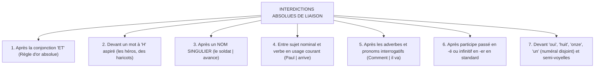

# Chapitre 4 — Le Système Formel des Liaisons en Français Standard : Obligatoires, Interdites et Modulation de Registre

> **Identifiant du chapitre** : `CHP-101-04`  
> **Module de rattachement** : [`MOD-101` — Positionnement Diagnostique, Phonétique Appliquée (API) et Alphabet Orthographique](file:///f:/Formation/world-class-french/03-curriculum/year-1/semester-1/mod-101-diagnostic-phonetique-alphabet.md)  
> **Semestre académique** : Année 1 — Semestre 1 (S1)  
> **Volume horaire estimé** : 5 à 6 heures (Phase 1 — Étude théorique et appropriation : 1 h 30 | Phase 2 — Pratique systématique des liaisons : 2 h | Phase 3 — Ateliers d'éradication des cuirs/velours et diction : 1 h | Phase 4 — Consolidation, rappel actif et évaluation : 1 h)  
> **Statut du document** : [STATUT : VALIDÉ]  
> **Compétence principale** : [`FR-PHON-001` — Maîtrise des contrastes phonologiques et de la prosodie formelle](file:///f:/Formation/world-class-french/02-competency-framework/competency-framework.md#fr-phon-001-maîtrise-des-contrastes-phonologiques-et-de-la-prosodie-formelle) (Cible : Palier L3 — Autonomie)  
> **Sources savantes de référence** : Maurice Grevisse et André Goosse, *Le Bon Usage* 16e éd. (§ 42 à § 47) [`SRC-GRAM-01`](file:///f:/Formation/world-class-french/07-resources/source-registry.md#1-grammaires-et-traités-de-référence-norme-et-description) ; Martin Riegel, Jean-Christophe Pellat et René Rioul, *Grammaire méthodique du français* (chap. 2) [`SRC-GRAM-02`](file:///f:/Formation/world-class-french/07-resources/source-registry.md#1-grammaires-et-traités-de-référence-norme-et-description) ; Pierre Léon, *Phonétisme et prononciations du français* (6e éd. refondue, 2011) [`SRC-PHON-01`](file:///f:/Formation/world-class-french/07-resources/source-registry.md#5-phonétique-phonologie-et-prosodie) ; Bernard Tranel, *The Sounds of French: An Introduction* [`SRC-PHON-03`](file:///f:/Formation/world-class-french/07-resources/source-registry.md#5-phonétique-phonologie-et-prosodie).

---

## 1. Titre et Place dans le Cursus

Le présent chapitre s'intitule **« Le Système Formel des Liaisons en Français Standard : Obligatoires, Interdites et Modulation de Registre »** (`CHP-101-04`).

### Positionnement au sein du module MOD-101
Dans l'architecture du module `MOD-101`, ce cours intervient au terme de l'exploration phonétique fondamentale. Après avoir distingué le phonème du graphème (`CHP-101-01`), stabilisé les oppositions vocaliques et nasales sensibles (`CHP-101-02`) et formalisé la structure syllabique ainsi que l'enchaînement consonantique (`CHP-101-03`), le chapitre 4 aborde le phénomène charnière où la syntaxe, la morphologie et la phonologie se rejoignent : **la liaison**. Il prépare immédiatement le `CHP-101-05` consacré à l'alphabet graphique et aux signes diacritiques.

### Articulation avec l'ensemble du cursus World-Class French
- **En amont** : Il s'appuie sur la maîtrise des symboles de l'Alphabet Phonétique International (API) et sur la distinction entre consonne prononcée et consonne graphique muette.
- **En aval immédiat** : Il conditionne l'étude des classes de mots de `MOD-102` (où le comportement de liaison des déterminants, adjectifs et pronoms sert d'indice morphosyntaxique) et la lecture prosodique à voix haute de `MOD-104`.
- **Réinvestissements avancés** : La conscience fine des registres de liaison alimentera l'analyse sociolinguistique des variations régionales en Semestre 4 (`MOD-404`) et la déclamation oratoire classique en Semestre 5 (`MOD-503`).

---

## 2. Objectifs Mesurables

Au terme de l'étude autonome et des travaux pratiques de ce chapitre, l'apprenant doit être capable de :

1. **Classifier infailliblement tout contexte de liaison** rencontré dans un texte écrit selon l'un des trois statuts normatifs : *obligatoire*, *interdite* ou *facultative*, en explicitant le fondement syntaxique de la règle [Réf. `SRC-GRAM-01`, § 42-46].
2. **Réaliser à 100 % les liaisons obligatoires** lors d'une lecture à voix haute sans hésitation, rupture de débit ni altération du timbre vocalique.
3. **Respecter avec une rigueur absolue les interdictions de liaison**, en évitant toute jonction fautive après la conjonction *et*, devant un mot à *h* aspiré ou après un nom singulier.
4. **Identifier et proscrire les phénomènes de pataquès, cuirs (liaisons indues en [t]) et velours (liaisons indues en [z])** tant dans sa propre production orale que dans l'audit critique d'énoncés oraux.
5. **Transposer phonétiquement en API** les mutations de voisement et de mode d'articulation des consonnes de liaison (/s, x, z/ $\rightarrow$ [z] ; /d, t/ $\rightarrow$ [t] ; /f/ $\rightarrow$ [v]).
6. **Ajuster le taux de réalisation des liaisons facultatives** selon le registre de discours visé (standard soigné vs diction publique académique et solennelle), conformément au paramétrage diaphasique.

---

## 3. Prérequis et Test de Préparation

### Prérequis indispensables
- Connaissance des symboles de base de l'Alphabet Phonétique International pour le français standard (voyelles orales, voyelles nasales, semi-voyelles, consonnes) [Réf. `SRC-PHON-01`, chap. 1].
- Maîtrise de la notion d'enchaînement consonantique étudiée au `CHP-101-03` (*une consonne déjà prononcée en finale syllabique se lie naturellement à la voyelle suivante* : *avec elle* [a.vɛ.kɛl]).
- Identification élémentaire des natures grammaticales fondamentales (nom, adjectif qualificatif antéposé/postposé, déterminant, pronom personnel sujet ou objet conjoint, verbe, préposition).

### Test de préparation (Diagnostic d'entrée en 5 questions)

Répondez par écrit avant de commencer la lecture du cours :

1. Dans le mot *grand*, la lettre finale *d* est-elle prononcée lorsque le mot est prononcé isolément ? Est-elle une consonne fixe ou une consonne latente ?
2. Quelle différence faites-vous entre la prononciation de *« avec un ami »* et celle de *« chez un ami »* sur le plan de la consonne finale du premier mot ?
3. Que représente le symbole phonétique [z] par rapport au graphème *s* dans *« les enfants »* ?
4. Le mot *héros* commence-t-il par un *h* muet ou un *h* dit aspiré ? Qu'en est-il du mot *héroïne* ?
5. Dans la phrase *« Il est parti et a fermé la porte »*, peut-on faire entendre une consonne entre *et* et *a* ?

#### Corrigé du test de préparation
* **Question 1** : Dans *grand* isolé [gʁɑ̃], le *d* est muet. C'est une **consonne latente** (qui ne s'actualise que sous conditions phonosyntaxiques spécifiques devant voyelle), et non une consonne fixe.
* **Question 2** : Dans *avec*, le [k] est une consonne fixe, toujours prononcée même devant consonne (*avec toi* [a.vɛk.twa]) ; son union avec la voyelle suivante est un **enchaînement consonantique**. Dans *chez*, le *z* est muet devant consonne (*chez moi* [ʃe.mwa]) ; son apparition sonore [z] devant voyelle relève de la **liaison**.
* **Question 3** : Le graphème *s* correspond ici au phonème latent /z/, consonne fricative alvéolaire voisée, transcrite [z] en API.
* **Question 4** : *Héros* commence par un *h* aspiré (disjonction obligatoire : *le héros* [lə eʁo], jamais de liaison ni d'élision). En revanche, son dérivé féminin *héroïne* commence par un *h* muet (*l'héroïne* [leʁɔin], liaison obligatoire : *les héroïnes* [lezeʁɔin]).
* **Question 5** : **Non, jamais.** La conjonction de coordination *et* est frappée d'une interdiction absolue de liaison dans toute la francophonie et selon tous les traités de référence [Réf. `SRC-GRAM-01`, § 46].

---

## 4. Situation de Départ ou Problème Concret

Considérez les déclarations suivantes, recueillies lors de prises de parole publiques, d'entretiens professionnels ou d'émissions audiovisuelles :

> *« Il a-t-été convenu d'un accord... »*  
> *« Cela coûte vingt-z-euros. »*  
> *« Moi-z-aussi, j'ai-t-entendu cette remarque. »*  
> *« C'est un homme qui est-t-intelligent et-t-aimable. »*  
> *« Nous allons saluer les-z-héros de la nation. »*  
> *« Le soldat-t-avance avec fierté. »*

Toutes ces phrases partagent une anomalie majeure : elles heurtent violemment l'oreille d'un auditeur cultivé, d'un jury académique ou d'un interlocuteur exigeant. Pourtant, les locuteurs qui les profèrent n'ont pas l'intention d'estropier la langue. Bien au contraire : ces fautes sont presque toujours le produit d'une **hypercorrection**, c'est-à-dire d'une volonté maladroite de « bien parler », de paraître élégant ou châtié en multipliant les liaisons au hasard.

Ce phénomène engendre une profonde **insécurité linguistique**. L'orateur non averti hésite :
- Dois-je lier ou ne pas lier ?
- Pourquoi lie-t-on *« un grand homme »* [œ̃.gʁɑ̃.tɔm] avec un son [t] alors qu'il s'écrit avec un *d* ?
- Pourquoi dit-on *« des enfants »* [de.zɑ̃.fɑ̃] mais *« un enfant / attentif »* sans liaison en [t] ?
- Comment ne pas passer pour pédant en introduisant des liaisons archaïques, tout en évitant de paraître négligé en omettant les liaisons nécessaires ?

La maîtrise du système des liaisons n'est pas une coquetterie de salon : c'est l'un des marqueurs les plus discriminants de la maîtrise de l'oral formel en français.

---

## 5. Explication Intuitive

Pour comprendre intuitivement la liaison, il faut observer comment fonctionne la ligne mélodique du français.

Le français moderne manifeste une nette répugnance pour le **hiatus**, c'est-à-dire la rencontre successive de deux voyelles prononcées sans consonne intermédiaire à l'intérieur d'un même souffle (*« il a _ été »* contraint la voix à marquer un coup de glotte ou une rupture d'intensité).

Aux origines de la langue (en ancien français, vers le XIe siècle), les consonnes finales de tous les mots se prononçaient distinctement. Entre le XIIe et le XVIe siècle, la langue a subi une vague massive d'amuïssement : les consonnes finales se sont affaiblies puis tues devant un mot commençant par une consonne (*les livres* $\rightarrow$ [le livʁ]) et en fin de phrase (*il est grand* $\rightarrow$ [il ɛ gʁɑ̃]).

Cependant, lorsque le mot suivant commençait par une voyelle, la consonne finale s'est maintenue pour assurer un appui articulatoire, une passerelle fluide évitant le heurt des voyelles. Ces consonnes ne sont pas mortes : elles sont passées à l'état de **consonnes fantômes** ou **consonnes latentes**. Elles dorment au bout du mot et ne se réveillent que si deux conditions strictes sont réunies :
1. Le mot suivant commence par une **voyelle** ou un **h muet** ;
2. Les deux mots sont **étroitement soudés par le sens et la syntaxe** au sein d'une même unité de souffle (le groupe rythmique).

Imaginez un pont mobile entre deux îles linguistiques :
- Si les deux îles forment un même territoire organique (par exemple le déterminant *les* et son nom *arbres*), le pont s'abaisse automatiquement : la consonne latente se fait entendre ([le.zaʁbʁ]).
- Si les deux îles appartiennent à deux domaines distincts séparés par une frontière (par exemple un nom singulier sujet et son verbe, ou les deux membres d'une coordination séparés par *et*), la frontière reste fermée : le pont mobile demeure invisible, et la consonne latente reste muette.

---

## 6. Définitions Précises et Terminologie

Pour manipuler ce domaine sans confusion, fixons la nomenclature linguistique établie par les traités scientifiques de référence [Réf. `SRC-GRAM-01`, `SRC-GRAM-02`, `SRC-PHON-01`, `SRC-PHON-03`] :

| Terme technique | Définition linguistique rigoureuse | Exemple illustratif |
| :--- | :--- | :--- |
| **Liaison** | Phénomène phonosyntaxique par lequel la consonne finale d'un mot, habituellement muette en position isolée ou devant une consonne, est réalisée phonétiquement devant l'initiale vocalique du mot suivant au sein d'un même constituant syntaxique [Réf. `SRC-GRAM-01`, § 42]. | *les* [le] $\rightarrow$ *les amis* [le.za.mi] |
| **Consonne latente** | Segment consonantique abstrait présent dans la représentation lexicale sous-jacente d'un morphème, dépourvu d'ancrage squelettique autonome, qui ne se matérialise à la surface phonétique que sous conditions de déclenchement syntaxique et phonologique [Réf. `SRC-PHON-03`, chap. 10]. | Le /z/ de *nous* [nu] vs [nu.zɑ̃.fɑ̃] |
| **Consonne fixe** | Consonne finale structurellement ancrée, prononcée dans toutes les distributions contextuelles : en isolation, devant consonne et devant voyelle [Réf. `SRC-PHON-01`, chap. 4]. | Le [k] de *avec* (*avec lui* [a.vɛk.lɥi], *avec elle* [a.vɛ.kɛl]) |
| **Enchaînement consonantique** | Resyllabation mécanique par laquelle une consonne fixe finale déjà prononcée devient l'attaque de la première syllabe du mot suivant à initiale vocalique, sans modification de voisement [Réf. `SRC-PHON-01`, p. 112]. | *une grande amie* [yn.gʁɑ̃.da.mi] (le [d] de *grande* est fixe) |
| **H muet** | Entité purement graphique héritée de l'étymologie gréco-latine, sans réalité phonologique ni incidence obstructive ; il autorise obligatoirement l'élision et la liaison [Réf. `SRC-GRAM-01`, § 44]. | *l'homme* [lɔm], *les hommes* [le.zɔm] |
| **H aspiré (ou disjoint)** | Entité historique d'origine germanique (ou d'emprunt) agissant comme un « coup de frein » phonologique ; sans se prononcer comme une consonne, il bloque catégoriquement l'élision et la liaison en maintenant la voyelle disjointe [Réf. `SRC-LEX-01`, `SRC-GRAM-02`]. | *le héros* [lə.e.ʁo], *les héros* [le.e.ʁo] |
| **Cuir** | Faute de jonction orale consistant à introduire indûment une consonne de liaison dentale sourde [t] non étymologique ou syntaxiquement prohibée [Réf. `SRC-GRAM-01`, § 47]. | *« il a-t-été »*, *« moi-t-aussi »* |
| **Velours** | Faute de jonction orale consistant à introduire indûment une consonne de liaison fricative alvéolaire voisée [z] non étymologique ou syntaxiquement prohibée [Réf. `SRC-GRAM-01`, § 47]. | *« vingt-z-euros »*, *« moi-z-aussi »* |
| **Pataquès** | Terme générique désignant toute liaison vicieuse, aberrante ou déplacée mêlant cuirs, velours et confusions de segments (origine paronymique : *« je ne sais pas-t-à qui est-ce »*). | *« il va-z-à Paris »*, *« donne-moi-z-en »* |

---

## 7. Règles et Mécanismes Fondamentaux

### 7.1 Nature morphosyntaxique et phonétique de la liaison

La liaison n'est pas un simple enjolivement euphonique laissé au caprice du locuteur. C'est un phénomène strictement articulé à la hiérarchie de la phrase :
1. **La resyllabation** : La consonne latente devient l'attaque syllabique de la syllabe initiale du second mot.
   * *les amis* : découpage lexical */le/ + /ami/* $\rightarrow$ découpage phonétique réalisé [le.za.mi] (syllabation : `[le - za - mi]`).
2. **Les altérations phonétiques régulières des consonnes de liaison** :
   En passant de l'état latent à la réalisation sonore, certaines consonnes subissent une mutation systématique codifiée par la phonétique historique française [Réf. `SRC-GRAM-01`, § 43 ; `SRC-PHON-01`, p. 115] :

| Graphème écrit | Réalisation API en liaison | Règle phonétique sous-jacente | Exemples illustratifs |
| :---: | :---: | :--- | :--- |
| **-s, -x, -z** | **[z]** | **Voisement systématique** des fricatives coronales finales. | *les arbres* [le.zaʁbʁ]<br/>*deux enfants* [dø.zɑ̃.fɑ̃]<br/>*chez eux* [ʃe.zø] |
| **-d, -t** | **[t]** | **Dévoisement systématique** des occlusives dentales (le *d* devient [t]). | *un grand homme* [œ̃.gʁɑ̃.tɔm]<br/>*quand il vient* [kɑ̃.til.vjɛ̃]<br/>*un profond ennui* [œ̃.pʁɔ.fɔ̃.tɑ̃.nɥi] |
| **-g** | **[k]** | **Dévoisement historique** de l'occlusive vélaire (devenu rare et très soutenu). | *un long hiver* [œ̃.lɔ̃.ki.vɛʁ]<br/>*sang et eau* [sɑ̃.ke.o] |
| **-f** | **[v]** | **Voisement restreint** lexicalement limité au numéral *neuf* devant *ans* et *heures*. | *neuf ans* [nœ.vɑ̃]<br/>*neuf heures* [nœ.vœʁ]<br/>*(mais : neuf hommes [nœ.fɔm] en usage moderne standard)* |
| **-n** (voyelle nasale) | **[n]** avec ou sans dénasalisation | Deux comportements distincts :<br/>1. *Maintien de la voyelle nasale* + [n] (déterminants possessifs, pronoms *on/en*, *un*) ;<br/>2. *Dénasalisation complète* de la voyelle [ɑ̃ $\rightarrow$ an, ɛ̃ $\rightarrow$ ɛn] (adjectifs antéposés *bon, plein, certain, vain*). | *mon ami* [mɔ̃.na.mi]<br/>*en été* [ɑ̃.ne.te]<br/>*un instant* [œ̃.nɛ̃s.tɑ̃]<br/>---<br/>*bon ami* [bɔ.na.mi]<br/>*plein air* [plɛ.nɛʁ]<br/>*certain auteur* [sɛʁ.tɛ.no.tœʁ] |
| **-p** | **[p]** | Maintien de l'occlusive bilabiale sourde (très restreint : *trop*, *beaucoup*). | *trop aimable* [tʁo.pɛ.mabl]<br/>*beaucoup aimé* [bo.ku.pɛ.me] |
| **-r** | **[ʁ]** | Réactivation de la vibrante/fricative uvulaire (adjectifs en *-er*, infinitifs littéraires). | *premier étage* [pʁə.mje.ʁe.taʒ]<br/>*dernier espoir* [dɛʁ.nje.ʁɛs.pwaʁ] |

---

### 7.2 Les Liaisons OBLIGATOIRES

Les liaisons obligatoires lient des termes formant un **bloc prosodique inséparable** (au sein d'un même constituant immédiat). Les omettre en français standard constitue une faute de prononciation majeure.

Ces contextes obligatoires sont au nombre de six [Réf. `SRC-GRAM-01`, § 44 ; `SRC-GRAM-02`, chap. 2] :

1. **Au sein du syntagme nominal : Déterminant + Nom (ou Déterminant + Adjectif + Nom)** :
   * *les_enfants* [le.zɑ̃.fɑ̃]
   * *des_arbres* [de.zaʁbʁ]
   * *un_ami* [œ̃.na.mi]
   * *mon_oncle* [mɔ̃.nɔ̃kl]
   * *ces_admirables_artistes* [se.zad.mi.ʁa.bl‿aʁ.tist]
   * *leurs_affaires* [lœʁ.za.fɛʁ]
   * *tout_homme* [tu.tɔm]
   * *deux_ours* [dø.zuʁs], *trois_arbres* [tʁwa.zaʁbʁ], *cent_ans* [sɑ̃.tɑ̃].
2. **Entre l'Adjectif qualificatif antéposé et le Nom (ou l'adjectif suivant)** :
   * *un grand_homme* [œ̃.gʁɑ̃.tɔm]
   * *de beaux_yeux* [də.bo.zjø]
   * *un petit_enfant* [œ̃.pə.ti.tɑ̃.fɑ̃]
   * *les anciens_élèves* [le.zɑ̃.sjɛ.ne.lɛv]
   * *un vaste_espace* (enchaînement de consonne fixe [vast.ɛs.pas]).
3. **Pronom personnel conjoint clitique (sujet ou objet) + Verbe / Verbe + Pronom conjoint** :
   * *ils_ont* [il.zɔ̃]
   * *on_arrive* [ɔ̃.na.ʁiv]
   * *vous_aimez* [vu.zɛ.me]
   * *nous_en_avons* [nu.zɑ̃.na.vɔ̃]
   * *ils_y_étaient* [il.zi.e.tɛ]
   * *vas-y* [va.zi]
   * *donnez-en* [dɔ.ne.zɑ̃]
   * *prends-en* [pʁɑ̃.zɑ̃].
4. **Entre pronoms conjoints successifs** :
   * *nous_y allons* [nu.zi.a.lɔ̃]
   * *les_en avertir* [le.zɑ̃.na.vɛʁ.tiʁ].
5. **Après les prépositions et adverbes monosyllabiques étroitement soudés à leur complément** :
   * Prépositions : *en_effet* [ɑ̃.nɛ.fɛ], *dans_un an* [dɑ̃.zœ̃.nɑ̃], *sous_un arbre* [su.zœ̃.naʁbʁ], *sans_argent* [sɑ̃.zaʁ.ʒɑ̃], *chez_elle* [ʃe.zɛl].
   * Adverbes modifiant l'adjectif ou l'adverbe qui suit immédiatement : *très_aimable* [tʁɛ.zɛ.mabl], *bien_utile* [bjɛ̃.ny.til], *plus_habile* [ply.za.bil], *trop_étroit* [tʁo.pe.tʁwa], *tout_entier* [tu.tɑ̃.tje].
6. **Dans les locutions, mots composés et formules lexicalisées figées** :
   * *les États-Unis* [le.ze.ta.zy.ni]
   * *de temps_en temps* [də.tɑ̃.zɑ̃.tɑ̃]
   * *mot_à mot* [mo.ta.mo]
   * *tout_à coup* [tu.ta.ku], *tout_à l'heure* [tu.ta.lœʁ]
   * *pied-à-terre* [pje.ta.tɛʁ], *pot-au-feu* [pɔ.to.fø]
   * *nuit_et jour* [nɥi.te.ʒuʁ] (locution figée spécifique).

---

### 7.3 Les Liaisons STRICTEMENT INTERDITES

Les liaisons interdites correspondent à des **frontières syntaxiques ou phonologiques étanches**. Les réaliser constitue une faute caractérisée de langue, souvent perçue comme grotesque ou inculte [Réf. `SRC-GRAM-01`, § 46 ; `SRC-GRAM-02`, chap. 2].

Il existe sept interdictions absolues qu'aucun registre, fût-il le plus solennel, n'autorise à enfreindre :



#### 1. Après la conjonction de coordination *ET* (Interdiction absolue et universelle)
On ne lie **JAMAIS** la conjonction *et*, quelle que soit la voyelle qui suit :
* *et / ensuite* $\rightarrow$ [e ɑ̃.sɥit] (et **JAMAIS** *[e.tɑ̃.sɥit]* ni *[e.zɑ̃.sɥit]*).
* *un père et / une mère* $\rightarrow$ [œ̃ pɛ.ʁ‿e yn mɛʁ].
* *lui et / elle* $\rightarrow$ [lɥi e ɛl].

#### 2. Devant un mot commençant par un *H* aspiré
Le *h* aspiré bloque radicalement l'élision et la liaison :
* *les / héros* $\rightarrow$ [le e.ʁo] (et non *[le.ze.ʁo]*, qui signifie *les zéros*).
* *en / haut* $\rightarrow$ [ɑ̃ o] (et non *[ɑ̃.no]*).
* *des / haricots* $\rightarrow$ [de a.ʁi.ko] (et non *[de.za.ʁi.ko]*).
* *très / hardi* $\rightarrow$ [tʁɛ aʁ.di] (et non *[tʁɛ.zaʁ.di]*).
* *un / huitième* $\rightarrow$ [œ̃ ɥi.tjɛm] (et non *[œ̃.nɥi.tjɛm]*).

#### 3. Après un Nom commun SINGULIER terminé par consonne graphique muette
Le nom singulier n'ouvre jamais de liaison vers son adjectif postposé, son complément ou son verbe :
* *un soldat / avance* $\rightarrow$ [œ̃ sɔl.da a.vɑ̃s] (et non *[œ̃ sɔl.da.ta.vɑ̃s]*).
* *un avocat / éminent* $\rightarrow$ [œ̃.na.vɔ.ka e.mi.nɑ̃] (et non *[œ̃.na.vɔ.ka.te.mi.nɑ̃]*).
* *le vent / souffle* $\rightarrow$ [lə vɑ̃ suf.lə] (et non *[lə vɑ̃.t‿suf.lə]*).
* *le temps / est doux* $\rightarrow$ [lə tɑ̃ ɛ du] (et non *[lə tɑ̃.zɛ du]*).
* *un chat / angora* $\rightarrow$ [œ̃ ʃa ɑ̃.gɔ.ʁa] (et non *[œ̃ ʃa.tɑ̃.gɔ.ʁa]*).

#### 4. Entre le Sujet nominal et le Verbe en registre usuel
* *Les enfants / arrivent* $\rightarrow$ [le.zɑ̃.fɑ̃ a.ʁiv] (la liaison *[le.zɑ̃.fɑ̃.za.ʁiv]* relève de la très haute déclamation théâtrale classique et est proscrite en français standard soigné).
* *Paul / entre dans la pièce* $\rightarrow$ [pɔl ɑ̃tʁ...].

#### 5. Après les adverbes et pronoms interrogatifs
* *Comment / a-t-il fait ?* $\rightarrow$ [kɔ.mɑ̃ a.til fɛ]. *(Seule exception admise et figée par l'usage : « Comment allez-vous ? » [kɔ.mɑ̃.ta.le.vu]).*
* *Quand / est-il venu ?* $\rightarrow$ [kɑ̃ ɛ.til və.ny] (la liaison en [t] est admise uniquement si *quand* est immédiatement suivi d'un clitique : *quand_il* [kɑ̃.til]).
* *Combien / en voulez-vous ?* $\rightarrow$ liaison en [n] déconseillée en standard.

#### 6. Après un Participe passé terminé par voyelle (*-é, -i, -u*) ou un Infinitif en *-er* en registre standard
* *Il est allé / à Paris* $\rightarrow$ [i.lɛ.ta.le a pa.ʁi] (et non *[i.lɛ.ta.le.ta pa.ʁi]*).
* *Parti / avant l'heure* $\rightarrow$ [paʁ.ti a.vɑ̃ lœʁ].
* *Aller / à la gare* $\rightarrow$ [a.le a la gaʁ] (la prononciation du [ʁ] de l'infinitif en *-er* devant voyelle est un archaïsme théâtral maniéré).

#### 7. Devant certains mots particuliers (semi-consonnes, numéraux disjoints, onomatopées)
* *les / yaourts* $\rightarrow$ [le ja.uʁt]
* *les / yachts* $\rightarrow$ [le jɔt]
* *des / whiskies* $\rightarrow$ [de wis.ki]
* *les / oui* $\rightarrow$ [le wi]
* *le / un*, *les / onze* $\rightarrow$ [lə œ̃], [le ɔ̃z] (disjonction des numéraux cardinaux pris substantivement).

---

### 7.4 Les Liaisons FACULTATIVES et la Modulation Diaphasique de Registre

À la différence des deux catégories précédentes, les **liaisons facultatives** dépendent entièrement de la situation de communication, du degré de formalisme et de la vitesse d'élocution. C'est ici que s'exprime la **modulation diaphasique** [Réf. `SRC-PHON-01`, chap. 5 ; `SRC-GRAM-02`, chap. 2].

On distingue trois grands registres de diction :

| Contexte grammatical | Registre Courant / Informel (Taux : bas) | Registre Standard Soigné (Taux : modéré) | Registre Soutenu / Oratoire (Taux : élevé) |
| :--- | :--- | :--- | :--- |
| **Verbe être + Attribut** (*Il est aimable*) | [i.lɛ ɛ.mabl] (omise) | **[i.lɛ.tɛ.mabl]** (réalisée couramment) | **[i.lɛ.tɛ.mabl]** (indispensable) |
| **Auxiliaire + Participe passé** (*Nous avons essayé*) | [nu.za.vɔ̃ e.sɛ.je] (omise) | **[nu.za.vɔ̃.ze.sɛ.je]** (fréquente) | **[nu.za.vɔ̃.ze.sɛ.je]** (obligée) |
| **Verbes modaux / semi-auxiliaires** (*Il doit attendre*) | [il.dwa a.tɑ̃dʁ] (omise) | [il.dwa a.tɑ̃dʁ] | **[il.dwa.ta.tɑ̃dʁ]** |
| **Nom pluriel + Adjectif postposé** (*Des pays arabes*) | [de.pe.i a.ʁab] (omise) | [de.pe.i a.ʁab] | **[de.pe.i.za.ʁab]** |
| **Adverbe polysyllabique + Adj.** (*Tellement intelligent*) | [tɛl.mɑ̃ ɛ̃.tɛ.li.ʒɑ̃] | [tɛl.mɑ̃ ɛ̃.tɛ.li.ʒɑ̃] | **[tɛl.mɑ̃.tɛ̃.tɛ.li.ʒɑ̃]** |
| **Préposition polysyllabique** (*Pendant un an*) | [pɑ̃.dɑ̃ œ̃.nɑ̃] | **[pɑ̃.dɑ̃.tœ̃.nɑ̃]** | **[pɑ̃.dɑ̃.tœ̃.nɑ̃]** |

> [!IMPORTANT]
> **Règle d'or de la modulation** : Plus le discours est solennel, écrit, préparé ou oratoire, plus le taux de liaisons facultatives s'élève. Cependant, **une liaison interdite ne devient JAMAIS facultative**. Multiplier les liaisons facultatives sans maîtriser les interdictions conduit inévitablement au ridicule du pataquès.

---

### 7.5 Traque et Éradication Absolue des Cuirs et Velours

Les deux monstres phonétiques de l'oral français sont le **cuir** et le **velours** [Réf. `SRC-GRAM-01`, § 47] :

#### 1. Le Cuir (adjonction parasite d'un [t])
Il naît de la fausse analogie avec la particule euphonique verbale interrogative (*aime-t-il ?*, *a-t-il ?*) :
* *« Il a-t-été »* $\rightarrow$ **HORREUR ABSOLUE**. Le verbe *a* n'a aucune consonne finale. On doit prononcer : **[i.la e.te]** en respectant le léger hiatus, sans coup de glotte convulsif.
* *« Moi-t-aussi »* $\rightarrow$ Prononcer : **[mwa o.si]**.
* *« Tu vas-t-avoir »* $\rightarrow$ Prononcer : **[ty va a.vwaʁ]**.
* *« C'est-t-impossible »* $\rightarrow$ Le mot *c'est* se termine déjà par un *t* muet qui se lie en [t] (*c'est_impossible* [sɛ.tɛ̃.pɔ.sibl]), mais doubler le *t* ou le prononcer sur *il est-t-impossible* est un cuir.

#### 2. Le Velours (adjonction parasite d'un [z])
Il naît de la sur-généralisation inconsciente de la marque du pluriel :
* *« Vingt-z-euros »* $\rightarrow$ Le mot *vingt* se termine par la lettre *t* (qui se lie en [t] dans *vingt_ans* [vɛ̃.tɑ̃]). Il ne comporte aucun *s*. Dire *« vingt-z-euros »* est un velours grotesque. On dit : **[vɛ̃.tø.ʁo]** ou, en langage familier relâché sans liaison, **[vɛ̃ ø.ʁo]**, mais JAMAIS *[vɛ̃.zø.ʁo]*.
* *« Moi-z-aussi »* $\rightarrow$ Prononcer : **[mwa o.si]**.
* *« Cent-z-amis »* $\rightarrow$ *Cent* s'écrit avec un *d* ; la liaison facultative ou obligatoire est en [t] (*cent_amis* [sɑ̃.ta.mi]), JAMAIS en [z].
* *« Donne-moi-z-en »* $\rightarrow$ L'impératif régulier devant le pronom *en* prend un *s* graphique et phonétique (*donnes-en* [dɔn.zɑ̃]), mais dès que le pronom disjoint *moi* s'intercale, la liaison en [z] est exclue : **[dɔn.mwa ɑ̃]**.

---

## 8. Raisonnement Détaillé Permettant de Comprendre les Règles

Pourquoi le système français obéit-il à ces lois si rigoureuses ?

Ce n'est pas un code arbitraire inventé par des censeurs d'académie. La liaison reflète directement la **cohésion morphosyntaxique et prosodique des groupes rythmiques** [Réf. `SRC-GRAM-02`, chap. 2 ; `SRC-PHON-03`, chap. 10].

### La hiérarchie des frontières syntaxiques
Dans une phrase, tous les mots ne sont pas séparés par des frontières de même force :

```text
Phrase = [ Groupe Nominal Sujet ] + [ Groupe Verbal ] + [ Groupe Circonstanciel ]
              |          |                  |      |
         Dét + Nom     Adj + Nom         Aux + Participe
         [Frontière minime]             [Frontière interne]
```

1. **Frontière de degré zéro (interne au mot phonétique)** : Entre un clitique (mot grammatical atone sans accent propre : déterminant, pronom personnel sujet) et le mot lexical auquel il se rattache, la frontière est nulle. Le clitique ne peut pas exister seul. Il forme une seule unité prosodique avec le mot suivant. La liaison y est donc **obligatoire** (*les‿enfants*, *il‿arrive*).
2. **Frontière intermédiaire (au sein du syntagme)** : Entre un auxiliaire et son verbe, ou entre une copule et un attribut, la frontière est faible. La liaison y est **facultative** en standard, devenant naturelle dès que le rythme se ralentit ou que le ton s'élève.
3. **Frontière majeure (entre syntagmes autonomes)** :
   - Entre le Groupe Sujet et le Groupe Verbal (*Le magistrat | examine le dossier*) ;
   - Entre deux propositions coordonnées par *et* (*Il entra | et ouvrit le livre*).
   Sur ces frontières majeures, la prosodie marque obligatoirement une pause virtuelle, une élévation de hauteur musicale et une démarcation intonative. Faire une liaison à travers une frontière majeure équivaudrait à souder deux phrases indépendantes par une consonne parasite : c'est pourquoi elle est **catégoriquement interdite**.

---

## 9. Exemples Corrects Commentés avec Transcriptions API

Voici dix contextes modèles disséqués avec leur justification syntaxique intégrale :

### 1. *« Les admirables artistes ont été acclamés. »*
- **Transcription API** : `[le.zad.mi.ʁa.bl‿aʁ.tist ɔ̃.t‿e.te a.kla.me]`
- **Analyse microscopique** :
  - *Les‿admirables* : liaison **obligatoire** déterminant + adjectif antéposé, /s/ $\rightarrow$ [z].
  - *admirables artistes* : enchaînement consonantique régulier du [bl] sonore avec effacement du *e* caduc.
  - *artistes | ont* : liaison **interdite** (ou hautement solennelle) entre le nom sujet et le verbe ; en standard soigné, on marque une frontière sans liaison `[aʁ.tist ɔ̃]`.
  - *ont‿été* : liaison **facultative soignée** auxiliaire + participe passé, /t/ $\rightarrow$ [t].
  - *été | acclamés* : liaison **interdite** après participe passé terminé par voyelle.

### 2. *« Un grand homme d'État doit écouter sans impatience. »*
- **Transcription API** : `[œ̃.gʁɑ̃.tɔm de.ta dwa e.ku.te sɑ̃.zɛ̃.pa.sjɑ̃s]`
- **Analyse microscopique** :
  - *Un‿grand* : adjectif commençant par consonne, pas de liaison.
  - *grand‿homme* : liaison **obligatoire** adjectif antéposé + nom, /d/ $\rightarrow$ [t], *homme* commence par un *h* muet.
  - *doit | écouter* : liaison facultative semi-auxiliaire + infinitif (omise ici en registre standard fluide, possible en soutenu : `[dwa.te.ku.te]`).
  - *sans‿impatience* : liaison **obligatoire** préposition monosyllabique + nom, /s/ $\rightarrow$ [z].

### 3. *« Ils en ont parlé et ont décidé d'agir. »*
- **Transcription API** : `[il.zɑ̃.nɔ̃ paʁ.le e ɔ̃ de.si.de da.ʒiʁ]`
- **Analyse microscopique** :
  - *Ils‿en* : liaison **obligatoire** pronom clitique sujet + pronom objet, /s/ $\rightarrow$ [z].
  - *en‿ont* : liaison **obligatoire** pronom clitique objet + auxiliaire, /n/ $\rightarrow$ [n].
  - *parlé | et* : liaison **interdite** après participe en voyelle.
  - *et | ont* : liaison **STRICTEMENT INTERDITE** après la conjonction *et*, maintien absolu du hiatus `[e ɔ̃]`.

### 4. *« Chez eux, tout est prêt depuis un an. »*
- **Transcription API** : `[ʃe.zø tu.tɛ pʁɛ də.pɥi œ̃.nɑ̃]`
- **Analyse microscopique** :
  - *Chez‿eux* : liaison **obligatoire** préposition monosyllabique + pronom, /z/ $\rightarrow$ [z].
  - *tout‿est* : liaison **obligatoire** pronom indéfini clitisé + copule, /t/ $\rightarrow$ [t].
  - *prêt | depuis* : mot terminé par consonne devant consonne, pas de liaison.
  - *depuis | un an* : préposition polysyllabique, liaison facultative omise en standard ; *un‿an* liaison **obligatoire** déterminant + nom [œ̃.nɑ̃].

### 5. *« De temps en temps, nous allions voir les héroïnes de la pièce. »*
- **Transcription API** : `[də.tɑ̃.zɑ̃.tɑ̃ nu.za.ljɔ̃ vwaʁ le.ze.ʁɔ.in də la pjɛs]`
- **Analyse microscopique** :
  - *temps‿en temps* : locution figée, liaison **obligatoire** /s/ $\rightarrow$ [z].
  - *nous‿allions* : pronom conjoint + verbe, liaison **obligatoire**, /s/ $\rightarrow$ [z].
  - *les‿héroïnes* : *héroïne* a un *h* muet (contrairement à *héros*), liaison **obligatoire** /s/ $\rightarrow$ [z].

### 6. *« C'est un savant aveugle qui avance dans la nuit. »*
- **Transcription API** : `[sɛ.tœ̃ sa.vɑ̃ a.vœgl ki a.vɑ̃s dɑ̃ la nɥi]`
- **Analyse microscopique** :
  - *C'est‿un* : copule + déterminant, liaison **obligatoire**, /t/ $\rightarrow$ [t].
  - *savant | aveugle* : *savant* est ici le NOM SINGULIER, *aveugle* est l'adjectif qualificatif postposé. La liaison après nom singulier est **interdite** (`[sa.vɑ̃ a.vœgl]`). *(Si l'on disait « un aveugle savant », ce serait également interdit après aveugle).*

### 7. *« Vas-y hardiment, mais sans éclat superflu. »*
- **Transcription API** : `[va.zi aʁ.di.mɑ̃ mɛ sɑ̃.ze.kla sy.pɛʁ.fly]`
- **Analyse microscopique** :
  - *Vas-y* : impératif avec *s* euphonique graphique obligatoire, liaison **obligatoire** [va.zi].
  - *hardiment* : commence par un *h* aspiré (famille de *hardi*), pas d'élision ni de liaison possible.
  - *sans‿éclat* : préposition monosyllabique + nom, liaison **obligatoire**, [sɑ̃.ze.kla].

### 8. *« Ce savant est un fin observateur. »*
- **Transcription API** : `[sə sa.vɑ̃ ɛ.tœ̃ fɛ̃.nɔb.sɛʁ.va.tœʁ]`
- **Analyse microscopique** :
  - *savant | est* : nom singulier sujet + verbe, liaison **interdite**.
  - *est‿un* : copule + déterminant, liaison **obligatoire / standard très soigné**, [ɛ.tœ̃].
  - *fin‿observateur* : adjectif antéposé terminé par consonne nasale latente /n/, dénasalisation partielle ou réalisation [fɛ̃.nɔb...] liaison **obligatoire** [Réf. `SRC-GRAM-01`, § 43].

### 9. *« Quand il est arrivé, nous dormions d'un sommeil profond. »*
- **Transcription API** : `[kɑ̃.ti.lɛ.ta.ʁi.ve nu dɔʁ.mjɔ̃ dœ̃ sɔ.mɛj pʁɔ.fɔ̃]`
- **Analyse microscopique** :
  - *Quand‿il* : conjonction *quand* + pronom clitique sujet, liaison **obligatoire**, /d/ $\rightarrow$ [t].
  - *il‿est* : pronom + auxiliaire, liaison **obligatoire**, /l/ $\rightarrow$ enchaînement [i.lɛ].
  - *est‿arrivé* : auxiliaire + participe, liaison **facultative soignée**, [ɛ.ta.ʁi.ve].
  - *arrivé | nous* : frontière de proposition, pause.

### 10. *« Ils étaient arrivés vers neuf heures du matin. »*
- **Transcription API** : `[il.ze.tɛ.ta.ʁi.ve vɛʁ nœ.vœʁ dy ma.tɛ̃]`
- **Analyse microscopique** :
  - *Ils‿étaient* : liaison **obligatoire**, /s/ $\rightarrow$ [z].
  - *étaient‿arrivés* : liaison **facultative réalisée**, /t/ $\rightarrow$ [t].
  - *vers* : préposition monosyllabique, liaison facultative devant consonne impossible.
  - *neuf‿heures* : cas particulier obligatoire du numéral *neuf*, /f/ $\rightarrow$ [v] devant *heures* et *ans*.

---

## 10. Contre-Exemples et Erreurs Fréquentes

Analyse microscopique de 10 fautes majeures relevées à l'oral, avec diagnostic linguistique et correction raisonnée :

| N° | Énoncé fautif courant | Transcription fautive | Règle violée et diagnostic | Forme correcte et transcription API |
| :---: | :--- | :--- | :--- | :--- |
| **1** | *« Pain et / eau »* prononcé avec liaison | `*[pɛ̃.te.o]` ou `*[pɛ̃.ze.o]` | **Violation de l'interdiction absolue après "et"**. *Et* n'a jamais de liaison consonantique. | `[pɛ̃ e o]` (maintien du contact vocalique) |
| **2** | *« Les héros de la nation »* | `*[le.ze.ʁo]` | **Confusion h muet / h aspiré**. *Héros* a un *h* disjoint germanique. `[le.ze.ʁo]` signifie littéralement *« les zéros »*. | `[le e.ʁo]` (disjonction nette) |
| **3** | *« Un avocat éminent »* | `*[ɛ̃.na.vɔ.ka.te.mi.nɑ̃]` | **Liaison indue après un nom singulier**. Le nom singulier ne transmet jamais sa consonne finale muente à son adjectif. | `[œ̃.na.vɔ.ka e.mi.nɑ̃]` |
| **4** | *« Cela coûte vingt euros »* | `*[vɛ̃.zø.ʁo]` | **Velours grossier**. *Vingt* n'a pas de *s*. Sa liaison étymologique est en [t] (*vingt ans* [vɛ̃.tɑ̃]). | `[vɛ̃.tø.ʁo]` (soigné) ou `[vɛ̃ ø.ʁo]` |
| **5** | *« Il a été prévenu »* | `*[i.la.t‿e.te...]` | **Cuir intempestif**. Le verbe *a* ne possède aucune consonne latente. Fausse analogie avec la forme interrogative *a-t-il*. | `[i.la e.te pʁe.və.ny]` |
| **6** | *« Moi aussi, je viens »* | `*[mwa.zo.si]` ou `*[mwa.to.si]` | **Cuir ou velours**. Le pronom disjoint *moi* ne supporte aucune liaison. | `[mwa o.si ʒə vjɛ̃]` |
| **7** | *« Donne-moi-en deux »* déformé en *« Donne-moi-z-en »* | `*[dɔn.mwa.zɑ̃...]` | **Velours par analogie erronée**. On dit *donnes-en* [dɔn.zɑ̃] mais *donne-moi en* sans liaison sifflante. | `[dɔn.mwa ɑ̃ dø]` |
| **8** | *« J'adore les yaourts »* | `*[le.zja.uʁt]` | **Liaison indue devant semi-consonne / emprunt**. La consonne initiale [j] bloque la liaison en français standard. | `[le ja.uʁt]` |
| **9** | *« Cent un dalmatiens »* | `*[sɑ̃.tœ̃...]` | **Liaison indue devant le numéral "un"**. *Un* employé comme numéral ordinal/cardinal exige la disjonction. | `[sɑ̃ œ̃ dal.ma.sjɛ̃]` |
| **10** | *« Il s'est assis et est reparti »* | `*[...e.tɛ ʁə.paʁ.ti]` | **Liaison indue après "et"** combinée à une liaison sur verbe. *Et* isole totalement les deux propositions. | `[il sɛ.ta.si e ɛ ʁə.paʁ.ti]` |

---

## 11. Cas Particuliers et Limites du Système

### 1. Le mot *TOUT* : Déterminant vs Pronom vs Adverbe
- **Déterminant** : liaison obligatoire $\rightarrow$ *tout_homme* [tu.tɔm], *tous_amis* [tu.za.mi].
- **Pronom** : liaison obligatoire $\rightarrow$ *tout_est bien* [tu.tɛ bjɛ̃], *tous_ont voté* [tus.ɔ̃ vɔ.te] (avec prononciation du *s* fixe [tus]).
- **Adverbe** : liaison obligatoire devant voyelle ou *h* muet $\rightarrow$ *tout_ému* [tu.te.my], *tout_autre* [tu.totʁ].

### 2. Le mot *QUAND*
- Devant pronom personnel conjoint : liaison **obligatoire** en [t] $\rightarrow$ *quand_il vient* [kɑ̃.til.vjɛ̃], *quand_elle part* [kɑ̃.tɛl.paʁ].
- Dans les interrogatives avec inversion nominale : liaison **interdite** $\rightarrow$ *Quand / arrive le train ?* [kɑ̃ a.ʁiv lə tʁɛ̃] (et non *[kɑ̃.ta.ʁiv...]*).

### 3. Les numéraux cardinaux : *HUIT, ONZE, UN*
- Bien que commençant par des voyelles ou des semi-voyelles, ces trois numéraux fonctionnent très majoritairement comme des mots à disjonction initiale :
  * *les / huit jours* [le ɥi ʒuʁ] (pas de liaison).
  * *le / onze novembre* [lə ɔ̃z nɔ.vɑ̃bʁ] (pas d'élision).
  * *les / uns et les autres* : ici, *un* est pronom, la liaison est **obligatoire** : [le.zœ̃ e le.zotʁ].

### 4. Les adjectifs singuliers en *-d* : *GRAND, PROFOND, SECOND*
- La consonne latente /d/ s'actualise toujours en sourde [t] :
  * *un grand_homme* [œ̃.gʁɑ̃.tɔm]
  * *un profond_abîme* [œ̃.pʁɔ.fɔ̃.ta.bim]
  * *un second_étage* [œ̃.sə.gɔ̃.te.taʒ] (rappel : le *c* de *second* se prononce [g]).

### 5. Les mots composés et locutions figées archaïques
- Certains figements ont fossilisé une liaison qui serait interdite par la syntaxe moderne :
  * *pot-au-feu* [pɔ.to.fø] (nom + préposition)
  * *pied-à-terre* [pje.ta.tɛʁ]
  * *accent tonique* [ak.sɑ̃ tɔ.nik] (pas de liaison car adjectif postposé à consonne).

---

## 12. Approfondissement Adapté au Niveau du Chapitre

### Perspective diachronique : Comment sommes-nous arrivés là ?
Pour comprendre pourquoi le français a développé un système aussi singulier parmi les langues romanes (l'espagnol et l'italien prononcent toutes leurs consonnes finales sans liaison complexe), il faut remonter à la crise articulatoire du moyen français (XIVe-XVIe siècles).

En latin tardif, la réduction des déclinaisons a renforcé le rôle de la consonne finale (notamment le *-s* accusatif pluriel). Mais vers 1300, une loi phonétique spontanée entraîne l'affaiblissement articulatoire de toute consonne finale devant une consonne suivante : le contact entre deux consonnes dures (*les femmes* $\rightarrow$ [les fɛməs]) demandait un effort musculaire trop important ; la consonne pré-consonantique s'est donc amuïe ([le fɛm]).

Cependant, devant une voyelle, la consonne finale ne rencontrait aucun obstacle : elle s'est naturellement rattachée à la voyelle suivante par resyllabation (*les âmes* $\rightarrow$ [le-za-məs]).

Au XVIIe siècle, au moment où les premiers théoriciens de la langue et l'Académie française ont voulu fixer la norme classique, un conflit a éclaté :
- Fallait-il prononcer les consonnes partout, comme les lettrés latinistes ?
- Fallait-il les supprimer partout, comme le peuple de Paris ?

Le compromis classique, formalisé par Vaugelas et les grammairiens de Port-Royal, a consacré la solution actuelle : **la liaison conditionnelle**. On a réservé la prononciation des consonnes latentes aux situations où le lien syntaxique était étroit. Dès lors, la maîtrise de la liaison est devenue un symbole suprême de civilité, de discipline intellectuelle et d'appartenance à l'élite lettrée [Réf. `SRC-PHON-03`, chap. 11].

---

## 13. Comparaisons Permettant de Distinguer les Notions Proches

Pour ancrer définitivement la rigueur conceptuelle, voici deux tableaux comparatifs fondamentaux :

### Tableau 1 : Liaison vs Enchaînement Consonantique

| Paramètre de distinction | Liaison Phonétique | Enchaînement Consonantique |
| :--- | :--- | :--- |
| **Nature de la consonne** | **Consonne latente** (muette si le mot est isolé ou devant consonne). | **Consonne fixe** (toujours prononcée, quelle que soit la position). |
| **Effet de voisement** | Altération fréquente (/s, x/ $\rightarrow$ [z] ; /d/ $\rightarrow$ [t] ; /f/ $\rightarrow$ [v]). | **Aucune altération** : la consonne garde son voisement intrinsèque. |
| **Statut normatif** | Soumis aux règles syntaxiques (obligatoire, interdite, facultative). | **Purement mécanique et physiologique** : inévitable dès qu'une consonne finale rencontre une voyelle. |
| **Paire discriminative modèle** | *un grand_homme* [œ̃.gʁɑ̃.**t**ɔm] (le *d* est latent et se dévoise). | *une grande amie* [yn.gʁɑ̃.**d**a.mi] (le *d* est fixe et reste sonore). |
| **Autre paire minimale** | *petit ami* [pə.ti.**t**a.mi] (/t/ latent). | *petite amie* [pə.ti.**t**a.mi] (consonne fixe féminine, même résultat acoustique mais statut phonologique distinct). |

### Tableau 2 : *H* Muet vs *H* Aspiré

| Propriété phonosyntaxique | *H* Muet (Vocalique) | *H* Aspiré (Disjoint / Consonantique virtuel) |
| :--- | :--- | :--- |
| **Origine étymologique** | Latine ou grecque (*homo* $\rightarrow$ homme, *herba* $\rightarrow$ herbe). | Germanique, francique ou onomatopéique (*hari* $\rightarrow$ haricot, *haunjan* $\rightarrow$ honte, *hero* $\rightarrow$ héros). |
| **Élision de l'article** | **OBLIGATOIRE** (*l'homme*, *l'hiver*, *l'histoire*). | **INTERDITE** (*le héros*, *la hache*, *le homard*). |
| **Liaison du pluriel** | **OBLIGATOIRE** (*les_hommes* [le.zɔm], *des_hivers* [de.zi.vɛʁ]). | **INTERDITE** (*les / héros* [le e.ʁo], *des / homards* [de ɔ.maʁ]). |
| **Test de vérification infaillible** | Mettre l'article singulier : si l'on dit *l'*, le *h* est muet. | Mettre l'article singulier : si l'on dit *le* ou *la*, le *h* est aspiré. |
| **Paires trompeuses** | *l'héroïne* [le.ʁɔ.in] / *les héroïnes* [le.ze.ʁɔ.in] | *le héros* [lə e.ʁo] / *les héros* [le e.ʁo] |

---

## 14. Exercices Progressifs

### Niveau 1 : Identification du Statut Normatif (Automatisation)
Pour chacun des 12 segments soulignés, indiquez si la liaison est **Obligatoire [O]**, **Interdite [I]** ou **Facultative [F]** dans un registre standard soigné, et précisez la consonne phonétique réalisée le cas échéant :

1. *Ces <u>beaux arbres</u> ombragent l'allée.*
2. *Il est sorti <u>et a</u> refermé la porte.*
3. *C'est un <u>savant érudit</u> qui prend la parole.*
4. *Les diplomates <u>sont arrivés</u> à l'ambassade.*
5. *Nous contemplons <u>les hauteurs</u> du massif.*
6. *Prenez garde à <u>ce chat agressif</u>.*
7. *Le ministre parle <u>avec assurance</u>.*
8. *<u>Ils ont</u> parfaitement compris la consigne.*
9. *Je refuse de manger <u>ces haricots</u>.*
10. *Elle habite au <u>premier étage</u>.*
11. *C'est un homme <u>fort aimable</u>.*
12. *<u>Quand part</u> votre train ?*

---

### Niveau 2 : Traque et Analyse des Cuirs et Velours (Discrimination)
Dans les 6 phrases dialoguées suivantes, relevez les fausses liaisons, nommez le phénomène exact (cuir, velours ou liaison interdite) et rétablissez la transcription phonétique standard :

1. *« Moi-z-aussi, j'ai-t-aperçu la silhouette dans le noir. »*
2. *« Ce costume sur mesure lui a coûté cent-z-euros. »*
3. *« C'est un étudiant brillant et-t-ambitieux. »*
4. *« Tu vas-t-avoir de gros ennuis si tu persistes. »*
5. *« Le gouvernement a-t-adopté la réforme sans débat. »*
6. *« Donnez-moi-z-en deux kilogrammes, s'il vous plaît. »*

---

### Niveau 3 : Préparation et Annotation d'une Lecture d'Apparat (Maîtrise)
Voici un extrait d'éloquence solennelle. Munissez-vous du code typographique formel :
- `‿` (arc de liaison souscrit) pour les liaisons **obligatoires** ou **facultatives choisies** ;
- `|` (barre verticale) pour les **interdictions absolues** de liaison ;
- `.` (point bas) pour les **enchaînements consonantiques fixes**.

Texte à annoter :
> *« Les anciens officiers sont enfin arrivés dans la grande salle et ont salué les héros de la patrie. Chacun d'eux avait accompli un exploit éclatant sans hésiter devant le danger. »*

---

## 15. Activité de Correction Raisonnée

### Énoncé du cas pratique
Un enregistrement d'allocution d'un responsable institutionnel contient **huit infractions graves** aux règles des liaisons. Voici la retranscription phonétique exacte des segments litigieux dans leur contexte :

> *« Mesdames et messieurs, nous sommes réunis aujourd'hui pour célébrer un soldat-t-émérite [sɔl.da.t‿e.me.ʁit] (1). Il a-t-accompli [i.la.t‿a.kɔ̃.pli] (2) des actes héroïques et-t-admirables [e.t‿ad.mi.ʁabl] (3). Nous allons rendre hommage à nos-z-héros [no.z‿e.ʁo] (4). Chacun de nous doit-t-admettre [dwa.t‿ad.mɛtʁ] (5) que cela fait vingt-z-ans [vɛ̃.z‿ɑ̃] (6) que notre pays n'avait connu une telle ferveur. Moi-z-aussi [mwa.z‿o.si] (7), je suis profondément ému par ce discours et-t-espère [e.t‿ɛs.pɛʁ] (8) vous revoir bientôt. »*

### Corrigé raisonné et apparat critique

| Segment | Réalisation observée | Nature exacte de l'infraction | Règle violée | Correction en API standard |
| :---: | :--- | :--- | :--- | :--- |
| **(1)** | `[sɔl.da.t‿e.me.ʁit]` | **Liaison indue sur nom singulier** | Un nom singulier terminé par consonne graphique ne se lie JAMAIS à son adjectif postposé [Réf. `SRC-GRAM-01`, § 46]. | `[sɔl.da e.me.ʁit]` |
| **(2)** | `[i.la.t‿a.kɔ̃.pli]` | **Cuir grossier** | Le verbe auxiliaire *a* ne possède aucune consonne latente. Fausse analogie avec l'inversion interrogative. | `[i.la a.kɔ̃.pli]` |
| **(3)** | `[e.t‿ad.mi.ʁabl]` | **Liaison après "et"** | Interdiction catégorique absolue : la conjonction *et* ne supporte aucune consonne de liaison. | `[e ad.mi.ʁabl]` |
| **(4)** | `[no.z‿e.ʁo]` | **Liaison devant H aspiré** | *Héros* a une consonne initiale disjointe (h aspiré) qui bloque l'élision et la liaison. `[no.z‿e.ʁo]` dit « nos zéros ». | `[no e.ʁo]` |
| **(5)** | `[dwa.t‿ad.mɛtʁ]` | **Liaison facultative forcée / Cuir** | Après un verbe conjugué autre que *être* ou *avoir*, la liaison en standard est évitée pour ne pas surcharger la phrase. | `[dwa ad.mɛtʁ]` |
| **(6)** | `[vɛ̃.z‿ɑ̃]` | **Velours inadmissible** | Le mot *vingt* n'a pas de *s*. Sa consonne de liaison étymologique est [t]. Dire *« vingt-z-ans »* est une faute lourde. | `[vɛ̃.tɑ̃]` |
| **(7)** | `[mwa.z‿o.si]` | **Velours sur pronom disjoint** | Le pronom tonique *moi* ne comporte aucune consonne de liaison latente. | `[mwa o.si]` |
| **(8)** | `[e.t‿ɛs.pɛʁ]` | **Liaison après "et"** | Seconde infraction à la règle d'or d'inviolabilité de la coordination *et*. | `[e ɛs.pɛʁ]` |

---

## 16. Mise en Pratique dans une Production Réelle

### Protocole de laboratoire audio : Lecture étalonnée d'un texte d'apparat (100 mots)

#### Consigne
1. Copiez le texte ci-dessous sur votre carnet d'étude.
2. Annotez chaque jonction entre deux mots contigus selon le code typographique :
   - Arc souscrit `‿` pour les **liaisons obligatoires** et les **liaisons facultatives que vous choisissez d'actualiser** ;
   - Barre verticale `|` pour les **interdictions absolues** ;
   - Point souscrit `.` pour les **enchaînements consonantiques fixes**.
3. Enregistrez votre lecture à voix haute à l'aide d'un microphone ou d'un smartphone (durée cible : entre 45 et 55 secondes, débit mesuré, voix posée, articulation soutenue).
4. Écoutez votre enregistrement en suivant la grille d'auto-évaluation critériée.

#### Texte d'application étalonné
> *« Les‿anciens.édifices de la cité ont‿été restaurés avec.un soin admirable. Dès‿aujourd'hui, les‿habitants et | leurs‿enfants peuvent‿admirer ces‿œuvres d'art sans | aucune gêne. Un grand‿effort a | été accompli par les‿architectes et | a permis de sauver ces‿humbles demeures. Nous‿avons tous‿appris que le maire | a prononcé un vibrant | hommage en‿honneur des‿héroïnes de la résistance, devant‿un public recueilli. »*

#### Grille d'évaluation sommative de l'enregistrement
- [ ] 100 % des liaisons obligatoires réalisées sans hésitation (/z/, /t/, /n/).
- [ ] Zéro liaison après la conjonction *et* (deux occurrences dans le texte).
- [ ] Zéro cuir sur *a été* ou *le maire a*.
- [ ] Respect de la liaison sur *les héroïnes* [le.ze.ʁɔ.in] sans confusion avec *héros*.
- [ ] Fluidité prosodique et respect des groupes de souffle.

---

## 17. Résumé Structuré : Tableau Synoptique Tripartite

Conservez ce tableau comme instrument de consultation rapide et absolue pour toute lecture à voix haute :

| LIAISONS OBLIGATOIRES<br/>*(Ne jamais omettre)* | LIAISONS FACULTATIVES<br/>*(Modulation de registre)* | LIAISONS INTERDITES<br/>*(Ne jamais réaliser)* |
| :--- | :--- | :--- |
| **1. Déterminant + Nom**<br/>(*les‿arbres*, *un‿ami*, *mon‿enfant*) | **1. Verbe être + Attribut**<br/>(*c'est‿évident*, *il est‿avocat*) | **1. Après la conjonction "ET"**<br/>(*et \| ensuite*, *et \| enfin*) |
| **2. Adjectif antéposé + Nom**<br/>(*grand‿homme*, *beaux‿yeux*) | **2. Auxiliaire + Participe passé**<br/>(*ils ont‿aimé*, *nous sommes‿allés*) | **2. Devant un H aspiré**<br/>(*les \| héros*, *des \| haricots*) |
| **3. Pronom conjoint + Verbe**<br/>(*ils‿ont*, *on‿arrive*, *vous‿avez*) | **3. Verbe modal + Infinitif**<br/>(*il doit‿attendre*, *nous allons‿essayer*) | **3. Après un Nom SINGULIER**<br/>(*le soldat \| avance*, *un chat \| angora*) |
| **4. Verbe impératif + Pronom**<br/>(*vas-y*, *prenez-en*) | **4. Nom pluriel + Adjectif postposé**<br/>(*des pays‿arabes*, *des livres‿anciens*) | **4. Sujet nominal + Verbe en standard**<br/>(*Paul \| arrive*, *les enfants \| entrent*) |
| **5. Prépositions / Adverbes courts**<br/>(*en‿effet*, *très‿aimable*, *sans‿eau*) | **5. Prépositions polysyllabiques**<br/>(*pendant‿un an*, *depuis‿un mois*) | **5. Après participe en -é / infinitif en -er**<br/>(*allé \| à Paris*, *manger \| avec soin*) |
| **6. Locutions et figements**<br/>(*États-Unis*, *de temps‿en temps*) | **6. Adverbes polysyllabiques**<br/>(*tellement‿aimable*, *souvent‿évoqué*) | **6. Devant oui, onze, huit, yaourt, yacht**<br/>(*les \| onze*, *des \| yaourts*) |

---

## 18. Questions de Rappel Actif (Active Recall)

Répondez sans relire le cours pour consolider l'ancrage mnésique :

1. **Question 1** : Pourquoi le mot *grand* dans *« un grand homme »* se prononce-t-il avec le son [t] et non avec le son [d] ? Nommez le phénomène phonétique précis.
2. **Question 2** : Quelle est la règle d'or absolue concernant la conjonction *et* en matière de liaison ? Y a-t-il une seule exception dans toute la langue française ?
3. **Question 3** : Quelle différence acoustique fondamentale existe-t-il entre *« les héros »* et *« les héroïnes »* ? Expliquez pourquoi.
4. **Question 4** : Qu'est-ce qu'un « velours » et quelle est l'erreur commise dans l'expression *« vingt-z-euros »* ?
5. **Question 5** : Pourquoi est-il strictement interdit de faire la liaison dans *« un soldat attentif »* alors qu'elle est obligatoire dans *« un petit enfant »* ?
6. **Question 6** : Dans quel registre de langue réalise-t-on la liaison dans *« des officiers éminents »* ? Que ferait un locuteur en registre standard courant ?

---

## 19. Mini-Évaluation Notée sur 20 avec Corrigé Justifié

### Épreuve sommative individuelle

#### Exercice A — Arbitrage normatif (8 points, soit 1 pt par item)
Indiquez pour chaque phrase si la liaison signalée entre crochets est **Obligatoire [O]**, **Interdite [I]** ou **Facultative [F]** :
1. *Chez [‿] elle, tout est toujours impeccable.*
2. *Pierre et [‿] André préparent leur examen.*
3. *Un éléphant [‿] énorme traversait la clairière.*
4. *Les étudiants sont [‿] allés à la bibliothèque.*
5. *Ils regardent les [‿] huit concurrents sur la piste.*
6. *Prenez [‿] en un morceau immédiatement.*
7. *Il paraît [‿] évident que le plan fonctionnera.*
8. *Nous avons acheté des [‿] haricots frais.*

#### Exercice B — Détection et correction critique de fautes orales (6 points, soit 2 pts par item)
Trois phrases ont été enregistrées avec des liaisons vicieuses. Identifiez la faute, nommez le mécanisme erroné (cuir, velours, transgression d'interdiction) et donnez la transcription API exacte :
1. Énoncé entendu : *« C'est un homme qui a-t-obtenu gain de cause. »*
2. Énoncé entendu : *« Il a payé cent-z-euros pour cette réparation. »*
3. Énoncé entendu : *« Nous saluons les-z-héros de l'indépendance. »*

#### Exercice C — Transcription phonétique en API d'un énoncé complexe (6 points)
Transcrivez intégralement en API standard la phrase suivante en appliquant scrupuleusement les liaisons obligatoires et en refusant les liaisons interdites (barème pénal : **-2 points par cuir ou velours introduit**) :
*« Quand il est entré dans la pièce, un grand silence s'est fait et tout le monde a écouté. »*

---

### Corrigé Justifié de la Mini-Évaluation

#### Exercice A (8 points)
1. **[O]** — Préposition monosyllabique + pronom personnel clitisé (*chez‿elle* [ʃe.zɛl]). (1 pt)
2. **[I]** — Interdiction absolue et inviolable après la conjonction *et* (*et | André* [e ɑ̃.dʁe]). (1 pt)
3. **[I]** — Interdiction absolue après un nom singulier terminé par consonne graphique (*éléphant | énorme* [e.le.fɑ̃ e.nɔʁm]). (1 pt)
4. **[F]** — Liaison facultative soignée entre l'auxiliaire être et le participe passé (*sont‿allés* [sɔ̃.ta.le] ou [sɔ̃ a.le]). (1 pt)
5. **[I]** — Interdiction absolue devant le numéral disjoint *huit* (*les | huit* [le ɥi]). (1 pt)
6. **[O]** — Liaison obligatoire verbe à l'impératif + pronom conjoint clitisé (*prenez-en* [pʁə.ne.zɑ̃]). (1 pt)
7. **[F]** — Liaison facultative soutenue entre le verbe copule et l'attribut du sujet (*paraît‿évident* [pa.ʁɛ.te.vi.dɑ̃] ou [pa.ʁɛ e.vi.dɑ̃]). (1 pt)
8. **[I]** — Interdiction absolue devant un nom à *h* aspiré (*des | haricots* [de a.ʁi.ko]). (1 pt)

#### Exercice B (6 points)
1. **Faute** : *a-t-obtenu*. **Mécanisme** : **Cuir**. Le verbe *a* n'a aucune consonne latente. **Correction API** : `[a ɔb.tə.ny]` (sans [t]). (2 pts)
2. **Faute** : *cent-z-euros*. **Mécanisme** : **Velours**. Le numéral *cent* ne possède pas de sifflante latente ; sa liaison éventuelle est en [t]. **Correction API** : `[sɑ̃.tø.ʁo]` ou `[sɑ̃ ø.ʁo]`. (2 pts)
3. **Faute** : *les-z-héros*. **Mécanisme** : **Transgression d'interdiction devant H aspiré** (confusion acoustique avec *les zéros*). **Correction API** : `[le e.ʁo]`. (2 pts)

#### Exercice C (6 points)
- **Transcription API modèle** :
  `[kɑ̃.ti.lɛ.tɑ̃.tʁe dɑ̃ la pjɛs œ̃ gʁɑ̃ si.lɑ̃s sɛ fɛ e tul mɔ̃d a e.ku.te]`
- **Points de contrôle d'évaluation** :
  - *Quand‿il* : `[kɑ̃.til]` (liaison obligatoire en [t]) $\rightarrow$ 1 pt
  - *il‿est‿entré* : `[i.lɛ.tɑ̃.tʁe]` (liaisons clitique + auxiliaire et auxiliaire + participe) $\rightarrow$ 1 pt
  - *dans la pièce* : `[dɑ̃ la pjɛs]` (enchaînement normal) $\rightarrow$ 0,5 pt
  - *un grand silence* : `[œ̃ gʁɑ̃ si.lɑ̃s]` (pas de liaison devant consonne) $\rightarrow$ 0,5 pt
  - *silence s'est fait* : `[si.lɑ̃s sɛ fɛ]` $\rightarrow$ 1 pt
  - *fait et* : `[fɛ e]` (pas de liaison après participe/nom) $\rightarrow$ 0,5 pt
  - *et tout* : `[e tul mɔ̃d]` (pas de liaison après *et*) $\rightarrow$ 0,5 pt
  - *monde a écouté* : `[mɔ̃d a e.ku.te]` (pas de cuir *a-t-écouté*, pas de liaison singulier) $\rightarrow$ 1 pt
- **Pénalité** : Tout cuir (*a-t-écouté*) ou velours entraîne **-2 points directs**.

---

## 20. Critères Observables de Maîtrise (Palier L3 Autonomie)

Pour certifier que l'apprenant a atteint le niveau d'autonomie requis par le référentiel [`FR-PHON-001`](file:///f:/Formation/world-class-french/02-competency-framework/competency-framework.md#fr-phon-001-maîtrise-des-contrastes-phonologiques-et-de-la-prosodie-formelle), les observables suivants doivent être validés sans réserve :

| Domaine de compétence | Comportement observable mesurable | Seuil minimal d'admissibilité |
| :--- | :--- | :---: |
| **Liaisons obligatoires** | Réalisation spontanée et exacte de l'ensemble des liaisons obligatoires lors de la lecture d'un texte continu de 200 mots. | **100 % d'exactitude** |
| **Interdictions formelles** | Absence totale de liaison après *et*, devant *h* aspiré et après nom singulier. | **0 faute tolérée** |
| **Proscription des liaisons vicieuses** | Éradication complète des cuirs en [t] (*il a-t-été*) et des velours en [z] (*vingt-z-euros*). | **0 occurrence** |
| **Mutation des consonnes** | Réalisation exacte des dévoisements (/d/ $\rightarrow$ [t]) et voisinages (/s, x/ $\rightarrow$ [z]). | **100 % d'exactitude** |
| **Conscience stylistique** | Capacité à justifier oralement ou par écrit pourquoi une liaison est facultative et quel registre elle dénote. | **Explication conforme aux traités** |

---

## 21. Sources et Lectures Complémentaires

Les règles, données historiques et transcriptions de ce chapitre sont rigoureusement adossées aux ouvrages fondamentaux suivants :

1. **Grevisse, Maurice et Goosse, André (2016)**. *Le Bon Usage : Grammaire française* (16e édition). Bruxelles : De Boeck Supérieur [`SRC-GRAM-01`](file:///f:/Formation/world-class-french/07-resources/source-registry.md#1-grammaires-et-traités-de-référence-norme-et-description).
   * Consulter impérativement les **paragraphes § 42 à § 47** : description exhaustive des consonnes de liaison, règles des liaisons obligatoires (§ 44), interdites (§ 46), facultatives (§ 45) et historique des pataquès, cuirs et velours (§ 47).
2. **Riegel, Martin, Pellat, Jean-Christophe et Rioul, René (2016/2021)**. *Grammaire méthodique du français*. Paris : PUF, collection « Quadrige » [`SRC-GRAM-02`](file:///f:/Formation/world-class-french/07-resources/source-registry.md#1-grammaires-et-traités-de-référence-norme-et-description).
   * Consulter le **chapitre 2 (« De l'oral à l'écrit : Phonétique et phonologie »)** : analyse des clitiques, des groupes rythmiques et de la morphophonologie de la liaison en français contemporain.
3. **Léon, Pierre (2011)**. *Phonétisme et prononciations du français* (6e éd. refondue). Paris : Armand Colin [`SRC-PHON-01`](file:///f:/Formation/world-class-french/07-resources/source-registry.md#5-phonétique-phonologie-et-prosodie).
   * Consulter le **chapitre 4 (« Syllabation, enchaînements et liaisons »)** : données acoustiques, règles de resyllabation, voisement des consonnes latentes et transcriptions API de référence.
4. **Tranel, Bernard (1987)**. *The Sounds of French: An Introduction*. Cambridge : Cambridge University Press [`SRC-PHON-03`](file:///f:/Formation/world-class-french/07-resources/source-registry.md#5-phonétique-phonologie-et-prosodie).
   * Consulter les **chapitres 10 et 11 (« Liaison and Elision »)** : modélisation générative de la consonne latente vs consonne fixe, perspective sociolinguistique et phonologie théorique.

---

## 22. Classification Didactique du Contenu Avancé

Conformément aux normes didactiques de gouvernance du cursus **World-Class French**, les contenus abordés dans ce chapitre sont explicitement classifiés ci-dessous :

| Notion / Segment de contenu | Classification didactique | Justification pédagogique et calendaire |
| :--- | :---: | :--- |
| **Mécanisme fondamental de la liaison (réactivation de consonne latente)** | `CORE-NOW` | Socle indispensable du Semestre 1 pour éradiquer les insécurités orales. |
| **Règles des liaisons obligatoires et des 7 interdictions absolues** | `CORE-NOW` | Non négociable : conditionne l'admission en Semestre 2. |
| **Traque des cuirs ([t]) et velours ([z])** | `CORE-NOW` | Priorité clinique absolue pour éliminer le ridicule de l'hypercorrection. |
| **Tableau synoptique tripartite (Obligatoire / Facultatif / Interdit)** | `CORE-NOW` | Outil de travail quotidien pour les ateliers de lecture et de dictée. |
| **Modulation diaphasique des liaisons facultatives selon le registre** | `INTRODUCTION-NOW` | Présenté pour comprendre la variation, mais son maniement actif soutenu sera approfondi en lecture théâtrale. |
| **Origine diachronique (crise articulatoire du moyen français et Vaugelas)** | `OPTIONAL-ADVANCED` | Fournit le « pourquoi » historique pour les esprits savants sans alourdir l'épreuve pratique immédiate. |
| **Liaison du 'g' en [k] (*un long hiver*, *sang et eau*)** | `OPTIONAL-ADVANCED` | Archaïsme poétique et littéraire à connaître passivement, déconseillé en oral moderne usuel. |
| **Étude sociolinguistique approfondie des taux de liaison par classe sociale** | `DEFER` | Reporté au module de sociolinguistique de Semestre 4 ([`MOD-404`](file:///f:/Formation/world-class-french/03-curriculum/year-2/semester-4/mod-404-sociolinguistique-francophone-ouest-africaine-norme.md)). |
| **Déclamation d'apparat en alexandrins classiques et liaison poétique** | `DEFER` | Reporté au module de haute éloquence de Semestre 5 ([`MOD-503`](file:///f:/Formation/world-class-french/03-curriculum/year-3/semester-5/mod-503-haute-eloquence-declamation-presence-oratoire.md)). |
