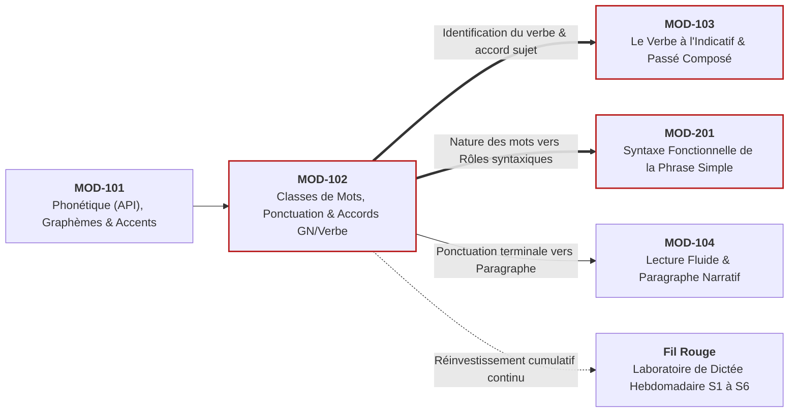

# Fiche Pédagogique Opérationnelle — Module MOD-102

> **Identifiant** : `MOD-102`  
> **Titre** : *Morphologie des Parties du Discours, Ponctuation Terminale et Mécanique des Accords Fondamentaux*  
> **Semestre** : Année 1 — Semestre 1 (S1)  
> **Domaines mobilisés** : DOM-02 (Orthographe et morphologie), DOM-03 (Grammaire et analyse grammaticale)  
> **Volume horaire estimé** : 17 heures (Étude : 5 h | Pratique : 6 h 30 | Correction : 3 h | Révision : 2 h 30)  
> *Statut* : [STATUT : VALIDÉ]  
> **Alignement** : [`syllabus.md` (S1)](file:///f:/Formation/world-class-french/03-curriculum/year-1/semester-1/syllabus.md), [`dependency-graph.md`](file:///f:/Formation/world-class-french/01-architecture/dependency-graph.md), [`competency-framework.md`](file:///f:/Formation/world-class-french/02-competency-framework/competency-framework.md), [`source-registry.md`](file:///f:/Formation/world-class-french/07-resources/source-registry.md)

---

## 1. Présentation et Intérêt du Module

Le module `MOD-102` bâtit l'ossature grammaticale du scripteur francophone. En langue française, toute erreur d'accord ou de ponctuation dérive presque toujours d'une méconnaissance de la **nature intrinsèque des mots** (catégories lexicales) ou d'une incapacité à identifier le donneur et le receveur d'accord au sein de l'énoncé.

Ce module a pour vocation :
1. De fixer définitivement la distinction capitale entre la **nature** (l'identité immuable d'un mot dans le dictionnaire) et la **fonction** (le rôle circonstanciel qu'il joue dans une phrase particulière) [Réf. SRC-NORM-03, p. 12] ;
2. D'installer une maîtrise réflexe des 9 parties du discours (mots variables vs invariables) pour éliminer les hésitations catégorielles ;
3. De dompter la **délimitation graphique de la phrase** par la ponctuation terminale rigoureuse (point, point d'interrogation, d'exclamation, points de suspension et majuscules obligatoires), mettant fin aux phrases infinies ou tronquées sans verbe ;
4. D'automatiser la mécanique des **accords dans le syntagme nominal** (genre et nombre du nom se propageant au déterminant et aux adjectifs épithètes contigus ou distants) ;
5. D'enraciner l'automatisme de l'**accord sujet-verbe canonique**, en apprenant à identifier le véritable noyau du groupe sujet en dépit des perturbateurs syntaxiques immédiats (compléments du nom intercalés, pronoms personnels objets intercalés) ;
6. D'éradiquer définitivement les confusions homophoniques majeures qui décrédibilisent immédiatement un scripteur (*a/à, ou/où, et/est, son/sont, ce/se, ces/ses/c'est/s'est, leur/leurs*).

---

## 2. Place dans le Cursus

- **Position séquentielle** : Deuxième module du Semestre 1 (Semaines 2 à 7, conduit en partie concomitamment avec la fin de `MOD-101` et le début de `MOD-103`).
- **Rôle architectural** : Pivot structural du Cycle 1.
- **Relations amont/aval** :
  - *En amont* : S'appuie sur `MOD-101` (dissociation phonème vs graphème, alphabet orthographique et accents).
  - *En aval* : Prérequis bloquant direct (*Hard Prerequisite*, voir [`dependency-graph.md`](file:///f:/Formation/world-class-french/01-architecture/dependency-graph.md#21-axe-morphosyntaxe-des-catégories-aux-fonctions)) pour :
    - `MOD-103` (conjugaison et morphologie du verbe régulier) ;
    - `MOD-201` (analyse fonctionnelle de la phrase simple : on ne peut identifier un sujet ou un COD sans connaître au préalable la classe du nom et du pronom) ;
    - `MOD-202` (accord du participe passé avec *avoir*).

---

## 3. Prérequis et Diagnostic

### 3.1 Prérequis
- Validation des acquis de `MOD-101` (maîtrise du rapport son/lettre et de l'alphabet diacrité).
- Capacité à segmenter oralement une phrase en unités de sens.

### 3.2 Diagnostic Spécifique d'Entrée
En Semaine 2, l'apprenant réalise un test diagnostique de discrimination catégorielle :
- **Test d'étiquetage à l'aveugle** : Identifier la nature de 20 mots soulignés dans un texte littéraire bref (repérer notamment les mots poly-catégoriels comme *leur*, *tout*, *même*, *bien*).
- **Test de repérage du sujet perturbé** : Identifier le donneur d'accord dans 10 phrases comportant des pièges d'éloignement (*« Le chant des oiseaux dans la canopée apaise/apaisent les esprits »* ; *« Nous vous prions/prie de bien vouloir agréer... »*).
- **Livrable** : Cartographie des confusions morphosyntaxiques personnelles de l'apprenant.

---

## 4. Objectifs Pédagogiques Mesurables

Au terme du module, l'apprenant doit être capable de :
1. Assigner sans hésitation sa classe grammaticale exacte à n'importe quel mot d'un énoncé en justifiant son classement par un test linguistique formel (effacement, substitution ou variation morphologique) [Réf. SRC-GRAM-02, chap. 4].
2. Découper un texte continu dépourvu de ponctuation en phrases graphiques canoniques, sans rupture de sens ni anacoluthe.
3. Réaliser la chaîne d'accord du syntagme nominal avec un taux d'exactitude de 100 % sur des pluriels complexes (*-aux, -oux*) et des adjectifs distants.
4. Accorder infailliblement le verbe avec son sujet, y compris en présence d'un complément de nom pluriel intercalé, d'un sujet inversé simple ou d'un pronom objet intercalé.
5. Résoudre instantanément et sans erreur les 7 grandes paires d'homophones grammaticaux en mobilisant le test de substitution approprié.

---

## 5. Compétences Visées et Niveaux de Maîtrise Attendus

| Identifiant | Formulation de la Compétence | Palier Entrée | Palier Cible MOD-102 |
| :--- | :--- | :---: | :---: |
| [`FR-ORTHO-001`](file:///f:/Formation/world-class-french/02-competency-framework/competency-framework.md#fr-ortho-001-maîtrise-de-lorthographe-lexicale-et-flexionnelle) | Orthographe lexicale, flexionnelle et homophonie grammaticale | L1 | **L3 (Autonomie)** |
| [`FR-ORTHO-002`](file:///f:/Formation/world-class-french/02-competency-framework/competency-framework.md#fr-ortho-002-mécanique-infaillible-de-laccord-sujet-verbe) | Mécanique infaillible de l'accord sujet-verbe canonique | L2 | **L3 (Autonomie)** |
| [`FR-INT-001`](file:///f:/Formation/world-class-french/02-competency-framework/competency-framework.md#fr-int-001-rédaction-dun-texte-long-cohérent-avec-maîtrise-des-accords-et-de-la-ponctuation) | Délimitation graphique de la phrase et ponctuation terminale | L1 | **L2 (Application guidée)** |

---

## 6. Plan Détaillé des Chapitres

```text
ARCHITECTURE DES CHAPITRES DU MODULE MOD-102
├── CHAPITRE 1 : LA DISSOCIATION CARDINALE : NATURE (CLASSE) VS FONCTION
│   ├── 1.1 Qu'est-ce qu'une partie du discours ? L'identité lexicale inhérente.
│   ├── 1.2 Qu'est-ce qu'une fonction syntaxique ? Le rôle en relation avec d'autres mots.
│   └── 1.3 Les tests linguistiques universels de discrimination catégorielle (commutation, effacement).
├── CHAPITRE 2 : L'INVENTAIRE DES NEUF CLASSES GRAMMATICALES DU FRANÇAIS
│   ├── 2.1 Les 5 classes variables : Nom (commun/propre), Déterminant, Adjectif, Pronom, Verbe.
│   ├── 2.2 Les 4 classes invariables : Adverbe, Préposition, Conjonction (coord./subord.), Interjection.
│   └── 2.3 Les mots caméléons et changements de classe (la dérivation impropre : *un devoir, le rouge, manger bio*).
├── CHAPITRE 3 : LA PHRASE GRAPHIQUE ET LA PONCTUATION TERMINALE
│   ├── 3.1 La définition linguistique de la phrase : unité de sens, d'intonation et de syntaxe.
│   ├── 3.2 Le bornage typographique : majuscule initiale et ponctuation terminale (point, ?, !, ...).
│   └── 3.3 Pathologies de délimitation : le saucissonnage intempestif et la phrase amorphe sans fin.
├── CHAPITRE 4 : LA MÉCANIQUE DES ACCORDS DANS LE SYNTAGME NOMINAL
│   ├── 4.1 Le nom, chef de file et donneur d'accord (genre et nombre).
│   ├── 4.2 Les receveurs d'accord : déterminants et adjectifs qualificatifs épithètes (règles régulières).
│   ├── 4.3 Pluriels particuliers des noms et adjectifs : *-al -> -aux*, les 7 noms en *-oux*, adjectifs en *-s, -x, -z*.
│   └── 4.4 Les adjectifs de couleur simples et composés (règles canoniques de base).
├── CHAPITRE 5 : L'ACCORD SUJET-VERBE FONDAMENTAL ET LA TRAQUE DU NOYAU
│   ├── 5.1 Principe du donneur d'accord : le sujet impose sa personne et son nombre au verbe.
│   ├── 5.2 Le piège de l'attraction du complément du nom intercalé (*« La liste des candidats est/sont prête »*).
│   ├── 5.3 Le piège du pronom personnel objet antéposé intercalé (*« Nous vous prions », « Il les écoute »*).
│   └── 5.4 Sujets coordonnés simples par *et* et sujet inversé canonique (*« De là naît la difficulté »*).
└── CHAPITRE 6 : LABORATOIRE CHIRURGICAL DES HOMOPHONES GRAMMATICAUX
    ├── 6.1 Les homophones en *a / à* (test du temps passé : *avait*).
    ├── 6.2 Les homophones en *ou / où* (test de coordination : *ou bien* vs localisation).
    ├── 6.3 Les homophones en *et / est* (test du temps passé : *était*).
    ├── 6.4 Les homophones en *son / sont* (test du possessif vs verbe *étaient*).
    ├── 6.5 Les homophones en *ce / se* (test du pronom réfléchi verbal vs démonstratif).
    ├── 6.6 Les homophones en *ces / ses / c'est / s'est* (discrimination possessif, démonstratif et présentatif).
    └── 6.7 Les homophones en *leur / leurs* (déterminant possessif pluriel vs pronom personnel COI invariable).
```

---

## 7. Concepts Fondamentaux et Notions Avancées

### 7.1 Concepts Fondamentaux
- **Donneur d'accord** : Syntagme ou mot porteur des traits morphologiques intrinsèques (genre, nombre, personne) qu'il transmet par rection à d'autres constituants dépendants [Réf. SRC-GRAM-02, chap. 6].
- **Receveur d'accord** : Constituant qui ne possède pas de traits intrinsèques de genre ou de nombre et qui adopte obligatoirement ceux que lui assigne son donneur (l'adjectif, le déterminant, le verbe).
- **Syntagme nominal (SN)** : Groupe organisé de mots structuré autour d'un nom noyau (tête du syntagme), comprenant obligatoirement un déterminant et éventuellement des expansions (adjectif épithète, complément du nom).
- **Homophone grammatical** : Mots de prononciation identique mais de natures syntaxiques et d'orthographes différentes, dont la distinction repose exclusivement sur l'analyse grammaticale en contexte [Réf. SRC-GRAM-05, § 34].

### 7.2 Notions Avancées
- **Dérivation impropre (ou conversion)** : Changement de la classe grammaticale d'un mot sans modification de sa forme extérieure (*sourire* [verbe] $\rightarrow$ *un sourire* [nom] ; *fort* [adjectif] $\rightarrow$ *crier fort* [adverbe]) [Réf. SRC-GRAM-02, chap. 12].
- **Attraction phonétique ou de proximité** : Erreur psycholinguistique universelle où le scripteur fait accorder le verbe non pas avec le noyau du sujet, mais avec le substantif le plus immédiatement contigu au verbe dans la chaîne parlée.
- **Statut amphibologique de *leur*** :
  - *Leur* déterminant possessif : s'accorde en nombre avec le nom déterminé (*leur maison*, *leurs enfants*).
  - *Leur* pronom personnel complément d'objet indirect (pluriel de *lui*) : **rigoureusement invariable**, placé devant un verbe (*« je leur parle »*, jamais de *s*).

---

## 8. Erreurs et Confusions Fréquentes

| Forme fautive | Analyse de la faille cognitive | Forme correcte et justification | Source de référence |
| :--- | :--- | :--- | :--- |
| *« La majorité des personnes approuvent »* (hésitation) | Oubli de la règle du noyau syntaxique : *la majorité* est au singulier. | *La majorité [...] approuve* (accord régulier sur le noyau singulier) ou pluriel admis d'intention selon la syllepses. | [Réf. SRC-GRAM-01, § 437] |
| *« Je vous prit de m'excuser »* | Attraction par le pronom objet *vous* intercalé entre le sujet et le verbe. | *« Je vous prie »* : le donneur est *Je* (1re personne du singulier). | [Réf. SRC-GRAM-02, chap. 6] |
| *« Ils leurs ont dit »* | Confusion entre le déterminant possessif et le pronom personnel COI. | *« Ils leur ont dit »* : *leur* est pronom personnel COI, rigoureusement invariable. | [Réf. SRC-GRAM-01, § 672] |
| *« Les mesures que l'ont prend »* | Confusion phonétique entre le pronom sujet indéfini *on* et l'auxiliaire *ont*. | *« [...] que l'on prend »* : pronom indéfini précédé du *l'* euphonique étymologique. | [Réf. SRC-GRAM-05, § 68] |
| *« Des jupes marrons »* | Outil d'accord appliqué à un nom employé substantivement comme adjectif de couleur. | *« Des jupes marron »* : nom de fruit employé comme couleur $\rightarrow$ invariable (sauf exceptions : *pourpre, mauve, fauve, rose*). | [Réf. SRC-GRAM-01, § 565] |

---

## 9. Exemples Progressifs

### 9.1 Niveau Simple (Canonique)
- *Chaîne nominale directe* : *Le grand arbre vert* $\rightarrow$ *Les grands arbres verts*.
- *Accord sujet-verbe direct* : *L'enfant chante* $\rightarrow$ *Les enfants chantent*.
- *Homophone a/à* : *Paul a faim* (remplaçable par *avait* $\rightarrow$ verbe) vs *Paul va à la ville* (non remplaçable $\rightarrow$ préposition).

### 9.2 Niveau Intermédiaire (Éloignement et Neutralisation)
- *Complément du nom intercalé* : *Le succès de toutes ses entreprises retentit encore* (*entreprises* est pluriel, mais le noyau donneur est *succès* singulier).
- *Pronom objet intercalé* : *Ce dossier, le directeur nous le confie sans réserve* (le sujet est *le directeur*, non *nous*).
- *Homophones ces/ses/c'est* : *C'est son choix* (présentatif) ; *Il range ses affaires* (les siennes) ; *Regardez ces collines* (celles-là).

### 9.3 Niveau Complexe (Inversions, Syllepses et Sujets Multiples)
- *Sujet inversé simple* : *Dans cette vallée sombre coulent trois ruisseaux silencieux* (*trois ruisseaux* est le sujet postposé de *coulent*).
- *Sujets coordonnés par "ni... ni..."* : *Ni la force ni la ruse ne purent / ne put l'abattre* (règles d'exclusion sémantique vs addition).
- *Syllepse avec collectifs partitifs* : *Une foule de curieux s'amassait / s'amassaient* (justification de l'accord grammatical au singulier vs accord de sens au pluriel) [Réf. SRC-GRAM-01, § 438].

---

## 10. Activités d'Observation et de Découverte

1. **Atelier "Le test de la boîte noire" (Nature vs Fonction)** :
   - Présentation de 10 phrases où le mot *tout* apparaît dans 4 classes différentes (adjectif, pronom, adverbe, nom). Les apprenants doivent trouver le test linguistique qui prouve sa classe dans chaque phrase.
2. **Atelier "L'autopsie de la ponctuation"** :
   - Distribution d'un extrait de Maupassant débarrassé de tous ses points et majuscules. Les apprenants segmentent le texte en phrases graphiques complètes et comparent leurs découpages.
3. **Chasse aux attracteurs d'accord** :
   - Les apprenants reçoivent 20 phrases où un « faux sujet » pluriel a été inséré juste devant le verbe. Ils doivent surligner en rouge le faux sujet et relier d'une flèche verte le véritable noyau au verbe.

---

## 11. Exercices Progressifs

### 11.1 Exercices de Discrimination Catégorielle (Niveau 1)
- **Exercice 1.1** : Indiquer la nature exacte des mots soulignés dans 15 phrases (nom, adjectif, déterminant, pronom, adverbe, préposition, conjonction).
- **Exercice 1.2** : Compléter par *a* ou *à*, *ou* ou *où*, *et* ou *est*, *son* ou *sont* en justifiant par le test de substitution à l'imparfait ou par l'adjonction de *ou bien*.

### 11.2 Exercices de Manipulation Syntaxique (Niveau 2)
- **Exercice 2.1** : Mettre au pluriel des groupes nominaux complexes comportant des noms en *-al, -ail, -ou* et des adjectifs de couleur simples et dérivés.
- **Exercice 2.2** : Accorder les verbes entre parenthèses dans 20 phrases comportant des sujets inversés ou des compléments du nom intercalés.

### 11.3 Exercices d'Arbitrage et de Haute Rigueur (Niveau 3)
- **Exercice 3.1** : Résoudre l'accord du verbe dans 15 phrases à sujets collectifs (*la plupart de, le peu de, quantité de, l'ensemble de*) en justifiant la règle grammaticale académique applicable.
- **Exercice 3.2** : Rédiger un paragraphe de 100 mots sans aucune faute d'accord en réutilisant obligatoirement 5 occurrences de *leur* (3 pronoms invariables et 2 déterminants possessifs).

---

## 12. Ateliers de Correction et de Révision

- **Laboratoire d'autocorrection en deux passes (Hebdomadaire)** :
  - *Passe 1 (Le crible du syntagme nominal)* : Surligner chaque nom. Vérifier la conformité en genre et en nombre de son déterminant et de ses adjectifs satellites.
  - *Passe 2 (Le crible de la rection verbale)* : Surligner chaque verbe conjugué. Tracer une flèche vers son donneur d'accord (le sujet véritable). Vérifier la terminaison de personne et de nombre.

---

## 13. Production Intégratrice

- **Nature de la production** : **Texte suivi calibré et dissection morphosyntaxique complète**.
- **Consigne** :
  1. Rédiger un texte descriptif de 200 mots respectant un découpage rigoureux en 6 à 8 phrases graphiques bien délimitées par la ponctuation terminale.
  2. Le texte doit contenir au moins : 2 sujets inversés, 2 compléments du nom intercalés entre le sujet et son verbe, 3 occurrences distinctes de *leur* (au moins un pronom et un déterminant), et 4 adjectifs qualificatifs distants de leur nom.
  3. Joindre sous le texte le tableau d'analyse morphologique complet de 20 termes consécutifs (nature exacte justifiée par un test linguistique).

---

## 14. Évaluation et Barème

L'évaluation sommative de fin de module `MOD-102` est notée sur **20 points** :

| Épreuve / Critère | Barème et pénalités | Seuil éliminatoire |
| :--- | :--- | :---: |
| **1. Dictée de contrôle sans document (150 mots)** | Barème officiel pénal ([`assessment-rubrics.md`](file:///f:/Formation/world-class-french/02-competency-framework/assessment-rubrics.md)) :<br/>• -4 pts par accord sujet-verbe ou nominal faussé<br/>• -2 pts par homophone erroné (*a/à, ce/se, leur/leurs*)<br/>• -1 pt par ponctuation terminale omise ou majuscule manquante | $< 14/20$ |
| **2. Analyse des classes grammaticales (sur 6 pts)** | Étiquetage de 12 termes en contexte (-0,5 pt par erreur de classe ou confusion nature/fonction). | $< 4/6$ |
| **3. Test des perturbateurs d'accord (sur 6 pts)** | Résolution de 12 phrases pièges d'accords sujet-verbe éloignés et inversés (-0,5 pt par erreur). | $< 4,5/6$ |

- **Note globale de validation du module** : **14/20 (70 %)** minimum requis.

---

## 15. Critères de Maîtrise

Le module est validé au niveau **L3 (Autonomie)** si l'apprenant :
- N'a commis **aucun solécisme d'accord sujet-verbe** sur un devoir de 300 mots ;
- Distingue infailliblement *leur* pronom (invariable) de *leur/leurs* déterminant possessif ;
- Ne commet aucune faute sur les 7 couples d'homophones majeurs ;
- Délimite sans erreur les frontières graphiques de la phrase (zéro phrase saucissonnée sans verbe ou phrase fleuve sans point).

---

## 16. Révisions Espacées Recommandées

- **J+3 après le module** : Drill de 10 phrases pièges sur *leur/leurs* et *ce/se* (10 minutes).
- **J+10** : Test flash de repérage du sujet inversé sur 10 phrases d'auteurs (10 minutes).
- **J+30** : Réactivation dans le cadre du module `MOD-103` (accord des verbes au passé composé).
- **Semestre 2 (S2)** : Réactivation majeure lors de l'étude des fonctions syntaxiques (`MOD-201`) et de la ponctuation interne (`MOD-202`).

---

## 17. Sources de Référence Vérifiées

Toutes les prescriptions de ce module s'appuient sur les sources savantes suivantes :
1. **Grevisse, Maurice & Goosse, André (2016)**. *Le Bon Usage* (16e éd.). Bruxelles : De Boeck Supérieur.  
   $\rightarrow$ Référence pour les parties du discours (§ 140-155), l'accord du verbe avec le sujet (§ 428-445), le pluriel des noms et adjectifs (§ 510-535) et le statut de *leur* (§ 672) [Réf. `SRC-GRAM-01`].
2. **Riegel, Martin, Pellat, Jean-Christophe & Rioul, René (2016)**. *Grammaire méthodique du français*. Paris : PUF.  
   $\rightarrow$ Référence pour les critères de classification des parties du discours (chap. 4), la morphologie flexionnelle nominale (chap. 5) et la chaîne d'accord (chap. 6) [Réf. `SRC-GRAM-02`].
3. **Ministère de l'Éducation nationale (2020)**. *Terminologie grammaticale*. Paris : Réseau Canopé.  
   $\rightarrow$ Référence pour la nomenclature officielle : distinction nature/fonction et inventaire des classes grammaticales [Réf. `SRC-NORM-03`].
4. **Grevisse, Maurice (2009)**. *Le Petit Grevisse : Grammaire française* (32e éd.). Bruxelles : De Boeck Supérieur.  
   $\rightarrow$ Référence pour les tests pratiques de substitution des homophones grammaticaux (§ 34-40) [Réf. `SRC-GRAM-05`].
5. **Imprimerie nationale (2002)**. *Lexique des règles typographiques en usage à l'Imprimerie nationale*.  
   $\rightarrow$ Référence pour la ponctuation terminale, les majuscules obligatoires et les règles d'espacement des signes [Réf. `SRC-TYPO-01`].

---

## 18. Liens avec les Modules Précédents et Suivants


