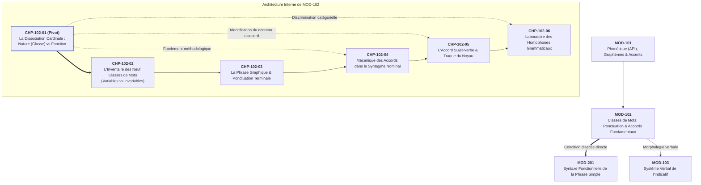
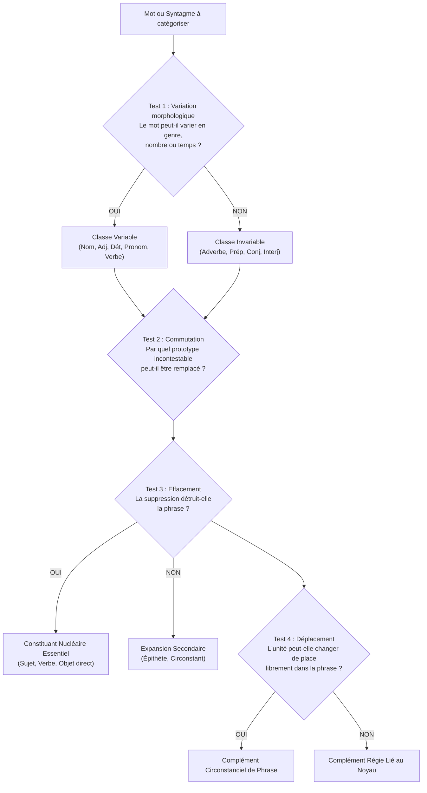

# Chapitre 1 — La Dissociation Cardinale : Nature (Classe) vs Fonction, Identité Lexicale et Tests Formels

> **Identifiant du chapitre** : `CHP-102-01`  
> **Module de rattachement** : [`MOD-102` — Morphologie des Parties du Discours, Ponctuation Terminale et Mécanique des Accords Fondamentaux](file:///f:/Formation/world-class-french/03-curriculum/year-1/semester-1/mod-102-classes-mots-accords-fondamentaux.md)  
> **Semestre** : Année 1 — Semestre 1 (S1)  
> **Volume horaire canonique** : 5 à 6 heures d'apprentissage autonome délibéré et d'ateliers d'application (Phase 1 Étude : 1 h 30 | Phase 2 Pratique : 1 h 30 | Phase 3 Correction : 1 h 00 | Phase 4 Évaluation : 1 h 00)  
> **Statut** : [STATUT : VALIDÉ]  
> **Compétences associées** : [`FR-ORTHO-001`](file:///f:/Formation/world-class-french/02-competency-framework/competency-framework.md#fr-ortho-001-maîtrise-de-lorthographe-lexicale-et-flexionnelle) (L3), [`FR-ORTHO-002`](file:///f:/Formation/world-class-french/02-competency-framework/competency-framework.md#fr-ortho-002-mécanique-infaillible-de-laccord-sujet-verbe) (L3), [`FR-SYNTAX-001`](file:///f:/Formation/world-class-french/02-competency-framework/competency-framework.md#fr-syntax-001-analyse-fonctionnelle-et-délimitation-de-la-phrase-simple) (L2/L3), [`FR-INT-001`](file:///f:/Formation/world-class-french/02-competency-framework/competency-framework.md#fr-int-001-rédiger-un-texte-long-cohérent-en-maîtrisant-accords-et-ponctuation) (L2)  
> **Sources scientifiques de référence** : `SRC-NORM-03` (Ministère de l'Éducation nationale, *Terminologie grammaticale*, 2020), `SRC-GRAM-02` (Riegel, Pellat, Rioul, *Grammaire méthodique du français*, 2016), `SRC-GRAM-01` (Grevisse & Goosse, *Le Bon Usage*, 2016), `SRC-GRAM-05` (Grevisse, *Le Petit Grevisse*, 2009)

---

## 1. Titre et Place dans le Cursus

### 1.1 Intitulé Officiel
**Chapitre 1 : La Dissociation Cardinale : Nature (Classe) vs Fonction, Identité Lexicale et Tests Formels** (`CHP-102-01`).

### 1.2 Insertion Architecturale dans le Cursus
Ce premier chapitre du module `MOD-102` constitue la clé de voûte de toute la grammaire française écrite et raisonnée. Après avoir analysé dans le module `MOD-101` la matérialité sonore (phonèmes, API) et graphique (lettres, accents, graphèmes) de la langue, l'apprenant aborde ici l'organisation structurale des unités significatives.

Toute la syntaxe, toute la morphologie flexionnelle et l'ensemble des règles d'accord reposent sur une distinction conceptuelle fondamentale : **ce qu'un mot est par lui-même** (sa classe grammaticale ou nature) et **ce qu'il fait dans une phrase donnée** (sa fonction syntaxique) [Réf. `SRC-NORM-03`, p. 12].



- **En amont** : Ce chapitre prend appui sur les acquis de [`MOD-101`](file:///f:/Formation/world-class-french/03-curriculum/year-1/semester-1/mod-101-diagnostic-phonetique-alphabet.md). L'apprenant sait désormais distinguer le mot phonique du mot graphique, identifier les frontières de morphèmes et déchiffrer les marques écrites muettes.
- **Au sein du module `MOD-102`** : Il installe la boussole conceptuelle indispensable pour tous les chapitres suivants. On ne peut étudier l'inventaire des 9 classes au Chapitre 2 (`CHP-102-02`), maîtriser la chaîne d'accord du nom au Chapitre 4 (`CHP-102-04`), traquer le vrai sujet du verbe au Chapitre 5 (`CHP-102-05`) ou discriminer *leur* pronom de *leur* déterminant au Chapitre 6 (`CHP-102-06`) sans avoir d'abord assimilé la distinction entre nature et fonction.
- **En aval dans le cursus** : Cette dissociation ouvre directement sur [`MOD-201`](file:///f:/Formation/world-class-french/03-curriculum/year-1/semester-2/mod-201-syntaxe-fonctionnelle-phrase-simple.md) (*Syntaxe Fonctionnelle de la Phrase Simple*) et conditionne toute l'analyse de la phrase complexe (Année 2).

---

## 2. Objectifs Mesurables

Au terme de l'étude autonome et des travaux pratiques de ce chapitre, l'apprenant doit être capable de :

1. **Distinguer sans équivoque la classe grammaticale et la fonction syntaxique** : assigner sans hésitation à n'importe quel mot ou syntagme d'un énoncé sa nature inhérente (l'étiquette de dictionnaire) et son rôle relationnel circonstanciel (sa fonction dans la proposition) [Réf. `SRC-NORM-03`, p. 12 ; `SRC-GRAM-02`, chap. 4].
2. **Appliquer les 4 tests linguistiques formels de catégorisation** : administrer méthodiquement les épreuves de substitution (commutation paradigmatique), d'effacement, de déplacement (permutation syntagmatique) et de variation morphologique afin d'établir objectivement l'identité et la dépendance syntaxique d'une unité lexicale [Réf. `SRC-GRAM-02`, chap. 4 et 6].
3. **Démontrer la plasticité combinatoire de la langue** : prouver par des manipulations syntaxiques contrôlées qu'un mot de nature fixe peut occuper au moins quatre fonctions différentes dans des contextes distincts, et réciproquement qu'une même fonction syntaxique canonique (par exemple sujet de la proposition) peut être assumée par des unités appartenant à des classes grammaticales variées.
4. **Diagnostiquer et réfuter les confusions d'étiquetage sauvage** : identifier, analyser et rectifier les erreurs récurrentes d'analyse morphosyntaxique (confusions nature/fonction, critères sémantiques ou psychologiques subjectifs) dans un devoir d'étudiant, en rédigeant un apparat critique de justification scientifique rigoureux.

---

## 3. Prérequis et Test de Préparation (Auto-Diagnostic)

### 3.1 Prérequis Cognitifs
- Savoir identifier une phrase simple délimitée graphiquement par une majuscule initiale et un point final.
- Être capable d'isoler les mots graphiques séparés par des espaces ou des apostrophes.
- Disposer d'une première familiarité intuitive avec les notions de nom, de verbe et d'adjectif.

### 3.2 Test de Préparation Immédiat
Répondez aux cinq questions suivantes avant d'aborder la lecture active du chapitre. Vérifiez ensuite vos déductions dans le corrigé détaillé.

1. Dans la phrase *« Le grand silence de la nuit apaise les esprits »*, quel est le rôle du mot *silence* par rapport au verbe *apaise*, et quelle est son identité de dictionnaire ?
2. Dans la phrase *« Marcher fortifie le corps »*, quelle est la nature de *Marcher* et quelle est sa fonction syntaxique ? Un verbe peut-il légitimement assumer ce rôle ?
3. Si vous ouvrez un dictionnaire au mot *courageux*, trouvez-vous sa nature ? Y trouvez-vous sa fonction ? Pour quelle raison fondamentale ?
4. Dans l'énoncé *« Cette décision est sage »*, quelle est la nature du mot *sage* et quelle est sa fonction ?
5. Quel test linguistique formel permet de prouver que le mot *hier* n'est pas un adjectif qualificatif dans la phrase *« Hier, le vent soufflait violemment »* ?

---

#### Corrigé Détaillé de l'Auto-Diagnostic

<details>
<summary><b>Consulter le corrigé raisonné des 5 questions de préparation</b></summary>

1. **Analyse de *silence*** :
   - Son identité lexicale (nature) est : **nom commun** (masculin singulier).
   - Son rôle syntaxique (fonction) est : **noyau du groupe sujet** du verbe *apaise* (le syntagme sujet complet étant *Le grand silence de la nuit*).
2. **Analyse de *Marcher*** :
   - Sa nature est : **verbe** (à l'infinitif présent).
   - Sa fonction est : **sujet** du verbe conjugué *fortifie*.
   - Oui, un verbe à l'infinitif peut parfaitement occuper la fonction de sujet, car l'infinitif est la forme nominale du verbe.
3. **Le mot dans le dictionnaire** :
   - On y trouve obligatoirement sa **nature** (la classe grammaticale : ici, *adjectif qualificatif*).
   - On n'y trouve **jamais sa fonction**, car la fonction n'est pas une propriété inhérente du mot : elle n'apparaît que lorsque le mot est mis en relation avec d'autres mots au sein d'une phrase particulière.
4. **Analyse de *sage*** :
   - Sa nature est : **adjectif qualificatif** (masculin/féminin singulier).
   - Sa fonction est : **attribut du sujet** *Cette décision* (relié par le verbe d'état *est*).
5. **Test formel pour *hier*** :
   - **Le test de variation morphologique** : si l'on modifie le contexte (par exemple en parlant de plusieurs jours ou d'éléments féminins), le mot *hier* demeure rigoureusement invariable. Il ne peut jamais recevoir de marque de genre (*-e*) ni de nombre (*-s*), contrairement aux adjectifs. De plus, il commute avec des adverbes (*aujourd'hui, autrefois*), prouvant qu'il appartient à la classe des **adverbes**.

</details>

---

## 4. Situation de Départ ou Problème Concret : Le Piège de l'Étiquetage Sauvage

### 4.1 La Confusion Ordinaire
Considérez les extraits d'analyses grammaticales suivants, relevés fréquemment dans les copies d'apprenants universitaires et les concours de recrutement :

> *« Dans la phrase "Les ouvriers préparent leur travail", le mot préparent a pour nature : verbe, et pour fonction : action. »*  
> *« Le mot travail a pour nature : COD, et pour fonction : objet matériel. »*  
> *« Le mot leur a pour nature : sujet, et pour fonction : possessif. »*

Ces réponses constituent ce que la didactique du français nomme un **étiquetage sauvage** : une juxtaposition anarchique d'intuitions sémantiques réelles, de termes grammaticaux réels, mais sans aucune rigueur architecturale.

L'apprenant commet ici trois confusions intellectuelles fatales :
1. **Confondre la fonction et le sens** : déclarer que la fonction d'un verbe est d'être « une action », c'est confondre le rôle syntaxique dans la phrase avec le sens psychologique du mot dans la réalité extra-linguistique.
2. **Confondre la nature et la fonction** : déclarer que la nature de *travail* est « COD », c'est attribuer à un mot pris isolément un rôle relationnel qui ne dépend que du verbe qui le régit.
3. **Confondre le rôle relationnel et la désignation sémantique** : qualifier une fonction d'« objet matériel » oublie que la grammaire décrit les liens formels entre les mots, non la matière physique des choses.

### 4.2 Les Conséquences Dévastatrices sur la Correction de la Langue
Cette absence de frontière mentale claire entre nature et fonction paralyse l'apprentissage de l'orthographe et de la rédaction :
- **L'incapacité à réaliser les accords** : pour accorder correctement le verbe, il faut identifier le **sujet** (qui est une *fonction*). Mais pour appliquer la terminaison, il faut trouver le **nom** ou le **pronom** noyau (qui est une *nature*). Celui qui ignore cette dissociation cherche le sujet au hasard du sens et accorde avec le mot le plus proche.
- **Le piège des mots poly-catégoriels** : si un scripteur croit que le mot *leur* est « toujours un adjectif possessif », il écrira immanquablement *« ils leurs parlent »* avec un *-s* fautif, incapable de voir que dans cette phrase, *leur* n'est pas un déterminant mais un **pronom personnel** exerçant la fonction de **Complément d'Objet Indirect (COI)**, rigoureusement invariable [Réf. `SRC-GRAM-01`, § 672].
- **L'insécurité linguistique permanente** : faute de tests objectifs, l'apprenant juge de la grammaire « à l'oreille » ou par des devinettes sémantiques.

---

## 5. Explication Intuitive : L'Analogie Citoyenne et Professionnelle

Pour installer une représentation mentale stable et définitive de cette dissociation cardinale, recourons à l'analogie sociale de **la carte nationale d'identité et de l'emploi occupé**.

```
┌────────────────────────────────────────┐       ┌────────────────────────────────────────┐
│     CARTE NATIONALE D'IDENTITÉ         │       │          RÔLE / POSTE OCCUPÉ           │
│        (Ce que l'on EST)               │       │        (Ce que l'on FAIT)              │
├────────────────────────────────────────┤       ├────────────────────────────────────────┤
│  • Nom de famille, Prénom              │       │  • Médecin traitant (au cabinet, 08h)  │
│  • Date et lieu de naissance           │  ──>  │  • Client acheteur (au marché, 12h)    │
│  • Nationalité                         │       │  • Témoin assermenté (au tribunal, 15h)│
│                                        │       │  • Président de club (en réunion, 19h) │
│  => Identité inhérente, immuable       │       │  => Rôle relationnel circonstanciel    │
│     Valable partout, même endormi      │       │     Défini par le contexte d'activité  │
└────────────────────────────────────────┘       └────────────────────────────────────────┘
                 ▲                                                ▲
                 │                                                │
         NATURE DU MOT                                    FONCTION DU MOT
  (Classe dans le dictionnaire)                   (Rôle syntaxique dans la phrase)
```

### 5.1 La Carte d'Identité : La Nature (Classe Grammaticale)
Un citoyen possède une carte d'identité officielle. Y sont consignés ses nom, prénoms, date de naissance et filiation. Cette identité lui appartient en propre :
- Qu'il soit au travail, en vacances, hospitalisé ou endormi dans son lit, sa carte d'identité ne change pas.
- Même s'il se trouve seul sur une île déserte, sans personne autour de lui, son identité civile demeure intacte.

Dans la langue française, **la nature (ou classe grammaticale)** est la carte d'identité du mot. Le mot *maison* est un nom commun ; le mot *parler* est un verbe ; le mot *rapide* est un adjectif qualificatif. Cette identité est inscrite dans son code génétique lexical : vous la trouvez imprimée en italique immédiatement après le mot lorsque vous ouvrez le dictionnaire.

### 5.2 Le Métier ou Rôle : La Fonction Syntaxique
Ce même citoyen ne passe pas sa vie isolé. Il interagit au sein d'une société organisée. Au cours d'une même semaine, il peut occuper différents rôles relationnels :
- Le lundi matin à l'hôpital, il exerce le rôle de **médecin chef** par rapport à ses patients.
- Le midi au restaurant, il devient **client** par rapport au restaurateur.
- Le jeudi après-midi au tribunal, il comparaît en qualité de **témoin** par rapport au juge.
- Le samedi soir dans son association sportive, il siège comme **président** par rapport aux adhérents.

Sa carte d'identité n'a jamais changé : il est toujours la même personne. Mais son rôle social, sa responsabilité et ses devoirs dépendent entièrement **du cadre relationnel dans lequel il s'insère à un instant précis**.

Dans la phrase, **la fonction syntaxique** est le métier que remplit le mot par rapport aux autres mots de la phrase :
- Le nom *maison* peut être **sujet** dans *« La maison s'élève sur la colline »*.
- Il devient **Complément d'Objet Direct (COD)** dans *« L'architecte dessine la maison »*.
- Il devient **Complément du Nom** dans *« La clé de la maison est perdue »*.
- Il devient **Complément Circonstanciel de Lieu** dans *« Il rentre à la maison »*.

### 5.3 La Réciprocité de l'Analogie
L'analogie fonctionne également en sens inverse :
De même qu'un rôle social précis (par exemple, le poste de *président d'une commission*) peut être confié successivement à un médecin, à une ingénieure, à un juriste ou à un enseignant, **une même fonction syntaxique peut être assumée par des mots de natures complètement différentes**.

Le poste de **Sujet** du verbe *chante* peut être occupé par :
- Un nom commun : *« L'oiseau chante. »*
- Un nom propre : *« Sarah chante. »*
- Un pronom : *« Elle chante. »*
- Un verbe à l'infinitif : *« Chanter libère l'âme. »*

---

## 6. Définitions Précises et Terminologie Formelle

Pour aborder la syntaxe avec la rigueur des sciences du langage, sept concepts opératoires doivent être définis sans ambiguïté.

### 6.1 Classe Grammaticale (Partie du Discours ou Nature)
> **Définition** : La classe grammaticale est la catégorie morphosyntaxique inhérente à laquelle appartient une unité lexicale en langue, indépendamment de toute phrase particulière. Elle détermine les propriétés flexionnelles du mot (sa capacité à varier en genre, nombre, personne, temps) et ses contraintes d'association syntaxique [Réf. `SRC-NORM-03`, p. 11].
- Le français moderne compte **9 classes grammaticales fondamentales** : le nom, le déterminant, l'adjectif, le pronom, le verbe, l'adverbe, la préposition, la conjonction et l'interjection.

### 6.2 Fonction Syntaxique
> **Définition** : La fonction syntaxique est le rôle grammatical relationnel que remplit une unité linguistique (mot isolé ou syntagme complet) par rapport à une autre unité régissante (le verbe, le nom, l'adjectif) ou par rapport à l'ensemble de la proposition dans laquelle elle est insérée [Réf. `SRC-NORM-03`, p. 12 ; `SRC-GRAM-02`, chap. 6].
- Une fonction n'existe jamais dans le vide : elle est toujours relative à un terme recteur. On ne dit jamais « ce mot est complément », mais « ce mot est complément d'objet direct du verbe X » ou « complément du nom Y ».

### 6.3 Syntagme (Groupe Syntaxique)
> **Définition** : Un syntagme est une unité syntaxique intermédiaire entre le mot et la proposition, constituée d'un mot noyau (la tête du syntagme) et de ses éventuelles expansions ou dépendants, fonctionnant comme un bloc solidaire vis-à-vis des fonctions de la phrase [Réf. `SRC-GRAM-02`, chap. 6].
- Dans *« Le jeune magistrat intègre de Cotonou »*, le groupe entier forme un **Syntagme Nominal (SN)** dont le nom *magistrat* est le noyau recteur. C'est le syntagme entier qui assume la fonction de sujet dans la phrase.

### 6.4 Rection (Dépendance Syntaxique)
> **Définition** : La rection est le lien hiérarchique par lequel une unité rectrice commande la présence, la forme morphologique ou la fonction d'une unité dépendante.
- Le verbe transitif direct régit un COD sans préposition (*lire un livre*) ; le verbe transitif indirect régit un COI introduit par une préposition (*songer à l'avenir*).

### 6.5 Commutation Paradigmatique (Substitution)
> **Définition** : Opération de test formel consistant à remplacer une unité dans un énoncé par une autre unité appartenant à la même classe théorique, sur l'axe vertical des choix virtuels de la langue (axe paradigmatique), afin de vérifier si la phrase conserve sa grammaticalité [Réf. `SRC-GRAM-02`, chap. 4].

### 6.6 Permutation Syntagmatique (Déplacement)
> **Définition** : Opération formelle consistant à modifier la place d'une unité le long de la chaîne linéaire horizontale de l'énoncé (axe syntagmatique), permettant d'éprouver le degré d'attachement d'un constituant (mobile pour un complément de phrase, fixe pour un complément de verbe) [Réf. `SRC-GRAM-02`, chap. 6].

### 6.7 Effacement
> **Définition** : Opération formelle consistant à supprimer une unité dans un énoncé donné pour vérifier son caractère obligatoire (constituant essentiel : sujet, verbe, complément d'objet nucléaire) ou facultatif (expansion secondaire : épithète, complément circonstanciel) [Réf. `SRC-NORM-03`, p. 14].

---

## 7. Règles ou Mécanismes Fondamentaux

### 7.1 L'Identité Lexicale Inhérente : Le Mot dans le Dictionnaire

Tout mot de la langue française est rangé par le lexique dans une classe déterminée. Cette appartenance n'est pas fortuite : elle commande ce que le mot a le droit ou le devoir de faire dans la chaîne parlée et écrite.

On distingue deux grands ensembles de classes grammaticales :

```
CLASSES GRAMMATICALES DU FRANÇAIS (9 Classes)
├── 1. Les Cinq Classes Variables (soumises à la flexion)
│   ├── Nom (substantif) : possède un genre inhérent (masculin/féminin), varie en nombre.
│   ├── Déterminant : reçoit son genre et son nombre du nom qu'il actualise.
│   ├── Adjectif : reçoit son genre et son nombre du nom ou pronom auquel il se rapporte.
│   ├── Pronom : varie en personne, genre, nombre et parfois selon le cas (je/me/moi).
│   └── Verbe : varie en mode, temps, aspect, voix, personne et nombre.
│
└── 2. Les Quatre Classes Invariables (morphologie rigoureusement fixe)
    ├── Adverbe : modifie le sens d'un verbe, d'un adjectif ou d'un autre adverbe.
    ├── Préposition : mot de liaison introduisant un complément régi.
    ├── Conjonction : relie deux éléments équivalents (coordination) ou une subordonnée (subordination).
    └── Interjection : mot autonome traduisant une émotion ou une injonction orale.
```

> [!IMPORTANT]
> **Règle d'or de l'identité lexicale** : La classe grammaticale d'un mot existe **avant même que la phrase ne soit construite**. Elle est consubstantielle au mot dans le système de la langue.

### 7.2 Le Rôle Syntaxique Relationnel : La Fonction en Contexte Propositionnel

À l'inverse de la nature, la fonction n'est pas une étiquette collée sur le mot : c'est un **contrat relationnel temporaire** signé entre deux éléments dans une proposition particulière.

On distingue trois grands niveaux de relations fonctionnelles dans la phrase :

1. **Les fonctions par rapport au verbe (le noyau de la proposition)** :
   - Le **Sujet** : le constituant dont le verbe exprime l'action ou l'état, et qui lui dicte ses marques de personne et de nombre (le donneur d'accord).
   - Le **Complément d'Objet Direct (COD)** : complément essentiel non prépositionnel régi directement par le verbe transitif.
   - Le **Complément d'Objet Indirect (COI)** : complément essentiel prépositionnel (introduit par *à*, *de*, etc.) régi par le verbe.
   - L'**Attribut du sujet** : constituant exprimant une qualité ou un état attribué au sujet par l'intermédiaire d'un verbe attributif (*être, paraître, sembler, devenir, demeurer, rester*).
   - L'**Attribut du COD** : constituant exprimant une qualité attribuée au complément d'objet (*« Je juge cette démarche inopportune »*).

2. **Les fonctions par rapport au nom (au sein du syntagme nominal)** :
   - L'**Épithète** : adjectif relié directement au nom (antéposé ou postposé) sans médiation verbale (*« Une décision sage »*).
   - Le **Complément du Nom (CDN)** : syntagme prépositionnel apportant une précision au nom noyau (*« La décision du conseil »*).
   - L'**Apposition** (ou épithète détachée) : adjectif ou nom séparé du nom par une pause graphique (virgules) apportant une caractérisation explicative (*« Le directeur, attentif et calme, écouta les réclamations »*).

3. **Les fonctions par rapport à la proposition entière (périphérie)** :
   - Le **Complément Circonstanciel (CC)** : constituant facultatif et mobile indiquant le cadre spatiotemporel, modal, causal ou final de l'énoncé (*« Ce matin, dans la grande salle, il a prononcé son discours »*).

### 7.3 Les Quatre Tests Linguistiques Formels Infaillibles

Pour identifier la nature d'un mot ou d'un syntagme avec certitude, le linguiste ne se fie jamais à une impression de sens. Il applique un protocole expérimental fondé sur **quatre épreuves formelles**.



#### Test 1 : Le Test de Variation Morphologique (Épreuve de Flexion)
- **Principe** : Modifier le genre, le nombre ou l'époque temporelle de l'environnement de la phrase pour observer si le mot cible subit obligatoirement une altération morphologique.
- **Application** :
  - *« Elle travaille dur. »* $\rightarrow$ Mettre au pluriel : *« Elles travaillent dur. »* Le mot *dur* ne prend pas de *-s* ; il ne devient pas *dure* au féminin. Conclusion : *dur* fonctionne ici comme un **adverbe** invariable (et non comme un adjectif qualificatif).
  - *« Ces mesures sont fermes. »* $\rightarrow$ Mettre au singulier : *« Cette mesure est ferme. »* Le mot *fermes* a perdu son *-s*. Conclusion : il s'agit d'un **adjectif qualificatif** variable.

#### Test 2 : Le Test de Substitution (Commutation Paradigmatique)
- **Principe** : Remplacer l'unité inconnue par une unité étalon (un prototype) dont la classe grammaticale est certaine, sans modifier la structure grammaticale de la phrase.
- **Application** :
  - Soit le mot *leur* dans : *« Il leur transmet le rapport. »*
  - Substituons par le pronom singulier équivalent *lui* : *« Il lui transmet le rapport. »* $\rightarrow$ La phrase est parfaitement grammaticale.
  - Or, *lui* est incontestablement un **pronom personnel**. Par conséquent, dans cette phrase, *leur* est rigoureusement un **pronom personnel** (complément d'objet indirect), et en aucun cas un adjectif ou déterminant possessif.

#### Test 3 : Le Test d'Effacement
- **Principe** : Retrancher l'unité ciblée de la phrase pour déterminer si elle participe à l'ossature prédicative minimale obligatoire ou si elle constitue une dépendance facultative.
- **Application** :
  - *« Le magistrat étudie soigneusement le dossier. »*
  - Supprimons *soigneusement* : *« Le magistrat étudie le dossier. »* $\rightarrow$ La phrase demeure complète et syntaxiquement parfaite. *Soigneusement* est un adverbe occupant la fonction de complément circonstanciel de manière.
  - Supprimons *le dossier* : *« *Le magistrat étudie. »* $\rightarrow$ La transitivité du verbe est rompue (sauf emploi absolu très particulier). *Le dossier* est un syntagme nominal exerçant la fonction essentielle de **Complément d'Objet Direct**.

#### Test 4 : Le Test de Déplacement (Permutation Syntagmatique)
- **Principe** : Déplacer l'unité en tête, au centre ou en fin de phrase.
- **Application** :
  - *« Demain, nous examinerons cette requête. »* $\rightarrow$ *« Nous examinerons cette requête demain. »* $\rightarrow$ *« Nous examinerons, demain, cette requête. »*
  - La mobilité totale sans perte de sens prouve que *demain* est un complément de phrase (complément circonstanciel de temps).
  - À l'inverse, tentons de déplacer le COD : *« *Cette requête nous examinerons demain »* (agrammatical en ordre canonique standard). Le COD ne peut être déplacé à volonté : il est solidaire du verbe régissant.

---

## 8. Raisonnement Détaillé : L'Économie Linguistique et le Pouvoir Combinatoire

Pourquoi la langue humaine distingue-t-elle si farouchement la nature de la fonction ? Pourquoi n'a-t-on pas forgé un mot unique pour chaque rôle imaginable ?

### 8.1 L'Économie de Moyens (André Martinet)
Considérons l'alternative logique : si chaque mot de la langue était assigné à perpétuité à une seule et unique fonction, que se passerait-il ?
- Il faudrait un mot particulier pour désigner le concept d'arbre quand il est sujet (*arbor-sujet*), un autre mot différent quand il est l'objet d'une coupe (*arbor-objet*), un troisième mot quand il sert de moyen de comparaison (*arbor-comparant*), et ainsi de suite pour chaque nuance syntaxique.
- Le lexique humain devrait alors mémoriser plusieurs dizaines de millions de vocables différents. La mémoire à long terme de l'homme et l'appareil phonatoire seraient saturés.

La langue a résolu cette équation par le principe d'**économie linguistique** [Réf. `SRC-GRAM-02`, chap. 1] :
Elle a créé un ensemble **fini et stable de briques lexicales** (les classes grammaticales : environ quelques dizaines de milliers de racines et de dérivés), et un système de **règles relationnelles modulables** (les fonctions syntaxiques).

### 8.2 La Combinatoire Finie au Service d'une Infinité de Sens (Wilhelm von Humboldt)
Comme l'a formulé le linguiste Wilhelm von Humboldt, le langage consiste à « faire un usage infini de moyens finis ».

Grâce à la dissociation cardinale entre la nature et la fonction :
1. **Un même mot peut occuper tour à tour toutes les positions de l'échiquier syntaxique** : le substantif *justice* peut être celui qui agit (*La justice triomphe*), celui que l'on recherche (*Il demande justice*), celui qui qualifie (*un acte de justice*) ou le repère vers lequel on tend (*Il combat pour la justice*).
2. **Une même place syntaxique peut accueillir n'importe quelle catégorie de la pensée** : pour dire ce qui nous anime, nous pouvons placer comme sujet un être animé (*L'orateur parle*), une abstraction (*La vérité parle*), un acte en devenir (*Vaincre nous suffit*) ou une proposition tout entière (*Que vous veniez me réjouit*).

C'est cette séparation tranchée entre la brique (la classe) et l'édifice (la fonction) qui confère au français sa souplesse stylistique, sa précision juridique et son architecture logique.

---

## 9. Exemples Corrects Commentés

### 9.1 Démonstration A : Un Moteur Unique dans Cinq Fonctions Différentes

Prenons une unité lexicale constante : le vocable **justice**.  
Sa nature inhérente dans le dictionnaire est invariable : **Nom commun**, féminin singulier.

Observons comment ce mot identique, sans jamais changer de nature, remplit cinq fonctions syntaxiques distinctes selon le réseau de dépendances dans lequel il s'insère :

```
             ┌─────────────────────────────────────────────────────────┐
             │       NATURE DU MOT : NOM COMMUN (FÉMININ SINGULIER)    │
             └─────────────────────────────────────────────────────────┘
                                          │
       ┌──────────────────┬───────────────┴───────────────┬──────────────────┐
       ▼                  ▼                               ▼                  ▼
  FONCTION 1          FONCTION 2                      FONCTION 3         FONCTION 4
    Sujet                COD                       Complément du nom     Attribut du sujet
       │                  │                               │                  │
"La justice triomphe" "Il réclame justice"     "L'amour de la justice"  "L'équité est justice"
```

1. **Exemple 1 : Fonction Sujet du verbe**  
   *« Dans cette république naissante, la justice protège les faibles contre l'arbitraire. »*  
   - **Analyse formelle** : *la justice* régit l'accord du verbe *protège* à la 3e personne du singulier. Encadrement possible par *« C'est... qui »* (*« C'est la justice qui protège... »*).  
   - **Bilan** : Nature = Nom commun | Fonction = Sujet du verbe *protège*.

2. **Exemple 2 : Fonction Complément d'Objet Direct (COD)**  
   *« Les citoyens assemblés réclament une justice équitable et indépendante. »*  
   - **Analyse formelle** : *une justice équitable* est régie directement par le verbe transitif *réclament*, sans préposition. Pronominalisable par *la* (*« Les citoyens la réclament »*).  
   - **Bilan** : Nature = Nom commun | Fonction = Complément d'Objet Direct du verbe *réclament*.

3. **Exemple 3 : Fonction Complément du Nom (CDN)**  
   *« Le ministre a inauguré le nouveau palais de justice de Porto-Novo. »*  
   - **Analyse formelle** : *de justice* est rattaché par la préposition *de* au nom noyau *palais*. Il complète et restreint le sens de ce substantif.  
   - **Bilan** : Nature = Nom commun | Fonction = Complément du nom *palais*.

4. **Exemple 4 : Fonction Attribut du sujet**  
   *« La première vertu du souverain demeure la justice. »*  
   - **Analyse formelle** : *la justice* est relié au sujet *La première vertu* par le verbe d'état *demeure*. On ne peut pas le supprimer (*« *La première vertu du souverain demeure »* est agrammatical). Il qualifie directement le sujet par le truchement du verbe.  
   - **Bilan** : Nature = Nom commun | Fonction = Attribut du sujet *La première vertu*.

5. **Exemple 5 : Fonction Complément Circonstanciel de Manière**  
   *« Le magistrat a tranché ce litige complexe avec justice et discernement. »*  
   - **Analyse formelle** : Le syntagme prépositionnel *avec justice* est mobile (*« Avec justice, le magistrat a tranché... »*) et effaçable (*« Le magistrat a tranché ce litige complexe »*). Il précise la modalité de l'action verbale.  
   - **Bilan** : Nature = Nom commun | Fonction = Complément circonstanciel de manière du verbe *a tranché*.

---

### 9.2 Démonstration B : Un Rôle Unique Assumé par Cinq Natures Divergentes

Inversons à présent l'expérience. Fixons un rôle syntaxique précis : la fonction **Sujet du verbe conjugué**.  
Constatons que cette fonction royale peut être endossée par cinq classes grammaticales différentes :

1. **Exemple 1 : Sujet = Syntagme Nominal (SN)**  
   *« Les jeunes écrivains béninois enrichissent le patrimoine littéraire francophone. »*  
   - **Nature du noyau donneur** : *écrivains* est un **nom commun** (masculin pluriel).  
   - **Fonction** : Sujet du verbe *enrichissent*.

2. **Exemple 2 : Sujet = Pronom Personnel**  
   *« Ils défendent la beauté vivante de la langue avec une ardeur admirable. »*  
   - **Nature du constituant** : *Ils* est un **pronom personnel** (3e personne du masculin pluriel).  
   - **Fonction** : Sujet du verbe *défendent*.

3. **Exemple 3 : Sujet = Nom Propre**  
   *« Olympe Bhêly-Quenum a dépeint les tourments tragiques de l'âme humaine dans son chef-d'œuvre. »*  
   - **Nature du constituant** : *Olympe Bhêly-Quenum* est un **nom propre**.  
   - **Fonction** : Sujet du verbe *a dépeint*.

4. **Exemple 4 : Sujet = Verbe à l'Infinitif (Syntagme Infinitif)**  
   *« Lire attentivement les grands traités linguistiques forge l'indépendance de l'esprit. »*  
   - **Nature de la tête** : *Lire* est un **verbe à l'infinitif présent**.  
   - **Fonction** : Sujet du verbe *forge*. (L'infinitif commande par défaut un accord à la 3e personne du singulier).

5. **Exemple 5 : Sujet = Proposition Subordonnée Conjonctive Complétive**  
   *« Que vous maîtrisiez la distinction entre nature et fonction réjouit profondément vos enseignants. »*  
   - **Nature du constituant** : Proposition subordonnée conjonctive introduite par *que*.  
   - **Fonction** : Sujet de la proposition principale dont le verbe est *réjouit*.

---

### 9.3 Analyse de Textes Littéraires Authentiques

Observons ces mécanismes à l'œuvre chez deux maîtres de la prose francophone :

#### Texte 1 : Olympe Bhêly-Quenum (*Un piège sans fin*, 1960)
> *« Le soleil déclinait lentement vers les cimes lointaines de la forêt vierge. »*

- **Analyse du mot *soleil*** :
  - *Nature* : Nom commun, masculin singulier.
  - *Fonction* : Sujet du verbe *déclinait* (donneur d'accord).
- **Analyse du mot *lentement*** :
  - *Nature* : Adverbe de manière (classe invariable, suffixe *-ment*).
  - *Fonction* : Complément circonstanciel de manière du verbe *déclinait* (effaçable et déplaçable).
- **Analyse du syntagme *vers les cimes lointaines de la forêt vierge*** :
  - *Nature du syntagme* : Syntagme prépositionnel (introduit par la préposition *vers*).
  - *Fonction globale* : Complément circonstanciel de lieu (direction).
  - *Analyse interne de cimes* : Nom commun, féminin pluriel, noyau du syntagme prépositionnel.
  - *Analyse interne de lointaines* : Adjectif qualificatif, féminin pluriel, fonction : épithète liée du nom *cimes*.

#### Texte 2 : Gustave Flaubert (*Madame Bovary*, 1857)
> *« Le silence de la campagne était complet ; les arbres immobiles ne remuaient point leurs feuilles. »*

- Dans la première proposition coordonnée :
  - *Le silence* : Nom commun masculin singulier, sujet de *était*.
  - *de la campagne* : Syntagme prépositionnel, fonction : complément du nom *silence*.
  - *complet* : Adjectif qualificatif, fonction : **attribut du sujet** *Le silence* (accordé au masculin singulier avec son donneur).
- Dans la seconde proposition :
  - *immobiles* : Adjectif qualificatif, fonction : **épithète liée** du nom *arbres*.
  - *leurs feuilles* : Syntagme nominal, fonction : **Complément d'Objet Direct (COD)** du verbe transitif *remuaient*.

---

## 10. Contre-Exemples et Erreurs Fréquentes

L'observation clinique des devoirs et rédactions met en lumière six erreurs récurrentes d'analyse morphosyntaxique qu'il convient de déconstruire avec précision.

### Erreur n°1 : La Confusion Catégorielle « La nature de ce mot est sujet »
- **La formulation fautive** : L'apprenant écrit : *« Dans la phrase "Le vent souffle", la nature de "Le vent" est sujet. »*
- **La faille cognitive** : L'apprenant assimile le statut d'un mot à l'action qu'il accomplit. N'ayant pas séparé la carte d'identité du métier, il donne le titre de travail au lieu de l'état civil.
- **La réfutation scientifique** : Si vous cherchez le mot *vent* dans un dictionnaire de la langue française (`SRC-LEX-01`, `SRC-LEX-04`), vous ne trouverez jamais l'indication *« n. f. ou sujet »*. Vous trouverez exclusivement *« n. m. »* (nom masculin). La qualité de « sujet » n'apparaît que parce qu'il y a un verbe conjugué (*souffle*) à côté de lui.
- **La correction formelle** :  
  - Nature : **Syntagme nominal** (dont le noyau est le nom commun masculin singulier *vent*).  
  - Fonction : **Sujet** du verbe *souffle*.

### Erreur n°2 : L'Amalgame Syntaxique « Un verbe est un COD »
- **La formulation fautive** : Dans la phrase *« Paul aime courir »*, l'apprenant affirme : *« Le mot courir ne peut pas être un COD parce que c'est un verbe. »* Ou pire : *« La nature de courir est COD. »*
- **La faille cognitive** : L'apprenant croit qu'un verbe ne peut exercer qu'un seul métier : être le verbe conjugué de la phrase. Il confond le mode fini (conjugué) et le mode infini (l'infinitif).
- **La réfutation scientifique** : L'infinitif est la forme nominale du verbe [Réf. `SRC-GRAM-02`, chap. 11]. À ce titre, tout en conservant sa nature verbale (il peut avoir ses propres adverbes et compléments : *courir vite*), il est apte à remplir toutes les fonctions réservées au nom dans la proposition. Appliquons le test de substitution : remplaçons *courir* par le nom commun *le sport* : *« Paul aime le sport »*. *Le sport* étant COD de *aime*, *courir* exerce exactement la même fonction syntaxique.
- **La correction formelle** :  
  - Nature de *courir* : **Verbe** à l'infinitif présent.  
  - Fonction de *courir* : **Complément d'Objet Direct** du verbe conjugué *aime*.

### Erreur n°3 : L'Illusion Psychologique et Sémantique (Définir la classe par le sens)
- **La formulation fautive** : *« Le mot destruction est un verbe parce que c'est une action violente. »* Ou : *« Le mot rouge est toujours un adjectif parce que c'est une couleur. »*
- **La faille cognitive** : L'illusion que la grammaire est le miroir direct de la physique ou de la psychologie humaine. L'apprenant classe les mots d'après la matière concrète de ce qu'ils évoquent dans son esprit.
- **La réfutation scientifique** : La classe grammaticale est une réalité formelle, distributionnelle et morphologique, non une propriété physique.
  - *La destruction* est précédée d'un déterminant féminin (*la*), prend la marque du pluriel (*les destructions*), ne se conjugue pas avec des personnes (*je destruction* n'existe pas) : c'est incontestablement un **nom commun**, bien qu'il évoque une action dynamique.
  - Le verbe *exister* n'évoque aucun mouvement physique : c'est pourtant un **verbe**, car il se conjugue (*j'existe, nous existions*).
  - Dans *« Le rouge lui va bien »*, *rouge* est précédé d'un déterminant défini et occupe la place de sujet : c'est un **nom commun** issu d'une conversion lexicale, et non un adjectif.

### Erreur n°4 : L'Amnésie Syntagmatique (Assigner une fonction à un déterminant isolé)
- **La formulation fautive** : Dans la phrase *« La grande forêt brûle »*, l'apprenant écrit : *« La est le sujet du verbe brûle. »*
- **La faille cognitive** : Découper la phrase mot par mot sans percevoir les blocs structurels intermédiaires (les syntagmes).
- **La réfutation scientifique** : Un déterminant n'a aucune autonomie syntaxique. Il ne peut jamais être sujet, COD ou complément circonstanciel à lui seul. Il n'existe que comme satellite d'un nom noyau au sein d'un **Syntagme Nominal**. C'est le syntagme entier *La grande forêt* qui est sujet de *brûle*.
- **La correction formelle** :  
  - Fonction de *La grande forêt* : **Sujet** du verbe *brûle*.  
  - Nature de *La* : **Déterminant** (article défini féminin singulier).  
  - Fonction de *La* au sein du syntagme nominal : **Actualisateur / déterminant** du nom noyau *forêt*.

### Erreur n°5 : L'Accord Fautif Provoqué par la Méconnaissance des Classes
- **La formulation fautive** : *« Ces jeunes filles marchent *vites. »* Ou : *« Ces livres coûtent *chers. »*
- **La faille cognitive** : Constatant la présence d'un pluriel devant (*Ces jeunes filles*), le scripteur applique un automatisme d'accord mécanique sans vérifier la classe grammaticale du mot qui suit le verbe.
- **La réfutation scientifique** : Appliquons le test de substitution : *« Ces jeunes filles marchent lentement »*. *Lentement* est un adverbe invariable. Dans cette tournure, *vite* et *cher* sont employés adverbialement pour modifier le verbe (adverbes courts issus de conversions). En tant qu'adverbes, ils appartiennent à la classe des **invariables** et ne reçoivent jamais de marque d'accord en nombre.
- **La correction formelle** : *« Ces jeunes filles marchent vite. »* / *« Ces livres coûtent cher. »*

### Erreur n°6 : L'Étiquetage Hors Contexte d'un Mot Poly-Catégoriel (*leur*, *tout*)
- **La formulation fautive** : *« Le mot leur est toujours un déterminant possessif, donc on doit mettre un -s au pluriel : "Je leurs ai parlé". »*
- **La faille cognitive** : Oublier qu'un même signe graphique peut appartenir à deux classes grammaticales différentes selon sa distribution dans la phrase.
- **La réfutation scientifique** : Appliquons le test de substitution par le singulier correspondant :
  - *« Je lui ai parlé »* $\rightarrow$ *lui* est un **pronom personnel** (forme conjointe du COI).
  - Le pluriel de *lui* en position préverbale est *leur* (**pronom personnel**).
  - En tant que pronom personnel conjoint, le mot *leur* est **rigoureusement invariable** [Réf. `SRC-GRAM-01`, § 672]. Il ne prend jamais de *-s*.
  - En revanche, dans *« Leurs maisons sont belles »*, *leurs* commute avec *ses* (*« Sa maison est belle »*) : c'est un **déterminant possessif**, qui s'accorde obligatoirement en nombre avec le nom déterminé *maisons*.
- **La correction formelle** : *« Je leur ai parlé »* (sans *-s*).

---

## 11. Cas Particuliers et Limites du Système

La frontière entre les classes grammaticales n'est pas une cloison étanche et figée. La vitalité de la langue française repose sur des mécanismes d'échanges, de glissements et de figements.

### 11.1 Les Mots Poly-Catégoriels (Double ou Triple Appartenance)

Certains vocables très fréquents changent de classe grammaticale selon l'environnement syntaxique où ils sont convoqués.

#### Le Cas Émblématique de *TOUT*
Le mot *tout* traverse quatre classes grammaticales différentes :

| Phrase modèle | Nature de *tout* | Justification par test formel | Règle d'accord induite |
| :--- | :--- | :--- | :--- |
| *« Tout travail mérite salaire. »* | **Déterminant indéfini** | Commute avec *chaque* (*« Chaque travail mérite... »*). Détermine le nom *travail*. | S'accorde en genre et nombre avec le nom (*Toute peine...*). |
| *« Tous sont venus à la réunion. »* | **Pronom indéfini** | Commute avec *chacun* ou *ils* (*« Ils sont venus... »*). Occupe la fonction de sujet. | Porte la marque du pluriel (*Tous* prononcé `/tus/`). |
| *« Elle est tout émue de ce discours. »* | **Adverbe d'intensité** | Commute avec *entièrement* ou *tout à fait* (*« Elle est entièrement émue »*). Modifie l'adjectif *émue*. | Invariable par nature (sauf devant adjectif féminin débutant par consonne : *toute surprise*). |
| *« Il forme un tout indissociable. »* | **Nom commun** | Précédé d'un article indéfini (*un*), noyau d'un syntagme nominal. | Reçoit le pluriel nominal régulier (*des touts* ou invariable selon usage). |

#### Le Cas de *QUE*
Le mot *que* peut être :
1. **Pronom relatif** : *« Le livre que je lis »* (commute avec *lequel*, fonction : COD de *lis*).
2. **Pronom interrogatif** : *« Que voulez-vous ? »* (commute avec *quelle chose*, fonction : COD).
3. **Conjonction de subordination** : *« Je sais que tu viendras »* (mot de liaison pur sans fonction interne).
4. **Adverbe exclamatif** : *« Que la nuit est belle ! »* (commute avec *comme* ou *combien*).

### 11.2 La Conversion Lexicale (Dérivation Impropre)

> **Définition** : La conversion lexicale (ou dérivation impropre) est le processus morphologique par lequel un mot passe d'une classe grammaticale à une autre **sans aucune modification de sa forme graphique ni adjonction de suffixe dérivateur** [Réf. `SRC-GRAM-02`, chap. 12].

Les trois voies majeures de conversion en français sont :
1. **La substantivation de l'infinitif (Verbe $\rightarrow$ Nom)** :
   - *manger* (verbe) $\rightarrow$ *le manger* (nom commun désignant la nourriture).
   - *devoir* (verbe) $\rightarrow$ *un devoir* (nom commun désignant une obligation ou un exercice).
   - *pouvoir* (verbe) $\rightarrow$ *le pouvoir* (nom commun désignant l'autorité politique).
2. **La substantivation de l'adjectif (Adjectif $\rightarrow$ Nom)** :
   - *vrai* (adjectif) $\rightarrow$ *le vrai* (nom abstrait désignant la vérité philosophique).
   - *rouge* (adjectif) $\rightarrow$ *le rouge* (nom désignant la couleur ou le pigment).
   - *blessé* (participe/adjectif) $\rightarrow$ *un blessé* (nom désignant une personne touchée).
3. **L'emploi adverbial de l'adjectif (Adjectif $\rightarrow$ Adverbe)** :
   - *fort* (adjectif dans *« un homme fort »*) $\rightarrow$ *« crier fort »* (adverbe modifiant le verbe, invariable).
   - *clair* (adjectif dans *« une eau claire »*) $\rightarrow$ *« voir clair »* (adverbe modifiant le verbe, invariable).
   - *droit* (adjectif dans *« une ligne droite »*) $\rightarrow$ *« marcher droit »* (adverbe, invariable).

### 11.3 Le Figement Locutionnel

Il arrive fréquemment que plusieurs mots autonomes perdent leur individualité lexicale pour s'agglomérer en une unité sémantique et syntaxique indissociable : **la locution**.

Une fois le figement accompli, l'analyse grammaticale **ne doit plus disséquer chaque mot isolé**, mais considérer le bloc entier comme appartenant à une seule classe grammaticale :
- **Locutions nominales** : *chemin de fer*, *pomme de terre*, *carte d'identité*, *coup d'État* $\rightarrow$ traitées comme un **Nom commun unique**.
- **Locutions prépositives** : *grâce à*, *en vue de*, *au détriment de*, *quant à* $\rightarrow$ traitées comme une **Préposition unique**.
- **Locutions conjonctives** : *bien que*, *parce que*, *dès que*, *afin que* $\rightarrow$ traitées comme une **Conjonction de subordination unique**.
- **Locutions adverbiales** : *tout à coup*, *d'ores et déjà*, *peu à peu*, *à peu près* $\rightarrow$ traitées comme un **Adverbe unique**.

---

## 12. Approfondissement Adapté au Niveau (Palier L3 Autonomie)

### 12.1 La Théorie des Syntagmes et la Notion de Tête Régissante

Pour dépasser la vision scolaire élémentaire où chaque mot est étiqueté individuellement, la linguistique moderne (de Bloomfield à Chomsky) démontre que la phrase ne s'organise pas comme un chapelet de mots, mais comme une **hiérarchie de syntagmes emboîtés** [Réf. `SRC-GRAM-02`, chap. 6].

Dans un syntagme, un mot joue le rôle de **Tête (ou noyau)** :
- Dans un **Syntagme Nominal (SN)**, la tête est le Nom : *[Le jeune magistrat [de Cotonou]]*.
- Dans un **Syntagme Verbal (SV)**, la tête est le Verbe : *[étudie attentivement ce dossier complexe]*.
- Dans un **Syntagme Prépositionnel (SP)**, la tête est la Préposition régissant son complément : *[vers la vaste clairière]*.
- Dans un **Syntagme Adjectival (SA)**, la tête est l'Adjectif : *[très fier de ses étudiants]*.

> [!TIP]
> **Conséquence directe pour l'analyse fonctionnelle** :
> Les grandes fonctions de la phrase (Sujet, COD, Circonstant) sont contractées par des **syntagmes entiers**, et non par des mots isolés. Les fonctions internes (Épithète, Complément du nom, Déterminant) s'exercent **à l'intérieur du syntagme** par rapport à sa tête.

### 12.2 L'Approche Distributionnelle de Bloomfield et Harris vs la Terminologie Officielle MEN 2020

Comment définir scientifiquement une classe grammaticale ? Deux approches se complètent dans l'enseignement universitaire :

1. **L'Approche Distributionnelle (Linguistique structurale américaine)** :
   Leonard Bloomfield et Zellig Harris posent qu'une classe n'est pas définie par ce qu'elle « veut dire », mais par **l'ensemble des environnements linguistiques (les contextes) où elle peut apparaître**.
   - Si un mot peut légitimement s'insérer dans le cadre : *« Le _____ est arrivé »*, c'est un **nom**.
   - Si un mot peut s'insérer dans le cadre : *« Il est très _____ »*, c'est un **adjectif**.
   - Si un mot peut s'insérer dans le cadre : *« Il marche _____ »*, c'est un **adverbe**.

2. **La Synthèse de la Terminologie Grammaticale Officielle (MEN 2020)** :
   Le ministère de l'Éducation nationale français (`SRC-NORM-03`) réconcilie la tradition grammaticale des 9 parties du discours avec la distributionnaliste contemporaine. Il stipule que pour analyser rigoureusement une phrase, il faut systématiquement :
   - D'abord délimiter les **syntagmes** et identifier leur **classe** par des tests de distribution et de commutation ;
   - Ensuite déterminer la **fonction relationnelle** de chaque syntagme par rapport au prédicat verbal ou à la phrase.

---

## 13. Comparaisons Différentielles (Tableaux Synoptiques Bilatéraux)

### 13.1 Tableau Différentiel 1 : Nature (Classe) vs Fonction Syntaxique

| Critère d'opposition | Nature (Classe grammaticale) | Fonction syntaxique | Illustration opératoire |
| :--- | :--- | :--- | :--- |
| **Définition essentielle** | Ce que le mot **est** intrinsèquement dans le lexique. | Ce que le mot **fait** dans une proposition donnée. | *Courageux* est un adjectif ; dans *« Il est courageux »*, il est attribut du sujet. |
| **Lieu d'attribution** | Inscrite dans le **dictionnaire**. | Déterminée par le **contexte de la phrase**. | Isolé, le mot *soleil* est un nom ; en phrase, il devient sujet ou COD. |
| **Stabilité** | **Fixe et immuable** pour un mot donné (sauf conversion lexicale). | **Variable et mobile** selon les besoins de l'énoncé. | Le nom *travail* conserve sa classe qu'il soit sujet, objet ou complément. |
| **Test d'identification** | Test de substitution paradigmatique par un mot prototype. | Tests de déplacement, d'effacement et de pronominalisation. | Remplacer par *quelque chose* (classe nominale) vs remplacer par *le* (COD). |
| **Terminologie canonique** | Nom, Déterminant, Adjectif, Pronom, Verbe, Adverbe, Préposition, Conjonction. | Sujet, COD, COI, Attribut, Épithète, Complément du nom, Circonstant. | Interdiction de mélanger ces deux vocabulaires. |

### 13.2 Tableau Différentiel 2 : Mot Isolé dans le Dictionnaire vs Mot en Contexte

| Paramètre d'observation | Mot isolé dans le dictionnaire | Mot inséré dans une proposition vivante |
| :--- | :--- | :--- |
| **Sens** | Signification virtuelle, polysémique, potentielle. | Sens actualisé, univoque, contextuel. |
| **Classe grammaticale** | Immédiatement identifiable et étiquetée (*n. m., adj., v. tr.*). | Confirmée par les marques morphologiques et la distribution. |
| **Fonction syntaxique** | **Absente par définition** (aucun réseau relationnel). | Pleinement active et analysable par rapport à la tête régissante. |
| **Accords morphologiques** | Forme canonique neutre (lemme : masculin singulier, infinitif). | Marques flexionnelles imposées par le donneur d'accord. |

---

## 14. Exercices Progressifs

### 14.1 Niveau 1 : Reconnaissance et Tri Catégoriel (Guidé)

#### Consigne
Dans les dix phrases suivantes, observez attentivement le mot souligné entre astérisques `*...*`. Indiquez sa **nature exacte** (classe grammaticale de dictionnaire) et sa **fonction syntaxique exacte** dans la phrase. Justifiez votre analyse par un test linguistique formel.

1. Le vieux pêcheur répare sa *pirogue* avant le lever du jour.
2. *Cette* décision courageuse a sauvé l'entreprise de la faillite.
3. Les orateurs ont parlé *longtemps* devant l'assemblée attentive.
4. Le courage de ce jeune homme est *exemplaire*.
5. *Pardonner* exige une force d'âme extraordinaire.
6. Le silence de la *nuit* enveloppait le village paisible.
7. L'enfant *sage* écoute les conseils de ses aînés.
8. Les juges *leur* ont accordé un délai supplémentaire.
9. *Tous* ont applaudi la fin de la représentation.
10. Nous marcherons jusqu'au sommet de la *montagne*.

---

#### Corrigé Détaillé et Justifié du Niveau 1

<details>
<summary><b>Consulter le corrigé exhaustif des 10 items du Niveau 1</b></summary>

1. ***pirogue*** :
   - *Nature* : Nom commun (féminin singulier).
   - *Fonction* : Complément d'Objet Direct (COD) du verbe *répare*.
   - *Justification* : Régi directement par le verbe transitif sans préposition ; pronominalisable par *la* (*« Le vieux pêcheur la répare »*).
2. ***Cette*** :
   - *Nature* : Déterminant démonstratif (féminin singulier).
   - *Fonction* : Actualisateur / Déterminant du nom noyau *décision*.
   - *Justification* : Satellite obligatoire du nom *décision* ; commute avec un article défini (*La décision*).
3. ***longtemps*** :
   - *Nature* : Adverbe de temps (classe invariable).
   - *Fonction* : Complément circonstanciel de temps du verbe *ont parlé*.
   - *Justification* : Invariable ; déplaçable (*« Longtemps, les orateurs ont parlé »*) et effaçable.
4. ***exemplaire*** :
   - *Nature* : Adjectif qualificatif.
   - *Fonction* : Attribut du sujet *Le courage de ce jeune homme*.
   - *Justification* : Relié au sujet par le verbe attributif *est* ; non effaçable sans rendre la phrase agrammaticale.
5. ***Pardonner*** :
   - *Nature* : Verbe à l'infinitif présent.
   - *Fonction* : Sujet du verbe conjugué *exige*.
   - *Justification* : Commute avec un syntagme nominal (*Le pardon exige...*) ; encadrable par *« C'est... qui »* (*« C'est pardonner qui exige... »*).
6. ***nuit*** :
   - *Nature* : Nom commun (féminin singulier).
   - *Fonction* : Noyau du complément du nom *silence*.
   - *Justification* : Introduit par la préposition *de* pour compléter le substantif *silence*.
7. ***sage*** :
   - *Nature* : Adjectif qualificatif.
   - *Fonction* : Épithète liée du nom *enfant*.
   - *Justification* : Directement contigu au nom qualifié, à l'intérieur du syntagme nominal ; effaçable (*L'enfant écoute...*).
8. ***leur*** :
   - *Nature* : Pronom personnel (3e personne du pluriel, forme COI).
   - *Fonction* : Complément d'Objet Indirect (COI) du verbe *ont accordé*.
   - *Justification* : Commute avec le pronom singulier *lui* (*« Les juges lui ont accordé... »*) ; invariable dans cet emploi.
9. ***Tous*** :
   - *Nature* : Pronom indéfini (masculin pluriel).
   - *Fonction* : Sujet du verbe *ont applaudi*.
   - *Justification* : Se prononce `/tus/` ; remplace un groupe de personnes et donne l'accord au verbe à la 3e personne du pluriel.
10. ***montagne*** :
    - *Nature* : Nom commun (féminin singulier).
    - *Fonction* : Noyau du complément circonstanciel de lieu *jusqu'au sommet de la montagne* (ou complément du nom *sommet*).
    - *Justification* : Rattaché par la préposition *de* au nom *sommet*.

</details>

---

### 14.2 Niveau 2 : Manipulation Syntaxique et Commutation Fonctionnelle (Semi-Autonome)

#### Exercice 2.1 : Déclinaison Poly-Fonctionnelle d'un Vocable Unique
Rédigez quatre phrases indépendantes en utilisant à chaque fois le mot **victoire** (Nature fixe : Nom commun féminin singulier).  
Votre mot doit occuper successivement les quatre fonctions syntaxiques suivantes :
1. Sujet du verbe.
2. Complément d'Objet Direct (COD).
3. Complément du Nom (CDN).
4. Attribut du sujet.

#### Exercice 2.2 : Commutation Catégorielle d'un Sujet
Soit la phrase canonique : *« Le départ de nos amis attriste toute la maison. »*  
Dans cette phrase, la fonction de sujet est occupée par le Syntagme Nominal *Le départ de nos amis*.  
Réécrivez cette phrase en modifiant la nature du sujet selon les consignes suivantes (le verbe *attriste* et son complément doivent être conservés) :
1. Remplacer le sujet par un **Pronom personnel**.
2. Remplacer le sujet par un **Verbe à l'infinitif**.
3. Remplacer le sujet par une **Proposition subordonnée complétive** introduite par *que*.

---

#### Corrigé Détaillé et Justifié du Niveau 2

<details>
<summary><b>Consulter le corrigé modèle du Niveau 2</b></summary>

#### Solution de l'Exercice 2.1 (*victoire*)
1. *En fonction Sujet* : *« La victoire couronne les efforts persévérants de l'athlète. »*
2. *En fonction COD* : *« L'équipe nationale célèbre avec ferveur cette éclatante victoire. »*
3. *En fonction Complément du Nom* : *« Le goût de la victoire efface les souffrances de l'entraînement. »*
4. *En fonction Attribut du sujet* : *« Le triomphe de la vérité sur le mensonge demeure notre plus belle victoire. »*

#### Solution de l'Exercice 2.2 (Commutation du sujet)
1. *Avec un Pronom personnel* : *« Il attriste toute la maison. »* (ou *« Cela attriste toute la maison »* avec un pronom démonstratif neutre).
2. *Avec un Verbe à l'infinitif* : *« Partir si tôt attriste toute la maison. »*
3. *Avec une Proposition subordonnée complétive* : *« Que nos amis partent si promptement attriste toute la maison. »*

</details>

---

### 14.3 Niveau 3 : Analyse Morphosyntaxique Complète de Textes Denses (Autonome)

#### Consigne
Analysez exhaustivement les constituants soulignés dans les deux extraits littéraires ci-dessous. Dressez pour chaque constituant son bilan complet : **Délimitation exacte du syntagme**, **Classe grammaticale de la tête**, **Fonction syntaxique dans la proposition**, et **Justification par au moins deux tests formels**.

#### Extrait 1 : Victor Hugo (*Les Misérables*)
> *« [L'obscurité de la nuit] augmentait [l'effroi des voyageurs égarés] ; nul [ne pouvait distinguer] [le sentier sûr]. »*

#### Extrait 2 : Olympe Bhêly-Quenum (*Un piège sans fin*)
> *« [Ahouna], [pressentant un malheur imminent], écoutait [avec angoisse] [les rumeurs étranges] [qui montaient de la vallée]. »*

---

#### Corrigé Détaillé et Justifié du Niveau 3

<details>
<summary><b>Consulter le corrigé exhaustif du Niveau 3</b></summary>

#### Analyse de l'Extrait 1 (Victor Hugo)

1. *[L'obscurité de la nuit]* :
   - *Nature globale* : Syntagme Nominal (SN). Tête = nom commun *obscurité* (féminin singulier).
   - *Fonction* : Sujet du verbe conjugué *augmentait*.
   - *Justifications formelles* :
     - Test d'encadrement : *« C'est l'obscurité de la nuit qui augmentait... »* (validé).
     - Test de variation morphologique : si l'on passe au pluriel (*Les obscurités...*), le verbe devient obligatoirement *augmentaient*. C'est le donneur d'accord.
2. *[l'effroi des voyageurs égarés]* :
   - *Nature globale* : Syntagme Nominal (SN). Tête = nom commun *effroi* (masculin singulier).
   - *Fonction* : Complément d'Objet Direct (COD) du verbe *augmentait*.
   - *Justifications formelles* :
     - Test de pronominalisation : *« L'obscurité de la nuit l'augmentait »* (pronominalisable par *le/l'*).
     - Test de passivation : *« L'effroi des voyageurs égarés était augmenté par l'obscurité de la nuit »* (devient sujet à la voix passive).
3. *[nul]* :
   - *Nature* : Pronom indéfini (singulier).
   - *Fonction* : Sujet du verbe *pouvait*.
   - *Justification* : Commute avec *personne* ou *aucun homme* ; donne l'accord à la 3e personne du singulier.
4. *[le sentier sûr]* :
   - *Nature globale* : Syntagme Nominal (SN). Tête = nom commun *sentier* (masculin singulier).
   - *Fonction* : Complément d'Objet Direct (COD) de l'infinitif *distinguer*.
   - *Analyse interne de sûr* : Adjectif qualificatif, fonction : épithète liée de *sentier*.

#### Analyse de l'Extrait 2 (Olympe Bhêly-Quenum)

1. *[Ahouna]* :
   - *Nature* : Nom propre de personne.
   - *Fonction* : Sujet du verbe principal *écoutait*.
   - *Justification* : Donneur d'accord verbal à la 3e personne du singulier.
2. *[pressentant un malheur imminent]* :
   - *Nature* : Syntagme participial (Tête = participe présent du verbe *pressentir*).
   - *Fonction* : Épithète détachée (ou apposition) se rapportant au nom propre sujet *Ahouna*.
   - *Justification* : Séparé par des virgules ; effaçable (*« Ahouna écoutait avec angoisse... »*).
3. *[avec angoisse]* :
   - *Nature* : Syntagme prépositionnel (Préposition *avec* + nom commun *angoisse*).
   - *Fonction* : Complément circonstanciel de manière du verbe *écoutait*.
   - *Justification* : Mobile (*« Avec angoisse, Ahouna écoutait... »*) et effaçable.
4. *[les rumeurs étranges]* :
   - *Nature* : Syntagme Nominal (SN). Tête = nom commun *rumeurs* (féminin pluriel).
   - *Fonction* : Complément d'Objet Direct (COD) du verbe *écoutait*.
5. *[qui montaient de la vallée]* :
   - *Nature* : Proposition subordonnée relative (introduite par le pronom relatif *qui*).
   - *Fonction* : Complément de l'antécédent *les rumeurs étranges* (ou épithète de l'antécédent).
   - *Analyse interne de qui* : Pronom relatif, fonction : sujet du verbe *montaient* (prend le genre et le nombre de son antécédent *rumeurs* $\rightarrow$ 3e personne du pluriel).

</details>

---

## 15. Activité de Correction Raisonnée

### Contexte de l'Épreuve d'Expertise
Voici l'extrait d'un devoir d'analyse morphosyntaxique remis par un étudiant de première année de Lettres modernes. Le texte soumis à son examen était la phrase suivante de Camara Laye (*L'Enfant noir*) :
> *« Mon père travaillait le fer rouge avec une habileté merveilleuse. »*

L'étudiant a formulé six propositions d'analyse. Toutes les six comportent une erreur conceptuelle ou terminologique grave. Votre mission consiste à rédiger un apparat critique réfutant chaque proposition et établissant la correction scientifique définitive.

---

### Copie de l'Étudiant et Apparat Critique Réfutatif

#### Faute d'analyse n°1
- **Proposition de l'étudiant** : *« Le mot "Mon" a pour nature : déterminant possessif, et pour fonction : sujet de travaillait. »*
- **Diagnostic de la faille cognitive** : L'étudiant attribue la fonction du syntagme nominal entier à un mot satellite incomplet.
- **Réfutation par test formel** : Un déterminant ne peut jamais exercer seul une fonction dans la proposition (*« *Mon travaillait »* est agrammatical). C'est le syntagme nominal complet *Mon père* qui est sujet.
- **Correction rigoureuse** :
  - Nature de *Mon* : **Déterminant possessif** (masculin singulier).
  - Fonction de *Mon* : **Actualisateur / déterminant** du nom noyau *père* au sein du syntagme nominal *Mon père*.

#### Faute d'analyse n°2
- **Proposition de l'étudiant** : *« Le mot "père" a pour nature : sujet, et pour fonction : être humain. »*
- **Diagnostic de la faille cognitive** : Double confusion : l'étudiant prend la fonction (*sujet*) pour la classe, et substitue une description sémantique du monde réel (*être humain*) à la fonction syntaxique.
- **Réfutation par test formel** : Dans le dictionnaire, *père* est enregistré comme nom. La qualité de sujet est le rôle relationnel du groupe qu'il dirige vis-à-vis du verbe *travaillait*.
- **Correction rigoureuse** :
  - Nature de *père* : **Nom commun** (masculin singulier).
  - Fonction de *père* : **Noyau du groupe sujet** *Mon père* du verbe *travaillait*.

#### Faute d'analyse n°3
- **Proposition de l'étudiant** : *« Le mot "travaillait" a pour nature : verbe, et pour fonction : action manuelle. »*
- **Diagnostic de la faille cognitive** : Confusion entre le rôle relationnel grammatical et le sens référentiel extralinguistique de l'action.
- **Réfutation par test formel** : La grammaire décrit des liaisons syntaxiques, non des gestes d'atelier. La fonction du verbe conjugué dans la proposition indépendante est d'être le **pivot prédicatif** (ou verbe de la proposition).
- **Correction rigoureuse** :
  - Nature de *travaillait* : **Verbe** (à l'indicatif imparfait, 3e personne du singulier).
  - Fonction de *travaillait* : **Prédicat verbal / verbe de la proposition**.

#### Faute d'analyse n°4
- **Proposition de l'étudiant** : *« Le groupe "le fer rouge" a pour nature : complément d'objet direct, et pour fonction : nom. »*
- **Diagnostic de la faille cognitive** : Inversion pure et simple des étiquettes : la nature a été appelée fonction, et la fonction a été appelée nature.
- **Réfutation par test formel** : Ce groupe est composé d'un déterminant, d'un nom et d'un adjectif : sa structure intrinsèque est celle d'un syntagme nominal. Son rôle vis-à-vis de *travaillait* est d'être complété sans préposition (pronominalisable par *le* : *« Mon père le travaillait »*).
- **Correction rigoureuse** :
  - Nature de *le fer rouge* : **Syntagme Nominal (SN)**.
  - Fonction de *le fer rouge* : **Complément d'Objet Direct (COD)** du verbe *travaillait*.

#### Faute d'analyse n°5
- **Proposition de l'étudiant** : *« Le mot "rouge" a pour nature : adjectif, et pour fonction : complément circonstanciel de couleur. »*
- **Diagnostic de la faille cognitive** : Invention d'une fonction fantaisiste issue du sens sémantique au lieu de la fonction syntaxique reconnue par la nomenclature officielle.
- **Réfutation par test formel** : La fonction « complément circonstanciel de couleur » n'existe pas en grammaire française (`SRC-NORM-03`). L'adjectif est contigu au nom *fer* à l'intérieur du syntagme nominal : sa fonction est celle d'épithète liée.
- **Correction rigoureuse** :
  - Nature de *rouge* : **Adjectif qualificatif**.
  - Fonction de *rouge* : **Épithète liée** du nom *fer*.

#### Faute d'analyse n°6
- **Proposition de l'étudiant** : *« Le groupe "avec une habileté merveilleuse" a pour nature : adverbe, et pour fonction : manière. »*
- **Diagnostic de la faille cognitive** : Confusion entre un groupe prépositionnel et un mot adverbial simple, et omission de la désignation fonctionnelle canonique.
- **Réfutation par test formel** : Ce constituant est introduit par la préposition *avec* suivie d'un syntagme nominal (*une habileté merveilleuse*) : c'est un syntagme prépositionnel.
- **Correction rigoureuse** :
  - Nature : **Syntagme prépositionnel** (constitué de la préposition *avec* régissant le SN *une habileté merveilleuse*).
  - Fonction : **Complément circonstanciel de manière** du verbe *travaillait*.

---

## 16. Mise en Pratique Réelle

### Corpus Authentique Calibré (50 mots)
Le corpus suivant compte **exactement 50 mots graphiques** :

> *« Le jour se levait sur la lagune calme. Les pirogues légères glissaient doucement vers le rivage lointain. Deux pêcheurs silencieux lançaient leurs filets dans cette eau tiède et sombre. Une brise matinale apportait les premières rumeurs du grand marché où les marchandes étalaient déjà leurs paniers remplis de fruits mûrs. »*

---

### Grille d'Analyse Morphosyntaxique Formalisée

Complétez le tableau d'analyse suivant portant sur dix unités et syntagmes cardinaux extraits du corpus :

| N° | Unité textuelle extraite | Nature grammaticale exacte | Fonction syntaxique précise | Justification formelle (test appliqué) |
| :---: | :--- | :--- | :--- | :--- |
| **1** | *Le jour* | Syntagme Nominal | Sujet du verbe *se levait* | Donneur d'accord verbal (3e singulier) ; test *C'est... qui*. |
| **2** | *calme* | Adjectif qualificatif | Épithète liée du nom *lagune* | Contigu au nom à l'intérieur du syntagme ; effaçable. |
| **3** | *doucement* | Adverbe de manière | Complément circonstanciel de manière de *glissaient* | Invariable (suffixe *-ment*) ; mobile et effaçable. |
| **4** | *Deux* | Déterminant numéral | Actualisateur du nom *pêcheurs* | Précède immédiatement le nom pluriel ; commute avec *Les*. |
| **5** | *leurs filets* | Syntagme Nominal | Complément d'Objet Direct (COD) de *lançaient* | Pronominalisable par *les* (*« Deux pêcheurs les lançaient »*). |
| **6** | *tiède et sombre* | Syntagme adjectival coordonné | Épithète liée du nom *eau* | S'accorde au féminin singulier avec le nom *eau*. |
| **7** | *Une brise matinale* | Syntagme Nominal | Sujet du verbe *apportait* | Donneur d'accord du verbe *apportait*. |
| **8** | *du grand marché* | Syntagme prépositionnel | Complément du nom *rumeurs* | Introduit par *de* (*de + le = du*) pour déterminer *rumeurs*. |
| **9** | *où* | Pronom relatif | Complément circonstanciel de lieu de *étalaient* | A pour antécédent *marché* ; relie la subordonnée relative. |
| **10** | *déjà* | Adverbe de temps | Modificateur du verbe *étalaient* | Invariable ; modifie le procès verbal temporellement. |

---

## 17. Résumé Structuré

### 17.1 Tableau Synthétique d'Arbitrage

```
═══════════════════════════════════════════════════════════════════════════════
                 LA DISSOCIATION CARDINALE EN UN CLIN D'ŒIL
═══════════════════════════════════════════════════════════════════════════════

         NATURE (Classe grammaticale)          FONCTION SYNTAXIQUE
  ┌─────────────────────────────────────┐  ┌─────────────────────────────────────┐
  │ • L'identité du dictionnaire        │  │ • Le métier dans la proposition     │
  │ • Propriété inhérente et fixe       │  │ • Contrat relationnel circonstanciel│
  │ • Existe hors contexte              │  │ • N'existe qu'au sein d'une phrase  │
  │ • 9 classes en français             │  │ • Dépend d'un terme recteur         │
  └─────────────────────────────────────┘  └─────────────────────────────────────┘
                     │                                        │
                     ▼                                        ▼
             LES 9 CLASSES :                           LES GRANDES FONCTIONS :
   Variables :                               Par rapport au verbe :
     • Nom (substantif)                        • Sujet (donneur d'accord)
     • Déterminant                             • COD (objet direct)
     • Adjectif qualificatif                   • COI (objet prépositionnel)
     • Pronom                                  • Attribut du sujet / du COD
     • Verbe                                 Par rapport au nom :
   Invariables :                               • Épithète (liée ou détachée)
     • Adverbe                                 • Complément du nom (CDN)
     • Préposition                           Par rapport à la phrase :
     • Conjonction (coord. / subord.)          • Complément circonstanciel (CC)
     • Interjection
═══════════════════════════════════════════════════════════════════════════════
```

### 17.2 Arbre de Décision Algorithmique pour l'Analyse d'un Mot en Contexte

Pour analyser n'importe quel terme dans un texte sans commettre d'erreur, suivez rigoureusement ce cheminement en quatre étapes :

```
ÉTAPE 1 : ISOLATION DU TERME
│
└── Le mot peut-il varier si je modifie le genre, le nombre ou le temps ?
    ├── OUI ──> CLASSE VARIABLE (Nom, Déterminant, Adjectif, Pronom, Verbe)
    └── NON ──> CLASSE INVARIABLE (Adverbe, Préposition, Conjonction, Interjection)
         │
ÉTAPE 2 : IDENTIFICATION DE LA NATURE PAR COMMUTATION
│
└── Remplacer le mot par un prototype absolu de la classe conjecturée :
    • Par "chose/homme" ──> Nom
    • Par "grand"       ──> Adjectif
    • Par "il/lui"      ──> Pronom
    • Par "faire"       ──> Verbe
    • Par "lentement"   ──> Adverbe
    • Par "avec/dans"   ──> Préposition
         │
ÉTAPE 3 : DÉLIMITATION DU SYNTAGME
│
└── Le mot est-il seul ou forme-t-il un bloc solidaire autour d'un noyau ?
    └── Délimiter le Syntagme (SN, SV, SP, SA).
         │
ÉTAPE 4 : ASSIGNATION DE LA FONCTION
│
└── Quelle relation le syntagme entretient-il avec le reste de la phrase ?
    ├── Il impose l'accord au verbe              ──> SUJET
    ├── Il complète le verbe sans préposition    ──> COD
    ├── Il complète le verbe avec préposition    ──> COI
    ├── Il exprime une qualité via un verbe état ──> ATTRIBUT DU SUJET
    ├── Il est collé à un nom sans verbe         ──> ÉPITHÈTE
    ├── Il complète un nom par une préposition   ──> COMPLÉMENT DU NOM
    └── Il est déplaçable et effaçable           ──> COMPLÉMENT CIRCONSTANCIEL
```

---

## 18. Questions de Rappel Actif (Active Recall)

Testez votre mémoire de travail et votre assimilation conceptuelle en répondant à ces six questions fondamentales sans regarder vos notes.

1. Quelle est la différence conceptuelle exacte entre la nature et la fonction d'un mot ? Donnez une métaphore explicative.
2. Citez les cinq classes de mots variables et les quatre classes de mots invariables du français.
3. Pourquoi un dictionnaire ne peut-il jamais indiquer la fonction syntaxique d'un mot ?
4. Décrivez le fonctionnement du test de variation morphologique et donnez un exemple où il permet de trancher entre adjectif et adverbe.
5. Dans la phrase *« Nous leur donnons nos coordonnées »*, quelle est la nature et quelle est la fonction du mot *leur* ? Quel test permet de prouver qu'il ne doit pas prendre de *-s* ?
6. Qu'appelle-t-on la « conversion lexicale » (ou dérivation impropre) ? Donnez-en deux exemples typiques.

---

### Réponses Repliables d'Active Recall

<details>
<summary><b>Question 1 : Différence Nature vs Fonction</b></summary>

- La **nature (classe grammaticale)** est l'identité lexicale inhérente d'un mot dans le système de la langue, fixe et attestée au dictionnaire (ce que le mot *est*).
- La **fonction syntaxique** est le rôle grammatical circonstanciel que joue le mot ou son syntagme dans une proposition par rapport à un terme recteur (ce que le mot *fait*).
- *Métaphore* : La carte d'identité du citoyen (nature) vs le métier ou rôle exercé dans une réunion précise (fonction).

</details>

<details>
<summary><b>Question 2 : Les 9 Classes Grammaticales</b></summary>

- **5 classes variables** : Nom (substantif), Déterminant, Adjectif qualificatif, Pronom, Verbe.
- **4 classes invariables** : Adverbe, Préposition, Conjonction (coordination et subordination), Interjection.

</details>

<details>
<summary><b>Question 3 : Pourquoi le dictionnaire n'indique pas la fonction</b></summary>

Parce que la fonction n'est pas une propriété inhérente du mot. La fonction est une relation qui ne naît que lorsqu'un mot est connecté à d'autres mots au sein d'une proposition vivante. Isolé dans le dictionnaire, un mot ne remplit aucune fonction syntaxique.

</details>

<details>
<summary><b>Question 4 : Le test de variation morphologique</b></summary>

- *Principe* : On modifie le genre ou le nombre du contexte. Si le mot est obligé de changer de forme, il appartient à une classe variable ; si sa forme reste immuable, il appartient à une classe invariable.
- *Exemple* : *« Ces voitures roulent vite »*. Au singulier : *« Cette voiture roule vite »*. *Vite* ne varie pas $\rightarrow$ c'est un adverbe invariable (et non un adjectif).

</details>

<details>
<summary><b>Question 5 : Le statut de *leur* dans *« Nous leur donnons »*</b></summary>

- *Nature* : Pronom personnel (3e personne du pluriel, forme conjointe du COI).
- *Fonction* : Complément d'Objet Indirect (COI) du verbe *donnons*.
- *Test formel* : Substitution par le pronom personnel singulier correspondant : *« Nous lui donnons nos coordonnées »*. *Lui* étant un pronom personnel COI invariable, son pluriel verbal *leur* l'est également et ne prend jamais de *-s*.

</details>

<details>
<summary><b>Question 6 : La conversion lexicale</b></summary>

- *Définition* : Changement de la classe grammaticale d'un mot sans adjonction d'affixe dérivateur (dérivation impropre).
- *Exemples canoniques* :
  1. *sourire* (verbe) $\rightarrow$ *un sourire* (nom commun).
  2. *cher* (adjectif dans *un vêtement cher*) $\rightarrow$ *coûter cher* (adverbe invariable).

</details>

---

## 19. Mini-Évaluation Sommative

Cette épreuve est conçue pour être résolue en **30 minutes sans document**. Elle est notée sur **20 points**.  
> **Seuil d'autonomie (Palier L3)** : Note minimale exigée $\ge 14/20$.  
> **Pénalité éliminatoire** : Toute confusion formelle entre un terme de nature et un terme de fonction (par exemple écrire que la nature d'un mot est « COD » ou « Sujet ») entraîne le retrait automatique de 1 point par occurrence.

---

### Sujet de l'Évaluation

#### Partie I : Questions de Rigueur Théorique (4 points)
1. Définissez avec exactitude la notion de *commutation paradigmatique* et indiquez son utilité pour catégoriser un mot (2 points).
2. Expliquez pourquoi il est faux d'affirmer que le mot *chanter* dans *« Chanter apaise l'esprit »* est le verbe de la proposition (2 points).

#### Partie II : Traque et Réfutation des Solécismes Métalinguistiques (6 points)
Voici trois propositions d'analyse grammaticale. Identifiez la faute commise et rédigez la correction savante :
1. *« Dans "Les étudiants révisent leur cours", leur a pour nature : adjectif possessif, et pour fonction : possession. »* (2 pts)
2. *« Dans "Il parle fort", fort a pour nature : adjectif qualificatif, et pour fonction : complément circonstanciel de manière. »* (2 pts)
3. *« Dans "Ce silence est pesant", pesant a pour nature : attribut du sujet, et pour fonction : adjectif. »* (2 pts)

#### Partie III : Analyse Morphosyntaxique sur Corpus (6 points)
Soit la phrase suivante :  
*« Chaque matin, le directeur général accorde une audience particulière aux délégués syndicaux. »*  
Indiquez dans un tableau la **nature exacte** et la **fonction précise** des trois éléments suivants :
1. *Chaque matin* (2 pts)
2. *une audience particulière* (2 pts)
3. *aux délégués syndicaux* (2 pts)

#### Partie IV : Manipulation Syntaxique sous Contrainte (4 points)
1. Rédigez une phrase où le mot *savoir* est employé comme **Nom commun** (1 pt).
2. Rédigez une phrase où le mot *bien* est employé comme **Adverbe** (1 pt).
3. Rédigez une phrase où une **Proposition subordonnée** exerce la fonction de **Sujet** (2 pts).

---

### Corrigé Détaillé et Barème de Notation

#### Partie I (4 points)
1. **La commutation paradigmatique (2 pts)** :
   - *Définition* : Remplacement d'une unité lexicale par une autre unité sur l'axe vertical des choix de la langue sans altérer la syntaxe (1 pt).
   - *Utilité* : Permet de tester l'appartenance catégorielle en substituant un prototype certain (ex. remplacer par *chose* pour prouver la nature nominale) (1 pt).
2. **Le statut de *chanter* (2 pts)** :
   - Dans cette phrase, le pivot prédicatif (le verbe conjugué de la proposition) est *apaise* (1 pt).
   - *Chanter* est un verbe à l'infinitif qui occupe la fonction de **Sujet** de *apaise* (1 pt).

#### Partie II (6 points)
1. *Analyse de leur* (2 pts) :
   - Faute : « possession » n'est pas une fonction syntaxique ; c'est un sens (1 pt).
   - Correction : Nature = **Déterminant possessif** (masculin singulier) | Fonction = **Actualisateur du nom** *cours* (1 pt).
2. *Analyse de fort* (2 pts) :
   - Faute : *fort* est employé adverbialement, il n'est plus adjectif ici (1 pt).
   - Correction : Nature = **Adverbe** (issu de conversion) | Fonction = **Modificateur du verbe / CC de manière** de *parle* (1 pt).
3. *Analyse de pesant* (2 pts) :
   - Faute : Inversion de la nature et de la fonction (1 pt).
   - Correction : Nature = **Adjectif qualificatif** | Fonction = **Attribut du sujet** *Ce silence* (1 pt).

#### Partie III (6 points)
1. *Chaque matin* (2 pts) :
   - Nature : **Syntagme Nominal (SN)** (1 pt).
   - Fonction : **Complément circonstanciel de temps** du verbe *accorde* (1 pt).
2. *une audience particulière* (2 pts) :
   - Nature : **Syntagme Nominal (SN)** (1 pt).
   - Fonction : **Complément d'Objet Direct (COD)** du verbe *accorde* (1 pt).
3. *aux délégués syndicaux* (2 pts) :
   - Nature : **Syntagme Prépositionnel (SP)** (à + les délégués syndicaux) (1 pt).
   - Fonction : **Complément d'Objet Indirect (COI) / Complément d'attribution** du verbe *accorde* (1 pt).

#### Partie IV (4 points)
1. *Savoir comme nom* : *« Le savoir des anciens guide nos pas. »* (1 pt)
2. *Bien comme adverbe* : *« Il a bien compris la leçon. »* (1 pt)
3. *Subordonnée comme sujet* : *« Qu'il vienne nous ferait plaisir. »* (2 pts : 1 pt pour la subordonnée, 1 pt pour la fonction sujet).

---

## 20. Critères Observables de Maîtrise (Indicateurs L3 Autonomie)

L'apprenant est réputé autonome sur la matière de ce premier chapitre si les quatre indicateurs suivants sont validés :

| N° | Comportement Observable | Indicateur de Réussite Mesurable | Seuil de Tolérance |
| :---: | :--- | :--- | :---: |
| **IND-01** | Discrimination catégorielle instantanée | Assigner la classe grammaticale et la fonction de 20 mots en contexte sans aucune confusion de terminologie. | 100 % de conformité terminologique |
| **IND-02** | Administration des tests formels | Justifier chaque étiquetage par le test approprié (commutation, effacement, déplacement, flexion) sans invoquer le sens psychologique. | Zéro justification sémantique naïve |
| **IND-03** | Réfutation des confusions d'autrui | Identifier et corriger les solécismes d'analyse grammaticale dans un texte tiers avec apparat critique rigoureux. | Note $\ge 5/6$ à l'épreuve de correction |
| **IND-04** | Sécurisation des accords sur mots caméléons | Ne commettre aucune erreur d'accord sur *leur/leurs* et *tout/tous* dans une dictée de 150 mots. | Zéro faute sur ces deux vocables |

---

## 21. Sources et Lectures Complémentaires

Les règles, définitions et analyses présentées dans ce chapitre sont rigoureusement adossées aux travaux savants suivants, répertoriés au registre des sources du cursus :

1. **Ministère de l'Éducation nationale (2020)**. *Terminologie grammaticale*. Paris : Réseau Canopé.  
   - Chapitre 1 : *Les classes de mots* (pp. 11-18) [Réf. `SRC-NORM-03`].  
   - Chapitre 2 : *Les fonctions syntaxiques* (pp. 19-35).  
   $\rightarrow$ Référence institutionnelle obligatoire pour la nomenclature moderne et la dissociation systématique classe/fonction.
2. **Riegel, Martin, Pellat, Jean-Christophe & Rioul, René (2016)**. *Grammaire méthodique du français*. Paris : PUF, coll. « Quadrige ».  
   - Chapitre 4 : *Les parties du discours : critères de définition et de classement* [Réf. `SRC-GRAM-02`].  
   - Chapitre 6 : *La syntaxe : principes d'analyse et fonctions relationnelles*.  
   - Chapitre 12 : *La formation des mots : dérivation, composition et conversion*.  
   $\rightarrow$ Ouvrage de référence universitaire pour les tests distributionnels et la théorie du syntagme.
3. **Grevisse, Maurice & Goosse, André (2016)**. *Le Bon Usage* (16e éd.). Bruxelles : De Boeck Supérieur.  
   - Première partie : *Les éléments de la phrase : parties du discours et fonctions* (§ 140 à § 155) [Réf. `SRC-GRAM-01`].  
   - Statut morphologique de *leur* (§ 672) et de *tout* (§ 745).  
   $\rightarrow$ Référence intégrale pour les nuances historiques et les tolérances littéraires.
4. **Grevisse, Maurice (2009)**. *Le Petit Grevisse : Grammaire française* (32e éd.). Bruxelles : De Boeck Supérieur.  
   - Section 1 : *Notions préliminaires : mots et phrases* (§ 1 à § 15) [Réf. `SRC-GRAM-05`].  
   $\rightarrow$ Référence d'initiation synthétique pour les tests pratiques de substitution des homophones.

---

## Annexe Pédagogique : Classification et Traçabilité du Contenu

Afin de prévenir toute surcharge cognitive et de maintenir une traçabilité didactique absolue au sein du cursus **World-Class French**, les contenus abordés dans ce chapitre sont formellement indexés selon la grille d'arbitrage pédagogique :

| Étiquette | Notion / Contenu concerné | Justification didactique & Destination |
| :--- | :--- | :--- |
| **CORE-NOW** | • La dissociation cardinale Nature vs Fonction.<br/>• L'inventaire des notions : classe lexicale, syntagme, rection.<br/>• Les 4 tests formels (substitution, effacement, déplacement, flexion).<br/>• Distinction des 5 classes variables et 4 invariables. | Socle indispensable dès le premier jour de MOD-102. Conditionne toute la mécanique des accords et de la syntaxe. |
| **INTRODUCTION-NOW** | • La théorie distributionnelle (Bloomfield, Harris).<br/>• La notion de tête régissante du syntagme.<br/>• Les mécanismes de conversion lexicale (dérivation impropre).<br/>• Le figement locutionnel. | Posé pour installer le cadre intellectuel universitaire sans exiger une virtuosité technique exhaustive dès la première semaine. |
| **DEFER** | • L'inventaire microscopique et exhaustif des 9 classes de mots et leurs sous-catégories (déterminants possessifs, démonstratifs, indéfinis...). | **Reporté à [`CHP-102-02`](file:///f:/Formation/world-class-french/03-curriculum/year-1/semester-1/mod-102/chp-102-02-inventaire-neuf-classes.md)**. |
| **DEFER** | • La délimitation graphique de la phrase et la ponctuation terminale rigoureuse. | **Reporté à [`CHP-102-03`](file:///f:/Formation/world-class-french/03-curriculum/year-1/semester-1/mod-102/chp-102-03-phrase-graphique-ponctuation.md)**. |
| **DEFER** | • La chaîne complète des accords au sein du syntagme nominal (pluriels en *-aux, -oux*, adjectifs de couleur). | **Reporté à [`CHP-102-04`](file:///f:/Formation/world-class-french/03-curriculum/year-1/semester-1/mod-102/chp-102-04-accords-syntagme-nominal.md)**. |
| **DEFER** | • La mécanique de l'accord sujet-verbe et la neutralisation des perturbateurs d'accord (compléments intercalés). | **Reporté à `CHP-102-05` ([`MOD-102`, Chapitre 5](file:///f:/Formation/world-class-french/03-curriculum/year-1/semester-1/mod-102-classes-mots-accords-fondamentaux.md#chapitre-5))**. |
| **DEFER** | • Le laboratoire chirurgical des sept couples d'homophones grammaticaux (*a/à, son/sont, leur/leurs*). | **Reporté à `CHP-102-06` ([`MOD-102`, Chapitre 6](file:///f:/Formation/world-class-french/03-curriculum/year-1/semester-1/mod-102-classes-mots-accords-fondamentaux.md#chapitre-6))**. |
| **DEFER** | • L'analyse syntaxique approfondie de la phrase simple et complexe (arbres syntaxiques complets, actants et circonstants). | **Reporté au Semestre 2 ([`MOD-201`](file:///f:/Formation/world-class-french/03-curriculum/year-1/semester-2/mod-201-syntaxe-fonctionnelle-phrase-simple.md))**. |
| **OPTIONAL-ADVANCED** | • Formalisation en théorie X-barre (niveaux X°, X', XP).<br/>• Débats sur le statut catégoriel des idéophones et interjections en linguistique africaine. | Réservé aux étudiants préparant les concours supérieurs (Agrégation / CAPES) ou une spécialisation linguistique. |
| **REMOVE** | • Digressions historiques sur l'évolution latine des cas (nominatif, accusatif) au stade de MOD-102.<br/>• Débats théoriques non stabilisés sur le statut catégoriel des prépositions pleines vs vides. | Éliminé pour préserver la clarté opérationnelle et l'efficacité d'apprentissage de l'apprenant en début de cursus. |
