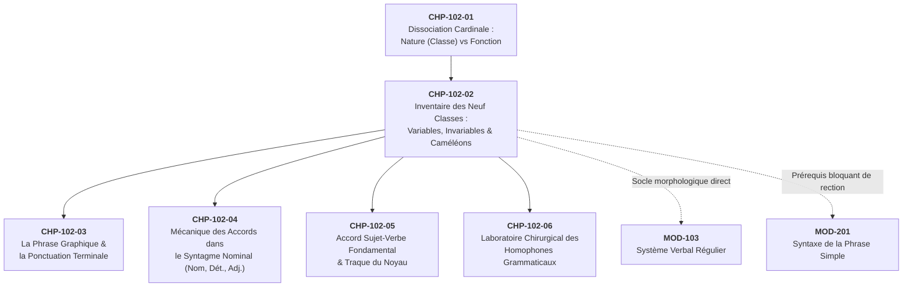

# Chapitre 2 — L'Inventaire des Neuf Classes Grammaticales du Français : Variables, Invariables et Mots Caméléons

> **Identifiant du chapitre** : `CHP-102-02`  
> **Module de rattachement** : [`MOD-102` — Morphologie des Parties du Discours, Ponctuation Terminale et Mécanique des Accords Fondamentaux](file:///f:/Formation/world-class-french/03-curriculum/year-1/semester-1/mod-102-classes-mots-accords-fondamentaux.md)  
> **Semestre** : Année 1 — Semestre 1 (S1)  
> **Volume horaire estimé** : 5 à 6 heures d'apprentissage autonome délibéré et d'ateliers d'application (Phase 1 Étude : 1 h 30 | Phase 2 Pratique : 1 h 30 | Phase 3 Correction : 1 h 00 | Phase 4 Évaluation : 1 h 00)  
> **Statut** : [STATUT : VALIDÉ]  
> **Compétences associées** : [`FR-ORTHO-001`](file:///f:/Formation/world-class-french/02-competency-framework/competency-framework.md#fr-ortho-001-maîtrise-de-lorthographe-lexicale-et-flexionnelle) (L3), [`FR-INT-001`](file:///f:/Formation/world-class-french/02-competency-framework/competency-framework.md#fr-int-001-rédiger-un-texte-long-cohérent-en-maîtrisant-accords-et-ponctuation) (L2/L3 stade phrase)  
> **Sources scientifiques de référence** : `SRC-NORM-03` (Ministère de l'Éducation nationale, 2020), `SRC-GRAM-02` (Riegel, Pellat, Rioul, 2016), `SRC-GRAM-01` (Grevisse & Goosse, 2016), `SRC-GRAM-05` (Grevisse, 2009), `SRC-LEX-01` (TLFi / ATILF)

---

## 1. Titre et Place dans le Cursus

### 1.1 Intitulé Officiel
**Chapitre 2 : L'Inventaire des Neuf Classes Grammaticales du Français : Variables, Invariables et Mots Caméléons** (`CHP-102-02`).

### 1.2 Insertion Architecturale dans le Cursus
Ce deuxième chapitre du module `MOD-102` constitue la charpente taxinomique de l'ensemble du cycle de grammaire et de morphosyntaxe. Alors que le chapitre précédent (`CHP-102-01`) a posé la frontière conceptuelle fondamentale entre la *nature* intrinsèque d'un mot et sa *fonction* syntaxique relationnelle en contexte d'énonciation, le présent chapitre dresse le répertoire exhaustif et scientifique des **neuf classes grammaticales** (les « parties du discours » traditionnelles) reconnues par la linguistique française contemporaine et la nomenclature officielle [Réf. `SRC-NORM-03`, p. 12-18 ; `SRC-GRAM-02`, chap. 4].



- **En amont** : Ce chapitre prend directement appui sur la compétence de discrimination acquise dans `CHP-102-01` (savoir qu'un mot possède une identité lexicale fixe indépendante de son rôle circonstanciel dans la phrase).
- **Au sein du module `MOD-102`** : Il fournit la grille catégorielle indispensable pour comprendre la mécanique des accords :
  - Au chapitre 4 (`CHP-102-04`), pour identifier le **nom** comme donneur d'accord exclusif du genre et du nombre, et le **déterminant** ainsi que l'**adjectif** comme receveurs d'accord ;
  - Au chapitre 5 (`CHP-102-05`), pour identifier le sujet (porté par un **nom** ou un **pronom**) imposant sa personne et son nombre au **verbe** ;
  - Au chapitre 6 (`CHP-102-06`), pour discriminer chirurgicalement les homophones grammaticaux dont la graphie découle exclusivement de la classe (*leur* déterminant vs *leur* pronom ; *a* verbe vs *à* préposition ; *ou* conjonction vs *où* pronom/adverbe).
- **En aval dans le cursus** : L'identification immédiate de la classe grammaticale et de ses mécanismes de conversion constitue un prérequis bloquant (*Hard Prerequisite*) pour l'analyse en constituants immédiats (`MOD-201`), l'accord du participe passé (`MOD-202`) et l'étude des propositions subordonnées (`MOD-301`).

---

## 2. Objectifs Mesurables

Au terme de l'étude autonome et des travaux dirigés de ce chapitre, l'apprenant doit être capable de :

1. **Classifier sans hésitation n'importe quelle unité lexicale en contexte** : face à un énoncé authentique de langue française, rattacher chacun de ses composants à l'une des neuf classes grammaticales canoniques (5 variables, 4 invariables) en formulant une justification fondée sur un test linguistique objectif (commutation distributionnelle ou manipulation morphologique) [Réf. `SRC-NORM-03`, p. 12 ; `SRC-GRAM-02`, chap. 4].
2. **Discriminer formellement les classes variables des classes invariables** : expliquer les raisons morphosyntaxiques pour lesquelles les noms, déterminants, adjectifs, pronoms et verbes fléchissent en recevant ou transmettant des marques, tandis que les adverbes, prépositions, conjonctions et interjections conservent une graphie rigoureusement fixe.
3. **Identifier et neutraliser les pièges de la conversion catégorielle (« mots caméléons »)** : déceler les cas de dérivation impropre (adjectif adverbialisé tel que *parler fort*, infinitif substantivé tel que *un devoir*, adverbe nominalisé tel que *le bien*) en appliquant le critère syntaxique de la distribution et de la détermination nominale.
4. **Éradiquer les fautes d'accord découlant d'une méprise sur la classe grammaticale** : repérer et corriger spontanément les accords fautifs portés sur des unités invariables (*« des enfants biens élevés »*, *« je leurs dis »*) et les omissions d'accord sur les receveurs réels.

---

## 3. Prérequis et Test de Préparation (Auto-Diagnostic)

### 3.1 Prérequis Cognitifs
- Maîtrise de la distinction cardinale entre la **nature** (ce qu'est le mot de manière permanente dans le dictionnaire) et la **fonction** (le rôle relationnel qu'il exerce dans une phrase précise), acquise dans `CHP-102-01`.
- Connaissance de la notion d'unité graphique et capacité à segmenter un énoncé en mots.
- Notions élémentaires sur les marques de pluriel (*-s*, *-x*) et les marques verbales personnelles (*-e, -es, -ons, -ez, -ent*).

### 3.2 Test de Préparation Immédiat
Répondez aux cinq questions suivantes avant d'entamer l'étude du chapitre. Consultez ensuite le corrigé repliable pour vérifier vos bases.

1. Dans la phrase : *« Les athlètes courent vite »*, quelle est la classe grammaticale du mot *vite* ? Peut-on écrire *vites* au pluriel ?
2. Dans l'énoncé : *« Je respecte leur travail et je leur réponds »*, quelle est la classe grammaticale respective des deux occurrences du mot *leur* ?
3. Dans la phrase : *« Le rouge de cette tenture est éclatant »*, quelle était la classe originelle du mot *rouge* dans le lexique, et quelle est sa classe grammaticale précise dans cet énoncé ?
4. Quelle différence fondamentale de nature sépare le mot *vers* dans *« Il marche vers la colline »* et le mot *vers* dans *« Ce poème comprend douze vers »* ?
5. Quels sont les deux grands ordres de conjonctions en français et quelle différence hiérarchique introduisent-ils entre les propositions ?

---

#### Corrigé de l'Auto-Diagnostic
<details>
<summary>Afficher le corrigé de l'auto-diagnostic</summary>

1. **Adverbe invariable** : Le mot *vite* modifie le verbe *courent* ; il appartient à la classe des adverbes de manière. Il est rigoureusement invariable. Écrire *vites* est une faute d'accord grossière.
2. **Déterminant possessif puis pronom personnel** : Le premier *leur* est placé devant le nom *travail* qu'il actualise : c'est un **déterminant possessif** (variable au pluriel : *leurs travaux*). Le second *leur* est placé devant le verbe *réponds* et remplace *à eux/à elles* : c'est un **pronom personnel complément d'objet indirect**, rigoureusement invariable (*« je leur réponds »*, jamais de *-s*).
3. **Adjectif converti en Nom** : À l'origine, *rouge* est un adjectif qualificatif de couleur (*une étoffe rouge*). Dans cette phrase, précédé de l'article défini *Le*, il subit une dérivation impropre (conversion) et fonctionne pleinement comme un **nom commun masculin singulier**.
4. **Préposition vs Nom commun** : Dans le premier cas, *vers* est une **préposition spatiale invariable** introduisant le groupe prépositionnel *vers la colline*. Dans le second cas, *vers* est un **nom commun masculin pluriel** désignant une ligne métrique de poésie, homophone du premier mais pourvu d'un singulier (*un vers*).
5. **Coordination vs Subordination** : Les **conjonctions de coordination** (*mais, ou, et, donc, or, ni, car*) relient deux unités de même niveau hiérarchique et syntaxique (parataxe ou liaison équipolente). Les **conjonctions de subordination** (*que, quand, lorsque, puisque, comme, si, quoique...*) placent la proposition qu'elles introduisent sous la dépendance syntaxique directe d'une proposition régissante (hypotaxe).

</details>

> [!NOTE]
> Si vous avez hésité sur l'une de ces cinq questions, ce chapitre vous apportera les critères formels et les méthodes de manipulation qui transforment l'hésitation en certitude réflexe.

---

## 4. Situation de Départ ou Problème Concret : L'Accord Fautif par Méconnaissance de la Classe

### 4.1 L'Hésitation Graphique dans la Rédaction Professionnelle
Considérez ces phrases relevées dans des écrits administratifs, académiques et professionnels :

1. *« Nous avons reçu des instructions de cadres biensveillants et biens formés. »* (Erreur)
2. *« Ce sont des dossiers complexes que nous leurs transmettons sans délai. »* (Erreur)
3. *« Ces nouvelles fournitures scolaires coûtent excessivement chères. »* (Erreur)
4. *« Elles sont arrivées toutes émues par la cérémonie. »* (Erreur)

Dans chacun de ces quatre énoncés, le scripteur a commis une faute orthographique patente non pas parce qu'il ignorait la règle générale du pluriel (*« on ajoute un -s au pluriel »*), mais parce qu'il a **mal identifié la classe grammaticale du mot** auquel il a appliqué la règle :

- Dans la phrase 1, le scripteur a cru que le mot *bien* qualifiait le nom *cadres* comme un adjectif épithète, alors que *bien* est ici un **adverbe d'intensité** modifiant le participe adjectivé *formés* ; or, un adverbe est invariable $\rightarrow$ *bien formés*.
- Dans la phrase 2, le scripteur a vu le pluriel de *dossiers* ou de *cadres* et a cru que *leur* s'accordait avec eux, le confondant avec l'adjectif possessif, alors que *leur* placé devant le verbe est un **pronom personnel**, forme plurielle atone de *lui*, rigoureusement invariable $\rightarrow$ *nous leur transmettons*.
- Dans la phrase 3, le scripteur a accordé *chères* avec le sujet *fournitures*, ignorant que le verbe *coûter* transforme l'adjectif *cher* en **adverbe de quantité/valeur** invariable $\rightarrow$ *coûtent cher*.
- Dans la phrase 4, le scripteur a cru devoir accorder l'adverbe *tout* devant un adjectif féminin, ignorant la restriction phonétique spécifique qui impose l'invariabilité devant une voyelle $\rightarrow$ *tout émues*.

### 4.2 Le Coût de l'Amalgame Catégoriel
Dans l'écrit soutenu, universitaire ou administratif, accorder un mot invariable ou omettre l'accord d'un mot variable décrédibilise immédiatement l'auteur. Le lecteur cultivé perçoit instantanément la faille : l'auteur ne « voit » pas la structure interne de sa phrase ; il se contente d'une contagion orthographique superficielle au fil de la plume.

Pour maîtriser l'orthographe française, la première question à se poser face à un mot n'est jamais *« comment s'accorde-t-il ? »*, mais :  
**« À quelle classe grammaticale ce mot appartient-il dans ce contexte précis ? »**

---

## 5. Explication Intuitive : L'Analogie du Code de la Route Grammatical

Pour comprendre la structure morphosyntaxique de la langue française, imaginons une analogie mécanique : **le système de circulation routière**.

```text
               SYSTÈME DE CIRCULATION DE LA PHRASE
      ┌─────────────────────────────────────────────────────────┐
      │ 1. LES VÉHICULES ET LEURS ÉQUIPEMENTS (CLASSES VARIABLES) │
      │    • Le Nom (le véhicule tracteur principal)            │
      │    • Le Déterminant (la plaque d'immatriculation)       │
      │    • L'Adjectif (les options et couleurs carrosserie)   │
      │    • Le Pronom (le véhicule de remplacement)            │
      │    • Le Verbe (le moteur puissant à régimes variables)  │
      └─────────────────────────────────────────────────────────┘
                                  │
                                  ▼
      ┌─────────────────────────────────────────────────────────┐
      │ 2. L'INFRASTRUCTURE FIXE DU RÉSEAU (CLASSES INVARIABLES)  │
      │    • L'Adverbe (le régulateur de vitesse ou de nuance)   │
      │    • La Préposition (l'échangeur et la bretelle d'accès)│
      │    • La Conjonction (le pont de raccordement / feux)    │
      │    • L'Interjection (le coup de klaxon ou gyrophare)    │
      └─────────────────────────────────────────────────────────┘
```

1. **Les véhicules modulables (les 5 classes variables)** :
   - Un camion (le **nom**) circule rarement sans sa plaque d'immatriculation (le **déterminant**). S'il s'agit d'un convoi de trois camions (pluriel), la plaque et les remorques d'équipement (les **adjectifs**) doivent obligatoirement afficher les mêmes voyants de gabarit (marques de genre et de nombre).
   - Si le camion s'absente, un véhicule relais prend exactement sa place et ses attributs : c'est le **pronom**.
   - Enfin, le moteur qui fait avancer tout l'équipage, c'est le **verbe** : sa cadence et son régime (temps, mode, personne) s'ajustent continuellement au poids du véhicule tracteur (le sujet).
   
2. **L'infrastructure fixe (les 4 classes invariables)** :
   - Les panneaux de signalisation, les échangeurs d'autoroute et les feux de circulation ne changent jamais d'aspect, qu'il passe devant eux une petite bicyclette féminine et singulière ou une flotte de vingt poids lourds masculins et pluriels.
   - La **préposition** est la bretelle d'accès fixe qui relie une portion de route à une autre (*vers, dans, avec, sans*).
   - La **conjonction** est l'aiguillage immuable qui articule deux voies indépendantes (*mais, ou, et, que, quand*).
   - L'**adverbe** est le voyant de vitesse fixe qui module l'allure (*vite, lentement, très, ne... pas*).
   - L'**interjection** est le coup de klaxon spontané (*Ah !, Bravo !*).

Tenter d'accorder une préposition ou un adverbe revient à vouloir peindre la plaque d'immatriculation du camion sur le panneau d'autoroute scellé dans le béton : c'est un non-sens mécanique.

---

## 6. Définitions Précises et Terminologie Fondamentale

Chaque terme ci-dessous constitue un outil d'analyse formelle rigoureusement défini dans les traités de référence [Réf. `SRC-NORM-03` ; `SRC-GRAM-02`, chap. 4 ; `SRC-GRAM-01`, § 150-165].

### 6.1 Classe Grammaticale (Partie du Discours)
> **Définition** : La **classe grammaticale** (ou *partie du discours*) est la catégorie lexicale et morphosyntaxique à laquelle appartient une unité linguistique en vertu de ses propriétés morphologiques (variabilité ou invariabilité), de sa combinatoire syntaxique (aptitude à recevoir des déterminants, à régir des compléments) et de son sémantisme fondamental [Réf. `SRC-NORM-03`, p. 12].

La grammaire française contemporaine reconnaît **neuf classes grammaticales fondamentales** :
- **Cinq classes variables** : le Nom, le Déterminant, l'Adjectif, le Pronom, le Verbe.
- **Quatre classes invariables** : l'Adverbe, la Préposition, la Conjonction, l'Interjection.

### 6.2 Mot Variable vs Mot Invariable
- **Mot variable** : Mot dont la forme graphique et phonique subit des modifications systématiques — appelées **flexions** — en fonction des catégories grammaticales de genre (masculin/féminin), de nombre (singulier/pluriel), de personne (1re, 2e, 3e), de temps ou de mode.
- **Mot invariable** : Mot dont la forme demeure unique, figée et insensible à l'environnement syntaxique. Il ne porte jamais de morphogramme flexionnel de genre ou de nombre.

### 6.3 Flexion, Base Lexicale et Lemme
- **Base lexicale (ou radical)** : Partie du mot qui porte l'essentiel du sens sémantique lexical et qui demeure généralement stable au cours de la flexion (ex. *chant-* dans *chant-er, chant-ons, chant-eur*).
- **Flexion (ou désinence)** : Affixe grammatical placé à la fin de la base lexicale pour marquer le genre, le nombre, la personne, le temps ou le mode (ex. *-e, -es, -ent, -ions*). La flexion s'oppose à la dérivation en ce qu'elle ne crée jamais un mot nouveau dans le dictionnaire, mais produit simplement les différentes formes réalisées d'un même mot.
- **Lemme** : Forme canonique conventionnelle sous laquelle un vocable est enregistré en entrée de dictionnaire :
  - Pour les verbes : l'infinitif présent (*aimer*, *prendre*) ;
  - Pour les noms et adjectifs : le masculin singulier (*grand*, *cheval*).

### 6.4 Classes Ouvertes vs Classes Fermées
- **Classe ouverte (ou lexicale)** : Catégorie comprenant un nombre indéterminé et potentiellement infini d'unités, continuellement enrichie par la création lexicale, la dérivation, la composition et l'emprunt. Les classes ouvertes sont : **le Nom**, **l'Adjectif**, **le Verbe** et les **Adverbes en *-ment***.
- **Classe fermée (ou grammaticale)** : Catégorie comprenant un inventaire fini et restreint d'unités fonctionnelles, qui n'accueille quasiment jamais de mots nouveaux dans l'état contemporain de la langue. Les classes fermées sont : **le Déterminant**, **le Pronom**, **la Préposition** et **la Conjonction**.

### 6.5 Dérivation Impropre (ou Conversion Catégorielle)
> **Définition** : La **dérivation impropre** (couramment nommée **conversion**) est un processus morphosyntaxique par lequel une unité lexicale passe d'une classe grammaticale à une autre **sans aucune modification de sa forme extérieure**, c'est-à-dire sans ajout de préfixe ni de suffixe [Réf. `SRC-GRAM-02`, chap. 12 ; `SRC-LEX-01`].

*Exemples cardinaux* :
- *devoir* (verbe à l'infinitif) $\rightarrow$ *un devoir* (nom commun, actualisé par un déterminant) ;
- *rouge* (adjectif qualificatif) $\rightarrow$ *le rouge* (nom commun désignant la couleur) ;
- *fort* (adjectif qualificatif) $\rightarrow$ *crier fort* (adverbe de manière invariable modifiant le verbe).

---

## 7. Règles ou Mécanismes Fondamentaux

Pour éviter la surcharge cognitive (§8 de la Charte du cursus), nous étudions l'inventaire en trois paliers structurés : les cinq classes variables (§ 7.1), les quatre classes invariables (§ 7.2), et la dynamique des conversions catégorielles (§ 7.3).

### 7.1 Les Cinq Classes Variables

Les classes variables partagent la propriété de fléchir. Elles se répartissent les rôles de **donneurs** et de **receveurs** d'accord au sein de la phrase.

```text
               TABLEAU SYNOPTIQUE DES CINQ CLASSES VARIABLES
┌──────────────┬─────────────────────────┬────────────────────────┬─────────────────────────┐
│ Classe       │ Nature du contenu       │ Traits flexionnels     │ Rôle syntaxique typique │
├──────────────┼─────────────────────────┼────────────────────────┼─────────────────────────┤
│ 1. Nom       │ Référentiel (entités)   │ Genre (inhérent),      │ Tête du groupe nominal, │
│              │                         │ Nombre (extrinsèque)   │ donneur universel d'acc.│
├──────────────┼─────────────────────────┼────────────────────────┼─────────────────────────┤
│ 2. Déterminant│ Actualisateur du nom    │ Genre, Nombre          │ Précède le nom,         │
│              │                         │                        │ receveur d'accord       │
├──────────────┼─────────────────────────┼────────────────────────┼─────────────────────────┤
│ 3. Adjectif  │ Caractérisant/Relation  │ Genre, Nombre          │ Épithète ou attribut,   │
│              │                         │                        │ receveur d'accord       │
├──────────────┼─────────────────────────┼────────────────────────┼─────────────────────────┤
│ 4. Pronom    │ Substitut ou déictique  │ Genre, Nombre,         │ Remplace un GN,         │
│              │                         │ Personne, Cas          │ sujet ou complément     │
├──────────────┼─────────────────────────┼────────────────────────┼─────────────────────────┤
│ 5. Verbe     │ Prédicatif (procès)     │ Mode, Temps,           │ Centre de la proposition│
│              │                         │ Personne, Nombre, Voix │ receveur du sujet       │
└──────────────┴─────────────────────────┴────────────────────────┴─────────────────────────┘
```

#### A. Le Nom (ou Substantif)
Le nom sert à désigner les êtres vivants, les objets concrets, les notions abstraites, les lieux et les événements [Réf. `SRC-NORM-03`, p. 12].
- **Nom commun** : s'applique à tous les individus d'une même espèce ou classe (*fleuve, étudiant, courage*). Il possède une signification lexicale générale et requiert presque toujours un déterminant pour s'actualiser dans la phrase.
- **Nom propre** : s'applique à un être ou un lieu unique (*Cotonou, Victor Hugo, la Seine*). Il s'écrit avec une majuscule initiale, ne s'emploie généralement pas avec un déterminant (sauf noms géographiques : *le Bénin, la France*) et est intrinsèquement singulier (sauf pluriels patronymiques ou géographiques spécifiques : *les Alpes*).
- **Propriétés flexionnelles** :
  - Le **genre** du nom est une propriété lexicale **intrinsèque** : en français, tout nom est arbitrairement soit masculin (*un livre*), soit féminin (*une table*). Le scripteur ne choisit pas le genre d'une table ; il le constate.
  - Le **nombre** est une catégorie **extrinsèque** : la plupart des noms communs peuvent commuter du singulier au pluriel (*un enfant $\rightarrow$ des enfants*). Certains noms ne s'emploient qu'au pluriel (*pluralia tantum* : *les ténèbres, les funérailles, les mœurs*).

#### B. Le Déterminant
Le déterminant est un mot-outil indispensable qui se place **devant le nom** pour lui permettre de passer de la puissance à l'acte, c'est-à-dire de s'insérer dans un énoncé concret en délimitant son extension référentielle [Réf. `SRC-GRAM-02`, chap. 8].
- **Inventaire canonique des sous-types de déterminants** :
  1. *Articles définis* : simples (*le, la, les, l'*), contractés (*au, aux, du, des*), élidés (*l'*).
  2. *Articles indéfinis* : *un, une, des*.
  3. *Articles partitifs* : *du, de la, des, de l'* (*boire du lait, avoir de la patience*).
  4. *Déterminants possessifs* : *mon, ton, son, ma, ta, sa, mes, tes, ses, notre, votre, leur, nos, vos, leurs*.
  5. *Déterminants démonstratifs* : *ce, cet, cette, ces*.
  6. *Déterminants indéfinis* : *aucun, chaque, nul, plusieurs, tout, certain, quelque, divers*.
  7. *Déterminants interrogatifs et exclamatifs* : *quel, quelle, quels, quelles*.
  8. *Déterminants numéraux cardinaux* : *deux, trois, vingt, cent...* (la *Terminologie grammaticale* MEN 2020 classe les anciens adjectifs numéraux cardinaux parmi les déterminants).
- **Propriétés flexionnelles** : Le déterminant ne possède pas de genre ni de nombre propre : il **reçoit** intégralement le genre et le nombre du nom qu'il introduit (*un cheval $\rightarrow$ une jument ; ce garçon $\rightarrow$ ces garçons*).

#### C. L'Adjectif (Qualificatif et Relationnel)
L'adjectif apporte une précision, une qualité ou une relation au nom auquel il se rattache [Réf. `SRC-NORM-03`, p. 13] :
- **Adjectif qualificatif** : exprime une propriété intrinsèque, gradable (qui accepte les adverbes d'intensité : *un texte très clair, une solution plus rapide*).
- **Adjectif relationnel** : dérivé d'un nom, il équivaut à un complément du nom et n'est pas gradable (*l'élection présidentielle* = de la présidence ; *un décret ministériel* ; on ne peut pas dire *\*un décret très ministériel*).
- **Propriétés flexionnelles** : L'adjectif est le **receveur d'accord** par excellence du groupe nominal. Il prend obligatoirement le genre et le nombre du nom qu'il qualifie, qu'il soit épithète liée (*une brillante étudiante*), épithète détachée (*Fatiguées, les voyageuses s'endormirent*) ou attribut du sujet (*Cette décision est sage*).

#### D. Le Pronom
Le pronom est un mot qui n'accompagne pas un nom mais **occupe la place d'un syntagme nominal entier** (fonction anaphorique de substitut) ou réfère directement aux participants de la situation de communication (fonction déictique) [Réf. `SRC-GRAM-02`, chap. 9].
- **Inventaire canonique des sous-types de pronoms** :
  1. *Pronoms personnels* : conjoints/atones (*je, tu, il, elle, on, nous, vous, ils, elles, me, te, se, le, la, les, lui, leur, en, y*) et disjoints/toniques (*moi, toi, lui, elle, soi, nous, vous, eux, elles*).
  2. *Pronoms possessifs* : *le mien, la tienne, les nôtres, le leur, les leurs...*
  3. *Pronoms démonstratifs* : formes simples (*celui, celle, ceux, celles, ce, c'*) et formes composées (*celui-ci, celle-là, ceci, cela, ça*).
  4. *Pronoms relatifs* : formes invariables (*qui, que, quoi, dont, où*) et formes composées variables (*lequel, laquelle, lesquels, lesquelles, auquel, duquel...*).
  5. *Pronoms interrogatifs* : *qui, que, quoi, lequel...*
  6. *Pronoms indéfinis* : *chacun, personne, rien, tout, certains, quelqu'un, nul, l'un, l'autre...*
- **Propriétés flexionnelles** : Le pronom varie en genre et en nombre selon son antécédent, mais aussi en **personne** (1re, 2e, 3e) et pour les pronoms personnels, en **cas/fonction** (*je* sujet, *me* COD/COI, *moi* tonique).

#### E. Le Verbe
Le verbe est le noyau prédicatif de la phrase verbale. Il exprime une action, un état, un devenir ou un processus situé dans le temps [Réf. `SRC-NORM-03`, p. 14].
- **Morphologie la plus riche du français** : Le verbe fléchit selon :
  1. Le **mode** : modes personnels (indicatif, subjonctif, conditionnel, impératif) et modes non personnels (infinitif, participe, gérondif).
  2. Le **temps** : présent, imparfait, passé simple, futur simple, passé composé, plus-que-parfait, passé antérieur, futur antérieur.
  3. La **voix** : active, passive, pronominale.
  4. La **personne et le nombre** : 1re, 2e, 3e personnes du singulier et du pluriel, imposées par le sujet donneur d'accord.

---

### 7.2 Les Quatre Classes Invariables

Les classes invariables ne fléchissent jamais. Elles constituent les opérateurs logiques, modaux, spatio-temporels et relationnels de la langue [Réf. `SRC-GRAM-01`, § 155 ; `SRC-GRAM-02`, chap. 10-11].

```text
               TABLEAU SYNOPTIQUE DES QUATRE CLASSES INVARIABLES
┌──────────────┬─────────────────────────┬────────────────────────┬─────────────────────────┐
│ Classe       │ Définition relationnelle│ Sous-catégories clés   │ Test de reconnaissance  │
├──────────────┼─────────────────────────┼────────────────────────┼─────────────────────────┤
│ 1. Adverbe   │ Modificateur de verbe,  │ Manière, temps, lieu,  │ Généralement effaçable, │
│              │ adjectif, adverbe, phras│ quantité, négation     │ jamais de complément obl│
├──────────────┼─────────────────────────┼────────────────────────┼─────────────────────────┤
│ 2. Préposition│ Mot de liaison recteur  │ Simples (à, de, pour)  │ Jamais effaçable seul,  │
│              │ introduisant un régime  │ Locutions (grâce à...) │ toujours suivi d'un GN/I│
├──────────────┼─────────────────────────┼────────────────────────┼─────────────────────────┤
│ 3. Conjonction│ Relie deux termes ou    │ Coordination (mais...) │ Lie deux unités sans ré-│
│              │ propositions            │ Subordination (que...) │ gime prépositionnel     │
├──────────────┼─────────────────────────┼────────────────────────┼─────────────────────────┤
│ 4. Interject.│ Énoncé affectif autonome│ Cris, onomatopées,     │ Isolée par virgule ou ! │
│              │                         │ formules expressives   │ autonome syntaxiquement │
└──────────────┴─────────────────────────┴────────────────────────┴─────────────────────────┘
```

#### A. L'Adverbe
L'adverbe est un mot invariable qui se joint à un verbe, un adjectif, un autre adverbe ou à une phrase entière pour en modifier le sens ou en préciser les circonstances [Réf. `SRC-NORM-03`, p. 15].
- **Types sémantiques et fonctionnels d'adverbes** :
  1. *Adverbes de manière* : *bien, mal, vite, ensemble, debout* et la vaste classe ouverte des adverbes en *-ment* (*rapidement, clairement, dignement*).
  2. *Adverbes de temps* : *hier, aujourd'hui, demain, alors, bientôt, tard, souvent, longtemps, toujours, jamais*.
  3. *Adverbes de lieu* : *ici, là, ailleurs, dedans, dehors, partout, devant, derrière, loin, près*.
  4. *Adverbes de quantité et d'intensité* : *beaucoup, peu, très, trop, assez, tellement, plus, moins, autant, tout*.
  5. *Adverbes de négation* : *ne... pas, ne... point, ne... plus, ne... jamais, non, ne... guère*.
  6. *Adverbes d'opinion, d'affirmation ou de doute* : *oui, certes, sans doute, peut-être, assurément*.
  7. *Adverbes de liaison (connecteurs logiques)* : *cependant, néanmoins, toutefois, en effet, ainsi, puis*.

#### B. La Préposition
La préposition est un mot invariable qui sert de mot de liaison **recteur** : elle introduit un constituant syntaxique dépendant (appelé son **régime** ou complément) et le rattache à un terme recteur (verbe, nom, adjectif) [Réf. `SRC-GRAM-02`, chap. 11].
- **Caractéristique absolue** : Une préposition ne peut **jamais** subsister seule dans la phrase sans son régime (sauf cas rarissimes d'ellipse littéraire ou emploi absolu converti). On dit *« Il part avec son frère »* ; on ne peut pas achever la phrase par *\*« Il part avec »* en français standard soutenu.
- **Formes** :
  - *Prépositions simples* : *à, de, en, par, pour, sur, sous, dans, avec, sans, vers, chez, contre, entre, pendant, selon, malgré, parmi, envers, outre*. (Moyen mnémotechnique classique : *« À, dans, par, pour, en, vers, avec, de, sans, sous, sur, chez, contre »*).
  - *Locutions prépositionnelles* : groupes figés équivalant à une préposition (*grâce à, à cause de, afin de, au moyen de, en dépit de, jusqu'à, quant à, à travers, le long de, près de, faute de*).

#### C. La Conjonction
La conjonction est un mot invariable qui sert à relier deux mots, deux groupes de mots ou deux propositions. La linguistique distingue deux sous-classes aux fonctionnements hiérarchiques opposés [Réf. `SRC-NORM-03`, p. 16] :
1. **Conjonctions de coordination** : Elles relient des mots ou des propositions de **même fonction syntaxique** et de même rang hiérarchique :
   - Les 7 formes canoniques : *mais, ou, et, donc, or, ni, car*.
   - Elles expriment une relation logique équipolente : opposition (*mais, or*), alternative (*ou*), addition (*et*), conséquence (*donc*), exclusion (*ni*), explication causale (*car*).
2. **Conjonctions de subordination** : Elles introduisent une proposition subordonnée et l'assujettissent hiérarchiquement à une proposition principale :
   - *Conjonctions simples* : *que, quand, lorsque, puisque, comme, si, quoique*.
   - *Locutions conjonctives de subordination* : *bien que, parce que, dès que, alors que, pourvu que, afin que, de sorte que, pendant que, tandis que*.

#### D. L'Interjection et l'Onomatopée
L'interjection est un mot invariable, isolé syntaxiquement, qui équivaut par lui-même à une phrase entière (*mot-phrase*) et traduit une émotion soudaine, un ordre ou une interpellation du locuteur [Réf. `SRC-NORM-03`, p. 17 ; `SRC-GRAM-01`, § 1045] :
- *Interjections expressives* : *Ah !, Oh !, Hélas !, Ouf !, Aïe !, Bravo !*
- *Interjections d'appel ou d'injonction* : *Holà !, Chut !, Gare !, Merci !*
- *Onomatopées* : mots imitant conventionnellement un bruit naturel ou mécanique (*Cocorico !, Tic-tac !, Boum !, Patatras !*).
- **Statut syntaxique** : L'interjection n'exerce aucune fonction syntaxique dans la proposition : elle est toujours détachée par une virgule ou suivie d'un point d'exclamation.

---

### 7.3 Les Mots Caméléons et la Conversion Catégorielle

Certains mots français ont la capacité de changer de classe grammaticale en fonction exclusive de leur environnement syntaxique. Ce phénomène porte le nom de **dérivation impropre** ou **conversion**.

```text
               LES SIX GRANDES VOIES DE LA CONVERSION CATÉGORIELLE
  ┌───────────────────────────┬──────────────────────────────────────────────┐
  │ Trajet de conversion      │ Exemples concrets commentés                  │
  ├───────────────────────────┼──────────────────────────────────────────────┤
  │ 1. Verbe inf. ➔ Nom       │ • devoir ➔ un devoir, des devoirs            │
  │                           │ • pouvoir ➔ le pouvoir, des pouvoirs         │
  │                           │ • rire ➔ un rire éclatant                    │
  ├───────────────────────────┼──────────────────────────────────────────────┤
  │ 2. Adjectif ➔ Nom         │ • le rouge (la couleur), un sage,            │
  │                           │ • les riches, le vrai, le beau               │
  ├───────────────────────────┼──────────────────────────────────────────────┤
  │ 3. Adjectif ➔ Adverbe     │ • parler fort (invariable)                   │
  │                           │ • coûter cher (invariable)                   │
  │                           │ • voir clair, chanter faux, voter écolo      │
  ├───────────────────────────┼──────────────────────────────────────────────┤
  │ 4. Mot invariable ➔ Nom   │ • un tout, le bien et le mal,                │
  │                           │ • des si et des mais, le pourquoi du comment │
  ├───────────────────────────┼──────────────────────────────────────────────┤
  │ 5. Participe ➔ Nom ou Adj.│ • un passant, un savant, un fait             │
  │                           │ • une eau courante, une affaire urgente      │
  ├───────────────────────────┼──────────────────────────────────────────────┤
  │ 6. Nom ➔ Adjectif         │ • un ruban rose, des jupes marron            │
  │                           │ • une veste chocolat, un travail éclair      │
  └───────────────────────────┴──────────────────────────────────────────────┘
```

#### Les Tests Infaillibles pour Démasquer la Conversion :
1. **Le test de la présence d'un déterminant** : Dès qu'un mot (verbe, adjectif, adverbe, conjonction) est précédé d'un déterminant (*un, le, ce, mon...*), il est **substantivé** et fonctionne pleinement comme un **nom** :
   - *« Il sait son devoir »* : *devoir* est précédé du possessif *son* $\rightarrow$ c'est un nom masculin singulier (au pluriel : *ses devoirs*).
   - *« Il doit partir »* : *doit* est le verbe *devoir* conjugué.
2. **Le test de la modification du verbe** : Dès qu'un adjectif sert à répondre à la question *« comment ? »* posée après un verbe et demeure invariable si l'on change le genre du sujet, il est **adverbialisé** :
   - *« Ces femmes parlent fort »* : on ne dit pas *\*parlent fortes* $\rightarrow$ *fort* fonctionne comme un adverbe modifiant *parlent*.

---

## 8. Raisonnement Détaillé : L'Économie de Transmission des Marques Morphosyntaxiques

Pourquoi la langue française impose-t-elle à cinq classes de fléchir continuellement tout en laissant les quatre autres figées dans une invariabilité absolue ?

### 8.1 La Nécessité du « Liage » Référentiel
Dans la communication orale et écrite, les êtres humains désignent des entités du monde réel ou conceptuel (objets, personnes, abstractions). Le français a besoin de lier les mots qui se rapportent à la **même entité** afin d'éviter toute ambiguïté interprétative [Réf. `SRC-GRAM-02`, chap. 6] :

Considérez l'énoncé suivant :
> *« La directrice a reçu le candidat et sa collaboratrice compétente. »*

Pourquoi sait-on avec certitude que c'est la collaboratrice qui est compétente et non le candidat ni la directrice ?
Parce que l'adjectif *compétente* porte la marque de flexion féminine singulière (*-e*) qui le relie sans équivoque au nom féminin le plus proche (*sa collaboratrice*). Si l'adjectif n'était pas variable, la phrase serait indécidable.

L'accord est donc un **dispositif de redondance informative** : il transmet le genre et le nombre du nom chef de file vers ses satellites immédiats (déterminants, adjectifs) et vers le prédicat (verbe).

### 8.2 La Nature Abstraite et Relationnelle des Invariables
À l'opposé des noms et des adjectifs, une préposition comme *avec*, *dans* ou *vers* ne désigne pas un objet du monde : elle désigne un **rapport abstrait** (de compagnie, de localisation ou de direction).
- Une relation spatiale ou temporelle n'a ni sexe, ni genre, ni pluralité physique. Dire *« avec deux hommes »* ou *« avec dix femmes »* ne change en rien la nature de la relation d'accompagnement.
- Exiger un accord sur la préposition (*\*avecs deux hommes*) surchargerait inutilement le cerveau du locuteur et du lecteur sans apporter la moindre information supplémentaire.

Par économie linguistique, le français a donc figé les opérateurs relationnels (prépositions, conjonctions, adverbes) dès la fin du gallo-roman et l'ancien français, tout en concentrant l'effort flexionnel sur le groupe nominal et la désinence verbale.

---

## 9. Exemples Corrects Commentés

Analysons une phrase complète intégrant une multiplicité de classes, en appliquant les tests de commutation, d'effacement et de déplacement pour chaque mot.

### 9.1 Phrase Modèle
> *« Ah ! le jeune voyageur marche courageusement vers son destin, mais il hésite lorsque la nuit sombre tombe. »*

Détaillons les constituants mot par mot :

| Mot | Classe exacte | Variabilité | Test de validation linguistique |
| :--- | :--- | :--- | :--- |
| **Ah !** | Interjection | Invariable | Énoncé autonome expressif, séparé par une marque de ponctuation forte ; inanalysable en termes de fonction. |
| **le** | Déterminant (article défini) | Variable | Précède le nom *voyageur*. Commutation : *un voyageur, ce voyageur*. Au pluriel : *les voyageurs*. |
| **jeune** | Adjectif qualificatif | Variable | Qualifie *voyageur*. Commutation par un autre adjectif : *le vieux voyageur*. Au féminin : *la jeune voyageuse*. |
| **voyageur** | Nom commun | Variable | Tête du syntagme nominal sujet. Porte le genre masculin intrinsèque. Au pluriel : *les jeunes voyageurs*. |
| **marche** | Verbe | Variable | Centre prédicatif. Commutation temporelle : *marchait, marchera*. Accord avec le sujet *voyageur* (3e pers. sing.). |
| **courageusement**| Adverbe de manière | Invariable | Modifie le verbe *marche*. Effaçable : *le jeune voyageur marche vers son destin*. Invariable au pluriel (*ils marchent courageusement*). |
| **vers** | Préposition | Invariable | Mot recteur introduisant le groupe nominal *son destin*. Non effaçable seul (*\*marche son destin*). |
| **son** | Déterminant possessif | Variable | Précède le nom *destin*. Reçoit le masculin singulier de *destin*. Au pluriel : *ses destins*. |
| **destin** | Nom commun | Variable | Régime de la préposition *vers*. Masculin singulier. Au pluriel : *vers leurs destins*. |
| **, mais** | Conjonction de coordination | Invariable | Relie les deux propositions coordonnées sur un pied d'égalité syntaxique. Exprime l'opposition. |
| **il** | Pronom personnel sujet | Variable | Remplace le syntagme nominal *le jeune voyageur*. Au pluriel : *ils hésitent*. |
| **hésite** | Verbe | Variable | Centre prédicatif de la seconde proposition. S'accorde avec le pronom sujet *il*. |
| **lorsque** | Conjonction de subordination | Invariable | Introduit la subordonnée temporelle circonstancielle *la nuit sombre tombe* sous la dépendance de *hésite*. |
| **la** | Déterminant (article défini) | Variable | Reçoit le féminin singulier du nom *nuit*. Au pluriel : *les nuits*. |
| **nuit** | Nom commun | Variable | Sujet du verbe *tombe*. Féminin intrinsèque. Au pluriel : *les nuits*. |
| **sombre** | Adjectif qualificatif | Variable | Épithète de *nuit*. S'accorde au féminin singulier. Au pluriel : *les nuits sombres*. |
| **tombe** | Verbe | Variable | Verbe de la proposition subordonnée, accordé avec *la nuit* (3e pers. sing.). |

---

## 10. Contre-Exemples et Erreurs Fréquentes

Examinons les cinq confusions pathologiques les plus fréquentes chez les scripteurs, avec leur réfutation scientifique [Réf. `SRC-GRAM-01`, § 155-165, § 672, § 985].

### 10.1 Accord Fautif de l'Adverbe Modificateur
- ❌ **Forme fautive** : *« Ce sont des étudiants biens préparés et forts intelligents. »*
- 🔍 **Analyse de la faille** : Le scripteur accorde *bien* et *fort* comme des adjectifs parce qu'il perçoit le pluriel du nom *étudiants*. Or, *bien* et *fort* ne qualifient pas directement le nom : ils modifient respectivement l'adjectif verbal *préparés* et l'adjectif *intelligents*. Ce sont des **adverbes d'intensité**, par essence invariables.
-  **Forme correcte** : *« Ce sont des étudiants **bien** préparés et **fort** intelligents. »*

### 10.2 Confusion Pronom Personnel COI vs Déterminant Possessif (*Leur / Leurs*)
- ❌ **Forme fautive** : *« Les professeurs sont arrivés, les délégués leurs ont remis leurs cahiers. »*
- 🔍 **Analyse de la faille** : Le premier *leurs* est placé immédiatement devant le verbe auxiliaire *ont remis* : c'est le pronom personnel complément d'objet indirect (pluriel de *lui*). Il est **rigoureusement invariable** et ne prend jamais de *-s*. Le second *leurs* précède le nom pluriel *cahiers* : c'est le déterminant possessif, qui prend régulièrement un *-s*.
-  **Forme correcte** : *« Les professeurs sont arrivés, les délégués **leur** ont remis **leurs** cahiers. »*
- 🧪 **Test de validation** : Si l'on remplace le pluriel par un singulier : *« Les délégués **lui** ont remis son cahier »* $\rightarrow$ *lui* n'a pas de *-s*, donc son pluriel *leur* n'en a jamais devant un verbe.

### 10.3 Confusion entre Préposition et Nom Homophone (*Vers / Verre / Vert / Vair*)
- ❌ **Forme fautive** : *« Les troupes avancent ver le village. »* ou *« Il récite un verre de Victor Hugo. »*
- 🔍 **Analyse de la faille** : Confusion phonétique totale entre quatre lexèmes partageant la séquence phonologique `/vɛʁ/` mais appartenant à des classes et des réseaux lexicaux différents :
  - *vers* = préposition spatiale ou temporelle invariable (*vers le soir*) ;
  - *vers* = nom masculin désignant l'unité poétique métrique (*un vers, des vers*) ;
  - *verre* = nom masculin désignant la matière transparente ou le récipient (*un verre d'eau*) ;
  - *vert* = adjectif de couleur ou nom (*un manteau vert, le vert*) ;
  - *vair* = nom masculin archaïque désignant une fourrure d'écureuil (*la pantoufle de vair*).
-  **Forme correcte** : *« Les troupes avancent **vers** le village. »* / *« Il récite un **vers** de Victor Hugo. »*

### 10.4 Accord Indu de l'Adjectif Adverbialisé
- ❌ **Forme fautive** : *« Ces montres coûtent chères, mais elles fonctionnent justes. »*
- 🔍 **Analyse de la faille** : Dans les locutions verbales *coûter cher*, *fonctionner juste*, *parler bas*, *frapper fort*, les adjectifs *cher, juste, bas, fort* ont subi une conversion catégorielle : ils fonctionnent comme des adverbes de manière modifiant le verbe. Ils perdent toute faculté de flexion.
-  **Forme correcte** : *« Ces montres coûtent **cher**, mais elles fonctionnent **juste**. »*

### 10.5 Confusion entre Conjonction de Coordination et Adverbe de Liaison
- ❌ **Forme fautive** : Traiter *pourtant* ou *cependant* comme des conjonctions de coordination pures pouvant coordonner sans ponctuation deux propositions complètes.
- 🔍 **Analyse de la faille** : Les seules conjonctions de coordination canoniques en français moderne sont *mais, ou, et, donc, or, ni, car*. Les mots comme *cependant, toutefois, néanmoins, pourtant* sont des **adverbes connecteurs**. Contrairement aux conjonctions pures, ils sont mobiles dans la proposition (*« Il est malade ; il est cependant venu »* / *« Il est toutefois présent »*).

---

## 11. Cas Particuliers et Limites

### 11.1 L'Adverbe « Tout » et son Anomalie Historique d'Accord par Euphonie
L'adverbe *tout* présente la plus célèbre anomalie morphologique du français : bien qu'étant un adverbe de degré signifiant *entièrement*, il s'accorde dans un cas strictement délimité [Réf. `SRC-GRAM-01`, § 985 ; `SRC-NORM-03`, p. 15].

```text
               ARBRE DE DÉCISION POUR L'ADVERBE « TOUT »
                                   tout + Adjectif
                                          │
            ┌─────────────────────────────┴─────────────────────────────┐
            ▼                                                           ▼
    Devant Adjectif Masculin                               Devant Adjectif Féminin
   (singulier ou pluriel)                                               │
            │                                     ┌─────────────────────┴─────────────────────┐
            ▼                                     ▼                                           ▼
   TOUJOURS INVARIABLE                   Devant Voyelle ou H muet                    Devant Consonne ou H aspiré
• Ils sont tout émus.                    • Elle est tout étonnée.                     • Elle est toute honteuse.
• Ils sont tout petits.                  • Elles sont tout heureuses.                 • Elles sont toutes pâles.
                                         (Invariable)                                 (ACCORD EUPHONIQUE EN GENRE & NOMBRE)
```

- **Raison historique du phénomène** : En ancien et moyen français, la consonne finale de *tout* s'amuisait devant une consonne. Pour éviter la disparition totale du mot dans l'articulation orale devant consonne (*toute petite* prononcé avec maintien du [t]), l'usage a maintenu la prononciation féminine [tut] devant consonne, que les scripteurs du XVIIe siècle ont fini par transcrire par *toute* et *toutes*. Devant voyelle, la consonne de liaison [t] étant naturellement réactivée (*tout‿émue*), la graphie est restée invariable *tout*.

### 11.2 Locutions Prépositionnelles vs Locutions Adverbiales
La frontière entre préposition et adverbe s'efface parfois dans la conversation relâchée, mais doit rester rigoureuse à l'écrit :
- **Préposition** : exige obligatoirement un régime nominal ou pronominal.  
  *« Il tourne autour de la maison. »* (*autour de* = locution prépositionnelle).
- **Adverbe** : se suffit à lui-même et ne régit aucun complément.  
  *« Il regarde autour. »* (*autour* = adverbe de lieu).
- **La paire *avant / avant de*** :
  - *« Avant son départ »* (*avant* = préposition + nom).
  - *« Avant de partir »* (*avant de* = locution prépositionnelle + infinitif).
  - *« Je ne l'avais pas vu avant »* (*avant* = adverbe temporel autonome).

### 11.3 Les Adjectifs / Participes Employés Prépositionnellement
Certains adjectifs ou participes passés se figent dans un emploi prépositionnel lorsqu'ils sont **antéposés** au groupe nominal :
- *Plein, passé, excepté, vu, attendu, y compris, non compris* :
  - Placés **avant** le nom : ils fonctionnent comme des prépositions invariables :  
    *« Il a des devoirs plein la tête. »* (invariable).  
    *« Passé huit heures, les portes ferment. »* (invariable).  
    *« Tous sont venus, excepté mes sœurs. »* (invariable).
  - Placés **après** le nom : ils redeviennent des adjectifs qualificatifs pleinement variables :  
    *« Il a la tête pleine de projets. »* (accord régulier).  
    *« Les huit heures passées, nous partîmes. »* (accord régulier).

---

## 12. Approfondissement Adapté au Niveau : Les Trois Critères de Classification Linguistique

La grammaire scolaire traditionnelle définissait souvent les parties du discours par leur seul sens : *« le nom désigne une personne ou une chose »*, *« le verbe indique une action »*. La linguistique moderne (Riegel et al., *Grammaire méthodique du français*) démontre que le critère sémantique seul est incapable de fonder une classification rigoureuse [Réf. `SRC-GRAM-02`, chap. 4].

Pour classer scientifiquement un mot, la linguistique croise obligatoirement trois critères :

```text
                  LES TROIS CRITÈRES DE CLASSIFICATION DU MOT
                    ┌────────────────────────────────────────┐
                    │ 1. CRITÈRE SÉMANTIQUE (Le sens)        │
                    │    Substance, qualité, action, relation│
                    └────────────────────────────────────────┘
                                        ▲
                                        │
           ┌────────────────────────────┴────────────────────────────┐
           ▼                                                         ▼
┌──────────────────────────────────────┐  ┌──────────────────────────────────────┐
│ 2. CRITÈRE MORPHOLOGIQUE (La forme)  │  │ 3. CRITÈRE SYNTAXIQUE (La position)  │
│    Variabilité, marques flexionnelles│  │    Distribution, combinatoire, rôle  │
│    (genre, nombre, temps, personne)  │  │    dans la proposition               │
└──────────────────────────────────────┘  └──────────────────────────────────────┘
```

1. **La faillite du critère sémantique pur** :
   - *« La rougeur »* désigne une qualité, tout comme *« rouge »* ; pourtant, *rougeur* est un **nom** et *rouge* est un **adjectif**.
   - *« Blanchir »* désigne une propriété en cours d'installation, tout comme *« blancheur »* ; pourtant, *blanchir* est un **verbe** et *blancheur* est un **nom**.
   - *« La marche »* désigne une action physique, tout comme *« marcher »* ; pourtant, *la marche* est un nom et *marcher* est un verbe.
2. **La primauté des critères morphologique et syntaxique** :
   - C'est la présence du déterminant (*la rougeur*) et son aptitude à varier en nombre (*les rougeurs*) qui prouvent formellement que *rougeur* est un **nom**.
   - C'est la conjugaison en mode et en temps (*il blanchit, nous blanchissons*) qui prouve formellement que *blanchir* est un **verbe**.
   - C'est la capacité à recevoir un adverbe de degré (*très rouge*) et à s'accorder en genre avec un nom (*une robe rouge*) qui prouve formellement que *rouge* est un **adjectif**.

> [!TIP]
> Lorsque vous hésitez sur la classe d'un mot, appliquez immédiatement le **test morphosyntaxique** : observez avec quels mots il se combine et s'il peut recevoir des flexions, plutôt que de vous demander abstraitement ce qu'il « veut dire ».

---

## 13. Comparaisons Différentielles (Tableaux Synoptiques)

### 13.1 Préposition vs Adverbe

| Critère d'opposition | Préposition | Adverbe |
| :--- | :--- | :--- |
| **Exigence d'un régime (complément)** | **Obligatoire** : ne peut pas exister sans régime nominal, pronominal ou infinitif (*chez lui, pour partir*). | **Nulle** : s'emploie de manière autonome et se suffit à lui-même (*il dort bien, viens ici*). |
| **Effaçabilité** | Non effaçable isolément : supprimer la préposition détruit la syntaxe (*\*il marche la forêt*). | Très souvent effaçable sans détruire la phrase (*il marche [lentement]*). |
| **Rôle syntaxique** | Mot de liaison recteur, tête du groupe prépositionnel. | Modificateur de verbe, d'adjectif, d'adverbe ou de phrase. |
| **Test de distinction** | Remplacer par *à* ou *de* : *Il court vers lui* $\rightarrow$ *Il va à lui*. | Remplacer par *beaucoup* ou *rapidement* : *Il court vite* $\rightarrow$ *Il court rapidement*. |

### 13.2 Déterminant vs Pronom

| Critère d'opposition | Déterminant | Pronom |
| :--- | :--- | :--- |
| **Position par rapport au nom** | **Toujours antéposé au nom** qu'il actualise (*cette table, leur maison*). | **Remplace le nom** ; ne figure jamais à côté du nom qu'il représente (*celle-ci, la leur*). |
| **Autonomie syntaxique** | Incomplet sans le nom noyau : ne peut former un constituant seul. | Pleinement autonome : occupe à lui seul la fonction de sujet, COD, COI, etc. |
| **Formes pièges (*leur / la / les*)** | • *Leur* devoir (déterminant possessif + nom).<br/>• *La* fleur (article défini + nom). | • Ils *leur* parlent (pronom COI + verbe).<br/>• Il *la* regarde (pronom COD + verbe). |
| **Test de détection** | Peut commuter avec l'article défini *le, la, les*. | Peut commuter avec un groupe nominal complet (*Je parle aux étudiants*). |

### 13.3 Conjonction de Coordination vs Conjonction de Subordination

| Critère d'opposition | Conjonction de Coordination | Conjonction de Subordination |
| :--- | :--- | :--- |
| **Rapport hiérarchique** | **Parataxe / Équipolence** : relie deux termes ou propositions de même rang syntaxique. | **Hypotaxe / Dépendance** : assujettit la subordonnée à une proposition régissante. |
| **Mobilité de la proposition** | **Fixe** : la seconde proposition coordonnée ne peut pas être déplacée en tête de phrase (*Il pleut, car le ciel est gris* ; on ne dit pas *\*Car le ciel est gris, il pleut*). | **Mobile** : la subordonnée circonstancielle peut être antéposée (*Puisque le ciel est gris, il pleut*). |
| **Inventaire** | Classe fermée stricte de 7 mots : *mais, ou, et, donc, or, ni, car*. | Classe riche : *que, quand, lorsque, puisque, si...* et locutions en *-que*. |

---

## 14. Exercices Progressifs (Trois Niveaux)

### Niveau 1 : Reconnaissance et Discrimination Guidée (10 items)
**Consigne** : Pour chacun des mots numérotés en gras dans le corpus ci-dessous, indiquez sa classe grammaticale précise et son caractère variable ou invariable.

*Corpus* :  
*(1) **Hélas !** (2) **chaque** citoyen (3) **doit** agir (4) **noblement** (5) **pour** préserver (6) **la** paix, (7) **mais** (8) **certains** hésitent (9) **encore** dans le (10) **silence**.*

---

### Niveau 2 : Traque des Conversions et Mots Caméléons (8 items)
**Consigne** : Pour chacun des mots soulignés ci-dessous, déterminez sa classe grammaticale contextuelle exacte et indiquez quelle est sa classe d'origine (lemme du dictionnaire).

1. *Le coureur s'arrête net devant l'obstacle.*
2. *Le souverain a perdu son pouvoir en quelques jours.*
3. *Cette jeune femme aime s'habiller en noir.*
4. *Les paysans ont voté écolo aux dernières élections.*
5. *Avec des si, on mettrait Paris en bouteille.*
6. *Ces artisans vendent cher leur savoir-faire.*
7. *Le bien ne fait pas de bruit, et le bruit ne fait pas de bien.*
8. *Un doux murmure s'élevait des grands arbres.*

---

### Niveau 3 : Étiquetage Intégral et Justification sur Extrait Littéraire (40 mots exacts)
**Consigne** : L'extrait ci-dessous compte **exactement 40 mots**. Dressez la nomenclature intégrale des 40 unités lexicales en spécifiant pour chacune : son numéro d'ordre (1 à 40), son lemme, sa classe grammaticale exacte et sa variabilité.

> *« Le vieux baobab dressait ses branches noueuses vers le ciel sombre, mais aucun oiseau ne chantait encore sur la terre. Soudain, un cri retentit dans le lointain ; l'enfant s'arrêta, hésita longuement, puis reprit courageusement sa marche très solitaire. »*

---

### Corrigés Exhaustifs et Justifiés des Exercices

#### Corrigé du Niveau 1
1. **Hélas !** : Interjection (invariable). Énoncé autonome affectif.
2. **chaque** : Déterminant indéfini (invariable en pratique, mais appartenant à la classe des déterminants). Précède le nom *citoyen*.
3. **doit** : Verbe (variable). Verbe *devoir* conjugué au présent de l'indicatif, 3e pers. sing.
4. **noblement** : Adverbe de manière (invariable). Suffixe en *-ment*, modifie le verbe *agir*.
5. **pour** : Préposition (invariable). Mot recteur introduisant l'infinitif *préserver*.
6. **la** : Déterminant (article défini féminin singulier, variable). Actualise le nom *paix*.
7. **mais** : Conjonction de coordination (invariable). Relie deux propositions coordonnées.
8. **certains** : Pronom indéfini masculin pluriel (variable). Sujet du verbe *hésitent*.
9. **encore** : Adverbe de temps/aspect (invariable). Modifie le verbe *hésitent*.
10. **silence** : Nom commun masculin singulier (variable). Régime de la préposition *dans*.

#### Corrigé du Niveau 2
1. *net* : **Adverbe de manière** invariable (modifie le verbe *s'arrête*). Origine : adjectif qualificatif (*un résultat net*).
2. *pouvoir* : **Nom commun** masculin singulier, précédé du possessif *son*. Origine : verbe à l'infinitif (*pouvoir*).
3. *noir* : **Nom commun** masculin singulier, précédé de la préposition *en*. Origine : adjectif qualificatif de couleur (*un tissu noir*).
4. *écolo* : **Adverbe de manière** invariable (modifie le verbe *ont voté*). Origine : adjectif qualificatif abrégé.
5. *si* : **Nom commun** masculin pluriel (reçoit la marque de pluriel par l'article partitif/indéfini *des*). Origine : conjonction de subordination.
6. *cher* : **Adverbe de quantité/valeur** invariable (modifie le verbe *vendent*). Origine : adjectif qualificatif (*un objet cher*).
7. *bien* : **Nom commun** masculin singulier (actualisé par l'article défini *Le*). Origine : adverbe de manière.
8. *murmure* : **Nom commun** masculin singulier (actualisé par *Un*). Origine : verbe conjugué (*je murmure* du verbe *murmurer*).

#### Corrigé du Niveau 3 (Inventaire des 40 mots de l'extrait)
*Protocole arithmétique de décompte : 40 tokens lexicaux et grammaticaux distincts, incluant les morphèmes élidés autonomes.*

| N° | Mot du texte | Lemme | Classe grammaticale exacte | Variabilité |
| :---: | :--- | :--- | :--- | :--- |
| **1** | Le | le | Déterminant (article défini masculin singulier) | Variable |
| **2** | vieux | vieux | Adjectif qualificatif masculin singulier | Variable |
| **3** | baobab | baobab | Nom commun masculin singulier | Variable |
| **4** | dressait | dresser | Verbe (indicatif imparfait, 3e pers. sing.) | Variable |
| **5** | ses | son | Déterminant possessif féminin pluriel | Variable |
| **6** | branches | branche | Nom commun féminin pluriel | Variable |
| **7** | noueuses | noueux | Adjectif qualificatif féminin pluriel | Variable |
| **8** | vers | vers | Préposition spatiale | Invariable |
| **9** | le | le | Déterminant (article défini masculin singulier) | Variable |
| **10** | ciel | ciel | Nom commun masculin singulier | Variable |
| **11** | sombre | sombre | Adjectif qualificatif masculin singulier | Variable |
| **12** | mais | mais | Conjonction de coordination | Invariable |
| **13** | aucun | aucun | Déterminant indéfini masculin singulier | Variable |
| **14** | oiseau | oiseau | Nom commun masculin singulier | Variable |
| **15** | ne | ne | Adverbe de négation (premier élément) | Invariable |
| **16** | chantait | chanter | Verbe (indicatif imparfait, 3e pers. sing.) | Variable |
| **17** | encore | encore | Adverbe de temps/aspect | Invariable |
| **18** | sur | sur | Préposition spatiale | Invariable |
| **19** | la | le | Déterminant (article défini féminin singulier) | Variable |
| **20** | terre | terre | Nom commun féminin singulier | Variable |
| **21** | Soudain | soudain | Adverbe de temps (modificateur de phrase) | Invariable |
| **22** | un | un | Déterminant (article indéfini masculin singulier) | Variable |
| **23** | cri | cri | Nom commun masculin singulier | Variable |
| **24** | retentit | retentir| Verbe (indicatif passé simple, 3e pers. sing.) | Variable |
| **25** | dans | dans | Préposition spatiale | Invariable |
| **26** | le | le | Déterminant (article défini masculin singulier) | Variable |
| **27** | lointain | lointain| Nom commun masculin singulier (converti de l'adjectif) | Variable |
| **28** | l' | le | Déterminant (article défini masculin singulier élidé) | Variable |
| **29** | enfant | enfant | Nom commun masculin singulier | Variable |
| **30** | s' | se | Pronom personnel réfléchi (3e pers. sing. élidé) | Variable |
| **31** | arrêta | arrêter | Verbe (indicatif passé simple, 3e pers. sing.) | Variable |
| **32** | hésita | hésiter | Verbe (indicatif passé simple, 3e pers. sing.) | Variable |
| **33** | longuement | longuement| Adverbe de manière | Invariable |
| **34** | puis | puis | Adverbe de temps / connecteur temporel | Invariable |
| **35** | reprit | reprendre | Verbe (indicatif passé simple, 3e pers. sing.) | Variable |
| **36** | courageusement | courageusement| Adverbe de manière | Invariable |
| **37** | sa | son | Déterminant possessif féminin singulier | Variable |
| **38** | marche | marche | Nom commun féminin singulier | Variable |
| **39** | très | très | Adverbe d'intensité (modifie l'adjectif) | Invariable |
| **40** | solitaire | solitaire | Adjectif qualificatif féminin singulier | Variable |

*Total vérifié : 40 mots exactement analysés.*

---

## 15. Activité de Correction Raisonnée (8 Erreurs de Classes et d'Accords)

### Texte Fautif Soumis à l'Expertise
Voici un extrait de copie d'étudiant comportant **exactement huit erreurs** découlant d'une méconnaissance des classes grammaticales et de leurs règles de flexion :

> *« Les délégués syndicaux sont arrivés tôt ce matin. Nous (1) **leurs** avons expliqué que ces machines neuves coûtent (2) **chères** à l'entreprise. Bien que les ouvrières soient (3) **toutes** émues par la fermeture de l'atelier, elles restent (4) **biens** calmes. Le président s'est assis (5) **prêt** de la tribune, mais (6) **sont** discours n'a convaincu personne. Les négociateurs travaillent (7) **dures** pour trouver un compromis, car le silence (8) **c'est** installé dans l'usine. »*

---

### Apparat Critique et Justification Scientifique des Rectifications

| N° | Forme fautive | Nature de l'erreur cognitive | Forme rectifiée | Règle et test de validation linguistique |
| :---: | :--- | :--- | :--- | :--- |
| **1** | *leurs* | Confusion Pronom personnel COI vs Déterminant possessif. | **leur** | Placé immédiatement devant l'auxiliaire verbal *avons expliqué*, *leur* est un pronom personnel (équivalent pluriel de *lui*). Il est **strictement invariable**. Test : *« Nous lui avons expliqué »* (pas de *-s*). |
| **2** | *chères* | Accord indu d'un adjectif converti en adverbe. | **cher** | Dans la locution verbale *coûter cher*, l'adjectif est adverbialisé pour exprimer une valeur marchande. En tant qu'adverbe, il ne fléchit jamais. Test : *« Cette machine coûte cher »*. |
| **3** | *toutes* | Violation de la restriction phonétique de l'adverbe *tout*. | **tout** | Devant un adjectif féminin commençant par une voyelle (*émues*), l'adverbe d'intensité *tout* reste obligatoirement invariable en vertu de la liaison phonétique naturelle [tut‿emy]. L'accord euphonique n'a lieu que devant consonne ou *h* aspiré. |
| **4** | *biens* | Accord fautif d'un adverbe modificateur d'adjectif. | **bien** | *Bien* modifie ici l'adjectif *calmes* ; c'est un adverbe d'intensité, rigoureusement invariable. Écrire *biens* le confond avec le nom commun (*des biens matériels*). |
| **5** | *prêt* | Confusion homophonique Adjectif vs Préposition. | **près** (près de) | *Prêt* (avec accent circonflexe) est un adjectif qualificatif signifiant « préparé », construit avec *à* (*prêt à partir*). La locution spatiale marquant le voisinage est *près de* (avec accent grave), invariable. |
| **6** | *sont* | Confusion homophonique Verbe auxiliant vs Déterminant possessif. | **son** | Le mot précède le nom masculin singulier *discours* : c'est le déterminant possessif *son* (*son discours*). *Sont* est la forme verbale de la 3e personne du pluriel d'*être*. Test : commuter par *mon discours*. |
| **7** | *dures* | Accord indu d'un adjectif converti en adverbe de manière. | **dur** | Dans la locution *travailler dur*, le mot *dur* est un adjectif adverbialisé équivalant à *durement*. En tant qu'adverbe modifiant le verbe *travaillent*, il est strictement invariable. |
| **8** | *c'est* | Confusion Présentatif démonstratif vs Pronom personnel réfléchi. | **s'est** | Dans la forme verbale pronominale *s'installer*, le verbe est précédé du pronom personnel réfléchi élidé *s'* suivi de l'auxiliaire *est*. *C'est* est la contraction du pronom démonstratif *ce* et du verbe *est*. Test : mettre à l'imparfait $\rightarrow$ *le silence s'était installé* (et non *\*c'était installé*). |

---

## 16. Mise en Pratique dans une Production Réelle

### Atelier d'Écriture Normée sous Contrainte
**Consigne** : Rédigez un paragraphe descriptif ou narratif cohérent de **60 mots exacts** (tolérance $\pm 2$ mots). Ce paragraphe doit impérativement contenir au moins une occurrence explicite de **chacune des neuf classes grammaticales**, ainsi qu'au moins **un mot caméléon issu d'une conversion catégorielle**.

Dressez sous votre texte la grille d'inventaire récapitulant les mots retenus pour illustrer chaque classe.

---

### Production Modèle Homologuée (60 mots exacts)
> *« Ah ! Malgré la chaleur accablante, le vaillant paysan cultive chaque matin son vaste champ rouge, car il sait que le travail nourrit dignement sa famille. Cet homme humble refuse le désespoir ; soudain, il regarde le ciel avec espérance et marche droit vers l'avenir, tandis que les enfants chantent joyeusement devant la vieille demeure familiale très accueillante et toujours fleurie. »*

#### Grille d'Inventaire des Classes Grammaticales Mobilisées

| Classe grammaticale exigée | Mot(s) identifié(s) dans le texte | Rôle syntaxique dans la phrase |
| :--- | :--- | :--- |
| **1. Interjection** | *Ah !* | Énoncé expressif initial isolé. |
| **2. Préposition** | *Malgré*, *avec*, *vers*, *devant* | Mots de liaison recteurs introduisant des compléments. |
| **3. Déterminant** | *la*, *le*, *chaque*, *son*, *Cet*, *les* | Actualisateurs obligatoires des noms du texte. |
| **4. Nom** | *chaleur, paysan, matin, champ, famille, homme...* | Chefs de file des groupes nominaux. |
| **5. Adjectif** | *accablante, vaillant, vaste, humble, vieille, familiale...*| Qualifiants receveurs d'accord des noms. |
| **6. Verbe** | *cultive, sait, nourrit, refuse, regarde, marche, chantent* | Centres prédicatifs des différentes propositions. |
| **7. Pronom** | *il* | Pronom personnel sujet remplaçant *le paysan*. |
| **8. Adverbe** | *dignement, soudain, joyeusement, très, toujours* | Modificateurs de verbes ou d'adjectifs. |
| **9. Conjonction** | *car* (coord.), *que* (subord.), *et* (coord.), *tandis que* (subord.) | Relient les propositions coordonnées et subordonnées. |
| **Mot Caméléon (Conversion)** | **droit** (dans *« marche droit »*) | Adjectif qualificatif converti en **adverbe de manière** invariable. |

*Contrôle arithmétique de la production modèle :*  
*Tokens du texte : 1. Ah, 2. Malgré, 3. la, 4. chaleur, 5. accablante, 6. le, 7. vaillant, 8. paysan, 9. cultive, 10. chaque, 11. matin, 12. son, 13. vaste, 14. champ, 15. rouge, 16. car, 17. il, 18. sait, 19. que, 20. le, 21. travail, 22. nourrit, 23. dignement, 24. sa, 25. famille, 26. Cet, 27. homme, 28. humble, 29. refuse, 30. le, 31. désespoir, 32. soudain, 33. il, 34. regarde, 35. le, 36. ciel, 37. avec, 38. espérance, 39. et, 40. marche, 41. droit, 42. vers, 43. l', 44. avenir, 45. tandis, 46. que, 47. les, 48. enfants, 49. chantent, 50. joyeusement, 51. devant, 52. la, 53. vieille, 54. demeure, 55. familiale, 56. très, 57. accueillante, 58. et, 59. toujours, 60. fleurie.*  
**Total : 60 mots exacts.**

---

## 17. Résumé Structuré

```text
========================================================================================
             SYNTHÈSE EXÉCUTIVE DES NEUF CLASSES GRAMMATICALES DU FRANÇAIS
========================================================================================

1. LES CINQ CLASSES VARIABLES (Fléchissent en genre, nombre, personne, temps ou mode)
   ├── NOM (Substantif)
   │   • Caractère : Donneur d'accord universel. Genre inhérent (masculin/féminin).
   │   • Sous-types : Noms communs vs Noms propres.
   │   • Test : Précédé d'un déterminant ; reçoit le pluriel en -s ou -x.
   │
   ├── DÉTERMINANT
   │   • Caractère : Actualisateur obligé du nom. Receveur d'accord en genre et nombre.
   │   • Sous-types : Articles (défini, indéfini, partitif), possessifs, démonstratifs,
   │                  indéfinis, interrogatifs, exclamatifs, numéraux cardinaux.
   │   • Test : Commutable avec l'article défini "le / la / les".
   │
   ├── ADJECTIF
   │   • Caractère : Qualifie le nom. Receveur d'accord universel du groupe nominal.
   │   • Sous-types : Qualificatifs (gradables : très grand) vs Relationnels (présidentiel).
   │   • Test : Peut être supprimé ou commutable par un autre adjectif simple.
   │
   ├── PRONOM
   │   • Caractère : Substitut de groupe nominal ou déictique direct.
   │   • Sous-types : Personnels (je, me, lui, leur), possessifs (le mien),
   │                  démonstratifs (celui-ci), relatifs (qui, dont), indéfinis (chacun).
   │   • Test : Remplace un nom sans figurer à côté de lui.
   │
   └── VERBE
       • Caractère : Centre prédicatif. Morphologie temporelle et modale la plus riche.
       • Flexions : Modes (6), Temps, Voix, Personnes (1 à 6).
       • Test : Se conjugue dans le temps (présent -> imparfait -> futur).

----------------------------------------------------------------------------------------

2. LES QUATRE CLASSES INVARIABLES (Morphologie fixe, aucune flexion de genre ni de nombre)
   ├── ADVERBE
   │   • Rôle : Modifie un verbe, un adjectif, un adverbe ou la phrase.
   │   • Sous-types : Manière (-ment, bien, vite), temps, lieu, quantité, négation.
   │   • Test : Généralement effaçable ; ne régit pas de complément obligatoire.
   │
   ├── PRÉPOSITION
   │   • Rôle : Mot de liaison recteur introduisant obligatoirement un régime.
   │   • Sous-types : Simples (à, de, pour, dans, sur, vers) ou locutions (grâce à).
   │   • Test : Ne peut jamais être employée seule sans son complément en français standard.
   │
   ├── CONJONCTION
   │   • Rôle : Relie des mots ou des propositions.
   │   • Coordination : "mais, ou, et, donc, or, ni, car" (liaison équipolente).
   │   • Subordination : "que, quand, lorsque, puisque..." (lien hiérarchique hypotaxique).
   │
   └── INTERJECTION / ONOMATOPÉE
       • Rôle : Énoncé affectif autonome (mot-phrase : Ah !, Hélas !, Bravo !, Boum !).
       • Test : Isolé syntaxiquement par une virgule ou un point d'exclamation.

----------------------------------------------------------------------------------------

3. LA CONVERSION CATÉGORIELLE (« MOTS CAMÉLÉONS »)
   • Changement de classe sans changer de forme :
     - Infinitif ➔ Nom : un devoir, le pouvoir.
     - Adjectif ➔ Nom : le rouge, un sage.
     - Adjectif ➔ Adverbe : parler fort, coûter cher, voir clair.
     - Invariable ➔ Nom : un tout, des si, le bien.
   • Règle d'or : C'est la place dans la phrase et les mots voisins qui dictent la classe !
========================================================================================
```

---

## 18. Questions de Rappel Actif (*Active Recall*)

Testez votre mémoire de travail et votre rétention conceptuelle sans consulter le cours. Ouvrez les volets pour vérifier vos réponses.

### Question 1
Quelles sont les cinq classes variables de la langue française et quel trait partagent-elles toutes sur le plan morphosyntaxique ?
<details>
<summary>Afficher la réponse</summary>
Les cinq classes variables sont le **Nom**, le **Déterminant**, l'**Adjectif**, le **Pronom** et le **Verbe**. Elles partagent toutes la propriété de **fléchir**, c'est-à-dire de modifier leur désinence graphique ou leur forme en fonction de catégories grammaticales (genre, nombre, personne, temps, mode) pour transmettre ou recevoir des marques d'accord au sein de la phrase.
</details>

### Question 2
Pourquoi le critère sémantique (fondé sur le sens des mots) est-il insuffisant pour définir scientifiquement une classe grammaticale ? Donnez un exemple probant.
<details>
<summary>Afficher la réponse</summary>
Le critère sémantique échoue car des mots relevant de classes grammaticales différentes peuvent exprimer exactement la même idée sémantique. Par exemple, l'idée de couleur ou de qualité peut s'exprimer par un adjectif (*rouge*), un nom (*la rougeur*) ou un verbe (*rougir*). De même, l'action physique peut être un verbe (*marcher*) ou un nom (*la marche*). Seuls les critères morphologiques (la capacité de flexion) et syntaxiques (la combinatoire avec un déterminant ou un auxiliaire) permettent de trancher avec certitude.
</details>

### Question 3
À quelle condition unique et pour quelle raison historique l'adverbe *tout* s'accorde-t-il en genre et en nombre devant un adjectif ?
<details>
<summary>Afficher la réponse</summary>
L'adverbe *tout* ne s'accorde que lorsqu'il est placé **devant un adjectif féminin commençant par une consonne ou un h aspiré** (*Elle est toute pâle*, *Elles sont toutes honteuses*). Devant une voyelle ou un h muet, il reste rigoureusement invariable (*Elle est tout émue*). Cette exception est purement **euphonique** : en ancien français, on a maintenu la prononciation du [t] final devant consonne pour éviter l'amuïssement du mot, ce qui s'est traduit graphiquement par l'adjonction d'un *-e* et d'un *-es*.
</details>

### Question 4
Quel test syntaxique simple et infaillible permet de distinguer une préposition d'un adverbe dans un énoncé ?
<details>
<summary>Afficher la réponse</summary>
Le test de l'**exigence du régime** : une préposition ne peut jamais être employée seule dans la phrase ; elle exige obligatoirement un complément (nom, pronom ou infinitif) qu'elle régit (*« Il marche vers la porte »*, on ne peut pas dire *\*« Il marche vers »*). À l'inverse, l'adverbe est autosuffisant et se combine à un verbe sans exiger de complément derrière lui (*« Il marche lentement »* ou *« Il regarde autour »*).
</details>

### Question 5
Comment distingue-t-on sans équivoque le mot *leur* déterminant possessif du mot *leur* pronom personnel ?
<details>
<summary>Afficher la réponse</summary>
Par leur position et leur combinatoire syntaxique :
- *Leur* **déterminant possessif** précède un nom (*leur cahier, leurs livres*) ; il varie au pluriel en prenant un *-s*.
- *Leur* **pronom personnel** précède immédiatement un verbe (ou suit à l'impératif) ; c'est le pluriel atone de *lui* (*« Je leur parle »*, *« Dis-leur »*) ; il est **rigoureusement invariable** et ne prend jamais de *-s*.
</details>

### Question 6
Qu'appelle-t-on la « dérivation impropre » (ou conversion) et quel indice formel signale immédiatement qu'un mot invariable ou un verbe est devenu un nom commun ?
<details>
<summary>Afficher la réponse</summary>
La dérivation impropre (ou conversion) est le passage d'un mot d'une classe grammaticale à une autre sans modification de sa forme (sans affixe). L'indice formel absolu de la substantivation (transformation en nom) est la **présence d'un déterminant** immédiatement placé devant le mot (*un devoir*, *le rouge*, *un tout*, *les pourquoi*).
</details>

---

## 19. Mini-Évaluation Sommative avec Corrigé Justifié

Cette épreuve est calibrée pour être réalisée en **30 minutes sans document**. Elle est notée sur **20 points**.  
*Seuil de validation L3 : 14 / 20.*

---

### Sujet de l'Évaluation

#### Partie I : Maîtrise Conceptuelle et Terminologique (4 points)
1. Définissez la différence entre une classe grammaticale « ouverte » et une classe grammaticale « fermée ». Donnez deux exemples de chaque (2 pts).
2. Expliquez pourquoi l'adjectif *fort* ne prend pas la marque du pluriel dans l'énoncé : *« Ces femmes crient fort »* (2 pts).

#### Partie II : Identification Catégorielle en Contexte (6 points)
Précisez la classe grammaticale exacte de chacun des six mots soulignés et numérotés dans la phrase suivante (1 pt par réponse exacte) :
> *« (1) **Chacun** sait (2) **que** ce vieux professeur parle (3) **avec** passion (4) **devant** ses étudiants, (5) **mais** la fatigue (6) **le** gagne. »*

#### Partie III : Traque des Pièges et Conversions (6 points)
Dans les trois phrases suivantes, identifiez la classe grammaticale des deux occurrences du mot répété (1 pt par occurrence = 2 pts par phrase) :
1. a) *Ce bijou coûte **cher**.*  
   b) *Ce livre est mon bien le plus **cher**.*
2. a) *Il a accompli son **devoir** avec honneur.*  
   b) *Vous devez **devoir** une forte somme à la banque.*
3. a) *Elles sont **tout** heureuses d'être ici.*  
   b) *Elle est arrivée **toute** rouge de honte.*

#### Partie IV : Résolution d'Anomalies d'Accord (4 points)
Réécrivez les deux phrases fautives suivantes en corrigeant les fautes de classe et d'accord. Justifiez chaque modification en une phrase technique (2 pts par phrase) :
1. *« Les enfants sont biens sages, nous leurs offrirons des récompenses. »*
2. *« Ces nouvelles règles sont dures à appliquer, elles coûtent excessivement chères. »*

---

### Corrigé Détaillé et Barème de Notation

#### Partie I (4 points)
1. **Classes ouvertes vs fermées (2 pts)** :
   - Une **classe ouverte** comprend un nombre indéterminé de mots et accueille constamment de nouveaux néologismes ou emprunts (*ex. Noms, Adjectifs, Verbes*) (1 pt).
   - Une **classe fermée** possède un inventaire strict et fini de mots-outils qui n'accueille quasiment pas de créations nouvelles (*ex. Prépositions, Déterminants, Conjonctions, Pronoms*) (1 pt).
2. **Statut de *fort* dans *« crient fort »* (2 pts)** :
   - *Fort* a subi une conversion catégorielle (dérivation impropre) : il est employé ici comme **adverbe de manière** modifiant le verbe *crient* (1 pt).
   - En tant qu'adverbe, il est rigoureusement invariable et ne peut pas recevoir la marque *-s* du pluriel (1 pt).

#### Partie II (6 points : 1 pt par item)
1. *Chacun* : **Pronom indéfini** (masculin singulier, sujet de *sait*).
2. *que* : **Conjonction de subordination** (introduit la proposition subordonnée complétive).
3. *avec* : **Préposition** (introduit le groupe prépositionnel complément de manière *avec passion*).
4. *devant* : **Préposition** (spatiale, introduit le groupe prépositionnel *devant ses étudiants*).
5. *mais* : **Conjonction de coordination** (marque l'opposition entre les deux propositions coordonnées).
6. *le* : **Pronom personnel** (complément d'objet direct du verbe *gagne*, remplaçant *ce vieux professeur*).

#### Partie III (6 points : 1 pt par item)
1. a) *cher* : **Adverbe de quantité/valeur** invariable (modifie le verbe *coûte*) (1 pt).  
   b) *cher* : **Adjectif qualificatif** masculin singulier (qualifie le nom *bien*) (1 pt).
2. a) *devoir* : **Nom commun** masculin singulier (actualisé par le possessif *son*) (1 pt).  
   b) *devoir* : **Verbe** à l'infinitif (complément du semi-auxiliaire *devez*) (1 pt).
3. a) *tout* : **Adverbe d'intensité** invariable devant l'adjectif féminin commençant par une voyelle (*heureuses*) (1 pt).  
   b) *toute* : **Adverbe d'intensité** accordé par euphonie devant l'adjectif féminin commençant par une consonne (*rouge*) (1 pt).

#### Partie IV (4 points : 2 pts par phrase)
1. *« Les enfants sont **bien** sages, nous **leur** offrirons des récompenses. »* (2 pts)
   - *bien* : adverbe modifiant l'adjectif *sages*, invariable (pas de *-s*).
   - *leur* : pronom personnel COI antéposé au verbe *offrirons*, rigoureusement invariable (pas de *-s*).
2. *« Ces nouvelles règles sont dures à appliquer, elles coûtent excessivement **cher**. »* (2 pts)
   - *dures* reste accordé au féminin pluriel (adjectif attribut du sujet *règles*).
   - *cher* : rectifié en adverbe invariable dans la locution verbale *coûter cher* (suppression de *-es*).

---

### Grille d'Appréciation Globale
- **18 à 20 / 20** : Maîtrise exceptionnelle (Niveau L3 acquis avec mention). Les critères morphosyntaxiques et les pièges de conversion sont parfaitement automatisés.
- **15 à 17 / 20** : Très bon niveau. Les mécanismes fondamentaux sont assimilés ; de rares confusions subsistent sur des cas limites.
- **14 / 20** : **Seuil minimal d'autonomie (L3 validé)**. L'apprenant ne commet plus de fautes grossières d'accord sur les mots invariables.
- **Moins de 14 / 20** : Non validé. Reprise indispensable des rubriques 7, 10 et 13 avant d'aborder la ponctuation terminale (`CHP-102-03`) et les accords du syntagme nominal (`CHP-102-04`).

---

## 20. Critères Observables de Maîtrise (Indicateurs L3 Autonomie)

L'apprenant est réputé avoir atteint le niveau **L3 (Autonomie)** sur le contenu de ce chapitre si et seulement si les quatre comportements observables suivants sont formellement validés :

| N° | Comportement Observable | Indicateur de Réussite Mesurable | Seuil de Tolérance |
| :---: | :--- | :--- | :--- :
| **IND-01** | Étiquetage catégoriel exhaustif | Identification exacte de la classe grammaticale des mots d'un corpus littéraire de 50 mots en mobilisant les tests de commutation. | Taux d'exactitude $\ge 95\,\%$ |
| **IND-02** | Neutralisation des accords sur invariables | Zéro accord fautif porté sur un adverbe (*bien, fort, cher, vite*) ou sur le pronom personnel *leur* dans une dictée de contrôle de 200 mots. | Zéro faute tolérée (100 %) |
| **IND-03** | Traque des conversions catégorielles | Capacité à expliciter la classe d'origine et la classe en contexte de 10 mots poly-catégoriels (*pouvoir, tout, bien, fort, si...*). | $\le 1\text{ erreur sur 10}$ |
| **IND-04** | Maîtrise de l'accord euphonique de *tout* | Application sans erreur de la règle d'accord ou d'invariabilité de l'adverbe *tout* sur une batterie de 10 syntagmes féminins contrastés (voyelle vs consonne/h aspiré). | 10/10 sans hésitation |

---

## 21. Sources et Lectures Complémentaires

Les analyses, classifications et protocoles de validation de ce chapitre s'appuient rigoureusement sur les ouvrages de référence suivants, répertoriés au registre des sources du cursus :

1. **Ministère de l'Éducation nationale, de la Jeunesse et des Sports (2020)**. *Terminologie grammaticale : Vocabulaire en usage pour les programmes de français*. Paris : Direction générale de l'enseignement scolaire (DGESCO).  
   - Première partie : *Les classes de mots* (pp. 12-18) [Réf. `SRC-NORM-03`].  
   $\rightarrow$ Référence institutionnelle obligatoire pour l'unification terminologique des déterminants et des neuf classes fondamentales.
2. **Riegel, Martin, Pellat, Jean-Christophe & Rioul, René (2016)**. *Grammaire méthodique du français*. Paris : PUF, coll. « Quadrige ».  
   - Chapitre 4 : *Les parties du discours : critères de classification* (pp. 153-172) [Réf. `SRC-GRAM-02`].  
   - Chapitre 8 : *Le groupe nominal : déterminants et adjectifs* (pp. 251-340).  
   - Chapitre 9 : *Les pronoms* (pp. 341-382).  
   - Chapitre 10 & 11 : *Les mots invariables : adverbes, prépositions, conjonctions* (pp. 647-734).  
   - Chapitre 12 : *La formation des mots : dérivation impropre et conversion* [Réf. `SRC-GRAM-02`, chap. 12].  
   $\rightarrow$ Référence universitaire majeure pour la justification morphosyntaxique et distributionnelle.
3. **Grevisse, Maurice & Goosse, André (2016)**. *Le Bon Usage* (16e éd.). Bruxelles : De Boeck Supérieur.  
   - Chapitre VII : *Les parties du discours et leurs fonctions* (§ 150 à § 165) [Réf. `SRC-GRAM-01`].  
   - Chapitre VIII : *Le nom* (§ 430 à § 550).  
   - Chapitre X : *Le pronom* (§ 650 à § 750 ; étude chirurgicale de *leur* § 672).  
   - Chapitre XII : *L'adverbe* (§ 950 à § 1010 ; étude exhaustive de l'accord euphonique de *tout* § 985).  
   $\rightarrow$ Somme descriptive de référence pour les nuances d'usage et les attestations littéraires.
4. **Grevisse, Maurice (2009)**. *Le Petit Grevisse : Grammaire française* (32e éd.). Bruxelles : De Boeck Supérieur.  
   - Première partie : *Les parties du discours* (§ 25 à § 115) [Réf. `SRC-GRAM-05`].  
   $\rightarrow$ Synthèse didactique fondamentale pour l'apprentissage autonome et les manipulations élémentaires.
5. **ATILF / CNRS (2026)**. *Trésor de la Langue Française informatisé (TLFi)*. En ligne : `atilf.atilf.fr` [Réf. `SRC-LEX-01`].  
   - Notices lexicologiques pour les mots à conversion multiple (*bien*, *fort*, *devoir*, *tout*).
6. **Queffélec, Ambroise et al. (2002)**. *Le français en Afrique noire : dynamiques lexicales et variations*. Paris : AUF / Didier Érudition [Réf. `SRC-SOCIO-01`].  
   - Analyse des dynamiques de conversion lexicale et de neutralisation des invariables en contexte francophone ouest-africain.

---

## Annexe Pédagogique : Classification et Traçabilité du Contenu

Afin de garantir la cohérence d'ensemble du cursus et de prévenir toute surcharge cognitive prématurée, les notions de ce chapitre sont rigoureusement répertoriées selon la grille d'arbitrage didactique de **World-Class French** :

| Étiquette | Notion / Contenu concerné | Justification didactique & Destination |
| :--- | :--- | :--- |
| **CORE-NOW** | • Inventaire exhaustif des 9 classes grammaticales du français.<br/>• Distinction formelle : 5 classes variables vs 4 classes invariables.<br/>• Notion de flexion, base lexicale et lemme.<br/>• Identification et traitement des conversions catégorielles majeures (*adjectif ➔ adverbe, infinitif ➔ nom, invariable ➔ nom*).<br/>• Règle d'invariabilité absolue des adverbes et de l'accord euphonique de *tout*. | Socle indispensable exigé au palier L3 (Autonomie) dès ce chapitre pour aborder sereinement les chapitres d'accords du module `MOD-102`. |
| **INTRODUCTION-NOW** | • Les 3 critères combinés de définition d'une classe (morphologique, syntaxique, sémantique).<br/>• Typologie des classes ouvertes vs classes fermées.<br/>• Nomenclature unifiée MEN 2020 (statut unifié des déterminants). | Posé pour fournir le cadre conceptuel rigoureux sans exiger d'exégèse théorique abstraite lors des évaluations sommatives initiales. |
| **DEFER** | • La délimitation graphique de la phrase simple et complexe par la ponctuation terminale et le découpage propositionnel. | **Reporté à [`CHP-102-03`](file:///f:/Formation/world-class-french/03-curriculum/year-1/semester-1/mod-102/chp-102-03-phrase-graphique-ponctuation.md)**. |
| **DEFER** | • La mécanique complète des accords dans le syntagme nominal (pluriels particuliers en *-aux, -oux*, adjectifs de couleur simples et composés). | **Reporté à [`CHP-102-04`](file:///f:/Formation/world-class-french/03-curriculum/year-1/semester-1/mod-102/chp-102-04-accords-syntagme-nominal.md)**. |
| **DEFER** | • L'accord sujet-verbe complexe (sujets inversés, pronoms intercalés, compléments de nom perturbateurs, sujets coordonnés par *ni/ou*). | **Reporté à [`CHP-102-05`](file:///f:/Formation/world-class-french/03-curriculum/year-1/semester-1/mod-102/chp-102-05-accord-sujet-verbe-fondamental.md)**. |
| **DEFER** | • Le traitement chirurgical approfondi des 7 grands couples d'homophones grammaticaux (*a/à, ou/où, et/est, son/sont, ce/se, ces/ses, leur/leurs*). | **Reporté à [`CHP-102-06`](file:///f:/Formation/world-class-french/03-curriculum/year-1/semester-1/mod-102/chp-102-06-laboratoire-homophones.md)**. |
| **DEFER** | • La conjugaison intégrale des verbes réguliers et irréguliers et l'étude des tiroirs verbaux. | **Reporté à [`MOD-103`](file:///f:/Formation/world-class-french/03-curriculum/year-1/semester-1/mod-103-systeme-verbal-indicatif.md)**. |
| **DEFER** | • L'analyse syntaxique en arbre des propositions subordonnées complétives, circonstancielles et relatives. | **Reporté à [`MOD-201`](file:///f:/Formation/world-class-french/03-curriculum/year-1/semester-2/mod-201-syntaxe-fonctionnelle-phrase-simple.md) et [`MOD-301`](file:///f:/Formation/world-class-french/03-curriculum/year-2/semester-3/mod-301-architecture-subordination-completives.md)**. |
| **OPTIONAL-ADVANCED** | • Les controverses théoriques de la linguistique générative sur le statut de tête de déterminant (*DP Hypothesis* de Abney).<br/>• L'analyse diachronique de l'affaiblissement du système casuel latin vers le système prépositionnel français. | Destiné aux apprenants visant une spécialisation universitaire en sciences du langage ou préparant les concours d'agrégation. |
| **REMOVE** | • Digressions historiques sur les classifications antiques (les 8 parties du discours de Denys le Thrace).<br/>• Débats spéculatifs sur le rattachement de l'interjection aux onomatopées pures. | Éliminé du corpus pour préserver la clarté pédagogique et l'efficacité opérationnelle directe de l'apprentissage. |
