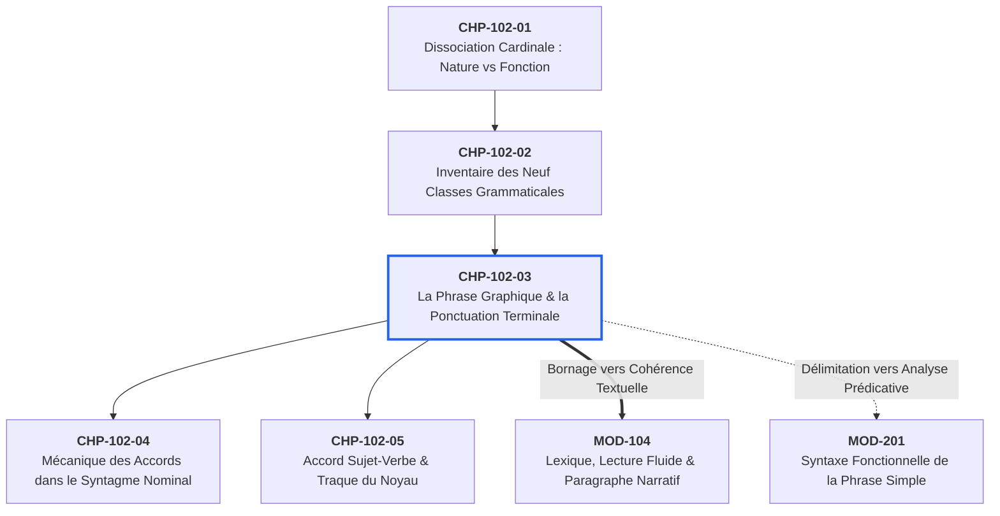

# Chapitre 3 — La Phrase Graphique et la Ponctuation Terminale : Délimitation, Majuscule et Bornage Typographique

> **Identifiant du chapitre** : `CHP-102-03`  
> **Module de rattachement** : [`MOD-102` — Morphologie des Parties du Discours, Ponctuation Terminale et Mécanique des Accords Fondamentaux](file:///f:/Formation/world-class-french/03-curriculum/year-1/semester-1/mod-102-classes-mots-accords-fondamentaux.md)  
> **Semestre** : Année 1 — Semestre 1 (S1)  
> **Volume horaire estimé** : 5 à 6 heures d'apprentissage autonome délibéré et d'ateliers d'application (Étude : 1 h 30 | Pratique : 1 h 30 | Correction : 1 h 00 | Évaluation : 1 h 00)  
> **Statut** : [STATUT : VALIDÉ]  
> **Compétences associées** : [`FR-INT-001`](file:///f:/Formation/world-class-french/02-competency-framework/competency-framework.md#fr-int-001-rédiger-un-texte-long-cohérent-en-maîtrisant-accords-et-ponctuation) (Palier L2), [`FR-ORTHO-001`](file:///f:/Formation/world-class-french/02-competency-framework/competency-framework.md#fr-ortho-001-maîtrise-de-lorthographe-lexicale-et-flexionnelle) (Palier L3), [`FR-SYNTAX-001`](file:///f:/Formation/world-class-french/02-competency-framework/competency-framework.md#fr-syntax-001-analyse-fonctionnelle-et-délimitation-de-la-phrase-simple) (Palier L2)  
> **Sources scientifiques de référence** : `SRC-TYPO-01` (Imprimerie nationale, 2002/2014), `SRC-NORM-03` (Ministère de l'Éducation nationale, 2020), `SRC-GRAM-02` (Riegel, Pellat, Rioul, 2016), `SRC-GRAM-01` (Grevisse & Goosse, 2016)

---

## 1. Titre et Place dans le Cursus

### 1.1 Intitulé Officiel
**Chapitre 3 : La Phrase Graphique et la Ponctuation Terminale : Délimitation, Majuscule et Bornage Typographique** (`CHP-102-03`).

### 1.2 Insertion Architecturale dans le Cursus
Ce troisième chapitre du module `MOD-102` constitue le pivot démarcatif de l'apprentissage de l'écrit. Tandis que les deux premiers chapitres ont établi la distinction cardinale entre nature et fonction puis dressé l'inventaire des neuf classes grammaticales, le chapitre 3 opère le passage de l'unité-mot à l'unité-énoncé.

Il enseigne à délimiter l'espace textuel au moyen de la **phrase graphique**, définie par son double bornage canonique : la **majuscule initiale** et le **signe de ponctuation terminale**.



- **En amont** : Le chapitre réinvestit les acquis de `MOD-101` (l'alphabet, la distinction phonème/graphème et l'accentuation des capitales) et s'appuie sur la reconnaissance des catégories lexicales (verbe, nom, connecteurs) acquise dans les chapitres `CHP-102-01` et `CHP-102-02`.
- **Au sein de `MOD-102`** : Il sécurise les frontières au sein desquelles s'exerceront les chaînes d'accord nominales (`CHP-102-04`) et la rection sujet-verbe (`CHP-102-05`). On ne peut accorder un verbe avec son sujet si l'on ne sait pas où commence et où s'achève la proposition qui les abrite.
- **En aval dans le cursus** :
  - Vers `MOD-104` : La phrase graphique bien bornée est le bloc élémentaire indispensable à la construction du paragraphe narratif et argumentatif.
  - Vers `MOD-201` : La distinction entre phrase graphique et phrase syntaxique prépare la dissection des constituants immédiats et l'analyse de la phrase complexe.

---

## 2. Objectifs Mesurables

Au terme de l'étude autonome et des ateliers pratiques de ce chapitre, l'apprenant doit être capable de :

1. **Identifier et discriminer phrase graphique et phrase syntaxique** : distinguer sans équivoque, dans n'importe quel texte continu, l'unité typographique visible (marquée par la majuscule et le point terminal) de l'unité grammaticale structurée par une relation prédicative [Réf. `SRC-GRAM-02`, chap. 7 ; `SRC-NORM-03`, p. 8].
2. **Appliquer infailliblement les règles typographiques de l'Imprimerie nationale** : employer les quatre signes de ponctuation terminale (`.`, `?`, `!`, `...`) en respectant scrupuleusement les normes d'espacement (espaces insécables devant les signes doubles, absence d'espace devant les signes simples) et l'accentuation obligatoire des majuscules initiales (*À, É, È, Î, Ô, Ç*) [Réf. `SRC-TYPO-01`, pp. 147-149].
3. **Éradiquer les pathologies majeures de délimitation de la phrase** : détecter, analyser et corriger les phénomènes de *saucissonnage intempestif* (subordonnée isolée par un point), de *phrase fleuve amorphe* (télescopage de propositions reliées par de simples virgules faibles / *comma splice*) et de *phrase averbale défectueuse*.
4. **Articuler valeur énonciative et prosodie de clôture** : sélectionner le signe terminal adéquat selon la modalité de l'énoncé (assertion, interrogation directe, exclamation, délibération suspensive) et justifier son choix au regard de la courbe intonative descendante ou montante.

---

## 3. Prérequis et Test de Préparation (Auto-Diagnostic)

### 3.1 Prérequis Cognitifs
- Savoir identifier un verbe conjugué à un mode personnel et son sujet dans une proposition simple.
- Connaître l'alphabet français et les signes diacritiques (accents aigu, grave, circonflexe, tréma, cédille).
- Percevoir à l'oral la différence entre une intonation montante (interrogative ou suspensive) et une intonation descendante (conclusive).

### 3.2 Test de Préparation Immédiat
Répondez aux cinq questions suivantes avant d'aborder le cours. Vérifiez ensuite vos réponses dans le corrigé repliable.

1. Une phrase doit-elle obligatoirement comporter un verbe conjugué pour être considérée comme complète ?
2. Quelle est la différence visuelle et fonctionnelle entre une virgule `,` et un point simple `.` dans l'organisation de la pensée ?
3. Doit-on mettre un accent sur une lettre majuscule située en début de phrase (par exemple sur *A* dans *A bientôt* ou sur *E* dans *Etat*) ?
4. Dans la phrase *« Bien qu'il pleuve. Nous sortirons. »*, le premier segment constitue-t-il une phrase autonome correcte ? Justifiez.
5. Quels sont les quatre signes de ponctuation qualifiés de « terminaux » en langue française ?

---

#### Corrigé de l'Auto-Diagnostic

<details>
<summary><b>Cliquez ici pour afficher le corrigé de l'auto-diagnostic</b></summary>

1. **Non, pas obligatoirement sur le plan graphique.** Si la phrase canonique repose sur un verbe conjugué (phrase verbale), la langue admet des phrases averbales ou nominales parfaitement légitimes et autonomes (*« Silence de mort. »*, *« Quel magnifique spectacle ! »*). En revanche, toute phrase doit constituer une unité de sens achevée.
2. La **virgule** sépare des constituants à l'intérieur d'une même phrase syntaxique sans en briser le souffle ni clore le propos ; le **point** clôt définitivement l'unité graphique et signale l'achèvement complet d'un mouvement de pensée. Remplacer un point par une virgule engendre un télescopage fautif (*comma splice*).
3. **Oui, absolument.** L'Académie française et l'Imprimerie nationale prescrivent formellement l'accentuation des majuscules et des capitales (*À bientôt*, *État*, *Écouter*, *Île*, *Ça*). L'accent a pleine valeur orthographique et prévient les contresens.
4. **Non, c'est une faute grave de délimitation (saucissonnage).** *« Bien qu'il pleuve »* est une proposition subordonnée conjonctive circonstancielle ; elle ne possède aucune autonomie syntaxique et ne peut former une phrase graphique isolée. Il faut écrire : *« Bien qu'il pleuve, nous sortirons. »*
5. Les quatre signes de ponctuation terminale sont : le **point simple** (`.`), le **point d'interrogation** (`?`), le **point d'exclamation** (`!`) et les **points de suspension** (`...`).

</details>

---

## 4. Situation de Départ ou Problème Concret : L'Écrit Amorphe sans Bornes

Considérez ces deux extraits issus, le premier d'un rapport de stage universitaire, le second d'une copie de concours administratif :

### Cas A : Le texte amorphe sans fin (La pensée noyée)
> *« Notre équipe a réceptionné les échantillons hier matin nous avons procédé aux analyses chimiques préliminaires les résultats semblent conformes aux prévisions toutefois des anomalies subsistent dans le lot numéro quatre nous préconisons un nouvel examen avant toute validation définitive. »*

Dans ce premier cas, le lecteur étouffe. Dépourvu de majuscules et de points, l'énoncé contraint le cerveau à tâtonner, à relire trois fois le paragraphe pour déterminer où s'achève l'action de réception, où commence l'hypothèse et quelle est la recommandation finale. L'absence de bornes transforme une suite d'informations rigoureuses en un magma informe.

### Cas B : Le texte haché en fragments inintelligibles (Le saucissonnage)
> *« Le conseil d'administration a rejeté la proposition. Parce que le budget n'était pas équilibré. Et que les investisseurs doutaient. Malgré les explications fournies. La séance a été levée à dix-huit heures. Dans un climat tendu. »*

Ici, le rédacteur a multiplié les points sans discernement. En coupant arbitrairement des compléments circonstanciels et des propositions subordonnées de leur proposition principale, il a produit une suite de faux moignons syntaxiques.

### Le diagnostic linguistique
Ces deux dérives, omniprésentes dans les copies d'étudiants et les courriers administratifs, procèdent d'une même méconnaissance : **l'incapacité à délimiter la phrase graphique**. La ponctuation terminale n'est pas un ornement décoratif posé au hasard des respirations physiques du scripteur ; elle est le garant logique de l'intelligibilité de la pensée écrite.

---

## 5. Explication Intuitive : La Clôture Cadastrale et le Circuit Électrique

Pour comprendre le fonctionnement de la phrase graphique, deux analogies matérielles s'imposent :

### 1. L'analogie de la clôture cadastrale
Une parcelle de terrain ne peut être exploitée ou bâtie si ses limites de propriété ne sont pas formellement bornées par des piquets géodésiques.
- La **majuscule initiale** est le piquet d'entrée : elle prévient le regard que nous pénétrons sur un nouveau territoire sémantique.
- Le **point terminal** est le piquet de sortie : il clôt l'espace privé de cette pensée avant que le voisin ne commence la sienne.
- Omettre le point, c'est abattre la clôture et laisser deux troupeaux distincts se mélanger dans la confusion. Poser un point au milieu d'une subordonnée, c'est planter un piquet en plein milieu d'une pièce de maison.

```text
[MAJUSCULE INITIALE] ===================== [POINT TERMINAL]
    Piquet d'entrée        Territoire de sens        Piquet de clôture
```

### 2. L'analogie du circuit électrique fermé
Une phrase graphique fonctionne comme un circuit électrique alimenté par un générateur (le sujet) et relié à un récepteur d'énergie (le prédicat) :
- La **majuscule** enclenche l'interrupteur. Le courant informationnel commence à circuler.
- Les virgules et points-virgules internes régulent la tension, installent des dérivations ou des résistances sans couper le flux.
- Le **point terminal** boucle le circuit et permet à l'ampoule (la compréhension du lecteur) de s'illuminer d'un éclat stable.
- Si le circuit est interrompu prématurément par un point intempestif avant le verbe ou la principale, le courant est coupé : c'est la panne (*court-circuit syntaxique*).

---

## 6. Définitions Précises et Terminologie

Pour manipuler la langue avec exactitude, distinguons rigoureusement les notions théoriques fondamentales [Réf. `SRC-NORM-03` ; `SRC-GRAM-02`] :

### 6.1 Phrase graphique
Unité de texte visuelle et linéaire, délimitée par une **lettre majuscule initiale** et un **signe de ponctuation terminale** (`.`, `?`, `!`, `...`). Elle relève de la matérialité de la page imprimée ou manuscrite.

### 6.2 Phrase syntaxique
Unité linguistique autonome sur le plan grammatical, construite autour d'une relation prédicative (un sujet et son prédicat). Une phrase graphique peut contenir une seule phrase syntaxique (phrase simple), plusieurs phrases syntaxiques reliées par coordination ou subordination (phrase complexe), ou aucune phrase verbale (phrase averbale).

### 6.3 Prédication
Acte sémantique et syntaxique fondamental par lequel un propos (le prédicat) est affirmé, nié ou interrogé à propos d'un thème (le sujet). Dans la phrase *« L'eau bout à cent degrés »*, *l'eau* est le sujet dont on prédique *qu'elle bout à cent degrés*.

### 6.4 Proposition autonome (ou indépendante)
Proposition qui ne dépend d'aucune autre unité syntaxique et dont aucune autre unité ne dépend obligatoirement. Elle est capable de former à elle seule une phrase graphique complète.

### 6.5 Majuscule initiale
Caractère typographique de grand format (capitale) placé en tête du premier mot d'une phrase graphique pour en marquer solennellement l'ouverture. En français, les majuscules conservent impérativement leurs accents et cédilles (*À, É, È, Î, Ô, Ç*).

### 6.6 Ponctuation terminale
Ensemble fermé des quatre signes typographiques ayant le pouvoir institutionnel de clore une phrase graphique :
1. Le point simple (`.`) ;
2. Le point d'interrogation (`?`) ;
3. Le point d'exclamation (`!`) ;
4. Les points de suspension (`...`).

### 6.7 Signe simple vs signe double
- **Signe simple** : composé d'un seul élément graphique posé sur la ligne de base (le point `.`, la virgule `,`).
- **Signe double** : composé de deux éléments superposés ou disjoints (le point d'interrogation `?`, le point d'exclamation `!`, le point-virgule `;`, les deux-points `:`). Cette distinction commande directement les règles d'espacement typographique.

### 6.8 Espace insécable
Espace typographique spéciale empêchant le signe qui la suit d'être rejeté isolément au début de la ligne suivante lors de la justification d'un paragraphe. En typographie soignée de l'Imprimerie nationale, les signes doubles sont toujours précédés d'une espace insécable (espace fine ou espace mot insécable).

---

## 7. Règles et Mécanismes Fondamentaux

### 7.1 La Définition Triple de la Phrase
En linguistique moderne [Réf. `SRC-GRAM-02`, chap. 7], la phrase ne peut être réduite à une simple intuition ; elle se définit par la convergence de trois critères cumulatifs :

```text
                        ┌──────────────────────────────┐
                        │     LA PHRASE CANONIQUE      │
                        └──────────────┬───────────────┘
            ┌──────────────────────────┼──────────────────────────┐
            ▼                          ▼                          ▼
   1. CRITÈRE SÉMANTIQUE      2. CRITÈRE PROSODIQUE      3. CRITÈRE SYNTAXIQUE
   Unité de sens complète     Courbe intonative fermée   Relation prédicative
  (énoncé autosuffisant)     (pause terminale nette)    (Sujet + Verbe/Prédicat)
```

1. **Le critère sémantique (unité de sens)** : La phrase transmet un message achevé. Hors contexte immédiat, elle présente une complétude informative minimale. *« Lorsque le soleil se lève »* ne possède pas de complétude sémantique ; *« Le soleil se lève »* en possède une.
2. **Le critère prosodique (courbe intonative)** : À l'oral, la phrase est enveloppée par une mélodie intonative complète. Dans une phrase déclarative, la voix monte légèrement sur les groupes d'attaque puis descend nettement sur la syllabe finale jusqu'à un silence complet (pause terminale majeure).
3. **Le critère syntaxique (relation prédicative)** : La phrase articule un sujet (ce dont on parle) et un prédicat (ce qu'on en dit), le plus souvent matérialisé par un verbe conjugué à un mode personnel.

---

### 7.2 L'Inventaire de la Ponctuation Terminale et ses Valeurs Énonciatives
La langue française dispose de quatre signes terminaux rigoureusement étalonnés [Réf. `SRC-NORM-03` ; `SRC-GRAM-01`, § 122] :

| Signe | Nom typographique | Modalité énonciative | Courbe intonative orale | Rôle communicatif cardinal |
| :---: | :--- | :--- | :--- | :--- |
| `.` | **Point simple** | Déclarative / Assertive | Descendante conclusive | Clôt un constat, une assertion neutre, un raisonnement établi. |
| `?` | **Point d'interrogation** | Interrogative directe | Montante accusée | Sollicite une réponse, formule un doute ou une question rhétorique. |
| `!` | **Point d'exclamation** | Exclamative / Injonctive | Descendante abrupte ou modulée | Exprime une émotion vive (joie, colère, surprise) ou un ordre impératif. |
| `...` | **Points de suspension** | Suspensive / Émissive | Suspendue en palier | Signale une interruption volontaire, un sous-entendu ou une délibération inachevée. |

#### Prescriptions formelles sur les points de suspension
- **Nombre fixe** : Ils sont **toujours au nombre de trois**. Les graphies fautives à deux points (`..`) ou quatre points (`....`) sont des solécismes typographiques absolus.
- **Incompatibilité absolue avec *etc.*** : La locution *etc.* (abréviation du latin *et caetera*, « et toutes les autres choses ») indique déjà que la liste continue. Écrire *« des pommes, des poires, etc... »* constitue un pléonasme grossier. On écrit : *« des pommes, des poires, etc. »* ou *« des pommes, des poires... »*.
- **Incompatibilité avec la virgule** : On ne place jamais de virgule avant ni après des points de suspension (*«, ...»* est proscrit).

---

### 7.3 Les Règles Typographiques Officielles de l'Imprimerie Nationale
L'usage officiel français consigné dans le *Lexique des règles typographiques en usage à l'Imprimerie nationale* (`SRC-TYPO-01`) impose un traitement spatial et morphologique rigoureux :

#### 1. Règle des espacements
- **Avant la ponctuation simple (`.`, `,`)** : **Aucune espace**. Le signe est collé immédiatement à la dernière lettre du mot qui le précède.
- **Après la ponctuation simple (`.`, `,`)** : **Une espace sécante ordinaire**.
- **Avant la ponctuation double (`?`, `!`, `;`, `:`)** : **Une espace insécable** (espace fine insécable en typographie au plomb et PAO ; espace insécable `U+00A0` sur traitement de texte standard). Le signe ne doit jamais se retrouver orphelin à la ligne suivante.
- **Après la ponctuation double (`?`, `!`, `;`, `:`)** : **Une espace sécante ordinaire**.
- **Points de suspension (`...`)** : **Aucune espace avant** lorsqu'ils terminent un mot ou une phrase ; **une espace sécante après** s'ils se trouvent à l'intérieur d'une phrase qui continue, ou passage à la ligne / majuscule s'ils clôturent la phrase.

#### 2. Règle absolue de la majuscule accentuée
L'Académie française est formelle : **les majuscules doivent conserver tous leurs accents**. Écrire *« A l'attention de »* sans accent est une faute d'orthographe lexicale. On écrit obligatoirement :
- *« À l'attention de Monsieur le Doyen »*
- *« Émile a réussi son examen »*
- *« Île de la Cité »*
- *« Ça ne fait aucun doute »*

---

### 7.4 Les Pathologies de Délimitation
Le non-respect du bornage typographique engendre trois anomalies textuelles majeures :

#### 1. Le saucissonnage intempestif (faux fragments)
Cette faute consiste à couper le lien syntaxique unissant une proposition principale à ses dépendances.
- *Fautif* : *« Le candidat a présenté son projet. Bien qu'il n'eût pas réuni toutes les pièces. »*
- *Rectification* : *« Le candidat a présenté son projet, bien qu'il n'eût pas réuni toutes les pièces. »* (Une subordonnée circonstancielle ne peut former une phrase graphique isolée).

#### 2. La phrase fleuve sans fin (*comma splice* / télescopage par virgule faible)
Le scripteur empile des propositions indépendantes complètes en les séparant par une virgule ordinaire au lieu d'employer un point ou un connecteur logique.
- *Fautif* : *« L'orage a éclaté sur Cotonou, les rues ont été inondées, la circulation s'est arrêtée pendant deux heures. »*
- *Rectification A (points indépendants)* : *« L'orage a éclaté sur Cotonou. Les rues ont été inondées. La circulation s'est arrêtée pendant deux heures. »*
- *Rectification B (coordination / point-virgule)* : *« L'orage a éclaté sur Cotonou ; les rues ont été inondées et la circulation s'est arrêtée pendant deux heures. »*

#### 3. La phrase averbale mal calibrée
Si la phrase averbale (sans verbe conjugué) est une ressource stylistique légitime dans les titres, les slogans ou la description vive (*« Magnifique victoire de l'équipe nationale. »*), elle devient une faute lorsqu'elle résulte d'un oubli syntaxique qui laisse un énoncé suspendu et bancal dans un texte administratif ou démonstratif.

---

## 8. Raisonnement Détaillé : La Respiration Logique de la Pensée Écrite

Pourquoi la ponctuation terminale est-elle si rigoureusement codifiée ?

À l'oral, le locuteur dispose d'un appareil expressif surpuissant : les variations de hauteur de voix, le tempo, les silences physiques, les regards, les gestes des mains. L'auditeur sait d'instinct quand une phrase est terminée grâce à la chute intonative et à la pause respiratoire.

À l'écrit, tous ces indices vivants disparaissent. Le texte imprimé n'est qu'une succession silencieuse de caractères d'imprimerie noirs sur fond blanc. Si le scripteur n'introduit pas des balises géométriques rigides, le cerveau du lecteur est condamné à deviner la hiérarchie des concepts.

La ponctuation terminale accomplit trois missions cognitives vitales :
1. **La segmentation cognitive de l'information** : Le cerveau humain ne peut traiter simultanément qu'un nombre restreint d'unités d'information en mémoire de travail (environ 15 à 25 mots par empan perceptif). Le point terminal ordonne au cerveau de « vider la mémoire tampon », d'archiver la proposition comprise, et de se préparer à accueillir la suivante.
2. **La fixation du statut de vérité (l'énonciation)** : Le signe terminal indique si la pensée est assenée comme une certitude (`.`), remise en cause (`?`), chargée d'intensité passionnelle (`!`) ou laissée en suspens (`...`). Changer de point terminal, c'est changer la nature philosophique de l'acte de langage.
3. **La prévention absolue des contresens juridiques et administratifs** : Dans un contrat ou un décret, l'emplacement d'un point ou d'une virgule engage des responsabilités légales colossales. Une phrase mal bornée peut rendre caduque une clause entière par ambiguïté d'attribution.

---

## 9. Exemples Corrects Commentés

### Exemple 1 : Prose littéraire classique (Gustave Flaubert, *Madame Bovary*)
> *« La conversation de Charles était plate comme un trottoir de rue, et les idées de tout le monde y défilaient dans leur costume ordinaire, sans exciter d'émotion, de rire ou de rêverie. Il n'avait jamais été curieux, disait-il, pendant qu'il habitait Rouen, d'aller voir au théâtre les acteurs de Paris. Il ne savait ni nager, ni faire des armes, ni tirer le pistolet, et il ne put, un jour, lui expliquer un terme d'équitation qu'elle avait rencontré dans un roman. »*

#### Commentaire d'analyse stylistique et typographique
- Cet extrait comporte exactement **trois phrases graphiques**.
- **Phrase 1** : S'ouvre par la majuscule *La* et se clôt par un point simple après *rêverie*. C'est une phrase complexe ample, parfaitement équilibrée par deux membres coordonnés par *et*. Le point terminal permet au lecteur d'assimiler la platitude du personnage avant d'entrer dans l'inventaire de ses lacunes.
- **Phrase 2** : S'ouvre par le pronom majuscule *Il* et se termine par un point après *Paris*. Elle relate une anecdote rétrospective fermée.
- **Phrase 3** : S'ouvre à nouveau par *Il* et déploie une cadence ternaire (*ni nager, ni faire des armes, ni tirer le pistolet*) avant de clore l'alinéa sur une chute déceptive.
- L'architecture est impeccable : chaque phrase graphique correspond à un tableau psychologique net.

---

### Exemple 2 : Prose francophone ouest-africaine (Olympe Bhêly-Quénum, *Un piège sans fin*)
> *« Le soleil déclinait derrière la cime des grands baobabs. Dans la clairière, une brise tiède agitait à peine les herbes roussies par la sécheresse. Pourquoi cet étrange pressentiment refusait-il de quitter son esprit ? Il scruta l'orée de la forêt, immobile, retenant son souffle. Rien ne bougeait encore. »*

#### Commentaire d'analyse stylistique et typographique
- Ce texte compte **cinq phrases graphiques**.
- Observez l'alternance rythmée des signes terminaux :
  1. *Phrase 1* : Déclarative, point simple `.`, pose le cadre temporel et spatial.
  2. *Phrase 2* : Déclarative, point simple `.`, installe l'atmosphère sensorielle.
  3. *Phrase 3* : Interrogative directe, **point d'interrogation** `?` précédé d'une espace insécable. Cette phrase graphique rompt brusquement la contemplation pour projeter le lecteur dans le for intérieur angoissé du protagoniste.
  4. *Phrase 4* : Déclarative, point simple `.`, décrit l'action de guet.
  5. *Phrase 5* : Phrase brève conclusive, point simple `.`.
- La variété des signes terminaux insuffle la vie au récit : le point d'interrogation crée la tension dramatique que le point final suspend sans la résoudre.

---

### Exemple 3 : Rapport administratif officiel
> *« Conformément aux dispositions de l'article 12 du décret portant organisation des examens nationaux, la commission a procédé à la vérification des bordereaux de notes. Aucune irrégularité matérielle n'a été constatée lors du dépouillement. Dès lors, les résultats proclamés le 15 juillet demeurent pleinement valides et exécutoires. »*

#### Commentaire d'analyse stylistique et typographique
- **Trois phrases graphiques** d'une rigueur démonstrative absolue :
  1. Phrase 1 : Rappel du fondement juridique et de l'acte matériel accompli.
  2. Phrase 2 : Constat objectif des faits (absence d'anomalie).
  3. Phrase 3 : Conclusion juridique obligatoire introduite par le connecteur logique *Dès lors*.
- Aucun saucissonnage : les compléments circonstanciels d'ouverture (*Conformément aux dispositions...*) sont maintenus dans leur phrase matrice au moyen d'une virgule, et ne sont pas coupés par un point fautif.

---

## 10. Contre-Exemples et Erreurs Fréquentes

L'observation clinique des productions écrites révèle quatre erreurs récurrentes majeures :

### 10.1 Typologie des Quatre Erreurs Fréquentes

### Erreur n°1 : Le cumul anarchique des signes expressifs (`...?!`, `??`, `!!`)
- **Forme fautive** : *« Pourquoi n'avez-vous pas soumis votre dossier à temps ?!? C'est inacceptable... ! »*
- **Analyse de la faille cognitive** : L'apprenant calque l'expressivité émotionnelle brute des réseaux sociaux ou de la bande dessinée. Il croit compenser la faiblesse de son vocabulaire par l'accumulation hystérique de signes typographiques.
- **Réfutation et correction** : En langue formelle, académique ou administrative, **les signes de ponctuation ne se cumulent jamais**. Un seul signe d'interrogation ou d'exclamation suffit amplement à porter la modalité de la phrase.
  - *Forme correcte* : *« Pourquoi n'avez-vous pas soumis votre dossier à temps ? Ce retard est inadmissible. »*

### Erreur n°2 : L'omission de la majuscule après une ponctuation terminale
- **Forme fautive** : *« Quand arriveront les nouveaux équipements ? nous ne pouvons plus attendre. »*
- **Analyse de la faille cognitive** : Le scripteur traite le point d'interrogation comme une simple virgule au motif que le sujet porte sur la même préoccupation thématique.
- **Réfutation et correction** : Dès lors qu'un point d'interrogation clôt une phrase interrogative directe indépendante, **le mot suivant commence obligatoirement par une majuscule**.
  - *Forme correcte* : *« Quand arriveront les nouveaux équipements ? Nous ne pouvons plus attendre. »*

### Erreur n°3 : Le faux fragment (saucissonnage d'une proposition subordonnée)
- **Forme fautive** : *« L'université fermera ses portes vendredi prochain. Afin de permettre la désinfection des locaux. »*
- **Analyse de la faille cognitive** : L'apprenant confond une pause respiratoire dans sa lecture mentale avec la clôture syntaxique de l'énoncé. La proposition introduite par *Afin de* est une subordonnée de but qui dépend organiquement de la principale.
- **Réfutation et correction** : On ne place jamais de point terminal entre une principale et sa subordonnée circonstancielle postposée.
  - *Forme correcte* : *« L'université fermera ses portes vendredi prochain, afin de permettre la désinfection des locaux. »*

### Erreur n°4 : Le télescopage par virgule faible (*comma splice*)
- **Forme fautive** : *« Les cours magistraux ont débuté ce matin, les amphithéâtres étaient combles, les étudiants manifestaient un grand enthousiasme. »*
- **Analyse de la faille cognitive** : L'auteur perçoit que ces trois actions sont contiguës dans le temps et utilise la virgule comme une colle universelle, affaiblissant la charpente logique du texte.
- **Réfutation et correction** : Des propositions indépendantes complètes ayant chacune leur sujet propre ne peuvent être séparées par de simples virgules. Il faut recourir au point simple, au point-virgule ou à des conjonctions de coordination.
  - *Forme correcte* : *« Les cours magistraux ont débuté ce matin. Les amphithéâtres étaient combles et les étudiants manifestaient un grand enthousiasme. »*

---

## 11. Cas Particuliers et Limites de la Règle

### 11.1 Le point d'interrogation ou d'exclamation au sein d'une incise
Lorsqu'une phrase interrogative ou exclamative est suivie d'une proposition incise (verbe de parole inversé : *demanda-t-il, s'écria-t-elle, répondit Paul*), la règle du bornage subit un aménagement typographique remarquable [Réf. `SRC-TYPO-01`, p. 122] :
- Le point d'interrogation ou d'exclamation est maintenu à la fin de la réplique directe.
- **L'incise commence impérativement par une minuscule** (sauf nom propre), car elle fait partie intégrante de la même phrase graphique globale.
- C'est l'incise qui reçoit le point terminal final.
- *Exemple correct* : *« Viendrez-vous demain à la soutenance ? demanda le professeur avec insistance. »* (et non *« ... ? Demanda le professeur... »*).

### 11.2 Les abréviations terminées par un point
Certaines abréviations s'achèvent par un point abréviatif (*ex.* pour exemple, *etc.* pour et caetera, *M.* pour Monsieur, *vol.* pour volume).
- **Règle du non-redoublement** : Si une telle abréviation se trouve placée à la fin absolue d'une phrase graphique, **le point abréviatif se confond avec le point terminal**. On n'ajoute jamais un second point [Réf. `SRC-TYPO-01`, p. 148].
- *Fautif* : *« Il a apporté des cahiers, des stylos, des règles, etc.. »*
- *Correct* : *« Il a apporté des cahiers, des stylos, des règles, etc. »*

### 11.3 La ponctuation terminale et les citations entre guillemets
L'emplacement du point terminal par rapport au guillemet fermant obéit à une logique géométrique stricte [Réf. `SRC-TYPO-01`, p. 95] :
1. **La citation forme une phrase complète et autonome** : Le point terminal fait partie intégrante de la citation ; il se place **à l'intérieur des guillemets**. Aucun point ne s'ajoute après le guillemet fermant.
   - *Exemple* : *Le ministre déclara solennellement : « La rigueur budgétaire sera maintenue jusqu'au terme de l'exercice. »*
2. **La citation est un simple fragment fondu dans la phrase matrice** : Le point terminal appartient à la phrase hôte ; il se place **à l'extérieur des guillemets**.
   - *Exemple* : *Le président a dénoncé avec vigueur « des lenteurs administratives inacceptables ».*

---

## 12. Approfondissement Adapté au Niveau

### 12.1 Histoire Diachronique de la Ponctuation : De la *Scriptio Continua* à l'Imprimerie
Il est fécond de rappeler aux apprenants que la ponctuation n'a pas toujours existé :
1. **L'Antiquité et la *scriptio continua*** : Dans l'Antiquité gréco-romaine, les textes étaient copiés sans aucun espace entre les mots ni aucun signe de ponctuation (`SENATVSPOPVLVSQVEROMANVS`). La lecture était obligatoirement vocalisée à voix haute ; c'était l'effort musculaire de la voix de l'orateur qui découpait les unités de sens.
2. **Le haut Moyen Âge et les *distinctiones*** : Aux VIIe et VIIIe siècles, les moines copistes irlandais et anglo-saxons (dont le latin n'était pas la langue maternelle) introduisent la séparation systématique des mots par des espaces blancs. Au même moment, saint Isidore de Séville théorise les trois points (*distinctiones*) marquant des pauses de durées variables selon leur hauteur sur la ligne.
3. **La révolution aldine (Venise, fin du XVe siècle)** : L'imprimeur vénitien Alde Manuce et son atelier fixent au début du XVIe siècle l'inventaire moderne de la ponctuation : la virgule semi-circulaire, le point-virgule et le point final, destinés à rendre la lecture silencieuse rapide et non ambiguë.
4. **L'institutionnalisation par l'Imprimerie nationale (France, XVIIe-XXe siècles)** : Sous l'impulsion de Richelieu puis des traités typographiques des Didot, l'Imprimerie royale (puis nationale) formalise les règles métriques des espaces insécables et fines, transformant la page imprimée en un chef-d'œuvre d'architecture optique.

### 12.2 Le Statut Énonciatif et Polyphonique des Points de Suspension
D'un point de vue linguistique approfondi [Réf. `SRC-GRAM-02`, chap. 23], les points de suspension occupent une place singulière parmi les signes terminaux :
- Ils ne marquent pas un simple arrêt mécanique : ils constituent une **figure de rhétorique visuelle appelée réticence (ou aposiopèse)**.
- Le scripteur suspend son énoncé pour inviter le lecteur à compléter lui-même la proposition par inférence pragmatique (*« S'il découvrait la vérité... »*).
- Dans le dialogue ou le monologue intérieur, ils transcrivent l'hésitation psychologique, la pudeur, le regret ou la menace voilée. Utilisés avec parcimonie, ils sont d'une grande puissance évocatrice ; semés à chaque ligne, ils dénotent un esprit paresseux incapable de structurer ses conclusions.

---

## 13. Comparaisons Différentielles

Les trois tableaux synoptiques ci-dessous permettent de fixer définitivement les distinctions démarcatives cardinales :

### Tableau 1 : Point simple `.` vs Point-virgule `;`
| Critère d'analyse | Le Point simple (`.`) | Le Point-virgule (`;`) |
| :--- | :--- | :--- |
| **Statut graphique** | **Signe terminal de phrase** (clôture absolue). | **Signe interne de phrase** (liaison intermédiaire). |
| **Cas typographique suivant** | **Majuscule initiale obligatoire**. | **Minuscule obligatoire** (sauf nom propre). |
| **Effet sur la pensée** | Rompt le souffle ; sépare deux actes de langage distincts. | Maintient la solidarité logique entre deux propositions indépendantes coordonnées ou juxtaposées. |
| **Exemple contrasté** | *« Le vent est tombé. La mer s'est apaisée. »* (Deux constats séparés). | *« Le vent est tombé ; la mer s'est aussitôt apaisée. »* (Relation de causalité étroite). |

---

### Tableau 2 : Phrase Complexe Unifiée vs Deux Phrases Simples Indépendantes
| Structure syntaxique | Schéma démarcatif | Intérêt stylistique & Effet de lecture |
| :--- | :--- | :--- |
| **Deux phrases simples** | `[Majuscule ... Point.] [Majuscule ... Point.]` | **Rythme rapide, alerte, percutant**. Idéal pour l'action vive, les constats nets, le style coupé ou journalistique. |
| **Une phrase complexe** | `[Majuscule ... subordonnée / coordonnée ... Point.]` | **Rythme ample, périodique, démonstratif**. Idéal pour l'argumentation juridique, philosophique et universitaire. |

---

### Tableau 3 : Points de suspension `...` vs Locution abréviative *etc.*
| Critère | Points de suspension (`...`) | Locution *etc.* |
| :--- | :--- | :--- |
| **Valeur stylistique** | Énonciation subjective, poétique, suggestive ou interrogative. | Dénombrement neutre, objectif, technique ou administratif. |
| **Ponctuation d'accompagnement** | Trois points accolés sans virgule. | Suivi obligatoirement de son point abréviatif propre. |
| **Interdiction absolue** | Ne jamais écrire : `... etc.` ou `etc...`. | Ne jamais redoubler le point : `etc..`. |
| **Forme correcte** | *« Des chants, des rires, des murmures... »* | *« Des fournitures de bureau (stylos, rames de papier, classeurs, etc.). »* |

---

## 14. Exercices Progressifs

### 14.1 Niveau 1 : Reconnaissance et Rétablissement des Bornes Manquantes
**Consigne** : Dans les dix énoncés suivants, rétablissez les majuscules initiales obligatoires (en veillant aux accents), supprimez les anomalies typographiques et placez le signe de ponctuation terminale adéquat (`.`, `?`, `!`, `...`).

1. `en vérité, qui pourrait soutenir une thèse aussi absurde sans rougir`
2. `attention au départ du train pour Parakou`
3. `a cette époque de l'année, les pluies torrentielles inondent la vallée`
4. `nous avons commandé des dictionnaires, des grammaires, des manuels, etc...`
5. `quelle admirable leçon de courage ce vieil homme nous a donnée`
6. `il hésita longuement devant la porte entrebâillée, puis soupira`
7. `le doyen entra dans la salle, il s'assit au bureau, le silence se fit instantanément`
8. `ou avez-vous déposé les dossiers d'inscription des candidats de première année`
9. `le conseil municipal a voté le budget. bien que l'opposition ait manifesté son désaccord.`
10. `ca alors, personne ne s'attendait à une telle décision du conseil d'administration`

---

#### Corrigé Détaillé du Niveau 1
1. **« En vérité, qui pourrait soutenir une thèse aussi absurde sans rougir ? »**  
   *Justification* : Majuscule initiale à *En* ; modalité interrogative directe exigeant un point d'interrogation précédé d'une espace insécable.
2. **« Attention au départ du train pour Parakou ! »**  
   *Justification* : Majuscule à *Attention* ; modalité injonctive/exclamative commandant un point d'exclamation avec espace insécable.
3. **« À cette époque de l'année, les pluies torrentielles inondent la vallée. »**  
   *Justification* : **Majuscule accentuée obligatoire** sur la préposition (*À* et non *A*) ; point déclaratif simple final.
4. **« Nous avons commandé des dictionnaires, des grammaires, des manuels, etc. »** (ou *« ... des manuels... »*).  
   *Justification* : Majuscule à *Nous* ; suppression du cumul fautif *etc...* ; maintien du seul point abréviatif de *etc.*
5. **« Quelle admirable leçon de courage ce vieil homme nous a donnée ! »**  
   *Justification* : Majuscule à *Quelle* ; phrase exclamative introduite par le déterminant exclamatif *Quelle*, exigeant le point d'exclamation.
6. **« Il hésita longuement devant la porte entrebâillée, puis soupira... »** (ou point simple `.`).  
   *Justification* : Majuscule à *Il* ; points de suspension traduisant la rêverie ou le renoncement sans espace avant les trois points.
7. **« Le doyen entra dans la salle. Il s'assit au bureau et le silence se fit instantanément. »** (ou avec un point-virgule `;`).  
   *Justification* : Éradication du *comma splice* par découpage en phrases graphiques nettes avec majuscule à *Il*.
8. **« Où avez-vous déposé les dossiers d'inscription des candidats de première année ? »**  
   *Justification* : **Majuscule accentuée obligatoire** sur le pronom adverbial de lieu (*Où* avec accent grave) ; point d'interrogation terminal.
9. **« Le conseil municipal a voté le budget, bien que l'opposition ait manifesté son désaccord. »**  
   *Justification* : Réparation du saucissonnage intempestif : réunion de la principale et de la subordonnée concessive sous une seule phrase graphique.
10. **« Ça alors, personne ne s'attendait à une telle décision du conseil d'administration ! »**  
   *Justification* : **Cédille sous la majuscule obligatoire** (*Ça*) ; point d'exclamation terminal marquant la stupéfaction.

---

### 14.2 Niveau 2 : Découpage d'un Texte Amorphe Continu
**Consigne** : Découpez le texte continu ci-dessous en exactement **six phrases graphiques équilibrées**. Rétablissez les majuscules initiales (y compris accentuées) et choisissez avec soin les signes terminaux en fonction du sens et des types d'énoncés.

> *« la nuit était tombée sur la lagune de Porto-Novo une brise légère apportait l'odeur du large et le bruissement des palmes pourquoi les pêcheurs tardaient-ils tant à regagner le rivage l'inquiétude gagnait peu à peu les familles rassemblées sur la berge soudain une lueur vacillante déchira l'obscurité quel immense soulagement s'empara alors de la foule »*

---

#### Corrigé Détaillé du Niveau 2
Voici le texte rigoureusement restructuré en **six phrases graphiques** :

> 1. **La nuit était tombée sur la lagune de Porto-Novo.**  
> 2. **Une brise légère apportait l'odeur du large et le bruissement des palmes.**  
> 3. **Pourquoi les pêcheurs tardaient-ils tant à regagner le rivage ?**  
> 4. **L'inquiétude gagnait peu à peu les familles rassemblées sur la berge.**  
> 5. **Soudain, une lueur vacillante déchira l'obscurité.**  
> 6. **Quel immense soulagement s'empara alors de la foule !**

*Analyse des choix démarcatifs* :
- *Phrases 1 et 2* : Deux phrases déclaratives autonomes décrivant successivement le cadre temporel puis le paysage sonore et olfactif. (Possibilité admise de réunir 1 et 2 par un point-virgule, mais la consigne demandait 6 phrases graphiques).
- *Phrase 3* : Interrogation directe rhétorique avec inversion sujet-verbe (*tardaient-ils*), exigeant le point d'interrogation.
- *Phrase 4* : Phrase déclarative simple marquant la progression dramatique de la tension.
- *Phrase 5* : Phrase déclarative brève d'action introduite par l'adverbe de temps détaché *Soudain*.
- *Phrase 6* : Phrase exclamative introduite par *Quel*, traduisant l'explosion d'émotion collective, close par le point d'exclamation.

---

### 14.3 Niveau 3 : Réécriture et « Cure de Désensauvagement » d'un Texte Haché
**Consigne** : Le texte suivant (environ 110 mots) a été rédigé par un scripteur négligent qui cumule saucissonnages, phrases fleuves sans virgules fortes et signes fantaisistes. Réécrivez-le intégralement pour en faire un modèle de prose administrative soutenue, articulé en **quatre ou cinq phrases graphiques exemplaires**.

> *« La direction des ressources humaines informe l'ensemble du personnel. Que les entretiens annuels d'évaluation débuteront lundi prochain, chaque collaborateur doit préparer son bilan d'activité avec rigueur. Parce que ces entretiens conditionnent les avancements d'échelon. Comment pourrait-on espérer une promotion sans évaluation objective... ? Les fiches de synthèse doivent être remises aux chefs de service avant le 30 novembre, aucun délai supplémentaire ne sera accordé ! »*

---

#### Corrigé Détaillé du Niveau 3
Voici la version réécrite selon les plus hauts standards de la rédaction administrative (5 phrases graphiques) :

> *« La direction des ressources humaines informe l'ensemble du personnel que les entretiens annuels d'évaluation débuteront lundi prochain. Chaque collaborateur est invité à préparer son bilan d'activité avec la plus grande rigueur, car ces échanges conditionnent directement les avancements d'échelon. Comment pourrait-on d'ailleurs envisager une promotion équitable sans une appréciation objective des compétences ? Les fiches de synthèse devront être remises aux chefs de service avant le 30 novembre. Aucun délai supplémentaire ne sera accordé. »*

*Apparat critique des corrections effectuées* :
1. **Élimination du premier saucissonnage** : *« informe l'ensemble du personnel. Que... »* est une rupture inadmissible entre le verbe transitif et sa proposition subordonnée complétive COD en *que*. Fusion obligatoire en une phrase graphique unifiée.
2. **Élimination du second saucissonnage** : *« Parce que ces entretiens... »* était isolé par un point. La proposition causale a été réintégrée à la phrase précédente à l'aide d'une virgule et de la conjonction de coordination *car*.
3. **Nettoyage du signe cumulé** : *« ... ? »* a été remplacé par un point d'interrogation unique et sobre.
4. **Éradication du comma splice final** : Les deux propositions indépendantes finales ont été disjointes en deux phrases graphiques distinctes terminées par un point simple, ce qui confère une fermeté sereine et régalienne à la directive sans recourir au point d'exclamation comminatoire.

---

## 15. Activité de Correction Raisonnée

Vous êtes réviseur au secrétariat général d'un ministère. On vous soumet l'extrait de rapport suivant, truffé d'infractions typographiques et syntaxiques.

### Document Fautif Soumis à l'Expertise
> *« [1] Le comité de pilotage s'est réuni ce mardi matin afin d'examiner l'état d'avancement des travaux de réhabilitation du campus universitaire. [2] bien que l'entreprise adjudicataire ait mobilisé des engins supplémentaires. [3] Le retard accumulé sur le gros œuvre demeure préoccupant, les pluies récentes ont freiné le coulage des fondations. [4] A ce propos, pourquoi n'a-t-on pas anticipé l'installation d'abris étanches ?!? [5] L'ingénieur en chef a déclaré : « nous ferons tout notre possible pour livrer les bâtiments avant la rentrée académique. » [6] Des mesures d'urgence ont été arrêtées, réaménagement des horaires, travail de nuit, etc... [7] Le ministre a rappelé aux entrepreneurs qu'aucun dépassement financier ne serait toléré. [8] Et que les pénalités de retard s'appliqueraient avec la plus extrême rigueur. »*

---

### Grille d'Expertise et Apparat Critique des 8 Infractions

| N° | Segment fautif | Analyse linguistique de l'infraction | Règle savante violée | Correction proposée |
| :---: | :--- | :--- | :--- | :--- |
| **1** | Segment [2] : *« bien que... »* | Minuscule initiale après le point du segment [1] et subordonnée concessive isolée. | Majuscule obligatoire après point et interdiction d'isoler une subordonnée dépendante (`SRC-GRAM-02`). | Fusionner avec le segment [3] : *« Bien que l'entreprise [...], le retard demeure... »* |
| **2** | Segment [3] : *« préoccupant, les pluies... »* | Télescopage de deux propositions indépendantes complètes par une simple virgule faible (*comma splice*). | Des indépendantes non coordonnées exigent une ponctuation forte (`SRC-GRAM-01`, § 120). | Séparer par un point simple ou un point-virgule : *« ... préoccupant ; les pluies... »* |
| **3** | Segment [4] : *« A ce propos »* | Absence d'accent grave sur la majuscule de la préposition *À*. | L'accent a pleine valeur orthographique sur les majuscules (`SRC-TYPO-01`, p. 12). | Écrire : *« À ce propos »*. |
| **4** | Segment [4] : *« ?!? »* | Cumul anarchique de trois signes de ponctuation expressive. | Interdiction absolue du cumul de signes en typographie soignée (`SRC-TYPO-01`, p. 148). | Remplacer par un point d'interrogation unique : *« ... abris étanches ? »* |
| **5** | Segment [5] : *« « nous ferons... »* | Minuscule initiale à l'ouverture d'une citation directe complète formant phrase. | Une citation complète introduite par les deux-points commence par une majuscule (`SRC-TYPO-01`, p. 95). | Écrire : *« « Nous ferons... »* |
| **6** | Segment [6] : *« arrêtées, réaménagement... »* | Emploi d'une virgule au lieu des deux-points pour introduire une énumération explicative. | Les deux-points sont requis pour introduire une liste ou une explication (`SRC-NORM-03`). | Écrire : *« ... arrêtées : réaménagement... »* |
| **7** | Segment [6] : *« etc... »* | Pléonasme typographique cumulant *etc.* et les points de suspension. | *etc.* s'achève par son seul point abréviatif (`SRC-TYPO-01`, p. 79). | Écrire : *« etc. »*. |
| **8** | Segments [7]-[8] : *« ... ne serait toléré. Et que... »* | Saucissonnage de la seconde proposition subordonnée complétive coordonnée (*Et que*). | Les complétives régies par *a rappelé* ne peuvent être coupées de leur verbe matrice (`SRC-GRAM-02`). | Remplacer le point par une virgule : *« ... toléré, et que les pénalités... »* |

---

## 16. Mise en Pratique dans une Production Réelle

### Consigne de l'Atelier d'Écriture Autonome
Rédigez un plaidoyer argumentatif d'environ **180 à 220 mots** sur le thème :  
*« L'accès universel aux bibliothèques numériques : luxe superflu ou impératif démocratique pour la jeunesse francophone ? »*

Votre production devra respecter scrupuleusement le cahier des charges suivant :
1. Être calibrée en exactement **huit phrases graphiques**.
2. Présenter une variété raisonnée des quatre signes terminaux :
   - Au moins **cinq phrases déclaratives** terminées par un point simple `.`.
   - Exactement **une phrase interrogative directe rhétorique** terminée par un point d'interrogation `?`.
   - Exactement **une phrase exclamative sobre** terminée par un point d'exclamation `!`.
   - Exactement **une phrase avec points de suspension** `...` marquant une délibération ou une perspective ouverte.
3. Comporter au moins **deux phrases commençant par une majuscule accentuée** (*À*, *É*, *Î* ou *Où*).
4. Ne contenir aucun saucissonnage, aucun *comma splice* et respecter les espaces insécables devant les signes doubles.

---

### Exemple de Production Conforme et Validée

> **[P1]** À l'heure où les technologies redessinent l'accès au savoir, l'édification de bibliothèques numériques ouvertes constitue une priorité nationale absolue.  
> **[P2]** Éloigner les jeunes générations des grands textes classiques et scientifiques sous prétexte de contraintes budgétaires serait une faute stratégique irréparable.  
> **[P3]** Comment une nation pourrait-elle en effet prétendre rivaliser dans l'économie de la connaissance si ses étudiants demeurent privés des instruments fondamentaux de la recherche ?  
> **[P4]** Le livre numérique abolit les distances géographiques et transcende l'enclavement des provinces les plus reculées.  
> **[P5]** D'un simple geste sur un écran, l'apprenant de Parakou, de Dakar ou de Liège accède aux mêmes dictionnaires savants et aux mêmes trésors de la pensée universelle.  
> **[P6]** Quelle magnifique promesse d'émancipation intellectuelle pour toute notre jeunesse !  
> **[P7]** Il ne s'agit pas d'un privilège somptuaire réservé à quelques élites urbaines, mais bien de la condition première de l'égalité républicaine.  
> **[P8]** Si nous manquions aujourd'hui ce rendez-vous avec l'avenir, l'histoire ne manquerait pas de nous demander des comptes...

#### Grille d'Auto-Évaluation de la Production
- [x] Exactement 8 phrases graphiques délimitées par une majuscule et un point terminal.
- [x] Répartition des signes terminaux : 5 points simples (P1, P2, P4, P5, P7), 1 point d'interrogation (P3), 1 point d'exclamation (P6), 1 point de suspension (P8).
- [x] Deux majuscules accentuées initiales : *À* (P1) et *É* (P2).
- [x] Zéro saucissonnage et zéro *comma splice*.

---

## 17. Résumé Structuré

Le tableau synoptique ci-dessous synthétise l'ensemble du système de délimitation typographique de la phrase graphique française :

| Signe terminal | Nom officiel | Espacement typographique (Imprimerie nationale) | Courbe intonative orale | Rôle fonctionnel dans la pensée | Pièges et fautes à proscrire |
| :---: | :--- | :--- | :--- | :--- | :--- |
| `.` | **Point simple** | • Avant : **aucune espace**<br/>• Après : **espace sécante** | Descendante conclusive (palier bas) | Clôture d'une assertion, d'un constat ou d'un raisonnement achevé. | Le *comma splice* (le remplacer à tort par une virgule) ; le saucissonnage. |
| `?` | **Point d'interrogation** | • Avant : **espace insécable**<br/>• Après : **espace sécante** | Montante accusée (palier haut) | Interrogation directe, interpellation, doute méthodique ou question d'éloquence. | Omettre la majuscule sur la phrase suivante ; cumuler avec `!` ou `...`. |
| `!` | **Point d'exclamation** | • Avant : **espace insécable**<br/>• Après : **espace sécante** | Descendante abrupte ou modulée | Expression d'une émotion vive (admiration, indignation) ou injonction impérative. | Banalisation excessive dans les écrits académiques ; redoublement (`!!`). |
| `...` | **Points de suspension** | • Avant : **aucune espace**<br/>• Après : **espace sécante** | Palier suspendu (inachèvement) | Suspension du sens, réticence rhétorique, ellipse, sous-entendu calculé. | N'en mettre que deux (`..`) ou plus de trois (`....`) ; cumuler avec *etc.* ou `,`. |

---

## 18. Questions de Rappel Actif (*Active Recall*)

Testez votre mémoire de travail et votre compréhension profonde sans relire les sections précédentes. Cliquez sur chaque question pour déployer la réponse de contrôle.

### Question 1 : Pourquoi la phrase graphique ne coïncide-t-elle pas toujours avec la phrase syntaxique ?
<details>
<summary><b>Afficher la réponse</b></summary>
Parce que la **phrase graphique** est une unité visuelle matérielle définie par ses bornes d'écriture (majuscule et point terminal), tandis que la **phrase syntaxique** est une unité grammaticale abstraite fondée sur une relation prédicative (sujet + verbe/prédicat). Une phrase graphique peut abriter une seule proposition (phrase simple), plusieurs propositions coordonnées ou subordonnées (phrase complexe), ou aucune relation verbale (phrase averbale comme un titre ou une exclamation).
</details>

### Question 2 : Quelle est la règle officielle de l'Imprimerie nationale concernant l'espacement des signes de ponctuation doubles ?
<details>
<summary><b>Afficher la réponse</b></summary>
Les quatre signes de ponctuation dits « doubles » (`?`, `!`, `;`, `:`) sont **obligatoirement précédés d'une espace insécable** (espace fine insécable en typographie au plomb ou PAO ; espace insécable `U+00A0` sur traitement de texte) et **suivis d'une espace sécante ordinaire**. Cette espace insécable garantit que le signe de ponctuation ne sera jamais rejeté isolément en début de ligne suivante.
</details>

### Question 3 : Qu'appelle-t-on la pathologie du *saucissonnage intempestif* et comment la corrige-t-on ?
<details>
<summary><b>Afficher la réponse</b></summary>
Le saucissonnage consiste à poser un point terminal de manière intempestive entre une proposition principale et l'un de ses constituants obligatoires ou dépendants (en particulier une subordonnée circonstancielle ou un groupe prépositionnel), créant un faux fragment sans autonomie. On le corrige en supprimant le point fautif pour réintégrer la subordonnée ou le syntagme dans la phrase matrice, généralement au moyen d'une virgule ou sans ponctuation.
</details>

### Question 4 : Pourquoi est-il strictement interdit d'écrire *« etc... »* ou *«, ... »* ?
<details>
<summary><b>Afficher la réponse</b></summary>
Parce que la locution *etc.* signifie déjà par elle-même « et les autres choses » : lui accoler des points de suspension constitue un pléonasme typographique grossier. De même, les points de suspension signalant une coupure ou une suspension du flux, l'adjonction d'une virgule est une contradiction graphique. *etc.* se termine par son seul point abréviatif propre, et les points de suspension s'accolent directement au mot sans virgule.
</details>

### Question 5 : Dans une réplique suivie d'une incise comme *« Pars-tu déjà ? demanda sa mère »*, pourquoi le verbe *demanda* conserve-t-il une minuscule ?
<details>
<summary><b>Afficher la réponse</b></summary>
Parce que l'incise fait partie intégrante de la même phrase graphique globale que la réplique qu'elle explicite. Bien que le point d'interrogation signale la fin de l'intonation interrogative du dialogue, il ne clôt pas la phrase graphique générale, qui ne s'achève qu'après le sujet de l'incise (*sa mère.*). L'incise prend donc une minuscule, sauf s'il s'agit d'un nom propre.
</details>

### Question 6 : Quelle est la position exacte du point terminal par rapport aux guillemets fermants lorsqu'on cite les propos d'autrui ?
<details>
<summary><b>Afficher la réponse</b></summary>
Si la citation forme une **phrase complète autonome** introduite par les deux-points, le point terminal se place **à l'intérieur** des guillemets fermants. Si la citation n'est qu'un **fragment ou un membre de phrase** intégré à la syntaxe de la phrase d'accueil, le point terminal appartient à la phrase hôte et se place **à l'extérieur** des guillemets fermants.
</details>

---

## 19. Mini-Évaluation Sommative avec Corrigé Justifié

Cette épreuve est conçue pour être réalisée en **30 minutes sans document**. Elle est notée sur **20 points**.  
Le seuil minimal d'admissibilité est fixé à **14/20 (70 %)**.

---

### Sujet de l'Évaluation

#### Partie I : Maîtrise Théorique et Typographique (4 points)
1. Énoncez la règle d'accentuation des majuscules en français et donnez deux exemples contrastés (2 pts).
2. Complétez le tableau typographique suivant en indiquant l'espacement requis avant et après chaque signe (2 pts) :
   - Le point simple `.`
   - Le point d'interrogation `?`

#### Partie II : Diagnostic Clinique d'Erreurs (4 points)
Identifiez, nommez et corrigez l'infraction syntaxique ou typographique commise dans chacune des deux phrases suivantes :
1. *« La conférence s'est achevée tardivement, le public était ravi, plusieurs auditeurs ont posé des questions passionnantes. »* (2 pts)
2. *« Le recteur a ajourné la délibération. Attendu que les procès-verbaux n'étaient pas tous signés. »* (2 pts)

#### Partie III : Ponctuation et Délimitation d'un Texte d'Auteur (6 points)
Le texte suivant a été privé de toute ponctuation et de toute majuscule. Rétablissez les majuscules initiales et la ponctuation terminale de manière à former exactement **quatre phrases graphiques** irréprochables (6 pts) :

> *« lorsque le décret fut enfin publié nul n'osa contester son autorité les directeurs d'instituts convoquèrent immédiatement leurs équipes pour en organiser l'application comment aurait-il pu en être autrement l'avenir de l'institution tout entière dépendait de cette réforme »*

#### Partie IV : Résolution de Cas Particuliers (6 points)
Ponctuez correctement les trois énoncés suivants en justifiant la position des signes et la casse (majuscule/minuscule) :
1. Citation complète : *Le professeur a affirmé avec force les résultats du concours seront proclamés demain midi* (2 pts)
2. Incise interrogative : *Avez-vous compris cette démonstration demanda l'enseignant aux étudiants attentifs* (2 pts)
3. Fin de liste avec abréviation : *L'archiviste a classé les registres les chartes les correspondances etc* (2 pts)

---

### Corrigé Détaillé et Barème de Notation

#### Partie I : Maîtrise Théorique et Typographique (4 points)
1. **Règle d'accentuation des majuscules (2 pts)** :
   - En français, l'accent a pleine valeur orthographique : les majuscules et les capitales doivent être accentuées systématiquement pour éviter les contresens et préserver la morphologie du mot (1 pt).
   - *Exemples* : *À bientôt* (préposition) vs *A bientôt* (confusion possible avec l'auxiliaire avoir) ; *État* (substantif) vs *Etat* ; *Écouter*, *Île*, *Ça* (1 pt).
2. **Tableau des espacements (2 pts)** :
   - Point simple `.` : **aucune espace avant**, **une espace sécante après** (1 pt).
   - Point d'interrogation `?` : **une espace insécable avant**, **une espace sécante après** (1 pt).

#### Partie II : Diagnostic Clinique d'Erreurs (4 points)
1. **Première phrase (2 pts)** :
   - *Nom de l'erreur* : Télescopage par virgule faible (*comma splice*) ou phrase fleuve sans point (1 pt).
   - *Correction* : *« La conférence s'est achevée tardivement. Le public était ravi et plusieurs auditeurs ont posé des questions passionnantes. »* (ou point-virgule après *ravi*) (1 pt).
2. **Seconde phrase (2 pts)** :
   - *Nom de l'erreur* : Saucissonnage intempestif / faux fragment isolant une proposition participiale ou subordonnée causale (1 pt).
   - *Correction* : *« Le recteur a ajourné la délibération, attendu que les procès-verbaux n'étaient pas tous signés. »* (1 pt).

#### Partie III : Ponctuation et Délimitation d'un Texte d'Auteur (6 points)
Texte découpé en **quatre phrases graphiques** (1,5 pt par phrase exactement délimitée et ponctuée) :
> 1. **Lorsque le décret fut enfin publié, nul n'osa contester son autorité.** (1,5 pt)  
> 2. **Les directeurs d'instituts convoquèrent immédiatement leurs équipes pour en organiser l'application.** (1,5 pt)  
> 3. **Comment aurait-il pu en être autrement ?** (1,5 pt : majuscule à *Comment*, point d'interrogation avec espace insécable).  
> 4. **L'avenir de l'institution tout entière dépendait de cette réforme.** (1,5 pt : majuscule à *L'avenir*, point simple final).

#### Partie IV : Résolution de Cas Particuliers (6 points)
1. **Citation complète (2 pts)** :
   - *Forme correcte* : *Le professeur a affirmé avec force : « Les résultats du concours seront proclamés demain midi. »*
   - *Justification* : Deux-points, guillemet ouvrant, majuscule à *Les*, point terminal **à l'intérieur** du guillemet fermant car la citation est une phrase autonome (2 pts).
2. **Incise interrogative (2 pts)** :
   - *Forme correcte* : *« Avez-vous compris cette démonstration ? demanda l'enseignant aux étudiants attentifs. »*
   - *Justification* : Point d'interrogation après la question directe ; minuscule obligatoire à *demanda* car l'incise appartient à la phrase graphique globale ; point simple après *attentifs* (2 pts).
3. **Fin de liste avec abréviation (2 pts)** :
   - *Forme correcte* : *« L'archiviste a classé les registres, les chartes, les correspondances, etc. »*
   - *Justification* : Virgules séparatives ; maintien du point abréviatif unique de *etc.* qui tient lieu de point terminal ; aucun cumul avec `...` ou un second point (2 pts).

---

### Grille d'Appréciation Globale
- **18 à 20 / 20** : Maîtrise d'excellence. L'architecture de la phrase graphique et la typographie sont parfaitement intégrées.
- **15 à 17,5 / 20** : Très bon niveau. Erreurs vénielles d'espacement ou d'inattention, mais aucun saucissonnage.
- **14 / 20** : **Seuil minimal d'autonomie (Palier L2/L3)**.
- **Moins de 14 / 20** : Insuffisant. Reprise obligatoire des sections 7, 10 et 14 avant d'aborder les accords dans le syntagme nominal (`CHP-102-04`).

---

## 20. Critères Observables de Maîtrise (Indicateurs L2/L3 Autonomie)

L'apprenant est réputé maîtriser les compétences `FR-INT-001`, `FR-ORTHO-001` et `FR-SYNTAX-001` associées à la délimitation graphique si et seulement si les quatre indicateurs observables suivants sont validés :

| Identifiant | Comportement Observable | Indicateur de Réussite Mesurable | Seuil de Tolérance Admis |
| :---: | :--- | :--- | :---: |
| **IND-01** | Délimitation canonique de la phrase | Capacité à découper un texte amorphe continu de 200 mots en phrases graphiques équilibrées sans anacoluthe. | $\ge 95\,\%$ de bornes exactes |
| **IND-02** | Éradication du saucissonnage | Absence totale de propositions subordonnées coupées de leur principale par un point dans un devoir de 300 mots. | **0 faute tolérée** |
| **IND-03** | Rigueur typographique des espacements | Respect scrupuleux des espaces insécables avant signes doubles (`?`, `!`, `;`, `:`) et accentuation des majuscules. | 100 % de conformité |
| **IND-04** | Adéquation de la modalité terminale | Sélection du signe terminal approprié (`.`, `?`, `!`, `...`) selon l'intention énonciative sans aucun cumul fautif. | **0 cumul toléré** |

---

## 21. Sources et Lectures Complémentaires

Les règles, prescriptions et analyses exposées dans ce chapitre sont rigoureusement adossées aux ouvrages fondamentaux suivants, répertoriés au registre des sources du cursus :

1. **Imprimerie nationale (2002 / 2014)**. *Lexique des règles typographiques en usage à l'Imprimerie nationale*. Paris : Imprimerie nationale.  
   - Chapitre *Ponctuation* (pp. 147-149) : règles d'espacement, inventaire des signes simples et doubles [Réf. `SRC-TYPO-01`].  
   - Chapitre *Majuscules et capitales* (pp. 101-106) : accentuation obligatoire des majuscules.  
   - Chapitre *Citations et guillemets* (pp. 93-96) : positionnement du point terminal par rapport aux guillemets.  
   $\rightarrow$ Ouvrage de référence normative absolue pour la composition typographique.
2. **Ministère de l'Éducation nationale (2020)**. *Terminologie grammaticale*. Paris : Réseau Canopé.  
   - Section *La phrase : phrase graphique, phrase syntaxique, types et formes de phrases* (pp. 8-11) [Réf. `SRC-NORM-03`].  
   $\rightarrow$ Référence institutionnelle officielle pour la nomenclature didactique contemporaine.
3. **Riegel, Martin, Pellat, Jean-Christophe & Rioul, René (2016)**. *Grammaire méthodique du français*. Paris : PUF, coll. « Quadrige ».  
   - Chapitre 3 : *Les signes graphiques et la ponctuation* (pp. 97-124) [Réf. `SRC-GRAM-02`].  
   - Chapitre 7 : *La phrase : approche syntaxique, sémantique et énonciative* (pp. 185-212).  
   $\rightarrow$ Traité universitaire de référence pour la triple définition de la phrase et l'analyse fonctionnelle de la ponctuation.
4. **Grevisse, Maurice & Goosse, André (2016)**. *Le Bon Usage* (16e éd.). Bruxelles : De Boeck Supérieur.  
   - Première partie, chapitre III : *La ponctuation* (§ 118 à § 138) [Réf. `SRC-GRAM-01`].  
   $\rightarrow$ Somme descriptive de référence pour l'histoire des usages littéraires et les cas particuliers des incises.

---

## Annexe Pédagogique : Classification et Traçabilité du Contenu

Conformément aux exigences de gouvernance du cursus **World-Class French**, les contenus du présent chapitre sont répertoriés selon la grille d'arbitrage didactique :

| Étiquette | Notion / Contenu concerné | Justification didactique & Destination |
| :--- | :--- | :--- |
| **CORE-NOW** | • Définition de la phrase graphique (majuscule initiale et ponctuation terminale).<br/>• Inventaire des quatre signes terminaux (`.`, `?`, `!`, `...`).<br/>• Espacement typographique officiel de l'Imprimerie nationale.<br/>• Accentuation obligatoire des majuscules.<br/>• Éradication du saucissonnage et du *comma splice*. | Compétence charnière de survie rédactionnelle requise immédiatement pour aborder les accords du syntagme nominal et du verbe. Exigée au palier L2/L3. |
| **INTRODUCTION-NOW** | • Distinction théorique entre phrase graphique et phrase syntaxique.<br/>• La triple définition de la phrase (sens, prosodie, syntaxe).<br/>• Position du point dans les citations entre guillemets et les incises. | Posé pour installer la rigueur conceptuelle avant l'étude approfondie de la syntaxe. |
| **DEFER** | • La ponctuation interne de la phrase : la virgule d'apposition, la virgule des compléments circonstanciels détachés, le point-virgule d'énumération. | **Reporté à [`MOD-201`](file:///f:/Formation/world-class-french/03-curriculum/year-1/semester-2/mod-201-syntaxe-fonctionnelle-phrase-simple.md) et [`MOD-202`](file:///f:/Formation/world-class-french/03-curriculum/year-1/semester-2/mod-202-participe-passe-avoir-ponctuation-interne.md)** pour une étude fonctionnelle exhaustive. |
| **DEFER** | • L'architecture macro-textuelle du paragraphe (connecteurs logiques, alinéas, phrases de transition). | **Reporté à [`MOD-104`](file:///f:/Formation/world-class-french/03-curriculum/year-1/semester-1/mod-104-lexique-lecture-paragraphe.md)** (Lexique, Lecture fluide et Paragraphe narratif). |
| **DEFER** | • La grande période oratoire classique et ses cadences métriques complexes. | **Reporté au Semestre 5 ([`MOD-501`](file:///f:/Formation/world-class-french/03-curriculum/year-3/semester-5/mod-501-macro-syntaxe-periode-oratoire-cadences.md))**. |
| **OPTIONAL-ADVANCED** | • Diachronie comparée de la ponctuation depuis saint Isidore de Séville jusqu'à Alde Manuce.<br/>• Statut polyphonique et pragmatique approfondi de l'aposiopèse. | Destiné aux apprenants préparant les concours littéraires d'excellence (ENS, Agrégation) ou les filières de sciences du langage. |
| **REMOVE** | • Digressions sur les codes typographiques anglo-saxons (qui ne mettent pas d'espace avant les signes doubles).<br/>• Discussions byzantines sur l'emploi du point-exclamatif inventé par certains typographes du XXe siècle (point d'ironie, point d'amour). | Éliminé pour préserver la clarté normative et la concentration sur le français standard international. |
