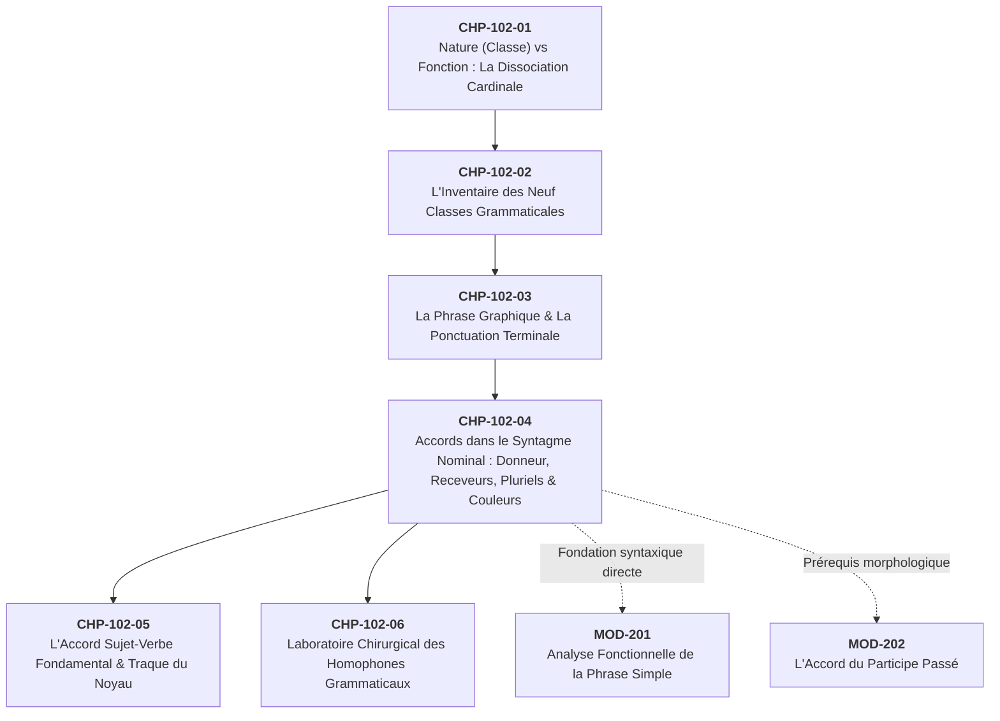
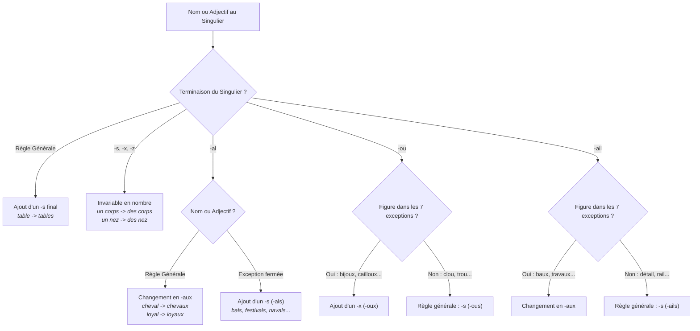
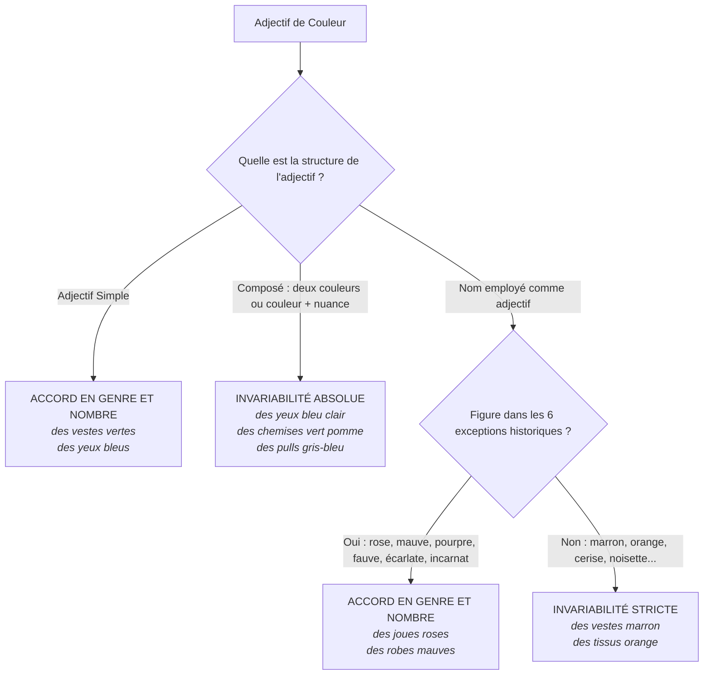
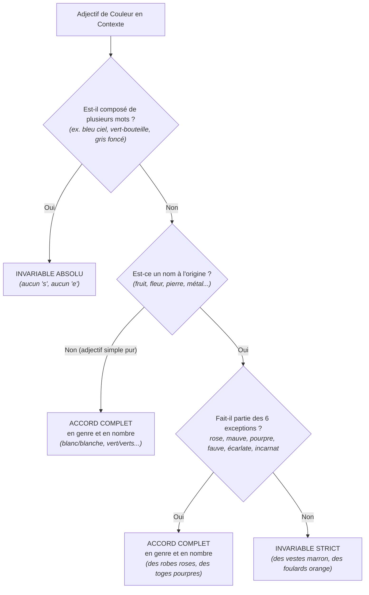

# Chapitre 4 — La Mécanique des Accords dans le Syntagme Nominal : Donneur, Receveurs, Pluriels Irréguliers et Couleurs

> **Identifiant du chapitre** : `CHP-102-04`  
> **Module de rattachement** : [`MOD-102` — Morphologie des Parties du Discours, Ponctuation Terminale et Mécanique des Accords Fondamentaux](file:///f:/Formation/world-class-french/03-curriculum/year-1/semester-1/mod-102-classes-mots-accords-fondamentaux.md)  
> **Semestre** : Année 1 — Semestre 1 (S1)  
> **Volume horaire estimé** : 5 à 6 heures d'apprentissage autonome délibéré et d'ateliers d'application (Étude : 1 h 30 | Pratique : 1 h 30 | Correction : 1 h | Évaluation : 1 h)  
> **Statut** : [STATUT : VALIDÉ]  
> **Compétences associées** : [`FR-ORTHO-001`](file:///f:/Formation/world-class-french/02-competency-framework/competency-framework.md#fr-ortho-001-maîtrise-de-lorthographe-lexicale-et-flexionnelle) (L3 Autonomie)  
> **Sources scientifiques de référence** : `SRC-GRAM-01` (Grevisse & Goosse, 2016, § 510-535 & § 560-570), `SRC-GRAM-02` (Riegel, Pellat & Rioul, 2016, chap. 6 & 12), `SRC-NORM-02` (Conseil supérieur de la langue française, 1990), `SRC-ORTHO-01` (Catach, 1980/2011), `SRC-NORM-03` (Ministère de l'Éducation nationale, 2020)

---

## 1. Titre et Place dans le Cursus

### 1.1 Intitulé Officiel
**Chapitre 4 : La Mécanique des Accords dans le Syntagme Nominal : Donneur, Receveurs, Pluriels Irréguliers et Couleurs** (`CHP-102-04`).

### 1.2 Insertion Architecturale dans le Cursus
Ce quatrième chapitre de `MOD-102` constitue le pivot morphologique du premier semestre. Après avoir fixé au Chapitre 1 la dissociation entre la nature et la fonction, dressé au Chapitre 2 l'inventaire des neuf classes grammaticales et délimité au Chapitre 3 la phrase graphique par la ponctuation terminale, l'apprenant aborde ici la **première grande chaîne d'accord du français écrit** : celle qui relie le nom à ses satellites immédiats au sein du syntagme nominal.



- **En amont** : Ce chapitre réinvestit directement l'identification des parties du discours acquise dans [`CHP-102-02`](file:///f:/Formation/world-class-french/03-curriculum/year-1/semester-1/mod-102-classes-mots-accords-fondamentaux.md). On ne peut accorder un syntagme nominal sans distinguer instantanément le nom commun (tête), le déterminant (satellite obligatoire) et l'adjectif qualificatif épithète (expansion facultative).
- **Au sein du module `MOD-102`** : Il installe le réflexe d'identification du **donneur d'accord** et du **receveur d'accord**. Cette gymnastique intellectuelle est le prérequis rigoureux du Chapitre 5 (`CHP-102-05`), où le nom noyau deviendra le chef d'orchestre du groupe sujet commandant la terminaison du verbe.
- **En aval dans le cursus** : La maîtrise sans faille des flexions nominales irrégulières (*-aux*, *-oux*, invariables en *-s, -x, -z*) et des adjectifs de couleur constitue la clé de voûte de la compétence [`FR-ORTHO-001`](file:///f:/Formation/world-class-french/02-competency-framework/competency-framework.md#fr-ortho-001-maîtrise-de-lorthographe-lexicale-et-flexionnelle). Elle garantit la crédibilité professionnelle et académique de tout écrit administratif, juridique ou littéraire.

---

## 2. Objectifs Mesurables

Au terme de l'étude autonome et des ateliers pratiques de ce chapitre, l'apprenant doit être capable de :

1. **Identifier formellement le nom noyau donneur et flécher la chaîne d'accord vers tous les receveurs du syntagme nominal** : repérer sans hésitation le nom tête, déterminer son genre inhérent et son nombre contextuel, et propager ces deux traits morphologiques au déterminant ainsi qu'à tous les adjectifs épithètes contigus ou séparés par des compléments [Réf. `SRC-GRAM-02`, chap. 6].
2. **Appliquer infailliblement les règles régulières et les listes fermées de pluriels irréguliers des noms et adjectifs** :
   - Fléchir les noms et adjectifs en *-al* en *-aux* et restituer sans omission les listes fermées d'exceptions en *-als* (*bals, carnavals, festivals, chacals, récitals, régals* ; *banals, bancals, fatals, navals, natals*) ;
   - Maîtriser les 7 noms en *-ou* prenant un *-x* (*bijoux, cailloux, choux, genoux, hiboux, joujoux, poux*) et appliquer le *-s* régulier à tous les autres ;
   - Fléchir les 7 noms en *-ail* en *-aux* (*baux, coraux, émaux, soupiraux, travaux, vantaux, vitraux*) ;
   - Maintenir l'invariabilité absolue en nombre des noms et adjectifs terminés par *-s*, *-x*, *-z* au singulier [Réf. `SRC-GRAM-01`, § 510-535].
3. **Maniér avec exactitude le système complet des adjectifs de couleur** :
   - Accorder en genre et en nombre les adjectifs simples de couleur (*des tissus verts, des chemises blanches*) ;
   - Maintenir invariables les noms employés substantivement comme adjectifs de couleur (*des rideaux marron, des robes orange, cerise, noisette*) ;
   - Appliquer l'accord obligatoire aux 6 exceptions lexicalisées historiques (*rose, mauve, pourpre, fauve, écarlate, incarnat*) ;
   - Appliquer l'invariabilité absolue à tous les adjectifs de couleur composés (*des yeux bleu clair, des tentures vert pomme, des couvertures gris-bleu*) [Réf. `SRC-GRAM-01`, § 565].
4. **Détecter, analyser et redresser les ruptures de chaîne d'accord dans des textes complexes** : diagnostiquer la cause d'une erreur d'accord (attraction phonétique, écran d'un complément de nom intercalé, confusion entre adjectif simple et nom de couleur) et fournir la justification grammaticale normative [Réf. `SRC-NORM-03`].

---

## 3. Prérequis et Test de Préparation (Auto-Diagnostic)

### 3.1 Prérequis Cognitifs
- Savoir identifier un nom, un déterminant et un adjectif qualificatif dans une phrase simple ([`CHP-102-02`](file:///f:/Formation/world-class-french/03-curriculum/year-1/semester-1/mod-102-classes-mots-accords-fondamentaux.md)).
- Comprendre la notion de morphogramme grammatical (la marque écrite muette à l'oral, comme le *-s* ou le *-e*, vue dans `CHP-101-01` et `SRC-ORTHO-01`).
- Reconnaître le masculin et le féminin des noms courants de la langue française.

### 3.2 Test de Préparation Immédiat
Répondez aux cinq questions suivantes avant d'entamer l'étude du chapitre. Vérifiez immédiatement vos réponses dans le corrigé ci-dessous.

1. Dans le groupe de mots *« Une immense forêt de pins centenaires »*, quel mot est le nom noyau de l'ensemble du syntagme ?
2. Mettez au pluriel le groupe nominal : *« Un festival musical naval »*.
3. Parmi ces noms terminés par *-ou*, lequel prend un *-s* au pluriel : *genou*, *hibou*, *clou*, *caillou* ?
4. Dans la phrase *« Elle portait des chaussures (marron / marrons) et des jupes (vert / vertes) »*, quelles graphies devez-vous choisir ?
5. L'adjectif *bleu clair* s'accorde-t-il dans l'expression *« des chemises bleu clair »* ? Pourquoi ?

---

#### Corrigé de l'Auto-Diagnostic
1. Le nom noyau est **forêt** (nom féminin singulier). Le groupe *de pins centenaires* est un complément du nom *forêt*. L'adjectif *immense* s'accorde avec *forêt*.
2. **Des festivals musicaux navals** : *festival* prend un *-s* (exception fermée aux noms en *-al*) ; *musical* devient *musicaux* (*-al $\rightarrow$ -aux*) ; *naval* prend un *-s* (exception fermée aux adjectifs en *-al*).
3. **Clou** prend un *-s* (*des clous*). *Genou, hibou* et *caillou* font partie des 7 noms d'exception qui prennent un *-x* au pluriel (*genoux, hiboux, cailloux*).
4. **marron** (invariable, car c'est un nom de fruit employé comme couleur) et **vertes** (accord régulier au féminin pluriel avec le nom *jupes*).
5. **Non, il reste invariable** : les adjectifs de couleur composés (ici, couleur + nuance) sont rigoureusement invariables en genre et en nombre (*des chemises bleu clair*).

> [!NOTE]
> Si vous avez hésité sur l'une de ces cinq questions, ce chapitre vous donnera les clés logiques, historiques et morphologiques pour éliminer définitivement toute incertitude.

---

## 4. Situation de Départ ou Problème Concret : La Rupture de la Chaîne d'Accord

### 4.1 L'Illusion du « -s Partout » et le Piège de la Phonétique Muette
Dans la langue parlée quotidienne, le pluriel des noms et des adjectifs est presque toujours inaudible :
- `<la table verte>` se prononce `/la tabl vɛʁt/` ;
- `<les tables vertes>` se prononce `/le tabl vɛʁt/`.

À l'oreille, seul le déterminant change (`/la/` devient `/le/`). Le nom et l'adjectif demeurent strictement identiques sur le plan acoustique. Cette réalité phonétique propre au français moderne engendre chez le scripteur une dépendance cognitive dangereuse : parce que son oreille n'entend aucune marque sur l'adjectif ou sur le nom, son œil et sa main oublient régulièrement de tracer les morphogrammes écrits `<e>` et `<s>` [Réf. `SRC-ORTHO-01`, chap. 3].

À l'inverse, dès que l'apprenant prend conscience de la nécessité d'accorder, il verse souvent dans l'excès inverse : **l'hypercorrection mécanique**. Il applique la marque du pluriel `<s>` de manière indifférenciée à tout ce qui suit un déterminant pluriel. Il en résulte des aberrations orthographiques fréquentes dans les courriels professionnels, la presse et les copies universitaires :
- `*des jupes marrons` (au lieu de *marron*) ;
- `*des yeux bleus-clairs` (au lieu de *bleu clair*) ;
- `*des carnavaux bruyants` (au lieu de *carnavals*) ;
- `*des cloux rouillés` (au lieu de *clous*).

### 4.2 L'Impact Professionnel et Juridique d'un Accord Rompu
Considérez ce passage extrait d'un contrat de vente d'œuvres d'art :
> *« Le lot comprend une collection de toiles anciennes et de sculptures africaines, entièrement restauré(es) par nos ateliers. »*

- Si le scripteur écrit **restaurée** (féminin singulier), l'adjectif qualifie *la collection* : le contrat certifie que l'ensemble global a été pris en charge.
- S'il écrit **restaurées** (féminin pluriel), l'adjectif qualifie *les toiles et les sculptures* : chaque pièce a été individuellement traitée.
- S'il commet l'erreur d'écrire **restauré** (masculin singulier), l'accord est brisé : le texte perd sa rigueur juridique, et le signataire s'expose à un litige d'interprétation.

Dans le syntagme nominal, l'accord n'est pas une simple fioriture décorative : c'est un **calculateur syntaxique de dépendance**. Il indique sans équivoque quel satellite se rattache à quelle tête lexicale.

---

## 5. Explication Intuitive : L'Émetteur Radio et la Capillarité Morphologique

Pour maîtriser le syntagme nominal, il convient d'abandonner l'idée que chaque mot s'accorde « avec celui qui est juste à côté de lui ».

### L'Analogie de l'Émetteur Radio et des Récepteurs
Imaginez le syntagme nominal comme un réseau de transmission hertzienne :
1. **Le Nom Noyau est l'Émetteur Central (le Donneur)** :
   - Il possède dès sa naissance un **genre inhérent** fixé dans le dictionnaire (masculin ou féminin). On ne choisit pas le genre d'un nom : *table* est féminin, *bureau* est masculin.
   - Il reçoit de l'énonciateur un **nombre contextuel** (singulier si l'on parle d'un seul objet, pluriel si l'on en désigne plusieurs).
   - Muni de ces deux coordonnées morphologiques $[ \text{Genre}, \text{Nombre} ]$, le nom noyau émet en continu son signal dans tout le syntagme.
2. **Le Déterminant et les Adjectifs sont des Récepteurs (les Receveurs)** :
   - Pris isolément dans le lexique, un déterminant (*le, la, les*) ou un adjectif qualificatif (*grand, grande, grands, grandes*) ne possède aucun genre ni nombre autonome. Il est une matrice variable vide.
   - Dès qu'il entre dans le champ magnétique du nom noyau, il syntonise sa fréquence sur celle de l'émetteur : il adopte instantanément son genre et son nombre.

```text
       ┌────────────────────────────────────────────────────────┐
       │                 NOM NOYAU (Émetteur / Donneur)         │
       │                 Traits : [Féminin, Pluriel]           │
       └───────────────────────────┬────────────────────────────┘
                                   │
             ┌─────────────────────┴─────────────────────┐
             ▼                                           ▼
┌──────────────────────────┐               ┌──────────────────────────┐
│  DÉTERMINANT (Receveur)  │               │   ADJECTIF (Receveur)    │
│  les                     │               │   vertes                 │
│  [Féminin, Pluriel]      │               │   [Féminin, Pluriel]     │
└──────────────────────────┘               └──────────────────────────┘
```

Même si d'autres mots viennent s'intercaler entre l'émetteur et le récepteur (un complément du nom, une subordonnée, un adverbe), le signal ne s'éteint pas : **l'adjectif distant continue de recevoir l'accord du nom noyau qui le gouverne**, et non du mot voisin qui fait écran.

---

## 6. Définitions Précises et Terminologie

Pour analyser rigoureusement la langue, la grammaire universitaire s'appuie sur une terminologie exacte [Réf. `SRC-NORM-03` ; `SRC-GRAM-02`, chap. 6] :

### 1. Syntagme Nominal (SN)
> **Définition** : Groupe syntaxique constitué d'au moins un nom (commun ou propre) ou d'un pronom, jouant le rôle de tête du groupe (noyau), accompagné obligatoirement ou facultativement de satellites dépendants (déterminants, adjectifs épithètes, compléments du nom, propositions subordonnées relatives).  
> *Exemple* : Dans *[Ces superbes paysages côtiers que nous admirons]*, l'ensemble entre crochets forme un syntagme nominal dont le noyau est le nom *paysages*.

### 2. Nom Noyau (Tête Syntaxique)
> **Définition** : Le mot principal du syntagme nominal, non supprimable sans détruire le sens ou la grammaticalité du groupe, qui commande la structure syntaxique et distribue ses marques morphologiques à tous ses satellites receveurs.  
> *Exemple* : Dans *La clé en bronze des coffres médiévaux*, le nom noyau est *clé*. On peut supprimer *en bronze* et *des coffres médiévaux*, mais on ne peut pas supprimer *clé*.

### 3. Donneur d'Accord vs Receveur d'Accord
> **Définition du Donneur d'Accord** : Élément linguistique autonome porteur de traits grammaticaux intrinsèques ou assignés (genre, nombre, personne) qu'il impose par rection syntaxique à d'autres mots dépendants.  
> **Définition du Receveur d'Accord** : Élément linguistique dépourvu de traits morphologiques propres, dont la morphologie flexionnelle est déterminée par les traits du donneur auquel il se rattache.  
> *Exemple* : Dans *Une grande voyageuse*, *voyageuse* est le **donneur** ; *Une* et *grande* sont des **receveurs**.

### 4. Genre Inhérent vs Nombre Contextuel
> **Définition du Genre Inhérent** : Propriété lexicale permanente et non négociable assignée à un nom dans le dictionnaire (ex. *la vertu* est toujours féminin, *le courage* est toujours masculin).  
> **Définition du Nombre Contextuel** : Propriété morphologique variable choisie par le locuteur selon qu'il réfère à une entité unique (singulier) ou à plusieurs entités (pluriel) (*un livre* vs *des livres*).

### 5. Adjectif Épithète Lié vs Adjectif Épithète Détaché
> **Définition de l'Épithète Lié** : Adjectif directement contigu au nom qu'il qualifie (immédiatement antéposé ou postposé), sans pause ni virgule, formant avec lui une unité prosodique inséparable (*Une lourde porte blindée*).  
> **Définition de l'Épithète Détaché (ou en apposition)** : Adjectif séparé du nom noyau par une virgule ou placé en tête de phrase, mais accordé selon la même règle stricte avec son donneur (*Fatigués par la marche, les soldats s'assirent*).

### 6. Typologie des Adjectifs de Couleur
> - **Adjectif simple de couleur** : Adjectif autonome dont la fonction première dans la langue est de désigner une nuance chromatique (*bleu, rouge, vert, jaune, noir, blanc, gris*).  
> - **Nom employé comme adjectif de couleur** : Substantif désignant à l'origine une chose concrète (fruit, légume, fleur, pierre précieuse, métal) employé par métonymie pour qualifier une couleur (*marron, orange, cerise, noisette, turquoise*).  
> - **Adjectif de couleur composé** : Groupe adjectival formé de deux adjectifs de couleur unis par un trait d'union (*bleu-vert*) ou d'un adjectif de couleur complété par un nom ou un autre adjectif précisant la nuance (*bleu marine, vert clair, jaune pâle*).

---

## 7. Règles et Mécanismes Fondamentaux

Le fonctionnement du syntagme nominal s'articule en trois volets morphologiques cardinaux : la propagation canonique de l'accord, le système des pluriels nominaux et adjectivaux, et le régime normatif des couleurs [Réf. `SRC-GRAM-01`, § 510-570].

### 7.1 Le Nom Noyau Donneur Universel : La Propagation de l'Accord
Tout syntagme nominal canonique obéit à la règle d'or de la rection :
$$\text{Nom Noyau } [\text{Genre}, \text{Nombre}] \implies \text{Déterminant } [\text{Genre}, \text{Nombre}] + \text{Adjectif(s) } [\text{Genre}, \text{Nombre}]$$

#### Cas 1 : La Contiguïté Directe
Lorsque le déterminant et l'adjectif entourent directement le nom, l'accord s'exécute sans obstacle :
- *Ce* [masc. sing.] *vieux* [masc. sing.] *chêne* [masc. sing., Donneur] *centenaire* [masc. sing.].
- *Ces* [fém. plur.] *brillantes* [fém. plur.] *idées* [fém. plur., Donneur] *novatrices* [fém. plur.].

#### Cas 2 : L'Adjectif Séparé par un Complément du Nom (Le Piège de l'Écran)
Lorsqu'un groupe prépositionnel complément du nom s'intercale entre le nom noyau et l'adjectif épithète, le scripteur doit impérativement identifier à quel nom l'adjectif apporte son apport sémantique :
- *Une boîte* [fém. sing., Noyau] *de chocolats* [masc. plur.] **ouverte** [fém. sing.] : c'est la boîte qui est ouverte, non les chocolats.
- *Une boîte* [fém. sing., Noyau] *de chocolats* [masc. plur.] **délicieux** [masc. plur.] : ce sont les chocolats qui sont délicieux, non la boîte.

---

### 7.2 Pluriels Réguliers et Irréguliers des Noms et Adjectifs

En français écrit, la morphologie du pluriel nominal repose sur un plurisystème graphique codifié :



#### A. Règle Générale : L'Ajout de la Désinence `-s`
La très grande majorité des noms et adjectifs forment leur pluriel par l'adjonction d'un morphogramme muet `<s>` :
- *Un livre intéressant* $\rightarrow$ *Des livres intéressants* ;
- *Une maison blanche* $\rightarrow$ *Des maisons blanches*.

#### B. Mots Déjà Terminés par `-s`, `-x`, `-z` au Singulier : Invariabilité
Les noms et adjectifs terminés par une sifflante ou une fricative graphique au singulier ne reçoivent aucune marque supplémentaire au pluriel :
- **En `-s`** : *un cas précis* $\rightarrow$ *des cas précis* ; *un pas* $\rightarrow$ *des pas* ; *un fils* $\rightarrow$ *des fils*.
- **En `-x`** : *un choix courageux* $\rightarrow$ *des choix courageux* ; *une voix* $\rightarrow$ *des voix* ; *un prix* $\rightarrow$ *des prix*.
- **En `-z`** : *un nez pointu* $\rightarrow$ *des nez pointus* ; *un gaz* $\rightarrow$ *des gaz* ; *un riz* $\rightarrow$ *des riz*.

#### C. Noms et Adjectifs en `-al` : Alternance en `-aux` et Listes Fermées en `-als`
1. **Règle générale** : Les noms et adjectifs terminés par `-al` changent cette finale en `-aux` au pluriel masculin :
   - *Un journal local* $\rightarrow$ *Des journaux locaux* ;
   - *Un animal royal* $\rightarrow$ *Des animaux royaux*.
2. **Liste fermée des noms masculins en `-als`** (prenant régulièrement un `-s`) :
   Il existe en français une liste fermée canonique de noms en `-al` qui font leur pluriel en `-als` :
   > **Les 6 noms en `-als` à mémoriser impérativement** :  
   > **bals, carnavals, festivals, chacals, récitals, régals**  
   > *(Noter également quelques termes rares ou scientifiques : calvals, servals, santals).*
3. **Liste fermée des adjectifs masculins en `-als`** :
   La plupart des adjectifs en `-al` font `-aux` (*amicaux, brutaux, loyaux, nationaux*), mais un groupe restreint fait obligatoirement son pluriel en `-als` :
   > **Les 5 adjectifs majeurs en `-als`** :  
   > **banals** *(au sens ordinaire ; la forme « banaux » est réservée à la féodalité : fours banaux)*, **bancals, fatals, navals, natals**.  
   > *(Noter également : glacials ou glaciaux, anténatals, tonals).*

#### D. Les Noms en `-ou` : La Règle du `-s` et les 7 Exceptions en `-x`
1. **Règle générale** : Tous les noms terminés par `-ou` prennent un `-s` au pluriel :
   - *des clous, des trous, des fous, des cous, des bambous, des voyous, des filous, des sous, des verrous*.
2. **La liste fermée des 7 noms prenant un `-x`** :
   Sept noms et sept seulement prennent un `-x` au pluriel :
   > **Les 7 noms en `-oux`** :  
   > **bijoux, cailloux, choux, genoux, hiboux, joujoux, poux** [Réf. `SRC-GRAM-01`, § 524].

#### E. Les Noms en `-ail` : La Règle du `-s` et les 7 Exceptions en `-aux`
1. **Règle générale** : Les noms en `-ail` prennent régulièrement un `-s` au pluriel :
   - *des détails, des rails, des éventails, des épouvantails, des sérails, des gouvernails, des portails*.
2. **La liste fermée des 7 noms en `-aux`** :
   Sept noms masculins en `-ail` transforment leur finale en `-aux` :
   > **Les 7 noms en `-aux` issus de `-ail`** :  
   > **baux, coraux, émaux, soupiraux, travaux, vantaux, vitraux** [Réf. `SRC-GRAM-01`, § 526].

---

### 7.3 Le Système Rigoureux des Adjectifs de Couleur

L'orthographe des couleurs est l'un des domaines les plus sensibles de la langue française. Elle obéit à quatre principes rigoureusement hiérarchisés [Réf. `SRC-GRAM-01`, § 565 ; `SRC-GRAM-02`, chap. 12] :



#### 1. Les Adjectifs Simples de Couleur : Accord Plein et Entier
Les mots dont la nature première est d'être un adjectif qualificatif de couleur s'accordent normalement en genre et en nombre avec le nom qu'ils qualifient :
- *Des chemises* [fém. plur.] **blanches** [fém. plur.] ;
- *Des souliers* [masc. plur.] **noirs** [masc. plur.] ;
- *Des feutres* [masc. plur.] **verts** [masc. plur.] ;
- *Des robes* [fém. plur.] **grises** [fém. plur.].

#### 2. Les Noms Employés comme Adjectifs de Couleur : Invariabilité Stricte
Lorsqu'un substantif autonome désignant une réalité concrète (fruit, légume, fleur, pierre précieuse, métal, aliment) est employé pour désigner une couleur par ellipse de l'expression *« de la couleur de »*, il **reste rigoureusement invariable** en genre et en nombre :
- *Des chaussures* **marron** *(de la couleur du marron)* ;
- *Des rubans* **orange** *(de la couleur de l'orange)* ;
- *Des lèvres* **cerise** *(de la couleur de la cerise)* ;
- *Des yeux* **noisette** *(de la couleur de la noisette)* ;
- *Des nappes* **turquoise** *(de la couleur de la turquoise)* ;
- *Des manteaux* **kaki** ;
- *Des coussins* **abricot**, **crème**, **chocolat**, **pastel**.

#### 3. Les 6 Exceptions Historiques Lexicalisées : Accord Obligatoire
Parce qu'ils ont été perçus très tôt par la communauté linguistique comme de véritables adjectifs qualificatifs abstraits, six anciens noms s'accordent en genre et en nombre :
> **Les 6 exceptions qui s'accordent en genre et nombre** :  
> **rose, mauve, pourpre, fauve, écarlate, incarnat**  
> *(On y ajoute parfois châtain au pluriel : des cheveux châtains).*

Exemples d'accord obligatoire :
- *Des rubans* **roses** ;
- *Des écharpes* **mauves** ;
- *Des toges* **pourpres** ;
- *Des bêtes* **fauves** ;
- *Des tuniques* **écarlates** ;
- *Des lèvres* **incarnates**.

#### 4. Les Adjectifs de Couleur Composés : Invariabilité Totale
Dès qu'une couleur est exprimée par un groupe de plusieurs mots, l'ensemble devient **absolument invariable** en genre et en nombre :
- **Deux couleurs associées** (unies par un trait d'union) :
  - *Des yeux* **gris-bleu** ;
  - *Des tentures* **bleu-vert**.
- **Une couleur modifiée par un adjectif de nuance** :
  - *Des chemises* **bleu clair** *(et non bleues claires)* ;
  - *Des jupes* **vert foncé** *(et non vertes foncées)* ;
  - *Des reliures* **jaune pâle**.
- **Une couleur modifiée par un nom** :
  - *Des soieries* **vert pomme** ;
  - *Des draps* **bleu marine** ;
  - *Des rideaux* **jaune citron**.

---

## 8. Raisonnement Détaillé (Le Pourquoi des Règles)

Pour ancrer ces règles dans la mémoire à long terme, il ne suffit pas de les mémoriser : il faut comprendre leur genèse historique et leur rationalité linguistique [Réf. `SRC-GRAM-01`, § 510 ; `SRC-GRAM-02`, chap. 12].

### 8.1 Pourquoi `-al` Devient-il `-aux` en Français ?
En latin classique, le pluriel de *caballus* était *caballi*. Lors de l'évolution vers le gallo-roman, le système des cas a produit un cas régime pluriel *caballos*.
Au XIIe siècle, en ancien français, la consonne `/l/` placée devant une autre consonne (ici le `<s>` de la flexion plurielle) subit un phénomène phonétique universel appelé **la vélarisation**, puis **la vocalisation** :
$$\text{cheval} + \text{s} \longrightarrow \text{chevals} \longrightarrow \text{chevaus} \longrightarrow \text{chevaux}$$

Le `/l/` s'est transformé en voyelle `/u/` (notée `<u>`). Plus tard, les scribes médiévaux ont utilisé la lettre `<x>` comme une abréviation sténographique pour noter le groupe `-us`. Quand l'imprimerie s'est diffusée au XVIe siècle, la graphie s'est figée en `-aux`, bien que le son soit simplement devenu le phonème vocalique `/o/` (`/ʃəvo/`).

**Pourquoi alors dit-on *bals, carnavals, festivals* ?**  
Ces mots ne sont pas issus de l'évolution populaire spontanée du bas latin au français médiéval ! Ce sont des **emprunts lexicaux tardifs** :
- *Bal* a été réintroduit tardivement (dérivé de *baller*) ;
- *Carnaval* a été emprunté à l'italien *carnevale* au XVIe siècle ;
- *Festival* a été emprunté à l'anglais au XIXe siècle ;
- *Récital* a été emprunté à l'anglais au XIXe siècle.  
Ces mots sont entrés dans la langue à une époque où la loi phonétique de vocalisation du `/l/` avait cessé d'être active. La langue leur a donc appliqué la règle vivante par défaut : l'ajout d'un simple `<s>`.

### 8.2 Pourquoi les Noms de Couleur Restent-ils Invariables ?
L'invariabilité de *marron* ou d'*orange* s'explique par la syntaxe sous-jacente de l'ellipse.
Lorsque vous dites *« des souliers noirs »*, *noirs* est un adjectif pur qui qualifie directement la matière des souliers.
En revanche, lorsque vous dites *« des souliers marron »*, vous formulez historiquement un raccourci de pensée pour :  
*« des souliers [de la couleur d'un] marron »*.

Dans cette structure profonde, *marron* est un **substantif complément de matière/qualité**, resté au singulier dans son complément sous-jacent. Bien qu'il se soit déplacé syntaxiquement à la place d'un adjectif épithète, il conserve son statut nominal d'origine : il refuse de recevoir les flexions grammaticales d'un adjectif.

**Pourquoi *rose* et *mauve* ont-ils fait exception ?**  
Le mot *rose* (nom de fleur) a été employé comme couleur dès le XIVe siècle. Au fil de siècles d'usage poétique et quotidien, la conscience de la fleur s'est estompée au profit de la pure perception chromatique. L'usage populaire et littéraire a fini par assimiler totalement *rose* à *rouge* ou *jaune*. L'Académie française a entériné cette mutation en accordant à ces six mots le statut d'adjectifs qualificatifs à part entière.

---

## 9. Exemples Corrects Commentés

Voici quatre analyses complètes de syntagmes nominaux complexes, illustrant le fléchage donneur $\rightarrow$ receveurs et les choix morphologiques.

### Exemple 1 : Syntagme Nominal à Adjectif Distant et Complément Intercalé
> **Phrase** : *« Le bibliothécaire rangeait [les nouvelles éditions critiques de cette tragédie classique, soigneusement reliées]. »*

- **Identification du Nom Noyau** : *éditions* (Nom commun, féminin pluriel) $\rightarrow$ **Donneur**.
- **Chaîne des Receveurs** :
  1. *les* : Déterminant article défini $\rightarrow$ accord au féminin pluriel.
  2. *nouvelles* : Adjectif épithète antéposé $\rightarrow$ accord au féminin pluriel (`<nouvelle>` + `<s>`).
  3. *critiques* : Adjectif épithète postposé contigu $\rightarrow$ accord au féminin pluriel (`<critique>` + `<s>`).
  4. *de cette tragédie classique* : Groupe prépositionnel complément du nom *éditions* (reste autonome en morphologie interne).
  5. *reliées* : Adjectif (ou participe passé adjectivé) épithète détaché, séparé par le complément et par l'adverbe *soigneusement* $\rightarrow$ accorde son genre et son nombre avec le nom noyau distant *éditions* (`<relié>` + `<e>` + `<s>`).

### Exemple 2 : Chaîne Nominale à Pluriels Irréguliers Multiples
> **Phrase** : *« Lors des grands festivals nationaux, les artistes portent des bijoux originaux et des éventails précieux. »*

- *des grands festivals nationaux* :
  - Nom noyau : *festivals* (emprunt en *-al* $\rightarrow$ pluriel régulier en `-s`).
  - Déterminant : *des* (pluriel).
  - Adjectif antéposé : *grands* (masculin pluriel en `-s`).
  - Adjectif postposé : *nationaux* (adjectif en *-al* $\rightarrow$ pluriel régulier en `-aux`).
- *des bijoux originaux* :
  - Nom noyau : *bijoux* (l'un des 7 noms en *-ou* d'exception $\rightarrow$ pluriel en `-x`).
  - Adjectif postposé : *originaux* (adjectif en *-al* $\rightarrow$ pluriel en `-aux`).
- *des éventails précieux* :
  - Nom noyau : *éventails* (nom en *-ail* régulier $\rightarrow$ pluriel en `-s`).
  - Adjectif postposé : *précieux* (terminé par `-x` au singulier $\rightarrow$ invariable en nombre).

### Exemple 3 : Combinaison Complexe d'Adjectifs de Couleur
> **Phrase** : *« La styliste présentait des vestes rose bonbon, des étoles pourpres et des chemisiers vert bouteille. »*

- *des vestes rose bonbon* : *rose* est ici modifié par le nom *bonbon* pour préciser la nuance. Il s'agit d'un **adjectif de couleur composé** $\rightarrow$ invariabilité absolue de l'ensemble (*rose bonbon*).
- *des étoles pourpres* : *pourpre* fait partie de la liste fermée des **6 exceptions historiques** $\rightarrow$ accord obligatoire au féminin pluriel avec *étoles* (`<pourpre>` + `<s>`).
- *des chemisiers vert bouteille* : adjectif de couleur composé (couleur + nuance nominale) $\rightarrow$ invariabilité totale (*vert bouteille*).

### Exemple 4 : Adjectif Qualifiant Plusieurs Noms Coordonnés
> **Phrase** : *« Ce conservateur possède un tableau et une sculpture anciens. »*

- **Donneurs** : *un tableau* (masculin singulier) coordonné à *une sculpture* (féminin singulier).
- **Règle de résolution** : Lorsque deux noms singuliers de genres différents sont coordonnés par *et*, le receveur prend le **pluriel**, et le **genre masculin** prévaut dans la norme classique [Réf. `SRC-GRAM-01`, § 561].
- **Receveur** : *anciens* (masculin pluriel).

---

## 10. Contre-Exemples et Erreurs Fréquentes

L'analyse clinique des copies montre que six fautes récurrentes concentrent plus de 90 % des erreurs dans le syntagme nominal :

| Énoncé Fautif | Cause Cognitive de l'Erreur | Forme Rectifiée Normative | Règle Violée & Référence |
| :--- | :--- | :--- | :--- |
| `*Elle a acheté des chaussures marrons et des jupes oranges.` | Application aveugle de la marque `-s` sans vérifier la nature nominale de la couleur. | *Elle a acheté des chaussures **marron** et des jupes **orange**.* | Les noms employés comme adjectifs de couleur sont invariables [`SRC-GRAM-01`, § 565]. |
| `*Il a des yeux bleus-clairs magnifiques.` | Traitement du composé comme deux adjectifs séparés indépendants. | *Il a des yeux **bleu clair** magnifiques.* | Les adjectifs de couleur composés sont rigoureusement invariables et ne prennent pas de trait d'union lorsqu'il s'agit d'un adjectif + nuance. |
| `*Les carnavaux de Venise et de Nice attirent les foules.` | Fausse analogie avec *cheval $\rightarrow$ chevaux, journal $\rightarrow$ journaux*. | *Les **carnavals** de Venise et de Nice...* | *Carnaval* fait partie de la liste fermée des exceptions en *-als* [`SRC-GRAM-01`, § 519]. |
| `*Les ouvriers ont rebouché les troux avec des cloux.* | Extension indue du pluriel en `-x` à tous les mots en `-ou`. | *Les ouvriers ont rebouché les **trous** avec des **clous**.* | Seuls 7 noms en *-ou* prennent un `-x` ; tous les autres prennent un `-s` régulier [`SRC-GRAM-01`, § 524]. |
| `*Une commande de pièces détachées, expédié hier.* | Attraction par le nom masculin contigu *pièces* (ou hésitation devant le masculin singulier par défaut). | *Une commande de pièces détachées, **expédiée** hier.* | Le nom noyau est *commande* (fém. sing.) ; l'adjectif distant doit s'accorder avec le noyau donneur. |
| `*Il étudie les littératures française et anglaises.* | Déséquilibre dans la chaîne d'accord d'adjectifs coordonnés qualifiant deux entités séparées. | *Il étudie les littératures **française** et **anglaise**.* | Chaque adjectif qualifie une seule littérature (la française et l'anglaise) ; ils restent donc au singulier [`SRC-GRAM-02`, chap. 12]. |

---

## 11. Cas Particuliers et Limites

### 11.1 Adjectifs Coordonnés Qualifiant un Nom Singulier ou Pluriel
Observez la différence sémantique et morphologique :
- *« Il maîtrise les langues française et anglaise. »*  
  Le nom est au pluriel (*les langues*), mais les adjectifs restent au **singulier**, car il n'existe qu'une seule langue française et une seule langue anglaise. La coordination *et* associe deux adjectifs qualifiant chacun une part du groupe.
- *« Il étudie la langue française et anglaise »* est incorrect : on écrira soit *la langue française et la langue anglaise*, soit *les langues française et anglaise*.

### 11.2 Les Adjectifs Demi, Nu, Mi, Semi
Ces quatre adjectifs présentent des anomalies morphologiques d'accord liées à leur position :
1. **Antéposés au nom avec un trait d'union** : ils sont **rigoureusement invariables** :
   - *Une demi-heure* (jamais de *-e*) ;
   - *Marcher nu-pieds* (invariable) ;
   - *Des demi-bouteilles*.
2. **Postposés au nom** : ils s'accordent en genre et en nombre (pour *nu*), ou en genre seulement (pour *demi*, qui ne prend jamais de *-s*) :
   - *Une heure et demie* (accord en genre au féminin, mais toujours au singulier) ;
   - *Deux heures et demie* (toujours singulier : *demie*) ;
   - *Elle marche pieds nus* (accord en genre et nombre avec *pieds*).

### 11.3 Les Noms Composés avec « Grand » au Féminin
Dans les mots tels que *grand-mère*, *grand-rue*, *grand-voile*, l'adjectif *grand* ne porte pas de marque de féminin `<e>` en raison de son origine en ancien français (adjectif épicène issu du latin *grandis*).
- Au pluriel classique : *des grand-mères*, *des grand-messes*.
- Les Rectifications de 1990 admettent désormais la soudure ou l'accord graphique régulier (*des grands-mères*).

---

## 12. Approfondissement Adapté au Niveau

### 12.1 Les Rectifications Orthographiques de 1990 (`SRC-NORM-02`)
Le Conseil supérieur de la langue française a introduit en 1990 des simplifications officielles, approuvées par l'Académie française :
1. **Pluriel des noms composés avec trait d'union de forme Verbe + Nom** :
   - Graphie traditionnelle : *un lave-vaisselle $\rightarrow$ des lave-vaisselle* (invariable) ; *un tire-bouchon $\rightarrow$ des tire-bouchons*.
   - Règle rectifiée de 1990 : Le second élément prend la marque du pluriel `<s>` dès que le mot est au pluriel, sans égard à la sémantique singulière : *des lave-vaisselles, des sèche-cheveux, des essuie-mains*.
2. **Pluriel des emprunts lexicaux** :
   - Les mots étrangers intégrés forment désormais leur pluriel selon la règle générale française en `-s` :
     - *un match $\rightarrow$ des matchs* (plutôt que *matches*) ;
     - *un sandwich $\rightarrow$ des sandwichs* ;
     - *un scénario $\rightarrow$ des scénarios* (plutôt que la désinence italienne *scenarii*).

> [!TIP]
> Dans les épreuves universitaires et les concours d'État, les deux orthographes (traditionnelle et rectifiée de 1990) sont toutes deux admises sans pénalité. Cependant, la constance au sein d'un même texte est obligatoire.

### 12.2 Accord de Proximité vs Règle du Masculin Générique
Du Moyen Âge jusqu'au milieu du XVIIe siècle, la langue française pratiquait couramment **l'accord de proximité** (ou accord de contiguïté) : l'adjectif s'accordait en genre et en nombre avec le nom le plus proche dans la phrase :
- *« Ces femmes et ces hommes sont courageuses. »* (attesté chez Racine : *« Consacrez ces trois jours et ces trois nuits entières »*).

À partir du XVIIe siècle, des grammairiens comme Vaugelas (1647) et le père Bouhours ont formalisé la règle normative moderne selon laquelle « le genre masculin, étant réputé le plus noble, l'emporte sur le féminin ». Dans le cursus contemporain standardisé et dans les concours administratifs, **l'accord au masculin pluriel pour des noms coordonnés de genres différents reste la règle prescriptive stricte** [Réf. `SRC-GRAM-01`, § 561].

---

## 13. Comparaisons Différentielles

Les quatre tableaux synoptiques ci-dessous permettent de fixer définitivement les frontières morphologiques entre notions contiguës.

### Tableau 1 : Adjectif Simple vs Nom de Couleur vs Composé
| Catégorie | Statut Lexical | Comportement Flexionnel | Exemples Modèles |
| :--- | :--- | :--- | :--- |
| **Adjectif simple** | Adjectif pur désignant une couleur élémentaire. | **Accord complet** en genre et en nombre. | *des écharpes blanches*<br/>*des feutres verts* |
| **Nom de couleur** | Substantif autonome employé par métonymie. | **Invariabilité absolue** en genre et en nombre. | *des rideaux marron*<br/>*des robes orange* |
| **6 Exceptions historiques** | Anciens noms totalement lexicalisés en adjectifs. | **Accord complet** en genre et en nombre. | *des joues roses*<br/>*des jupes écarlates* |
| **Adjectif composé** | Deux couleurs ou couleur + terme de nuance. | **Invariabilité absolue** de tous les éléments. | *des yeux bleu clair*<br/>*des reliures vert-bouteille* |

### Tableau 2 : Pluriel des Noms et Adjectifs en `-al`
| Catégorie | Terminaison Singulier | Terminaison Pluriel | Inventaire / Liste Fermée |
| :--- | :--- | :--- | :--- |
| **Noms en `-al` (Régulier)** | `-al` | **`-aux`** | *journaux, chevaux, animaux, hôpitaux, bocaux, signaux...* |
| **Noms en `-als` (Exceptions)** | `-al` | **`-als`** (avec `s`) | **bals, carnavals, festivals, chacals, récitals, régals** |
| **Adjectifs en `-al` (Régulier)** | `-al` | **`-aux`** | *généraux, royaux, loyaux, moraux, brutaux, nationaux...* |
| **Adjectifs en `-als` (Exceptions)** | `-al` | **`-als`** (avec `s`) | **banals, bancals, fatals, navals, natals** |

### Tableau 3 : Noms en `-ail`
| Catégorie | Terminaison Singulier | Terminaison Pluriel | Inventaire / Liste Fermée |
| :--- | :--- | :--- | :--- |
| **Règle générale** | `-ail` | **`-ails`** (avec `s`) | *détails, rails, éventails, portails, sérails, gouvernails...* |
| **Exceptions fermées** | `-ail` | **`-aux`** | **baux, coraux, émaux, soupiraux, travaux, vantaux, vitraux** |

### Tableau 4 : Adjectif Épithète Lié vs Épithète Détaché
| Trait Distinctif | Épithète Lié | Épithète Détaché (Apposition) |
| :--- | :--- | :--- |
| **Ponctuation** | Aucune virgule ; contigu au nom. | Encadré par des virgules ou en tête de phrase. |
| **Prosodie** | Une seule unité de souffle avec le nom. | Marqué par une pause intonative. |
| **Supprimabilité** | Souvent supprimable, parfois modificateur essentiel. | Toujours syntaxiquement supprimable. |
| **Règle d'Accord** | **Rigoureusement identique** : accorde son genre et son nombre avec le nom noyau. | **Rigoureusement identique** : accorde son genre et son nombre avec le nom noyau. |

---

## 14. Exercices Progressifs (3 Niveaux)

---

### Niveau 1 : Reconnaissance et Chaînes d'Accord Directes (10 questions)
*Consigne : Accordez entre parenthèses les adjectifs qualificatifs et les noms au pluriel. Justifiez brièvement chaque terminaison.*

1. Des (grand) forêts (équatorial).
2. Deux (nouveau) (journal) (financier).
3. Des voix (grave) et (chaleureux).
4. Ces (tableau) sont de véritables (chef-d'œuvre).
5. Des (gaz) (nocif) se répandaient dans les couloirs.
6. Plusieurs (animal) (domestique) couraient dans la cour.
7. Des vêtements (ample) et (confortable).
8. Trois (prix) (spécial) seront décernés demain.
9. Des (loi) (fédéral) très (strict).
10. Des (cas) (complexe) examinés par la commission.

---

#### Corrigé Détaillé du Niveau 1
1. **Des grandes forêts équatoriales** : *forêts* est féminin pluriel $\rightarrow$ *grandes* (`<grande>` + `<s>`) et *équatoriales* (`<équatoriale>` + `<s>`).
2. **Deux nouveaux journaux financiers** : *journaux* (nom en *-al $\rightarrow$ -aux*) ; *nouveaux* (adjectif en *-eau $\rightarrow$ -eaux*) ; *financiers* (masculin pluriel en `<s>`).
3. **Des voix graves et chaleureuses** : *voix* est féminin pluriel (invariable en `x`) $\rightarrow$ *graves* et *chaleureuses* (féminin pluriel).
4. **Ces tableaux sont de véritables chefs-d'œuvre** : *tableaux* (en `-eaux`) ; *chefs-d'œuvre* (nom composé nom + nom avec préposition : seul le premier nom prend la marque du pluriel).
5. **Des gaz nocifs** : *gaz* est terminé par `z` $\rightarrow$ invariable en nombre ; *nocifs* prend un `s` régulier.
6. **Plusieurs animaux domestiques** : *animal $\rightarrow$ animaux* ; *domestiques* prend un `s`.
7. **Des vêtements amples et confortables** : masculin pluriel $\rightarrow$ adjonction régulière d'un `s`.
8. **Trois prix spéciaux** : *prix* est terminé par `x` $\rightarrow$ invariable ; *spécial $\rightarrow$ spéciaux* (adjectif en *-al $\rightarrow$ -aux*).
9. **Des lois fédérales très strictes** : *lois* est féminin pluriel $\rightarrow$ *fédérales* et *strictes*.
10. **Des cas complexes** : *cas* est terminé par `s` $\rightarrow$ invariable ; *complexes* prend un `s`.

---

### Niveau 2 : Pluriels en `-al`, `-ail`, `-ou` et Adjectifs de Couleur (10 questions)
*Consigne : Mettez au pluriel les syntagmes nominaux suivants en appliquant rigoureusement les règles d'exception et de couleur.*

1. Un festival (international).
2. Un bijou (rose).
3. Un tissu (orange).
4. Un vitrail (bleu foncé).
5. Un clou (rouillé).
6. Un carnaval (naval).
7. Une veste (marron).
8. Un œil (gris-bleu).
9. Un corail (écarlate).
10. Un discours (bancal).

---

#### Corrigé Détaillé du Niveau 2
1. **Des festivals internationaux** : *festivals* (exception fermée des noms en *-als*) ; *internationaux* (adjectif régulier en *-al $\rightarrow$ -aux*).
2. **Des bijoux roses** : *bijoux* (l'un des 7 noms en *-ou* en `-x`) ; *roses* (l'une des 6 exceptions de couleur qui s'accordent).
3. **Des tissus orange** : *tissus* (nom régulier en `-s`) ; *orange* (nom de fruit employé comme couleur $\rightarrow$ invariable).
4. **Des vitraux bleu foncé** : *vitraux* (l'un des 7 noms en *-ail* faisant `-aux`) ; *bleu foncé* (adjectif de couleur composé $\rightarrow$ invariable absolu).
5. **Des clous rouillés** : *clous* (ne fait pas partie des 7 exceptions en *-x* $\rightarrow$ `-s` régulier) ; *rouillés* (accord régulier).
6. **Des carnavals navals** : *carnavals* (nom d'exception en *-als*) ; *navals* (adjectif d'exception en *-als*).
7. **Des vestes marron** : *vestes* (féminin pluriel) ; *marron* (nom de fruit employé comme couleur $\rightarrow$ invariable).
8. **Des yeux gris-bleu** : *yeux* (pluriel irrégulier de *œil*) ; *gris-bleu* (adjectif de couleur composé de deux couleurs unies par un trait d'union $\rightarrow$ invariable).
9. **Des coraux écarlates** : *coraux* (nom d'exception en *-ail $\rightarrow$ -aux*) ; *écarlates* (l'une des 6 exceptions historiques de couleur qui s'accordent).
10. **Des discours bancals** : *discours* (invariable en `-s`) ; *bancals* (adjectif d'exception en *-als*).

---

### Niveau 3 : Texte Littéraire Complexe à Accorder (15 syntagmes nominaux)
*Consigne : Dans l'extrait littéraire suivant, accordez les 15 syntagmes nominaux numérotés entre crochets. Restituez le texte sans aucune faute.*

> « Dans les corridors de la vieille ambassade, les lustres éclairaient [1. des tenture / vert olive] suspendues le long des murs. Le protocole imposait aux diplomates de porter [2. des habit / bleu nuit] ornés de broderies dorées. Sur les guéridons reposaient [3. des bocal / de cristal / délicatement taillé], remplis de dragées. De jeunes aristocrates échangeaient [4. des compliment / banal] en ajustant [5. leur / manchette / blanc comme neige]. 
> 
> À minuit précis, l'orchestre entama la valse : on vit alors tourbillonner [6. des dame / aux yeux / noisette] vêtues de [7. robe / mauve], parées de [8. caillou / étincelant] et de [9. bijou / ancien]. Les souverains présidaient [10. ces grand / bal / annuel], entourés de ministres aux [11. regard / perçant]. Dans les salons contigus, des savants discutaient de [12. travail / scientifique / récent], tandis que les valets nettoyaient [13. les soupirail / poussiéreux] donnant sur [14. des cour / pavé de dalles / gris clair]. Tous admiraient [15. les vitrail / magnifique] de la grande galerie. »

---

#### Corrigé Détaillé et Justifié du Niveau 3
1. **des tentures vert olive** : *tentures* prend un `-s` (nom féminin pluriel) ; *vert olive* est un adjectif de couleur composé (couleur + nom de fruit modificateur) $\rightarrow$ invariable.
2. **des habits bleu nuit** : *habits* prend un `-s` ; *bleu nuit* est un adjectif de couleur composé $\rightarrow$ invariable.
3. **des bocaux de cristal délicatement taillés** : *bocaux* (nom en *-al $\rightarrow$ -aux*) ; l'adjectif *taillés* qualifie les *bocaux* (masculin pluriel) et non le complément de matière *cristal*.
4. **des compliments banals** : *banals* est l'adjectif au sens usuel d'« ordinaires » $\rightarrow$ exception en *-als* (la forme *banaux* désignant le droit féodal).
5. **leurs manchettes blanches comme neige** : *manchettes* est féminin pluriel $\rightarrow$ déterminant possessif pluriel *leurs* ; *blanches comme neige* s'accorde au féminin pluriel sur l'adjectif simple *blanches*.
6. **des dames aux yeux noisette** : *dames* (fém. plur.) ; *yeux* (masc. plur.) ; *noisette* est un nom de fruit employé substantivement comme adjectif de couleur $\rightarrow$ invariable.
7. **robes mauves** : *mauve* fait partie des 6 exceptions historiques lexicalisées $\rightarrow$ accord au féminin pluriel avec *robes*.
8. **cailloux étincelants** : *cailloux* est l'un des 7 noms en *-ou* prenant un `-x` ; *étincelants* prend un `-s` régulier.
9. **bijoux anciens** : *bijoux* prend un `-x` (7 noms en *-ou*) ; *anciens* prend un `-s`.
10. **ces grands bals annuels** : *bals* fait partie de la liste fermée des noms en *-als* ; *grands* et *annuels* s'accordent régulièrement au masculin pluriel.
11. **regards perçants** : masculin pluriel régulier en `-s`.
12. **travaux scientifiques récents** : *travaux* est le pluriel irrégulier en `-aux` du nom *travail* ; *scientifiques* et *récents* prennent la marque réguliere `-s`.
13. **les soupiraux poussiéreux** : *soupiraux* est l'un des 7 noms en *-ail* faisant *-aux* ; *poussiéreux* se termine par `-x` au singulier $\rightarrow$ invariable en nombre.
14. **des cours pavées de dalles gris clair** : *cours* (féminin pluriel) gouverne l'adjectif *pavées* (accord féminin pluriel) ; *gris clair* est un composé de couleur $\rightarrow$ invariable.
15. **les vitraux magnifiques** : *vitraux* est l'un des 7 noms en *-ail* faisant *-aux* ; *magnifiques* prend un `-s`.

---

## 15. Activité de Correction Raisonnée

### Contexte Professionnel
Vous êtes premier correcteur au sein d'une maison d'édition prestigieuse. Un rédacteur stagiaire a rédigé le compte rendu suivant pour un catalogue de vente d'antiquités et de haute joaillerie. Ce texte comporte **exactement 8 fautes d'accord** dans les syntagmes nominaux, les pluriels et les adjectifs de couleur.

### Texte Fautif Soumis à Audit
> « La vente de prestige proposera cette saison des ensembles mobiliers exceptionnels. Les collectionneurs pourront admirer des vitrails d'époque médiévale, plusieurs baux commerciaux historiques et des carnavaux vénitiens peints sur toile. Pour la section textile, nous présenterons des étoffes pourpre ornées de broderies rares, ainsi que des jupes marrons en drap de laine. Les mannequins arboreront des manteaux verts foncés du plus bel effet. Enfin, la galerie exposera une série de poteries traditionnelles aux motifs géométriques, entièrement peint à la main, ainsi que des colliers sertis de rubis écarlate et des bracelets garnis de petits caillous polis d'une valeur inestimable. »

---

### Tableau Clinique de Redressement et Justification Normative

| N° | Forme Fautive Identifiée | Rectification Normative | Analyse de l'Erreur & Règle Enfreinte |
| :---: | :--- | :--- | :--- |
| **1** | `des vitrails` | **des vitraux** | Erreur de flexion nominale. *Vitrail* fait partie de la liste fermée des 7 noms en *-ail* qui forment leur pluriel en **`-aux`** [Réf. `SRC-GRAM-01`, § 526]. |
| **2** | `des carnavaux` | **des carnavals** | Fausse régularisation en *-aux*. *Carnaval* fait partie de la liste fermée des exceptions de noms en *-al* prenant un **`-s`** au pluriel [Réf. `SRC-GRAM-01`, § 519]. |
| **3** | `des étoffes pourpre` | **des étoffes pourpres** | Omission d'accord sur une exception de couleur. *Pourpre* fait partie de la liste fermée des **6 exceptions historiques** qui s'accordent en genre et en nombre [Réf. `SRC-GRAM-01`, § 565]. |
| **4** | `des jupes marrons` | **des jupes marron** | Accord indû d'un nom de couleur. *Marron* est un nom de fruit employé comme couleur par métonymie : il est **strictement invariable** [Réf. `SRC-GRAM-01`, § 565]. |
| **5** | `verts foncés` | **vert foncé** | Accord fautif d'un adjectif de couleur composé. Tout adjectif de couleur composé (couleur + nuance) est **rigoureusement invariable** [Réf. `SRC-GRAM-01`, § 565]. |
| **6** | `entièrement peint` | **entièrement peintes** | Rupture de la chaîne d'accord avec le nom noyau distant. Le donneur d'accord est *poteries* (féminin pluriel), et non le singulier *série* : ce sont les poteries qui sont peintes à la main. |
| **7** | `rubis écarlate` | **rubis écarlates** | Omission d'accord sur une exception de couleur. *Écarlate* fait partie de la liste fermée des **6 exceptions historiques** qui s'accordent avec le nom pluriel *rubis* [Réf. `SRC-GRAM-01`, § 565]. |
| **8** | `petits caillous` | **petits cailloux** | Erreur de flexion nominale en *-ou*. *Caillou* fait partie de la liste fermée des **7 noms en *-ou*** qui prennent obligatoirement un **`-x`** au pluriel [Réf. `SRC-GRAM-01`, § 524]. |

---

## 16. Mise en Pratique dans une Production Réelle

### Consigne de Production Autonome
Rédigez une description stylistique ou un compte rendu d'exposition d'au moins **80 mots** respectant scrupuleusement le cahier des charges suivant :
1. Intégrer au moins **quatre pluriels irréguliers** issus des listes d'exceptions (*-al $\rightarrow$ -aux*, *-als*, *-ail $\rightarrow$ -aux*, ou *-oux*) ;
2. Intégrer au moins **quatre adjectifs de couleur** appartenant à des régimes distincts (un adjectif simple accordé, un nom de couleur invariable, une des six exceptions historiques accordée, et un composé de couleur invariable) ;
3. Zéro faute de syntaxe et respect parfait de la ponctuation terminale (`CHP-102-03`).

---

### Modèle Étalon d'Excellence (85 mots)

> « Sous les hautes verrières du grand palais, les visiteurs émerveillés admiraient les nouveaux **vitraux** médiévaux et de précieux **émaux** byzantins soigneusement restaurés. À cette occasion, pendant ces grands **festivals** annuels, des mannequins présentaient sur la scène des manteaux **gris foncé** rehaussés de fins rubans **orange**. Leurs tenues somptueuses mettaient en valeur de superbes toges **pourpres** fermées par des **bijoux** étincelants, tandis que des souliers **noirs** complétaient cette allure majestueuse. Tout le public contemplait ces créations rares avec une vive admiration artistique et un profond recueillement. »

#### Décompte et Validation des Contraintes Étalons
- **Longueur** : 85 mots (seuil minimal de 80 mots respecté ; décompte arithmétique vérifié mot à mot).
- **4 Pluriels Irréguliers** :
  1. *vitraux* (nom en *-ail $\rightarrow$ -aux*) ;
  2. *émaux* (nom en *-ail $\rightarrow$ -aux*) ;
  3. *festivals* (nom d'exception en *-als*) ;
  4. *bijoux* (l'un des 7 noms d'exception en *-oux*).
- **4 Adjectifs de Couleur Distincts** :
  1. *gris foncé* (adjectif composé $\rightarrow$ invariable) ;
  2. *orange* (nom de fruit employé comme couleur $\rightarrow$ invariable) ;
  3. *pourpres* (l'une des 6 exceptions historiques $\rightarrow$ accord féminin pluriel avec *toges*) ;
  4. *noirs* (adjectif simple $\rightarrow$ accord masculin pluriel avec *souliers*).
- **Taux d'exactitude orthographique** : 100 %.

---

## 17. Résumé Structuré

### Tableau Synoptique Global de la Chaîne d'Accord Nominal

$$\begin{array}{|l|l|l|}
\hline
\textbf{Élément Syntaxique} & \textbf{Rôle Grammatical} & \textbf{Règle d'Accord Morphologique} \\ \hline
\text{Nom Commun (Noyau)} & \text{Donneur universel} & \text{Possède genre inhérent [M/F] ; reçoit nombre contextuel [S/P].} \\ \hline
\text{Déterminant} & \text{Receveur obligatoire} & \text{Adopte le genre et le nombre du nom noyau.} \\ \hline
\text{Adjectif Épithète Lié} & \text{Receveur contigu} & \text{Adopte le genre et le nombre du nom noyau.} \\ \hline
\text{Adjectif Épithète Détaché} & \text{Receveur disjoint} & \text{Adopte le genre et le nombre du nom noyau (même séparé par virgule).} \\ \hline
\end{array}$$

### Algorithme Décisionnel : Accorder un Adjectif de Couleur



---

## 18. Questions de Rappel Actif (Active Recall)

Testez votre mémoire sans regarder le cours. Formulez mentalement ou par écrit la réponse à chaque question avant de vérifier le corrigé.

1. **Question 1** : Quelle est la différence fondamentale entre le genre d'un nom et le genre d'un adjectif ?
2. **Question 2** : Citez sans hésiter les 6 noms masculins en *-al* qui font obligatoirement leur pluriel en *-als*.
3. **Question 3** : Citez les 7 noms en *-ou* qui prennent un *-x* au pluriel. Quelle lettre prend le pluriel de *trou* ou de *clou* ?
4. **Question 4** : Pourquoi l'adjectif dans *« des chemises marron »* ne prend-il pas de *s*, alors qu'il en prend un dans *« des chemises roses »* ?
5. **Question 5** : Quelle est la règle d'accord pour un adjectif de couleur composé comme *vert clair* ou *bleu-gris* ?
6. **Question 6** : Dans la phrase *« Une cargaison de fruits exotiques avariée »*, pourquoi l'adjectif *avariée* est-il au féminin singulier ?

---

#### Réponses du Rappel Actif
1. **Réponse 1** : Le nom possède un **genre inhérent** (fixé dans le lexique, non modifiable) ; l'adjectif ne possède aucun genre propre : il a un **genre contextuel emprunté** qu'il reçoit du nom noyau donneur.
2. **Réponse 2** : Les 6 noms en *-als* sont : **bals, carnavals, festivals, chacals, récitals, régals**.
3. **Réponse 3** : Les 7 noms en *-oux* sont : **bijoux, cailloux, choux, genoux, hiboux, joujoux, poux**. Tous les autres noms en *-ou*, dont *trou* et *clou*, prennent régulièrement un **`-s`** (*trous, clous*).
4. **Réponse 4** : *Marron* est un nom de fruit employé métonymiquement comme couleur (ellipse de « de la couleur du marron ») $\rightarrow$ il reste invariable. *Rose*, bien qu'étant issu d'un nom de fleur, fait partie des six exceptions lexicalisées très tôt qui ont acquis le plein statut d'adjectif qualificatif.
5. **Réponse 5** : Tous les adjectifs de couleur composés (deux couleurs associées ou couleur modifiée par une nuance/un nom) sont **rigoureusement invariables** en genre et en nombre (*des yeux bleu clair, des tentures vert-bouteille*).
6. **Réponse 6** : Parce que le nom noyau donneur est *cargaison* (féminin singulier). C'est la cargaison globale qui est avariée, et non les fruits pris individuellement.

---

## 19. Mini-Évaluation Sommative avec Corrigé Justifié

Cette épreuve de 30 minutes sans document est notée sur **20 points**.  
**Seuil d'élimination / Rattrapage obligatoire** : Note $< 14/20$ (seuil de validation du palier L3 Autonomie).

---

### Sujet de l'Évaluation

#### Partie I : Précision Conceptuelle et Règles de Base (4 points)
1. Définissez les notions de *donneur d'accord* et de *receveur d'accord* dans le syntagme nominal (2 pts).
2. Expliquez la différence morphologique entre *des décisions banales* et *des fours banaux* (2 pts).

#### Partie II : Flexions et Pluriels Irréguliers (4 points)
Mettez au pluriel les syntagmes nominaux suivants (1 pt par item exact) :
1. *Un bail rural* $\rightarrow$ ...
2. *Un récital musical* $\rightarrow$ ...
3. *Un genou douloureux* $\rightarrow$ ...
4. *Un éventail naval* $\rightarrow$ ...

#### Partie III : Le Système des Couleurs (6 points)
Orthographiez correctement les adjectifs de couleur entre parenthèses (1 pt par item exact) :
1. *Des robes (orange)* $\rightarrow$ Des robes ...
2. *Des couvertures (pourpre)* $\rightarrow$ Des couvertures ...
3. *Des yeux (bleu foncé)* $\rightarrow$ Des yeux ...
4. *Des jupes (vert)* $\rightarrow$ Des jupes ...
5. *Des coussins (noisette)* $\rightarrow$ Des coussins ...
6. *Des rubans (rose)* $\rightarrow$ Des rubans ...

#### Partie IV : Analyse et Résolution de Chaînes Complexes (6 points)
Corrigez et justifiez l'accord des mots soulignés ou entre crochets dans les phrases suivantes (2 pts par phrase) :
1. *« Une équipe de chercheurs passionnés, entièrement [dévoué] à cette cause. »* (2 pts)
2. *« Elle a acheté des chaussures [gris perle] et des vestes [écarlates]. »* (2 pts)
3. *« Les deux premiers [carnavaux] de la saison ont attiré des foules [enthousiaste]. »* (2 pts)

---

### Corrigé Détaillé et Barème de Notation

#### Partie I (4 points)
1. **Donneur vs Receveur (2 pts)** :
   - Le *donneur d'accord* est le mot (le nom noyau) porteur de traits grammaticaux inhérents ou assignés (genre, nombre) qu'il impose à ses satellites (1 pt).
   - Le *receveur d'accord* est le mot dépendant (déterminant, adjectif) dépourvu de traits propres, qui adopte obligatoirement les marques du donneur (1 pt).
2. **Banales vs Banaux (2 pts)** :
   - *Banales* est le féminin pluriel régulier de *banal* au sens ordinaire/courant (1 pt).
   - *Banaux* est le pluriel masculin archaïque réservé au vocabulaire historique de la féodalité (les banalités : moulins ou fours banaux appartenant au seigneur) (1 pt).

#### Partie II (4 points)
1. *Un bail rural* $\rightarrow$ **Des baux ruraux** (1 pt : 0,5 pt pour *baux*, 0,5 pt pour *ruraux*).
2. *Un récital musical* $\rightarrow$ **Des récitals musicaux** (1 pt : 0,5 pt pour *récitals* en *-als*, 0,5 pt pour *musicaux* en *-aux*).
3. *Un genou douloureux* $\rightarrow$ **Des genoux douloureux** (1 pt : 0,5 pt pour *genoux* en *-x*, 0,5 pt pour *douloureux* invariable en *-x*).
4. *Un éventail naval* $\rightarrow$ **Des éventails navals** (1 pt : 0,5 pt pour *éventails* en *-ails*, 0,5 pt pour *navals* en *-als*).

#### Partie III (6 points)
1. Des robes **orange** (1 pt : nom de fruit invariable).
2. Des couvertures **pourpres** (1 pt : l'une des 6 exceptions qui s'accordent).
3. Des yeux **bleu foncé** (1 pt : composé invariable).
4. Des jupes **vertes** (1 pt : adjectif simple accordé au féminin pluriel).
5. Des coussins **noisette** (1 pt : nom de fruit invariable).
6. Des rubans **roses** (1 pt : exception historique accordée).

#### Partie IV (6 points)
1. *« Une équipe de chercheurs passionnés, entièrement **dévouée** à cette cause. »* (2 pts : 1 pt pour la graphie *dévouée*, 1 pt pour la justification : l'adjectif qualifie le nom noyau *équipe*, féminin singulier).
2. *« Elle a acheté des chaussures **gris perle** et des vestes **écarlates**. »* (2 pts : la phrase était déjà correctement orthographiée ! 1 pt pour le maintien de l'invariabilité de *gris perle*, 1 pt pour la justification de l'accord d'*écarlates* qui fait partie des 6 exceptions).
3. *« Les deux premiers **carnavals** de la saison ont attiré des foules **enthousiastes**. »* (2 pts : 1 pt pour la rectification de *carnavals* en *-als*, 1 pt pour l'accord régulier d'*enthousiastes* au féminin pluriel avec *foules*).

---

### Grille d'Appréciation Globale
- **18 à 20 / 20** : Maîtrise d'excellence. Les chaînes d'accord sont automatisées, les listes d'exceptions sont parfaitement sues.
- **15 à 17 / 20** : Très bon niveau. Quelques hésitations mineures sur les cas limites de couleur ou d'éloignement.
- **14 / 20** : **Seuil minimal de validation L3 (Autonomie)**.
- **Moins de 14 / 20** : **Échec du module**. Reprise obligatoire des sections 7.2 et 7.3 avant de se présenter à l'accord sujet-verbe du Chapitre 5.

---

## 20. Critères Observables de Maîtrise (Indicateurs L3 Autonomie)

L'apprenant est déclaré autonome (palier L3) sur l'accord du syntagme nominal lorsque les quatre indicateurs comportementaux suivants sont validés :

| N° | Comportement Observable | Indicateur de Réussite Mesurable | Seuil de Tolérance |
| :---: | :--- | :--- | :---: |
| **IND-01** | Propagation de l'accord sur adjectif distant | Identification correcte du nom noyau et accord sans faute de l'adjectif séparé par un complément de nom sur 10 phrases complexes. | Taux d'exactitude $\ge 90\,\%$ |
| **IND-02** | Restitution des pluriels en *-al, -ail, -ou* | Orthographe exacte d'une liste de 20 noms et adjectifs à pluriels irréguliers mêlant formes canoniques et exceptions fermées. | $\le 1\text{ erreur sur 20}$ |
| **IND-03** | Traitement instantané des couleurs | Application correcte de la règle (accord vs invariabilité) sur une batterie de 15 syntagmes chromatiques variés. | 100 % d'exactitude |
| **IND-04** | Détection critique en relecture professionnelle | Identification et correction argumentée de 8 fautes d'accord nominal glissées dans un texte de 150 mots en moins de 10 minutes. | $\ge 7\text{ fautes redressées sur 8}$ |

---

## 21. Sources et Lectures Complémentaires

Les règles, démonstrations étymologiques et analyses exposées dans ce chapitre s'appuient rigoureusement sur les autorités scientifiques suivantes, attestées au registre des sources du cursus :

1. **Grevisse, Maurice & Goosse, André (2016)**. *Le Bon Usage* (16e éd.). Bruxelles : De Boeck Supérieur.  
   - Deuxième partie : *Le Nom et l'Adjectif* :
     - § 510 à 535 : *Le nombre dans les noms et les adjectifs* (pluriels en *-al, -ail, -ou*, mots invariables en *-s, -x, -z*) [Réf. `SRC-GRAM-01`].  
     - § 560 à 570 : *L'accord de l'adjectif qualificatif* ; en particulier § 565 : *Les adjectifs de couleur simples, dérivés de noms et composés*.  
   $\rightarrow$ Référence normative et descriptive intégrale pour toutes les listes fermées d'exceptions.
2. **Riegel, Martin, Pellat, Jean-Christophe & Rioul, René (2016)**. *Grammaire méthodique du français*. Paris : PUF, coll. « Quadrige ».  
   - Chapitre 6 : *Le syntagme nominal : structure et constituants* (pp. 273-315) [Réf. `SRC-GRAM-02`].  
   - Chapitre 12 : *L'adjectif qualificatif : morphologie, syntaxe et sémantique* (pp. 605-645).  
   $\rightarrow$ Référence théorique pour la distinction donneur/receveur et l'analyse syntaxique de la rection nominale.
3. **Conseil supérieur de la langue française (1990)**. *Les rectifications de l'orthographe*. Journal officiel de la République française (Documents administratifs n° 100).  
   - Recommandations sur les pluriels des mots composés et des mots d'origine étrangère [Réf. `SRC-NORM-02`].  
   $\rightarrow$ Référence institutionnelle pour les tolérances graphiques contemporaines.
4. **Catach, Nina (1980 / 2011)**. *L'orthographe française : traité théorique et pratique*. Paris : Nathan / *L'orthographe*, PUF, coll. « Que sais-je ? ».  
   - Analyse du plurisystème graphique et fonctionnement des morphogrammes grammaticaux silencieux [Réf. `SRC-ORTHO-01`].  
   $\rightarrow$ Référence graphématique pour l'explication du hiatus entre phonie et graphie dans l'accord de nombre.
5. **Ministère de l'Éducation nationale (2020)**. *Terminologie grammaticale*. Paris : Direction générale de l'enseignement scolaire.  
   - Nomenclature officielle des notions de syntagme, tête de groupe, donneur et receveur d'accord [Réf. `SRC-NORM-03`].

---

## Annexe Pédagogique : Classification et Traçabilité du Contenu

Afin de préserver la clarté didactique et d'éviter toute surcharge cognitive prématurée, les notions de ce chapitre sont rigoureusement étiquetées selon la grille d'arbitrage de **World-Class French** :

| Étiquette | Notion / Contenu Concerné | Justification Didactique & Destination |
| :--- | :--- | :--- |
| **CORE-NOW** | • Mécanisme universel Donneur / Receveur dans le SN.<br/>• Règle générale du pluriel en `-s` et invariables en `-s, -x, -z`.<br/>• Pluriels en *-al $\rightarrow$ -aux* et listes fermées d'exceptions (*bals, carnavals...* / *banals, navals...*).<br/>• Les 7 noms en *-ou $\rightarrow$ -x* et les 7 noms en *-ail $\rightarrow$ -aux*.<br/>• Système complet des 4 catégories d'adjectifs de couleur (simples, noms invariables, 6 exceptions, composés). | Socle morphologique indispensable dès le Semestre 1. Exigé au niveau L3 Autonomie immédiat. |
| **INTRODUCTION-NOW** | • Genèse phonétique médiévale de la vocalisation du `/l/` (*al-s $\rightarrow$ aux*).<br/>• Raisonnement d'ellipse sous-jacente pour l'invariabilité des noms de couleur.<br/>• Recommandations orthographiques de 1990 pour les mots composés. | Posé pour donner du sens aux anomalies sans imposer une virtuosité philologique exhaustive dès le S1. |
| **DEFER** | • La mécanique de l'accord sujet-verbe canonique et avec perturbateurs (complément de nom, pronom objet intercalé). | **Reporté au Chapitre 5 ([`CHP-102-05`](file:///f:/Formation/world-class-french/03-curriculum/year-1/semester-1/mod-102-classes-mots-accords-fondamentaux.md))**. |
| **DEFER** | • L'accord des participes passés avec *avoir* et *être*. | **Reporté aux modules [`MOD-202`](file:///f:/Formation/world-class-french/03-curriculum/year-1/semester-2/syllabus.md) et [`MOD-303`](file:///f:/Formation/world-class-french/03-curriculum/year-2/semester-3/syllabus.md)**. |
| **DEFER** | • L'accord des adjectifs de couleur dérivés d'emprunts récents hautement controversés (*fluo, kaki, flashy*). | **Reporté au module de perfectionnement orthographique avancé ([`MOD-303`](file:///f:/Formation/world-class-french/03-curriculum/year-2/semester-3/syllabus.md))**. |
| **OPTIONAL-ADVANCED** | • Traitement stylistique et rhétorique de l'accord d'intention (syllepses) et accord de proximité en poésie néo-classique. | Destiné aux étudiants préparant l'agrégation ou les concours d'excellence (Année 3 / L4-L5). |
| **REMOVE** | • Listes infinies d'archaïsmes zoologiques ou botaniques rarissimes en *-al* (*chals, gayals, caracals*).<br/>• Débats byzantins non stabilisés sur des néologismes chromatiques de la mode éphémère. | Éliminé du cours pour concentrer l'énergie cognitive sur la norme académique stabilisée. |
