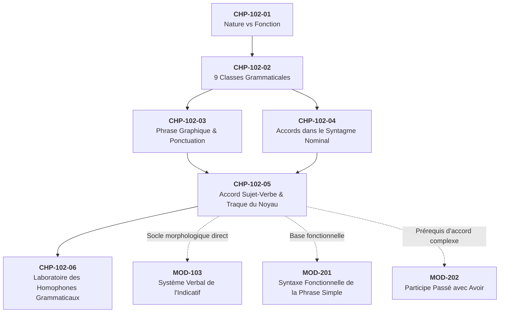
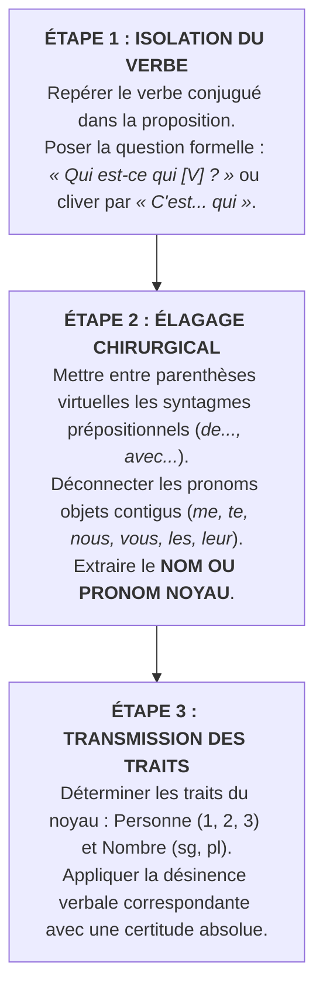

# Chapitre 5 — L'Accord Sujet-Verbe Canonique et la Traque du Noyau : Perturbateurs, Éloignement et Inversions

> **Identifiant du chapitre** : `CHP-102-05`  
> **Module de rattachement** : [`MOD-102` — Morphologie des Parties du Discours, Ponctuation Terminale et Mécanique des Accords Fondamentaux](file:///f:/Formation/world-class-french/03-curriculum/year-1/semester-1/mod-102-classes-mots-accords-fondamentaux.md)  
> **Semestre** : Année 1 — Semestre 1 (S1)  
> **Volume horaire estimé** : 5 à 6 heures d'apprentissage autonome délibéré et d'ateliers d'application (Étude : 1 h 30 | Pratique : 1 h 30 | Correction : 1 h 00 | Évaluation : 1 h 00)  
> **Statut** : [STATUT : VALIDÉ]  
> **Compétences associées** : [`FR-ORTHO-002`](file:///f:/Formation/world-class-french/02-competency-framework/competency-framework.md#fr-ortho-002-mécanique-infaillible-de-laccord-sujet-verbe) (L3 Autonomie), [`FR-ORTHO-001`](file:///f:/Formation/world-class-french/02-competency-framework/competency-framework.md#fr-ortho-001-maîtrise-de-lorthographe-lexicale-et-flexionnelle) (L3 Autonomie)  
> **Sources scientifiques de référence** : `SRC-GRAM-01` (Grevisse & Goosse, 2016, § 428-445), `SRC-GRAM-02` (Riegel et al., 2016, chap. 6), `SRC-GRAM-05` (Grevisse, 2009, § 34-40), `SRC-NORM-03` (Ministère de l'Éducation nationale, 2020, p. 12)

---

## 1. Titre et Place dans le Cursus

### 1.1 Intitulé Officiel
**Chapitre 5 : L'Accord Sujet-Verbe Canonique et la Traque du Noyau : Perturbateurs, Éloignement et Inversions** (`CHP-102-05`).

### 1.2 Insertion Architecturale dans le Cursus
Ce cinquième chapitre constitue la clé de voûte morphosyntaxique du premier semestre. Après avoir consolidé la dissociation fondamentale entre nature et fonction (`CHP-102-01`), l'inventaire des neuf classes grammaticales (`CHP-102-02`), la délimitation graphique de la phrase (`CHP-102-03`) et la chaîne des accords internes au syntagme nominal (`CHP-102-04`), ce cours aborde la relation d'accord la plus universelle, mais aussi la plus vulnérable de la langue française : **la rection du verbe par son sujet grammatical**.



- **En amont** : Ce chapitre réinvestit immédiatement la notion de **donneur d'accord** et de **tête nominale** acquise dans le chapitre précédent (`CHP-102-04`). Il suppose que l'apprenant sait identifier un nom, un pronom, un verbe conjugué et délimiter les frontières d'un syntagme nominal (`SN`).
- **Au sein du module `MOD-102`** : Il prépare directement le laboratoire chirurgical des homophones grammaticaux (`CHP-102-06`), notamment pour arbitrer sans hésitation *et / est*, *son / sont*, et *leur / leurs*.
- **En aval dans le cursus** :
  - Il forme le prérequis immédiat de [`MOD-103`](file:///f:/Formation/world-class-french/03-curriculum/year-1/semester-1/mod-103-systeme-verbal-indicatif.md) (*Système verbal de l'indicatif*), où la conjugaison des désinences temporelles régulières et irrégulières exige une identification réflexe de la personne grammaticale régissante ;
  - Il fonde l'analyse fonctionnelle approfondie de [`MOD-201`](file:///f:/Formation/world-class-french/03-curriculum/year-1/semester-2/mod-201-syntaxe-fonctionnelle-phrase-simple.md) (*Syntaxe fonctionnelle de la phrase simple* : valence verbale, compléments de verbe vs compléments de phrase) ;
  - Il est indispensable à [`MOD-202`](file:///f:/Formation/world-class-french/03-curriculum/year-1/semester-2/mod-202-participe-passe-avoir-ponctuation-interne.md) (*Accord du participe passé avec avoir*), car aucune règle d'accord d'objet direct ne peut être comprise si l'accord de base avec le sujet n'est pas devenu un automatisme infaillible.

---

## 2. Objectifs Mesurables

Au terme de l'étude autonome et des ateliers d'application de ce chapitre, l'apprenant doit être capable de :

1. **Identifier sans hésitation le nom ou pronom noyau du groupe sujet** dans tout énoncé simple ou complexe, en le distinguant de ses expansions périphériques (épithètes, compléments du nom, propositions relatives) et en administrant les tests d'encadrement par *« C'est... qui / Ce sont... qui »* et d'élagage syntaxique [Réf. `SRC-GRAM-02`, chap. 6].
2. **Neutraliser systématiquement les attracteurs syntaxiques parasites contigus au verbe**, en particulier les compléments du nom pluriels insérés dans le syntagme sujet (*« La liste des participants est... »*) et les pronoms personnels compléments d'objet antéposés (*« Nous vous prions... »*, *« Paul nous écoute... »*) [Réf. `SRC-GRAM-01`, § 428].
3. **Accorder infailliblement le verbe dans les structures à topologie non canonique**, notamment en présence d'un sujet inversé (incises de dialogue, phrases interrogatives, compléments circonstanciels ou adverbes en tête de phrase) [Réf. `SRC-GRAM-01`, § 430].
4. **Résoudre les accords à donneurs multiples ou hétérogènes**, en appliquant la hiérarchie des personnes grammaticales sur les sujets coordonnés par *et* ($1\text{re} > 2\text{e} > 3\text{e}$), en arbitrant les coordinations par *ou* et *ni... ni...* (exclusion vs addition), et en réglant l'accord des collectifs simples (*la plupart*, *la majorité de*) selon la norme académique [Réf. `SRC-GRAM-01`, § 434-438].

---

## 3. Prérequis et Test de Préparation (Auto-Diagnostic)

### 3.1 Prérequis Cognitifs
- Distinction stricte entre la **classe grammaticale** (nom, pronom, verbe) et la **fonction** (sujet, complément) [Réf. `SRC-NORM-03`, p. 12].
- Repérage rapide du verbe conjugué au sein d'une proposition.
- Maîtrise des marques flexionnelles régulières de personnes à l'indicatif présent (*-e, -es, -e, -ons, -ez, -ent* ou *-s, -s, -t/-d, -ons, -ez, -ent*).

### 3.2 Test de Préparation Immédiat
Résolvez mentalement ou par écrit les cinq questions suivantes avant d'entamer l'étude du chapitre.

1. Dans la phrase : *« La liste des participants [est / sont] affichée au tableau »*, quelle forme verbale s'impose ?
2. Dans la formule : *« Nous vous [prions / prie / priez] de bien vouloir agréer nos salutations »*, quel est le donneur d'accord du verbe ?
3. Choisissez la forme correcte : *« Toi et moi [partons / partez / partent] immédiatement. »*
4. Choisissez la forme correcte : *« Au fond de la cour [se trouvait / se trouvaient] deux vieux bancs de pierre. »*
5. Dans la phrase : *« Paul les regarde avec insistance »*, quelle est la fonction du mot *les* par rapport au verbe *regarde* ? Est-il le sujet du verbe ?

---

#### Corrigé de l'Auto-Diagnostic
1. **« est »** : Le sujet grammatical est le syntagme nominal *La liste des participants*. Le **noyau** de ce groupe est le nom singulier féminin *liste*. Le syntagme prépositionnel *des participants* n'est qu'un complément du nom ; il ne transmet aucun trait au verbe.
2. **« prions » (donneur : *Nous*)** : Le sujet est le pronom de première personne du pluriel *Nous*. Le pronom contigu *vous* est ici un pronom personnel complément d'objet direct ; il s'intercale entre le sujet et le verbe mais ne gouverne en rien la terminaison verbale.
3. **« partons »** : La coordination de la 2e personne (*toi*) et de la 1re personne (*moi*) équivaut globalement à la 1re personne du pluriel (*nous*). La première personne l'emporte toujours sur la deuxième.
4. **« se trouvaient »** : Le sujet réel est postposé (inversé) : *deux vieux bancs de pierre*. Ce syntagme nominal étant au pluriel, le verbe s'accorde au pluriel (*se trouvaient*), en dépit du complément singulier *Au fond de la cour* placé en tête.
5. **Non, *les* n'est pas le sujet** : *Les* est un pronom personnel complément d'objet direct (COD) antéposé. Le sujet est le nom propre singulier *Paul*, qui impose la 3e personne du singulier au verbe (*regarde*).

> [!NOTE]
> Si vous avez hésité à l'une de ces questions, votre cerveau a subi une **attraction de proximité**, le piège cognitif le plus répandu à l'écrit. Ce chapitre détaille les protocoles méthodiques nécessaires pour désactiver définitivement ce réflexe trompeur.

---

## 4. Situation de Départ ou Problème Concret : Le Piège de l'Attraction de Proximité

### 4.1 L'Erreur qui Détruit la Crédibilité Professionnelle
Considérez ces phrases tirées de procès-verbaux, de correspondances administratives ou de copies d'étudiants :

> *« Je vous **prit** de bien vouloir traiter mon dossier avec diligence. »*  
> *« La complexité des procédures administratives **découragent** les usagers. »*  
> *« De ces observations **découle** deux enseignements capitaux. »*  
> *« C'est une décision qui leur **incombent** personnellement. »*

Toutes ces phrases contiennent des solécismes majeurs d'accord sujet-verbe. Dans un cadre officiel, universitaire ou diplomatique, de telles erreurs provoquent un rejet immédiat : elles signalent à l'examinateur ou au destinataire une absence totale de maîtrise de la syntaxe élémentaire du français écrit.

### 4.2 Le Mécanisme de la Faille Cognitive
D'où provient cette vulnérabilité constante ?  
À l'oral, la langue française se déroule dans le temps de manière strictement linéaire. L'esprit humain, soucieux d'économie cognitive, a une tendance spontanée à faire accorder le verbe avec **le mot qui le précède immédiatement dans la phrase**, sans remonter à la source hiérarchique de l'ordre syntaxique.

Ce phénomène porte un nom scientifique en psycholinguistique : **l'attraction de proximité** (ou attraction de surface).
- Dans *« Je vous prie »*, le pronom pluriel *vous* vient se loger immédiatement avant le verbe. Le cerveau inattentif perçoit la désinence orale `/pʁi/` et, hypnotisé par *vous*, est tenté d'écrire *prit* (ou *priez*).
- Dans *« La complexité des procédures décourage »*, le nom pluriel *procédures* frappe l'œil juste avant l'espace précédant le verbe ; le scripteur écrit machinalement *découragent*.

Pour écrire sans faute, il faut briser cette tyrannie de la contiguïté spatiale et apprendre à conduire un **audit syntaxique hiérarchique instantané**.

---

## 5. Explication Intuitive : Le Radar Syntaxique et la Ligne Électrique Directe

Pour neutraliser les faux sujets, recourons à une modélisation mécanique claire : **le réseau électrique à haute tension**.

```text
  [ GÉNÉRATRICE : SUJET NOYAU ] ═══════════════════════════════════════► [ APPAREIL : VERBE ]
     (Donneur de traits :                     Ligne directe                   (Receveur obligé :
      Personne & Nombre)                     de commande                      flexion imposée)
               │                                                                    ▲
               └─── [ EXPANSIONS & PARASITES ] ─────────────────────────────────────┘
                    • Complément du nom : "des candidats"   (ÉCRAN DE FUMÉE)
                    • Pronom objet : "vous", "les", "leur"  (PASSAGERS DU TRAIN)
                    (Ne transmettent AUCUNE tension électrique au verbe)
```

Dans un circuit électrique :
- La **génératrice** (le sujet noyau) produit le courant : elle détient les traits exclusifs de **personne** (1re, 2e ou 3e) et de **nombre** (singulier ou pluriel).
- Le **verbe** est l'appareil électrique récepteur : il ne décide de rien par lui-même ; il reçoit le courant et adapte obligatoirement sa tension (sa désinence).
- Les mots intercalés — qu'il s'agisse d'un complément de nom pluriel (*de ces paysages*) ou d'un pronom objet (*nous*, *vous*, *les*) — ne sont que des composants décoratifs ou des passagers assis dans le wagon. **Ils ne sont connectés à aucun commutateur de commande.**

Le rédacteur rigoureux agit comme un opérateur radar : il traverse les écrans de fumée des mots intercalés, localise l'émetteur unique (la tête du syntagme sujet) et tire un câble imaginaire direct jusqu'à la désinence du verbe.

---

## 6. Définitions Précises et Terminologie Fondamentale

Chacun des concepts ci-dessous doit être manié avec une exactitude linguistique totale.

### 6.1 Le Sujet Grammatical
Le **sujet grammatical** est une fonction syntaxique primaire de la phrase canonique en français. Il présente trois caractéristiques universelles [Réf. `SRC-NORM-03`, p. 12 ; `SRC-GRAM-02`, chap. 6] :
1. **Non-supprimable** : Dans une phrase déclarative standard, il ne peut être effacé sans détruire la grammaticalité de l'énoncé (*« L'enfant dort »* $\rightarrow$ *\*« Dort »* est agrammatical).
2. **Encadrable** : Il est le seul constituant de la phrase répondant obligatoirement à la formule d'extraction par clivage : *« C'est... qui »* ou *« Ce sont... qui »* (*« C'est l'enfant qui dort »*).
3. **Pronominalisable** : Il peut être commué par un pronom personnel conjoint sujet (*il, elle, ils, elles, on*).

### 6.2 Le Donneur d'Accord et la Rection Verbale
- **Donneur d'accord** : Syntagme ou mot porteur des traits morphologiques intrinsèques (genre, nombre, personne) qu'il projette sur des termes dépendants. Le sujet est le donneur de personne et de nombre du verbe [Réf. `SRC-GRAM-02`, chap. 6].
- **Rection verbale** : Relation de dépendance morphosyntaxique par laquelle le verbe impose son régime à ses compléments (valence) et subit en retour la commande flexionnelle de son sujet grammatical.

### 6.3 Le Noyau du Groupe Sujet (Tête Syntaxique)
Le **noyau** (ou tête du syntagme nominal sujet) est l'élément directeur minimal autour duquel s'organisent d'éventuelles expansions périphériques (adjectifs, compléments prépositionnels, subordonnées relatives). C'est le noyau seul qui transmet ses traits de personne et de nombre au verbe recteur [Réf. `SRC-GRAM-01`, § 428].

*Exemple* :  
Dans le syntagme : *[La liste alphabétique des candidats admissibles au concours]*
- Tête / Noyau : *liste* (nom commun féminin singulier, 3e personne).
- Expansions : *alphabétique* (épithète), *des candidats admissibles au concours* (complément du nom).
- Le verbe s'accordera obligatoirement au singulier : *« [...] est affichée »*.

### 6.4 L'Attracteur Syntaxique (Leurre d'Accord)
Un **attracteur syntaxique** est un constituant de la phrase qui, en raison de sa position contiguë au verbe ou de sa force perceptive (marque de pluriel audible ou visible), crée une illusion perceptive de sujet et induit le scripteur en erreur.

### 6.5 Le Sujet Inversé (ou Postposé)
Le **sujet inversé** est un sujet grammatical placé après le verbe conjugué. Bien que sa position linéaire soit modifiée par des contraintes pragmatiques, stylistiques ou interrogatives, son statut hiérarchique de donneur d'accord demeure rigoureusement intact [Réf. `SRC-GRAM-01`, § 430].

*Exemple* :  
*« Au milieu du tumulte s'élevaient les cris des marchands. »*  
Le sujet donneur est *les cris des marchands* (3e personne du pluriel) ; le verbe s'écrit *s'élevaient*.

### 6.6 La Syllepse de Nombre (Accord selon le Sens)
La **syllepse de nombre** est un accord syntaxique opéré non pas d'après la forme morphologique grammaticale brute du donneur (singulier), mais d'après l'idée de pluralité qu'il évoque dans l'esprit du locuteur (*ad sensum*) [Réf. `SRC-GRAM-01`, § 437]. Elle intervient principalement avec les noms collectifs accompagnés d'un complément pluriel.

---

## 7. Règles ou Mécanismes Fondamentaux

L'exposé des règles d'accord est découpé en six paliers opérationnels.

### 7.1 La Règle d'Or Canonique de l'Accord Sujet-Verbe
Le verbe s'accorde obligatoirement en **personne** (1re, 2e, 3e) et en **nombre** (singulier, pluriel) avec le noyau de son groupe sujet [Réf. `SRC-GRAM-01`, § 428].

```text
RÈGLE D'OR :
[SUJET NOYAU : Personne P, Nombre N] ──(Rection)──► [VERBE : Désinence de Personne P, Nombre N]
```

#### Le Test de l'Encadrement Révélateur
Face à n'importe quelle phrase dont l'accord semble incertain, appliquez le test d'extraction par clivage :
$$\text{Encadrer le bloc suspect par : } \mathbf{\text{« C'est... qui »}} \text{ ou } \mathbf{\text{« Ce sont... qui »}}$$
Le bloc qui prend place entre *C'est / Ce sont* et *qui* est **le sujet grammatical intégral**. Tout mot situé en dehors de ce bloc ne peut en aucun cas faire accorder le verbe.

---

### 7.2 Le Piège n° 1 : L'Attraction du Complément du Nom Intercalé
Lorsque le groupe nominal sujet comporte une expansion prépositionnelle (introduite par *de, des, d', avec, sans, etc.*), ce complément du nom s'intercale fréquemment entre le nom noyau et le verbe conjugué.

- **Le piège** : Le complément du nom est souvent au pluriel, alors que le nom noyau est au singulier (ou inversement).
- **La règle** : Le complément du nom est un satellite intérieur au syntagme nominal ; il est subordonné au nom noyau et n'a aucun lien de rection avec le verbe [Réf. `SRC-GRAM-01`, § 428].

```text
Exemple :
"La beauté de ces paysages enchante [et NON enchantent] le voyageur."
  │          └────────────────┘   │
  └─ Noyau singulier (3e pers.) ──┴─► Verbe à la 3e pers. du singulier
```

#### Le Test de l'Élagage Prépositionnel
Pour démasquer le noyau, supprimez purement et simplement le syntagme prépositionnel commençant par la préposition :
1. Énoncé brut : *Le résultat [des élections législatives dans cette circonscription] suscite de vifs débats.*
2. Élagage : *Le résultat [...] suscite de vifs débats.*
3. Vérification : Le sujet résiduel est *Le résultat* (singulier) $\rightarrow$ verbe *suscite* (singulier).

---

### 7.3 Le Piège n° 2 : L'Attraction du Pronom Personnel Objet Antéposé Contigu
En français, les pronoms personnels compléments d'objet direct ou indirect (*me, te, nous, vous, le, la, les, lui, leur*) se placent obligatoirement **avant le verbe** aux temps simples, s'insérant entre le sujet et la forme verbale.

- **Le piège** : Les pronoms *nous* et *vous* ressemblent visuellement et phonétiquement aux pronoms sujets de 1re et 2e personnes du pluriel. Le rédacteur croit accorder le verbe avec *nous* ou *vous*, alors que ce mot est un simple complément d'objet [Réf. `SRC-GRAM-02`, chap. 6].
- **La règle** : Un pronom personnel complément ne gouverne jamais l'accord du verbe qui le suit.

```text
Exemples modèles :
1. "Je vous prie [et NON vous prit / vous priez] d'agréer..."
    │   └────┘   │
    └── Sujet ───┴─► Verbe accordé avec "Je" (1re pers. singulier)

2. "Paul nous avertit du danger."
     │    └──┘    │
     └── Sujet ───┴─► Verbe accordé avec "Paul" (3e pers. singulier)

3. "Le directeur les écoute attentivement."
          │       └──┘   │
          └── Sujet ─────┴─► Verbe accordé avec "Le directeur" (3e pers. singulier)
```

#### Le Test de la Substitution par un Nom Plein
Pour prouver que le pronom contigu n'est pas le sujet, remplacez-le par un groupe nominal placé après le verbe :
- *« Le directeur les écoute »* $\rightarrow$ *« Le directeur écoute les étudiants »*.
- Il apparaît immédiatement que *les* équivaut à un complément d'objet postposé ; le verbe reste invariablement régi par *Le directeur*.

---

### 7.4 Le Piège n° 3 : Les Sujets Coordonnés par *et* et la Hiérarchie des Personnes
Lorsque plusieurs sujets singuliers ou pluriels sont unis par la conjonction de coordination *et*, ils cumulent leurs forces quantitatives :
1. **Règle générale de nombre** : Deux ou plusieurs sujets coordonnés par *et* forment une unité plurielle ; le verbe s'accorde obligatoirement au **pluriel** [Réf. `SRC-GRAM-01`, § 434].
   - *« Le maire et son adjoint approuvent le projet. »*
2. **Hiérarchie absolue des personnes grammaticales** : Si les sujets coordonnés appartiennent à des personnes grammaticales différentes, la personne la plus forte l'emporte selon la loi décroissante :
   $$\mathbf{1\text{re Personne} > 2\text{e Personne} > 3\text{e Personne}}$$
   - **Règle 1 ($1 + 2$ ou $1 + 3 = \mathbf{1\text{re pluriel [nous]}}$)** :  
     *« Toi et moi partons. »* (*Toi et moi* = nous $\rightarrow$ désinence *-ons*).  
     *« Mon collègue et moi préparons le dossier. »* (*Lui et moi* = nous $\rightarrow$ désinence *-ons*).
   - **Règle 2 ($2 + 3 = \mathbf{2\text{e pluriel [vous]}}$)** :  
     *« Ton frère et toi partez immédiatement. »* (*Lui et toi* = vous $\rightarrow$ désinence *-ez*).

---

### 7.5 Le Piège n° 4 : Le Sujet Inversé Simple (Postposé)
Dans plusieurs configurations canoniques de la phrase française, le sujet est rejeté après le verbe [Réf. `SRC-GRAM-01`, § 430] :
1. **Phrases interrogatives directes** : *« Où vont ces hommes égarés ? »* (Sujet : *ces hommes égarés* $\rightarrow$ 3e pluriel *vont*).
2. **Incises de dialogue ou de citation** : *« C'est impossible, s'écrièrent les délégués stupéfaits. »* (Sujet : *les délégués* $\rightarrow$ 3e pluriel *s'écrièrent*).
3. **Compléments circonstanciels ou adverbes en tête de phrase** :  
   - *« Au loin s'élevaient d'épaisses colonnes de fumée. »* (Sujet : *d'épaisses colonnes de fumée* $\rightarrow$ 3e pluriel *s'élevaient*).
   - *« De cette décision découleront trois conséquences majeures. »* (Sujet : *trois conséquences majeures* $\rightarrow$ 3e pluriel *découleront*).
   - *« De là viennent tous nos malheurs. »* (Sujet : *tous nos malheurs* $\rightarrow$ 3e pluriel *viennent*).

#### Le Test du Rétablissement de l'Ordre Canonique (S-V-C)
Pour sécuriser l'accord d'un verbe précédé d'un constituant prépositionnel, rétablissez l'ordre syntaxique direct (Sujet + Verbe + Complément) :
- *« Au loin s'élevaient d'épaisses colonnes de fumée »*  
  $\rightarrow$ *« D'épaisses colonnes de fumée s'élevaient au loin. »*  
L'accord au pluriel devient immédiatement évident et incontestable.

---

### 7.6 Cas des Sujets Collectifs Simples et Quantifieurs
Les noms collectifs (*la plupart, une foule, une majorité, la totalité, un groupe*) posent un problème d'arbitrage entre l'accord morphologique strict et la syllepse sémantique [Réf. `SRC-GRAM-01`, § 437-438].

| Sujet collectif | Règle normative académique | Exemple validé | Source de référence |
| :--- | :--- | :--- | :--- |
| **La plupart** (employé seul ou avec complément pluriel) | Accord **toujours au pluriel**. L'usage classique et moderne y voit une valeur intrinsèque de pluralité. | *La plupart sont d'avis de continuer.*<br/>*La plupart des témoins ont confirmé la version.* | [Réf. `SRC-GRAM-01`, § 438] |
| **Une infinité de / Quantité de / Nombre de** (+ nom pluriel) | Accord **au pluriel**. Ces expressions fonctionnent comme des déterminants indéfinis pluriels. | *Une infinité de détails manquent.*<br/>*Nombre de citoyens ont voté.* | [Réf. `SRC-GRAM-02`, chap. 6] |
| **La majorité de / Une foule de / Le groupe de** (+ nom pluriel) | **Double accord admis** :<br/>• Au **singulier** si l'on insiste sur l'unité globale du groupe (accord grammatical sur le noyau).<br/>• Au **pluriel** si l'on focalise sur la pluralité des individus (accord sylleptique). | *La majorité des députés a voté la loi* (le bloc uni).<br/>*La majorité des participants sont partis* (les individus). | [Réf. `SRC-GRAM-01`, § 437] |
| **Le peu de + nom pluriel** | • Au **singulier** si le sens met l'accent sur le manque ou l'insuffisance.<br/>• Au **pluriel** si le sens met l'accent sur la quantité positive existante. | *Le peu de ressources dont il dispose lui suffit* (manque).<br/>*Le peu de mots qu'il a dits ont touché l'auditoire* (présence). | [Réf. `SRC-GRAM-01`, § 439] |

---

## 8. Raisonnement Détaillé : Pourquoi le Cerveau Humain Succombe à l'Attraction de Surface

L'erreur d'accord sujet-verbe n'est pas un simple accident d'inattention ; c'est une défaillance neuro-linguistique documentée. Pour s'en prémunir durablement, il faut comprendre l'architecture cognitive qui la favorise.

### 8.1 La Compétition entre Linéarité Temporelle et Arborescence Hiérarchique
Le langage humain possède une **double réalité structurelle** :
1. **La chaîne de surface (linéaire)** : Les mots se succèdent les uns après les autres dans le temps (à l'oral) ou dans l'espace de la ligne (à l'écrit) :  
   $$\text{Mot}_1 \longrightarrow \text{Mot}_2 \longrightarrow \text{Mot}_3 \longrightarrow \text{Mot}_4 \longrightarrow \text{Verbe}$$
2. **La structure profonde (arborescente)** : La syntaxe n'est pas une simple chaîne de perles contiguës ; c'est un arbre hiérarchique où certains mots dominent d'autres mots à distance, indépendamment de leur position linéaire [Réf. `SRC-GRAM-02`, chap. 6].

Dans la mémoire de travail (notamment au sein de la boucle phonologique modélisée par Alan Baddeley), les éléments lexicaux récents laissent une empreinte acoustique vive. Lorsque la main s'apprête à tracer la désinence du verbe, le mot situé immédiatement à gauche du curseur est celui qui bénéficie du **taux d'activation cérébrale le plus élevé**.

Si ce mot contigu porte une marque de nombre opposée au sujet véritable (par exemple un pluriel comme *paysages* devant un noyau singulier *beauté*), il opère une **capture attentionnelle**. L'automatisme phonologique court-circuite le calcul syntaxique hiérarchique : le scripteur accorde avec l'intrus.

```text
TRAITEMENT NAÏF (Linéaire, erroné) :
[La beauté] ──► [de ces paysages] (PLURIEL !) ──► [Verbe : *enchantent]  <-- ERREUR PAR ATTRACTION !

TRAITEMENT EXPERT (Hiérarchique, correct) :
               [ Syntagme Nominal Sujet ]
                       ┌─────┴─────────────────────────┐
               [ Tête : La beauté ]            [ Complément adnominal ]
               (3e pers. Singulier)            (de ces paysages : Pluriel neutralisé)
                       │
                       └───────────────────────────────► [ Verbe : enchante ] (3e pers. Singulier)
```

### 8.2 Le Passage de l'Écriture Spontanée à la Vigilance Métasyntaxique
Pour un locuteur expert, la rection sujet-verbe cesse d'être une réaction phonologique immédiate. Elle devient un **programme de contrôle réflexe** en trois temps :
1. Toute trace de verbe conjugué déclenche l'interrogation automatique du donneur ;
2. Tout constituant prépositionnel ou pronominal intercalé est instantanément mis entre parenthèses virtuelles ;
3. La désinence graphique est verrouillée sur la tête nominale avant même la fin du tracé du mot.

---

## 9. Exemples Corrects Commentés

Voici six phrases pièges modèles analysées selon le protocole de l'audit syntaxique.

### Exemple 1 : Le Complément du Nom Pluriel Intercalé
> *« Le cortège des hauts dignitaires de la sous-région **avance** solennellement dans l'allée centrale. »*

- **Analyse du sujet** : Le syntagme nominal sujet est *Le cortège des hauts dignitaires de la sous-région*.
- **Identification du noyau** : Le nom tête est **cortège** (nom masculin singulier, 3e personne).
- **Perturbateurs neutralisés** : *des hauts dignitaires* (complément du nom au pluriel) et *de la sous-région* (complément du nom au singulier).
- **Fléchage syntaxique** :  
  $$\text{Le cortège [noyau sg]} \longrightarrow \mathbf{\text{avance [verbe sg]}}$$
- **Justification** : Le verbe *avance* prend la désinence *-e* de la 3e personne du singulier de l'indicatif présent. La graphie *\*avancent* serait un solécisme grossier provoqué par l'attraction de *dignitaires*.

---

### Exemple 2 : Le Pronom Personnel Objet Antéposé Contigu
> *« Le conseil d'administration vous **prie** de bien vouloir assister à la séance extraordinaire. »*

- **Analyse du sujet** : Le syntagme nominal sujet est *Le conseil d'administration*.
- **Identification du noyau** : Le nom tête est **conseil** (nom masculin singulier, 3e personne).
- **Perturbateur neutralisé** : Le pronom personnel **vous**, placé immédiatement devant le verbe, est ici un pronom complément d'objet direct (COD). Il répond à la question : *« Le conseil prie qui ? $\rightarrow$ vous »*.
- **Fléchage syntaxique** :  
  $$\text{Le conseil [noyau sg]} \longrightarrow \mathbf{\text{prie [verbe sg]}}$$
- **Justification** : Le verbe *prie* s'accorde avec *conseil* (3e personne du singulier). Le pronom *vous* ne modifie en rien la désinence verbale.

---

### Exemple 3 : Le Double Pronom Objet Antéposé
> *« Ce précieux manuscrit historique, mon vénérable grand-père nous le **transmet** avec émotion. »*

- **Analyse du sujet** : Le sujet du verbe est le syntagme *mon vénérable grand-père*.
- **Identification du noyau** : Le nom tête est **grand-père** (nom singulier, 3e personne).
- **Perturbateurs neutralisés** : Deux pronoms personnels objets contigus sont accumulés devant le verbe : *nous* (COI) et *le* (COD).
- **Fléchage syntaxique** :  
  $$\text{mon vénérable grand-père [noyau sg]} \longrightarrow \mathbf{\text{transmet [verbe sg]}}$$
- **Justification** : Ni *nous* ni *le* ne sont sujets. Le verbe reçoit la désinence *-t* du 3e groupe à la 3e personne du singulier (*transmet*).

---

### Exemple 4 : Le Sujet Inversé après un Circonstant de Lieu en Tête
> *« Sur les rives poissonneuses du fleuve Ouémé **s'étendent** de vastes palmeraies verdoyantes. »*

- **Analyse de la topologie** : La phrase s'ouvre sur un complément circonstanciel de lieu étendu (*Sur les rives poissonneuses du fleuve Ouémé*).
- **Localisation du verbe** : Le verbe pronominal est *s'étendent*.
- **Recherche du sujet donneur** : *« Qu'est-ce qui s'étend sur les rives ? »* $\rightarrow$ *de vastes palmeraies verdoyantes*.
- **Identification du noyau** : Le nom tête est **palmeraies** (nom féminin pluriel, 3e personne).
- **Fléchage syntaxique** :  
  $$\mathbf{\text{s'étendent [verbe pl]}} \longleftarrow \text{de vastes palmeraies [sujet inversé pl]}$$
- **Justification** : Le sujet étant postposé et au pluriel, le verbe reçoit obligatoirement la marque *-ent* du pluriel. Écrire *\*s'étend* sous prétexte que le verbe jouxte le singulier *Ouémé* constituerait une erreur de rection majeure.

---

### Exemple 5 : La Coordination de Personnes Différentes
> *« Mon fidèle collaborateur et moi **rédigeons** le rapport financier définitif. »*

- **Analyse des sujets coordonnés** :
  - Premier sujet : *Mon fidèle collaborateur* (3e personne du singulier).
  - Deuxième sujet : *moi* (pronom disjoint de 1re personne du singulier).
- **Application de la règle hiérarchique** : $3\text{e personne} + 1\text{re personne} = \mathbf{1\text{re personne du pluriel (nous)}}$ [Réf. `SRC-GRAM-01`, § 434].
- **Fléchage syntaxique** :  
  $$\text{[Lui + moi = Nous]} \longrightarrow \mathbf{\text{rédigeons [verbe 1re pl]}}$$
- **Justification** : Le verbe adopte la désinence *-ons* propre à la première personne du pluriel.

---

### Exemple 6 : Le Collectif avec Complément Pluriel
> *« La plupart des jeunes diplômés **aspirent** à fonder une entreprise innovante. »*

- **Analyse du sujet** : Le sujet est l'expression quantitative collective *La plupart des jeunes diplômés*.
- **Règle académique** : *La plupart* gouverne impérativement l'accord au **pluriel** [Réf. `SRC-GRAM-01`, § 438].
- **Fléchage syntaxique** :  
  $$\text{La plupart des jeunes diplômés} \longrightarrow \mathbf{\text{aspirent [verbe 3e pl]}}$$
- **Justification** : Le verbe prend la désinence plurielle *-ent* (*aspirent*).

---

## 10. Contre-Exemples et Erreurs Fréquentes

Voici l'inventaire clinique de six fautes récurrentes d'accord sujet-verbe observées chez les scripteurs :

### Erreur n° 1 : L'Attraction par le Pronom Complément Contigu (*« Je vous prit »*)
- **Énoncé fautif** : *\*« Je vous prit de bien vouloir m'accorder une audience. »*
- **Analyse de la méprise** : Le scripteur entend le son verbal `/pʁi/`. Subissant l'attraction du pronom pluriel *vous* contigu au verbe, il sélectionne indûment la forme fléchie du passé simple (*prit*) ou confond avec l'impératif pluriel (*priez*).
- **Forme corrigée** : *« Je vous **prie** de bien vouloir m'accorder une audience. »*
- **Test de vérification** : Élaguer le pronom complément : *« Je [...] prie »*. Le sujet donneur est *Je* (1re personne du singulier du présent de l'indicatif $\rightarrow$ désinence *-e*).

---

### Erreur n° 2 : L'Attraction par le Complément du Nom Pluriel (*« La liste des inscrits sont... »*)
- **Énoncé fautif** : *\*« La liste complète des candidats retenus pour les entretiens finaux sont affichée à l'entrée. »*
- **Analyse de la méprise** : L'œil et l'oreille du scripteur sont saturés par la séquence plurielle *des candidats retenus pour les entretiens finaux*. La mémoire de travail associe immédiatement le verbe à ce groupe pluriel contigu.
- **Forme corrigée** : *« La liste complète des candidats retenus pour les entretiens finaux **est** affichée à l'entrée. »*
- **Test de vérification** : Administrer le test d'élagage prépositionnel : *« La liste complète [...] **est** affichée »*. Le noyau est *liste* (singulier).

---

### Erreur n° 3 : L'Oubli du Sujet Postposé après un Circonstant en Tête (*« De cette crise découle... »*)
- **Énoncé fautif** : *\*« De cette grave crise économique et financière découle de profondes réformes structurelles. »*
- **Analyse de la méprise** : Le verbe *découle* est placé immédiatement après le syntagme singulier *cette grave crise économique et financière*. Le scripteur commet une double faute : il prend le complément circonstanciel pour le sujet, et oublie que le véritable sujet est postposé.
- **Forme corrigée** : *« De cette grave crise économique et financière **découlent** de profondes réformes structurelles. »*
- **Test de vérification** : Rétablir l'ordre canonique de la phrase : *« De profondes réformes structurelles [sujet pluriel] découlent de cette grave crise »*.

---

### Erreur n° 4 : La Confusion dans la Coordination des Personnes (*« Toi et moi partez »*)
- **Énoncé fautif** : *\*« Toi et moi partez pour la capitale dès demain matin. »*
- **Analyse de la méprise** : Le scripteur accorde le verbe avec le pronom *toi* qui figure en tête de coordination, oubliant la loi de suprématie de la 1re personne sur la 2e.
- **Forme corrigée** : *« Toi et moi **partons** pour la capitale dès demain matin. »*
- **Test de vérification** : Remplacer mentalement le groupe coordonné par le pronom synthétique équivalent : *« [Toi et moi] = Nous $\rightarrow$ Nous partons »*.

---

### Erreur n° 5 : L'Accord Défaillant sur le Pronom Relatif *qui* (*« C'est moi qui a fait cela »*)
- **Énoncé fautif** : *\*« C'est moi qui a pris l'initiative de convoquer cette assemblée. »*
- **Analyse de la méprise** : Le scripteur traite le pronom relatif sujet *qui* comme une entité neutre de 3e personne du singulier par défaut, oubliant que *qui* est un anaphorique pur qui hérite intégralement de la personne et du nombre de son antécédent [Réf. `SRC-GRAM-01`, § 441].
- **Forme corrigée** : *« C'est moi qui **ai** pris l'initiative de convoquer cette assemblée. »*
- **Test de vérification** : Identifier l'antécédent de *qui* : l'antécédent est *moi* (1re personne du singulier). Donc *qui* vaut *je* : *« C'est moi qui **ai** pris »* (comme l'on dirait : *« C'est toi qui **as** pris »*, *« C'est nous qui **avons** pris »*).

---

### Erreur n° 6 : L'Accord Fautif sur le Pronom COI *leur* Pris pour un Sujet (*« Les motifs qui leur semblent... »*)
- **Énoncé fautif** : *\*« Les obligations que leur incombent sont particulièrement lourdes. »*
- **Analyse de la méprise** : Le scripteur aperçoit le pronom *leur* (pluriel de *lui*) placé devant le verbe. Croyant qu'il commande le verbe, ou inversement confondant le sujet avec un autre mot, il hésite sur le donneur d'accord. Dans la phrase citée, le verbe *incomber* est intransitif : ce sont *les obligations* qui incombent. Mais dans *« Le devoir qui leur incombe »*, le scripteur écrit fautivement *\*incombent* sous l'influence de *leur*.
- **Forme corrigée** :  
  - Cas 1 (sujet singulier) : *« Le devoir qui leur **incombe** [et NON incombent] est immense. »*  
  - Cas 2 (sujet pluriel) : *« Les devoirs qui leur **incombent** sont immenses. »*
- **Test de vérification** : Le pronom personnel *leur* placé devant un verbe est TOUJOURS un complément d'objet indirect (invariable, équivalent à *à eux / à elles*). Il ne peut **jamais** être sujet d'un verbe.

---

## 11. Cas Particuliers et Limites de la Règle Générale

Au-delà de la mécanique canonique, le scripteur de haut niveau doit maîtriser trois zones de complexité syntaxique.

### 11.1 Sujets Coordonnés par *ou* ou par *ni... ni...* : Exclusion vs Addition
La coordination par *ou* ou la double négation par *ni... ni...* introduit une nuance sémantique entre deux logiques distinctes [Réf. `SRC-GRAM-01`, § 435-436] :

1. **L'exclusion sémantique mutuelle $\rightarrow$ Accord au SINGULIER** :  
   Lorsque l'action ne peut, par la logique même des faits, être accomplie que par un seul des sujets à l'exclusion de l'autre, le verbe reste obligatoirement au singulier.  
   - *« Le Bénin ou le Sénégal remportera la coupe continentale. »* (Un seul pays peut remporter la coupe $\rightarrow$ verbe au singulier).  
   - *« Ni l'un ni l'autre ne sera élu président du conseil d'administration. »* (Un seul poste est à pourvoir $\rightarrow$ verbe au singulier).
2. **L'addition ou la concomitance sémantique $\rightarrow$ Accord au PLURIEL** :  
   Lorsque les deux sujets participent ensemble à l'action ou que l'action s'applique conjointement aux deux termes, le verbe s'accorde au pluriel.  
   - *« La peur ou la colère guidaient chacun de ses mouvements. »* (Les deux sentiments agissent ensemble $\rightarrow$ pluriel).  
   - *« Ni le froid ni la faim ne purent entamer leur courage. »* (Les deux fléaux frappent simultanément $\rightarrow$ pluriel obligatoire selon l'usage académique dominant).

### 11.2 Le Pronom Relatif Sujet *qui* : La Transmission Intégrale des Traits
Le pronom relatif *qui* n'a pas de personne ni de nombre propres dans son signifiant morphologique. Il reçoit les traits morphologiques complets de son **antécédent direct** [Réf. `SRC-GRAM-01`, § 441] :

| Antécédent | Pronom sujet | Verbe conjugué (présent de l'indicatif) | Exemple canonique |
| :--- | :---: | :---: | :--- |
| **Moi** (1re pers. sg) | *qui* | 1re pers. du singulier | *C'est moi qui **suis** le responsable.* |
| **Toi** (2e pers. sg) | *qui* | 2e pers. du singulier | *C'est toi qui **as** remporté la victoire.* |
| **Lui / Elle** (3e pers. sg) | *qui* | 3e pers. du singulier | *C'est lui qui **connaît** la réponse.* |
| **Nous** (1re pers. pl) | *qui* | 1re pers. du pluriel | *C'est nous qui **portons** ce projet.* |
| **Vous** (2e pers. pl) | *qui* | 2e pers. du pluriel | *C'est vous qui **prenez** la décision.* |
| **Eux / Elles** (3e pers. pl) | *qui* | 3e pers. du pluriel | *Ce sont eux qui **bâtissent** la cité.* |

> [!CAUTION]
> L'expression fautive *\*« C'est moi qui a »* ou *\*« C'est vous qui a »* est un solécisme grossier résultant de l'oubli de l'antécédent pronominal.

### 11.3 La Tournure Impersonnelle et le Sujet Apparent *il*
Dans les constructions impersonnelles, la phrase comporte deux éléments sujets distincts [Réf. `SRC-GRAM-02`, chap. 6] :
- Le **sujet grammatical apparent** : le pronom neutre invariable *il* ;
- La **séquence sujet réelle (ou sujet logique)** : le syntagme nominal postposé au verbe.

**La règle d'or** : Le verbe s'accorde TOUJOURS au **singulier** avec le sujet grammatical apparent *il*, quel que soit le nombre du syntagme nominal placé après lui.
- *« **Il arrive** de grands malheurs dans la vie des peuples. »* (Et non *\*Il arrivent*).
- *« **Il reste** trois questions à élucider. »* (Et non *\*Il restent*).
- *« **Il s'est produit** des incidents regrettables. »* (Et non *\*Il se sont produits*).

Ne confondez jamais la phrase impersonnelle avec la phrase personnelle à sujet inversé :
- Tournure impersonnelle : *« **Il** s'élève d'épaisses fumées. »* (Sujet grammatical : *il* $\rightarrow$ singulier).
- Sujet inversé personnel : *« Au loin **s'élevaient** d'épaisses fumées. »* (Sujet grammatical : *d'épaisses fumées* $\rightarrow$ pluriel).

---

## 12. Approfondissement Adapté au Niveau : Syntaxe Générative et Syllepse Littéraire

### 12.1 La Modélisation Générative de l'Accord (Relations Structurelles)
Dans la linguistique formelle moderne (modèle des principes et des paramètres initié par Noam Chomsky), la phrase ne se décrit pas comme une suite linéaire de mots, mais comme une arborescence ordonnée par des nœuds catégoriels [Réf. `SRC-GRAM-02`, chap. 6].

Considérons la phrase : *« La clarté de ces explications illumine l'esprit. »*

```text
                     P (Phrase)
             ┌───────────┴───────────┐
      SN (Sujet)                  SV (Syntagme Verbal)
   ┌─────┴──────────────┐            ┌───────┴──────┐
Dét (La)              N'           V (illumine)   SN (l'esprit)
                 ┌──────┴──────┐
             N (clarté)       SP (Complément adnominal)
                           ┌───┴────────┐
                       Prép (de)     SN (ces explications)
```

Dans cette arborescence :
1. Le nœud $SN$ sujet commande directement le nœud $SV$ (Syntagme Verbal) au sein du nœud père $P$. C'est la relation formelle de **gouvernement** (ou de c-commande).
2. Le syntagme prépositionnel *de ces explications* est confiné dans un sous-arbre dépendant du nom *clarté* ($N'$). Il est structurellement bloqué à l'intérieur du syntagme nominal sujet ; il ne possède aucun lien hiérarchique avec le nœud $V$ (le verbe).
3. Le verbe ne peut « voir » que la **tête** du syntagme nominal qui le gouverne, à savoir le nom *clarté*.

Cette formalisation mathématique démontre pourquoi toute attraction par un mot inclus dans un sous-arbre constitue une rupture de la géométrie syntaxique de la langue.

### 12.2 La Syllepse de Nombre dans le Patrimoine Littéraire Classique
Chez les écrivains classiques des XVIIe et XVIIIe siècles (Racine, La Fontaine, Saint-Simon, Bossuet), l'accord selon le sens (la syllepse) était fréquemment mobilisé comme une figure de vivacité stylistique délibérée [Réf. `SRC-GRAM-01`, § 437] :

> *« Une troupe de nymphes accoururent à sa voix. »* (Fénelon, *Télémaque*)  
> *« Un grand nombre d'officiers furent tués dans la mêlée. »* (Voltaire, *Histoire de Charles XII*)

Chez Fénelon, le nom singulier *troupe* s'efface dans l'imagination de l'auteur devant l'image vive de la multiplicité des nymphes en mouvement. 

Cependant, la codification de la langue française par l'Académie et les grammairiens du XIXe siècle a progressivement encadré cette liberté. Aujourd'hui, dans le registre formel académique et professionnel :
- La règle du noyau syntaxique prévaut rigoureusement chaque fois que le nom collectif est précédé d'un article défini (*« La troupe de nymphes accourut »*) ;
- Le pluriel sylleptique n'est admis sans réserve que pour les quantifieurs indéfinis (*la plupart, nombre de, une infinité de*).

---

## 13. Comparaisons Différentielles

Les trois tableaux synoptiques ci-dessous permettent de trancher immédiatement les confusions structurelles.

### 13.1 Pronom Personnel Sujet vs Pronom Personnel Objet Contigu

| Forme pronominale | Fonction : Sujet donneur d'accord | Fonction : Objet intercalé (Attracteur) | Règle de résolution infaillible |
| :---: | :--- | :--- | :--- |
| **nous** | *« **Nous** vous informons du calendrier. »*<br/>$\rightarrow$ *Nous* commande le verbe (*-ons*). | *« Le directeur **nous** informe du calendrier. »*<br/>$\rightarrow$ *Le directeur* commande le verbe (*-e*). | Si le verbe a déjà un sujet exprimé (*Le directeur*), *nous* est obligatoirement objet. |
| **vous** | *« **Vous** nous transmettez le rapport. »*<br/>$\rightarrow$ *Vous* commande le verbe (*-ez*). | *« Mon collègue **vous** transmet le rapport. »*<br/>$\rightarrow$ *Mon collègue* commande le verbe (*-t*). | Isoler le premier pronom ou nom de la proposition ; c'est lui le sujet. |
| **les** | *« **Les** enfants dorment. »* (*Les* est déterminant pluriel). | *« Ce dossier, Paul **les** examine avec soin. »*<br/>$\rightarrow$ *Paul* commande le verbe (*-e*). | Devant un verbe, *les* est TOUJOURS pronom objet. Il n'est jamais sujet. |
| **leur** | *Ne peut jamais être pronom sujet*. | *« Cette tâche **leur** incombe légitimement. »*<br/>$\rightarrow$ *Cette tâche* commande le verbe (*-e*). | Devant un verbe, *leur* est toujours pronom personnel COI (invariable). |

---

### 13.2 Noyau Singulier + Complément Pluriel vs Noyau Pluriel + Complément Singulier

| Configuration structurelle | Énoncé modèle analysé | Tête nominale (Noyau) | Expansion neutralisée | Accord imposé au verbe |
| :--- | :--- | :---: | :---: | :---: |
| **Noyau singulier + Complément pluriel** | *Le recueil de poèmes séduit les lecteurs.* | **recueil** (singulier) | *de poèmes* (pluriel) | **séduit** (3e pers. du singulier) |
| **Noyau pluriel + Complément singulier** | *Les poèmes du recueil séduisent les lecteurs.* | **poèmes** (pluriel) | *du recueil* (singulier) | **séduisent** (3e pers. du pluriel) |
| **Noyau singulier + Complément pluriel** | *La liste des admis paraît demain.* | **liste** (singulier) | *des admis* (pluriel) | **paraît** (3e pers. du singulier) |
| **Noyau pluriel + Complément singulier** | *Les membres du jury délibèrent.* | **membres** (pluriel) | *du jury* (singulier) | **délibèrent** (3e pers. du pluriel) |

---

### 13.3 Sujet Canonique Antéposé vs Sujet Inversé Postposé

| Type de phrase | Ordre linéaire | Exemple illustratif | Mécanisme de contrôle |
| :--- | :---: | :--- | :--- |
| **Canonique (S-V-C)** | $\text{Sujet} \longrightarrow \text{Verbe}$ | *Trois ruisseaux limpides **coulent** dans la vallée.* | Le donneur d'accord précède immédiatement ou à distance le verbe. |
| **Inversé (C-V-S)** | $\text{Complément} \longrightarrow \text{Verbe} \longleftarrow \mathbf{\text{Sujet}}$ | *Dans la vallée **coulent** trois ruisseaux limpides.* | Rétablir l'ordre canonique : poser la question *« Qu'est-ce qui coule ? »*. |
| **Incise de citation** | $\text{Paroles} \longrightarrow \text{Verbe} \longleftarrow \mathbf{\text{Sujet}}$ | *« Partons », **chuchotèrent** les deux sentinelles.* | Le sujet est rejeté après le verbe de parole ou de pensée. |

---

## 14. Exercices Progressifs

### 14.1 Niveau 1 : Reconnaissance du Noyau et Accord Direct (Guidé)

#### Consigne
Dans chacune des 5 phrases suivantes :
1. Isolez le groupe nominal sujet intégral entre crochets ;
2. Soulignez le nom ou pronom noyau (donneur d'accord) ;
3. Choisissez la forme verbale correcte entre parenthèses en justifiant votre choix.

1. *[Le chant harmonieux des oiseaux migrateurs] (enchante / enchantent) la forêt au lever du jour.*
2. *[La propagation des fausses nouvelles sur les réseaux sociaux] (menace / menacent) la cohésion républicaine.*
3. *[Chacun des étudiants inscrits à cette formation d'élite] (reçoit / reçoivent) un programme individualisé.*
4. *[Les résultats provisoires de l'élection présidentielle] (confirme / confirment) la tendance observée.*
5. *[Le chef de ces trois brigades d'intervention] (ordonne / ordonnent) le repli immédiat des troupes.*

---

#### Corrigé Détaillé du Niveau 1
1. **enchante** :
   - Groupe sujet : *[Le chant harmonieux des oiseaux migrateurs]*.
   - Noyau : **chant** (nom masculin singulier, 3e personne).
   - Expansion neutralisée : *des oiseaux migrateurs* (complément du nom au pluriel).
   - Justification : Le verbe s'accorde avec le noyau singulier *chant* $\rightarrow$ *enchante*.
2. **menace** :
   - Groupe sujet : *[La propagation des fausses nouvelles sur les réseaux sociaux]*.
   - Noyau : **propagation** (nom féminin singulier, 3e personne).
   - Expansion neutralisée : *des fausses nouvelles sur les réseaux sociaux* (compléments prépositionnels pluriels).
   - Justification : Accord au singulier avec *propagation* $\rightarrow$ *menace*.
3. **reçoit** :
   - Groupe sujet : *[Chacun des étudiants inscrits à cette formation d'élite]*.
   - Noyau : **Chacun** (pronom indéfini singulier, 3e personne).
   - Expansion neutralisée : *des étudiants inscrits...* (complément pluriel).
   - Justification : *Chacun* est intrinsèquement singulier $\rightarrow$ *reçoit*.
4. **confirment** :
   - Groupe sujet : *[Les résultats provisoires de l'élection présidentielle]*.
   - Noyau : **résultats** (nom masculin pluriel, 3e personne).
   - Expansion neutralisée : *de l'élection présidentielle* (complément au singulier).
   - Justification : Le noyau étant pluriel, le verbe prend *-ent* $\rightarrow$ *confirment*.
5. **ordonne** :
   - Groupe sujet : *[Le chef de ces trois brigades d'intervention]*.
   - Noyau : **chef** (nom masculin singulier, 3e personne).
   - Expansion neutralisée : *de ces trois brigades d'intervention* (complément pluriel).
   - Justification : Accord au singulier avec *chef* $\rightarrow$ *ordonne*.

---

### 14.2 Niveau 2 : Résolution avec Perturbateurs Contigus (Semi-Autonome)

#### Consigne
Conjuguez les verbes entre parenthèses au **présent de l'indicatif** en déjouant les pièges des pronoms personnels objets intercalés et des compléments du nom.

1. *Le ministre du Développement et de la Coopération vous (remercier) pour votre engagement exemplaire.*
2. *Ces dossiers confidentiels, le greffier en chef nous les (transmettre) sous pli scellé.*
3. *Le flot ininterrompu de touristes et de curieux (envahir) les ruelles historiques de Ouidah.*
4. *Les dispositions impératives de la nouvelle loi leur (interdire) toute activité commerciale non déclarée.*
5. *Mon frère et moi vous (assurer) de notre soutien indéfectible.*
6. *L'accumulation de ces retards injustifiés (compromettre) la livraison finale du chantier.*

---

#### Corrigé Détaillé du Niveau 2
1. **remercie** :
   - Sujet donneur : *Le ministre du Développement et de la Coopération* (noyau : *ministre*, 3e pers. sg).
   - Perturbateur : *vous* est pronom personnel COD (antéposé).
   - Forme : 1er groupe, 3e personne du singulier $\rightarrow$ *remercie*.
2. **transmet** :
   - Sujet donneur : *le greffier en chef* (noyau : *greffier*, 3e pers. sg).
   - Perturbateurs : *nous* (COI) et *les* (COD) sont des pronoms objets intercalés.
   - Forme : 3e groupe, 3e personne du singulier $\rightarrow$ *transmet*.
3. **envahit** :
   - Sujet donneur : *Le flot ininterrompu de touristes et de curieux* (noyau : *flot*, 3e pers. sg).
   - Perturbateur : *de touristes et de curieux* est un complément pluriel.
   - Forme : 2e groupe, 3e personne du singulier $\rightarrow$ *envahit*.
4. **interdisent** :
   - Sujet donneur : *Les dispositions impératives de la nouvelle loi* (noyau : *dispositions*, 3e pers. pl).
   - Perturbateur : *leur* est pronom personnel COI invariable ; *de la nouvelle loi* est un complément singulier.
   - Forme : 3e groupe, 3e personne du pluriel $\rightarrow$ *interdisent*.
5. **assurons** :
   - Sujet donneur : *Mon frère et moi* ($3\text{e} + 1\text{re} = \mathbf{1\text{re pers. pl [nous]}}$).
   - Perturbateur : *vous* est pronom objet contigu.
   - Forme : 1er groupe, 1re personne du pluriel $\rightarrow$ *assurons*.
6. **compromet** :
   - Sujet donneur : *L'accumulation de ces retards injustifiés* (noyau : *accumulation*, 3e pers. sg).
   - Perturbateur : *de ces retards injustifiés* est au pluriel.
   - Forme : 3e groupe, 3e personne du singulier $\rightarrow$ *compromet*.

---

### 14.3 Niveau 3 : Inversions, Coordinations Hétérogènes et Collectifs (Autonome)

#### Consigne
Conjuguez les verbes entre parenthèses au **présent de l'indicatif** (ou au passé simple lorsque le contexte narratif l'impose explicitement). Justifiez rigoureusement l'accord de chaque verbe par la règle grammaticale académique applicable.

1. *De cette confrontation vigoureuse d'idées (naître) des solutions pérennes pour notre communauté.*
2. *Au centre de l'amphithéâtre silencieux (se tenir) les représentants officiels des délégations étrangères.*
3. *Ton associé et toi (devoir) impérativement soumettre votre bilan avant la fin du trimestre.*
4. *La plupart des participants (approuver) sans réserve les conclusions du rapport d'étape.*
5. *Ni le découragement ni la fatigue ne (pouvoir) ébranler la détermination de ces bâtisseurs infatigables.*
6. *C'est vous, Monsieur le Doyen, qui (détenir) l'autorité légitime pour signer ce décret.*

---

#### Corrigé Détaillé du Niveau 3
1. **naissent** :
   - Sujet donneur : *des solutions pérennes pour notre communauté* (sujet inversé, nom noyau : *solutions*, féminin pluriel).
   - Circonstant antéposé : *De cette confrontation vigoureuse d'idées* (ne gouverne rien).
   - Règle : Le verbe s'accorde au pluriel avec son sujet postposé $\rightarrow$ *naissent*.
2. **se tiennent** :
   - Sujet donneur : *les représentants officiels des délégations étrangères* (sujet inversé, nom noyau : *représentants*, masculin pluriel).
   - Circonstant antéposé : *Au centre de l'amphithéâtre silencieux* (singulier).
   - Règle : Accord obligatoire au pluriel avec le sujet postposé $\rightarrow$ *se tiennent*.
3. **devez** :
   - Sujet donneur : *Ton associé et toi* ($3\text{e personne} + 2\text{e personne} = \mathbf{2\text{e personne du pluriel [vous]}}$) [Réf. `SRC-GRAM-01`, § 434].
   - Règle : La deuxième personne l'emporte sur la troisième $\rightarrow$ *devez*.
4. **approuvent** :
   - Sujet donneur : *La plupart des participants*.
   - Règle : *La plupart* gouverne obligatoirement le verbe au pluriel dans l'usage académique [Réf. `SRC-GRAM-01`, § 438] $\rightarrow$ *approuvent*.
5. **peuvent** :
   - Sujet donneur : *Ni le découragement ni la fatigue* (coordination par double négation de deux fléaux qui cumulent leurs effets sans s'exclure).
   - Règle : Lorsque les sujets coordonnés par *ni... ni...* agissent de concert (concomitance), l'accord au pluriel est de rigueur [Réf. `SRC-GRAM-01`, § 436] $\rightarrow$ *peuvent*.
6. **détenez** :
   - Sujet donneur : Le pronom relatif *qui*, dont l'antécédent direct est le pronom de 2e personne du pluriel *vous* (*Monsieur le Doyen* étant une apposition de politesse) [Réf. `SRC-GRAM-01`, § 441].
   - Règle : Le verbe s'accorde à la 2e personne du pluriel avec l'antécédent $\rightarrow$ *détenez*.

---

## 15. Activité de Correction Raisonnée

### 15.1 Corpus d'Expertise : Lettre de Transmission Ministérielle
Le texte ci-dessous simule une note de transmission officielle rédigée par un secrétaire administratif inattentif. Ce document contient exactement **huit solécismes d'accord sujet-verbe** dissimulés sous des perturbateurs d'éloignement et d'inversion.

> *Monsieur le Ministre,*  
>  
> *L'ensemble des dossiers relatifs au concours d'entrée à l'École nationale d'administration **sont parvenus** à mon cabinet hier matin. La commission d'examen des candidatures **ont délibéré** pendant plusieurs heures dans la grande salle du conseil. De ces échanges approfondis **ressort** plusieurs constats alarmants. Le nombre croissant des candidatures féminines dans les filières scientifiques **témoignent** certes d'un réel progrès démocratique ; cependant, la faiblesse notoire des résultats en culture générale et en langue française **préoccupent** vivement le jury.*  
>  
> *Mon adjoint et moi-même vous **assure** que des dispositions rigoureuses seront prises dès la prochaine session. Les consignes strictes que le jury leur **assignent** devront être respectées scrupuleusement. C'est vous, Monsieur le Ministre, qui **a** la prérogative d'entériner les délibérations finales.*

---

### 15.2 Apparat Critique d'Identification et de Redressement (8 Solécismes)

| N° | Segment fautif dans le texte | Origine de la méprise cognitive | Sujet donneur véritable | Correction normée et règle académique |
| :---: | :--- | :--- | :--- | :--- |
| **1** | *« L'ensemble [...] sont parvenus »* | Attraction par le complément prépositionnel pluriel *des dossiers*. | **L'ensemble** (nom singulier avec article défini). | **est parvenu** : Le nom collectif singulier précédé de l'article défini commande l'accord grammatical au singulier [Réf. `SRC-GRAM-01`, § 437]. |
| **2** | *« La commission [...] ont délibéré »* | Attraction par le complément pluriel *des candidatures*. | **La commission** (nom féminin singulier). | **a délibéré** : Le noyau *commission* est au singulier ; il impose la 3e personne du singulier au verbe. |
| **3** | *« ressort plusieurs constats »* | Fausse attribution du sujet au complément antéposé *De ces échanges approfondis*. | **plusieurs constats alarmants** (sujet inversé pluriel). | **ressortent** : Le verbe doit s'accorder au pluriel avec son sujet postposé (*plusieurs constats*) [Réf. `SRC-GRAM-01`, § 430]. |
| **4** | *« Le nombre croissant [...] témoignent »* | Attraction par le complément pluriel *des candidatures féminines*. | **Le nombre** (nom masculin singulier). | **témoigne** : Le noyau est *nombre* singulier (à ne pas confondre avec la locution indéfinie *nombre de*) [Réf. `SRC-GRAM-02`, chap. 6]. |
| **5** | *« la faiblesse notoire [...] préoccupent »* | Attraction par la séquence plurielle *des résultats*. | **la faiblesse notoire** (nom féminin singulier). | **préoccupe** : Le noyau du syntagme sujet est *faiblesse* singulier $\rightarrow$ verbe à la 3e pers. du singulier. |
| **6** | *« Mon adjoint et moi-même vous assure »* | Accord fautif sur la 1re personne du singulier ou attraction par *vous*. | **Mon adjoint et moi-même** ($3\text{e} + 1\text{re} = \mathbf{1\text{re pl [nous]}}$). | **assurons** : Les sujets coordonnés impliquant la 1re personne s'accordent à la 1re personne du pluriel (*nous*) [Réf. `SRC-GRAM-01`, § 434]. |
| **7** | *« que le jury leur assignent »* | Prise en compte fautive du pronom COI *leur* comme sujet du verbe. | **le jury** (nom singulier, 3e personne). | **assigne** : Le sujet du verbe *assigner* est *le jury* (singulier). Le pronom *leur* n'est qu'un complément d'objet indirect. |
| **8** | *« C'est vous [...] qui a la prérogative »* | Traitement fautif de *qui* comme une 3e personne neutre par défaut. | **qui** (antécédent : **vous**, 2e personne du pluriel). | **avez** : Le pronom relatif *qui* hérite de la personne de son antécédent *vous* $\rightarrow$ 2e pers. du pluriel *avez* [Réf. `SRC-GRAM-01`, § 441]. |

---

### 15.3 Texte Intégral Assaini et Conforme
> *Monsieur le Ministre,*  
>  
> *L'ensemble des dossiers relatifs au concours d'entrée à l'École nationale d'administration **est parvenu** à mon cabinet hier matin. La commission d'examen des candidatures **a délibéré** pendant plusieurs heures dans la grande salle du conseil. De ces échanges approfondis **ressortent** plusieurs constats alarmants. Le nombre croissant des candidatures féminines dans les filières scientifiques **témoigne** certes d'un réel progrès démocratique ; cependant, la faiblesse notoire des résultats en culture générale et en langue française **préoccupe** vivement le jury.*  
>  
> *Mon adjoint et moi-même vous **assurons** que des dispositions rigoureuses seront prises dès la prochaine session. Les consignes strictes que le jury leur **assigne** devront être respectées scrupuleusement. C'est vous, Monsieur le Ministre, qui **avez** la prérogative d'entériner les délibérations finales.*

---

## 16. Mise en Pratique dans une Production Réelle

### 16.1 Consigne de Rédaction Contrôlée
Rédigez un plaidoyer solennel de **100 mots exacts** (selon le protocole typographique des concours universitaires où chaque vocable séparé par une espace ou une apostrophe compte pour une unité). Votre texte doit respecter scrupuleusement les contraintes syntaxiques suivantes :
1. Intégrer au moins **trois sujets inversés** ;
2. Intégrer au moins **deux compléments du nom intercalés** entre le nom noyau et son verbe ;
3. Intégrer au moins **deux pronoms personnels compléments d'objet contigus antéposés** au verbe ;
4. Ne comporter **aucun solécisme d'accord sujet-verbe**.

---

### 16.2 Texte Modèle Étalonné (Exactement 100 Mots)

> *Devant cette auguste assemblée s'avancent des citoyens résolus et lucides. Le courage de nos vaillants pionniers inspire notre marche commune vers la justice. Jamais ne faiblira la noble détermination de ce grand peuple digne. En ces lieux solennels se rassemblent les délégués pour proclamer la concorde. Les représentants de la jeune nation consolident chaque jour les institutions républicaines. Nos voix vous supplient d'écouter enfin ce serment solennel. De nos labeurs persévérants naîtront des victoires magnifiques et durables. La patrie souveraine leur accorde dès aujourd'hui une confiance inaltérable dans cet engagement historique pour une liberté pleine et féconde.*

---

### 16.3 Justification des Contraintes et Décompte Exhaustif

#### Vérification des Contraintes Syntaxiques
1. **Sujets inversés (4 occurrences $\ge 3$)** :
   - *« s'avancent [V] des citoyens résolus et lucides [Sujet inversé pl] »*
   - *« faiblira [V] la noble détermination de ce grand peuple digne [Sujet inversé sg] »*
   - *« se rassemblent [V] les délégués [Sujet inversé pl] »*
   - *« naîtront [V] des victoires magnifiques et durables [Sujet inversé pl] »*
2. **Compléments du nom intercalés (2 occurrences requises)** :
   - *« Le courage [de nos vaillants pionniers : complément pl] inspire [V sg]... »* (Noyau sg : *courage*)
   - *« Les représentants [de la jeune nation : complément sg] consolident [V pl]... »* (Noyau pl : *représentants*)
3. **Pronoms personnels objets contigus antéposés (2 occurrences requises)** :
   - *« Nos voix vous [pronom COD contigu] supplient... »* (Sujet donneur : *voix*, 3e pl $\rightarrow$ *supplient*)
   - *« La patrie souveraine leur [pronom COI contigu] accorde... »* (Sujet donneur : *patrie*, 3e sg $\rightarrow$ *accorde*)
4. **Zéro faute d'accord** : L'ensemble des 8 propositions respecte rigoureusement la rection syntaxique canonique.

#### Décompte Typographique Officiel Mot par Mot (1 à 100)
1: *Devant* | 2: *cette* | 3: *auguste* | 4: *assemblée* | 5: *s'* | 6: *avancent* | 7: *des* | 8: *citoyens* | 9: *résolus* | 10: *et* | 11: *lucides* | 12: *Le* | 13: *courage* | 14: *de* | 15: *nos* | 16: *vaillants* | 17: *pionniers* | 18: *inspire* | 19: *notre* | 20: *marche* | 21: *commune* | 22: *vers* | 23: *la* | 24: *justice* | 25: *Jamais* | 26: *ne* | 27: *faiblira* | 28: *la* | 29: *noble* | 30: *détermination* | 31: *de* | 32: *ce* | 33: *grand* | 34: *peuple* | 35: *digne* | 36: *En* | 37: *ces* | 38: *lieux* | 39: *solennels* | 40: *se* | 41: *rassemblent* | 42: *les* | 43: *délégués* | 44: *pour* | 45: *proclamer* | 46: *la* | 47: *concorde* | 48: *Les* | 49: *représentants* | 50: *de* | 51: *la* | 52: *jeune* | 53: *nation* | 54: *consolident* | 55: *chaque* | 56: *jour* | 57: *les* | 58: *institutions* | 59: *républicaines* | 60: *Nos* | 61: *voix* | 62: *vous* | 63: *supplient* | 64: *d'* | 65: *écouter* | 66: *enfin* | 67: *ce* | 68: *serment* | 69: *solennel* | 70: *De* | 71: *nos* | 72: *labeurs* | 73: *persévérants* | 74: *naîtront* | 75: *des* | 76: *victoires* | 77: *magnifiques* | 78: *et* | 79: *durables* | 80: *La* | 81: *patrie* | 82: *souveraine* | 83: *leur* | 84: *accorde* | 85: *dès* | 86: *aujourd'* | 87: *hui* | 88: *une* | 89: *confiance* | 90: *inaltérable* | 91: *dans* | 92: *cet* | 93: *engagement* | 94: *historique* | 95: *pour* | 96: *une* | 97: *liberté* | 98: *pleine* | 99: *et* | 100: *féconde*.

**Total arithmétique certifié** : **100 mots typographiques**.

---

## 17. Résumé Structuré : Les 5 Perturbateurs et l'Algorithme Infaillible

### 17.1 Tableau Synoptique des 5 Grands Perturbateurs d'Accord

```text
═════════════════════════════════════════════════════════════════════════════════════════════════════════════
                       MATRICE DES 5 PERTURBATEURS SYNTAXIQUES D'ACCORD SUJET-VERBE
═════════════════════════════════════════════════════════════════════════════════════════════════════════════
 PERTURBATEUR                 EXEMPLE DU PIÈGE                 MÉCANISME D'ÉRADICATION & RÈGLE
─────────────────────────────────────────────────────────────────────────────────────────────────────────────
 1. Complément du nom         "Le résultat des élections       Élaguer le syntagme prépositionnel.
    intercalé                 suscite de vifs débats."         Le verbe s'accorde uniquement avec le nom
                                                               tête (singulier).
─────────────────────────────────────────────────────────────────────────────────────────────────────────────
 2. Pronom personnel          "Nous vous prions d'agréer..."   Isoler le premier pronom (sujet réel).
    objet antéposé            "Paul nous écoute."              Les pronoms objets contigus ne transmettent
                                                               aucun trait morphologique au verbe.
─────────────────────────────────────────────────────────────────────────────────────────────────────────────
 3. Sujet inversé             "Au loin s'élevaient de          Poser la question "Qu'est-ce qui [verbe] ?".
    (postposé)                sombres fumées."                 Rétablir l'ordre canonique S-V pour voir le
                                                               pluriel postposé.
─────────────────────────────────────────────────────────────────────────────────────────────────────────────
 4. Sujets coordonnés         "Toi et moi partons."            Appliquer la loi hiérarchique décroissante :
    de personnes hétérogènes  "Ton collègue et toi partez."    1re pers. > 2e pers. > 3e pers.
─────────────────────────────────────────────────────────────────────────────────────────────────────────────
 5. Sujets collectifs         "La plupart approuvent."         • "La plupart" = toujours au pluriel.
    et quantifieurs           "Une majorité a/ont voté."       • Collectifs avec article défini = singulier
                                                                 prioritaire (sauf syllepse admise).
═════════════════════════════════════════════════════════════════════════════════════════════════════════════
```

### 17.2 L'Algorithme du Radar Syntaxique en 3 Étapes



---

## 18. Questions de Rappel Actif (Active Recall)

Répondez mentalement ou par écrit à ces six questions fondamentales sans consulter le cours avant de vérifier vos réponses.

1. **Question 1** : Quel est le test linguistique rigoureux permettant de délimiter l'intégralité du groupe sujet dans une phrase et de s'assurer qu'un mot suspect fait ou non partie de ce groupe ?
2. **Question 2** : Pourquoi le pronom personnel *vous* dans la phrase *« Nous vous supplions de nous entendre »* ne peut-il en aucun cas commander la désinence du verbe *supplions* ?
3. **Question 3** : Énoncez la règle hiérarchique régissant l'accord d'un verbe lorsque ses sujets coordonnés par *et* appartiennent à des personnes grammaticales différentes.
4. **Question 4** : Quelle est la différence de nature syntaxique entre *« Il arrive de grands malheurs »* et *« De là viennent nos malheurs »* ? Quel est le sujet de chacun de ces verbes ?
5. **Question 5** : Comment s'accorde le verbe dont le sujet est le pronom relatif *qui* ? Donnez un exemple avec la 1re personne du singulier et un exemple avec la 2e personne du pluriel.
6. **Question 6** : Dans quel cas précis le sujet collectif *la plupart* admet-il un accord au singulier ?

---

### Réponses aux Questions de Rappel Actif

1. **Réponse 1** : C'est le **test de clivage par extraction** : *« C'est... qui »* ou *« Ce sont... qui »*. Tout ce qui prend place à l'intérieur de la formule clivée constitue le groupe sujet. Tout élément qui ne peut pas y entrer (complément de phrase, objet, adverbe détaché) est exclu du groupe sujet.
2. **Réponse 2** : Parce que *vous* occupe ici la fonction syntaxique de **complément d'objet direct** (COD). Dans le système de rection du français, seuls les éléments investis de la fonction **sujet** projettent leurs traits de personne et de nombre sur le verbe. Les pronoms compléments d'objet sont des receveurs de valence verbale, jamais des donneurs d'accord.
3. **Réponse 3** : La personne la plus basse dans l'ordre arithmétique l'emporte toujours :
   $$\mathbf{1\text{re personne} > 2\text{e personne} > 3\text{e personne}}$$
   - Si la 1re personne est présente ($1 + 2$ ou $1 + 3$), le verbe s'accorde à la **1re personne du pluriel (*nous*)** ;
   - Si la 2e personne est coordonnée avec la 3e ($2 + 3$), le verbe s'accorde à la **2e personne du pluriel (*vous*)**.
4. **Réponse 4** :
   - Dans *« Il arrive de grands malheurs »*, il s'agit d'une **tournure impersonnelle** : le sujet grammatical est le pronom neutre *Il* (singulier obligatoire $\rightarrow$ *arrive*).
   - Dans *« De là viennent nos malheurs »*, il s'agit d'une **phrase personnelle à sujet inversé** : le sujet grammatical réel est *nos malheurs* (pluriel $\rightarrow$ *viennent*).
5. **Réponse 5** : Le pronom relatif *qui* hérite intégralement de la personne et du nombre de son **antécédent** :
   - Avec la 1re personne du singulier : *« C'est moi qui **suis** responsable. »*
   - Avec la 2e personne du pluriel : *« C'est vous qui **avez** raison. »*
6. **Réponse 6** : **Dans aucun cas.** Selon la norme académique constante du français (`SRC-GRAM-01`, § 438), le quantifieur *la plupart* impose **systématiquement et sans exception** l'accord au **pluriel** (*« La plupart sont partis »*, *« La plupart du temps se passent »* en usage classique, et *« La plupart pensent... »*).

---

## 19. Mini-Évaluation Sommative avec Corrigé Justifié

Cette épreuve est calibrée pour être réalisée en **30 minutes sans document**. Elle est notée sur **20 points**.  
Conformément aux directives officielles de [`assessment-rubrics.md`](file:///f:/Formation/world-class-french/02-competency-framework/assessment-rubrics.md) et du module `MOD-102` :
- **Pénalité éliminatoire** : Tout accord sujet-verbe faussé entraîne une pénalité forfaitaire de **-4 points**.
- **Seuil minimal de validation (L3 Autonomie)** : **14 / 20**. Toute note inférieure à 14/20 impose une reprise intégrale des ateliers d'accord.

---

### Sujet de l'Évaluation

#### Partie I : Traque du Noyau et Élagage des Attracteurs (4 points)
Isolez le nom ou pronom noyau dans chacune des quatre phrases suivantes et indiquez sa personne et son nombre (1 pt par item) :
1. *La récurrence de ces coupures d'électricité exaspère les riverains.*
2. *Chacune des pièces maîtresses de cette collection bénéficie d'une assurance spéciale.*
3. *Le cortège des délégations sportives traverse le boulevard lagunaire.*
4. *Les clauses restrictives de ce contrat d'embauche leur interdisent toute concurrence.*

#### Partie II : Accords sous Tension avec Perturbateurs Contigus (6 points)
Conjuguez les verbes entre parenthèses au **présent de l'indicatif** (2 pts par phrase correcte ; tout solécisme d'accord entraîne 0 pt à la phrase) :
1. *Le recteur de l'académie et ses proches collaborateurs vous (prier) de recevoir leurs salutations distinguées.*
2. *Ce volumineux dossier d'archives, notre juriste d'entreprise nous le (transmettre) sans délai.*
3. *L'avalanche de messages et de réclamations téléphoniques (saturer) le serveur informatique.*

#### Partie III : Inversions et Coordinations de Personnes (6 points)
Conjuguez les verbes entre parenthèses au **présent de l'indicatif** (2 pts par phrase correcte) :
1. *Au terme de cet audit exhaustif (apparaître) trois dysfonctionnements majeurs.*
2. *Ton frère aîné et toi (devoir) impérativement représenter la famille lors de cette cérémonie.*
3. *Dans cette vallée reculée (demeurer) deux tribus aux coutumes ancestrales.*

#### Partie IV : Arbitrage de Syllepses et Analyse Critique (4 points)
1. Dans la phrase : *« La majorité des délégués (a voté / ont voté) en faveur de la motion »*, justifiez pourquoi les deux formes peuvent être admises selon la norme grammaticale, en précisant la nuance sémantique attachée à chacune (2 pts).
2. Réfutez scientifiquement la phrase suivante en expliquant l'erreur commise : *« C'est moi qui a pris la décision finale »* (2 pts).

---

### Corrigé Détaillé et Barème de Notation

#### Partie I : Traque du Noyau (4 points)
1. **récurrence** : nom féminin singulier, 3e personne du singulier (1 pt).
2. **Chacune** : pronom indéfini féminin singulier, 3e personne du singulier (1 pt).
3. **cortège** : nom masculin singulier, 3e personne du singulier (1 pt).
4. **clauses** : nom féminin pluriel, 3e personne du pluriel (1 pt).

#### Partie II : Accords avec Perturbateurs Contigus (6 points)
1. **prient** (2 pts) : Le sujet est composé par coordination : *Le recteur [...] et ses proches collaborateurs* (pluriel). Le pronom contigu *vous* est COD et ne modifie pas l'accord.
2. **transmet** (2 pts) : Le sujet donneur est *notre juriste d'entreprise* (noyau singulier : *juriste*). Les pronoms *nous* et *le* sont compléments d'objet antéposés.
3. **sature** (2 pts) : Le sujet donneur est *L'avalanche* (noyau singulier). Le syntagme prépositionnel pluriel *de messages et de réclamations téléphoniques* est élagué.

#### Partie III : Inversions et Coordinations (6 points)
1. **apparaissent** (2 pts) : Le sujet réel est postposé : *trois dysfonctionnements majeurs* (masculin pluriel, 3e personne). Le verbe s'accorde obligatoirement au pluriel.
2. **devez** (2 pts) : Coordination de la 3e personne (*Ton frère aîné*) et de la 2e personne (*toi*) : $3 + 2 = \mathbf{2\text{e pers. du pluriel (vous)}}$.
3. **demeurent** (2 pts) : Le sujet réel est postposé : *deux tribus aux coutumes ancestrales* (féminin pluriel, 3e personne) $\rightarrow$ désinence *-ent*.

#### Partie IV : Arbitrage et Réfutation (4 points)
1. **Justification de la double possibilité (2 pts)** :
   - *a voté* : accord grammatical strict sur le nom noyau singulier *majorité* ; met en valeur l'institution ou le bloc uni du groupe (1 pt).
   - *ont voté* : accord par syllepse de nombre sur le complément pluriel *délégués* ; met en valeur la multiplicité des personnes individuelles qui ont accompli l'acte de vote (1 pt) [Réf. `SRC-GRAM-01`, § 437].
2. **Réfutation scientifique (2 pts)** :
   - La forme *\*a pris* est un solécisme d'accord. Le pronom relatif sujet *qui* n'est pas une forme neutre figée de 3e personne : il assume intégralement les traits de son antécédent (1 pt).
   - L'antécédent de *qui* étant le pronom de première personne *moi*, le verbe doit obligatoirement se conjuguer à la 1re personne du singulier : *« C'est moi qui **ai pris** la décision finale »* (1 pt) [Réf. `SRC-GRAM-01`, § 441].

---

### Grille d'Étalonnage et Décision Pédagogique
- **19 à 20 / 20** : Maîtrise experte exceptionnelle. Les automatismes d'élagage syntaxique et de traque du noyau sont parfaits.
- **16 à 18 / 20** : Très bon niveau. Les règles d'or sont stabilisées ; légères hésitations théoriques sans impact sur la graphie.
- **14 à 15 / 20** : **Seuil minimal de validation L3 (Autonomie)**. Aucune faute d'accord majeure, mais révision recommandée des sujets inversés.
- **Moins de 14 / 20** : **Échec au test de validation**. Reprise obligatoire des rubriques 7, 8 et 10 et entraînement ciblé au Niveau 2 avant de poursuivre le module.

---

## 20. Critères Observables de Maîtrise (Indicateurs L3 Autonomie)

L'apprenant est réputé avoir acquis la compétence [`FR-ORTHO-002`](file:///f:/Formation/world-class-french/02-competency-framework/competency-framework.md#fr-ortho-002-mécanique-infaillible-de-laccord-sujet-verbe) au palier **L3 (Autonomie)** si et seulement si les quatre comportements observables suivants sont attestés sans étayage :

| Code | Comportement Observable | Indicateur de Réussite Mesurable | Seuil de Tolérance |
| :---: | :--- | :--- | :---: |
| **IND-01** | **Élagage instantané des attracteurs prépositionnels** | Capacité à identifier le nom tête et à accorder correctement le verbe dans une série de 20 phrases comportant des compléments de nom de nombre opposé. | Zéro faute sur 20 phrases ($100\,\%$) |
| **IND-02** | **Déconnexion des pronoms personnels objets antéposés** | Neutralisation absolue des pronoms *nous, vous, les, leur* placés devant le verbe dans tout travail d'écriture spontanée ou surveillée. | Taux de réussite de $100\,\%$ |
| **IND-03** | **Résolution des accords dans les structures inversées** | Détection réflexe du sujet postposé après compléments circonstanciels ou adverbes en tête de phrase et application de la désinence plurielle. | $\le 1\text{ erreur sur 15 items}$ |
| **IND-04** | **Arbitrage des sujets multiples et collectifs** | Application sans faute de la hiérarchie des personnes ($1 > 2 > 3$) sur les sujets coordonnés par *et* et respect de l'accord pluriel de *la plupart*. | Zéro confusion de personne |

---

## 21. Sources et Lectures Complémentaires

Les règles, décomptes et analyses présentés dans ce chapitre s'appuient rigoureusement sur les traités linguistiques fondamentaux suivants, répertoriés au registre [`07-resources/source-registry.md`](file:///f:/Formation/world-class-french/07-resources/source-registry.md) :

1. **Grevisse, Maurice & Goosse, André (2016)**. *Le Bon Usage* (16e éd.). Bruxelles : De Boeck Supérieur.  
   - Chapitre 10 : *L'accord du verbe avec le sujet* (§ 428 à § 445) [Réf. `SRC-GRAM-01`].  
     - § 428 : Règle générale et notion de noyau du groupe sujet.  
     - § 430 : Sujet inversé et postposition.  
     - § 434 : Coordination de sujets par *et* et hiérarchie des personnes.  
     - § 435-436 : Sujets coordonnés par *ou* et *ni... ni...*.  
     - § 437-438 : Noms collectifs et accord avec *la plupart*.  
     - § 441 : Accord du verbe ayant pour sujet le pronom relatif *qui*.  
   $\rightarrow$ Référence monumentale pour l'arbitrage normatif de tous les cas d'accord litigieux.
2. **Riegel, Martin, Pellat, Jean-Christophe & Rioul, René (2016)**. *Grammaire méthodique du français*. Paris : PUF, coll. « Quadrige ».  
   - Chapitre 6 : *La chaîne d'accord et la rection verbale* (pp. 215-248) [Réf. `SRC-GRAM-02`].  
   $\rightarrow$ Ouvrage de référence pour la modélisation syntaxique de la rection et la structure arborescente du syntagme nominal.
3. **Grevisse, Maurice (2009)**. *Le Petit Grevisse : Grammaire française* (32e éd.). Bruxelles : De Boeck Supérieur.  
   - Chapitre 4 : *Les accords fondamentaux et les pièges d'éloignement* (§ 34 à § 40) [Réf. `SRC-GRAM-05`].  
   $\rightarrow$ Référence synthétique pour les tests pratiques d'élagage et de commutation.
4. **Ministère de l'Éducation nationale (2020)**. *Terminologie grammaticale*. Paris : Réseau Canopé.  
   - Première partie : *Les fonctions syntaxiques — Le sujet du verbe* (p. 12) [Réf. `SRC-NORM-03`].  
   $\rightarrow$ Référence terminologique officielle pour la distinction nature/fonction et les critères d'identification du sujet.

---

## Annexe Pédagogique : Classification et Traçabilité du Contenu

Afin de garantir la transparence didactique du cursus et de prévenir toute surcharge cognitive prématurée, les notions de ce chapitre sont classées selon la grille d'arbitrage pédagogique de **World-Class French** :

| Étiquette | Notion / Contenu concerné | Justification didactique & Destination |
| :--- | :--- | :--- |
| **CORE-NOW** | • Identification du nom ou pronom noyau du groupe sujet.<br/>• Neutralisation de l'attraction du complément du nom intercalé.<br/>• Neutralisation de l'attraction du pronom objet antéposé (*nous, vous, les, leur*).<br/>• Accord du verbe avec un sujet inversé simple.<br/>• Coordination de sujets par *et* et hiérarchie des personnes ($1 > 2 > 3$). | Socle morphosyntaxique absolu exigé au niveau L3 dès ce chapitre. Tout scripteur francophone doit maîtriser ces mécanismes à 100 %. |
| **INTRODUCTION-NOW** | • Règle d'accord du pronom relatif sujet *qui* avec son antécédent.<br/>• Accord des sujets collectifs simples (*la plupart*, *la majorité de*).<br/>• Différence entre phrase impersonnelle (*il arrive*) et phrase à sujet inversé.<br/>• Modélisation arborescente élémentaire (c-commande du verbe par le SN sujet). | Posé pour fournir des repères analytiques clairs sans exiger une virtuosité sur les cas pathologiques. |
| **DEFER** | • La conjugaison intégrale des verbes irréguliers du 3e groupe à tous les temps de l'indicatif. | **Reporté à [`MOD-103`](file:///f:/Formation/world-class-french/03-curriculum/year-1/semester-1/mod-103-systeme-verbal-indicatif.md)** (*Système verbal de l'indicatif*). |
| **DEFER** | • L'analyse syntaxique approfondie de la valence verbale et la distinction complément de verbe vs complément de phrase. | **Reporté à [`MOD-201`](file:///f:/Formation/world-class-french/03-curriculum/year-1/semester-2/mod-201-syntaxe-fonctionnelle-phrase-simple.md)** (*Syntaxe fonctionnelle de la phrase simple*). |
| **DEFER** | • L'accord du participe passé employé avec l'auxiliaire *avoir* avec le COD antéposé. | **Reporté à [`MOD-202`](file:///f:/Formation/world-class-french/03-curriculum/year-1/semester-2/mod-202-participe-passe-avoir-ponctuation-interne.md)** (*Accord du participe passé avec avoir*). |
| **DEFER** | • L'accord des verbes pronominaux et l'analyse de la fonction du pronom réfléchi. | **Reporté à [`MOD-303`](file:///f:/Formation/world-class-french/03-curriculum/year-2/semester-3/mod-303-accords-verbes-pronominaux.md)** (*Accords des verbes pronominaux*). |
| **DEFER** | • Les cas d'accord limites et l'histoire des rectifications de l'accord du participe passé. | **Reporté à [`MOD-401`](file:///f:/Formation/world-class-french/03-curriculum/year-2/semester-4/mod-401-pragmatique-accords-limites-rectifications-1990.md)** (*Pragmatique et accords limites*). |
| **OPTIONAL-ADVANCED** | • Formalisation générative complète de la structure en couches $CP / TP / vP$.<br/>• Analyse stylistique de la syllepse de nombre chez Saint-Simon et Chateaubriand. | Destiné aux apprenants préparant les concours de haut niveau (Agrégation / ENS). |
| **REMOVE** | • Digressions sur les langues sans accord sujet-verbe (langues isolantes comme le chinois).<br/>• Controverses philologiques non résolues sur l'accord de locutions archaïques disparues. | Écarté pour préserver l'efficacité opérationnelle et la clarté pédagogique du cursus initial. |
