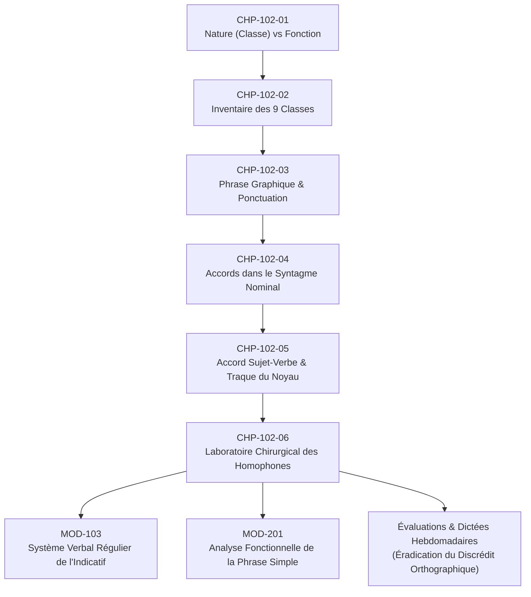
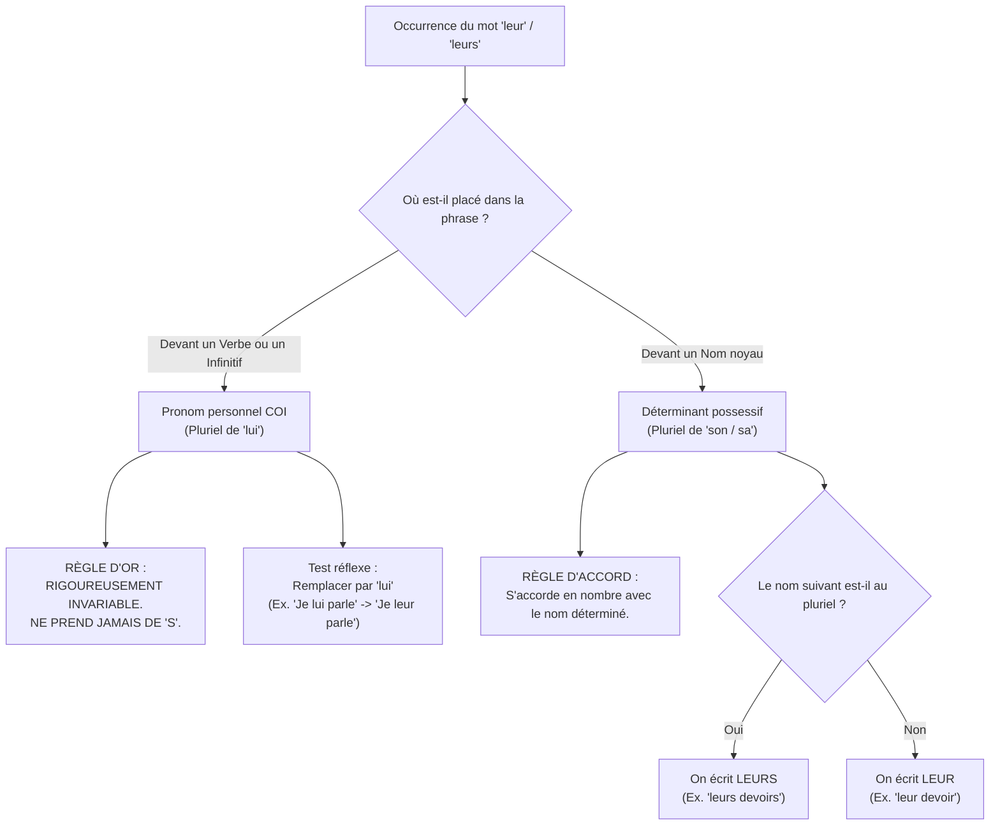

# Chapitre 6 — Laboratoire Chirurgical des Homophones Grammaticaux : Tests de Substitution et Éradication des Confusions

> **Identifiant du chapitre** : `CHP-102-06`  
> **Module de rattachement** : [`MOD-102` — Morphologie des Parties du Discours, Ponctuation Terminale et Mécanique des Accords Fondamentaux](file:///f:/Formation/world-class-french/03-curriculum/year-1/semester-1/mod-102-classes-mots-accords-fondamentaux.md)  
> **Semestre** : Année 1 — Semestre 1 (S1)  
> **Volume horaire estimé** : 5 à 6 heures d'apprentissage autonome délibéré et d'ateliers d'application (Phase 1 — Étude théorique et modélisation chirurgicale : 1 h 30 | Phase 2 — Pratique délibérée et exercices progressifs : 1 h 30 | Phase 3 — Correction critique et production réelle : 1 h 00 | Phase 4 — Ancrage mnésique et évaluation sommative : 1 h 00)  
> **Statut du document** : [STATUT : VALIDÉ]  
> **Compétence visée** : [`FR-ORTHO-001`](file:///f:/Formation/world-class-french/02-competency-framework/competency-framework.md#fr-ortho-001-maîtrise-de-lorthographe-lexicale-et-flexionnelle) (Palier cible : **L3 — Autonomie**) en articulation avec [`FR-ORTHO-002`](file:///f:/Formation/world-class-french/02-competency-framework/competency-framework.md#fr-ortho-002-mécanique-infaillible-de-laccord-sujet-verbe) et [`FR-INT-001`](file:///f:/Formation/world-class-french/02-competency-framework/competency-framework.md#fr-int-001-rédaction-dun-texte-long-cohérent-avec-maîtrise-des-accords-et-de-la-ponctuation)  
> **Sources de référence majeures** :  
> - Maurice Grevisse, *Le Petit Grevisse : Grammaire française*, 32e éd., § 34-40 [`SRC-GRAM-05`](file:///f:/Formation/world-class-french/07-resources/source-registry.md#1-grammaires-et-traités-de-référence-norme-et-description)  
> - Maurice Grevisse & André Goosse, *Le Bon Usage*, 16e éd., § 672, § 437, § 68 [`SRC-GRAM-01`](file:///f:/Formation/world-class-french/07-resources/source-registry.md#1-grammaires-et-traités-de-référence-norme-et-description)  
> - Martin Riegel, Jean-Christophe Pellat & René Rioul, *Grammaire méthodique du français*, chap. 4 et chap. 6 [`SRC-GRAM-02`](file:///f:/Formation/world-class-french/07-resources/source-registry.md#1-grammaires-et-traités-de-référence-norme-et-description)  
> - Nina Catach, *L'orthographe française : traité théorique et pratique* [`SRC-ORTHO-01`](file:///f:/Formation/world-class-french/07-resources/source-registry.md#6-orthographe-graphématique-et-typographie)  
> - Ministère de l'Éducation nationale, *Terminologie grammaticale*, 2020 [`SRC-NORM-03`](file:///f:/Formation/world-class-french/07-resources/source-registry.md#4-cadres-didactiques-et-normatifs-officiels)

---

## 1. Titre et Place dans le Cursus

Le présent chapitre s'intitule : **Laboratoire Chirurgical des Homophones Grammaticaux : Tests de Substitution et Éradication des Confusions** (Code : `CHP-102-06`).

Au sein du module [`MOD-102`](file:///f:/Formation/world-class-french/03-curriculum/year-1/semester-1/mod-102-classes-mots-accords-fondamentaux.md), ce chapitre constitue la clé de voûte et le laboratoire terminal d'application :



### Raccordement architectural amont et aval
- **En amont** : Ce chapitre mobilise l'ensemble des acquis morphologiques construits du chapitre 1 au chapitre 5 :
  - La distinction entre classe grammaticale intrinsèque et fonction syntaxique (`CHP-102-01`) ;
  - La catégorisation formelle des verbes, déterminants possessifs/démonstratifs, pronoms personnels/réfléchis, prépositions et conjonctions (`CHP-102-02`) ;
  - La chaîne d'accord du syntagme nominal (`CHP-102-04`) et l'accord du verbe avec son sujet réel (`CHP-102-05`).
- **En aval** : Il conditionne l'accès aux modules de conjugaison approfondie ([`MOD-103`](file:///f:/Formation/world-class-french/03-curriculum/year-1/semester-1/mod-103-systeme-verbal-indicatif.md)), de syntaxe fonctionnelle ([`MOD-201`](file:///f:/Formation/world-class-french/03-curriculum/year-1/semester-2/mod-201-syntaxe-fonctionnelle-phrase-simple.md)) et de morphosyntaxe du participe passé ([`MOD-202`](file:///f:/Formation/world-class-french/03-curriculum/year-1/semester-2/mod-202-participe-passe-avoir-ponctuation-interne.md)).
- **Rôle socioprofessionnel** : Il garantit une étanchéité orthographique absolue face aux confusions homophoniques élémentaires, éliminant tout risque de discrédit social ou universitaire.

---

## 2. Objectifs Mesurables

Au terme de ce chapitre, l'apprenant doit être capable de :
1. **Identifier et classifier** sans ambiguïté la nature grammaticale intrinsèque de chacune des 7 paires et familles majeures d'homophones en contexte phrastique [Réf. SRC-GRAM-02, chap. 4].
2. **Appliquer de manière réflexe** les tests formels de substitution paradigmatique (*ou bien*, *mon*, *ceci*) et de commutation temporelle (*avait*, *était*, *étaient*, *s'était*) pour trancher instantanément entre deux graphies homophones concurrentes [Réf. SRC-GRAM-05, § 34-40].
3. **Formuler par écrit** la justification linguistique formelle de chaque graphie choisie (catégorie syntaxique, fonction ou accord) dans le cadre d'un audit de texte [Réf. SRC-NORM-03].
4. **Détecter, réfuter et corriger** avec un taux d'exactitude de 100 % les confusions homophoniques dans des documents académiques ou professionnels complexes de 300 mots [Réf. FR-ORTHO-001, Palier L3].

---

## 3. Prérequis et Test de Préparation

### 3.1 Prérequis indispensables
- **Distinction classe vs fonction** (`CHP-102-01`) : savoir qu'un mot a une identité morphologique stable (nature) et un rôle relationnel en contexte (fonction).
- **Inventaire des classes grammaticales** (`CHP-102-02`) : reconnaître un nom, un verbe, un déterminant possessif ou démonstratif, un pronom personnel ou réfléchi, une préposition et une conjonction de coordination.
- **Mécanique de l'accord sujet-verbe** (`CHP-102-05`) : identifier le donneur d'accord pour conjuguer correctement les formes verbales simples.

### 3.2 Auto-diagnostic de préparation immédiat
Répondez aux 5 questions suivantes avant d'aborder le chapitre :

1. Dans la phrase *« Le navire accoste au port »*, quelle est la classe grammaticale précise du mot *accoste* et quel test morphologique simple prouve qu'il ne s'agit pas d'un nom ?
2. Quelle est la différence fondamentale entre une classe grammaticale variable et une classe grammaticale invariable ? Citez deux exemples de chaque catégorie.
3. Pourquoi le mot *mon* dans *« mon bureau »* est-il classé comme déterminant possessif et non comme pronom ?
4. Dans *« Il parle à son collègue »*, le mot *à* peut-il être transposé à l'imparfait (*avait*) sans détruire la syntaxe de la phrase ? Que déduisez-vous de sa nature ?
5. Dans *« Ils mangent une mangue »*, quel constituant est le donneur d'accord du verbe *mangent* ?

<details>
<summary>Corrigé du test de préparation</summary>

1. *Accoste* est un **verbe** conjugué au présent de l'indicatif (3e personne du singulier). Le test morphologique de la commutation temporelle le prouve : on peut transposer au passé (*« Le navire accostait au port »*), ce qui est la propriété exclusive des verbes.
2. Une **classe variable** change de forme selon le genre, le nombre ou la personne (*le verbe, le nom, l'adjectif, le déterminant, le pronom*). Une **classe invariable** conserve toujours la même orthographe quel que soit le contexte (*la préposition, la conjonction, l'adverbe, l'interjection*).
3. *Mon* est un **déterminant possessif** car il est placé immédiatement devant un nom noyau (*bureau*) qu'il actualise dans le syntagme nominal ; il ne remplace aucun groupe nominal, contrairement à un pronom (*le mien*).
4. Non, *\*« Il parle avait son collègue »* est rigoureusement agrammaticale. Le mot *à* est donc une **préposition invariable** introduisant un complément d'objet indirect, et non la forme verbale du verbe *avoir*.
5. Le donneur d'accord est le pronom personnel sujet **Ils** (3e personne du pluriel), qui transmet ses traits de nombre et de personne à la désinence verbale *-ent*.
</details>

---

## 4. Situation de Départ ou Problème Concret

Dans la sphère professionnelle, académique et administrative, les erreurs portant sur les homophones grammaticaux élémentaires (*a/à, son/sont, et/est, ce/se, leur/leurs*) produisent un **discrédit social immédiat et irrémédiable**.

Considérons ces extraits authentiques tirés de correspondances professionnelles :
- *\*« Nous leurs avons envoyé le rapport à temps. »*
- *\*« La direction c'est réunie ce matin pour valider le budget. »*
- *\*« Ces son premier jour dans l'entreprise. »*
- *\*« Le candidat à confirmé son intérêt pour le poste. »*

Pour un recruteur, un jury de concours universitaire ou un partenaire commercial, de telles graphies déclenchent un réflexe de rejet instinctif : l'émetteur est immédiatement catalogué comme négligent, dépourvu de rigueur logique et inapte à rédiger des documents engageant l'institution.

### Pourquoi les correcteurs automatiques et les intelligences artificielles échouent-ils souvent ?
La majorité des outils d'aide à la rédaction reposent sur des dictionnaires lexicaux ou des modèles probabilistes :
1. Les mots *a*, *à*, *son*, *sont*, *ce*, *se*, *leur*, *leurs* existent tous dans le dictionnaire français : aucune alerte de mot inconnu n'est donc levée.
2. Dès qu'une phrase devient syntaxiquement complexe (présence d'incises, de compléments intercalés, d'inversions ou de propositions subordonnées), les analyseurs statistiques s'égarent et valident fréquemment des formes aberrantes (*« La décision qui leurs incombe »* n'est souvent pas détectée par les correcteurs basiques).
3. L'humain formé ne doit dépendre d'aucun algorithme : il dispose d'un outillage d'analyse chirurgicale infaillible, fondé sur des **tests de substitution formels**.

---

## 5. Explication Intuitive : L'Analogie des Sosies et du Contrôle d'Identité

Imaginons la langue française comme un aéroport international où circulent des millions de mots.

À l'oreille, les homophones sont de **parfaits sosies physiques** :
- /a/ (*a* et *à*)
- /u/ (*ou* et *où*)
- /e/ ou /ɛ/ (*et* et *est*)
- /sɔ̃/ (*son* et *sont*)
- /sə/ (*ce* et *se*)
- /se/ (*ces*, *ses*, *c'est*, *s'est*)
- /lœʁ/ (*leur* et *leurs*)

Sur le plan purement acoustique, ils partagent la même voix, la même hauteur et la même empreinte sonore. Si l'on ne se fiait qu'à l'oreille, il serait rigoureusement impossible de les départager.

Cependant, au **poste de contrôle de l'écriture**, l'officier de police syntaxique (le scripteur) ne se contente pas de regarder le visage du mot : il exige ses **papiers d'identité officiels** (sa classe grammaticale).
- Si le voyageur déclare être un **Verbe** (*a, est, sont*), l'officier lui fait passer le **test de la machine à voyager dans le temps** : *« Pouvez-vous voyager vers le passé et devenir avait, était, étaient ? »* S'il y parvient sans détruire le sens de la phrase, son identité de verbe est certifiée conforme.
- S'il s'agit d'un **Déterminant possessif** (*son, ses, leur*), il doit prouver son statut en se faisant remplacer par un collègue de même rang (*mon, mes, leur*).
- S'il s'agit d'un **Pronom personnel invariable** (*leur*), il prouve son identité en se remplaçant par son équivalent singulier (*lui*), qui refuse catégoriquement toute marque de pluriel.

Le test de substitution linguistique est le test ADN irréfutable : il démasque le sosie en une fraction de seconde.

---

## 6. Définitions Précises et Terminologie

Dans le strict respect de la linguistique française et de la terminologie officielle [Réf. SRC-GRAM-01, SRC-GRAM-02, SRC-NORM-03], les concepts opératoires sont définis comme suit :

- **Homophones** : Unités linguistiques qui possèdent une prononciation rigoureusement identique mais dont le sens et la graphie diffèrent [Réf. SRC-GRAM-02, chap. 2]. Ex. : *vert*, *verre*, *vers*, *ver* (/vɛʁ/).
- **Homographes** : Unités linguistiques qui partagent la même forme écrite mais diffèrent par le sens et parfois par la prononciation. Ex. : *les poules du couvent* (/ku.vɑ̃/) *couvent* (/kuv/).
- **Homonymes** : Terme générique englobant les unités qui sont homophones, homographes, ou les deux à la fois.
- **Homophones grammaticaux (ou morphosyntaxiques)** : Mots de même prononciation appartenant à des classes grammaticales distinctes (outils grammaticaux, formes verbales fléchies, pronoms, déterminants), dont la discrimination orthographique dépend exclusivement de l'analyse syntaxique en contexte [Réf. SRC-GRAM-05, § 34].
- **Test de substitution paradigmatique** : Opération linguistique fondamentale consistant à remplacer une unité au sein d'un énoncé par une autre unité de même classe grammaticale pour vérifier la structure de la phrase sans en altérer la grammaticalité [Réf. SRC-GRAM-02, chap. 4].
- **Commutation temporelle** : Procédure de variation flexionnelle consistant à transposer l'énoncé du présent de l'indicatif à un temps du passé (généralement l'imparfait de l'indicatif). Si le mot varie (*a $\rightarrow$ avait*, *est $\rightarrow$ était*, *sont $\rightarrow$ étaient*), sa nature de verbe est formellement établie.

---

## 7. Règles ou Mécanismes Fondamentaux : Les 7 Familles Majeures

### 7.1 La famille *a / à*

#### 1. Le mot *a* (sans accent) : Forme verbale
- **Classe grammaticale** : Verbe ou auxiliaire *avoir* conjugué au présent de l'indicatif (3e personne du singulier).
- **Test de substitution infaillible** : Commutation temporelle à l'imparfait $\rightarrow$ **avait**.
- **Mécanisme** : Si la transposition par *avait* produit une phrase parfaitement correcte, il s'agit du verbe. On écrit **a** sans accent.
  - *Exemple* : *« L'avocat a défendu son client. »* $\rightarrow$ *« L'avocat **avait** défendu son client. »* (Valide $\rightarrow$ verbe **a**).

#### 2. Le mot *à* (avec accent grave) : Préposition
- **Classe grammaticale** : Préposition invariable introduisant un complément (lieu, temps, attribution, moyen).
- **Test de substitution infaillible** : L'imparfait *avait* est **impossible** (*\*avait* rend la phrase absurde).
- **Mécanisme** : Si le mot ne peut être remplacé par *avait*, il s'agit de la préposition invariable. On écrit obligatoirement **à** avec un accent grave.
  - *Exemple* : *« Il habite à Cotonou. »* $\rightarrow$ *\*« Il habite **avait** Cotonou »* (Agrammatical $\rightarrow$ préposition **à**).

---

### 7.2 La famille *ou / où*

#### 1. Le mot *ou* (sans accent) : Conjonction de coordination
- **Classe grammaticale** : Conjonction de coordination marquant une disjonction, un choix ou une alternative.
- **Test de substitution infaillible** : Remplacement paradigmatique par **ou bien**.
- **Mécanisme** : Si l'insertion de *ou bien* préserve la syntaxe et le sens disjonctif, on écrit **ou** sans accent.
  - *Exemple* : *« Préférez-vous le train ou l'avion ? »* $\rightarrow$ *« Préférez-vous le train **ou bien** l'avion ? »* (Valide $\rightarrow$ conjonction **ou**).

#### 2. Le mot *où* (avec accent grave) : Pronom relatif ou adverbe
- **Classe grammaticale** : Pronom relatif (marquant le lieu où le moment, introduisant une proposition subordonnée relative) ou adverbe interrogatif de lieu.
- **Test de substitution infaillible** : Remplacement par **dans lequel**, **à quel endroit** ou **au moment où** ; le remplacement par *ou bien* est **rigoureusement impossible**.
- **Mécanisme** : Il renvoie toujours à une localisation spatiale ou à une référence temporelle. On écrit obligatoirement **où** avec un accent grave.
  - *Exemple* : *« La maison où il a grandi. »* $\rightarrow$ *« La maison **dans laquelle** il a grandi. »* (Valide $\rightarrow$ pronom relatif **où**).

---

### 7.3 La famille *et / est*

#### 1. Le mot *est* : Forme verbale
- **Classe grammaticale** : Verbe ou auxiliaire *être* conjugué au présent de l'indicatif (3e personne du singulier).
- **Test de substitution infaillible** : Commutation temporelle à l'imparfait $\rightarrow$ **était**.
- **Mécanisme** : Si la forme peut être remplacée par *était*, il s'agit du verbe *être*. On écrit **est**.
  - *Exemple* : *« Le document est prêt. »* $\rightarrow$ *« Le document **était** prêt. »* (Valide $\rightarrow$ verbe **est**).

#### 2. Le mot *et* : Conjonction de coordination
- **Classe grammaticale** : Conjonction de coordination marquant la liaison, l'addition ou la succession chronologique.
- **Test de substitution infaillible** : Remplacement paradigmatique par **et puis** ou **ainsi que**.
- **Mécanisme** : L'imparfait *était* est rigoureusement impossible. On écrit **et**.
  - *Exemple* : *« La rigueur et la méthode. »* $\rightarrow$ *« La rigueur **et puis** la méthode »* ou *« La rigueur **ainsi que** la méthode »*. (Valide $\rightarrow$ conjonction **et**).

---

### 7.4 La famille *son / sont*

#### 1. Le mot *sont* : Forme verbale
- **Classe grammaticale** : Verbe ou auxiliaire *être* conjugué au présent de l'indicatif (3e personne du pluriel).
- **Test de substitution infaillible** : Commutation temporelle à l'imparfait $\rightarrow$ **étaient**.
- **Mécanisme** : Si l'on peut transposer par *étaient*, il s'agit du verbe. On écrit **sont**.
  - *Exemple* : *« Les candidats sont admis. »* $\rightarrow$ *« Les candidats **étaient** admis. »* (Valide $\rightarrow$ verbe **sont**).

#### 2. Le mot *son* : Déterminant possessif
- **Classe grammaticale** : Déterminant possessif masculin singulier (actualisateur d'un nom noyau masculin ou d'un nom féminin commençant par une voyelle).
- **Test de substitution infaillible** : Remplacement paradigmatique par un autre possessif singulier $\rightarrow$ **mon** ou **ton** (ou par l'article défini *le*).
- **Mécanisme** : L'imparfait *étaient* est impossible. On écrit **son**.
  - *Exemple* : *« Il consulte son avocat. »* $\rightarrow$ *« Il consulte **mon** avocat. »* (Valide $\rightarrow$ déterminant possessif **son**).

---

### 7.5 La famille *ce / se*

#### 1. Le mot *se* (avec *s*) : Pronom réfléchi verbal
- **Classe grammaticale** : Pronom personnel réfléchi (ou réciproque) de la 3e personne, placé immédiatement devant une forme verbale pronominale (finie ou infinitive).
- **Test de substitution infaillible** : Variation de la personne du sujet $\rightarrow$ remplacement par **me** ou **te** (*je me*, *tu te*).
- **Mécanisme** : Placé devant un verbe pronominal, il s'accorde en personne avec le sujet. On écrit **se**.
  - *Exemple* : *« Le magistrat se prépare. »* $\rightarrow$ *« Je **me** prépare / Tu **te** prépares. »* (Valide $\rightarrow$ pronom réfléchi **se**).

#### 2. Le mot *ce* (avec *c*) : Déterminant ou pronom démonstratif
- **Classe grammaticale** :
  - Soit **déterminant démonstratif** masculin singulier placé devant un nom : test du féminin $\rightarrow$ **cette** ou pluriel $\rightarrow$ **ces**.
  - Soit **pronom démonstratif neutre** placé devant le verbe être ou devant un pronom relatif (*ce qui*, *ce que*) : test de substitution $\rightarrow$ **ceci** ou **cela**.
- **Mécanisme** : La variation par *me* ou *te* est impossible (*\*je me projet*, *\*tu te sera*). On écrit **ce**.
  - *Exemple 1* : *« Ce rapport est limpide. »* $\rightarrow$ *« **Cette** note est limpide. »* (Déterminant **ce**).
  - *Exemple 2* : *« Ce sera magnifique. »* $\rightarrow$ *« **Cela** sera magnifique. »* (Pronom neutre **ce**).

---

### 7.6 La constellation *ces / ses / c'est / s'est*

Cette famille à 4 branches constitue la source la plus fréquente de confusion chez les scripteurs inexpérimentés.

#### 1. Le mot *ces* : Déterminant démonstratif pluriel
- **Nature** : Déterminant démonstratif pluriel (pluriel de *ce*, *cet*, *cette*).
- **Test infaillible** : Mettre au singulier $\rightarrow$ **ce**, **cet** ou **cette** (valeur de désignation, on montre les objets du doigt ou on les a déjà mentionnés).
  - *Exemple* : *« Examinez ces dossiers. »* $\rightarrow$ *« Examinez **ce** dossier / **cette** chemise. »*

#### 2. Le mot *ses* : Déterminant possessif pluriel
- **Nature** : Déterminant possessif pluriel (pluriel de *son*, *sa*).
- **Test infaillible** : Mettre au singulier $\rightarrow$ **son** ou **sa** ; substitution par un autre possessif $\rightarrow$ **mes**, **tes** ou **les siens**.
  - *Exemple* : *« L'auteur relit ses textes. »* $\rightarrow$ *« L'auteur relit **son** texte / **ses propres** textes. »*

#### 3. Le mot *c'est* : Présentatif démonstratif neutre
- **Nature** : Pronom démonstratif neutre élidé *c'* + verbe *être* conjugué à la 3e personne du singulier (*est*).
- **Test infaillible** : Remplacement par **ceci est** ou commutation temporelle à l'imparfait $\rightarrow$ **c'était**.
  - *Exemple* : *« C'est une excellente initiative. »* $\rightarrow$ *« **C'était** une excellente initiative »* / *« **Ceci est** une excellente initiative. »*

#### 4. Le mot *s'est* : Pronom réfléchi + auxiliaire *être*
- **Nature** : Pronom personnel réfléchi élidé *s'* + auxiliaire *être* au passé composé d'un verbe pronominal.
- **Test infaillible** : Changer de personne $\rightarrow$ **je me suis**, **tu t'es** ; ou commutation à l'imparfait $\rightarrow$ **s'était**.
  - *Exemple* : *« L'ingénieur s'est trompé. »* $\rightarrow$ *« Je **me suis** trompé »* / *« L'ingénieur **s'était** trompé. »*

---

### 7.7 La dualité critique *leur / leurs*

La confusion sur le mot *leur* est sévèrement sanctionnée dans tous les concours académiques et administratifs [Réf. SRC-GRAM-01, § 672].



#### 1. *Leur* pronom personnel complément d'objet indirect (COI)
- **Classe grammaticale** : Pronom personnel COI de 3e personne du pluriel (forme conjointe plurielle de *lui*).
- **Position syntaxique** : Placé immédiatement **devant un verbe** ou un infinitif (sauf à l'impératif affirmatif où il est postposé : *« donnez-leur »*).
- **Règle absolue** : **RIGOUREUSEMENT ET ÉTERNELLEMENT INVARIABLE**. Il ne prend **JAMAIS** de *s*.
- **Test de substitution infaillible** : Remplacer par le singulier **lui**.
  - *Exemple* : *« Je leur parle de ce projet. »* $\rightarrow$ *« Je **lui** parle de ce projet. »* (Forme singulière valide $\rightarrow$ **leur** invariable, sans *s*).
  - *Exemple avec auxiliaire* : *« Nous leur avons transmis le dossier. »* $\rightarrow$ *« Nous **lui** avons transmis le dossier. »* (Forme singulière valide $\rightarrow$ **leur** sans *s*, proscrire absolument *\*leurs avons*).

#### 2. *Leur / leurs* déterminant possessif
- **Classe grammaticale** : Déterminant possessif accompagnant un nom noyau.
- **Position syntaxique** : Placé immédiatement **devant un nom** (ou précédant un adjectif épithète antéposé au nom).
- **Règle d'accord** : Il s'accorde en nombre avec le nom qu'il détermine.
  - Si le nom est au singulier : **leur** (sans *s*). Test : remplaçable par *son* ou *sa*.
    - *Exemple* : *« Les élèves ont rendu leur devoir. »* $\rightarrow$ *« [...] rendu **son** devoir. »*
  - Si le nom est au pluriel : **leurs** (avec un *s*). Test : remplaçable par *ses*.
    - *Exemple* : *« Les élèves ont rendu leurs devoirs. »* $\rightarrow$ *« [...] rendu **ses** devoirs. »*

---

## 8. Raisonnement Détaillé : L'Origine Historique et la Logique de la Langue

Pourquoi la langue française contemporaine concentre-t-elle une telle densité d'homophones grammaticaux ? Cette singularité s'explique par deux forces historiques convergentes :

### 1. L'usure phonétique des désinences latines (la phonétique historique)
Au cours du passage du latin classique au gallo-roman puis à l'ancien français, les consonnes finales se sont progressivement amuïes (affaiblies jusqu'à disparaître de la prononciation) [Réf. SRC-GRAM-02, chap. 2] :
- La 3e personne du verbe *habet* a perdu sa consonne dentale *-t* et sa consonne aspirée initiale *h-*, aboutissant au phonème vocalique unique **/a/**.
- La préposition latine *ad* a perdu son *-d* final, aboutissant également au phonème **/a/**.
- De même, *est* (/ɛst/ $\rightarrow$ /ɛ/) et la conjonction *et* (/et/ $\rightarrow$ /e/) ont vu leurs consonnes finales s'amuïr, convergeant vers des voyelles moyennes antérieures très proches.
- Le pronom latin *illi* (datif pluriel vulgaire) et le déterminant génitif *illorum* ont tous deux évolué phonétiquement vers **/lœʁ/**.

### 2. La conservation orthographique discriminante (la fonction logographique)
Face à cette convergence acoustique qui aurait pu noyer le texte écrit dans l'amphibologie (l'ambiguïté de sens), les grammairiens humanistes du XVIe siècle et l'Académie française au XVIIe siècle ont fait un choix délibéré : **maintenir ou introduire des distinctions graphiques visibles sans changer la prononciation** [Réf. SRC-ORTHO-01].
- L'accent grave a été posé sur la préposition *à* et sur l'adverbe *où* pour créer une discrimination visuelle immédiate par rapport au verbe *a* et à la conjonction *ou*.
- Le pronom *leur* a conservé son invariabilité morphologique héritée du pronom personnel datif (*lui/leur* ne prennent pas de marque de flexion nominale), tandis que le possessif *leur/leurs* a logiquement reçu la marque plurielle *-s* du syntagme nominal.

L'orthographe française n'est donc pas une simple transcription sonore ; elle est un **système sémiotique autonome** où chaque lettre et chaque accent porte une fonction syntaxique précise.

---

## 9. Exemples Corrects Commentés

Examinons deux énoncés modèles condensant plusieurs homophones et analysons la validation chirurgicale de chaque terme :

### Exemple 1 : Analyse d'un énoncé complexe en contexte professionnel
Considérons l'énoncé suivant :
> *« Le chef de service a rappelé à ses agents que c'est à eux de vérifier son rapport, et il leur demande si ces données sont fiables ou incomplètes. »*

Décortiquons méthodiquement chacun des 11 homophones résolus :
1. **a** (*a rappelé*) : Remplaçable par *avait rappelé* $\rightarrow$ verbe *avoir*, forme verbale sans accent.
2. **à** (*à ses agents*) : Remplacement par *avait* impossible (*\*avait ses agents*) $\rightarrow$ préposition invariable, accent grave obligatoire.
3. **ses** (*ses agents*) : Pluriel de *son agent*, remplaçable par *les siens* $\rightarrow$ déterminant possessif pluriel avec *s*.
4. **c'est** (*c'est à eux*) : Remplaçable par *c'était à eux* / *ceci est à eux* $\rightarrow$ présentatif neutre *c'* + *est*.
5. **à** (*à eux*) : Remplacement par *avait* impossible $\rightarrow$ préposition avec accent grave.
6. **son** (*son rapport*) : Remplaçable par *mon rapport* $\rightarrow$ déterminant possessif singulier avec *n*.
7. **et** (*et il leur demande*) : Remplaçable par *et puis il* $\rightarrow$ conjonction de coordination d'addition.
8. **leur** (*leur demande*) : Placé immédiatement devant le verbe *demande*, remplaçable par le singulier *lui demande* $\rightarrow$ pronom personnel COI, rigoureusement invariable, sans *s*.
9. **ces** (*ces données*) : Pluriel démonstratif de *cette donnée*, désigne les données mentionnées $\rightarrow$ déterminant démonstratif pluriel avec *c*.
10. **sont** (*sont fiables*) : Remplaçable par l'imparfait *étaient fiables* $\rightarrow$ verbe *être* (3e personne du pluriel) avec *t*.
11. **ou** (*fiables ou incomplètes*) : Remplaçable par *ou bien incomplètes* $\rightarrow$ conjonction de coordination de choix, sans accent.

### Exemple 2 : Analyse d'un énoncé académique narratif
Considérons cet énoncé :
> *« L'étudiant s'est rendu à la bibliothèque où leurs professeurs leur avaient conseillé de travailler. »*

1. **s'est** (*s'est rendu*) : Remplaçable par *s'était rendu* ou *je me suis rendu* $\rightarrow$ pronom réfléchi élidé *s'* + verbe *être*.
2. **à** (*à la bibliothèque*) : Préposition de lieu, non remplaçable par *avait* $\rightarrow$ préposition avec accent grave.
3. **où** (*où leurs professeurs*) : Pronom relatif marquant le lieu, remplaçable par *dans laquelle* $\rightarrow$ pronom relatif portant l'accent grave.
4. **leurs** (*leurs professeurs*) : Placé devant le nom pluriel *professeurs*, remplaçable par *ses professeurs* $\rightarrow$ déterminant possessif pluriel avec *s*.
5. **leur** (*leur avaient conseillé*) : Placé devant la forme verbale *avaient conseillé*, remplaçable par *lui avaient conseillé* $\rightarrow$ pronom personnel COI invariable, strictement sans *s*.

---

## 10. Contre-Exemples et Erreurs Fréquentes : Typologie Clinique

L'observation des copies universitaires et des écrits professionnels met en lumière 4 pathologies récurrentes sévères qu'il convient de déconstruire :

### Pathologie n° 1 : L'adjonction fautive d'un *s* au pronom personnel *leur*
- **Forme fautive** : *\*« Les directeurs leurs ont accordé une audience. »*
- **Diagnostic de la faille cognitive** : L'apprenant voit que le sujet *Les directeurs* est au pluriel, ou pense aux multiples personnes qui reçoivent l'audience ; il procède à un accord d'attraction phonétique au pluriel sur le pronom.
- **Réfutation scientifique** : Placé devant le verbe *ont accordé*, *leur* n'est pas un adjectif ou un nom : c'est le pronom personnel conjoint de 3e personne du pluriel. En français, les pronoms personnels compléments (*nous, vous, lui, leur*) possèdent un paradigme clos qui n'admet jamais de marque de flexion nominale.
- **Protocole de rectification** : Appliquer le test du singulier *lui* : *« Les directeurs **lui** ont accordé... »* $\rightarrow$ écrire obligatoirement **leur** sans *s* : *« Les directeurs **leur** ont accordé une audience. »* [Réf. SRC-GRAM-01, § 672].

### Pathologie n° 2 : La confusion entre présentatif et forme pronominale (*c'est* vs *s'est*)
- **Forme fautive** : *\*« On c'est trompé d'itinéraire. »* ou *\*« Il c'est aperçu de l'erreur. »*
- **Diagnostic de la faille cognitive** : L'apprenant entend le phonème /se/ devant un participe passé et écrit le présentatif le plus fréquent à l'écrit (*c'est*).
- **Réfutation scientifique** : Le verbe employé est un verbe pronominal (*se tromper*, *s'apercevoir*). Au passé composé, la forme exige le pronom personnel réfléchi *se* (qui s'élide en *s'*) conjugué avec l'auxiliaire être. *C'est* signifierait *\*ceci est trompé*, ce qui est agrammatical.
- **Protocole de rectification** : Transposer à la 1re personne du singulier : *« Je **me suis** trompé »* $\rightarrow$ la forme correspondante à la 3e personne est **s'est** (*« On **s'est** trompé »*, *« Il **s'est** aperçu »*).

### Pathologie n° 3 : L'emploi de *ces* à la place de *c'est*
- **Forme fautive** : *\*« Ces son choix et nous devons le respecter. »*
- **Diagnostic de la faille cognitive** : Confusion acoustique totale entre le déterminant pluriel *ces* et le présentatif *c'est*.
- **Réfutation scientifique** : Le mot est suivi du singulier *son choix*. *Ces* est un déterminant pluriel qui ne peut en aucun cas déterminer un syntagme singulier (*\*ces son* juxtapose absurdement deux déterminants incompatibles). La phrase nécessite un sujet et un verbe pour constituer une proposition indépendante.
- **Protocole de rectification** : Remplacer par *c'était* : *« **C'était** son choix »* $\rightarrow$ écrire impérativement **C'est** (*« **C'est** son choix et nous devons le respecter. »*).

### Pathologie n° 4 : La confusion de l'accent sur *a / à* en contexte expressif
- **Forme fautive** : *\*« Il a faim à mourir »* écrit *\*« Il à faim a mourir »*.
- **Diagnostic de la faille cognitive** : L'apprenant inverse mécaniquement les deux occurrences par précipitation graphique.
- **Réfutation scientifique** : Dans le premier créneau, nous avons le verbe conjugué (le sujet *Il* exige son verbe : *avait faim*). Dans le second créneau, nous avons une préposition introduisant une locution infinitive consécutive (non remplaçable par *avait*).
- **Protocole de rectification** : Appliquer systématiquement le test *avait* séparément sur chaque occurrence :
  - *Il [avait] faim* $\rightarrow$ valide $\rightarrow$ **a** (sans accent).
  - *[avait] mourir* $\rightarrow$ impossible $\rightarrow$ **à** (avec accent).
  - Forme correcte : *« Il **a** faim **à** mourir. »*

---

## 11. Cas Particuliers et Limites du Système

### 11.1 La distinction *l'on* euphonique vs *l'ont* forme verbale
- **Le tour *l'on*** : Il s'agit du pronom indéfini sujet *on* précédé de l'article défini élidé *l'*, employé par tradition classique pour éviter le hiatus vocalique (choc de deux voyelles) ou la rencontre de sons désagréables, particulièrement après *et*, *ou*, *où*, *si*, *que*, *qui*, *quoi* (*« et l'on voit »*, *« si l'on veut »*) [Réf. SRC-GRAM-01, § 68].
  - **Test** : On peut supprimer le *l'* ou le remplacer par *on* seul sans modifier la syntaxe : *« si l'on veut »* $\rightarrow$ *« si on veut »*.
- **La forme *l'ont*** : Il s'agit du pronom personnel complément d'objet direct élidé *l'* suivi du verbe ou auxiliaire *avoir* à la 3e personne du pluriel (*ont*).
  - **Test** : Commutation temporelle à l'imparfait $\rightarrow$ **l'avaient**.
  - *Exemple* : *« Les juges l'ont condamné. »* $\rightarrow$ *« Les juges **l'avaient** condamné. »* (Verbe *avoir* $\rightarrow$ écrire **l'ont** avec un *t*).

### 11.2 Le contraste *on* pronom vs *ont* verbe
- **on** (sans *t*) : Pronom personnel indéfini sujet (3e personne du singulier). Remplaçable par **il** ou **quelqu'un**.
  - *Exemple* : *« On prend la parole. »* $\rightarrow$ *« **Il** prend la parole. »*
- **ont** (avec *t*) : Verbe ou auxiliaire *avoir* au présent (3e personne du pluriel). Remplaçable par l'imparfait **avaient**.
  - *Exemple* : *« Ils ont pris la parole. »* $\rightarrow$ *« Ils **avaient** pris la parole. »*

### 11.3 En perspective : *quel(s)/quelle(s)* vs *qu'elle(s)*
Bien que ce couple appartienne au programme de morphosyntaxe pronominale avancée ([`MOD-104`](file:///f:/Formation/world-class-french/03-curriculum/year-1/semester-1/mod-104-lexique-lecture-paragraphe.md)), signalons dès à présent le mécanisme discriminant :
- **quel / quelle / quels / quelles** : Déterminant interrogatif ou exclamatif s'accordant en genre et en nombre avec le nom déterminé (*« Quel courage ! »*, *« Quelles décisions prendrez-vous ? »*).
- **qu'elle / qu'elles** : Pronom relatif ou conjonction de subordination *que* élidé (*qu'*) devant le pronom personnel sujet *elle* ou *elles*. Test : remplaçable par le masculin **qu'il** ou **qu'ils** (*« Je sais **qu'elle** réussira »* $\rightarrow$ *« Je sais **qu'il** réussira »*).

---

## 12. Approfondissement Adapté au Niveau : La Théorie du Logogramme de Nina Catach

Dans son ouvrage fondamental *L'orthographe française : traité théorique et pratique* [Réf. `SRC-ORTHO-01`], la linguiste et philologue Nina Catach a démontré que l'écriture du français ne saurait être réduite à un simple alphabet phonétique imparfait.

Le français fonctionne selon un **plurisystème graphique** composé de trois niveaux de signes :
1. **Les phonogrammes** : lettres transcrivant des sons (comme *p*, *ch*, *ou*).
2. **Les morphogrammes** : lettres indiquant la grammaire et la dérivation lexicale (la marque *-s* du pluriel, le *-t* muet de *chat* rappelant *chaton*).
3. **Les logogrammes (ou signes idéographiques)** : graphies spécialisées qui ont pour fonction unique de **différencier visuellement des unités de sens ou des classes grammaticales sans altérer la prononciation**.

L'accent grave sur la préposition *à* et sur le pronom relatif *où*, l'apostrophe dans *c'est* et *s'est*, ou encore l'opposition graphique *ce/se* et *son/sont* sont de véritables **logogrammes grammaticaux**.

### L'autonomie de la lecture visuelle
À l'oral, l'auditeur est obligé d'attendre la fin de la phrase ou de mobiliser le contexte situationnel pour désambiguïser l'énoncé. À l'écrit, le lecteur expert ne vocalise pas mentalement chaque lettre : il pratique une **lecture idéovisuelle directe**. 
Grâce au logogramme, le cerveau identifie instantanément la nature grammaticale du mot :
- La silhouette graphique `<à>` annonce immédiatement une relation prépositionnelle ;
- La silhouette `<a ont>` alerte immédiatement le cortex sur une impossibilité syntaxique ;
- La silhouette `<leur>` devant verbe identifie instantanément le destinataire indirect d'une action.

Maîtriser les homophones grammaticaux, c'est donc s'approprier le code visuel de la pensée écrite française.

---

## 13. Comparaisons Différentielles : Les 7 Tableaux Synoptiques Infaillibles

Pour chaque couple et famille d'homophones, le tableau suivant synthétise la forme graphique, la classe grammaticale précise, le test de substitution infaillible et l'exemple modèle :

### 1. Synthèse différentielle *a / à*
| Forme | Classe grammaticale | Test de substitution infaillible | Exemple modèle analysé |
| :---: | :--- | :--- | :--- |
| **a** | Verbe / auxiliaire *avoir* (présent, P3) | Transposition à l'imparfait $\rightarrow$ **avait** | *« L'expert **a** validé le rapport. »* $\rightarrow$ *« L'expert **avait** validé le rapport. »* |
| **à** | Préposition invariable | Imparfait impossible ; marque un lien de lieu, temps ou but | *« Il se rend **à** Porto-Novo. »* $\rightarrow$ *\*« Il se rend **avait** Porto-Novo »* (impossible). |

### 2. Synthèse différentielle *ou / où*
| Forme | Classe grammaticale | Test de substitution infaillible | Exemple modèle analysé |
| :---: | :--- | :--- | :--- |
| **ou** | Conjonction de coordination | Remplacement par **ou bien** | *« Choisissez le bleu **ou** le vert. »* $\rightarrow$ *« Choisissez le bleu **ou bien** le vert. »* |
| **où** | Pronom relatif ou adverbe de lieu/temps | Remplacement par **dans lequel**, **à quel endroit** | *« Le bureau **où** je travaille. »* $\rightarrow$ *« Le bureau **dans lequel** je travaille. »* |

### 3. Synthèse différentielle *et / est*
| Forme | Classe grammaticale | Test de substitution infaillible | Exemple modèle analysé |
| :---: | :--- | :--- | :--- |
| **est** | Verbe / auxiliaire *être* (présent, P3) | Transposition à l'imparfait $\rightarrow$ **était** | *« L'analyse **est** rigoureuse. »* $\rightarrow$ *« L'analyse **était** rigoureuse. »* |
| **et** | Conjonction de coordination | Remplacement par **et puis** ou **ainsi que** | *« Clarté **et** concision. »* $\rightarrow$ *« Clarté **ainsi que** concision. »* |

### 4. Synthèse différentielle *son / sont*
| Forme | Classe grammaticale | Test de substitution infaillible | Exemple modèle analysé |
| :---: | :--- | :--- | :--- |
| **sont** | Verbe / auxiliaire *être* (présent, P6) | Transposition à l'imparfait $\rightarrow$ **étaient** | *« Ces critères **sont** retenus. »* $\rightarrow$ *« Ces critères **étaient** retenus. »* |
| **son** | Déterminant possessif singulier | Remplacement par **mon**, **ton** ou **le** | *« Il présente **son** projet. »* $\rightarrow$ *« Il présente **mon** projet. »* |

### 5. Synthèse différentielle *ce / se*
| Forme | Classe grammaticale | Test de substitution infaillible | Exemple modèle analysé |
| :---: | :--- | :--- | :--- |
| **se** | Pronom personnel réfléchi (P3) | Variation de personne $\rightarrow$ **me**, **te** (*je me, tu te*) | *« L'arbitre **se** lève. »* $\rightarrow$ *« Je **me** lève / Tu **te** lèves. »* |
| **ce** | Déterminant démonstratif ou pronom neutre | Devant nom $\rightarrow$ **cette / ces** ; devant verbe $\rightarrow$ **ceci / cela** | *« **Ce** plan est parfait. »* $\rightarrow$ *« **Cette** idée est parfaite. »* |

### 6. Synthèse différentielle *ces / ses / c'est / s'est*
| Forme | Classe grammaticale | Test de substitution infaillible | Exemple modèle analysé |
| :---: | :--- | :--- | :--- |
| **ces** | Déterminant démonstratif pluriel | Mettre au singulier $\rightarrow$ **ce / cet / cette** | *« Regardez **ces** arbres. »* $\rightarrow$ *« Regardez **cet** arbre. »* |
| **ses** | Déterminant possessif pluriel | Mettre au singulier $\rightarrow$ **son / sa** ; ou **les siens** | *« Il range **ses** affaires. »* $\rightarrow$ *« Il range **son** affaire. »* |
| **c'est** | Présentatif démonstratif neutre (*c'* + *est*) | Remplacement par **ceci est** ou **c'était** | *« **C'est** évident. »* $\rightarrow$ *« **C'était** évident. »* |
| **s'est** | Pronom réfléchi élidé + verbe *être* (*s'* + *est*) | Variation de personne $\rightarrow$ **je me suis**, **tu t'es** | *« Il **s'est** aperçu du fait. »* $\rightarrow$ *« Je **me suis** aperçu du fait. »* |

### 7. Synthèse différentielle *leur / leurs*
| Forme | Classe grammaticale | Test de substitution infaillible | Exemple modèle analysé |
| :---: | :--- | :--- | :--- |
| **leur** (invariable) | Pronom personnel COI (pluriel de *lui*) | Placé devant verbe ; remplacer par le singulier **lui** | *« Nous **leur** écrivons. »* $\rightarrow$ *« Nous **lui** écrivons. »* (**Jamais de s**) |
| **leur / leurs** | Déterminant possessif | Placé devant nom ; remplacer par **son / ses** | *« **Leur** maison »* $\rightarrow$ *« **son** village »* ; *« **Leurs** amis »* $\rightarrow$ *« **ses** amis »*. |

---

## 14. Exercices Progressifs (3 Niveaux de Pratique Délibérée)

### Niveau 1 : Discrimination guidée par couple (14 items)
Complétez chaque phrase avec la forme correcte et formulez le test de substitution entre parenthèses :

#### Série 1 : *a / à*
1. Le délégué [...] présenté ses conclusions [...] l'assemblée générale.
2. Tout le monde [...] intérêt [...] respecter les consignes.

#### Série 2 : *ou / où*
3. Indiquez-moi le dossier [...] figure cette clause, [...] prévenez votre supérieur.
4. Partirez-vous en mission lundi [...] mardi prochain, et savez-vous [...] vous logerez ?

#### Série 3 : *et / est*
5. La réunion [...] ajournée [...] le procès-verbal sera signé demain.
6. Le calme [...] la patience : telle [...] la devise du négociateur.

#### Série 4 : *son / sont*
7. Tous les témoins [...] unanimes : le chauffeur conduisait [...] véhicule avec prudence.
8. Les résultats [...] conformes aux prévisions de [...] directeur.

#### Série 5 : *ce / se*
9. En [...] moment précis, le candidat [...] concentre sur l'épreuve.
10. Il faut admettre que [...] qui [...] passe ici est exceptionnel.

#### Série 6 : *ces / ses / c'est / s'est*
11. L'ingénieur [...] trompé en classant [...] dossiers personnels avec [...] pièces d'archives.
12. [...] une décision historique : l'athlète a surpassé tous [...] rivaux lors de [...] épreuves.

#### Série 7 : *leur / leurs*
13. Les formateurs [...] demandent de vérifier [...] notes de synthèse.
14. Vous devez [...] transmettre [...] convocations avant la fin de la semaine.

---

### Niveau 2 : Traque et discrimination dans des phrases mixtes à pièges multiples (10 phrases)
Dans chacune des phrases suivantes, choisissez l'orthographe correcte des mots entre crochets et justifiez chaque choix par le test formel approprié :

1. Les auditeurs [*leur / leurs*] ont accordé [*leur / leurs*] confiance pour mener [*ce / se*] projet.
2. [*C'est / S'est / Ces / Ses*] en observant [*ces / ses*] collaborateurs que le chef d'équipe [*c'est / s'est*] rendu compte de l'urgence.
3. Le professeur [*a / à*] demandé [*a / à*] chacun [*ou / où*] il comptait déposer [*son / sont*] mémoire.
4. [*Ce / Se*] matin, le comité [*c'est / s'est*] réuni pour examiner [*ces / ses / c'est*] nouvelles directives.
5. Les membres du jury [*son / sont*] prêts [*a / à*] délibérer [*et / est*] [*leur / leurs*] avis sera déterminant.
6. [*C'est / S'est*] ici [*ou / où*] le responsable [*a / à*] pris [*ces / ses*] fonctions l'an passé.
7. Ne [*leur / leurs*] dites pas [*ce / se*] que vous avez entendu lors de [*ce / se*] colloque.
8. L'artisan [*a / à*] réparé [*ce / se*] meuble avec [*son / sont*] apprenti [*et / est*] [*ses / ces*] outils personnels.
9. Nous savons [*ou / où*] ils [*son / sont*] allés chercher [*leur / leurs*] fournitures.
10. [*Ces / Ses / C'est*] résultats [*son / sont*] brillants, [*et / est*] le lauréat [*c'est / s'est*] vu décerner une bourse prestigieuse.

---

### Niveau 3 : Dictée d'entraînement étalonnée (80 mots) et justification micro-syntaxique

#### Consigne de la dictée
Écrivez sous la dictée le texte suivant (ou recopiez-le sans omission), puis complétez le tableau d'audit pour chacun des homophones grammaticaux identifiés.

> **Texte étalon de la dictée (80 mots exactement)** :  
> *« Le directeur est à son bureau où ses collaborateurs se réunissent. C'est le moment où chacun présente son projet et ses résultats. Les directeurs leur demandent si ces chiffres sont fiables ou discutables. L'équipe a préparé son rapport avec soin. Ce document se divise en plusieurs volets où leurs propositions sont détaillées. Le responsable leur explique la démarche et s'est engagé à respecter les délais. Chacun sait ce qu'il doit accomplir pour réussir cette mission complexe. »*

*(Protocole de comptage : 80 mots orthographiques, les formes élidées comptant comme deux unités distinctes : c'est = c' + est, l'équipe = l' + équipe, s'est = s' + est, qu'il = qu' + il).*

---

### Corrigés Détaillés et Justifications des Exercices

#### Corrigé du Niveau 1
1. **a** (*avait présenté* $\rightarrow$ verbe) / **à** (*\*avait l'assemblée* impossible $\rightarrow$ préposition).
2. **a** (*avait intérêt* $\rightarrow$ verbe) / **à** (*\*avait respecter* impossible $\rightarrow$ préposition).
3. **où** (*dans lequel* $\rightarrow$ pronom relatif de lieu) / **ou** (*ou bien* $\rightarrow$ conjonction de disjonction).
4. **ou** (*ou bien* $\rightarrow$ conjonction de disjonction) / **où** (*à quel endroit* $\rightarrow$ adverbe de lieu).
5. **est** (*était ajournée* $\rightarrow$ verbe) / **et** (*et puis* $\rightarrow$ conjonction de coordination).
6. **et** (*ainsi que* $\rightarrow$ conjonction d'addition) / **est** (*était la devise* $\rightarrow$ verbe).
7. **sont** (*étaient unanimes* $\rightarrow$ verbe) / **son** (*mon véhicule* $\rightarrow$ déterminant possessif).
8. **sont** (*étaient conformes* $\rightarrow$ verbe) / **son** (*leur / mon directeur* $\rightarrow$ déterminant possessif).
9. **ce** (*ce moment / cette heure* $\rightarrow$ déterminant démonstratif) / **se** (*se concentre / je me concentre* $\rightarrow$ pronom réfléchi).
10. **ce** (*ceci qui* $\rightarrow$ pronom neutre) / **se** (*se passe* $\rightarrow$ verbe pronominal).
11. **s'est** (*s'était trompé / je me suis trompé* $\rightarrow$ pronom réfléchi + verbe) / **ses** (*ses propres dossiers* $\rightarrow$ possessif) / **ces** (*ces pièces-là* $\rightarrow$ démonstratif).
12. **C'est** (*C'était* $\rightarrow$ présentatif) / **ses** (*ses rivaux à lui* $\rightarrow$ possessif) / **ces** (*ces épreuves-là* $\rightarrow$ démonstratif).
13. **leur** (*lui demandent* $\rightarrow$ pronom COI devant verbe, invariable sans *s*) / **leurs** (*leurs notes à eux / ses notes* $\rightarrow$ possessif pluriel).
14. **leur** (*lui transmettre* $\rightarrow$ pronom COI devant verbe, invariable sans *s*) / **leurs** (*leurs convocations / ses convocations* $\rightarrow$ possessif pluriel).

#### Corrigé du Niveau 2
1. **leur** (devant auxiliaire *ont accordé*, remplaçable par *lui*) / **leur** (déterminant possessif singulier accordé avec *confiance*, remplaçable par *sa*) / **ce** (déterminant démonstratif masculin singulier accordé avec *projet*).
2. **C'est** (présentatif remplaçable par *C'était*) / **ses** (possessif pluriel remplaçable par *ses propres collaborateurs*) / **s'est** (verbe pronominal *se rendre compte*, remplaçable par *je me suis rendu compte*).
3. **a** (verbe avoir, remplaçable par *avait*) / **à** (préposition, non remplaçable par *avait*) / **où** (pronom de lieu remplaçable par *à quel endroit*) / **son** (possessif singulier remplaçable par *mon mémoire*).
4. **Ce** (démonstratif masculin singulier devant nom) / **s'est** (forme verbale pronominale *se réunir*, remplaçable par *s'était réuni*) / **ces** (démonstratif pluriel désignant *ces nouvelles directives-là*).
5. **sont** (verbe être, remplaçable par *étaient*) / **à** (préposition devant infinitif) / **et** (conjonction d'addition, remplaçable par *et puis*) / **leur** (possessif singulier devant *avis*, remplaçable par *son avis*).
6. **C'est** (présentatif remplaçable par *C'était*) / **où** (pronom relatif de lieu remplaçable par *à l'endroit où*) / **a** (verbe avoir, remplaçable par *avait pris*) / **ses** (possessif pluriel remplaçable par *ses fonctions à lui*).
7. **leur** (pronom COI devant verbe *dites*, remplaçable par *lui*, sans *s*) / **ce** (pronom démonstratif neutre remplaçable par *ceci*) / **ce** (déterminant démonstratif devant nom).
8. **a** (verbe avoir $\rightarrow$ *avait réparé*) / **ce** (démonstratif devant nom) / **son** (possessif devant *apprenti*) / **et** (conjonction d'addition $\rightarrow$ *ainsi que*) / **ses** (possessif pluriel devant *outils*).
9. **où** (pronom de lieu) / **sont** (verbe être $\rightarrow$ *étaient allés*) / **leurs** (déterminant possessif pluriel devant nom pluriel *fournitures* $\rightarrow$ *ses fournitures*).
10. **Ces** (démonstratif pluriel désignant ces résultats précis) / **sont** (verbe être $\rightarrow$ *étaient*) / **et** (conjonction de liaison) / **s'est** (verbe pronominal passif *se voir décerner* $\rightarrow$ *s'était vu*).

#### Corrigé et Audit du Niveau 3 (Dictée)
| Occurrence dans la dictée | Graphie exacte | Classe grammaticale | Test de substitution validé |
| :--- | :---: | :--- | :--- |
| *Le directeur **est*** | **est** | Verbe *être* (présent, P3) | *était* |
| *[...]* ***à** son bureau* | **à** | Préposition de lieu | Non remplaçable par *avait* |
| *[...]* ***son** bureau* | **son** | Déterminant possessif singulier | *mon bureau* |
| *[...]* ***où** ses collaborateurs* | **où** | Pronom relatif de lieu | *dans lequel* |
| *[...]* ***ses** collaborateurs* | **ses** | Déterminant possessif pluriel | *ses propres collaborateurs / son collaborateur* |
| *[...]* ***se** réunissent* | **se** | Pronom personnel réfléchi | *ils se réunissent $\rightarrow$ nous nous réunissons* |
| ***C'est** le moment* | **C'est** | Présentatif démonstratif neutre | *C'était le moment* |
| *[...]* ***où** chacun présente* | **où** | Pronom relatif de temps | *auquel / au moment duquel* |
| *[...]* ***son** projet* | **son** | Déterminant possessif singulier | *mon projet* |
| *[...]* ***et** ses résultats* | **et** | Conjonction de coordination | *et puis ses résultats* |
| *[...]* ***ses** résultats* | **ses** | Déterminant possessif pluriel | *ses propres résultats* |
| *Les directeurs **leur** demandent* | **leur** | Pronom personnel COI | *lui demandent* (invariable, sans *s*) |
| *[...]* *si **ces** chiffres* | **ces** | Déterminant démonstratif pluriel | *ce chiffre* (désignation) |
| *[...]* ***sont** fiables* | **sont** | Verbe *être* (présent, P6) | *étaient fiables* |
| *[...]* ***ou** discutables* | **ou** | Conjonction de coordination | *ou bien discutables* |
| *L'équipe **a** préparé* | **a** | Auxiliaire *avoir* (présent, P3) | *avait préparé* |
| *[...]* ***son** rapport* | **son** | Déterminant possessif singulier | *mon rapport* |
| ***Ce** document* | **Ce** | Déterminant démonstratif masculin singulier | *cette note / ces documents* |
| *[...]* ***se** divise* | **se** | Pronom réfléchi devant verbe | *se divise $\rightarrow$ se divisait* |
| *[...]* ***où** leurs propositions* | **où** | Pronom relatif de lieu | *dans lesquels* |
| *[...]* ***leurs** propositions* | **leurs** | Déterminant possessif pluriel | *ses propositions* (accord avec le nom pluriel) |
| *[...]* ***sont** détaillées* | **sont** | Auxiliaire *être* (présent, P6) | *étaient détaillées* |
| *Le responsable **leur** explique* | **leur** | Pronom personnel COI | *lui explique* (invariable, sans *s*) |
| *[...]* ***et** s'est engagé* | **et** | Conjonction de coordination | *et puis s'est engagé* |
| *[...]* ***s'est** engagé* | **s'est** | Pronom réfléchi élidé + verbe *être* | *s'était engagé / je me suis engagé* |
| *[...]* ***à** respecter* | **à** | Préposition devant infinitif | Non remplaçable par *avait* |
| *Chacun sait **ce** qu'il* | **ce** | Pronom démonstratif neutre | *ceci qu'il doit accomplir* |

---

## 15. Activité de Correction Raisonnée : Audit Clinique d'un Courrier de Réclamation

### Texte fautif soumis à l'expertise (10 fautes d'homophones réelles)
Le document suivant a été adressé au service juridique d'une entreprise partenaire. Il comporte **exactement 10 fautes d'homophones grammaticaux**. Identifiez-les, corrigez-les et motivez chaque intervention dans le tableau d'audit.

> *Madame, Monsieur,*  
> *Notre société **à** constaté plusieurs anomalies graves sur la livraison du 12 octobre. À l'époque **ou** le contrat fut signé, vos engagements étaient pourtant formels. Or, le délai convenu est dépassé et la commande **et** incomplète. De surcroît, vos techniciens **son** intervenus sans prévenir la direction du site, et ce problème **ce** répète pour la troisième fois ce mois-ci. Votre livreur **c'est** trompé d'adresse, et le directeur financier réclame **ces** factures acquittées depuis plus de deux semaines. Nous **leurs** avons téléphoné hier sans obtenir de réponse claire. Par conséquent, nous tenons **a** vous rappeler nos exigences de qualité : **ces** inadmissible pour une entreprise partenaire de notre rang.*  
> *Veuillez agréer, Madame, Monsieur, nos salutations distinguées.*

---

### Tableau d'Audit et de Correction Raisonnée (Corrigé Intégral des 10 Fautes)

| N° | Extrait fautif | Forme erronée | Forme corrigée | Justification linguistique par le test formel |
| :---: | :--- | :---: | :---: | :--- |
| **1** | *Notre société à constaté* | **à** | **a** | Forme verbale de l'auxiliaire *avoir*, commutable à l'imparfait (*avait constaté*). La préposition avec accent est exclue. |
| **2** | *À l'époque ou le contrat* | **ou** | **où** | Pronom relatif marquant le repère temporel (*à l'époque à laquelle*). Le remplacement par *ou bien* est impossible. |
| **3** | *la commande et incomplète* | **et** | **est** | Verbe *être* reliant le sujet à l'attribut, commutable à l'imparfait (*était incomplète*). Non conjonction *et puis*. |
| **4** | *vos techniciens son intervenus* | **son** | **sont** | Verbe *être* à la 3e personne du pluriel, commutable à l'imparfait (*étaient intervenus*). Non possessif *mon*. |
| **5** | *ce problème ce répète* | **ce** (2e) | **se** | Pronom personnel réfléchi devant verbe pronominal (*se répète*). Non déterminant démonstratif *ce*. |
| **6** | *Votre livreur c'est trompé* | **c'est** | **s'est** | Pronom réfléchi élidé *s'* + verbe *être* au passé composé (*il s'est trompé $\rightarrow$ je me suis trompé*). Non présentatif. |
| **7** | *réclame ces factures* | **ces** | **ses** | Déterminant possessif pluriel marquant l'appartenance au directeur (*ses propres factures / sa facture*). |
| **8** | *Nous leurs avons téléphoné* | **leurs** | **leur** | Pronom personnel COI placé devant le verbe, pluriel de *lui* (*Nous lui avons téléphoné*). Rigoureusement invariable : **aucun s**. |
| **9** | *nous tenons a vous rappeler* | **a** | **à** | Préposition invariable introduisant un infinitif. Le test *avait* est agrammatical (*\*tenons avait vous rappeler*). |
| **10** | *ces inadmissible* | **ces** | **c'est** | Présentatif démonstratif neutre *c'* + verbe *est*, remplaçable par *c'était inadmissible* ou *ceci est inadmissible*. |

---

## 16. Mise en Pratique Réelle : Rédaction d'une Note de Service Officielle (100 mots exacts)

### Consigne de production authentique
Rédigez une **note de service officielle** respectant scrupuleusement les contraintes suivantes :
1. Longueur étalonnée : **exactement 100 mots** orthographiques.
2. Contenu didactique : Réutiliser au moins une fois chacun des **7 couples et familles d'homophones majeurs** (*a/à, ou/où, et/est, son/sont, ce/se, ces/ses/c'est/s'est, leur/leurs*).
3. Exactitude orthographique absolue : 0 faute tolérée.
4. Livrable complémentaire : Tableau d'audit justifiant chaque occurrence intégrée.

---

### Texte Modèle Produit (Note de Service Canonique)

> **NOTE DE SERVICE N° 2026-04 — DIRECTION GÉNÉRALE**  
> *« La direction générale rappelle à chacun les règles de gestion où la rigueur est requise. Ce matin, le comité s'est réuni afin d'examiner les dossiers en cours. Les responsables ont présenté leur plan d'action et ses priorités. Ces mesures sont indispensables pour atteindre nos objectifs, ou corriger les faiblesses constatées. Chaque cadre a reçu son calendrier officiel. La direction leur demande d'appliquer ces consignes dans leurs services respectifs sans délai. C'est en conjuguant nos efforts que notre entreprise se développera durablement. Tout manquement sera signalé à la hiérarchie. Votre implication active assurera ce succès collectif. »*

*(Décompte certifié : **100 mots orthographiques exacts**, calculés selon la norme typographique standard où toute unité délimitée par un espace ou une apostrophe compte pour un mot distinct : d'examiner = 2, d'action = 2, s'est = 2, d'appliquer = 2, c'est = 2).*

---

### Tableau d'Audit de Conformité Morphosyntaxique de la Note

| Famille d'homophones | Occurrence dans le texte | Classe grammaticale | Test de substitution validé |
| :--- | :--- | :--- | :--- |
| **1. a / à** | *rappelle **à** chacun*<br/>*cadre **a** reçu*<br/>*signalé **à** la hiérarchie* | • Préposition invariable<br/>• Verbe *avoir* (présent, P3)<br/>• Préposition invariable | • Non remplaçable par *avait*<br/>• *avait reçu*<br/>• Non remplaçable par *avait* |
| **2. ou / où** | *règles [...] **où** la rigueur*<br/>*nos objectifs, **ou** corriger* | • Pronom relatif de lieu métaphorique<br/>• Conjonction de coordination | • *dans lesquelles la rigueur*<br/>• *ou bien corriger* |
| **3. et / est** | *la rigueur **est** requise*<br/>*plan [...] **et** ses priorités* | • Verbe *être* (présent, P3)<br/>• Conjonction de coordination | • *était requise*<br/>• *ainsi que ses priorités* |
| **4. son / sont** | *Ces mesures **sont** indispensables*<br/>*a reçu **son** calendrier* | • Verbe *être* (présent, P6)<br/>• Déterminant possessif singulier | • *étaient indispensables*<br/>• *mon calendrier* |
| **5. ce / se** | ***Ce** matin*<br/>*entreprise **se** développera*<br/>*assurer **ce** succès* | • Déterminant démonstratif masculin<br/>• Pronom réfléchi devant verbe<br/>• Déterminant démonstratif masculin | • *cette journée / ces matins*<br/>• *je me développerai*<br/>• *cette réussite* |
| **6. ces / ses / c'est / s'est** | *le comité **s'est** réuni*<br/>*plan [...] et **ses** priorités*<br/>***Ces** mesures sont*<br/>*appliquer **ces** consignes*<br/>***C'est** en conjuguant* | • Pronom réfléchi + verbe *être*<br/>• Déterminant possessif pluriel<br/>• Déterminant démonstratif pluriel<br/>• Déterminant démonstratif pluriel<br/>• Présentatif démonstratif neutre | • *s'était réuni / je me suis réuni*<br/>• *ses priorités à lui / sa priorité*<br/>• *cette mesure*<br/>• *cette consigne*<br/>• *c'était en conjuguant* |
| **7. leur / leurs** | *présenté **leur** plan*<br/>*direction **leur** demande*<br/>*dans **leurs** services* | • Déterminant possessif singulier<br/>• Pronom personnel COI devant verbe<br/>• Déterminant possessif pluriel | • *son plan* (accord singulier)<br/>• *lui demande* (**invariable, sans s**)<br/>• *ses services* (accord pluriel) |

---

## 17. Résumé Structuré : L'Aide-Mémoire Réflexe de Poche

Pour relire un document en situation d'urgence ou d'examen, gardez à l'esprit cette matrice décisionnelle immédiate :

```text
====================================================================================
MATRICE DÉCISIONNELLE RÉFLEXE DES 7 HOMOPHONES GRAMMATICAUX
====================================================================================
1. /a/       -> a (verbe : remplaçable par "avait")
             -> à (préposition invariable : remplacement par "avait" impossible)
------------------------------------------------------------------------------------
2. /u/       -> ou (conjonction de choix : remplaçable par "ou bien")
             -> où (lieu/temps : remplaçable par "dans lequel / à quel endroit")
------------------------------------------------------------------------------------
3. /e/-/ɛ/   -> est (verbe être : remplaçable par "était")
             -> et (conjonction d'addition : remplaçable par "et puis / ainsi que")
------------------------------------------------------------------------------------
4. /sɔ̃/      -> sont (verbe être : remplaçable par "étaient")
             -> son (déterminant possessif : remplaçable par "mon / ton")
------------------------------------------------------------------------------------
5. /sə/      -> se (pronom réfléchi devant verbe : remplaçable par "me / te")
             -> ce (démonstratif : devant nom "cette", devant verbe "ceci/cela")
------------------------------------------------------------------------------------
6. /se/      -> ces (démonstratif pluriel : singulier "ce, cet, cette")
             -> ses (possessif pluriel : singulier "son, sa", "les siens")
             -> c'est (présentatif neutre : remplaçable par "c'était / ceci est")
             -> s'est (pronom réfléchi + être : remplaçable par "je me suis / s'était")
------------------------------------------------------------------------------------
7. /lœʁ/     -> leur + VERBE (pronom COI = pluriel de "lui" : TOUJOURS INVARIABLE, SANS S)
             -> leur / leurs + NOM (déterminant possessif = singulier "leur", pluriel "leurs")
====================================================================================
```

---

## 18. Questions de Rappel Actif (*Active Recall*)

Vérifiez votre maîtrise sans consulter le cours en répondant aux 6 questions fondamentales suivantes :

### Question 1
Pourquoi le pronom personnel *leur* ne prend-il JAMAIS de *s*, même lorsqu'il renvoie à un millier de personnes ?
<details>
<summary>Afficher la réponse</summary>
Parce que *leur* placé devant un verbe est un **pronom personnel complément d'objet indirect** (le pluriel du pronom singulier *lui*). En grammaire française, les pronoms personnels conjoints ne prennent pas de marque de flexion nominale en *-s* ; ils possèdent une forme fixe et invariable. Le test réflexe consiste à remplacer par le singulier *lui* (*« Je leur parle » $\rightarrow$ « Je lui parle »*).
</details>

### Question 2
Quel est le test linguistique infaillible permettant de distinguer la conjonction *ou* du pronom/adverbe *où* ?
<details>
<summary>Afficher la réponse</summary>
Le test de substitution par **ou bien**. Si la phrase conserve son sens et sa grammaticalité (*« fromage ou dessert » $\rightarrow$ « fromage ou bien dessert »*), il s'agit de la conjonction de coordination : on écrit **ou** sans accent. Dans le cas contraire, il s'agit du pronom relatif ou adverbe de lieu/temps portant obligatoirement l'accent grave : on écrit **où**.
</details>

### Question 3
Quelle est la différence de nature grammaticale et de test entre le présentatif *c'est* et la forme verbale *s'est* ?
<details>
<summary>Afficher la réponse</summary>
- **c'est** est un **présentatif** constitué du pronom démonstratif neutre élidé *c'* et du verbe *être*. Test : remplaçable par *c'était* ou *ceci est*.
- **s'est** est la combinaison du **pronom réfléchi** élidé *s'* et de l'auxiliaire *être* au passé composé d'un verbe pronominal. Test : variation de personne du sujet (*il s'est lavé $\rightarrow$ je me suis lavé, tu t'es lavé*).
</details>

### Question 4
Pourquoi la langue écrite française impose-t-elle un accent grave sur la préposition *à* alors que le verbe *a* s'écrit sans accent ?
<details>
<summary>Afficher la réponse</summary>
L'accent grave sur *à* est un **logogramme graphique** introduit pour désambiguïser visuellement la lecture. À l'origine, les deux formes se prononçaient /a/ à la suite de l'usure des consonnes finales latines (*habet $\rightarrow$ a*, *ad $\rightarrow$ a*). Pour permettre à l'œil du lecteur d'identifier instantanément la fonction grammaticale (outil prépositionnel vs prédicat verbal) sans attendre le contexte oral, l'accent grave a été affecté à la préposition.
</details>

### Question 5
Comment départager les graphies *ces* et *ses* si le contexte d'énonciation ne fournit pas d'indice visuel immédiat ?
<details>
<summary>Afficher la réponse</summary>
On recourt au test du passage au singulier ou à la substitution possessive :
- Si l'on peut transposer par **ce / cet / cette** (valeur de désignation démonstrative, « ceux que l'on montre ou que l'on vient de citer »), on écrit **ces**.
- Si l'on peut transposer par **son / sa** ou substituer par **les siens / les siennes** (valeur d'appartenance ou de dépendance vis-à-vis d'un possesseur singulier), on écrit **ses**.
</details>

### Question 6
Quelle est la distinction formelle entre *l'on* et *l'ont*, et quel test permet de trancher immédiatement ?
<details>
<summary>Afficher la réponse</summary>
- **l'on** est le pronom indéfini sujet *on* précédé du *l'* euphonique (évitant l'hiatus après *si, ou, où, que*). Test : le *l'* peut être supprimé sans altérer le sens (*« si l'on vient » $\rightarrow$ « si on vient »*).
- **l'ont** est le pronom personnel objet *l'* suivi du verbe ou auxiliaire *avoir* à la 3e personne du pluriel. Test : commutable à l'imparfait par **l'avaient** (*« ils l'ont dit » $\rightarrow$ « ils l'avaient dit »*).
</details>

---

## 19. Mini-Évaluation Sommative Notée sur 20 Points

> **Durée conseillée** : 30 minutes  
> **Barème pénal standard** : Tout choix d'homophone erroné entraîne un retrait strict de **2 points**.  
> **Seuil éliminatoire** : Note minimale exigée pour valider le chapitre : **14/20** (Palier L3 Autonomie). En deçà, reprise intégrale des ateliers.

---

### Énoncé de l'Épreuve

#### Partie I : Discrimination catégorielle et test réflexe (4 points — 1 pt par question)
Indiquez la classe grammaticale exacte et le test de substitution formel pour chacun des mots soulignés :
1. *« Les cadres **leur** confient cette mission. »* (1 pt)
2. *« Il a choisi l'heure **où** le trafic diminue. »* (1 pt)
3. *« Cette mesure **est** applicable immédiatement. »* (1 pt)
4. *« L'avocat consulte **ses** confrères. »* (1 pt)

#### Partie II : Phrases pièges à discriminer (6 points — 1 pt par phrase)
Choisissez la forme correcte entre crochets et fournissez la justification en un mot-clé de test :
1. Les responsables [*leur / leurs*] ont rappelé que [*ce / se*] délai était impératif. (1 pt)
2. [*C'est / S'est*] un accord historique qui [*c'est / s'est*] conclu hier. (1 pt)
3. Nous ignorons [*ou / où*] ils [*son / sont*] partis en congé. (1 pt)
4. Le comité [*a / à*] tenu [*a / à*] saluer les lauréats. (1 pt)
5. [*Ces / Ses*] trois stagiaires ont terminé [*leur / leurs*] projets annuels. (1 pt)
6. Le ministre [*et / est*] [*son / sont*] conseiller [*son / sont*] arrivés ensemble. (1 pt)

#### Partie III : Traque et correction d'erreurs d'homophonie (6 points — 1,5 pt par phrase)
Corrigez la ou les fautes d'homophones présentes dans chaque énoncé et formulez le test appliqué :
1. *\*« Les magistrats leurs ont transmis ce réquisitoire à huit clos. »* (1,5 pt)
2. *\*« Elle c'est arrêtée au carrefour ou les travaux ont débuté. »* (1,5 pt)
3. *\*« Ces son devoir le plus strict et il le sait pertinemment. »* (1,5 pt)
4. *\*« Le préfet à averti les maires que l'ont devait intervenir sans retard. »* (1,5 pt)

#### Partie IV : Résolution micro-syntaxique de phrases denses (4 points — 2 pts par phrase)
Rétablissez les homophones manquants sans aucune faute :
1. *« Le jury [...] réuni [...] l'instant [...] les candidats présentaient [...] mémoires. »* (2 pts)  
   *(Options à répartir : s'est / c'est | a / à | ou / où | leur / leurs)*
2. *« Chacun sait [...] que [...] mesures [...] imposées [...] tous [...] membres. »* (2 pts)  
   *(Options à répartir : ce / se | ces / ses | sont / son | a / à | ses / ces)*

---

### Corrigé Intégral et Barème Détaillé de l'Évaluation

#### Partie I (4 points)
1. **leur** (1 pt) : Pronom personnel COI invariable (devant verbe). Test : remplaçable par *lui* (*« lui confient »*).
2. **où** (1 pt) : Pronom relatif marquant le temps. Test : remplaçable par *à laquelle* / *au moment où*.
3. **est** (1 pt) : Verbe *être* (présent, P3). Test : commutable à l'imparfait par *était* (*« était applicable »*).
4. **ses** (1 pt) : Déterminant possessif pluriel. Test : remplaçable par *son confrère* / *les siens*.

#### Partie II (6 points)
1. **leur** (*lui ont rappelé*) / **ce** (*ce délai-là*) (1 pt).
2. **C'est** (*C'était un accord*) / **s'est** (*s'était conclu / verbe pronominal*) (1 pt).
3. **où** (*à quel endroit*) / **sont** (*étaient partis*) (1 pt).
4. **a** (*avait tenu*) / **à** (préposition devant infinitif *saluer*) (1 pt).
5. **Ces** (*ces trois stagiaires-là*) / **leurs** (*leurs projets respectifs $\rightarrow$ ses projets*) (1 pt).
6. **et** (*ainsi que son conseiller*) / **son** (*mon conseiller*) / **sont** (*étaient arrivés*) (1 pt).

#### Partie III (6 points)
1. *\*leurs ont transmis* $\rightarrow$ **leur ont transmis** (1,5 pt) : Pronom personnel COI invariable devant verbe (*lui ont transmis*), pas de *s*.
2. *\*Elle c'est arrêtée au carrefour ou* $\rightarrow$ **Elle s'est arrêtée au carrefour où** (1,5 pt) : *s'est* (verbe pronominal *s'arrêter* $\rightarrow$ *je me suis arrêtée*) et *où* (lieu $\rightarrow$ *dans lequel*).
3. *\*Ces son devoir* $\rightarrow$ **C'est son devoir** (1,5 pt) : Présentatif neutre (*C'était son devoir*), et non déterminant démonstratif pluriel.
4. *\*Le préfet à averti [...] que l'ont devait* $\rightarrow$ **Le préfet a averti [...] que l'on devait** (1,5 pt) : *a* (verbe avoir $\rightarrow$ *avait averti*) et *l'on* (pronom sujet indéfini avec *l'* euphonique, remplaçable par *on*).

#### Partie IV (4 points)
1. *« Le jury **s'est** réuni **à** l'instant **où** les candidats présentaient **leurs** mémoires. »* (2 pts — 0,5 pt par mot exact : s'est / à / où / leurs).
2. *« Chacun sait **ce** que **ces** mesures **sont** imposées **à** tous **ses** membres. »* (ou *à tous **ces** membres*) (2 pts — 0,4 pt par terme exact : ce / ces / sont / à / ses).

---

## 20. Critères Observables de Maîtrise (Palier L3 Autonomie)

Pour valider l'acquisition de la compétence [`FR-ORTHO-001`](file:///f:/Formation/world-class-french/02-competency-framework/competency-framework.md#fr-ortho-001-maîtrise-de-lorthographe-lexicale-et-flexionnelle) au palier **L3 (Autonomie)** à l'issue de ce chapitre, l'auditeur académique doit pouvoir constater chez l'apprenant les comportements observables suivants :

| Indicateur observable | Seuil de performance requis | Preuve d'évaluation |
| :--- | :---: | :--- |
| **Exactitude sur la famille *leur / leurs*** | 100 % d'exactitude (0 tolérance sur *\*leurs + verbe*) | Exercices de Niveau 1 à 3 et productions écrites. |
| **Discrimination instantanée *a / à*** | 100 % d'exactitude en contexte de dictée ou d'écriture rapide | Évaluation sommative et note de service. |
| **Départage *c'est / s'est / ces / ses*** | 100 % d'exactitude sur phrases denses | Mini-évaluation sommative (score $\ge 14/20$). |
| **Verbalisation des tests formels** | Capacité à justifier chaque choix par le test de substitution | Tableau d'audit de la note de service (Rubrique 16). |
| **Détection d'erreurs en relecture** | Détection de 100 % des fautes d'homophones d'un texte d'autrui | Exercice clinique de réclamation (Rubrique 15). |

---

## 21. Sources et Lectures Complémentaires

Les règles, descriptions syntaxiques et tests de substitution présentés dans ce chapitre s'appuient rigoureusement sur les ouvrages de référence du registre académique :

1. **Grevisse, Maurice (2009)**. *Le Petit Grevisse : Grammaire française* (32e édition). Bruxelles : De Boeck Supérieur.  
   $\rightarrow$ **§ 34 à § 40 : Les homophones grammaticaux fondamentaux** : inventaire canonique des oppositions, règles de distinction immédiate et exercices de contrôle [`SRC-GRAM-05`](file:///f:/Formation/world-class-french/07-resources/source-registry.md#1-grammaires-et-traités-de-référence-norme-et-description).
2. **Grevisse, Maurice & Goosse, André (2016)**. *Le Bon Usage* (16e édition). Bruxelles : De Boeck Supérieur.  
   $\rightarrow$ **§ 672** : Analyse syntaxique exhaustive du pronom personnel *leur* (invariabilité historique et syntaxique) ; **§ 437** : Accord du verbe ; **§ 68** : Le pronom indéfini *on* et l'emploi euphonique de *l'on* [`SRC-GRAM-01`](file:///f:/Formation/world-class-french/07-resources/source-registry.md#1-grammaires-et-traités-de-référence-norme-et-description).
3. **Riegel, Martin, Pellat, Jean-Christophe & Rioul, René (2016/2021)**. *Grammaire méthodique du français*. Paris : Presses Universitaires de France, coll. « Quadrige ».  
   $\rightarrow$ **Chapitre 4 : Les parties du discours** (déterminants possessifs et démonstratifs, pronoms) et **Chapitre 6 : La syntaxe de la phrase simple** (tests de commutation paradigmatique et distributions) [`SRC-GRAM-02`](file:///f:/Formation/world-class-french/07-resources/source-registry.md#1-grammaires-et-traités-de-référence-norme-et-description).
4. **Catach, Nina (1980/2011)**. *L'orthographe française : traité théorique et pratique*. Paris : Nathan / *L'orthographe*, PUF, coll. « Que sais-je ? ».  
   $\rightarrow$ **Théorie du plurisystème graphique** et description de la fonction des logogrammes dans la désambiguïsation de la lecture silencieuse [`SRC-ORTHO-01`](file:///f:/Formation/world-class-french/07-resources/source-registry.md#6-orthographe-graphématique-et-typographie).
5. **Ministère de l'Éducation nationale (2020)**. *Terminologie grammaticale*. Paris : Direction générale de l'enseignement scolaire.  
   $\rightarrow$ Nomenclature officielle des classes de mots et des relations syntaxiques dans l'enseignement francophone [`SRC-NORM-03`](file:///f:/Formation/world-class-french/07-resources/source-registry.md#4-cadres-didactiques-et-normatifs-officiels).

---

## Annexe : Classification Pédagogique du Contenu

Conformément au cadre de gouvernance didactique du cursus **World-Class French**, les contenus du présent chapitre sont classifiés selon les étiquettes normatives :

- **`CORE-NOW`** :
  - La maîtrise opérationnelle réflexe des 7 familles majeures : *a/à*, *ou/où*, *et/est*, *son/sont*, *ce/se*, *ces/ses/c'est/s'est*, *leur/leurs*.
  - L'application systématique des tests de substitution paradigmatique (*ou bien, mon, cette, ceci*) et de commutation temporelle (*avait, était, étaient, s'était*).
  - La règle d'invariabilité absolue du pronom personnel COI *leur* devant un verbe.
  - La distinction immédiate entre déterminant possessif pluriel (*ses, leurs*) et déterminant démonstratif (*ces*).
- **`INTRODUCTION-NOW`** :
  - L'explication historique de l'usure phonétique des désinences latines (pourquoi *habet* et *ad* sont devenus /a/).
  - La notion linguistique de **logogramme** grammatical selon Nina Catach.
  - La distinction entre *l'on* euphonique et la forme verbale *l'ont*.
- **`DEFER`** :
  - Les homophones verbaux complexes en *-er / -é / -ez / -ai / -ait* (infinitif en *-er* vs participe passé en *-é* vs imparfait) $\rightarrow$ **Reporté au module de conjugaison [`MOD-103`](file:///f:/Formation/world-class-french/03-curriculum/year-1/semester-1/mod-103-systeme-verbal-indicatif.md)**.
  - L'analyse approfondie des homophones poly-catégoriels *tout/tous*, *même/mêmes*, *quelque/quel que* $\rightarrow$ **Reporté au module de morphosyntaxe avancée [`MOD-303`](file:///f:/Formation/world-class-french/03-curriculum/year-2/semester-3/mod-303-accords-verbes-pronominaux.md)**.
  - L'accord des participes passés avec *avoir* et les verbes pronominaux $\rightarrow$ **Reporté au module [`MOD-202`](file:///f:/Formation/world-class-french/03-curriculum/year-1/semester-2/mod-202-participe-passe-avoir-ponctuation-interne.md)**.
- **`MOVE`** :
  - Aucun déplacement requis ; l'étude chirurgicale des homophones trouve ici sa place logique de clôture et de consolidation du module `MOD-102`.
- **`OPTIONAL-ADVANCED`** :
  - L'étude diachronique comparative des systèmes pronominaux romans (évolution de *illorum* en ancien français vs italien *loro* vs espagnol *su*).
  - La stylistique comparée de l'emploi de *l'on* euphonique dans la prose classique du XVIIe siècle.
- **`REMOVE`** :
  - Les recettes mnémotechniques infantilisantes sans fondement grammatical (ex. « pour *à*, se demander si on a mal à la tête »), proscrites au profit exclusif de tests syntaxiques universitaires rigoureux.
