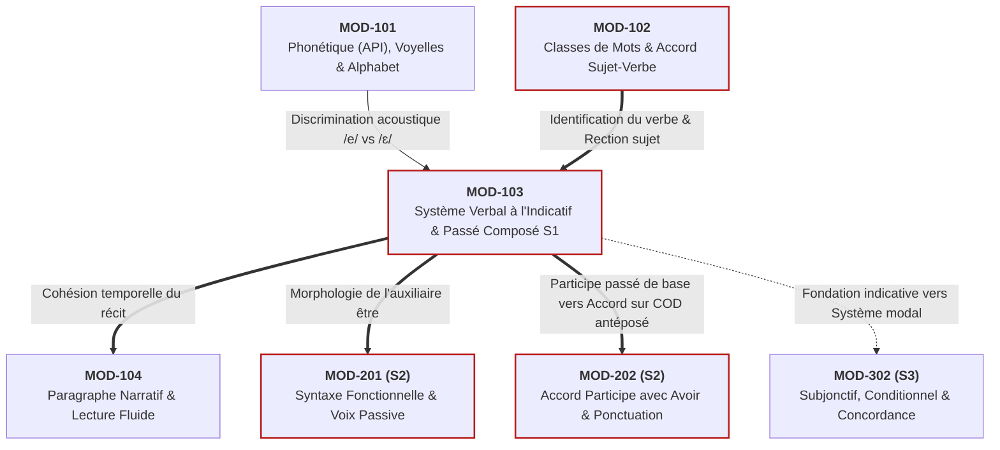

# Fiche Pédagogique Opérationnelle — Module MOD-103

> **Identifiant** : `MOD-103`  
> **Titre** : *Le Système Verbal à l'Indicatif : Morphologie des Régularités, Verbes Fréquents Irréguliers, Passé Composé Régulier/Être et Périphrases Aspectuelles*  
> **Semestre** : Année 1 — Semestre 1 (S1)  
> **Domaines mobilisés** : DOM-04 (Conjugaison et syntaxe), DOM-02 (Orthographe et morphologie), DOM-03 (Grammaire et analyse grammaticale)  
> **Volume horaire estimé** : 16 heures (Étude : 4 h 30 | Pratique : 6 h | Correction : 3 h | Révision : 2 h 30)  
> **Statut** : [STATUT : VALIDÉ]  
> **Alignement** : [`academic-structure.md`](file:///f:/Formation/world-class-french/01-architecture/academic-structure.md), [`dependency-graph.md`](file:///f:/Formation/world-class-french/01-architecture/dependency-graph.md), [`competency-framework.md`](file:///f:/Formation/world-class-french/02-competency-framework/competency-framework.md), [`source-registry.md`](file:///f:/Formation/world-class-french/07-resources/source-registry.md), [`decisions-log.md` (DEC-010)](file:///f:/Formation/world-class-french/00-governance/decisions-log.md#dec-010-application-des-résolutions-de-laudit-darchitecture-pédagogique)

---

## 1. Présentation et Intérêt du Module

Le verbe constitue le moteur syntaxique et sémantique de la proposition en français. Tandis que le syntagme nominal désigne les actants, le verbe structure le procès, lui assigne un cadre temporel (passé, présent, avenir), une modalité d'assertion (l'indicatif comme mode du réel et de l'avéré) et une perspective aspectuelle (procès en cours, achevé, imminent ou itératif). 

Or, la conjugaison française est perçue par de nombreux apprenants comme un catalogue indigeste d'exceptions arbitraires. Cette insécurité produit deux pathologies écrites majeures :
1. **L'insécurité morphologique et orthographique** : hésitations sur les désinences muettes (*-e, -es, -ent* vs *-s, -s, -t*), confusion graphémique dévastatrice entre la terminaison en *-ai* (futur simple ou passé simple) et *-ais* (imparfait ou conditionnel présent), et fautes récurrentes sur les radicaux des verbes irréguliers à haute fréquence ;
2. **L'indigence aspectuo-temporelle** : incapacité à hiérarchiser un récit au passé par l'alternance raisonnée de l'imparfait (arrière-plan, aspect sécant) et du passé composé / passé simple (premier plan événementiel, aspect non-sécant), compensée par un recours anarchique au présent ou au passé composé uniforme.

Le module `MOD-103` a pour vocation :
1. De démythifier la morphologie verbale en révélant sa structure sous-jacente combinatoire : **Base/Radical + Marque de temps/mode + Marque de personne/nombre** [Réf. SRC-GRAM-02, chap. 8] ;
2. D'installer une maîtrise automatisée des trois groupes verbaux aux temps cardinaux de l'indicatif (présent, imparfait, futur simple et initiation au passé simple) ;
3. D'ancrer le socle du passé composé en dissociant méthodiquement deux réalités, conformément à la décision d'architecture [DEC-010](file:///f:/Formation/world-class-french/00-governance/decisions-log.md#dec-010-application-des-résolutions-de-laudit-darchitecture-pédagogique) :
   - la formation du participe passé régulier (*-é, -i, -u*) et des formes fréquentes avec consonne latente (*pris, fait, dit*) ;
   - l'accord systématique avec le sujet pour les verbes transitifs ou intransitifs conjugués avec l'auxiliaire *être* ;
   - l'**invariabilité canonique par défaut** avec l'auxiliaire *avoir* (sans antéposition du complément d'objet direct, dont l'étude fonctionnelle est déphasée en S2 dans `MOD-202`) ;
4. D'enrichir l'expression immédiate grâce aux trois périphrases aspectuelles fondamentales (*être en train de*, *venir de*, *aller + infinitif*), permettant de moduler le procès avec finesse sans recourir prématurément à des temps complexes ;
5. De dompter les 12 verbes irréguliers les plus fréquents de la langue française (*être, avoir, aller, faire, dire, pouvoir, vouloir, savoir, voir, venir, prendre, devoir*), responsables à eux seuls de plus de 70 % des occurrences verbales en discours authentique.

---

## 2. Place dans le Cursus

- **Position séquentielle** : Troisième module du Semestre 1 (Semaines 5 à 10, conduit en tuilage progressif avec `MOD-102` et en articulation amont avec `MOD-104`).
- **Rôle architectural** : Clé de voûte de la morphologie grammaticale et de la dynamique narrative du premier cycle.
- **Relations amont/aval** :
  - *En amont* : Prérequis indispensables validés dans `MOD-101` (discrimination phonème/graphème, règles de découpe phonologique et transcription API) et dans `MOD-102` (identification de la classe grammaticale du verbe, distinction formelle donneur/receveur d'accord dans la rection sujet-verbe [DEP-ORT-01]).
  - *En aval* : Prérequis direct et bloquant pour :
    - `MOD-104` (rédaction du paragraphe narratif et cohésion temporelle) ;
    - `MOD-201` (analyse actancielle, voix passive et constructions impersonnelles) ;
    - `MOD-202` (accord du participe passé avec l'auxiliaire *avoir* sur COD antéposé [DEP-ORT-02]) ;
    - `MOD-302` (système modal : subjonctif, conditionnel et concordance des temps [DEP-VRB-02]).
  - *Fil conducteur* : Les régularités morphologiques et les distinctions aspectuelles fixées dans `MOD-103` constituent le socle permanent sur lequel reposeront toutes les subtilités narratives et stylistiques du cursus jusqu'en S6.

---

## 3. Prérequis et Diagnostic

### 3.1 Prérequis
- Validation du module `MOD-101` : capacité à discriminer /e/ et /ɛ/, identification des voyelles nasales et respect des liaisons obligatoires.
- Validation du module `MOD-102` : identification infaillible de la nature "verbe", repérage du sujet donneur d'accord dans la phrase simple contiguë ou perturbée, distinction de base entre nom et verbe homophones (*le travail* [nom] vs *il travaille* [verbe]).

### 3.2 Diagnostic Spécifique d'Entrée
Dès la Semaine 5, l'apprenant effectue une batterie diagnostique de 30 minutes :
1. **Épreuve de découpage morphologique** : Isoler le radical et les terminaisons sur 10 formes verbales conjuguées (ex. *chantions*, *finissiez*, *partiront*).
2. **Test de discrimination -ai / -ais** : Choisir la graphie correcte et justifier la valeur temporelle ou modale dans 10 phrases контекстуelles (*« Demain, je lui (écrirai / écrirais) »* ; *« Autrefois, j'(aimai / aimais) me promener »*).
3. **Test des auxiliaires au passé composé** : Conjuguer 15 verbes au passé composé en justifiant le choix de l'auxiliaire (*être* vs *avoir*) et la marque ou l'absence de marque sur le participe passé.
4. **Livrable** : *Fiche de diagnostic verbal personnalisé* cartographiant les confusions de désinences et les verbes irréguliers prioritaires à consolider.

---

## 4. Objectifs Pédagogiques Mesurables

Au terme du module `MOD-103`, l'apprenant doit être capable de :
1. Décomposer n'importe quelle forme verbale régulière des trois groupes en ses constituants morphologiques (radical, marque temporelle, désinence personnelle) avec 100 % d'exactitude [Réf. SRC-NORM-03, p. 34].
2. Conjuguer sans faute écrite, aux personnes demandées, les 12 verbes irréguliers fréquents au présent, à l'imparfait, au futur simple et au passé composé.
3. Orthographier infailliblement la première personne du singulier au futur simple (*-ai*) et à l'imparfait (*-ais*), en justifiant son choix par un test linguistique de commutation temporelle ou de personne [Réf. SRC-GRAM-05, § 74].
4. Former correctement le participe passé des verbes réguliers et fréquents, appliquer sans erreur l'accord avec le sujet lorsque le verbe requiert l'auxiliaire *être*, et maintenir l'invariabilité par défaut avec l'auxiliaire *avoir* dans les structures de phrase simples de S1.
5. Reconnaître morphologiquement et employer à bon escient les formes de 3e personne du singulier et du pluriel du passé simple dans un court extrait narratif.
6. Employer adéquatement les périphrases aspectuelles (*être en train de*, *venir de*, *aller + infinitif*) pour préciser la saisie du procès sans confusion chronologique ni solécisme de construction.

---

## 5. Compétences Visées et Niveaux de Maîtrise Attendus

| Identifiant | Intitulé de la Compétence | Palier Entrée | Palier Cible MOD-103 | Indicateur de Réussite Observable |
| :--- | :--- | :---: | :---: | :--- |
| [`FR-VERB-001`](file:///f:/Formation/world-class-french/02-competency-framework/competency-framework.md#fr-verb-001-maîtrise-des-valeurs-aspectuo-temporelles-de-lindicatif) | Morphologie et valeurs temporelles de l'indicatif | L1 | **L3 (Autonomie)** | 100 % d'exactitude morphologique sur les temps cardinaux de l'indicatif et alternance imparfait/passé composé sans confusion dans un récit. |
| [`FR-ORTHO-002`](file:///f:/Formation/world-class-french/02-competency-framework/competency-framework.md#fr-ortho-002-mécanique-infaillible-de-laccord-sujet-verbe) | Mécanique infaillible de l'accord sujet-verbe | L2 | **L3 (Autonomie)** | Accord immédiat du verbe simple et du participe passé avec l'auxiliaire *être* en genre et en nombre avec le sujet donneur. |

---

## 6. Plan Détaillé des Chapitres

```text
ARCHITECTURE DES CHAPITRES DU MODULE MOD-103
├── CHAPITRE 1 : ARCHITECTURE MORPHOLOGIQUE DU VERBE FRANÇAIS
│   ├── 1.1 Qu'est-ce qu'un verbe ? Définition sémantique, syntaxique et morphologique.
│   ├── 1.2 L'équation combinatoire canonique : Base/Radical (R) + Marque de Temps/Mode (TM) + Désinence Personnelle (PN).
│   ├── 1.3 Les trois groupes verbaux : critères linguistiques de classification.
│   │   ├── Le 1er groupe (-er sauf aller) : régularité vivante, voyelle thématique -e-.
│   │   ├── Le 2e groupe (-ir / -issant) : le formant inchoatif -iss- aux personnes du pluriel.
│   │   └── Le 3e groupe : ensemble fermé, bases multiples et allomorphes.
│   └── 1.4 Les marques de personne et de nombre (PN) : le système fermé des désinences (-s/-e, -s/-es, -t/-d/-e, -ons, -ez, -ent).
├── CHAPITRE 2 : LE PRÉSENT DE L'INDICATIF : FORMES ET VALEURS D'ÉNONCIATION
│   ├── 2.1 Morphologie régulière du présent : régimes en -e/-es/-e et régimes en -s/-s/-t (ou -d).
│   ├── 2.2 Particularités orthographiques du 1er groupe : verbes en -cer, -ger, -eler, -eter, -yer, -ier.
│   ├── 2.3 Les 12 verbes irréguliers fréquents au présent : analyse des radicaux (être, avoir, aller, faire, dire, pouvoir, vouloir, savoir, voir, venir, prendre, devoir).
│   └── 2.4 Les valeurs discursives du présent : présent d'énonciation, d'habitude (itératif), de vérité générale, futur proche familier et présent de narration.
├── CHAPITRE 3 : L'IMPARFAIT DE L'INDICATIF : LA RÉGULARITÉ ABSOLUE ET L'ASPECT SÉCANT
│   ├── 3.1 La règle de dérivation universelle : Radical de P4 (nous au présent) + désinences uniques d'imparfait (-ais, -ais, -ait, -ions, -iez, -aient).
│   ├── 3.2 L'unique exception morphologique : le verbe être (radical ét-).
│   ├── 3.3 Les pièges graphiques : verbes en -ier, -yer (nous criions, nous voyions) et verbes en -cer, -ger (nous commencions, nous mangions).
│   └── 3.4 Sémantique et aspect de l'imparfait : aspect sécant (procès non borné, saisi de l'intérieur), arrière-plan descriptif, valeur d'habitude dans le passé.
├── CHAPITRE 4 : LE FUTUR SIMPLE : PROJECTION ET MARQUE DU RADICAL EN -R-
│   ├── 4.1 Origine et structure : l'infinitif + présent d'avoir (chanter-ai -> chanterai).
│   ├── 4.2 Les désinences universelles du futur : -ai, -as, -a, -ons, -ez, -ont.
│   ├── 4.3 Les radicaux irréguliers fréquents en -r- et -rr- (ser-, aur-, ir-, fer-, pourr-, voudr-, saur-, verr-, viendr-, prendr-, devr-).
│   ├── 4.4 L'opposition cardinale -ai / -ais : distinction phonologique (/e/ vs /ɛ/) et test de substitution par la personne P3 (il chantera vs il chanterait/chantait).
│   └── 4.5 Valeurs temporelles et modales du futur : avenir certain, promesse, ordre atténué ou déontique.
├── CHAPITRE 5 : INITIATION AU PASSÉ SIMPLE DU RÉCIT ÉCRIT
│   ├── 5.1 Rôle stylistique : temps non-sécant du récit classique coupé de l'énonciation.
│   ├── 5.2 Les quatre séries de voyelles caractéristiques :
│   │   ├── Série en -a- (1er groupe) : -ai, -as, -a, -âmes, -âtes, -èrent.
│   │   ├── Série en -i- (2e groupe et partie du 3e) : -is, -is, -it, -îmes, -îtes, -irent.
│   │   ├── Série en -u- (partie du 3e groupe : avoir, être, devoir, savoir, vouloir, etc.) : -us, -us, -ut, -ûmes, -ûtes, -urent.
│   │   └── Série nasale en -in- (venir, tenir et dérivés) : -ins, -ins, -int, -înmes, -întes, -inrent.
│   └── 5.3 Maîtrise prioritaire en S1 : reconnaissance et maniement des 3es personnes du singulier et du pluriel (P3/P6).
├── CHAPITRE 6 : LE PASSÉ COMPOSÉ DE BASE ET L'ACCORD DU PARTICIPE PASSÉ EN S1
│   ├── 6.1 Structure binaire : Auxiliaire au présent (être ou avoir) + Participe passé.
│   ├── 6.2 Morphologie du participe passé :
│   │   ├── Formes régulières : -é (1er gr.), -i (2e gr.), -u (3e gr. fréquent).
│   │   └── Formes à consonne latente : le test infaillible du féminin (pris -> prise, fait -> faite, écrit -> écrite, dit -> dite).
│   ├── 6.3 La sélection de l'auxiliaire :
│   │   ├── Auxiliaire avoir : verbes transitifs et grande majorité des intransitifs.
│   │   └── Auxiliaire être : verbes de changement d'état et de mouvement intransitifs canoniques (liste de la "maison d'être").
│   ├── 6.4 La règle d'accord avec l'auxiliaire être : accord plein et entier en genre et nombre avec le sujet donneur.
│   └── 6.5 La règle de base avec l'auxiliaire avoir : invariabilité canonique par défaut en l'absence de COD antéposé (cadrage strict S1 [DEC-010]).
└── CHAPITRE 7 : LES PÉRIPHRASES ASPECTUELLES FONDAMENTALES
    ├── 7.1 Définition linguistique de la périphrase verbale : semi-auxiliaire + forme non conjuguée (infinitif).
    ├── 7.2 L'aspect progressif / duratif : être en train de + infinitif (procès saisi au cœur de son accomplissement).
    ├── 7.3 L'aspect rétrospectif immédiat : venir de + infinitif (passé récent rattaché au repère temporel).
    ├── 7.4 L'aspect prospectif immédiat : aller + infinitif (futur proche, imminence et intention).
    └── 7.5 Articulation narrative : combinaison des périphrases avec les temps simples et composés pour rythmer le récit.
```

---

## 7. Concepts Fondamentaux et Notions Avancées

### 7.1 Concepts Fondamentaux
- **Procès** : Terme linguistique désignant l'action, l'état, l'événement ou le changement exprimé par le verbe indépendamment de son actualisation dans le temps [Réf. SRC-GRAM-02, chap. 8].
- **Mode** : Catégorie grammaticale qui indique la façon dont le locuteur envisage le procès (l'**indicatif** pose le procès comme réel, avéré ou probable dans le monde de référence ; il s'oppose au subjonctif, mode du virtuel ou de l'incertitude).
- **Temps grammatical vs Temps chronologique** : Le temps chronologique est une droite continue orientée (passé $\leftarrow$ présent $\rightarrow$ avenir) ; le temps grammatical est le système de formes linguistiques permettant de situer le procès par rapport au moment de l'énonciation ($T_0$).
- **Radical (ou base)** : Morphème lexical porteur du sens sémantique fondamental du verbe, susceptible de varier (allomorphes) selon les personnes et les temps (*chant-*, *finiss-*, *voul- / voul- / veuill-*).
- **Désinence** : Morphème flexionnel terminal agglutiné au radical, portant les marques de temps, de mode, de personne et de nombre.

### 7.2 Notions Avancées
- **Aspect verbal (Accompli vs Inaccompli)** :
  - *Aspect inaccompli* : Le procès est envisagé pendant son déroulement, sans que son terme soit atteint (marqué par les temps simples : présent, imparfait, futur simple).
  - *Aspect accompli* : Le procès est envisagé comme achevé, ses bornes finales étant franchies au moment considéré, laissant souvent un résultat présent (marqué par les temps composés : passé composé, plus-que-parfait) [Réf. SRC-GRAM-02, chap. 9].
- **Aspect sécant vs non-sécant** :
  - *Aspect sécant (Imparfait)* : La ligne du procès est coupée (« sécante ») par le regard de l'observateur. Le début et la fin de l'action ne sont pas visibles ; l'action est montrée comme un tableau continu en toile de fond.
  - *Aspect non-sécant (Passé simple / Passé composé événementiel)* : Le procès est saisi globalement de l'extérieur, comme un bloc borné d'un point de départ à un point d'arrivée [Réf. SRC-GRAM-01, § 854].
- **Allomorphie radicale** : Phénomène linguistique où un même verbe possède plusieurs bases phonétiques et graphiques selon la distribution de l'accent ou la nature du mode (ex. le verbe *aller* mobilise 3 radicaux historiques distincts : *va-* [présent singulier], *all-* [P4/P5 et imparfait], *i-* [futur et conditionnel]).
- **Formant inchoatif du 2e groupe** : L'élément phonétique /-is-/ (*-iss-*) aux personnes plurielles (*nous finissons, vous finissez, ils finissent*) est issu de l'affixe latin *-iscere* marquant à l'origine l'entrée dans un état, devenu en français moderne le critère discriminatoire absolu entre le 2e groupe et les verbes en *-ir* du 3e groupe (*partir* $\rightarrow$ *nous partons*, sans *-iss-*).
- **Invariabilité canonique du participe passé avec avoir (Règle S1)** : À ce stade du cursus, avant la formalisation syntaxique du COD dans `MOD-201` et de son antéposition dans `MOD-202`, la règle d'usage inviolable est : **le participe passé conjugué avec l'auxiliaire *avoir* ne s'accorde jamais avec le sujet** (*« Ils ont chanté »*, *« Elle a écrit »*).

---

## 8. Erreurs et Confusions Fréquentes

| Forme fautive | Analyse de la faille cognitive | Forme correcte et justification | Source de référence |
| :--- | :--- | :--- | :--- |
| *« Demain je prendrais le train »* | Confusion graphémique et phonologique entre le futur (*-ai* /e/) et le conditionnel (*-ais* /ɛ/). | *« Demain je prendrai le train »* : marque de certitude future $\rightarrow$ futur simple en *-ai*. Test : remplacer par *il* $\rightarrow$ *il prendra* (et non *il prendrait*). | [Réf. SRC-GRAM-01, § 881] |
| *« Pendant qu'il dormit, un voleur entra »* | Confusion aspectuelle entre procès continu d'arrière-plan (sécant) et événement ponctuel de rupture (non-sécant). | *« Pendant qu'il dormait, un voleur entra »* : l'action de dormir sert de cadre non délimité $\rightarrow$ imparfait sécant obligatoire. | [Réf. SRC-GRAM-02, chap. 9] |
| *« Elles ont parties hier matin »* | Report fautif de l'accord sujet sur l'auxiliaire *avoir* au lieu de l'auxiliaire *être*. | *« Elles sont parties hier matin »* : verbe de déplacement intransitif se conjuguant avec *être* $\rightarrow$ accord féminin pluriel avec le sujet. | [Réf. SRC-GRAM-05, § 78] |
| *« Elle a allée au marché »* | Erreur de sélection d'auxiliaire sur verbe de mouvement intransitif. | *« Elle est allée au marché »* : *aller* requiert obligatoirement l'auxiliaire *être* $\rightarrow$ accord avec *Elle*. | [Réf. SRC-GRAM-01, § 805] |
| *« Ils disents ce qu'ils fassent »* | Régularisation abusive des verbes irréguliers du 3e groupe à P6 (*faire, dire*). | *« Ils disent ce qu'ils font »* : P6 irrégulière en *-ont* pour *faire* (*ils font* comme *ils sont, ont, vont*) et désinence en *-ent* sur base *dis-*. | [Réf. SRC-NORM-03, p. 36] |
| *« Hier nous mangions et soudain la porte a claqué »* (bonne) vs *« Hier nous avons mangé et soudain... »* | Tendance à employer le passé composé pour des descriptions longues ou l'imparfait pour des faits brefs. | Distinguer la perspective : l'action qui interrompt est non-sécante (passé composé ou passé simple), l'action interrompue est sécante (imparfait). | [Réf. SRC-GRAM-02, chap. 9] |
| *« Nous voyons de réussir »* (au lieu de *venir de*) | Confusion lexicale et phonétique entre *voir* et *venir de* comme semi-auxiliaire aspectuel. | *« Nous venons de réussir »* : semi-auxiliaire *venir de* marquant le passé immédiat. | [Réf. SRC-GRAM-02, chap. 8] |

---

## 9. Exemples Progressifs

### 9.1 Niveau Simple (Morphologie Régulière et Périphrases Évidentes)
- *Présent du 1er groupe* : *L'artisan travaille avec méthode* (radical *travaill-* + désinence *-e* de P3).
- *Présent du 2e groupe* : *Les arbres fleurissent au printemps* (radical *fleur-* + marque inchoative *-iss-* + désinence *-ent*).
- *Futur simple régulier* : *Nous écouterons vos conseils* (infinitif complet + désinence *-ons*).
- *Périphrase progressive* : *L'enfant est en train de tracer ses premières lettres* (action en cours de déroulement à l'instant de parole).
- *Passé composé avec être* : *Les déléguées sont arrivées à l'heure convenue* (*arriver* avec *être* $\rightarrow$ accord féminin pluriel avec *les déléguées*).

### 9.2 Niveau Intermédiaire (Irrégularités Fréquentes, Pièges Graphiques et Alternances)
- *Verbes en -cer et -ger à l'imparfait* : *Nous avancions lentement, mais il mangeait avec appétit* (maintien de la cédille devant *-a* : *mangeait* avec *e* muet ; pas de cédille devant *-i* : *avancions*).
- *Verbes en -ier et -yer à l'imparfait* : *Autrefois, nous vous remerciions chaque jour et nous payions comptant* (coexistence du *-i-* ou *-y-* du radical et du *-i-* de la terminaison P4 d'imparfait).
- *Test d'arbitrage -ai / -ais* : *Dès que je recevrai sa lettre, je lui répondrai* (futur, substitution : *dès qu'il recevra, il répondra*) vs *À cette époque, je recevais ses lettres et je lui répondais* (imparfait, substitution : *il recevait, il répondait*).
- *Périphrase du passé récent et futur proche articulées* : *Le président vient de signer le décret et le ministre va le publier d'une heure à l'autre*.
- *Passé composé avec avoir (invariabilité canonique S1)* : *Les historiennes ont analysé ces archives anciennes* (*analysé* reste invariable au masculin singulier ; la règle du COD antéposé n'intervient pas ici).

### 9.3 Niveau Complexe (Alternances Aspectuelles Littéraires et Radicaux Forts)
- *Polyphonie aspectuelle imparfait / passé simple (Extrait modèle francophone inspiré d'Olympe Bhêly-Quenum)* :  
  *« Le soleil déclinait derrière la forêt de palmiers et le vent tiède agitait à peine les feuilles de maïs. Soudain, un tambour retentit dans le lointain ; les villageois interrompirent leurs palabres et se dressèrent d'un seul bond. »*  
  $\rightarrow$ *Déclinait, agitait* : imparfait sécant (cadre descriptif continu).  
  $\rightarrow$ *Retentit, interrompirent, se dressèrent* : passé simple non-sécant (événements ponctuels successifs de premier plan).
- *Radicaux allomorphes au présent et futur des 12 verbes fréquents* :  
  *« Vous faites tout ce que vous pouvez, mais vous ne savez pas encore ce qu'ils voudront entreprendre quand ils viendront. »*  
  $\rightarrow$ Analyse des bases : *fai-tes* (P5 irrégulière sans *-ez*), *peuv-ent*, *sav-ez*, *voud-r-ont*, *viend-r-ont*.
- *Consonnes latentes des participes passés du 3e groupe* :  
  *« Le discours qu'il a produit a surpris l'assemblée, car le rapport était mal conçu mais la synthèse a été bien comprise. »*  
  $\rightarrow$ Test féminin : *produit* (/t/ : *produite*), *surpris* (/z/ : *surprise*).

---

## 10. Activités d'Observation et de Découverte

1. **Atelier "Dissection chirurgicale du verbe" (Morphologie combinatoire)** :
   - Les apprenants reçoivent un tableau de 15 formes verbales découpées en étiquettes syllabiques mobiles. Ils doivent reconstituer les 3 blocs fonctionnels : $[Radical] + [Marque\;de\;temps/mode] + [Désinence\;personnelle]$ et formaliser la règle d'assemblage universelle.
2. **Laboratoire acoustique et morphologique "L'épreuve du futur vs conditionnel"** :
   - Écoute de 10 phrases orales comportant des verbes à la 1re personne en /-e/ ou /-ɛ/. 
   - Application du test de commutation systématique par la 3e personne du singulier (*il chantera* vs *il chanterait*) pour valider le sens (certitude de l'action à venir vs hypothèse ou souhait).
3. **Atelier d'animation temporelle "La caméra linguistique" (Sécant vs Non-sécant)** :
   - À partir d'un court texte narratif sans verbes, les apprenants doivent décider pour chaque événement s'il s'agit d'un "plan large continu" (imparfait, caméra fixe observant le décor) ou d'un "coup de projecteur d'action" (passé composé ou passé simple, fait ponctuel qui fait avancer l'horloge).
4. **Chasse aux formes parasites des verbes fréquents** :
   - Analyse d'un corpus de 20 phrases contenant des formes fautives courantes (*« vous faisez »*, *« ils venent »*, *« je prendera »*, *« si nous savions »*). Les apprenants nomment la cause de l'erreur (analogie trompeuse avec le 1er groupe) et rétablissent l'allomorphe historique correct.

---

## 11. Exercices Progressifs

### 11.1 Niveau 1 : Reconnaissance et Drill Morphologique Canonique
- **Exercice 1.1 (Décomposition morphologique)** : Isoler le radical, la voyelle thématique ou marque temporelle, et la désinence personnelle de : *nous marchons, vous finissiez, ils prendront, elle chantait, vous applaudissez*.
- **Exercice 1.2 (Drill des 12 verbes fréquents au présent)** : Conjuguer aux 6 personnes du présent de l'indicatif : *faire, dire, pouvoir, aller, vouloir, savoir*.
- **Exercice 1.3 (Application du passé composé simple)** : Conjuguer au passé composé avec le sujet imposé :
  - *arriver* (sujet : *Les invitées*)
  - *partir* (sujet : *Ces deux voyageuses*)
  - *travailler* (sujet : *Les artisans*)
  - *écrire* (sujet : *Notre collègue*)

### 11.2 Niveau 2 : Manipulation Syntaxique, Pièges Graphiques et Périphrases
- **Exercice 2.1 (Le duel -ai / -ais)** : Compléter par *-ai* ou *-ais* en justifiant par la substitution à la 3e personne (*il*) :
  1. *L'année prochaine, j' (entamer...)* de nouvelles études.
  2. *Chaque soir, je (contempl...)* les étoiles depuis la terrasse.
  3. *Si j'avais le temps, je vous (aid...)* volontiers.
  4. *Demain matin, je vous (enverr...)* le rapport définitif.
- **Exercice 2.2 (L'imparfait des verbes délicats)** : Conjuguer à la personne indiquée à l'imparfait :
  - *nous (étudier)*
  - *vous (essuyer)*
  - *nous (commencer)*
  - *ils (manger)*
  - *vous (croire)*
- **Exercice 2.3 (Enrichissement par les périphrases aspectuelles)** : Transformer les phrases suivantes en mobilisant la périphrase indiquée :
  1. *Il répare sa bicyclette* $\rightarrow$ [aspect progressif en cours].
  2. *L'avion a atterri il y a cinq minutes* $\rightarrow$ [aspect passé immédiat].
  3. *Le spectacle va débuter dans un instant* $\rightarrow$ [aspect prospectif imminent].

### 11.3 Niveau 3 : Arbitrage de Haute Rigueur et Cohésion Narrative
- **Exercice 3.1 (Alternance aspectuelle imparfait / passé composé dans le récit)** :  
  Dans le texte suivant, conjuguer les verbes entre parenthèses soit à l'imparfait, soit au passé composé, en justifiant chaque choix selon la valeur aspectuelle (sécant vs non-sécant) :  
  *« Hier soir, tandis que nous (dîner) paisiblement et que la pluie (battre) les vitres, une détonation sourde (retentir) dans la rue. Aussitôt, mon frère (se lever), (ouvrir) la fenêtre et (apercevoir) une foule qui (courir) vers le carrefour. »*
- **Exercice 3.2 (Reconnaissance du passé simple à P3/P6)** :  
  Mettre au passé simple aux 3es personnes du singulier et du pluriel : *prendre, venir, pouvoir, faire, voir, mourir, vouloir, être, avoir*.
- **Exercice 3.3 (Transposition temporelle intégrale)** :  
  Transposer un texte de 120 mots écrit au présent vers les temps du passé (imparfait pour l'arrière-plan, passé composé pour les événements de premier plan), sans introduire aucune rupture d'accord ni confusion morphologique.

---

## 12. Ateliers de Correction et de Révision

- **Protocole d'autocorrection en deux passes (La chaîne verbale)** :
  - *Passe 1 (Le crible morphologique du radical et de la marque temporelle)* :
    1. Surligner le verbe conjugué.
    2. Déterminer le temps visé par le contexte sémantique (passé, présent, futur).
    3. Vérifier que le radical correspond bien au temps (ex. futur en *-r-*).
    4. Appliquer le test de substitution sur les finales douteuses (*-ai* vs *-ais* : transposer avec *il*).
  - *Passe 2 (Le crible de la rection et des accords)* :
    1. Pointer le sujet donneur d'accord.
    2. Si le verbe est à un temps simple : vérifier la désinence personnelle de nombre (singulier vs pluriel, P1 à P6).
    3. Si le verbe est au passé composé :
       - Identifier l'auxiliaire (*être* vs *avoir*).
       - Si *être* : accorder obligatoirement le participe passé en genre et en nombre avec le sujet.
       - Si *avoir* : vérifier que le participe reste invariable au masculin singulier (conformément au cadre S1).

---

## 13. Production Intégratrice

- **Format** : **Récit narratif structuré et tableau d'explicitation aspectuo-temporelle**.
- **Consigne détaillée** :
  1. Rédiger un texte narratif cohérent de **200 à 250 mots** relatant un événement marquant (personnel, historique ou d'actualité).
  2. Le récit doit obligatoirement respecter l'alternance temporelle suivante :
     - Au moins **4 verbes à l'imparfait** assumant une fonction descriptive ou d'arrière-plan sécant ;
     - Au moins **5 verbes au passé composé** (dont au moins 2 avec l'auxiliaire *être* accordés avec leur sujet, et au moins 2 avec l'auxiliaire *avoir* rigoureusement invariables) ;
     - Au moins **2 périphrases aspectuelles distinctes** (*être en train de*, *venir de*, ou *aller + infinitif* transposées au passé ou au présent) ;
     - Au moins **3 verbes irréguliers fréquents** parmi la liste des 12 (ex. *faire, pouvoir, venir*).
  3. Joindre sous le texte un **tableau d'analyse linguistique** de 6 formes verbales extraites du récit, spécifiant :  
     $[Verbe\;conjugué] \;\vert\; [Infinitif\;et\;Groupe] \;\vert\; [Temps/Mode] \;\vert\; [Valeur\;aspectuelle\;(sécant/non-sécant/accompli)] \;\vert\; [Justification\;de\;l'accord]$.

---

## 14. Évaluation et Barème

L'évaluation sommative finale du module `MOD-103` est notée sur **20 points** avec un seuil éliminatoire strict fixé à **14/20 (70 %)** :

| Épreuve / Volet | Description et barème des pénalités | Seuil éliminatoire partiel |
| :--- | :--- | :---: |
| **Volet 1 : Dictée de contrôle morphosyntaxique (150 mots)** (sur 8 pts) | Barème officiel à pénalités calibrées ([`assessment-rubrics.md`](file:///f:/Formation/world-class-french/02-competency-framework/assessment-rubrics.md)) :<br/>• **-2 pts** par faute de désinence verbale ou confusion *-ai / -ais*.<br/>• **-2 pts** par accord fautif du participe passé avec *être* ou altération indue avec *avoir*.<br/>• **-1 pt** par erreur d'orthographe lexicale sur un radical irrégulier.<br/>• **-0,5 pt** par omission de cédille ou de *-e-* muet (*mangeait, commençait*). | $< 5,5 / 8$ |
| **Volet 2 : Épreuve d'analyse morphologique et de drill (30 items)** (sur 6 pts) | • 10 items de décomposition radical/désinence (0,2 pt / item = 2 pts).<br/>• 10 items de conjugaison des 12 verbes fréquents sous contrainte (0,2 pt / item = 2 pts).<br/>• 10 items d'arbitrage aspectuel (imparfait vs passé composé) (0,2 pt / item = 2 pts). | $< 4 / 6$ |
| **Volet 3 : Production intégratrice écrite (Récit au passé)** (sur 6 pts) | • Respect des consignes d'alternance aspectuelle (imparfait/passé composé/périphrases) : **2 pts**.<br/>• Correction orthographique absolue des formes verbales : **2 pts**.<br/>• Exactitude du tableau d'analyse linguistique joint : **2 pts**. | $< 4,5 / 6$ |

- **Note globale minimale d'admission au module** : **14/20**. Toute note inférieure à 14/20 impose un passage en sas de remédiation ciblée avec reprise des drills morphologiques avant le passage aux modules du semestre 2.

---

## 15. Critères de Maîtrise

Le module `MOD-103` est certifié au palier **L3 (Autonomie)** lorsque l'apprenant :
- Ne commet **aucune confusion écrite** entre le futur simple (*-ai*) et l'imparfait / conditionnel (*-ais*) sur l'ensemble de ses devoirs ;
- Conjugue spontanément et sans hésitation les 12 verbes irréguliers majeurs aux temps cardinaux de l'indicatif ;
- Applique sans faille l'accord du participe passé avec l'auxiliaire *être* en genre et en nombre avec le sujet ;
- Respecte l'invariabilité de base du participe passé avec l'auxiliaire *avoir* sans commettre d'accord fautif avec le sujet ;
- Articule avec fluidité et cohérence sémantique l'imparfait et le passé composé dans une narration suivie, sans incohérence d'aspect.

---

## 16. Révisions Espacées Recommandées

Afin de garantir la rétention à long terme et l'automatisation réflexe des formes verbales, le calendrier de réactivation suivant est prescrit :
- **J+3 après le module** : Flashcards de rappel actif sur les allomorphes des 12 verbes irréguliers au présent et au futur (15 minutes).
- **J+10** : Test de 10 phrases sur la discrimination *-ai / -ais* et les verbes en *-ier / -yer* à l'imparfait (15 minutes).
- **J+30** : Réactivation dans le cadre du module `MOD-104` (rédaction du paragraphe narratif fluide).
- **Semestre 2 (S2)** : Réinvestissement majeur dans `MOD-201` (transposition à la voix passive : morphologie de l'auxiliaire *être* à tous les temps) et dans `MOD-202` (apprentissage de l'antéposition du COD avec l'auxiliaire *avoir*).

---

## 17. Sources de Référence Vérifiées

Conformément à la charte d'intégrité du cursus ([DEC-004](file:///f:/Formation/world-class-french/00-governance/decisions-log.md#dec-004-règle-dintégrité-bibliographique-et-rôle-de-notebooklm)), toutes les règles, nomenclatures et analyses présentées dans ce module s'appuient sur les sources faisant autorité répertoriées dans [`source-registry.md`](file:///f:/Formation/world-class-french/07-resources/source-registry.md) :

1. **Grevisse, Maurice & Goosse, André (2016)**. *Le Bon Usage* (16e éd.). Bruxelles : De Boeck Supérieur.  
   $\rightarrow$ Référence fondamentale pour la morphologie du verbe (§ 775-810), la décomposition des désinences (§ 780), les valeurs des temps de l'indicatif (§ 845-890) et l'accord du participe passé (§ 940-955) [Réf. `SRC-GRAM-01`].
2. **Riegel, Martin, Pellat, Jean-Christophe & Rioul, René (2016)**. *Grammaire méthodique du français*. Paris : PUF.  
   $\rightarrow$ Référence pour la description linguistique des bases verbales, de l'allomorphie et des marques flexionnelles (chap. 8), ainsi que pour la distinction théorique entre temps, mode et aspect (chap. 9 : accompli vs inaccompli, sécant vs non-sécant) [Réf. `SRC-GRAM-02`].
3. **Ministère de l'Éducation nationale (2020)**. *Terminologie grammaticale*. Paris : Réseau Canopé.  
   $\rightarrow$ Référence terminologique officielle pour l'enseignement : identification des 3 groupes, découpage radical/marque de temps/désinence, et inventaire des valeurs temporelles de base [Réf. `SRC-NORM-03`].
4. **Grevisse, Maurice (2009)**. *Le Petit Grevisse : Grammaire française* (32e éd.). Bruxelles : De Boeck Supérieur.  
   $\rightarrow$ Référence pratique pour les tableaux synthétiques de conjugaison régulière et les tests de substitution mnémotechniques (§ 70-85) [Réf. `SRC-GRAM-05`].
5. **Pellat, Jean-Christophe (dir.) (2009)**. *Quelle grammaire enseigner ?* Paris : Hatier.  
   $\rightarrow$ Référence didactique pour la progression raisonnée de l'enseignement du système verbal et la remédiation des confusions aspectuelles chez l'apprenant [Réf. `SRC-GRAM-04`].

---

## 18. Liens avec les Modules Précédents et Suivants


