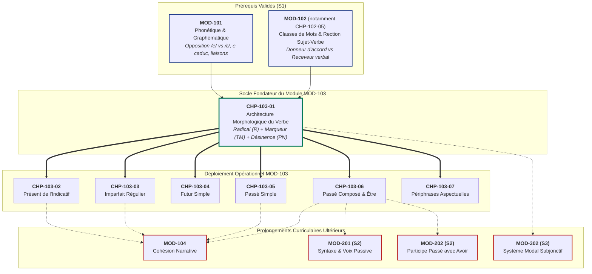
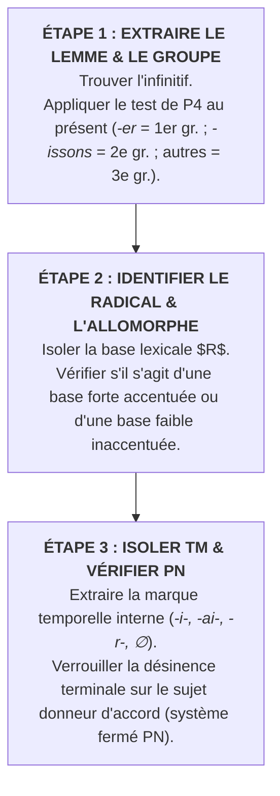

# Chapitre 1 — Architecture Morphologique du Verbe Français : Radical, Marqueurs de Temps-Mode et Désinences Personnelles

> **Identifiant du chapitre** : `CHP-103-01`  
> **Module de rattachement** : [`MOD-103` — Le Système Verbal à l'Indicatif : Morphologie des Régularités, Verbes Fréquents Irréguliers, Passé Composé Régulier/Être et Périphrases Aspectuelles](file:///f:/Formation/world-class-french/03-curriculum/year-1/semester-1/mod-103-systeme-verbal-indicatif.md)  
> **Semestre** : Année 1 — Semestre 1 (S1)  
> **Volume horaire canonique** : 5 à 6 heures d'apprentissage autonome délibéré et d'ateliers d'application (Étude : 1 h 30 | Pratique : 1 h 30 | Correction : 1 h 00 | Évaluation : 1 h 00)  
> **Statut** : [STATUT : VALIDÉ]  
> **Compétences associées** : [`FR-VERB-001`](file:///f:/Formation/world-class-french/02-competency-framework/competency-framework.md#fr-verb-001-maîtrise-des-valeurs-aspectuo-temporelles-de-lindicatif) (L3 Autonomie), [`FR-ORTHO-002`](file:///f:/Formation/world-class-french/02-competency-framework/competency-framework.md#fr-ortho-002-mécanique-infaillible-de-laccord-sujet-verbe) (L3 Autonomie)  
> **Sources scientifiques de référence** : `SRC-NORM-03` (Ministère de l'Éducation nationale, 2020), `SRC-GRAM-02` (Riegel et al., 2016, chap. 8), `SRC-GRAM-01` (Grevisse & Goosse, 2016, § 775-810), `SRC-GRAM-05` (Grevisse, 2009, § 70-85)

---

## 1. Titre et Place dans le Cursus

### 1.1 Intitulé Officiel
**Chapitre 1 : Architecture Morphologique du Verbe Français : Radical, Marqueurs de Temps-Mode et Désinences Personnelles** (`CHP-103-01`).

### 1.2 Insertion Architecturale dans le Cursus
Le verbe constitue le cœur battant de la syntaxe phrastique et de l'expression sémantique en français. Alors que le syntagme nominal circonscrit les entités du discours, le verbe structure le **procès** dans le temps, assigne les rôles thématiques aux actants et porte la modalité d'assertion.

Ce premier chapitre du module `MOD-103` pose le cadre morphologique fondamental de toute la conjugaison française. Il rompt définitivement avec l'illusion d'une conjugaison conçue comme un catalogue d'exceptions à mémoriser passivement, en lui substituant une modélisation combinatoire rigoureuse : **l'équation universelle Radical + Marque de Temps/Mode + Désinence Personnelle**.



- **En amont** : Ce chapitre réinvestit immédiatement :
  - Les acquis phonético-orthographiques de [`MOD-101`](file:///f:/Formation/world-class-french/03-curriculum/year-1/semester-1/mod-101-diagnostic-phonetique-alphabet.md) : la distinction phonologique entre voyelles fermées et ouvertes (/e/ vs /ɛ/), le comportement du e caduc (/ə/) et la réalisation des consonnes de liaison latentes ;
  - Les principes syntaxiques de [`MOD-102`](file:///f:/Formation/world-class-french/03-curriculum/year-1/semester-1/mod-102-classes-mots-accords-fondamentaux.md), en particulier la rection verbe-sujet et la traque du noyau donneur d'accord établies dans [`CHP-102-05`](file:///f:/Formation/world-class-french/03-curriculum/year-1/semester-1/mod-102/chp-102-05-accord-sujet-verbe-fondamental.md).
- **Au sein de `MOD-103`** : Il constitue la clé de voûte théorique qui déverrouille l'étude de l'ensemble des temps de l'indicatif :
  - Le présent et ses alternances de désinences (`CHP-103-02`) ;
  - L'imparfait et sa formation universelle sur le radical de P4 (`CHP-103-03`) ;
  - Le futur simple et sa marque en /-r-/ adossée au radical (`CHP-103-04`) ;
  - Le passé simple et ses quatre séries vocaliques caractéristiques (`CHP-103-05`) ;
  - Le passé composé et le statut du participe passé (`CHP-103-06`) ;
  - Les périphrases aspectuelles mobilisant l'infinitif (`CHP-103-07`).
- **En aval** : Il arme l'apprenant pour la cohésion narrative dans [`MOD-104`](file:///f:/Formation/world-class-french/03-curriculum/year-1/semester-1/mod-104-lexique-lecture-paragraphe.md), la voix passive dans `MOD-201`, l'accord du participe passé sur COD antéposé dans `MOD-202` et le subjonctif dans `MOD-302`.

---

## 2. Objectifs Mesurables

Au terme de l'étude autonome et des ateliers pratiques de ce chapitre, l'apprenant doit être capable de :

1. **Segmenter infailliblement toute forme verbale fléchie** en ses trois morphèmes constitutifs fondamentaux : **Radical ($R$)**, **Marqueur de Temps/Mode ($TM$)**, et **Désinence de Personne/Nombre ($PN$)**, en identifiant formellement les marques matérialisées et les marques zéro ($\varnothing$) avec 100 % d'exactitude [Réf. `SRC-NORM-03`, p. 34].
2. **Classifier rigoureusement tout verbe dans l'un des trois groupes morphologiques du français**, en mobilisant les critères linguistiques objectifs : productivité lexicale vivante et voyelle thématique *-e-* pour le 1er groupe, présence obligatoire du formant inchoatif latin /-is-/ (*-iss-*) aux personnes plurielles pour le 2e groupe, ou appartenance à l'ensemble fermé résiduel à allomorphie pour le 3e groupe [Réf. `SRC-GRAM-02`, chap. 8].
3. **Identifier et expliquer les variations de bases (allomorphes) des verbes fréquents**, en rendant compte des alternances phonétiques régulières induites par la position de l'accent tonique (bases fortes accentuées vs bases faibles inaccentuées) et par l'évolution historique [Réf. `SRC-GRAM-01`, § 780].
4. **Reconstruire et orthographier sans erreur les formes verbales à partir de morphèmes isolés**, en appliquant sans confusion le système fermé des désinences personnelles terminales du français écrit (*-e/-es/-e* vs *-s/-s/-t* vs *-s/-s/-d* vs *-ons/-ez/-ent*) [Réf. `SRC-GRAM-05`, § 70-74].

---

## 3. Prérequis et Test de Préparation (Auto-Diagnostic)

### 3.1 Prérequis Cognitifs
- Capacité à identifier sans équivoque la nature "verbe" dans une proposition déclarative (`MOD-102`).
- Identification du sujet donneur d'accord et des traits de personne (P1 à P6) et de nombre (`CHP-102-05`).
- Discrimination des phonèmes voyelles (/e/ vs /ɛ/) et des désinences verbales muettes à l'oral (`MOD-101`).

### 3.2 Test de Préparation Immédiat
Résolvez par écrit les cinq questions suivantes avant d'entamer l'étude du chapitre.

1. Dans la forme verbale fléchie *nous marchions*, quel élément précis porte l'information de temps (l'imparfait) ? Est-ce la terminaison globale *-ions* ou un segment plus restreint ?
2. Pourquoi le verbe *partir* n'appartient-il pas au deuxième groupe de conjugaison, bien que son infinitif se termine par *-ir* comme *finir* ?
3. Quel est le point commun morphologique invariant à l'écrit entre les formes de 2e personne du singulier : *tu marches*, *tu finis*, *tu prends*, *tu marcheras*, *tu marchais* ?
4. Dans la forme *ils finissent*, combien de morphèmes distincts composent le mot ? Isolez-les par des tirets.
5. Dans la forme verbale *vous ferez*, quel segment vocalique ou consonantique indique que le verbe est au futur simple ?

---

#### Corrigé de l'Auto-Diagnostic

1. **Le segment *-i-*** : Dans *marchions*, le radical est *march-*, le marqueur de temps/mode est **-i-** (caractéristique de l'imparfait aux personnes P4 et P5), et la désinence de personne/nombre est **-ons** (commune à P4 à l'indicatif présent, futur et imparfait).
2. **L'absence du formant /-is-/ (*-iss-)** : Au 2e groupe (*finir*), les personnes plurielles intègrent obligatoirement l'élément *-iss-* (*nous finissons, ils finissent*, participe présent *finissant*). Le verbe *partir* produit *nous partons, ils partent, partant* sans aucun élargissement en *-iss-* ; il appartient donc au 3e groupe.
3. **La présence constante de la marque de personne \<-s\>** : À la deuxième personne du singulier (P2), la graphie française exige universellement la consonne finale \<-s\> (qu'elle soit précédée d'un *-e-* dans le 1er groupe, ou soudée directement au radical dans les 2e et 3e groupes).
4. **Trois morphèmes distincts : *fin-iss-ent*** :
   - *fin-* : le radical lexical porteur du sens sémantique ;
   - *-iss-* : le formant inchoatif caractéristique du 2e groupe ;
   - *-ent* : la désinence muette de 3e personne du pluriel (P6).
5. **La consonne \<-r-\> (dans le segment *-r-*)** : Le radical allomorphe est *fe-*, le marqueur universel du futur est **-r-**, et la désinence de 2e personne du pluriel est **-ez** (*fe-r-ez*).

> [!NOTE]
> Si vous avez analysé ces formes de manière globale sans distinguer le temps de la personne, votre cerveau pratique encore une mémorisation phonétique de surface. Ce chapitre va vous donner les instruments d'une analyse anatomique exacte du verbe.

---

## 4. Situation de Départ ou Problème Concret : L'Angoisse de la Jungle Verbale

### 4.1 L'Illusion de la Mémorisation Infinie
Considérez le désarroi éprouvé par de nombreux apprenants et scripteurs face aux tableaux de conjugaison traditionnels : un verbe français possède en moyenne une cinquantaine de formes fléchies simples (modes indicatif, subjonctif, conditionnel, impératif, participe). Pour un vocabulaire actif usuel de plusieurs centaines de verbes, l'esprit humain est sommé d'emmagasiner des dizaines de milliers de formes isolées.

Sous l'effet de cette angoisse mémorielle, le scripteur non averti commet des erreurs cliniques dévastatrices pour sa crédibilité académique ou professionnelle :
- *\*« Ils chantent une chanson »* écrit spontanément *\*« Ils chants une chanson »* (contamination par la marque nominale de pluriel \<-s\>) ;
- *\*« Nous finissons nos études »* écrit *\*« Nous finissont »* (confusion phonétique avec la 3e personne du pluriel des verbes en *-ont* comme *vont, ont, font*) ;
- *\*« Je prendrai le train »* écrit *\*« Je prendera »* (tentative d'appliquer aveuglément le modèle du 1er groupe au futur sur un radical non tronqué) ;
- *\*« Vous faisez erreur »* (régularisation intempestive de la 2e personne du pluriel par analogie trompeuse).

### 4.2 La Faille Cognitive : Confondre Forme Globale et Mécanisme Modulaire
Ces fautes ne procèdent pas d'une déficience intellectuelle : elles résultent d'un **mauvais modèle mental**. L'apprenant aborde chaque verbe comme une entité étanche qu'il tente de photographier dans son ensemble. Dès que la mémoire de travail est saturée par la syntaxe de la phrase, ce souvenir visuel s'effrite et laisse place à des interférences phonétiques aléatoires.

Or, la linguistique moderne démontre que **la conjugaison française ne fonctionne pas comme un répertoire d'images fixes, mais comme une chaîne d'assemblage modulaire hautement standardisée**. Maîtriser le verbe, c'est comprendre comment trois briques standardisées s'emboîtent selon un algorithme immuable.

---

## 5. Explication Intuitive : L'Analogie de l'Ingénierie Modulaire

Pour se représenter l'architecture morphologique du verbe, imaginons la conception d'un véhicule dans une usine d'ingénierie moderne :

```text
┌─────────────────────────┐   ┌──────────────────────────┐   ┌──────────────────────────┐
│   CHÂSSIS & MOTEUR      │   │    BOÎTE DE VITESSES     │   │   CONNECTEUR D'ARRIMAGE  │
│   (Sens du Verbe)       │ + │   (Situation Temporelle) │ + │   (Liaison au Sujet)     │
│                         │   │                          │   │                          │
│     RADICAL (R)         │   │   MARQUEUR TEMPS/MODE    │   │   DÉSINENCE PERSONNE/    │
│   Base lexicale pure    │   │          (TM)            │   │       NOMBRE (PN)        │
└────────────┬────────────┘   └────────────┬─────────────┘   └────────────┬─────────────┘
             │                             │                              │
             ▼                             ▼                              ▼
          chant-                         -i-                            -ons
             │                             │                              │
             └─────────────────────────────┼──────────────────────────────┘
                                           ▼
                           Forme Complète : "chantions"
                        (Nous chantions autrefois à pleine voix)
```

1. **Le Châssis (Le Radical)** : C'est la base fixe qui porte l'identité lexicale et la signification du procès. Que l'on dise *marcher*, *marchons*, *marchiez* ou *marcheront*, le bloc *march-* ne change pas : il indique l'action de se déplacer à pied.
2. **La Boîte de vitesses (Le Marqueur de Temps/Mode)** : C'est le sélecteur mécanique qui enclenche le cadre temporel ou l'attitude du locuteur. Il signale si le procès est projeté dans l'avenir (marque *-r-* du futur), saisi au cours de son déroulement passé (marque *-i-* / *-ai-* de l'imparfait), ou ancré dans le présent immédiat (marque zéro $\varnothing$).
3. **Le Connecteur d'arrimage (La Désinence de Personne/Nombre)** : C'est la fiche normalisée qui s'enclenche dans la prise du sujet donneur d'accord. Le verbe n'a pas le choix de sa fiche : si le sujet est *nous*, la fiche est obligatoirement *-ons* ; si le sujet est *ils*, la fiche est universellement *-ent*.

En apprenant à isoler ces trois briques, le scripteur cesse de subir la conjugaison : il la pilote avec la précision d'un ingénieur.

---

## 6. Définitions Précises et Terminologie Fondamentale

Chaque terme ci-dessous possède un statut formel en morphologie linguistique et dans la nomenclature officielle [Réf. `SRC-NORM-03` ; `SRC-GRAM-02`] :

### 6.1 Le Procès
En linguistique, le **procès** désigne l'ensemble des réalités sémantiques susceptibles d'être dénotées par un verbe : une action (*bâtir*), un événement (*survenir*), un état (*demeurer*), ou un changement d'état (*vieillir*), envisagé sous l'angle de son déploiement dans la durée [Réf. `SRC-GRAM-02`, chap. 8].

### 6.2 Le Radical (ou Base Lexicale)
Le **radical** (noté **$R$**) est le morphème lexical central du verbe. Dépouillé de toutes ses marques grammaticales, il est porteur de la charge sémantique propre au verbe.
- *Exemple* : Dans *chant-er*, *chant-ons*, *chant-iez*, le radical invariable est **chant-**.

### 6.3 L'Allomorphe (ou Allomorphie Radicale)
On appelle **allomorphes** les variantes formelles (graphiques et/ou phonétiques) d'un même morphème lexical selon le tiroir verbal, la position de l'accent tonique ou la personne grammaticale [Réf. `SRC-GRAM-02`, chap. 8].
- *Exemple* : Le verbe *vouloir* mobilise trois allomorphes de base : *voul-* (*voulons, voulais*), *veul-* (*veulent*), et *veuill-* (*veuillez, que je veuille*).

### 6.4 La Voyelle Thématique
La **voyelle thématique** est un élément vocalique intercalé historiquement entre la racine lexicale et les suffixes flexionnels, servant à caractériser la classe de conjugaison. En français, la voyelle thématique *-e-* caractérise la conjugaison du premier groupe (*aim-e-ront*), tandis que *-i-* apparaît dans le deuxième groupe (*fin-i-ront*).

### 6.5 Le Marqueur Temporel / Modal (TM)
Le **marqueur temporel/modal** (noté **$TM$**) est un morphème grammatical flexionnel indiquant le temps grammatical et le mode du verbe.
- *Exemple* : Dans *nous finirions*, le segment *-i-* est le marqueur de l'imparfait/conditionnel, greffé sur le marqueur d'infinitif/futur *-r-*.

### 6.6 La Désinence Personnelle (PN)
La **désinence personnelle** (notée **$PN$**) est le morphème flexionnel terminal portant cumulativement les traits de **personne** (P1, P2, P3) et de **nombre** (singulier ou pluriel). C'est le receveur obligatoire de la rection du sujet donneur d'accord.

### 6.7 La Flexion
La **flexion** est la variation de la forme d'un mot au moyen d'affixes flexionnels pour exprimer des catégories grammaticales (pour le nom : genre et nombre ; pour le verbe : temps, aspect, mode, voix, personne et nombre). L'ensemble de la flexion d'un verbe constitue sa **conjugaison**.

### 6.8 Le Lemme et l'Infinitif
- **Lemme** : L'unité lexicale abstraite répertoriée dans le dictionnaire, neutralisée par rapport aux catégories grammaticales fléchies.
- **Infinitif** : Le mode non personnel du verbe retenu par convention lexicographique comme représentant du lemme verbal en français (*chanter, grandir, prendre*).

---

## 7. Règles ou Mécanismes Fondamentaux

L'analyse scientifique de la morphologie verbale repose sur trois piliers indissociables.

### 7.1 La Formule Combinatoire Universelle
Toute forme verbale conjuguée en français s'analyse rigoureusement selon la formule mathématique suivante [Réf. `SRC-NORM-03`, p. 34] :

$$\mathbf{V = R + TM + PN}$$

Où :
- $\mathbf{R}$ = **Radical** (base lexicale, parfois altérée par allomorphie) ;
- $\mathbf{TM}$ = **Marqueur de Temps et de Mode** (morphème flexionnel interne) ;
- $\mathbf{PN}$ = **Désinence de Personne et de Nombre** (morphème flexionnel terminal).

#### Le Morphème Zéro ($\varnothing$)
Lorsque la grammaire n'insère aucun segment graphique ou phonique matériel pour marquer un temps ou une personne, la linguistique note cette absence par le symbole du **morphème zéro** ($\varnothing$) :
- Dans la forme *il chante* au présent de l'indicatif :
  $$\text{Forme : } chant-e-\varnothing \quad [R = chant-] + [TM = \varnothing] + [PN = -e]$$
- Dans la forme *il chantait* à l'imparfait :
  $$\text{Forme : } chant-ai-t \quad [R = chant-] + [TM = -ai-] + [PN = -t]$$

---

### 7.2 Les Trois Groupes Verbaux sous le Regard de la Linguistique
La grammaire scolaire classe traditionnellement les verbes en trois groupes. La linguistique formelle donne à cette division un fondement scientifique précis [Réf. `SRC-GRAM-02`, chap. 8 ; `SRC-GRAM-01`, § 775] :

```text
┌────────────────────────────────────────────────────────────────────────────────────────┐
│                        CLASSIFICATION LINGUISTIQUE DES TROIS GROUPES                   │
├───────────────────┬───────────────────────────────┬────────────────────────────────────┤
│ GROUPE VERBAL     │ CRITÈRES MORPHOLOGIQUES       │ COMPORTEMENT DE LA BASE            │
├───────────────────┼───────────────────────────────┼────────────────────────────────────┤
│ 1er Groupe        │ • Infinitif en <-er>          │ • Base stable presque universelle  │
│ (Classe ouverte   │ • Voyelle thématique -e-      │ • Grande régularité                │
│   et vivante)     │ • Sauf verbe supplétif ALLER  │ • Plus de 90 % des verbes          │
├───────────────────┼───────────────────────────────┼────────────────────────────────────┤
│ 2e Groupe         │ • Infinitif en <-ir>          │ • Base élargie par le formant      │
│ (Classe fermée    │ • Formant inchoatif /-is-/    │   inchoatif latin aux personnes    │
│   homogène)       │   aux personnes du pluriel    │   plurielles (-iss-ons, -iss-ez)   │
├───────────────────┼───────────────────────────────┼────────────────────────────────────┤
│ 3e Groupe         │ • Infinitifs en <-ir, -oir,   │ • Allomorphie radicale dominante   │
│ (Classe fermée    │   -re> + ALLER                │ • 1 à 5 bases selon les temps      │
│   résiduelle)     │ • Pas de formant inchoatif    │ • Environ 350 lemmes anciens       │
└───────────────────┴───────────────────────────────┴────────────────────────────────────┘
```

#### 1. Le Premier Groupe : La Régularité Productive
Le premier groupe rassemble tous les verbes dont l'infinitif se termine par \<-er\> (à l'exception unique du verbe *aller*).
- **Productivité** : C'est la seule classe vivante de la langue. Tout nouveau verbe créé par la technologie ou l'emprunt entre spontanément dans ce groupe (*numériser, téléverser, tweeter, clamer*).
- **Stabilité de base** : Le radical y est généralement invariant (*march-er, march-ons, march-era*). Les seules variations ne sont que des ajustements orthographiques mineurs destinés à préserver la valeur phonétique de la consonne radicale (*avanç-ons, mang-e-ons*) ou à refléter l'accentuation de la voyelle (*céd-er / cèd-e*).

#### 2. Le Deuxième Groupe : Le Formant Inchoatif Latin /-is-/
Le deuxième groupe réunit les verbes en \<-ir\> qui insèrent obligatoirement le formant inchoatif **-iss-** (du latin *-iscere*, marquant à l'origine l'entrée dans un état, ex. *florescere* $\rightarrow$ *fleurir*) :
- Aux personnes plurielles de l'indicatif présent : *nous fin-iss-ons*, *vous fin-iss-ez*, *ils fin-iss-ent* ;
- À toutes les personnes de l'imparfait : *je fin-iss-ais*, *nous fin-iss-ions* ;
- Au participe présent : *fin-iss-ant*.
- **Le test infaillible d'appartenance** : Si la forme de P4 (nous) au présent se termine par *-issons*, le verbe est du 2e groupe. Si la forme de P4 se termine par *-ons* sans *-iss-* (*nous part-ons*, *nous dorm-ons*), le verbe relève obligatoirement du 3e groupe.

#### 3. Le Troisième Groupe : Le Conservatoire des Allomorphes
Le troisième groupe forme un ensemble résiduel clos d'environ 350 verbes hérités du latin classique et populaire.
- Il se caractérise par des radicaux à **bases multiples** (allomorphes) :
  - Verbes à une base : *rompre* (*romp-* partout) ;
  - Verbes à deux bases : *partir* (*par-* au singulier du présent, *part-* ailleurs) ;
  - Verbes à trois bases : *prendre* (*prend-*, *pren-*, *prenn-*) ;
  - Verbes supplétifs à bases multiples : *aller* (*va-*, *all-*, *i-*), *être* (*su-*, *es-*, *ét-*, *f-*, *ser-*).

---

### 7.3 Les Marques de Personne et de Nombre (PN) : Un Système Fermé
Alors que le français compte des centaines de radicaux, le répertoire de ses désinences terminales est un **système rigoureusement fermé** comprenant un nombre très limité de variantes [Réf. `SRC-NORM-03`, p. 35] :

```text
┌────────────────────────────────────────────────────────────────────────────────────────┐
│                   INVENTAIRE CANONIQUE DES DÉSINENCES PERSONNELLES (PN)                │
├──────────────┬───────────────────────────────┬─────────────────────────────────────────┤
│ PERSONNE     │ TYPE 1 (1er Groupe & Présents │ TYPE 2 (2e & 3e Groupes, Imparfait,     │
│              │ en -e-)                       │ Conditionnel, Passé Simple)             │
├──────────────┼───────────────────────────────┼─────────────────────────────────────────┤
│ P1 (je)      │ -e   (je chante, je cueille)  │ -s   (je finis, je pars, je prenais)    │
│              │                               │ -ai  (futur : chanterai ; passé simple) │
├──────────────┼───────────────────────────────┼─────────────────────────────────────────┤
│ P2 (tu)      │ -es  (tu chantes)             │ -s   (tu finis, tu pars, tu prenais)    │
│              │                               │ -as  (futur simple : chanteras)         │
├──────────────┼───────────────────────────────┼─────────────────────────────────────────┤
│ P3 (il/elle) │ -e   (il chante, il ouvre)    │ -t   (il finit, il part, il prenait)    │
│              │                               │ -d   (verbes en -dre : il vend, rend)   │
│              │                               │ -a   (futur simple : chantera)          │
├──────────────┼───────────────────────────────┼─────────────────────────────────────────┤
│ P4 (nous)    │ -ons (universel à l'indicatif │ -âmes / -îmes / -ûmes / -înmes          │
│              │       présent, imparfait,     │ (réserve exclusive du passé simple)     │
│              │       futur simple)           │                                         │
├──────────────┼───────────────────────────────┼─────────────────────────────────────────┤
│ P5 (vous)    │ -ez  (universel, sauf 3 verbes│ -âtes / -îtes / -ûtes / -întes          │
│              │       historiques en -tes)    │ (réserve exclusive du passé simple)     │
│              │ • Exception : faites, dites,  │                                         │
│              │   êtes                        │                                         │
├──────────────┼───────────────────────────────┼─────────────────────────────────────────┤
│ P6 (ils/elles│ -ent (désinence universelle   │ -ont (réserve exclusive du futur simple │
│              │       muette écrite)          │       et de 4 verbes fréquents :        │
│              │                               │       ils ont, sont, vont, font)        │
└──────────────┴───────────────────────────────┴─────────────────────────────────────────┘
```

> [!IMPORTANT]
> Observez l'invariance absolue des personnes plurielles : en dehors de quelques formes historiques lexicalisées (*faites, dites, êtes, ont, sont, vont, font*), les marques **-ons**, **-ez** et **-ent** règnent sans partage sur toute la conjugaison française.

---

## 8. Raisonnement Détaillé : Pourquoi la Langue Française Segmente ainsi le Verbe

### 8.1 De la Flexion Synthétique Latine à la Fixation Analytique
En latin classique, le verbe était hautement synthétique : la voix, le temps, le mode et la personne étaient concentrés dans des désinences orales distinctes (*canto, cantas, cantat, cantamus, cantatis, cantant*). Chacune de ces désinences comportait des consonnes sonores pleinement articulées.

Au fil de la romanisation et de l'évolution vers le gallo-roman et l'ancien français :
1. **L'accent tonique d'intensité** a frappé la syllabe pénultième ou ultime, provoquant l'effacement systématique des voyelles post-toniques (l'**apocope**) ;
2. Les consonnes finales se sont progressivement amuïes à l'oral en moyen français : le latin *cantat* est devenu *chante* `/ʃɑ̃t/`, *cantant* est devenu *chantent* `/ʃɑ̃t/`, et *cantas* est devenu *chantes* `/ʃɑ̃t/`.

### 8.2 L'Amuïssement Phonétique et la Révolution du Pronom Sujet
Cet amuïssement oral massif a créé une homophonie complète entre les trois personnes du singulier et la troisième du pluriel :
$$\text{À l'oral : } \text{P1, P2, P3, P6} \longrightarrow \mathbf{/ʃɑ̃t/}$$

Dès lors que la terminaison n'était plus audible à l'oreille, la langue française a dû opérer deux mutations architecturales majeures pour éviter l'effondrement de la communication :
1. **La grammaticalisation du pronom clitique sujet** : Le latin pouvait omettre le pronom (*dormio* suffisait pour « je dors »). Le français moderne a rendu le pronom sujet obligatoire (*je dors, tu dors, il dort*) pour identifier sans ambiguïté la personne qui accomplit le procès [Réf. `SRC-GRAM-02`, chap. 8].
2. **L'autonomisation du plurisystème graphique (Théorie de Nina Catach)** : L'écrit n'a pas copié l'oral neutralisé ; il a maintenu et codifié des **morphogrammes grammaticaux distinctifs** :
   - Le \<-s\> de *tu chantes* pour maintenir l'identité graphique de la 2e personne ;
   - Le \<-nt\> de *ils chantent* pour marquer silencieusement le pluriel verbal [Réf. `SRC-ORTHO-01`].

La segmentation $R + TM + PN$ est donc le résultat d'un compromis millénaire entre l'usure phonétique de l'oral et la sauvegarde de la clarté syntaxique à l'écrit.

---

## 9. Exemples Corrects Commentés

Voici l'analyse morphologique anatomique de six formes verbales illustrant les trois groupes et les tiroirs cardinaux de l'indicatif.

```text
┌────────────────────────────────────────────────────────────────────────────────────────┐
│                     TABLEAU D'ANALYSE MORPHOLOGIQUE COMPARÉE                           │
├─────────────────┬───────────┬─────────────┬─────────────┬────────────┬─────────────────┤
│ Forme Verbale   │ Infinitif │ Radical (R) │ Formant / TM│ Désinence  │ Tiroir / Valeur │
│                 │ & Groupe  │             │             │ (PN)       │                 │
├─────────────────┼───────────┼─────────────┼─────────────┼────────────┼─────────────────┤
│ 1. marchions    │ marcher   │ march-      │ -i-         │ -ons       │ Imparfait       │
│                 │ (1er gr.) │             │ (TM imparf.)│ (P4)       │ Indicatif       │
├─────────────────┼───────────┼─────────────┼─────────────┼────────────┼─────────────────┤
│ 2. finissez     │ finir     │ fin-        │ -iss-       │ -ez        │ Présent         │
│                 │ (2e gr.)  │             │ (inchoatif) │ (P5)       │ Indicatif       │
├─────────────────┼───────────┼─────────────┼─────────────┼────────────┼─────────────────┤
│ 3. finissiez    │ finir     │ fin-        │ -iss- + -i- │ -ez        │ Imparfait       │
│                 │ (2e gr.)  │             │ (inch.+TM)  │ (P5)       │ Indicatif       │
├─────────────────┼───────────┼─────────────┼─────────────┼────────────┼─────────────────┤
│ 4. partirons    │ partir    │ part-       │ -ir-        │ -ons       │ Futur Simple    │
│                 │ (3e gr.)  │             │ (TM futur)  │ (P4)       │ Indicatif       │
├─────────────────┼───────────┼─────────────┼─────────────┼────────────┼─────────────────┤
│ 5. voulait      │ vouloir   │ voul-       │ -ai-        │ -t         │ Imparfait       │
│                 │ (3e gr.)  │ (allomorphe)│ (TM imparf.)│ (P3)       │ Indicatif       │
├─────────────────┼───────────┼─────────────┼─────────────┼────────────┼─────────────────┤
│ 6. rendent      │ rendre    │ rend-       │ ∅           │ -ent       │ Présent         │
│                 │ (3e gr.)  │             │ (TM prés.)  │ (P6)       │ Indicatif       │
└─────────────────┴───────────┴─────────────┴─────────────┴────────────┴─────────────────┘
```

### Commentaire Détaillé des Formes Modèles

- **Forme 1 : *marchions*** :
  - Radical : **march-** (base lexicale du 1er groupe).
  - Marqueur TM : **-i-** (marque spécifique de l'imparfait aux personnes plurielles P4 et P5).
  - Désinence PN : **-ons** (désinence canonique de 1re personne du pluriel).
  - *Démonstration* : Opposer à la forme du présent *marchons* ($march- \varnothing -ons$) : l'apparition du segment **-i-** commute instantanément le présent vers l'imparfait.

- **Forme 2 : *finissez*** :
  - Radical : **fin-** (racine lexicale du lemme *finir*).
  - Formant : **-iss-** (élargissement inchoatif propre au 2e groupe).
  - Marqueur TM : **$\varnothing$** (marque zéro du présent de l'indicatif).
  - Désinence PN : **-ez** (désinence canonique de 2e personne du pluriel).

- **Forme 3 : *finissiez*** :
  - Cette forme empile magnifiquement deux morphèmes fonctionnels : le radical lexical **fin-**, le formant de groupe **-iss-**, le marqueur d'imparfait **-i-**, et la désinence de personne **-ez**. L'analyse démasque la rigueur de l'emboîtement.

- **Forme 4 : *partirons*** :
  - Radical : **part-** (racine lexicale de *partir*).
  - Marqueur TM : **-ir-** (marque spécifique du futur issue de la forme d'infinitif en *-ir*).
  - Désinence PN : **-ons** (désinence universelle de P4).

- **Forme 5 : *voulait*** :
  - Radical : **voul-** (allomorphe faible inaccentué du verbe *vouloir*, opposé à la base forte *veul-* de *ils veulent*).
  - Marqueur TM : **-ai-** (marque d'imparfait aux personnes singulières P1, P2, P3 et à P6).
  - Désinence PN : **-t** (désinence de 3e personne du singulier des verbes des 2e et 3e groupes).

- **Forme 6 : *rendent*** :
  - Radical : **rend-** (base consonantique complète en *-d*).
  - Marqueur TM : **$\varnothing$** (présent).
  - Désinence PN : **-ent** (désinence muette universelle de P6). Noter que la consonne \<-d-\> appartient au radical et non à la désinence.

---

## 10. Contre-Exemples et Erreurs Fréquentes

Voici l'inventaire clinique de cinq fautes récurrentes d'analyse morphologique observées chez les scripteurs :

### Erreur n° 1 : Confondre le Radical avec l'Infinitif Complet (*« chant-er-ons »*)
- **Erreur commise** : L'apprenant segmente la forme du futur *chanterons* en déclarant que le radical est *\*chanter-* et la terminaison *\*-ons*.
- **Analyse de la méprise** : L'apprenant projette l'infinitif complet sur le radical, oubliant que la marque de l'infinitif \<-er\> n'est pas constitutive du radical lexical pur.
- **Rectification linguistique** : Le radical est **chant-**. Le segment **-er-** est le marqueur de temps/mode du futur simple (issu historiquement de la périphrase latine *cantare habeo* $\rightarrow$ *chanter ai*), et **-ons** est la désinence de personne P4 [Réf. `SRC-GRAM-02`, chap. 8].

---

### Erreur n° 2 : Assimiler le Formant Inchoatif *-iss-* à une Terminaison Arbitraire ou à un Radical Autonome
- **Erreur commise** : Dans *nous réussissons*, l'apprenant isole le radical *\*réussiss-* ou considère que la terminaison est *\*-issons*.
- **Analyse de la méprise** : Incapacité à dissocier le radical invariant (*réuss-*) du morphème d'extension (*-iss-*) qui n'apparaît ni au singulier du présent (*je réussis, tu réussis, il réussit*), ni au futur (*je réussirai*).
- **Rectification linguistique** : Le radical lexical est **réuss-**. Le formant **-iss-** est un affixe inchoatif grammaticalisé qui caractérise la morphologie plurielle du 2e groupe.

---

### Erreur n° 3 : Traiter la Désinence Muette *-ent* comme un Pluriel Nominal ou la Vocaliser à l'Oral
- **Erreur commise** : À l'écrit, substituer la terminaison nominale \<-s\> à la désinence verbale (*\*« ils cours »* pour *ils courent*, *\*« ils manges »* pour *ils mangent*) ; ou à l'oral en lecture surveillée, prononcer la syllabe nasale `[ɑ̃]` (*\*ils chantent* prononcé `/ʃɑ̃tɑ̃/`).
- **Analyse de la méprise** : Confusion entre le morphème de nombre nominal (qui s'écrit universellement \<-s\> ou \<-x\>) et le morphème de nombre verbal P6 (qui s'écrit universellement \<-ent\> et se réalise phonétiquement par un morphème zéro `/ø/` ou un schwa caduc résiduel) [Réf. `SRC-ORTHO-01`].
- **Rectification linguistique** : En français, **le pluriel des verbes ne s'écrit jamais avec un -s final isolé**. La marque de 3e personne du pluriel est toujours **-ent** (ou **-ont** sur 4 verbes et au futur).

---

### Erreur n° 4 : Créer un Radical Régularisé par Analogie Abusive (*« vous faisez »*, *« je prendera »*)
- **Erreur commise** : Fabriquer des formes analogiques inexistantes en calquant le modèle régulier du 1er groupe sur les verbes irréguliers du 3e groupe (*\*« vous faisez »* au lieu de *vous faites*, *\*« ils écrivent »* calqué en *\*« ils prendent »* pour *ils prennent*, *\*« je prendera »* pour *je prendrai*).
- **Analyse de la méprise** : La mémoire de travail applique par défaut la règle la plus fréquente (la régularité en *-er* et *-ez*), court-circuitant l'allomorphe historique légitime.
- **Rectification linguistique** : Au présent, *faire* sélectionne la désinence archaïque **-tes** sur base *fai-* (*vous faites* comme *vous dites*, *vous êtes*). Au futur, les verbes en *-dre* perdent obligatoirement leur voyelle finale d'infinitif : le radical du futur de *prendre* est **prend-r-** (*je prendrai*).

---

### Erreur n° 5 : Oublier la Consonne Finale du Radical sur les Verbes en *-dre* (*« il vend »* écrit *\*il vent* ou *\*il vends*)
- **Erreur commise** : À la 3e personne du singulier du présent, écrire *\*il vent*, *\*il vends*, *\*il répont* au lieu de *il vend, il répond*.
- **Analyse de la méprise** : Le scripteur entend la finale orale `/vɑ̃/` ou `/ʁepɔ̃/`. Croyant devoir ajouter la marque classique \<-t\> ou \<-s\> de P3, il altère ou efface la consonne radicale \<-d-\>.
- **Rectification linguistique** : Les verbes du 3e groupe dont le radical se termine par \<-d\> (*vendre, attendre, perdre, mordre*) conservent intégralement ce \<-d\> à la 3e personne du singulier. Ils prennent la **désinence zéro $\varnothing$** de P3 : *il vend-$\varnothing$* (la marque \<-d\> n'est pas une terminaison, c'est l'ultime consonne du radical). Seuls les verbes en *-indre* et *-soudre* remplacent le \<-d\> par un \<-t\> (*il peint, il résout*).

---

## 11. Cas Particuliers et Limites de la Règle Générale

L'architecture morphologique rencontre trois limites lexicalisées dans l'histoire de la langue.

### 11.1 Les Verbes Défectifs
Certains verbes français ont perdu au cours de l'usage une partie de leur paradigme flexionnel : ce sont les **verbes défectifs** [Réf. `SRC-GRAM-01`, § 808].
- *Exemples canoniques* :
  - *Falloir* : Ne se conjugue qu'à la 3e personne du singulier (*il faut, il fallait, il faudra, il fallut*) ;
  - *Pleuvoir* : Limité à la 3e personne (*il pleut, il pleuvait, il pleuvra*), sauf emplois métaphoriques rares (*les balles pleuvent*) ;
  - *Clore* : Dépourvu d'imparfait et de passé simple (*je clos, tu clos, il clôt, ils closent* ; futur : *je clorai*) ;
  - *Gésir* : Ne s'emploie qu'au présent (*il gît, nous gisons, ils gisent*) et à l'imparfait (*il gisait*) ;
  - *Choir* : Inusité à l'imparfait (*je chois, tu chois, il choit, ils choient* ; futur : *je choirai*).

### 11.2 Les Verbes Impersonnels
Les **verbes impersonnels** (ou unipersonnels) sont des verbes dont le procès ne peut être accompli par un actant humain ou animé. Ils ne possèdent morphologiquement qu'une seule personne : la **3e personne du singulier** commandée par le pronom neutre *il* sans antécédent réel :
- Verbes météorologiques : *il neige, il grêle, il vente, il bruine* ;
- Verbes de nécessité ou d'obligation : *il faut, il convient, il importe, il s'agit de*.

### 11.3 Les Verbes à Allomorphie Multiple et Supplétisme Historique
Certains verbes à très haute fréquence reposent sur un **supplétisme radical** : ils empruntent leurs bases à des racines étymologiques distinctes qui se sont fondues dans un même lemme [Réf. `SRC-GRAM-02`, chap. 8] :
- **Le verbe ÊTRE** mobilise quatre racines indo-européennes distinctes :
  1. Base *es- / s-* (présent) : *je suis, tu es, il est, ils sont* ;
  2. Base *ét-* (imparfait) : *j'étais, nous étions* (ancien français *esteir*, du latin *stare*) ;
  3. Base *f-* (passé simple et subjonctif imparfait) : *je fus, nous fûmes* (du latin *fui*) ;
  4. Base *ser-* (futur et conditionnel) : *je serai, nous serions* (du latin *sedere*).
- **Le verbe ALLER** mobilise trois racines distinctes :
  1. Base *va-* (présent singulier et P6) : *je vais, tu vas, il va, ils vont* (du latin *vadere*) ;
  2. Base *all-* (présent P4/P5, imparfait) : *nous allons, vous allez, j'allais* (origine controversée, latin *ambulare* ou *alare*) ;
  3. Base *i-* (futur et conditionnel) : *j'irai, nous irons* (du latin *ire*).

---

## 12. Approfondissement Adapté au Niveau : Théorie Morphémique et Accentuation

### 12.1 La Théorie Morphémique d'André Martinet et Jean Dubois
Dans la description structurale de la langue française, la segmentation du verbe s'appuie sur la distinction fondamentale établie par André Martinet entre deux types de monèmes (unités significatives minimales) :
1. **Le morphème lexical (ou lexème)** : Unité ouverte référant au monde extralinguistique (*chant-*, *march-*, *dorm-*).
2. **Le morphème grammatical (ou grammème / morphème flexionnel)** : Unité fermée exprimant les relations syntaxiques et les catégories grammaticales (*-i-*, *-r-*, *-ons*, *-ent*).

Jean Dubois (*Grammaire structurale du français : le verbe*, Larousse) a formalisé le verbe comme un syntagme morphologique compact où chaque position structurelle porte une information non redondante :
$$\text{Mot verbal} = \text{Lexème} + \text{Suffixe aspectuo-temporel} + \text{Désinence de personne}$$

### 12.2 L'Allomorphie Conditionnée par l'Accentuation Historique
Pourquoi un verbe comme *mourir* produit-il *je meurs* mais *nous mourons* ? Pourquoi *venir* produit-il *je viens* mais *nous venons* ?

La réponse réside dans la loi de l'**accent tonique du latin vulgaire** :
- **Base forte (accentuée)** : En latin, l'accent tonique frappait le radical aux trois personnes du singulier et à la 3e du pluriel. Sous l'impact de l'énergie articulatoire, la voyelle brève s'est diphtonguée en français :
  - *MÓR-IOR* (accent sur la racine) $\rightarrow$ diphtongaison en */œ/* $\rightarrow$ *je meurs*, *ils meurent* ;
  - *VÉN-IO* (accent sur la racine) $\rightarrow$ diphtongaison en */jɛ̃/* $\rightarrow$ *je viens*, *ils viennent* ;
  - *PÓS-SUM* $\rightarrow$ *je peux / puis*.
- **Base faible (inaccentuée)** : Aux personnes P4 (*nous*) et P5 (*vous*), l'accent tonique se déplaçait sur la désinence (*mor-Í-MUS*, *ven-Í-MUS*). La voyelle radicale, non accentuée, ne s'est pas diphtonguée :
  - *mor-ímus* $\rightarrow$ maintien de la voyelle fermée $\rightarrow$ *nous mourons*, *vous mourez* ;
  - *ven-ímus* $\rightarrow$ maintien de la voyelle fermée $\rightarrow$ *nous venons*, *vous venez*.

L'apprenant comprend ainsi que l'allomorphie n'est pas un caprice arbitraire de la langue, mais la trace vivante des lois physiques de la voix humaine à travers les siècles.

---

## 13. Comparaisons Différentielles

### 13.1 Deuxième Groupe vs Troisième Groupe en *-ir*
Le tableau suivant fixe définitivement la discrimination entre les verbes réguliers du 2e groupe et les verbes du 3e groupe partageant le même infinitif en \<-ir\> :

```text
┌────────────────────────────────────────────────────────────────────────────────────────┐
│               COMPARAISON DISCRIMINATOIRE : 2e GROUPE vs 3e GROUPE EN -IR              │
├──────────────────┬─────────────────────────────┬───────────────────────────────────────┤
│ CRITÈRE TEST     │ 2e GROUPE (ex. FINIR)       │ 3e GROUPE EN -IR (ex. PARTIR / DORMIR)│
├──────────────────┼─────────────────────────────┼───────────────────────────────────────┤
│ Présent P1 (je)  │ je fin-i-s                  │ je par-s / je dor-s                   │
│                  │ (voyelle i maintenue)       │ (chute de la consonne radicale finale)│
├──────────────────┼─────────────────────────────┼───────────────────────────────────────┤
│ Présent P4 (nous)│ nous fin-iss-ons            │ nous part-ons / nous dorm-ons         │
│ (TEST MAJEUR)    │ (PRÉSENCE DU FORMANT -ISS-) │ (ABSENCE DU FORMANT -ISS-)            │
├──────────────────┼─────────────────────────────┼───────────────────────────────────────┤
│ Présent P6 (ils) │ ils fin-iss-ent             │ ils part-ent / ils dorm-ent           │
│                  │ (PRÉSENCE DU FORMANT -ISS-) │ (base consonantique complète part-/dorm-)│
├──────────────────┼─────────────────────────────┼───────────────────────────────────────┤
│ Imparfait P1     │ je fin-iss-ais              │ je part-ais / je dorm-ais             │
│                  │ (élargissement systématique)│ (radical simple part-/dorm-)          │
├──────────────────┼─────────────────────────────┼───────────────────────────────────────┤
│ Participe        │ fin-iss-ant                 │ part-ant / dorm-ant                   │
│ Présent          │ (marque -issant)            │ (marque -ant sans -iss-)              │
├──────────────────┼─────────────────────────────┼───────────────────────────────────────┤
│ Statut lexical   │ Classe homogène             │ Ensemble hétérogène (courir, mourir,  │
│                  │ (bâtir, fleurir, grandir)   │ servir, sentir, vêtir, ouvrir...)     │
└──────────────────┴─────────────────────────────┴───────────────────────────────────────┘
```

---

### 13.2 Marqueur Temporel (TM) vs Désinence Personnelle (PN)

```text
┌────────────────────────────────────────────────────────────────────────────────────────┐
│          DISTINCTION FONCTIONNELLE : MARQUEUR TEMPOREL vs DÉSINENCE PERSONNELLE        │
├──────────────────┬─────────────────────────────┬───────────────────────────────────────┤
│ PROPRIÉTÉ        │ MARQUEUR TEMPS/MODE (TM)    │ DÉSINENCE PERSONNE/NOMBRE (PN)        │
├──────────────────┼─────────────────────────────┼───────────────────────────────────────┤
│ Position dans    │ Médiane : intercalé entre   │ Terminale : toujours situé à la       │
│ le mot verbal    │ le radical et la désinence  │ fin absolue de la forme fléchie       │
├──────────────────┼─────────────────────────────┼───────────────────────────────────────┤
│ Information      │ Temps grammatical (antérieur│ Actant grammatical régissant (P1, P2, │
│ portée           │ présent, futur) et Modalité │ P3, P4, P5, P6) et Nombre (sg / pl)   │
├──────────────────┼─────────────────────────────┼───────────────────────────────────────┤
│ Dépendance       │ Indépendant du sujet        │ Strictement commandé par la rection   │
│ syntaxique       │ (choisi par le scripteur)   │ du sujet donneur d'accord             │
├──────────────────┼─────────────────────────────┼───────────────────────────────────────┤
│ Exemples         │ • -r- / -ir- / -er- (futur) │ • -e / -s (P1)                        │
│ typiques         │ • -i- / -ai- (imparfait)    │ • -es / -s (P2)                       │
│                  │ • ∅ (présent indicatif)     │ • -ons (P4)                           │
│                  │                             │ • -ez (P5)                            │
│                  │                             │ • -ent / -ont (P6)                    │
└──────────────────┴─────────────────────────────┴───────────────────────────────────────┘
```

---

## 14. Exercices Progressifs

### 14.1 Niveau 1 : Découpage Morphologique Guidé (10 Formes)
Pour chacune des 10 formes verbales suivantes, séparez les constituants par des tirets et identifiez formellement le Radical ($R$), le Marqueur de Temps/Mode ($TM$ ou formant), et la Désinence Personnelle ($PN$) :

1. *marchons*
2. *grandissaient*
3. *vendras*
4. *chantait*
5. *applaudissons*
6. *partirez*
7. *sentent*
8. *choisissiez*
9. *disons*
10. *vivront*

---

#### Corrigé Détaillé du Niveau 1

1. **march-ons** :
   - $R = march-$ (radical du 1er groupe).
   - $TM = \varnothing$ (présent de l'indicatif).
   - $PN = -ons$ (1re personne du pluriel).
2. **grand-iss-ai-ent** :
   - $R = grand-$ (radical du 2e groupe).
   - Formant = *-iss-* (formant inchoatif).
   - $TM = -ai-$ (marque d'imparfait).
   - $PN = -ent$ (3e personne du pluriel).
3. **vend-r-as** :
   - $R = vend-$ (radical du 3e groupe).
   - $TM = -r-$ (marque du futur simple).
   - $PN = -as$ (2e personne du singulier).
4. **chant-ai-t** :
   - $R = chant-$ (radical du 1er groupe).
   - $TM = -ai-$ (marque d'imparfait).
   - $PN = -t$ (3e personne du singulier).
5. **applaud-iss-ons** :
   - $R = applaud-$ (radical du 2e groupe).
   - Formant = *-iss-* (inchoatif).
   - $TM = \varnothing$ (présent).
   - $PN = -ons$ (1re personne du pluriel).
6. **part-ir-ez** :
   - $R = part-$ (radical du 3e groupe).
   - $TM = -ir-$ (marque du futur simple).
   - $PN = -ez$ (2e personne du pluriel).
7. **sent-ent** :
   - $R = sent-$ (radical du 3e groupe).
   - $TM = \varnothing$ (présent).
   - $PN = -ent$ (3e personne du pluriel).
8. **chois-iss-i-ez** :
   - $R = chois-$ (radical du 2e groupe).
   - Formant = *-iss-*.
   - $TM = -i-$ (marque d'imparfait à P5).
   - $PN = -ez$ (2e personne du pluriel).
9. **dis-ons** :
   - $R = dis-$ (allomorphe du 3e groupe pour *dire*).
   - $TM = \varnothing$ (présent).
   - $PN = -ons$ (1re personne du pluriel).
10. **viv-r-ont** :
    - $R = viv-$ (allomorphe du 3e groupe pour *vivre*).
    - $TM = -r-$ (marque du futur simple).
    - $PN = -ont$ (3e personne du pluriel au futur).

---

### 14.2 Niveau 2 : Reconstruction et Synthèse à Partir de Morphèmes (10 Items)
Reconstituez la forme verbale orthographique exacte et précisez son temps, son mode et sa personne à partir des trois morphèmes donnés :

1. $R = bond-$ (2e gr.) $+$ Formant = *-iss-* $+ TM = -ai- + PN = -t$
2. $R = pens-$ (1er gr.) $+ TM = -er- + PN = -ai$
3. $R = cour-$ (3e gr.) $+ TM = -r- + PN = -ons$
4. $R = pren-$ (3e gr.) $+ TM = -i- + PN = -ons$
5. $R = roug-$ (2e gr.) $+$ Formant = *-iss-* $+ TM = \varnothing + PN = -ez$
6. $R = voul-$ (3e gr.) $+ TM = -ai- + PN = -ent$
7. $R = dans-$ (1er gr.) $+ TM = \varnothing + PN = -e$ (3e personne)
8. $R = bat-$ (3e gr.) $+ TM = \varnothing + PN = -s$ (2e personne)
9. $R = éclair-$ (1er gr.) $+ TM = -er- + PN = -ont$
10. $R = ag-$ (2e gr.) $+$ Formant = *-iss-* $+ TM = -ai- + PN = -s$ (1re personne)

---

#### Corrigé Détaillé du Niveau 2

1. **bondissait** : Indicatif imparfait, 3e personne du singulier (*bond-iss-ai-t*).
2. **penserai** : Indicatif futur simple, 1re personne du singulier (*pens-er-ai*).
3. **courrons** : Indicatif futur simple, 1re personne du pluriel (*cour-r-ons* avec gémination \<-rr-\> caractéristique de *courir*).
4. **prenions** : Indicatif imparfait, 1re personne du pluriel (*pren-i-ons*).
5. **rougissez** : Indicatif présent, 2e personne du pluriel (*roug-iss-ez*).
6. **voulaient** : Indicatif imparfait, 3e personne du pluriel (*voul-ai-ent*).
7. **danse** : Indicatif présent, 3e personne du singulier (*dans-e-$\varnothing$*).
8. **bats** : Indicatif présent, 2e personne du singulier (*bat-s*).
9. **éclaireront** : Indicatif futur simple, 3e personne du pluriel (*éclair-er-ont*).
10. **agissais** : Indicatif imparfait, 1re personne du singulier (*ag-iss-ai-s*).

---

### 14.3 Niveau 3 : Analyse Morphologique d'un Extrait Littéraire
Lisez attentivement cet extrait d'un récit littéraire francophone (inspiré d'Olympe Bhêly-Quenum) :

> *« Le vent tiède agitait doucement les palmes géantes. Au crépuscule, les piroguiers descendaient le fleuve majestueux ; ils chantaient des mélodies anciennes que les jeunes apprentis retenaient avec ferveur. Demain, tous franchiront la passe dangereuse et vendront leurs poissons au grand marché lagunaire. »*

**Consigne** : Relevez les 6 verbes conjugués du texte et établissez pour chacun sa fiche d'analyse morphologique intégrale :
1. *Infinitif et groupe grammatical* ;
2. *Découpage formel : Radical + Formant/TM + Désinence PN* ;
3. *Temps et mode*.

---

#### Corrigé Détaillé du Niveau 3

1. **agitait** :
   - *Infinitif et groupe* : *agiter*, 1er groupe.
   - *Découpage* : **agit-** ($R$) $+$ **-ai-** ($TM$ imparfait) $+$ **-t** ($PN$ P3 singulier).
   - *Temps et mode* : Indicatif imparfait.
2. **descendaient** :
   - *Infinitif et groupe* : *descendre*, 3e groupe.
   - *Découpage* : **descend-** ($R$) $+$ **-ai-** ($TM$ imparfait) $+$ **-ent** ($PN$ P6 pluriel).
   - *Temps et mode* : Indicatif imparfait.
3. **chantaient** :
   - *Infinitif et groupe* : *chanter*, 1er groupe.
   - *Découpage* : **chant-** ($R$) $+$ **-ai-** ($TM$ imparfait) $+$ **-ent** ($PN$ P6 pluriel).
   - *Temps et mode* : Indicatif imparfait.
4. **retenaient** :
   - *Infinitif et groupe* : *retenir*, 3e groupe.
   - *Découpage* : **reten-** ($R$, allomorphe inaccentué) $+$ **-ai-** ($TM$ imparfait) $+$ **-ent** ($PN$ P6 pluriel).
   - *Temps et mode* : Indicatif imparfait.
5. **franchiront** :
   - *Infinitif et groupe* : *franchir*, 2e groupe.
   - *Découpage* : **franch-** ($R$) $+$ **-ir-** ($TM$ futur simple) $+$ **-ont** ($PN$ P6 pluriel).
   - *Temps et mode* : Indicatif futur simple.
6. **vendront** :
   - *Infinitif et groupe* : *vendre*, 3e groupe.
   - *Découpage* : **vend-** ($R$) $+$ **-r-** ($TM$ futur simple) $+$ **-ont** ($PN$ P6 pluriel).
   - *Temps et mode* : Indicatif futur simple.

---

## 15. Activité de Correction Raisonnée

Voici la copie d'un étudiant de licence ayant tenté de décomposer morphologiquement six formes verbales dans le cadre d'un atelier pratique. Ce devoir comporte exactement **six erreurs d'analyse morphologique**.

### Copie de l'Étudiant Soumise à Expertise

```text
1. Forme "nous donnons" :
   « Le radical est "donn-", la marque de temps est "-o-" et la terminaison est "-ns". »
2. Forme "ils finissent" :
   « Le radical est "finiss-", le verbe est du 3e groupe parce qu'il a deux "s", et la terminaison est "-ent". »
3. Forme "tu ouvriras" :
   « Le verbe est du 2e groupe parce qu'il finit par "-ir", le radical est "ouvr-" et la terminaison du futur est "-iras". »
4. Forme "il attend" :
   « Le radical est "atten-", et la terminaison de 3e personne est "-d". »
5. Forme "vous mangiez" :
   « Le radical est "mangi-", la marque de l'imparfait est "-e-" et la terminaison de personne est "-z". »
6. Forme "ils iront" :
   « Le radical est "ir-", c'est un verbe régulier du 3e groupe, et la terminaison est "-ont". »
```

### Grille d'Expertise et Réfutations Philologiques

1. **Erreur sur *nous donnons*** :
   - *Diagnostic de l'erreur* : L'étudiant coupe arbitrairement la désinence *-ons* en deux segments fictifs (*-o-* et *-ns*).
   - *Réfutation scientifique* : À l'indicatif présent, le marqueur de temps/mode est **zéro ($\varnothing$)**. Le segment **-ons** est un morphème flexionnel indivisible représentant cumulativement la 1re personne et le pluriel (P4). Le découpage correct est : **donn- [R] + $\varnothing$ [TM] + -ons [PN]**.
2. **Erreur sur *ils finissent*** :
   - *Diagnostic de l'erreur* : L'étudiant inclut le formant *-iss-* dans le radical et classe absurdement le verbe dans le 3e groupe.
   - *Réfutation scientifique* : Le lemme est *finir*, verbe canonique du **2e groupe**. L'élément **-iss-** est le formant inchoatif caractéristique du 2e groupe aux personnes plurielles. Le radical pur est **fin-**. Le découpage exact est : **fin- [R] + -iss- [Formant] + $\varnothing$ [TM] + -ent [PN]**.
3. **Erreur sur *tu ouvriras*** :
   - *Diagnostic de l'erreur* : L'étudiant classe *ouvrir* dans le 2e groupe au motif qu'il se termine par *-ir*, et regroupe le marqueur temporel et la désinence sous l'étiquette bâtarde *-iras*.
   - *Réfutation scientifique* : *Ouvrir* est du **3e groupe** (présent : *nous ouvrons*, et non *\*nous ouvrissons*). De plus, au futur, le marqueur temporel est **-ir-** et la désinence de P2 est **-as**. Le découpage exact est : **ouvr- [R] + -ir- [TM futur] + -as [PN]**.
4. **Erreur sur *il attend*** :
   - *Diagnostic de l'erreur* : L'étudiant ampute le radical de sa consonne finale \<-d\> et qualifie \<-d\> de désinence de personne.
   - *Réfutation scientifique* : Le radical du verbe *attendre* est **attend-** (comme l'attestent *attendant*, *attendons*). À la 3e personne du singulier, les verbes en *-dre* prennent une **désinence zéro ($\varnothing$)**. Le \<-d\> est la consonne finale du radical. Le découpage exact est : **attend- [R] + $\varnothing$ [TM] + $\varnothing$ [PN]**.
5. **Erreur sur *vous mangiez*** :
   - *Diagnostic de l'erreur* : L'étudiant intègre le *-i-* dans le radical, prend le *-e-* pour la marque d'imparfait et réduit la désinence à *-z*.
   - *Réfutation scientifique* : Le radical de *manger* est **mang-**. Le segment **-i-** est le marqueur universel d'imparfait à P5. La désinence personnelle de P5 est le morphème indivisible **-ez**. La lettre \<-e-\> n'apparaît jamais devant \<-i-\> (*nous mangions, vous mangiez* sans cédille ni \<-e-\> muet). Le découpage exact est : **mang- [R] + -i- [TM] + -ez [PN]**.
6. **Erreur sur *ils iront*** :
   - *Diagnostic de l'erreur* : L'étudiant traite *ir-* comme un radical plein régulier du 3e groupe.
   - *Réfutation scientifique* : *Iront* est une forme du verbe **aller**, verbe supplétif hautement irrégulier. La base lexicale est l'allomorphe **i-** (issu du latin *ire*). La consonne **-r-** est le marqueur universel du futur, et **-ont** est la désinence de P6. Le découpage exact est : **i- [R allomorphe] + -r- [TM futur] + -ont [PN]**.

---

## 16. Mise en Pratique dans une Production Réelle

### 16.1 Le Corpus d'Analyse (Texte Calibré de 50 Mots)
Le texte narratif suivant a été spécialement rédigé pour calibrer l'exercice de dissection morphologique. Il comporte rigoureusement **cinquante mots** selon le décompte linguistique officiel (chaque mot graphique étant numéroté de 1 à 50) :

```text
[1] Dans [2] la [3] vaste [4] clairière, [5] les [6] paysans [7] chantent [8] et [9] cultivent
[10] la [11] terre [12] nourricière. [13] Leurs [14] enfants [15] grandissent [16] paisiblement
[17] sous [18] le [19] regard [20] des [21] anciens [22] bienveillants. [23] Demain, [24] nous
[25] bâtirons [26] un [27] nouvel [28] abri [29] solide, [30] car [31] les [32] pluies [33] menacent
[34] le [35] village. [36] Vous [37] finirez [38] vos [39] travaux [40] avant [41] la [42] nuit,
[43] puis [44] vous [45] partirez [46] vers [47] la [48] ville [49] sans [50] tarder.
```

### 16.2 Protocole de Dissection Morphologique Intégrale
Extrayez l'intégralité des huit formes verbales présentes dans ce corpus de 50 mots (sept formes finies fléchies et une forme infinitive) et dressez leur relevé morphologique exhaustif selon la norme universitaire :

```text
┌────────────────────────────────────────────────────────────────────────────────────────┐
│               RELEVÉ MORPHOLOGIQUE EXHAUSTIF DU CORPUS DE 50 MOTS                      │
├────┬────────────┬───────────┬───────────┬─────────────┬───────────┬────────────────────┤
│ N° │ Forme dans │ Infinitif │ Radical   │ Formant / TM│ Désinence │ Tiroir / Mode /    │
│    │ le texte   │ & Groupe  │ (R)       │             │ (PN)      │ Personne           │
├────┼────────────┼───────────┼───────────┼─────────────┼───────────┼────────────────────┤
│ 1  │ chantent   │ chanter   │ chant-    │ ∅           │ -ent      │ Présent indicatif  │
│    │ (mot n° 7) │ (1er gr.) │           │ (TM prés.)  │ (PN P6)   │ 3e pers. pluriel   │
├────┼────────────┼───────────┼───────────┼─────────────┼───────────┼────────────────────┤
│ 2  │ cultivent  │ cultiver  │ cultiv-   │ ∅           │ -ent      │ Présent indicatif  │
│    │ (mot n° 9) │ (1er gr.) │           │ (TM prés.)  │ (PN P6)   │ 3e pers. pluriel   │
├────┼────────────┼───────────┼───────────┼─────────────┼───────────┼────────────────────┤
│ 3  │ grandissent│ grandir   │ grand-    │ -iss-       │ -ent      │ Présent indicatif  │
│    │ (mot n° 15)│ (2e gr.)  │           │ (inchoatif) │ (PN P6)   │ 3e pers. pluriel   │
├────┼────────────┼───────────┼───────────┼─────────────┼───────────┼────────────────────┤
│ 4  │ bâtirons   │ bâtir     │ bât-      │ -ir-        │ -ons      │ Futur simple ind.  │
│    │ (mot n° 25)│ (2e gr.)  │           │ (TM futur)  │ (PN P4)   │ 1re pers. pluriel  │
├────┼────────────┼───────────┼───────────┼─────────────┼───────────┼────────────────────┤
│ 5  │ menacent   │ menacer   │ menac-    │ ∅           │ -ent      │ Présent indicatif  │
│    │ (mot n° 33)│ (1er gr.) │           │ (TM prés.)  │ (PN P6)   │ 3e pers. pluriel   │
├────┼────────────┼───────────┼───────────┼─────────────┼───────────┼────────────────────┤
│ 6  │ finirez    │ finir     │ fin-      │ -ir-        │ -ez       │ Futur simple ind.  │
│    │ (mot n° 37)│ (2e gr.)  │           │ (TM futur)  │ (PN P5)   │ 2e pers. pluriel   │
├────┼────────────┼───────────┼───────────┼─────────────┼───────────┼────────────────────┤
│ 7  │ partirez   │ partir    │ part-     │ -ir-        │ -ez       │ Futur simple ind.  │
│    │ (mot n° 45)│ (3e gr.)  │           │ (TM futur)  │ (PN P5)   │ 2e pers. pluriel   │
├────┼────────────┼───────────┼───────────┼─────────────┼───────────┼────────────────────┤
│ 8  │ tarder     │ tarder    │ tard-     │ -er         │ —         │ Mode non personnel │
│    │ (mot n° 50)│ (1er gr.) │           │ (marque inf)│ (sans PN) │ Infinitif présent  │
└────┴────────────┴───────────┴───────────┴─────────────┴───────────┴────────────────────┘
```

---

## 17. Résumé Structuré

### 17.1 La Matrice Combinatoire Universelle du Verbe Français

```text
═════════════════════════════════════════════════════════════════════════════════════════
                      L'ÉQUATION COMBINATOIRE DU VERBE FRANÇAIS
═════════════════════════════════════════════════════════════════════════════════════════
          [ RADICAL (R) ]     +     [ TEMPS/MODE (TM) ]     +     [ PERSONNE (PN) ]
         Porteur du sens            Sélecteur de tiroir           Connecteur au sujet
─────────────────────────────────────────────────────────────────────────────────────────
1er GR.  Base stable (-er)    +     Présent : ∅             +     P1 : -e   / -ai (futur)
         ex. march-                 Imparfait : -i- / -ai-        P2 : -es  / -as (futur)
                                    Futur : -er-                  P3 : -e   / -a  (futur)
                                                                  P4 : -ons
2e GR.   Base pure + formant  +     Présent : ∅             +     P5 : -ez  (sauf faites,
         inchoatif (-iss-)          Imparfait : -i- / -ai-              dites, êtes)
         ex. fin- (+ -iss-)         Futur : -ir-                  P6 : -ent / -ont (futur,
                                                                        ont, sont, vont, font)
3e GR.   Allomorphes de base  +     Présent : ∅             +     P1 : -s / -e / -x
         (1 à 5 bases)              Imparfait : -i- / -ai-        P2 : -s / -es / -x
         ex. pren- / prenn- /       Futur : -r-                   P3 : -t / -d / -e
             prend- / pri-                                        P4, P5, P6 : universelles
═════════════════════════════════════════════════════════════════════════════════════════
```

### 17.2 L'Algorithme de l'Audit Morphologique en 3 Étapes



---

## 18. Questions de Rappel Actif (Active Recall)

Répondez mentalement ou par écrit à ces six questions fondamentales sans consulter le cours avant de vérifier vos réponses.

1. **Question 1** : Quelle est la formule mathématique universelle qui décrit la composition d'une forme verbale fléchie en français ? Définissez brièvement chaque terme.
2. **Question 2** : Quel est le critère morphologique linguistique unique qui distingue sans faille un verbe du 2e groupe d'un verbe du 3e groupe se terminant également par *-ir* à l'infinitif ?
3. **Question 3** : Pourquoi la consonne \<-d\> dans la forme *il vend* ne doit-elle jamais être considérée comme une terminaison de 3e personne du singulier ?
4. **Question 4** : Quelles sont les quatre seules formes verbales de la langue française qui se terminent par la désinence *-ont* au présent de l'indicatif ?
5. **Question 5** : Qu'est-ce qu'un allomorphe radical ? Donnez un exemple concret de verbe du 3e groupe mobilisant au moins trois bases allomorphes distinctes.
6. **Question 6** : Pourquoi la désinence de 3e personne du pluriel \<-ent\> s'écrit-elle ainsi alors qu'elle est totalement muette à l'oral pour la grande majorité des temps simples ?

---

### Réponses aux Questions de Rappel Actif

1. **Réponse 1** : La formule est **$V = R + TM + PN$**.
   - $R$ (**Radical**) : morphème lexical portant la signification du procès ;
   - $TM$ (**Marqueur de Temps/Mode**) : morphème flexionnel indiquant le temps et le mode ;
   - $PN$ (**Désinence de Personne/Nombre**) : morphème flexionnel terminal encodant la personne (P1 à P6) et le nombre (singulier ou pluriel).
2. **Réponse 2** : C'est la présence obligatoire du **formant inchoatif latin /-is-/ (*-iss-*)** aux personnes plurielles de l'indicatif présent (*nous fin-iss-ons*), à tout l'imparfait (*nous fin-iss-ions*) et au participe présent (*fin-iss-ant*). Si la forme de P4 ne comporte pas *-iss-* (*nous partons, nous dormons*), le verbe est obligatoirement du 3e groupe.
3. **Réponse 3** : Parce que la lettre \<-d\> appartient en réalité à la **base lexicale** du verbe (*attend-re, attend-ons, attend-ent*). À la 3e personne du singulier, ces verbes reçoivent la **désinence zéro ($\varnothing$)** : la terminaison n'ajoute rien, le radical se termine simplement par sa propre consonne (*il vend-$\varnothing$*).
4. **Réponse 4** : Ce sont les verbes : **ils ont** (avoir), **ils sont** (être), **ils vont** (aller), et **ils font** (faire). Partout ailleurs à l'indicatif présent, la désinence de P6 est obligatoirement **-ent**.
5. **Réponse 5** : Un allomorphe est une variante contextuelle (phonétique ou graphique) d'un même morphème. Par exemple, le verbe *pouvoir* présente trois allomorphes majeurs : *peuv-* (*ils peuvent*), *pouv-* (*nous pouvons, pouvais*), et *pourr-* (*je pourrai*), sans compter la forme archaïque de P1 *puis*.
6. **Réponse 6** : Pour compenser l'amuïssement phonétique médiéval des finales à l'oral. L'écrit a préservé le morphogramme grammatical distinctif \<-ent\> (hérité du latin *-ant / -ent / -iunt*) afin de différencier visuellement la 3e personne du pluriel des formes singulières homophones (*il chante* vs *ils chantent*).

---

## 19. Mini-Évaluation Sommative avec Corrigé Justifié

Cette épreuve est calibrée pour être réalisée en **30 minutes sans document**. Elle est notée sur **20 points**.  
Conformément aux directives officielles de [`assessment-rubrics.md`](file:///f:/Formation/world-class-french/02-competency-framework/assessment-rubrics.md) :
- **Pénalité éliminatoire** : Toute confusion de désinence personnelle (*-e* vs *-s*, confusion de personne) entraîne une pénalité forfaitaire de **-2 points**.
- **Seuil minimal de validation (L3 Autonomie)** : **14 / 20**. Toute note inférieure à 14/20 impose une reprise intégrale des exercices de Niveau 1 et 2.

---

### Sujet de l'Évaluation

#### Partie I : Découpage Morphologique Formel (5 points)
Segmentez les cinq formes suivantes en isolant formellement : $[Radical] + [Marqueur\;TM\;ou\;Formant] + [D\acute{e}sinence\;PN]$ (1 pt par item) :
1. *nous chantions*
2. *ils rougissent*
3. *tu courras*
4. *vous peindrez*
5. *elle dormait*

#### Partie II : Identification du Groupe et du Formant (5 points)
Pour chacun des cinq verbes suivants donnés à l'infinitif, indiquez son **groupe grammatical (1er, 2e ou 3e)** et donnez sa forme de **1re personne du pluriel (P4) à l'indicatif présent** en justifiant la présence ou l'absence du formant inchoatif (1 pt par item) :
1. *avertir*
2. *mentir*
3. *franchir*
4. *accueillir*
5. *faiblir*

#### Partie III : Traque des Solécismes et Analyse Critique (5 points)
Dans le court extrait suivant, identifiez les deux formes verbales fautives, expliquez l'erreur morphologique commise et donnez la graphie académique correcte (2,5 pts par forme corrigée et justifiée) :
> *« Les délégués de l'assemblée nous dissents que si nous prenons cette route, nous arrivons trop tard et que vous faisez une grave erreur. »*

#### Partie IV : Reconstruction Sous Contrainte Morphologique (5 points)
Reconstituez la forme fléchie exacte correspondant aux indications suivantes (1 pt par item) :
1. Verbe *boire* : Allomorphe faible de P4 $+$ Marqueur imparfait P4 $+$ Désinence P4.
2. Verbe *vouloir* : Allomorphe fort de P6 $+$ Marqueur présent P6 $+$ Désinence P6.
3. Verbe *faire* : Allomorphe du futur $+$ Marqueur du futur $+$ Désinence de P2 singulier.
4. Verbe *rendre* : Radical pur $+$ Marqueur présent P3 $+$ Désinence de P3 singulier.
5. Verbe *grandir* : Radical pur $+$ Formant inchoatif $+$ Marqueur imparfait P5 $+$ Désinence de P5.

---

### Corrigé Détaillé et Barème de Notation

#### Partie I : Découpage Morphologique (5 points)
1. **chant-i-ons** : $R = chant-$, $TM = -i-$ (imparfait), $PN = -ons$ (1 pt).
2. **roug-iss-ent** : $R = roug-$, Formant = *-iss-*, $TM = \varnothing$, $PN = -ent$ (1 pt).
3. **cour-r-as** : $R = cour-$, $TM = -r-$, $PN = -as$ (1 pt).
4. **peind-r-ez** : $R = peind-$, $TM = -r-$, $PN = -ez$ (1 pt).
5. **dorm-ai-t** : $R = dorm-$, $TM = -ai-$ (imparfait), $PN = -t$ (1 pt).

#### Partie II : Groupe et Formant (5 points)
1. **avertir** : 2e groupe $\rightarrow$ *nous avertissons* (présence du formant inchoatif *-iss-*) (1 pt).
2. **mentir** : 3e groupe $\rightarrow$ *nous mentons* (absence du formant *-iss-*) (1 pt).
3. **franchir** : 2e groupe $\rightarrow$ *nous franchissons* (présence du formant *-iss-*) (1 pt).
4. **accueillir** : 3e groupe $\rightarrow$ *nous accueillons* (absence du formant *-iss-*) (1 pt).
5. **faiblir** : 2e groupe $\rightarrow$ *nous faiblissons* (présence du formant *-iss-*) (1 pt).

#### Partie III : Traque des Solécismes (5 points)
1. **Forme fautive : \*dissents** (2,5 pts) :
   - *Analyse de l'erreur* : Confusion graphémique et morphologique. Le scripteur a inséré indûment un \<-s-\> parasite et a altéré la désinence.
   - *Forme correcte* : **disent** (radical *dis-* $+$ désinence *-ent* de P6).
2. **Forme fautive : \*faisez** (2,5 pts) :
   - *Analyse de l'erreur* : Régularisation analogique abusive sur le modèle standard en *-ez*.
   - *Forme correcte* : **faites** (base *fai-* $+$ désinence archaïque *-tes* de P5 propre aux verbes *faire, dire, être*).

#### Partie IV : Reconstruction (5 points)
1. *buv-* $+$ *-i-* $+$ *-ons* = **buvions** (1 pt).
2. *veul-* $+$ $\varnothing$ $+$ *-ent* = **veulent** (1 pt).
3. *fe-* $+$ *-r-* $+$ *-as* = **feras** (1 pt).
4. *rend-* $+$ $\varnothing$ $+$ $\varnothing$ = **rend** (1 pt).
5. *grand-* $+$ *-iss-* $+$ *-i-* $+$ *-ez* = **grandissiez** (1 pt).

---

### Grille d'Étalonnage et Décision Pédagogique
- **19 à 20 / 20** : Maîtrise morphologique exceptionnelle. Les réflexes d'analyse combinatoire sont automatisés.
- **16 à 18 / 20** : Très bon niveau. Principes solides ; légères hésitations sur les allomorphes rares.
- **14 à 15 / 20** : **Seuil minimal de validation L3 (Autonomie)**. Compréhension acquise, mais entraînement recommandé sur les découpages de Niveau 2.
- **Moins de 14 / 20** : **Échec au test de validation**. Reprise obligatoire des rubriques 7, 8 et 10 et révision des exercices avant de poursuivre le module `MOD-103`.

---

## 20. Critères Observables de Maîtrise (Indicateurs L3 Autonomie)

L'apprenant est réputé avoir acquis les compétences [`FR-VERB-001`](file:///f:/Formation/world-class-french/02-competency-framework/competency-framework.md#fr-verb-001-maîtrise-des-valeurs-aspectuo-temporelles-de-lindicatif) et [`FR-ORTHO-002`](file:///f:/Formation/world-class-french/02-competency-framework/competency-framework.md#fr-ortho-002-mécanique-infaillible-de-laccord-sujet-verbe) au palier **L3 (Autonomie)** pour ce chapitre si et seulement si les quatre comportements observables suivants sont attestés sans étayage :

```text
┌────────────────────────────────────────────────────────────────────────────────────────┐
│                   GRILLE DES INDICATEURS OBSERVABLES (PALIER L3 AUTONOMIE)             │
├──────────┬───────────────────────────┬───────────────────────────────┬─────────────────┤
│ CODE     │ COMPORTEMENT OBSERVABLE   │ INDICATEUR DE RÉUSSITE        │ SEUIL DE        │
│          │                           │ MESURABLE                     │ TOLÉRANCE       │
├──────────┼───────────────────────────┼───────────────────────────────┼─────────────────┤
│ IND-01   │ Découpage combinatoire    │ Capacité à décomposer sans    │ Zéro erreur     │
│          │ universel (R + TM + PN)   │ hésitation 20 formes verbales │ sur les verbes  │
│          │                           │ fléchies des trois groupes.   │ réguliers (100%)│
├──────────┼───────────────────────────┼───────────────────────────────┼─────────────────┤
│ IND-02   │ Discrimination 2e groupe /│ Application immédiate du test │ Zéro confusion  │
│          │ 3e groupe par le formant  │ de P4 en -issons et isolation │ de groupe sur   │
│          │ inchoatif /-is-/          │ exacte du formant -iss-.      │ les verbes en -ir│
├──────────┼───────────────────────────┼───────────────────────────────┼─────────────────┤
│ IND-03   │ Maîtrise du système fermé │ Sélection réflexe de la bonne │ Zéro faute de   │
│          │ des désinences terminales │ désinence écrite selon le     │ personne ou     │
│          │ de personne               │ groupe et le temps considéré. │ de nombre       │
├──────────┼───────────────────────────┼───────────────────────────────┼─────────────────┤
│ IND-04   │ Traque des allomorphes    │ Identification des bases      │ Taux d'exacti-  │
│          │ radicaux fréquents        │ fortes/faibles sur les verbes │ tude supérieur  │
│          │                           │ usuels (vouloir, pouvoir...). │ ou égal à 90 %  │
└──────────┴───────────────────────────┴───────────────────────────────┴─────────────────┘
```

---

## 21. Sources et Lectures Complémentaires

Les analyses morphologiques, nomenclatures et règles exposées dans ce chapitre s'appuient rigoureusement sur les traités linguistiques fondamentaux suivants, répertoriés au registre [`07-resources/source-registry.md`](file:///f:/Formation/world-class-french/07-resources/source-registry.md) :

1. **Ministère de l'Éducation nationale (2020)**. *Terminologie grammaticale*. Paris : Réseau Canopé [Réf. `SRC-NORM-03`].  
   - Chapitre : *Le verbe — Morphologie du verbe* (pp. 34-37).  
   $\rightarrow$ Ouvrage de référence pour la terminologie institutionnelle officielle : découpage formel radical/marque de temps/désinence de personne et définition des trois groupes.
2. **Riegel, Martin, Pellat, Jean-Christophe & Rioul, René (2016)**. *Grammaire méthodique du français*. Paris : PUF, coll. « Quadrige » [Réf. `SRC-GRAM-02`].  
   - Chapitre 8 : *La morphologie verbale* (pp. 289-325).  
   $\rightarrow$ Traité universitaire de référence pour la théorie morphémique des bases verbales, l'allomorphie radicale et l'analyse distributionnelle des désinences.
3. **Grevisse, Maurice & Goosse, André (2016)**. *Le Bon Usage* (16e éd.). Bruxelles : De Boeck Supérieur [Réf. `SRC-GRAM-01`].  
   - Partie III : *Le Verbe — Morphologie* (§ 775 à § 810).  
     - § 775-780 : Éléments constitutifs du verbe et classification en groupes.  
     - § 781-795 : Les désinences régulières et les particularités graphiques.  
     - § 805-810 : Les verbes défectifs et irréguliers à bases multiples.  
   $\rightarrow$ Référence monumentale pour l'inventaire philologique exhaustif et l'arbitrage normatif.
4. **Grevisse, Maurice (2009)**. *Le Petit Grevisse : Grammaire française* (32e éd.). Bruxelles : De Boeck Supérieur [Réf. `SRC-GRAM-05`].  
   - Chapitre 7 : *Le verbe et sa conjugaison* (§ 70 à § 85).  
   $\rightarrow$ Synthèse pratique des tableaux de conjugaison canonique et des règles d'assemblage.

---

## Annexe Pédagogique : Classification et Traçabilité du Contenu

Afin de garantir la cohérence didactique et d'éviter toute surcharge cognitive prématurée, les notions abordées dans ce chapitre d'ouverture sont catégorisées selon la matrice de régulation pédagogique de **World-Class French** :

```text
┌────────────────────────────────────────────────────────────────────────────────────────┐
│                      MATRICE DE TRAÇABILITÉ ET D'ARBITRAGE DIDACTIQUE                  │
├──────────────────────┬──────────────────────────────────┬──────────────────────────────┤
│ ÉTIQUETTE NORMATIVE  │ CONTENU / NOTION ENSEIGNÉE       │ JUSTIFICATION DIDACTIQUE &   │
│                      │                                  │ DESTINATION CURRICULAIRE     │
├──────────────────────┼──────────────────────────────────┼──────────────────────────────┤
│ CORE-NOW             │ • L'équation combinatoire :      │ Socle fondamental absolu     │
│                      │   Radical + TM + PN.             │ exigé au niveau L3 dès ce    │
│                      │ • Définition des 3 groupes par   │ chapitre pour tous les temps │
│                      │   critères linguistiques.        │ de l'indicatif.              │
│                      │ • Formant inchoatif -iss- du 2e. │                              │
│                      │ • Système fermé des désinences.  │                              │
├──────────────────────┼──────────────────────────────────┼──────────────────────────────┤
│ INTRODUCTION-NOW     │ • Notion d'allomorphe de base.   │ Introduit pour donner des    │
│                      │ • Morphème zéro (∅).             │ repères conceptuels sans     │
│                      │ • Distinction base forte / base  │ exiger une maîtrise exhaustive│
│                      │   faible (accentuation latine).  │ des verbes rares.            │
├──────────────────────┼──────────────────────────────────┼──────────────────────────────┤
│ DEFER                │ • Conjugaison détaillée et       │ Reporté au chapitre suivant  │
│                      │   valeurs d'énonciation du       │ du module : CHP-103-02.      │
│                      │   présent de l'indicatif.        │                              │
├──────────────────────┼──────────────────────────────────┼──────────────────────────────┤
│ DEFER                │ • Morphologie universelle et     │ Reporté au chapitre :        │
│                      │   sémantique de l'imparfait.     │ CHP-103-03.                  │
├──────────────────────┼──────────────────────────────────┼──────────────────────────────┤
│ DEFER                │ • Morphologie du futur simple    │ Reporté au chapitre :        │
│                      │   et arbitrage -ai / -ais.       │ CHP-103-04.                  │
├──────────────────────┼──────────────────────────────────┼──────────────────────────────┤
│ DEFER                │ • Initiation aux 4 séries du     │ Reporté au chapitre :        │
│                      │   passé simple du récit écrit.   │ CHP-103-05.                  │
├──────────────────────┼──────────────────────────────────┼──────────────────────────────┤
│ DEFER                │ • Formation du participe passé et│ Reporté au chapitre :        │
│                      │   accord avec l'auxiliaire être. │ CHP-103-06.                  │
├──────────────────────┼──────────────────────────────────┼──────────────────────────────┤
│ DEFER                │ • Périphrases aspectuelles       │ Reporté au chapitre :        │
│                      │   (être en train de, venir de).  │ CHP-103-07.                  │
├──────────────────────┼──────────────────────────────────┼──────────────────────────────┤
│ OPTIONAL-ADVANCED    │ • Théorie morphémique générative │ Destiné aux concours de haut │
│                      │   (morphologie en couches).      │ niveau (Agrégation, ENS).    │
│                      │ • Philologie comparée romane.    │                              │
├──────────────────────┼──────────────────────────────────┼──────────────────────────────┤
│ REMOVE               │ • Listes exhaustives de verbes   │ Écarté pour préserver        │
│                      │   défectifs d'ancien français    │ l'efficacité opérationnelle  │
│                      │   disparus de l'usage moderne.   │ et la clarté pédagogique.    │
└──────────────────────┴──────────────────────────────────┴──────────────────────────────┘
```
