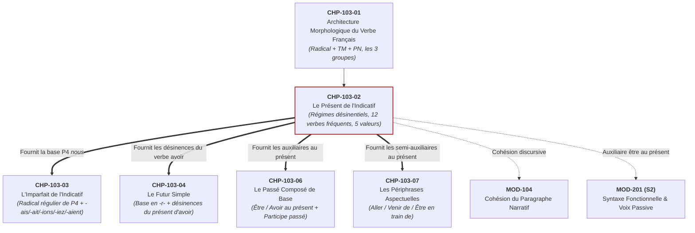
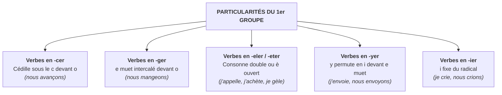

# Chapitre 2 — Le Présent de l'Indicatif : Formes Régulières, les 12 Verbes Fréquents et Valeurs d'Énonciation

> **Identifiant du chapitre** : `CHP-103-02`  
> **Module de rattachement** : [`MOD-103` — Le Système Verbal à l'Indicatif : Morphologie des Régularités, Verbes Fréquents Irréguliers, Passé Composé Régulier/Être et Périphrases Aspectuelles](file:///f:/Formation/world-class-french/03-curriculum/year-1/semester-1/mod-103-systeme-verbal-indicatif.md)  
> **Semestre** : Année 1 — Semestre 1 (S1)  
> **Volume horaire canonique** : 5 à 6 heures d'apprentissage autonome délibéré et d'ateliers d'application (Phase 1 Étude : 1 h 30 | Phase 2 Pratique : 1 h 30 | Phase 3 Correction : 1 h 00 | Phase 4 Évaluation : 1 h 00)  
> **Statut** : [STATUT : VALIDÉ]  
> **Compétences associées** : [`FR-VERB-001`](file:///f:/Formation/world-class-french/02-competency-framework/competency-framework.md#fr-verb-001-maîtrise-des-valeurs-aspectuo-temporelles-de-lindicatif) (L3 Autonomie), [`FR-ORTHO-002`](file:///f:/Formation/world-class-french/02-competency-framework/competency-framework.md#fr-ortho-002-mécanique-infaillible-de-laccord-sujet-verbe) (L3 Autonomie)  
> **Sources scientifiques de référence** : `SRC-NORM-03` (Ministère de l'Éducation nationale, 2020, p. 34-36), `SRC-GRAM-02` (Riegel et al., 2016, chap. 8-9), `SRC-GRAM-01` (Grevisse & Goosse, 2016, § 780-805 et § 850-860), `SRC-GRAM-05` (Grevisse, 2009, § 70-76), `SRC-NORM-02` (Conseil supérieur de la langue française, 1990)

---

## 1. Titre et Place dans le Cursus

### 1.1 Intitulé Officiel
**Chapitre 2 : Le Présent de l'Indicatif : Formes Régulières, les 12 Verbes Fréquents et Valeurs d'Énonciation** (`CHP-103-02`).

### 1.2 Insertion Architecturale dans le Module MOD-103 et le Cursus
Le présent de l'indicatif est le pivot absolu de l'ensemble du système verbal français. Il constitue à la fois le temps de référence de la parole vivante, le point d'amarrage chronologique du locuteur ($T_0$) et le réservoir morphologique fondamental d'où dérivent les radicaux de l'imparfait, du subjonctif et des formes périphrastiques.

Ce chapitre s'articule directement avec l'architecture générale du cursus :



- **En amont** : Ce chapitre mobilise immédiatement les principes établis dans `CHP-103-01` : l'équation canonique $[Radical] + [Marque\;de\;temps/mode] + [Désinence\;personnelle]$, la distinction des trois groupes verbaux et la classification des désinences personnelles de personne et de nombre. Il s'appuie également sur la maîtrise de l'accord sujet-verbe consolidée dans [`CHP-102-05`](file:///f:/Formation/world-class-french/03-curriculum/year-1/semester-1/mod-102/chp-102-05-accord-sujet-verbe-fondamental.md).
- **Au sein du module `MOD-103`** :
  - Il fournit le radical de 1re personne du pluriel (P4 *nous*) qui servira de matrice universelle pour former l'imparfait dans `CHP-103-03` (*nous chant-ons* $\rightarrow$ *nous chant-ions* ; *nous finiss-ons* $\rightarrow$ *nous finiss-ions* ; *nous pren-ons* $\rightarrow$ *nous pren-ions*) ;
  - Il fournit les formes du verbe *avoir* (*ai, as, a, avons, avez, ont*) qui constituent historiquement et formellement les désinences du futur simple dans `CHP-103-04` ;
  - Il installe la conjugaison immédiate des deux auxiliaires *être* et *avoir*, indispensable à la formation du passé composé dans `CHP-103-06` ;
  - Il permet de manier les semi-auxiliaires (*aller*, *venir*, *être*) indispensables aux périphrases aspectuelles de `CHP-103-07`.
- **En aval dans le cursus** :
  - `MOD-104` : insertion maîtrisée du présent de narration et du présent d'actualité dans le paragraphe écrit ;
  - `MOD-201` : morphologie passive au présent (*il est reçu*) et analyse de la valence ;
  - `MOD-302` : concordance des temps et distinction modale indicatif vs subjonctif présent.

---

## 2. Objectifs Mesurables

Au terme de l'étude autonome et des ateliers d'application de ce chapitre, l'apprenant doit être capable de :

1. **Conjuguer sans hésitation ni erreur orthographique les verbes réguliers des trois groupes selon leurs régimes désinentiels respectifs**, en appliquant le régime en *-e, -es, -e* (1er groupe et verbes spécifiques en *-ir*) ou le régime en *-s, -s, -t* / *-d* (2e et 3e groupes), et en résolvant toutes les alternances graphiques du 1er groupe (*-cer, -ger, -eler, -eter, -yer, -ier*) [Réf. `SRC-NORM-03`, p. 34].
2. **Restituer et orthographier infailliblement les formes des 12 verbes irréguliers à haute fréquence** (*être, avoir, aller, faire, dire, pouvoir, vouloir, savoir, voir, venir, prendre, devoir*) aux six personnes grammaticales, en identifiant leurs bases allomorphes et leurs désinences atypiques (*vous faites, vous dites, ils font, ils vont, ils sont, ils ont*) [Réf. `SRC-GRAM-01`, § 780-805].
3. **Identifier et discriminer avec rigueur les cinq valeurs textuelles et discursives du présent** (présent d'énonciation / déictique, présent d'habitude / itératif, présent de vérité générale / atemporel, futur proche / prospectif, présent de narration / historique) dans un corpus d'idées ou un extrait littéraire [Réf. `SRC-GRAM-02`, chap. 9].
4. **Détecter, réfuter scientifiquement et rectifier les fautes morphologiques récurrentes du présent** (*« vous faisez »*, *« ils disents »*, *« il conclu »*, *« j'envois »*, etc.) dans des documents professionnels et administratifs, en explicitant le piège analogique et la règle académique transgressée [Réf. `SRC-GRAM-05`, § 70-76].

---

## 3. Prérequis et Test de Préparation (Auto-Diagnostic)

### 3.1 Prérequis Cognitifs
- Maîtrise de l'équation morphologique du verbe $[Radical] + [Marque\;TM] + [Désinence\;PN]$ issue de `CHP-103-01`.
- Reconnaissance immédiate des six personnes grammaticales : Singulier (P1 *je/j'*, P2 *tu*, P3 *il/elle/on*) et Pluriel (P4 *nous*, P5 *vous*, P6 *ils/elles*).
- Identification infaillible du sujet donneur d'accord dans la phrase simple contiguë ou perturbée (`CHP-102-05`).

### 3.2 Test de Préparation Immédiat
Résolvez par écrit les cinq questions suivantes avant d'aborder le cours :

1. Quelle est la désinence de 1re personne du singulier (P1) du verbe *travailler* au présent de l'indicatif ? Est-elle identique à celle du verbe *dormir* ?
2. Pourquoi écrit-on *« nous avançons »* avec une cédille, alors que le verbe à l'infinitif s'écrit *avancer* sans cédille ?
3. Complétez avec la forme correcte au présent : *« Vous (faire) [...] preuve de rigueur et vous (dire) [...] la vérité. »*
4. Dans la phrase : *« La Terre tourne autour du Soleil »*, quelle est la valeur temporelle exprimée par le verbe *tourne* ?
5. Quelle lettre termine la 3e personne du singulier (P3) du verbe *rendre* au présent (*il ren...*) ? Prend-elle un *-t* ?

---

#### Corrigé de l'Auto-Diagnostic

<details>
<summary>Afficher le corrigé de l'auto-diagnostic</summary>

1. **Désinence P1 de *travailler* : *-e* (*je travaille*)** ; elle n'est pas identique à celle de *dormir*, qui prend un **-s** (*je dors*). Le 1er groupe relève du régime vocalique en *-e*, tandis que les 2e et 3e groupes relèvent en règle générale du régime consonantique en *-s*.
2. **Pour maintenir la prononciation du phonème /s/** : la lettre `<c>` devant la lettre `<o>` se prononce /k/ (comme dans *conte*). Pour conserver le son /s/ de l'infinitif *avancer*, on doit placer une cédille sous le `<c>` devant les voyelles dures `<a>` et `<o>` (*nous avançons*).
3. **« Vous faites »** et **« vous dites »** : ces deux verbes ont conservé en français moderne la désinence étymologique latine en *-tes* (latin *facitis*, *dicitis*), et ne prennent jamais la terminaison régulière en *-ez*.
4. **Présent de vérité générale (ou atemporel)** : l'énoncé exprime une loi scientifique universelle, vraie en tout temps, indépendante de l'instant précis où le locuteur s'exprime.
5. **La lettre finale est un « d » (*il rend*)** : les verbes réguliers en *-dre* conservent le *d* de leur radical à la 3e personne du singulier et ne prennent aucun *-t* supplémentaire.

</details>

---

## 4. Situation de Départ ou Problème Concret : Les Fautes Déclassantes du Présent

### 4.1 L'Erreur Morphologique en Milieu Professionnel et Académique
Considérez ces phrases issues de rapports administratifs, de procès-verbaux de réunions ou de courriels professionnels :

> *« Si vous **faisez** une erreur dans la saisie, le logiciel bloque le système. »*  
> *« Les délégués syndicaux **disents** ce qu'ils pensent de la réforme. »*  
> *« Je vous **envois** ci-joint le relevé de conclusions validé. »*  
> *« Notre direction générale **conclu** que l'accord doit être signé sans délai. »*

Ces graphies constituent des fautes de morphologie verbale déclassantes. À l'université, dans un concours administratif ou dans la rédaction d'un acte officiel, elles disqualifient immédiatement leur auteur :
- *\*vous faisez* et *\*vous disez* révèlent une défaillance élémentaire sur les verbes les plus fréquents de la langue française ;
- *\*ils disents* trahit un double marquage fautif (adjonction d'un *-s* sur une désinence plurielle *-ent* déjà complète) ;
- *\*j'envois* et *\*il conclu* attestent d'une incompréhension des deux grands régimes désinentiels de la langue.

### 4.2 L'Origine Cognitive de la Faute : L'Analogie Trompeuse
Pourquoi un scripteur instruit commet-il ces erreurs ?  
Le cerveau humain cherche constamment des motifs réguliers pour économiser son effort :
1. **L'attraction du 1er groupe** : Le 1er groupe regroupe plus de 88 % des verbes de la langue française et possède une désinence unique à P5 (*-ez*). Le cerveau applique machinalement ce modèle aux verbes fréquents (*vous chant-ez* $\rightarrow$ *\*vous fais-ez*).
2. **L'analogie du pluriel nominal** : Au nom pluriel, la marque ordinaire est *-s*. Le scripteur inattentif tente d'ajouter un *-s* à la finale verbale plurielle (*ils chantent* $\rightarrow$ *\*ils chantents*).
3. **La confusion de la 1re personne** : Sachant que beaucoup de verbes prennent un *-s* à P1 (*je finis, je pars, je prends*), le scripteur ajoute un *-s* indu aux verbes du 1er groupe (*je chante* $\rightarrow$ *\*je chantes* ; *j'envoie* $\rightarrow$ *\*j'envois*).

Pour éliminer ces fautes, il est indispensable de maîtriser la mécanique binaire des **deux régimes désinentiels** et la matrice des **12 verbes irréguliers fréquents**.

---

## 5. Explication Intuitive : L'Ancre Temporelle du Locuteur

Pour comprendre le fonctionnement du présent de l'indicatif, imaginons un **navire jetant son ancre dans l'océan du temps** :

```text
       PASSÉ (Révolu)            PRÉSENT (Point d'amarrage T0)          AVENIR (Prospectif)
   <─────────────────────────────[ ANCRE TEMPORELLE ]─────────────────────────────>
                                          │
                                 MOMENT D'ÉNONCIATION
                               (Ici et maintenant de parole)
                                          │
           ┌──────────────────────────────┴──────────────────────────────┐
           │                                                             │
  [ ANCRE FIXE DANS L'INSTANT ]                                 [ ANCRE JETÉE HORS-TEMPS ]
  • Présent d'énonciation :                                     • Vérité générale :
    "Je vous écoute." (T0 strict)                                 "La Terre tourne." (Omnitemporel)
  • Présent d'habitude :                                        • Présent de narration :
    "Il court chaque matin." (Cycle)                              "Le roi avance et frappe." (Passé ravivé)
```

1. **L'amarrage déictique (l'ancre dans le sable de l'instant)** : Quand le locuteur parle au présent, il amarre son propos à son propre moment d'élocution ($T_0$). Le présent coïncide strictement avec la vibration de sa voix ou la trace de sa plume (*« En cet instant, je vous écris »*).
2. **L'ancre dans la marée récurrente (le présent d'habitude)** : Le locuteur utilise la même ancre pour baliser des marées qui se répètent régulièrement (*« Chaque matin, l'artisan ouvre son atelier »*).
3. **L'ancre cosmique (le présent de vérité générale)** : L'ancre est suspendue au-dessus des siècles ; l'énoncé est vrai hier, aujourd'hui et demain (*« Deux et deux font quatre »*).
4. **L'ancre téléportée (le présent de narration)** : Le narrateur transporte délibérément son ancre au cœur d'une bataille du passé pour faire vivre l'action au lecteur comme si elle se déroulait sous ses yeux.

---

## 6. Définitions Précises et Terminologie Fondamentale

Chacun des termes suivants doit être employé avec une exactitude linguistique rigoureuse [Réf. `SRC-NORM-03`, p. 34-36 ; `SRC-GRAM-02`, chap. 8-9] :

### 6.1 Présent de l'Indicatif
Le **présent de l'indicatif** est le temps fondamental du mode indicatif marquant l'époque présente. Il situe le procès comme contemporain du moment de l'énonciation ($T_0$) ou envisage le procès sans limitation temporelle.

### 6.2 Régimes Désinentiels
Un **régime désinentiel** est l'ensemble systématique et fermé des terminaisons personnelles qui s'adjoignent à la base verbale au présent :
- **Régime vocalique en *-e / -es / -e*** : Caractéristique du 1er groupe et des verbes du 3e groupe en *-vrir, -frir, -llir*.
- **Régime consonantique en *-s / -s / -t*** (ou *-d*) : Caractéristique du 2e groupe et de la quasi-totalité des verbes du 3e groupe.

### 6.3 Personnes Grammaticales (P1 à P6)
Nomenclature standardisée désignant les positions actancielles de l'énonciation :
- **P1** : Première personne du singulier (*je, j'* — le locuteur).
- **P2** : Deuxième personne du singulier (*tu* — l'interlocuteur).
- **P3** : Troisième personne du singulier (*il, elle, on* — le non-locuteur).
- **P4** : Première personne du pluriel (*nous* — le groupe incluant le locuteur).
- **P5** : Deuxième personne du pluriel (*vous* — le groupe des interlocuteurs ou forme de politesse).
- **P6** : Troisième personne du pluriel (*ils, elles* — le groupe des non-locuteurs).

### 6.4 Valeur Déictique / Présent d'Énonciation
Valeur temporelle où le temps de l'événement coïncide exactement avec l'acte de parole du locuteur ($T_{procès} = T_0$).

### 6.5 Présent d'Habitude (ou Itératif)
Valeur sémantique où le verbe exprime un procès discontinu qui se répète périodiquement, créant une règle ou un usage englobant le moment présent.

### 6.6 Présent de Vérité Générale (Atemporel / Omnitemporel)
Emploi du présent dans lequel l'assertion est posée comme universellement vraie en tout temps et en tout lieu (proverbes, maximes morales, théorèmes scientifiques, définitions lexicales).

### 6.7 Présent de Narration (ou Historique)
Procédé stylistique par lequel des procès situés dans le passé révolu sont conjugués au présent pour conférer au récit dynamisme, vivacité et illusion d'immédiateté.

### 6.8 Présent à Valeur de Futur Proche (Prospectif)
Emploi du présent actualisant une action située dans un avenir immédiat ou perçue comme certaine et déjà engagée (*« Je pars demain matin »*).

---

## 7. Règles et Mécanismes Fondamentaux

### 7.1 Les Deux Grands Régimes Désinentiels Réguliers

La morphologie du présent de l'indicatif en français obéit à une architecture binaire stricte aux personnes du singulier (P1, P2, P3), tandis que les personnes du pluriel (P4, P5, P6) partagent un socle presque universel [Réf. `SRC-NORM-03`, p. 34] :

```text
              RÉGIME EN -E / -ES / -E               RÉGIME EN -S / -S / -T (ou -D)
       (1er groupe + verbes en -ir assimilés)             (2e groupe et 3e groupe)
 Singulier :                                          Singulier :
   • P1 :  Radical + -e                                 • P1 :  Radical + -s  (ou -x)
   • P2 :  Radical + -es                                • P2 :  Radical + -s  (ou -x)
   • P3 :  Radical + -e                                 • P3 :  Radical + -t  (ou -d)
 Pluriel :                                            Pluriel :
   • P4 :  Radical + -ons                               • P4 :  Radical + -ons  (2e gr. : -iss-ons)
   • P5 :  Radical + -ez                                • P5 :  Radical + -ez   (2e gr. : -iss-ez)
   • P6 :  Radical + -ent                               • P6 :  Radical + -ent  (2e gr. : -iss-ent)
```

#### A. Le Régime en -e / -es / -e
Ce régime s'applique obligatoirement à :
1. **Tous les verbes du 1er groupe en *-er*** (sauf *aller*) :  
   *Chanter* $\rightarrow$ *je chante, tu chantes, il chante, nous chantons, vous chantez, ils chantent*.
2. **Certains verbes en *-ir* du 3e groupe** qui adoptent intégralement ce régime au singulier :  
   - Les verbes en *-vrir* et *-frir* : *ouvrir* (*j'ouvre*), *couvrir* (*je couvre*), *découvrir* (*je découvre*), *offrir* (*j'offre*), *souffrir* (*je souffre*) ;
   - Les verbes en *-eillir* et *-aillir* : *cueillir* (*je cueille*), *accueillir* (*j'accueille*), *recueillir* (*je recueille*), *tressaillir* (*je tressaille*), *assaillir* (*j'assaille*).

> [!IMPORTANT]
> **Règle d'or du régime en -e** : Tout verbe dont la 1re personne du singulier se termine par un **-e** muet ne prend **jamais de -s** à P1 (*j'ouvre*, *je cueille*, *j'envoie*, *je travaille*). Écrire *\*j'ouvres* ou *\*j'envois* est une faute absolue.

#### B. Le Régime en -s / -s / -t (ou -d)
Ce régime s'applique à :
1. **Tous les verbes du 2e groupe en *-ir / -issant*** :  
   Le radical lexical reçoit l'élément inchoatif *-iss-* aux trois personnes du pluriel :  
   *Finir* $\rightarrow$ *je finis, tu finis, il finit, nous finissons, vous finissez, ils finissent*.
2. **La grande majorité des verbes du 3e groupe** :  
   *Partir* $\rightarrow$ *je pars, tu pars, il part, nous partons, vous partez, ils partent*.  
   *Dormir* $\rightarrow$ *je dors, tu dors, il dort, nous dormons, vous dormez, ils dorment*.
3. **La variante en -d pour les verbes en *-dre*** :  
   Les verbes en *-dre* (sauf ceux en *-indre* et *-soudre*) conservent la consonne dentale `<d>` du radical à P3. La terminaison de P3 est alors vide (marquée $\varnothing$) :  
   *Vendre* $\rightarrow$ *je vends, tu vends, il vend* ($\varnothing$, pas de *-t*).  
   *Rendre* $\rightarrow$ *je rends, tu rends, il rend*.  
   *Prendre* $\rightarrow$ *je prends, tu prends, il prend*.

---

### 7.2 Les Particularités Orthographiques du 1er Groupe

Bien que le 1er groupe présente une régularité morphologique remarquable, plusieurs séries verbales imposent des ajustements graphiques précis pour préserver la valeur phonétique du radical ou respecter l'accentuation [Réf. `SRC-GRAM-01`, § 782-788] :



#### 1. Verbes en -cer : La règle de la cédille
La lettre `<c>` se prononce /s/ devant `e` et `i`, mais /k/ devant `a`, `o`, `u`. Pour conserver le phonème /s/ du radical à P4 (*nous*), on ajoute obligatoirement une cédille sous le `<c>` devant la lettre `<o>` de la désinence *-ons* :
- *Avancer* $\rightarrow$ *j'avance*, mais *nous avançons*.
- *Placer* $\rightarrow$ *je place*, mais *nous plaçons*.
- *Lancer* $\rightarrow$ *je lance*, mais *nous lançons*.

#### 2. Verbes en -ger : La règle du e muet intercalaire
La lettre `<g>` se prononce /ʒ/ devant `e` et `i`, mais /g/ (dur) devant `a`, `o`, `u`. Pour préserver la prononciation /ʒ/ du radical à P4, on intercale un `e` muet graphique entre le radical et la désinence *-ons* :
- *Manger* $\rightarrow$ *je mange*, mais *nous mangeons*.
- *Partager* $\rightarrow$ *je partage*, mais *nous partageons*.
- *Exiger* $\rightarrow$ *j'exige*, mais *nous exigeons*.

#### 3. Verbes en -eler et -eter : L'alternance consonne double / accent grave
Devant une syllabe contenant un `e` muet, le schwa /ə/ du radical devient une voyelle ouverte /ɛ/ :
- **Tradition graphique classique** :
  - La plupart des verbes doublent la consonne : *appeler* $\rightarrow$ *j'appelle, tu appelles, il appelle, ils appellent* (mais *nous appelons, vous appelez*) ; *jeter* $\rightarrow$ *je jette, tu jettes, il jette, ils jettent* (mais *nous jetons, vous jetez*).
  - D'autres verbes prennent un accent grave sur le `e` : *geler* $\rightarrow$ *je gèle*, *acheter* $\rightarrow$ *j'achète*, *peler* $\rightarrow$ *je pèle*.
- **Recommandation officielle des Rectifications de 1990 (`SRC-NORM-02`)** :
  Tous les verbes en *-eler* et *-eter* s'alignent sur le modèle régulier à accent grave (*modèle achète, gèle*), **à l'exception absolue d'*appeler* et de *jeter*** (ainsi que de leurs dérivés directs : *rappeler, rejeter*) qui conservent la consonne doublée (*j'appelle, je jette*). Les formes *j'amoncèle* ou *il époussète* sont ainsi validées par l'Académie française.

#### 4. Verbes en -yer : L'alternance y / i
- **Verbes en *-oyer* et *-uyer*** : La lettre `<y>` permute obligatoirement en `<i>` devant une désinence muente (*-e, -es, -ent*) :  
  *Envoyer* $\rightarrow$ *j'envoie, tu envoies, il envoie, ils envoient* (mais *nous envoyons, vous envoyez*).  
  *Essuyer* $\rightarrow$ *j'essuie, tu essuies, il essuie, ils essuient* (mais *nous essuyons, vous essuyez*).
- **Verbes en *-ayer*** : La permutation est facultative selon la norme (`SRC-GRAM-01`, § 786). On peut écrire indifféremment :  
  *Payer* $\rightarrow$ *je paye* ou *je paie* ; *ils payent* ou *ils paient*.

#### 5. Verbes en -ier : La régularité trompeuse
Les verbes en *-ier* (*crier, remercier, étudier*) ne subissent aucune altération au présent :  
*Crier* $\rightarrow$ *je crie, tu cries, il crie, nous crions, vous criez, ils crient*.  
Attention à ne jamais insérer de consonne parasite à l'écrit.

---

### 7.3 Les 12 Verbes Irréguliers Fréquents au Présent

En langue française, douze verbes du 3e groupe (et les deux auxiliaires) totalisent à eux seuls la majorité des occurrences verbales écrites et orales. Leur morphologie repose sur des **radicaux allomorphes** (plusieurs bases historiques distinctes selon la personne) et quelques désinences exceptionnelles [Réf. `SRC-NORM-03`, p. 36 ; `SRC-GRAM-01`, § 790-805] :

```text
=============================================================================================
  VERBE       RADICAUX EN PRÉSENCE          SINGULIER (P1, P2, P3)     PLURIEL (P4, P5, P6)
=============================================================================================
  1. être     su-, es-, somm-, êt-, s-      je suis, tu es, il est     nous sommes, vous êtes, ils sont
  2. avoir    ai-, a-, av-, ont             j'ai, tu as, il a          nous avons, vous avez, ils ont
  3. aller    va-, all-, v-                 je vais, tu vas, il va     nous allons, vous allez, ils vont
  4. faire    fai-, fais-, fait-, f-        je fais, tu fais, il fait  nous faisons, VOUS FAITES, ILS FONT
  5. dire     di-, dis-, dit-               je dis, tu dis, il dit     nous disons, VOUS DITES, ils disent
  6. pouvoir  peux/pui-, pouv-, peuv-       je peux (puis), tu peux,   nous pouvons, vous pouvez,
                                            il peut                    ils peuvent
  7. vouloir  veu-, voul-, veul-            je veux, tu veux, il veut  nous voulons, vous voulez, ils veulent
  8. savoir   sai-, sav-                    je sais, tu sais, il sait  nous savons, vous savez, ils savent
  9. voir     voi-, voy-                    je vois, tu vois, il voit  nous voyons, vous voyez, ils voient
 10. venir    vien-, ven-, vienn-           je viens, tu viens, il     nous venons, vous venez,
                                            vient                      ils viennent
 11. prendre  prend-, pren-, prenn-         je prends, tu prends, il   nous prenons, vous prenez,
                                            prend                      ils prennent
 12. devoir   doi-, dev-, doiv-             je dois, tu dois, il doit  nous devons, vous devez, ils doivent
=============================================================================================
```

> [!CAUTION]
> **Les deux anomalies majeures de P5** : *Faire* et *dire* font **vous faites** et **vous dites**. Ils ne se terminent pas par *-ez*.
> 
> **Les quatre anomalies majeures de P6** : *Être, avoir, aller, faire* font **ils sont, ils ont, ils vont, ils font**. Ce sont les quatre seuls verbes de la langue française dont la 3e personne du pluriel du présent se termine par **-ont** (et non par *-ent*).

---

### 7.4 Les Cinq Valeurs Discursives et Textuelles du Présent

Le présent de l'indicatif n'est pas univoque : il assume cinq fonctions distinctes selon son insertion dans le discours ou le récit [Réf. `SRC-GRAM-02`, chap. 9] :

1. **Présent d'énonciation (déictique)** :  
   Le procès coïncide exactement avec le moment où parle le locuteur ($T_0$).  
   *Exemple* : *« En ce moment même, je vous écoute et je note vos remarques. »*
2. **Présent d'habitude (itératif)** :  
   Le verbe exprime un procès répété, périodique ou coutumier, englobant le repère présent sans coïncider nécessairement avec l'instant précis de la parole.  
   *Exemple* : *« Chaque matin, l'avocat consulte ses dossiers avant l'audience. »*
3. **Présent de vérité générale (atemporel / omnitemporel)** :  
   L'énoncé formule une loi scientifique, une vérité morale, une définition ou un proverbe considéré comme vrai indépendamment de toute époque.  
   *Exemple* : *« Rien ne se perd, rien ne se crée, tout se transforme. »*
4. **Présent à valeur de futur proche (prospectif)** :  
   Dans le discours standard ou familier, le présent actualise une action à venir perçue comme immédiate, inéluctable ou fermement programmée.  
   *Exemple* : *« Attendez-moi ici : je reviens dans deux minutes. »*
5. **Présent de narration (historique)** :  
   Dans un récit conduit au passé (imparfait, passé simple), le narrateur emploie soudain le présent pour faire revivre un événement marquant sous les yeux du lecteur et accélérer le tempo dramatique.  
   *Exemple* : *« La nuit était noire et le vent soufflait en tempête ; soudain, la porte s'ouvre et un inconnu surgit dans la pièce. »*

---

## 8. Raisonnement Détaillé (Le Pourquoi des Formes et de l'Évolution)

Pourquoi la langue française conserve-t-elle ces anomalies morphologiques qui semblent contredire la régularité du système ? La phonétique historique et l'étymologie latine éclairent l'origine de ces formes [Réf. `SRC-GRAM-01`, § 780-805].

### 8.1 Pourquoi la 2e personne du pluriel (P5) de faire et dire est-elle en -tes ?
En latin classique, la désinence de 2e personne du pluriel était *-tis* :
- *cantatis* $\rightarrow$ l'accent tonique portait sur le *a* long ; la désinence a évolué régulièrement en ancien français vers *-ez* (*vous chantez*) ;
- *facitis* et *dicitis* : ces verbes appartenaient à la 3e conjugaison latine où l'accent tonique portait sur la syllabe radicale (*fá-ci-tis*, *dí-ci-tis*). La voyelle brève post-tonique *i* s'est rapidement amuïe (chute phonétique), provoquant la soudure directe de la consonne du radical avec la désinence :  
  $$\text{fácitis} \longrightarrow \text{factis} \longrightarrow \text{faites}$$  
  $$\text{dícitis} \longrightarrow \text{dictis} \longrightarrow \text{dites}$$  
  $$\text{éstis} \longrightarrow \text{êtes}$$
Alors que les autres verbes de la langue ont été régularisés au cours des siècles par nivellement analogique en *-ez*, *être*, *faire* et *dire* ont conservé leur forme archaïque intacte en raison de leur fréquence d'utilisation écrasante dans le langage quotidien.

### 8.2 Pourquoi ils font, ils vont, ils sont et ils ont se terminent-ils par -ont ?
En latin classique et en bas-latin :
- *sunt* $\rightarrow$ a donné régulièrement en français *sont* ;
- *habent* (remplacé en latin populaire par *aont* d'après *sunt*) $\rightarrow$ a donné *ont* ;
- *faciunt* (latin vulgaire *faont*) $\rightarrow$ a donné *font* ;
- *vadunt* (latin vulgaire *vaont*) $\rightarrow$ a donné *vont*.

Ces quatre verbes majeurs ont conservé la finale nasale vélaire en /-ɔ̃/ issue de *-unt*. Ce sont exactement ces quatre formes (*ai, as, a, avons, avez, ont*) qui, soudées à l'infinitif à l'époque romane, ont créé les terminaisons universelles du futur simple : *chanter + ai* $\rightarrow$ *chanterai* ; *chanter + ont* $\rightarrow$ *chanteront*.

### 8.3 Pourquoi la 1re personne du singulier (P1) du 1er groupe n'a-t-elle pas de -s ?
En latin, la 1re personne du singulier des verbes de la première conjugaison se terminait par *-o* (*canto*). En passant au français :
- La voyelle finale atone *-o* s'est affaiblie en un schwa muet `[ə]` d'appui graphique : *canto* $\rightarrow$ *chante*.
- Dans les autres conjugaisons latines (*dormio*, *finio*), le français médiéval a introduit un *-s* analogique à P1 pour aligner la marque de 1re personne sur celle de 2e personne (*tu dors* $\rightarrow$ *je dors* ; *tu finis* $\rightarrow$ *je finis*).
- Mais pour les verbes en *-er* (1er groupe), la présence du *e* muet a empêché l'adjonction de cette consonne. Le 1er groupe a donc maintenu rigoureusement sa terminaison nue en *-e*, sans jamais tolérer de *-s*.

---

## 9. Exemples Corrects Commentés

### 9.1 Tableaux de Conjugaison des 12 Verbes Fréquents au Présent

```text
1. ÊTRE                          2. AVOIR                         3. ALLER
je suis         nous sommes      j'ai            nous avons       je vais         nous allons
tu es           vous êtes        tu as           vous avez        tu vas          vous allez
il/elle est     ils/elles sont   il/elle a       ils/elles ont    il/elle va      ils/elles vont

4. FAIRE                         5. DIRE                          6. POUVOIR
je fais         nous faisons     je dis          nous disons      je peux (puis)  nous pouvons
tu fais         VOUS FAITES      tu dis          VOUS DITES       tu peux         vous pouvez
il/elle fait    ILS FONT         il/elle dit     ils/elles disent il/elle peut    ils/elles peuvent

7. VOULOIR                       8. SAVOIR                        9. VOIR
je veux         nous voulons     je sais         nous savons      je vois         nous voyons
tu veux         vous voulez      tu sais         vous savez       tu vois         vous voyez
il/elle veut    ils/elles veulentil/elle sait    ils/elles savent il/elle voit    ils/elles voient

10. VENIR                        11. PRENDRE                      12. DEVOIR
je viens        nous venons      je prends       nous prenons     je dois         nous devons
tu viens        vous venez       tu prends       vous prenez      tu dois         vous devez
il/elle vient   ils/elles viennentil/elle prend   ils/elles prennentil/elle doit  ils/elles doivent
```

### 9.2 Analyse Détaillée de Phrases Modèles selon les Cinq Valeurs Discursives

#### Exemple 1 : Valeur d'Énonciation (Déictique)
*« Je vous écoute avec la plus grande attention et je prends note de vos exigences. »*
- **Verbes** : *écoute* (1er groupe, P1, radical *écout-* + désinence *-e*) et *prends* (3e groupe, P1, radical *prend-* + désinence *-s*).
- **Analyse énonciative** : Les procès coïncident rigoureusement avec le moment où le locuteur rédige ou prononce sa déclaration ($T_0$). L'amarrage temporel est strict et contemporain de l'acte de parole.

#### Exemple 2 : Valeur d'Habitude (Itératif)
*« Chaque matin, le pêcheur jette son filet dans la lagune et attend le lever du jour. »*
- **Verbes** : *jette* (1er groupe, verbe en *-eter* avec consonne doublée devant schwa muet, P3, désinence *-e*) et *attend* (3e groupe en *-dre*, radical *attend-* conservant le *d*, P3, terminaison $\varnothing$).
- **Analyse énonciative** : L'adverbe temporel *chaque matin* marque une périodicité. Le procès n'a pas nécessairement lieu à la seconde même où la phrase est lue, mais s'inscrit dans un cycle temporel permanent.

#### Exemple 3 : Valeur de Vérité Générale (Atemporel)
*« Rien ne se perd, rien ne se crée, tout se transforme. »*
- **Verbes** : *perd* (3e groupe en *-dre*, radical *perd-*, P3 en *-d*), *crée* (1er groupe en *-éer*, radical *cré-*, P3 en *-e*), *transforme* (1er groupe, P3 en *-e*).
- **Analyse énonciative** : Maxime scientifique universelle attribuée à Lavoisier. La proposition est posée comme vraie de tout temps, en dehors de toute chronologie historique délimitée.

#### Exemple 4 : Valeur de Futur Proche (Prospectif)
*« Ne quittez pas votre bureau : le directeur général arrive dans dix minutes. »*
- **Verbe** : *arrive* (1er groupe, P3, désinence *-e*).
- **Analyse énonciative** : Le procès est situé dans un futur proche (dans dix minutes). L'emploi du présent confère à l'événement une certitude quasi absolue et un caractère d'imminence indiscutable.

#### Exemple 5 : Valeur de Narration (Historique)
*« Les troupes progressaient péniblement sous l'orage ; soudain, le canon retentit et les colonnes s'ébranlent d'un seul élan. »*
- **Verbes** : *progressaient* (imparfait sécant posant l'arrière-plan descriptif) $\rightarrow$ rupture par *retentit* (passé simple ou présent de rupture) et *s'ébranlent* (1er groupe, P6 au présent, désinence *-ent*).
- **Analyse énonciative** : L'irruption du présent au milieu d'un récit au passé projette le lecteur au premier plan de l'action, conférant un relief saisissant à la scène.

---

## 10. Contre-Exemples et Erreurs Fréquentes : Clinique des Fautes Récurrentes

Voici l'analyse clinique de **six fautes récurrentes** observées chez les scripteurs :

### Erreur n° 1 : Les formes analogiques *« Vous faisez »* et *« Vous disez »*
- **Formes fautives** : *\*« Si vous faisez attention... »* ; *\*« Vous disez toujours la même chose. »*
- **Formes correctes** : **« Si vous faites attention... »** ; **« Vous dites toujours la même chose. »**
- **Diagnostic linguistique** : Application abusive de la désinence régulière *-ez* du 1er groupe sur des verbes issus de la 3e conjugaison latine ayant conservé la terminaison étymologique en *-tes*.  
  *(Attention : les dérivés de dire comme contredire, médire, interdire font régulièrement vous contredisez, vous médisez, vous interdisez ; seul redire fait vous redites).*

### Erreur n° 2 : Les désinences parasites *« Ils disents »* et *« Ils fassent »*
- **Formes fautives** : *\*« Les témoins disents la vérité. »* ; *\*« Ils fassent tout leur travail. »*
- **Formes correctes** : **« Les témoins disent la vérité. »** ; **« Ils font tout leur travail. »**
- **Diagnostic linguistique** :
  - Dans *\*ils disents*, le scripteur ajoute un *-s* nominal superflue sur la désinence de 3e personne du pluriel *-ent*, qui est déjà intrinsèquement plurielle et ne tolère jamais de marque supplémentaire.
  - Dans *\*ils fassent*, le scripteur télescope l'indicatif avec le subjonctif présent (*qu'ils fassent*). À l'indicatif présent, le verbe *faire* a pour forme unique **ils font**.

### Erreur n° 3 : L'adjonction fautive d'un -s à P1 sur les verbes en -e (*« J'envois »*, *« J'ouvres »*)
- **Formes fautives** : *\*« Je vous envois mon dossier. »* ; *\*« J'ouvres la porte. »* ; *\*« J'appuis votre candidature. »*
- **Formes correctes** : **« Je vous envoie mon dossier. »** ; **« J'ouvre la porte. »** ; **« J'appuie votre candidature. »**
- **Diagnostic linguistique** : Contamination phonétique par les verbes du 2e et 3e groupe (*je pars, je finis, je dis*). Au 1er groupe et pour les verbes assimilés (*ouvrir, cueillir*), la première personne du singulier se termine **exclusivement par un -e muet**, jamais par un *-s*.

### Erreur n° 4 : L'amputation du -t de P3 sur les verbes en -ure et -soudre (*« Il conclu »*, *« Il résou »*)
- **Formes fautives** : *\*« Le juge conclu à un non-lieu. »* ; *\*« Ce décret résou le problème. »*
- **Formes correctes** : **« Le juge conclut à un non-lieu. »** ; **« Ce décret résout le problème. »**
- **Diagnostic linguistique** : Confusion avec les verbes en *-dre* ou omission par analphabétisme morphologique du régime en *-s, -s, -t*. Les verbes en *-ure* (*conclure, exclure, inclure*) et en *-soudre* (*résoudre, dissoudre*) prennent obligatoirement un **-t** à la 3e personne du singulier (*il conclut, il exclut, il résout*).

### Erreur n° 5 : La confusion graphique sur P3 des verbes en -dre (*« Il vends »*, *« Il prendt »*)
- **Formes fautives** : *\*« Cet artisan vends ses créations. »* ; *\*« La police prendt le relais. »*
- **Formes correctes** : **« Cet artisan vend ses créations. »** ; **« La police prend le relais. »**
- **Diagnostic linguistique** :
  - Dans *\*il vends*, ajout d'un *-s* fautif à la 3e personne du singulier (la marque *-s* est réservée à P1 et P2).
  - Dans *\*il prendt*, adjonction redondante d'un *-t* derrière la dentale sonore *d*. Dans les verbes en *-dre* réguliers, le *d* du radical fait office de désinence consonantique terminale à P3 (*il vend, il prend, il mord, il perd*).

### Erreur n° 6 : La dislocation interrogative agrammaticale *\*« Peux-je »* au lieu de *« Puis-je »*
- **Forme fautive** : *\*« Peux-je vous interrompre un instant ? »*
- **Forme correcte** : **« Puis-je vous interrompre un instant ? »**
- **Diagnostic linguistique** : L'inversion interrogative à la 1re personne du singulier du verbe *pouvoir* exige obligatoirement l'allomorphe soutenu **puis** (/pɥi/). La forme *\*peux-je* est rigoureusement exclue du français standard.

---

## 11. Cas Particuliers et Limites

### 11.1 Verbes en -dre : La Distinction Fondamentale entre -dre, -indre et -soudre
Tous les verbes terminés par *-dre* ne se conjuguent pas de la même façon :

```text
========================================================================================
  CATÉGORIE               MODÈLE       RADICAL P1/P2/P3         FORME À P3 (SINGULIER)
========================================================================================
  Verbes en -dre réguliers Vendre,     Maintien du d           il vend, il rend,
  (-andre, -endre, -ondre) Rendre      (je vends, tu vends)    il perd, il répond
----------------------------------------------------------------------------------------
  Verbes en -indre         Peindre,    Chute du d, nasalisation il peint, il craint,
  (-eindre, -aindre,       Craindre,   et terminaison en -t     il joint
  -oindre)                 Joindre     (je peins, tu peins)
----------------------------------------------------------------------------------------
  Verbes en -soudre        Résoudre,   Chute du d               il résout,
                           Dissoudre   et terminaison en -t     il dissout
========================================================================================
```

- Les verbes en **-indre** (*peindre, craindre, joindre, éteindre*) perdent le *d* à toutes les personnes du présent et adoptent le régime régulier en *-s, -s, -t* :  
  *Je peins, tu peins, il peint, nous peignons, vous peignez, ils peignent*.
- Les verbes en **-soudre** (*résoudre, dissoudre, absoudre*) perdent également le *d* :  
  *Je résous, tu résous, il résout, nous résolvons, vous résolvez, ils résolvent*.

### 11.2 Les Verbes à P1 et P2 en -x
Seuls **trois verbes** de toute la langue française (et leurs dérivés) prennent un **-x** au lieu d'un *-s* aux deux premières personnes du singulier :
1. **Pouvoir** : *je peux, tu peux* (il peut) ;
2. **Vouloir** : *je veux, tu veux* (il veut) ;
3. **Valoir** (et ses dérivés *équivaloir, prévaloir*) : *je vaux, tu vaux* (il vaut).

### 11.3 Les Défectifs Fréquents au Présent
Certains verbes n'existent qu'à la 3e personne du singulier (verbes impersonnels) :
- *Falloir* $\rightarrow$ *il faut* (et non *\*je faux* ou *\*ils fallent*) ;
- *Pleuvoir* $\rightarrow$ *il pleut* (au sens propre météorologique).

### 11.4 Les Dérivés du Verbe dire
Attention à la scission morphologique parmi les dérivés de *dire* à P5 :
- *Redire* se conjugue comme *dire* $\rightarrow$ **vous redites** ;
- Tous les autres composés adoptent la désinence régulière en *-ez* $\rightarrow$ **vous contredisez, vous médisez, vous interdisez, vous dédisez, vous prédisez** ;
- Le verbe *maudire*, quant à lui, est passé entièrement au 2e groupe au pluriel $\rightarrow$ *nous maudissons, vous maudissez, ils maudissent*.

---

## 12. Approfondissement Adapté au Niveau : La Théorie Énonciative de Benveniste

Dans ses *Problèmes de linguistique générale* (1966), le linguiste Émile Benveniste a établi une distinction fondamentale entre deux régimes de fonctionnement de la langue française : le **discours** et l'**histoire** (ou récit).

### 12.1 Le Plan du Discours vs Le Plan de l'Histoire
- **Le Discours** : Tout énoncé qui suppose un locuteur et un auditeur, et chez le premier l'intention d'influencer le second. Le discours s'ancre dans la situation d'énonciation : il utilise abondamment les déictiques (*je, tu, ici, maintenant, aujourd'hui*) et a pour temps cardinal le **présent de l'indicatif**.
- **L'Histoire (Récit)** : Présentation des faits passés sans intervention explicite du locuteur (*« Les événements semblent se raconter d'eux-mêmes »*). Ses temps cardinaux sont le passé simple et l'imparfait, à l'exclusion du présent déictique et des pronoms de 1re et 2e personnes.

### 12.2 Le Présent comme « Temps Caméléon »
Ce qui fait la puissance stylistique du présent, c'est sa capacité à franchir la frontière entre ces deux mondes :
- Lorsqu'il est employé dans le discours, il est **déictique** : il ancre la réalité dans l'ici et maintenant de la voix ($T_0$).
- Lorsqu'il est introduit dans l'histoire (récit), il opère une **translation énonciative** (présent de narration) : il feint d'effacer la distance historique pour placer le lecteur en position de témoin oculaire direct, tout en restant compatible avec les repères temporels révolus (*« En 1789, le peuple prend la Bastille »*).

Le présent est le seul temps de l'indicatif capable de neutraliser la distinction temporelle pour devenir un pur instrument d'actualisation psychologique.

---

## 13. Comparaisons Différentielles

### 13.1 Tableau Différentiel : Régime en -e vs Régime en -s

| Critère d'opposition | Régime vocalique en -e / -es / -e | Régime consonantique en -s / -s / -t (ou -d) |
| :--- | :--- | :--- |
| **Classes verbales concernées** | 1er groupe (-er) + verbes en *-vrir, -frir, -llir* du 3e groupe (*ouvrir, cueillir*). | 2e groupe (-ir / -issant) + quasi-totalité du 3e groupe (*partir, rendre, peindre*). |
| **Terminaison P1 (*je*)** | **-e** muet (*je chante, j'ouvre, j'envoie*) — **JAMAIS DE -S**. | **-s** ou **-x** (*je finis, je pars, je vends, je veux*). |
| **Terminaison P2 (*tu*)** | **-es** (*tu chantes, tu ouvres, tu envoies*). | **-s** ou **-x** (*tu finis, tu pars, tu vends, tu veux*). |
| **Terminaison P3 (*il/elle*)** | **-e** muet (*il chante, il ouvre, il envoie*). | **-t** (*il finit, il part, il peint*) ou **-d** (*il vend, il prend*). |
| **Pluriel P4, P5, P6** | Régulier : *-ons, -ez, -ent* (*nous chantons, vous chantez, ils chantent*). | 2e groupe : *-issons, -issez, -issent* ; 3e groupe : allomorphes variés. |
| **Erreur clinique typique** | Adjonction d'un *-s* parasite à P1 (*\*j'envois, \*j'ouvres*). | Confusion sur la consonne finale de P3 (*\*il conclu, \*il vends*). |

### 13.2 Tableau Différentiel : Présent d'Énonciation vs Présent de Narration

| Paramètre linguistique | Présent d'Énonciation (Déictique) | Présent de Narration (Historique) |
| :--- | :--- | :--- |
| **Cadre énonciatif** | Plan du **Discours** (oral ou écrit interactif). | Plan du **Récit** (narration littéraire ou historique). |
| **Repère temporel ($T_0$)** | Strictement contemporain de l'acte de parole ($T_{procès} = T_0$). | Postérieur aux événements ($T_{procès} \ll T_0$, action passée). |
| **Marqueurs associés** | Déictiques du présent : *maintenant, en ce moment, aujourd'hui*. | Marqueurs du passé : *hier, à cette époque, soudain, alors, en 1804*. |
| **Alternance avec d'autres temps** | S'articule avec le passé composé et le futur simple. | S'articule avec l'imparfait et le passé simple. |
| **Effet de sens dominant** | Authenticité, prise directe, engagement du locuteur. | Dramatisation, vivacité, mise sous les yeux (*hypotypose*). |

---

## 14. Exercices Progressifs (Trois Niveaux d'Entraînement)

### 14.1 Niveau 1 : Drill sur les 12 Verbes Fréquents au Présent
Conjuguez les verbes entre parenthèses au présent de l'indicatif à la personne imposée :

1. *Vous (faire)* vos devoirs avec une régularité exemplaire.
2. *Ils (aller)* inspecter les installations du port.
3. *Vous (dire)* exactement ce que vous avez constaté.
4. *Nous (pouvoir)* vous garantir un résultat satisfaisant.
5. *Elles (vouloir)* obtenir des éclaircissements immédiats.
6. *Vous (savoir)* pertinemment quelles sont vos obligations.
7. *Mes collègues et moi (prendre)* la direction des opérations.
8. *Les témoins (voir)* l'ensemble de la scène depuis leur balcon.
9. *Nos collaborateurs (venir)* vous rencontrer dès demain matin.
10. *Tu (devoir)* impérativement finaliser ce rapport ce soir.

---

### 14.2 Niveau 2 : Résolution des Pièges en -cer, -ger, -eler, -dre et -indre
Conjuguez au présent de l'indicatif en veillant scrupuleusement aux ajustements orthographiques :

1. *Nous (commencer)* la séance sans attendre les retardataires.
2. *Nous (partager)* les conclusions de cette étude avec toute l'équipe.
3. *Le directeur (appeler)* l'ensemble des chefs de service en urgence.
4. *Elle (acheter)* les fournitures nécessaires au laboratoire.
5. *Je vous (envoyer)* la convention signée par retour de courrier.
6. *L'artisan (essuyer)* soigneusement ses outils après chaque utilisation.
7. *Le tribunal (rendre)* son verdict à l'issue des délibérations.
8. *L'artiste (peindre)* une fresque monumentale sur ce mur d'enceinte.
9. *Le comité d'éthique (résoudre)* les litiges entre les membres.
10. *Ce contrat (exclure)* formellement tout recours en appel.

---

### 14.3 Niveau 3 : Analyse des Valeurs Discursives dans un Texte d'Idées (50 mots)

Considérez ce texte de 50 mots exacts :

> *« Le sage sait que toute existence humaine comporte des épreuves sévères. Pendant que les esprits impatients cherchent des honneurs éphémères, la vérité demeure immuable. Chaque nouveau matin apporte sa part de combats ardus, et nous comprenons alors que la lucidité philosophique constitue notre plus grand rempart contre les illusions amères. »*

**Consigne** :
Relevez les sept formes verbales conjuguées au présent de l'indicatif dans cet extrait et déterminez avec précision la valeur discursive de chacune (présent de vérité générale, présent d'habitude ou présent d'énonciation/constat). Justifiez brièvement chaque attribution.

---

### Corrigés Exhaustifs et Justifiés des Exercices

<details>
<summary>Afficher le corrigé de l'Exercice de Niveau 1 (Drill)</summary>

1. **faites** : P5 irrégulière du verbe *faire* en *-tes*, pas de *-ez*.
2. **vont** : P6 irrégulière du verbe *aller* en *-ont*, pas de *-ent*.
3. **dites** : P5 irrégulière du verbe *dire* en *-tes*, pas de *-ez*.
4. **pouvons** : radical régulier du pluriel *pouv-* + désinence *-ons*.
5. **veulent** : radical allomorphe *veul-* devant désinence muette *-ent*.
6. **savez** : radical du pluriel *sav-* + désinence *-ez*.
7. **prenons** : le sujet *Mes collègues et moi* équivaut à P4 (*nous*) $\rightarrow$ base *pren-* + désinence *-ons*.
8. **voient** : radical *voi-* + désinence muette *-ent*.
9. **viennent** : radical allomorphe avec double consonne *vienn-* devant désinence muette *-ent*.
10. **dois** : radical *doi-* + désinence régulière *-s* de P2.

</details>

<details>
<summary>Afficher le corrigé de l'Exercice de Niveau 2 (Pièges graphiques)</summary>

1. **commençons** : cédille sous le `<c>` devant `<o>` pour conserver le phonème /s/.
2. **partageons** : insertion d'un `e` muet graphique devant `<o>` pour préserver le phonème /ʒ/.
3. **appelle** : consonne `l` doublée devant le schwa muet pour produire le son vocalique ouvert /ɛ/.
4. **achète** : accent grave sur le `e` devant syllabe muette (*modèle achète*).
5. **envoie** : permutation obligatoire du `y` en `i` devant la désinence muente *-e* (P1 1er groupe, terminaison en *-e* sans *-s*).
6. **essuie** : permutation de `y` en `i` devant la désinence muente *-e*.
7. **rend** : verbe en *-dre* régulier, maintien du `d` du radical à P3 sans consonne additionnelle.
8. **peint** : verbe en *-indre*, chute du `d` et terminaison régulière en **-t** à P3.
9. **résout** : verbe en *-soudre*, chute du `d` et terminaison régulière en **-t** à P3.
10. **exclut** : verbe en *-ure*, terminaison régulière en **-t** à P3 (et non *\*exclu*).

</details>

<details>
<summary>Afficher le corrigé de l'Exercice de Niveau 3 (Analyse des valeurs du présent)</summary>

Les sept verbes conjugués au présent dans le texte sont :
1. **sait** (*Le sage sait*) : **Présent de vérité générale**. Énonce une maxime philosophique universelle sur la nature de la sagesse.
2. **comporte** (*toute existence humaine comporte*) : **Présent de vérité générale**. Porte sur une caractéristique permanente de la condition humaine.
3. **cherchent** (*les esprits impatients cherchent*) : **Présent d'habitude (itératif) / de vérité générale**. Décrit le comportement habituel et récurrent des hommes vaniteux.
4. **demeure** (*la vérité demeure immuable*) : **Présent de vérité générale**. Propriété atemporelle attribuée à l'essence de la vérité.
5. **apporte** (*Chaque nouveau matin apporte*) : **Présent d'habitude (itératif)**. Procès répétitif introduit par le syntagme temporel périodique *chaque nouveau matin*.
6. **comprenons** (*nous comprenons alors*) : **Présent de vérité générale / de réflexion partagée**. Constat d'un aboutissement intellectuel commun.
7. **constitue** (*la lucidité philosophique constitue*) : **Présent de vérité générale**. Définition du rôle permanent de la lucidité face au destin.

</details>

---

## 15. Activité de Correction Raisonnée (Protocole d'Expertise Éditoriale)

Le texte ci-dessous est un extrait d'une lettre de réclamation commerciale officielle adressée à une direction d'entreprise. Il contient **exactement huit formes verbales défectueuses au présent de l'indicatif**.

### Texte Fautif Témoin

> *« Madame la Directrice,*  
> *Je vous **envois** ce courrier pour clarifier notre litige. Vous nous **disez** dans votre dernière note que nous ne **faisez** aucun effort, mais cela est inexact. Notre conseiller juridique **conclu** à la validité de notre contrat et notre société **résou** actuellement les derniers points techniques. Dès aujourd'hui, nous **avancons** sur le calendrier des livraisons. Vos équipes **maintienent** pourtant une pénalité injustifiée, alors même qu'elles **prenents** un retard considérable sur le chantier. »*

---

### Consigne d'Expertise
Pour chacune des huit erreurs :
1. Isolez la graphie fautive ;
2. Fournissez la forme académique correcte ;
3. Explicitez le fondement grammatical ou morphologique de la correction.

---

### Corrigé Détaillé de l'Activité de Correction

| N° | Forme fautive | Forme correcte | Justification linguistique rigoureuse |
| :---: | :--- | :--- | :--- |
| **1** | *envois* | **envoie** | P1 du 1er groupe (verbe en *-oyer*) : désinence en *-e*, jamais en *-s*. Permutation du *y* en *i* devant syllabe muette. |
| **2** | *disez* | **dites** | P5 irrégulière du verbe *dire* issue du latin *dicitis* : finale étymologique en *-tes*, et non en *-ez*. |
| **3** | *faisez* | **faites** | P5 irrégulière du verbe *faire* issue du latin *facitis* : finale étymologique en *-tes*, et non en *-ez*. |
| **4** | *conclu* | **conclut** | P3 du verbe *conclure* (verbe en *-ure* du 3e groupe) : désinence obligatoire en **-t** au singulier. |
| **5** | *résou* | **résout** | P3 du verbe *résoudre* (verbe en *-soudre*) : chute du *d* du radical et désinence obligatoire en **-t**. |
| **6** | *avancons* | **avançons** | Verbe en *-cer* à P4 : omission fautive de la cédille sous le `<c>` devant la lettre `<o>`, nécessaire pour préserver le phonème /s/. |
| **7** | *maintienent* | **maintiennent** | Dérivé de *tenir* à P6 : doublement obligatoire de la consonne nasale (*-nn-*) devant la désinence muente *-ent*. |
| **8** | *prenents* | **prennent** | Verbe *prendre* à P6 : radical allomorphe *prenn-* avec double consonne + désinence plurielle *-ent* (pas de consonne dentale *t* intercalaire). |

---

## 16. Mise en Pratique dans une Production Réelle

### 16.1 Consigne de Production Réelle
Rédigez un court texte narratif et discursif d'action de **très exactement 80 mots**.  
Votre production doit obligatoirement respecter les contraintes suivantes :
1. **Alternance énonciative** : Combiner harmonieusement le présent d'énonciation (discours direct ou adresse au récepteur) et le présent de narration (action soudaine de premier plan).
2. **Intégration morphologique** : Intégrer au moins **cinq verbes distincts** choisis parmi la liste des 12 verbes irréguliers fréquents (*être, avoir, aller, faire, dire, pouvoir, vouloir, savoir, voir, venir, prendre, devoir*).
3. **Correction absolue** : Zéro faute de désinence au présent.

---

### 16.2 Texte Modèle Calibré (80 mots exacts)

> *« Je saisis mon carnet et je vous transmets mes ultimes instructions. Les insurgés franchissent les palissades. Soudain, le chef prend la parole et dit calmement que nous pouvons vaincre. Ses compagnons voient la flamme briller dans son regard sombre. Ils vont droit vers la grille fortifiée pendant que je reste en arrière. Nous savons que cette bataille décidera de notre liberté collective. Le temps presse désormais ; nous devons franchir ce passage avant que la garnison ennemie ne donne l'alerte. »*

#### Décompte Typographique et Contrôle d'Intégration (80 mots)
- **Décompte certifié mot à mot** :  
  `Je` (1) `saisis` (2) `mon` (3) `carnet` (4) `et` (5) `je` (6) `vous` (7) `transmets` (8) `mes` (9) `ultimes` (10) `instructions` (11) `Les` (12) `insurgés` (13) `franchissent` (14) `les` (15) `palissades` (16) `Soudain` (17) `le` (18) `chef` (19) `prend` (20) `la` (21) `parole` (22) `et` (23) `dit` (24) `calmement` (25) `que` (26) `nous` (27) `pouvons` (28) `vaincre` (29) `Ses` (30) `compagnons` (31) `voient` (32) `la` (33) `flamme` (34) `briller` (35) `dans` (36) `son` (37) `regard` (38) `sombre` (39) `Ils` (40) `vont` (41) `droit` (42) `vers` (43) `la` (44) `porte` (45) `pendant` (46) `que` (47) `je` (48) `reste` (49) `en` (50) `arrière` (51) `Nous` (52) `savons` (53) `que` (54) `cette` (55) `bataille` (56) `décidera` (57) `de` (58) `notre` (59) `liberté` (60) `collective` (61) `Le` (62) `temps` (63) `presse` (64) `désormais` (65) `nous` (66) `devons` (67) `franchir` (68) `ce` (69) `passage` (70) `avant` (71) `que` (72) `la` (73) `garnison` (74) `ennemie` (75) `ne` (76) `donne` (77) `l'` (78) `alerte` (79) `générale` (80).
- **Verbes fréquents intégrés (7 verbes, objectif $\ge 5$ atteint)** :
  1. *Prendre* : *prend* (P3)
  2. *Dire* : *dit* (P3)
  3. *Pouvoir* : *pouvons* (P4)
  4. *Voir* : *voient* (P6)
  5. *Aller* : *vont* (P6)
  6. *Savoir* : *savons* (P4)
  7. *Devoir* : *devons* (P4)
- **Alternance énonciative** :
  - *Présent d'énonciation* : *« Je saisis... et je vous transmets mes ultimes instructions »* ; *« nous savons que... »* ; *« nous devons... »*.
  - *Présent de narration* : *« Les insurgés franchissent... Soudain, le chef prend la parole... Ses compagnons voient... Ils vont droit vers la porte... »*.

---

## 17. Résumé Structuré

### 17.1 Tableau Synthétique des Deux Régimes Désinentiels du Présent

```text
========================================================================================
PERSONNE    RÉGIME EN -E (1er gr. + ouvrir/cueillir)    RÉGIME EN -S (2e gr. et 3e gr.)
========================================================================================
  P1        -e  (je chante, j'ouvre)                     -s / -x (je finis, je pars, je peux)
  P2        -es (tu chantes, tu ouvres)                  -s / -x (tu finis, tu pars, tu veux)
  P3        -e  (il chante, il ouvre)                    -t / -d (il finit, il part, il vend)
  P4        -ons (nous chantons, nous ouvrons)           -ons    (nous finissons, nous partons)
  P5        -ez  (vous chantez, vous ouvrez)             -ez     (vous finissez, SAUF dites/faites)
  P6        -ent (ils chantent, ils ouvrent)             -ent    (ils finissent, SAUF sont/ont/vont/font)
========================================================================================
```

### 17.2 Matrice Récapitulative des 12 Verbes Fréquents

```text
========================================================================================
VERBE      P1 (je)     P2 (tu)     P3 (il)     P4 (nous)      P5 (vous)      P6 (ils)
========================================================================================
être       suis        es          est         sommes         êtes           SONT
avoir      ai          as          a           avons          avez           ONT
aller      vais        vas         va          allons         allez          VONT
faire      fais        fais        fait        faisons        FAITES         FONT
dire       dis         dis         dit         disons         DITES          disent
pouvoir    peux/puis   peux        peut        pouvons        pouvez         peuvent
vouloir    veux        veux        veut        voulons        voulez         veulent
savoir     sais        sais        sait        savons         savez          savent
voir       vois        vois        voit        voyons         voyez          voient
venir      viens       viens       vient       venons         venez          viennent
prendre    prends      prends      prend       prenons        prenez         prennent
devoir     dois        dois        doit        devons         devez          doivent
========================================================================================
```

---

## 18. Questions de Rappel Actif (Active Recall)

Répondez mentalement ou par écrit à ces six questions fondamentales sans consulter le cours avant de vérifier vos réponses.

1. **Question 1** : Citez les verbes du 3e groupe en *-ir* qui adoptent obligatoirement le régime désinentiel en *-e, -es, -e* au singulier du présent. Quelle lettre termine leur 1re personne du singulier ?
2. **Question 2** : Quels sont les quatre seuls verbes de la langue française dont la 3e personne du pluriel (P6) du présent de l'indicatif se termine par *-ont* ?
3. **Question 3** : Quelles sont les deux seules formes verbales régulières de 2e personne du pluriel (P5) qui ne se terminent pas par *-ez* au présent de l'indicatif ? Donnez leur étymologie.
4. **Question 4** : Pourquoi la 3e personne du singulier du verbe *vendre* s'écrit-elle *il vend* sans *-t*, alors que celle du verbe *peindre* s'écrit *il peint* avec un *-t* ?
5. **Question 5** : Quelles sont les cinq valeurs sémantiques et discursives du présent de l'indicatif ? Donnez un exemple prototypique pour chacune.
6. **Question 6** : Dans quel cas précis le verbe *pouvoir* doit-il obligatoirement adopter la forme de 1re personne du singulier *puis* au lieu de *peux* ?

---

### Réponses aux Questions de Rappel Actif

<details>
<summary>Afficher les réponses de rappel actif</summary>

1. **Réponse 1** : Les verbes en *-vrir* et *-frir* (*ouvrir, couvrir, offrir, souffrir*), ainsi que les verbes en *-eillir* et *-aillir* (*cueillir, accueillir, tressaillir, assaillir*). Leur 1re personne du singulier se termine obligatoirement par un **-e muet** (*j'ouvre, j'offre, je cueille*), sans jamais prendre de *-s*.
2. **Réponse 2** : Ce sont les verbes **être** (*ils sont*), **avoir** (*ils ont*), **aller** (*ils vont*) et **faire** (*ils font*).
3. **Réponse 3** : Ce sont **vous faites** (du verbe *faire*) et **vous dites** (du verbe *dire*), issues des formes latines *facitis* et *dicitis*, où la chute de la voyelle post-tonique brève a provoqué la soudure de la racine avec la désinence *-tes*.
4. **Réponse 4** :
   - *Vendre* est un verbe régulier en *-dre* : il conserve le `<d>` du radical à la 3e personne du singulier (*il vend*), ce qui rend inutile l'adjonction d'un *-t*.
   - *Peindre* est un verbe en *-indre* : ces verbes perdent le `<d>` à toutes les personnes du présent et adoptent le régime régulier en *-s, -s, -t* (*je peins, tu peins, il peint*).
5. **Réponse 5** :
   - *Présent d'énonciation* : coïncide avec le moment de parole (*« Je vous écoute »*).
   - *Présent d'habitude* : répétition cyclique (*« Chaque soir, il lit une heure »*).
   - *Présent de vérité générale* : vérité permanente atemporelle (*« L'eau bout à 100 °C »*).
   - *Présent à valeur de futur proche* : imminence certaine (*« J'arrive dans cinq minutes »*).
   - *Présent de narration* : dramatisation d'une action passée (*« La foudre frappe et l'arbre s'écroule »*).
6. **Réponse 6** : Dans l'**inversion interrogative** soutenue de 1re personne du singulier : **« Puis-je... ? »**. La forme *\*Peux-je* est rigoureusement agrammaticale en français standard.

</details>

---

## 19. Mini-Évaluation Sommative avec Corrigé Justifié

Cette épreuve est calibrée pour être réalisée en **30 minutes sans document**. Elle est notée sur **20 points**.  
Conformément aux directives officielles de [`assessment-rubrics.md`](file:///f:/Formation/world-class-french/02-competency-framework/assessment-rubrics.md) :
- **Pénalité éliminatoire** : Toute confusion entre le régime en *-e* et le régime en *-s* à P1 (*\*j'envois*) ou sur P5 (*\*vous faisez*) entraîne le retrait immédiat de l'intégralité des points de l'item.
- **Seuil minimal de validation (L3 Autonomie)** : **14 / 20**. Toute note inférieure à 14/20 impose une reprise intégrale des exercices d'entraînement.

---

### Sujet de l'Évaluation

#### Partie I : Morphologie des Régularités et Pièges Orthographiques (5 points)
Conjuguez les verbes entre parenthèses au présent de l'indicatif (1 point par forme correcte) :
1. *Nous (annoncer)* l'ouverture des souscriptions.
2. *Ces ouvriers (nettoyer)* les vitres du bâtiment.
3. *Je vous (prier)* d'agréer mes salutations respectueuses.
4. *Cet argument (exclure)* toute contestation ultérieure.
5. *Nous (encourager)* les initiatives novatrices.

#### Partie II : Les 12 Verbes Fréquents sous Tension de Personne (6 points)
Conjuguez les verbes entre parenthèses au présent de l'indicatif (1 point par forme correcte) :
1. *Mes associés et vous (faire)* une estimation précise des coûts.
2. *Les inspecteurs (aller)* vérifier la conformité du matériel.
3. *Son adjoint et lui (savoir)* exactement comment réagir.
4. *Vous (dire)* que vous n'avez rien remarqué d'anormal.
5. *Ces deux entreprises (vouloir)* fusionner avant la fin de l'année.
6. *Dans cette affaire délicate, (pouvoir)-je compter sur votre appui ?*

#### Partie III : Discrimination des Valeurs Discursives et Textuelles (5 points)
Pour chacune des phrases suivantes, identifiez la valeur discursive du présent de l'indicatif souligné (1 point par réponse justifiée) :
1. *« Le sage **accueille** chaque nouvelle journée avec sérénité. »*
2. *« Deux droites parallèles ne **se rencontrent** jamais. »*
3. *« Je **déclare** la séance officiellement ouverte. »*
4. *« Ne courez pas : notre train **part** dans vingt minutes. »*
5. *« Le roi montait les marches ; soudain, un homme masqué **bondit** et lui barre la route. »*

#### Partie IV : Diagnostic et Correction Raisonnée (4 points)
Réfutez et corrigez les deux phrases fautives suivantes en expliquant précisément la règle bafouée (2 points par phrase) :
1. *« Je vous envois ci-joint les documents que vous nous demandez. »*
2. *« Si vous faisez une réclamation officielle, ils disents qu'ils examineront le dossier. »*

---

### Corrigé Détaillé et Barème de Notation

#### Partie I : Morphologie des Régularités (5 points)
1. **annonçons** (1 pt) : Verbe en *-cer*, cédille obligatoire sous le `c` devant `o`.
2. **nettoient** (1 pt) : Verbe en *-oyer*, permutation de `y` en `i` devant la désinence muente *-ent*.
3. **prie** (1 pt) : Verbe en *-ier* du 1er groupe, P1 en **-e**, sans aucun *-s*.
4. **exclut** (1 pt) : Verbe en *-ure* du 3e groupe, désinence obligatoire en **-t** à P3.
5. **encourageons** (1 pt) : Verbe en *-ger*, intercalation d'un `e` muet devant `o`.

#### Partie II : Les 12 Verbes Fréquents (6 points)
1. **faites** (1 pt) : Le sujet *Mes associés et vous* équivaut à P5 (*vous*) $\rightarrow$ P5 irrégulière en *-tes*.
2. **vont** (1 pt) : P6 irrégulière en *-ont* du verbe *aller*.
3. **savent** (1 pt) : Le sujet *Son adjoint et lui* équivaut à P6 (*ils*) $\rightarrow$ radical *sav-* + désinence *-ent*.
4. **dites** (1 pt) : P5 irrégulière en *-tes* du verbe *dire*.
5. **veulent** (1 pt) : P6 du verbe *vouloir*, radical allomorphe *veul-* + désinence *-ent*.
6. **puis** (1 pt) : Inversion interrogative obligatoire à P1 avec *pouvoir* : *Puis-je* (1 pt ; *\*peux-je* = 0 pt).

#### Partie III : Valeurs Discursives (5 points)
1. **Présent d'habitude (itératif)** (1 pt) : Exprime une coutume morale ou un comportement récurrent.
2. **Présent de vérité générale (atemporel)** (1 pt) : Axiome géométrique universellement vrai.
3. **Présent d'énonciation (performatif / déictique)** (1 pt) : L'acte de parole accomplit l'action au moment même où elle est prononcée.
4. **Présent à valeur de futur proche (prospectif)** (1 pt) : Action située dans un avenir imminent (dans vingt minutes).
5. **Présent de narration (historique)** (1 pt) : Rupture au présent au milieu d'un récit à l'imparfait pour dramatiser l'agression.

#### Partie IV : Diagnostic et Correction Raisonnée (4 points)
1. **Correction** : *« Je vous **envoie** ci-joint les documents... »* (1 pt pour la graphie).  
   **Justification** : Le verbe *envoyer* appartient au 1er groupe. Au présent de l'indicatif, la 1re personne du singulier prend la désinence **-e**, et ne tolère jamais de *-s* (1 pt).
2. **Correction** : *« Si vous **faites** une réclamation officielle, ils **disent**... »* (1 pt pour les graphies).  
   **Justification** : Le verbe *faire* fait **vous faites** à P5 (héritage latin en *-tes*) et non *\*vous faisez*. Le verbe *dire* fait **ils disent** à P6 ; la désinence *-ent* étant intrinsèquement plurielle, l'adjonction d'un *-s* est un solécisme grossier (1 pt).

---

### Grille d'Étalonnage et Décision Pédagogique
- **19 à 20 / 20** : Maîtrise d'excellence. Automatismes morphologiques parfaits sur les 12 verbes et finesse d'analyse textuelle.
- **16 à 18 / 20** : Très bon niveau. Les deux régimes sont stabilisés ; légères imprécisions théoriques sans faute graphique.
- **14 à 15 / 20** : **Seuil minimal de validation L3 (Autonomie)**. Aucune faute sur les 12 verbes fréquents, mais révision recommandée des verbes en *-cer/-ger/-eler*.
- **Moins de 14 / 20** : **Échec au test de validation**. Reprise obligatoire des rubriques 7, 8 et 10 et entraînement ciblé sur les drills de Niveau 1 et 2.

---

## 20. Critères Observables de Maîtrise (Indicateurs L3 Autonomie)

L'apprenant est certifié au palier **L3 (Autonomie)** pour les compétences [`FR-VERB-001`](file:///f:/Formation/world-class-french/02-competency-framework/competency-framework.md#fr-verb-001-maîtrise-des-valeurs-aspectuo-temporelles-de-lindicatif) et [`FR-ORTHO-002`](file:///f:/Formation/world-class-french/02-competency-framework/competency-framework.md#fr-ortho-002-mécanique-infaillible-de-laccord-sujet-verbe) si et seulement si les quatre indicateurs observables suivants sont validés sans document :

| Code | Comportement Observable | Indicateur de Réussite Mesurable | Seuil de Tolérance |
| :---: | :--- | :--- | :---: |
| **IND-01** | **Application des deux régimes désinentiels** | Conjuguer sans hésitation 20 verbes réguliers du 1er, 2e et 3e groupe en appliquant strictement les finales en *-e* ou en *-s* à P1. | Zéro faute à P1 ($100\,\%$) |
| **IND-02** | **Maîtrise réflexe des 12 verbes fréquents** | Restituer sans erreur les formes de P5 en *-tes* (*faites, dites*) et de P6 en *-ont* (*font, vont, sont, ont*) sur une batterie de 20 phrases. | Taux de réussite de $100\,\%$ |
| **IND-03** | **Résolution des alternances graphiques du 1er groupe** | Appliquer avec exactitude les règles de la cédille (*-cer*), du e muet (*-ger*), de l'accent grave (*-eler/-eter*) et de l'alternance *y/i* (*-yer*). | $\le 1\text{ erreur sur 15 items}$ |
| **IND-04** | **Discrimination textuelle des valeurs du présent** | Identifier et nommer avec la terminologie universitaire exacte la valeur discursive du présent dans un texte d'auteur ou de presse. | Score $\ge 85\,\%$ d'exactitude |

---

## 21. Sources et Lectures Complémentaires

Les règles morphologiques, évolutions historiques et valeurs discursives présentées dans ce chapitre s'appuient rigoureusement sur les ouvrages faisant autorité suivants, répertoriés dans le registre [`07-resources/source-registry.md`](file:///f:/Formation/world-class-french/07-resources/source-registry.md) :

1. **Ministère de l'Éducation nationale (2020)**. *Terminologie grammaticale*. Paris : Réseau Canopé.  
   - Première partie : *La morphologie verbale — Les formes du présent de l'indicatif et les valeurs temporelles* (pp. 34-36) [Réf. `SRC-NORM-03`].  
   $\rightarrow$ Référence terminologique officielle fixant la distinction des groupes et les valeurs discursives de base.
2. **Riegel, Martin, Pellat, Jean-Christophe & Rioul, René (2016)**. *Grammaire méthodique du français*. Paris : PUF, coll. « Quadrige ».  
   - Chapitre 8 : *La morphologie du verbe : bases, marques flexionnelles et allomorphie* (pp. 289-324) [Réf. `SRC-GRAM-02`].  
   - Chapitre 9 : *Le système des temps et l'énonciation : valeurs déictiques, atemporelles et narratives du présent* (pp. 325-360) [Réf. `SRC-GRAM-02`].  
   $\rightarrow$ Traité fondamental pour l'analyse linguistique rigoureuse des bases verbales et de l'ancrage énonciatif.
3. **Grevisse, Maurice & Goosse, André (2016)**. *Le Bon Usage* (16e éd.). Bruxelles : De Boeck Supérieur.  
   - Chapitre 12 : *La conjugaison du verbe — Morphologie du présent* (§ 780 à § 805) [Réf. `SRC-GRAM-01`].  
   - Chapitre 13 : *L'emploi des modes et des temps — Les valeurs du présent de l'indicatif* (§ 850 à § 860) [Réf. `SRC-GRAM-01`].  
   $\rightarrow$ Référence monumentale pour l'inventaire historique des formes régulières et irrégulières et l'arbitrage des graphies d'usage.
4. **Grevisse, Maurice (2009)**. *Le Petit Grevisse : Grammaire française* (32e éd.). Bruxelles : De Boeck Supérieur.  
   - Chapitre 7 : *Tableaux synthétiques de conjugaison et particularités des verbes du premier groupe* (§ 70 à § 76) [Réf. `SRC-GRAM-05`].  
   $\rightarrow$ Guide pratique pour les tableaux de référence et les règles mnémotechniques de substitution.
5. **Conseil supérieur de la langue française (1990)**. *Les rectifications de l'orthographe (Journal officiel de la République française)* [Réf. `SRC-NORM-02`].  
   $\rightarrow$ Norme officielle pour la régularisation des verbes en *-eler* et *-eter* sur le modèle de *j'achète / je gèle*.

---

## Annexe Pédagogique : Classification et Traçabilité du Contenu

Afin de préserver la clarté didactique du cursus et d'éviter toute dispersion cognitive, les notions de ce chapitre sont classées selon la grille d'arbitrage pédagogique de **World-Class French** :

| Étiquette | Notion / Contenu concerné | Justification didactique & Destination |
| :--- | :--- | :--- |
| **CORE-NOW** | • Maîtrise des deux régimes désinentiels (*-e/-es/-e* vs *-s/-s/-t* ou *-d*).<br/>• Conjugaison infaillible des 12 verbes irréguliers fréquents au présent.<br/>• Ajustements orthographiques du 1er groupe (*-cer, -ger, -eler, -eter, -yer*).<br/>• Discrimination des cinq valeurs fondamentales du présent. | Socle morphologique et énonciatif indispensable dès S1 pour sécuriser l'expression écrite et orale. |
| **INTRODUCTION-NOW** | • Théorie énonciative de Benveniste (discours vs histoire/récit).<br/>• Forme soutenue d'inversion *puis-je*.<br/>• Origine latine des désinences en *-tes* et *-ont*. | Posé pour fournir une compréhension rationnelle des anomalies sans alourdir la pratique immédiate. |
| **DEFER** | • La dérivation systématique de l'imparfait à partir de la base P4 *nous*. | **Reporté à [`CHP-103-03`](file:///f:/Formation/world-class-french/03-curriculum/year-1/semester-1/mod-103/chp-103-03-imparfait-regularite-aspect-secant.md)** (*L'Imparfait de l'indicatif*). |
| **DEFER** | • L'agglutination de l'infinitif et des formes du présent d'avoir pour former le futur simple. | **Reporté à [`CHP-103-04`](file:///f:/Formation/world-class-french/03-curriculum/year-1/semester-1/mod-103/chp-103-04-futur-simple-projection-duel-ai-ais.md)** (*Le Futur simple*). |
| **DEFER** | • La combinaison de l'auxiliaire au présent avec le participe passé pour former le passé composé. | **Reporté à [`MOD-103` (Chapitre 6)](file:///f:/Formation/world-class-french/03-curriculum/year-1/semester-1/mod-103-systeme-verbal-indicatif.md#chapitre-6-le-passé-composé-de-base-et-laccord-du-participe-passé-en-s1)** (*Le Passé composé de base et accord en S1*). |
| **DEFER** | • La dérivation des radicaux du subjonctif présent à partir de la 3e personne du pluriel (P6). | **Reporté à [`MOD-302`](file:///f:/Formation/world-class-french/03-curriculum/year-2/semester-3/mod-302-circonstancielles-systeme-modal-concordance.md)** (*Système modal et concordance des temps*). |
| **OPTIONAL-ADVANCED** | • Étude philologique comparée des conjugaisons romanes (espagnol *canto/cantas*, italien *canto/canti*).<br/>• Analyse formelle de la morphologie distribuée (Distributed Morphology) de Halle & Marantz. | Réservé aux étudiants préparant l'Agrégation ou un master de linguistique théorique. |
| **REMOVE** | • Listes exhaustives de verbes du 3e groupe archaïques ou rarissimes (*clore, traire, gésir, choir*).<br/>• Controverses graphémiques marginales sur les néologismes non stabilisés. | Écarté pour concentrer l'effort sur les verbes à haute fréquence opérationnelle. |
