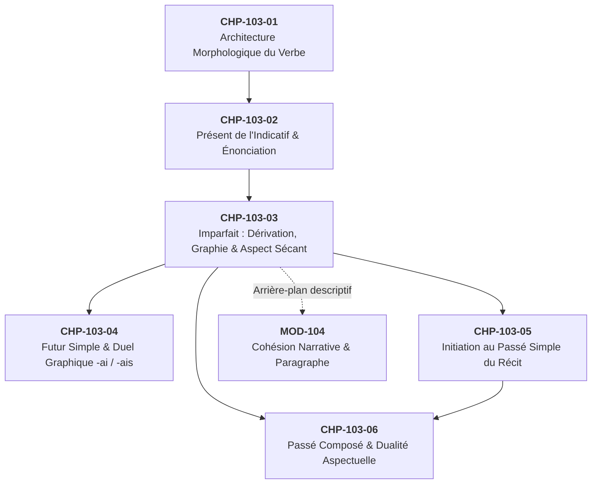

# Chapitre 3 — L'Imparfait de l'Indicatif : La Règle de Dérivation Universelle, Pièges Graphiques et Aspect Sécant

> **Identifiant du chapitre** : `CHP-103-03`  
> **Module de rattachement** : [`MOD-103` — Le Système Verbal à l'Indicatif : Morphologie des Régularités, Verbes Fréquents Irréguliers, Passé Composé Régulier/Être et Périphrases Aspectuelles](file:///f:/Formation/world-class-french/03-curriculum/year-1/semester-1/mod-103-systeme-verbal-indicatif.md)  
> **Semestre** : Année 1 — Semestre 1 (S1)  
> **Volume horaire estimé** : 5 à 6 heures d'apprentissage autonome délibéré et d'ateliers d'application (Phase 1 Étude : 1 h 30 | Phase 2 Pratique : 1 h 30 | Phase 3 Correction : 1 h 00 | Phase 4 Évaluation : 1 h 00)  
> **Statut** : [STATUT : VALIDÉ]  
> **Compétences associées** : [`FR-VERB-001`](file:///f:/Formation/world-class-french/02-competency-framework/competency-framework.md#fr-verb-001-maîtrise-des-valeurs-aspectuo-temporelles-de-lindicatif) (L3 Autonomie), [`FR-ORTHO-002`](file:///f:/Formation/world-class-french/02-competency-framework/competency-framework.md#fr-ortho-002-mécanique-infaillible-de-laccord-sujet-verbe) (L3 Autonomie)  
> **Sources scientifiques de référence** : `SRC-NORM-03` (Ministère de l'Éducation nationale, 2020, p. 34), `SRC-GRAM-02` (Riegel, Pellat, Rioul, 2016, chap. 8 et 9), `SRC-GRAM-01` (Grevisse & Goosse, 2016, § 785 et § 854), `SRC-GRAM-05` (Grevisse, 2009, § 74), `SRC-ORTHO-01` (Catach, 1980/2011)

---

## 1. Titre et Place dans le Cursus

### 1.1 Intitulé Officiel
**Chapitre 3 : L'Imparfait de l'Indicatif : La Règle de Dérivation Universelle, Pièges Graphiques et Aspect Sécant** (`CHP-103-03`).

### 1.2 Insertion Architecturale dans le Cursus
Ce troisième chapitre du module [`MOD-103`](file:///f:/Formation/world-class-french/03-curriculum/year-1/semester-1/mod-103-systeme-verbal-indicatif.md) constitue le pivot morphologique et aspectuel du système temporel du passé en français.

L'imparfait de l'indicatif est le temps de conjugaison le plus régulier de la langue française : à la seule exception historique du verbe *être*, toutes les formes d'imparfait se déduisent rigoureusement du radical de la première personne du pluriel (`P4`, pronom *nous*) au présent de l'indicatif, associées à une série unique et invariable de désinences (`-ais`, `-ais`, `-ait`, `-ions`, `-iez`, `-aient`).

Cependant, cette apparente simplicité mécanique dissimule deux écueils majeurs :
1. **Des pièges orthographiques et graphématiques sévères** : la rencontre du radical verbal et des désinences provoque des doublons graphiques (*-iions*, *-yions*) ou exige des ajustements phonético-graphiques (cédille `<ç>` devant *a*, `<e>` muet intercalaire après *g*) souvent ignorés des scripteurs ;
2. **Une valeur aspectuelle exigeante** : l'aspect **sécant** (procès non borné, saisi dans son déroulement interne), qui gouverne la mise en place du décor narratif et de l'arrière-plan, s'oppose diamétralement à l'aspect **non-sécant** du passé simple ou du passé composé.



- **En amont** : Ce chapitre réinvestit immédiatement la décomposition combinatoire du verbe (Radical + Marque temporelle + Marque de personne) vue en `CHP-103-01`, ainsi que la maîtrise du présent de l'indicatif et notamment de la base de `P4` (*nous*) stabilisée en `CHP-103-02`.
- **Au sein du module `MOD-103`** : Il prépare directement le duel phonologique et orthographique capital entre le futur simple en *-ai* et l'imparfait/conditionnel en *-ais* dans `CHP-103-04`, et fournit la moitié du binôme narratif canonique (arrière-plan vs premier plan) dont l'autre versant sera construit en `CHP-103-05` (passé simple) et `CHP-103-06` (passé composé).
- **En aval dans le cursus** : Il est le prérequis bloquant de [`MOD-104`](file:///f:/Formation/world-class-french/03-curriculum/year-1/semester-1/mod-104-lexique-lecture-paragraphe.md) pour la rédaction de récits cohérents et de descriptions d'atmosphère, ainsi que des modules ultérieurs de syntaxe de la phrase complexe (systèmes hypothétiques en *si + imparfait* dans `MOD-302`).

---

## 2. Objectifs Mesurables

Au terme de l'étude autonome et des ateliers d'application de ce chapitre, l'apprenant doit être capable de :

1. **Dériver avec 100 % d'exactitude morphologique** l'ensemble des formes de l'imparfait de n'importe quel verbe régulier ou irrégulier des trois groupes à partir de la base `P4` du présent, en intégrant immédiatement l'unique exception du verbe *être* [Réf. `SRC-NORM-03`, p. 34].
2. **Neutraliser systématiquement les quatre pièges graphématiques** de l'imparfait : doubler le `<i>` à `P4/P5` pour les verbes en `-ier` (*nous criions*), maintenir le `<i>` après `<y>` pour les verbes en `-yer` (*vous payiez*), placer la cédille devant `<a>` pour les verbes en `-cer` (*je commençais*), et insérer ou omettre le `<e>` muet selon la voyelle suivante pour les verbes en `-ger` (*il mangeait* vs *nous mangions*) [Réf. `SRC-ORTHO-01` ; `SRC-GRAM-01`, § 785].
3. **Identifier et expliciter la valeur aspectuelle sécante** d'un verbe à l'imparfait dans un texte narratif, en démontrant par des tests de suppression ou de reformulation pourquoi le procès constitue un arrière-plan, une habitude passée (itératif) ou un état continu non délimité [Réf. `SRC-GRAM-02`, chap. 9].
4. **Arbitrer sans contresens aspectuo-temporel** l'alternance entre l'imparfait sécant et les temps du premier plan événementiel (passé composé ou passé simple) dans la production ou la révision d'un texte suivi d'au moins 150 mots [Réf. `SRC-GRAM-01`, § 854 ; Compétence [`FR-VERB-001`](file:///f:/Formation/world-class-french/02-competency-framework/competency-framework.md#fr-verb-001-maîtrise-des-valeurs-aspectuo-temporelles-de-lindicatif)].

---

## 3. Prérequis et Test de Préparation (Auto-Diagnostic)

### 3.1 Prérequis Cognitifs
- Maîtrise de la conjugaison du présent de l'indicatif, en particulier la forme de la 1re personne du pluriel (*nous*) des verbes réguliers et irréguliers fréquents (`CHP-103-02`).
- Discrimination claire entre la base (radical) et la désinence personnelle (`CHP-103-01`).
- Distinction entre le sujet donneur d'accord et le verbe récepteur d'accord ([`FR-ORTHO-002`](file:///f:/Formation/world-class-french/02-competency-framework/competency-framework.md#fr-ortho-002-mécanique-infaillible-de-laccord-sujet-verbe)).

### 3.2 Test de Préparation Immédiat
Résolvez par écrit les cinq questions suivantes avant d'entamer l'étude du chapitre.

1. Donnez la forme du présent de l'indicatif à la 1re personne du pluriel (*nous*) pour les verbes suivants : *finir*, *prendre*, *faire*, *croire*, *partager*.
2. Isolez le radical verbal (la base) dans la forme *nous chantons*.
3. Quelle est la valeur de la lettre `<c>` devant la voyelle `<a>` dans les mots *carreau* et *façade* ?
4. Dans la phrase : *« Hier, alors que Paul marchait dans la rue, un chauffard a brûlé le feu rouge »*, quel verbe décrit le cadre continu et quel verbe décrit l'événement soudain ?
5. Quelle est la forme du verbe *être* à la 1re personne du pluriel (*nous*) au présent de l'indicatif ?

---

#### Corrigé de l'Auto-Diagnostic
1. **Formes de P4 au présent** : *nous finissons* (avec l'élargissement inchoatif *-iss-*), *nous prenons*, *nous faisons* (prononcé `/nu fə.zɔ̃/`), *nous croyons*, *nous partageons* (avec `<e>` intercalaire pour maintenir le son `/ʒ/`).
2. **Radical** : *chant-* (obtenu en retranchant la désinence flexionnelle *-ons*).
3. **Valeur de la lettre `<c>`** : Devant `<a>`, la lettre `<c>` sans cédille transcrit l'occlusive vélaire sourde `/k/` (*carreau* `/ka.ʁo/`) ; avec la cédille `<ç>`, elle transcrit la fricative alvéolaire sourde `/s/` (*façade* `/fa.sad/`).
4. **Cadre vs Événement** : *marchait* exprime l'action continue en cours d'accomplissement servant de cadre (arrière-plan) ; *a brûlé* exprime l'événement ponctuel qui fait basculer le récit (premier plan).
5. **Verbe être à P4** : *nous sommes*. (Retenez cette forme : elle constitue la clé de voûte de l'unique exception du chapitre).

> [!NOTE]
> Si vous avez obtenu 5/5, vos fondations morphologiques sont solides. Si vous avez hésité sur la base de *faire* (*faisons*) ou l'orthographe de *partageons*, portez une vigilance accrue aux rubriques 7.1 et 7.3.

---

## 4. Situation de Départ ou Problème Concret : Le Faux Ami de la Conjugaison

### 4.1 L'Illusion de Facilité
L'imparfait est communément présenté dans l'enseignement primaire comme « le temps le plus simple du français » : ses terminaisons sonnent de la même manière pour tout le monde (`/ɛ/` aux personnes singulières et à la 3e du pluriel), et sa régularité semble reposante.

Pourtant, dans les copies universitaires, les rédactions professionnelles et les épreuves de concours, l'imparfait est un véritable **nid de fautes orthographiques et de contresens narratifs**.

Considérez ces phrases authentiques issues de correspondances professionnelles et d'essais d'étudiants :

> *« Autrefois, nous vous **priyons** de patienter, mais vous nous **négligiez** sans cesse. »*  
> *« Quand nous étions enfants, nous **étudions** tard le soir et nous **mangions** ensemble. »*  
> *« Dès qu'il entrait dans le bureau, le directeur **remarquait** immédiatement le dossier manquant et **signait** l'arrêté sur-le-champ. »*  
> *« Je **commencais** à rédiger pendant que les secrétaires **balayaient** la salle. »*

Toutes ces phrases recèlent des anomalies graves :
- *nous priyons* est un barbarisme graphique issu de la confusion entre la prononciation du présent et de l'imparfait ;
- *nous étudions* est un présent de l'indicatif employé à contresens dans un contexte passé (omission du second `<i>` obligatoire de l'imparfait : *nous étudiions*) ;
- Dans la troisième phrase, l'emploi de l'imparfait pour deux actions ponctuelles et consécutives de premier plan (*remarquait*, *signait*) crée une inertie narrative inacceptable : le récit s'enlise dans une description figée au lieu de faire progresser l'action ;
- *commencais* comporte un solécisme phonético-graphique immédiat (se lirait `/kɔmɑ̃kɛ/` sans la cédille).

### 4.2 La Double Exigence : Graphie et Aspect
Pour maîtriser réellement l'imparfait, l'apprenant doit surmonter deux obstacles simultanés :
1. **L'obstacle graphématique** : réconcilier l'image auditive (ce que l'oreille entend) et la morphologie historique (les lettres imposées par le radical et la désinence) ;
2. **L'obstacle aspectuel** : comprendre que l'imparfait n'indique pas simplement « une action passée », mais **une manière particulière d'envisager le temps**, comme un flux continu sans frontières visibles.

---

## 5. Explication Intuitive : L'Analogie de la Caméra Cinématographique

Pour appréhender immédiatement la valeur aspectuelle de l'imparfait, imaginons le travail d'un réalisateur de cinéma sur un plateau de tournage :

```text
+--------------------------------------------------------------------------+
|                        L'OBJECTIF DE LA CAMÉRA                           |
+--------------------------------------------------------------------------+
|                                                                          |
|   IMPARFAIT (Aspect sécant / Plan large continu) :                       |
|   La caméra filme en plan panoramique sans couper :                      |
|   La pluie tombait. La foule grondait sur la place. Le vent soufflait.    |
|   --> On ne voit ni quand la pluie a commencé, ni quand elle va cesser.  |
|   --> Le spectateur est installé À L'INTÉRIEUR du temps du décor.        |
|                                                                          |
|   PASSÉ COMPOSÉ / PASSÉ SIMPLE (Aspect non-sécant / Coup de projecteur) :|
|   Soudain, coup de tonnerre ! Un éclair a fendu le ciel.                 |
|   Un homme s'est écrié : « Aux armes ! »                                 |
|   --> L'événement surgit, commence, s'achève et fait avancer l'histoire. |
|   --> La caméra enregistre le fait comme un bloc délimité fermé.         |
|                                                                          |
+--------------------------------------------------------------------------+
```

L'imparfait est **la bande son et le décor vivant** de la scène. Il installe la continuité, la durée, la répétition ou l'atmosphère. Il ne fait pas avancer les aiguilles de l'horloge : il les suspend pour donner à contempler ce qui est en train de se dérouler.

Dès qu'un fait nouveau se produit, délimité d'un point initial à un point final, la langue abandonne l'imparfait pour recourir au passé simple (récit littéraire) ou au passé composé (discours oral et écrit ordinaire).

---

## 6. Définitions Précises et Terminologie

Dans la description scientifique du français contemporain [Réf. `SRC-NORM-03`, p. 34 ; `SRC-GRAM-02`, chap. 8-9], les termes suivants sont définis avec rigueur :

- **Imparfait de l'indicatif** : Temps simple de la conjugaison appartenant au mode indicatif, situant le procès dans une époque antérieure au moment de l'énonciation ($T < T_0$) sous un angle aspectuel inaccompli et sécant.
- **Règle de dérivation morphologique** : Principe combinatoire régulier selon lequel la base d'un temps verbal dérive mécaniquement d'une forme préexistante du paradigme verbal. À l'imparfait, la base équivaut strictement au radical de la 1re personne du pluriel (`P4`, pronom *nous*) du présent de l'indicatif.
- **Désinences d'imparfait** : Série uniforme de six suffixes flexionnels attachés au radical pour marquer le temps et la personne :
  $$\{-ais,\; -ais,\; -ait,\; -ions,\; -iez,\; -aient\}$$
- **Aspect verbal** : Catégorie grammaticale qui exprime la manière dont le procès est envisagé dans son déroulement interne, indépendamment de son ancrage sur la ligne chronologique.
- **Aspect sécant** : Propriété aspectuelle d'une forme verbale qui montre le procès « en coupe » (sécant, du latin *secare*, couper). Le regard de l'énonciateur est placé à l'intérieur du procès en train de se faire, sans que les bornes temporelles de début (terme *a quo*) ou de fin (terme *ad quem*) ne soient perceptibles [Réf. `SRC-GRAM-01`, § 854].
- **Aspect non-sécant** : Propriété aspectuelle d'une forme verbale qui saisit le procès globalement depuis l'extérieur, comme une totalité fermée munie d'un début et d'une fin assignés (valeur propre au passé simple et au passé composé événementiel).
- **Arrière-plan narratif** : Fonction textuelle assumée par les propositions qui posent le cadre temporel, spatial, descriptif ou psychologique au sein duquel vont se détacher les événements de premier plan d'un récit.
- **Imparfait d'habitude (ou itératif)** : Emploi de l'imparfait dans lequel le procès ne représente pas un acte continu unique, mais une série d'actes répétés périodiquement dans le passé, devenus une coutume ou une régularité (*« Chaque soir, il fermait les volets à dix-neuf heures »*).
- **Imparfait d'hypothèse (ou de condition)** : Emploi de l'imparfait dans une proposition subordonnée circonstancielle introduite par la conjonction *si*, exprimant une condition posée comme non réalisée dans le présent (irréel du présent : *« Si j'avais le temps, je viendrais »*).

---

## 7. Règles ou Mécanismes Fondamentaux

### 7.1 La Règle de Dérivation Universelle
La morphologie de l'imparfait de l'indicatif repose sur un algorithme d'assemblage infaillible en deux étapes élémentaires :

$$\text{Forme de l'imparfait} = \left(\text{Radical de } P4 \text{ au présent}\right) + \text{Désinence d'imparfait}$$

#### Étape 1 : Extraction du radical
Prendre la forme conjuguée du verbe au présent de l'indicatif avec le pronom *nous* (`P4`), puis supprimer la désinence flexionnelle `-ons`.

#### Étape 2 : Adjonction des désinences uniques
Adjoindre au radical ainsi isolé les terminaisons universelles de l'imparfait, strictement identiques pour l'intégralité des verbes de la langue française :
- 1re personne du singulier (`P1`) : **`-ais`** (prononcé `/ɛ/`)
- 2e personne du singulier (`P2`) : **`-ais`** (prononcé `/ɛ/`)
- 3e personne du singulier (`P3`) : **`-ait`** (prononcé `/ɛ/`)
- 1re personne du pluriel (`P4`) : **`-ions`** (prononcé `/jɔ̃/`)
- 2e personne du pluriel (`P5`) : **`-iez`** (prononcé `/je/`)
- 3e personne du pluriel (`P6`) : **`-aient`** (prononcé `/ɛ/`)

#### Démonstration sur les trois groupes verbaux et les verbes irréguliers fréquents

| Groupe / Verbe | Forme P4 au présent (*nous*) | Radical d'imparfait extrait | Imparfait à P1 (*je / j'*) | Imparfait à P4 (*nous*) |
| :--- | :--- | :--- | :--- | :--- |
| **1er groupe** : *chanter* | *nous chant-ons* | **`chant-`** | *je chantais* | *nous chantions* |
| **2e groupe** : *finir* | *nous finiss-ons* | **`finiss-`** | *je finissais* | *nous finissions* |
| **3e groupe** : *partir* | *nous part-ons* | **`part-`** | *je partais* | *nous partions* |
| **3e groupe** : *prendre* | *nous pren-ons* | **`pren-`** | *je prenais* | *nous prenions* |
| **3e groupe** : *faire* | *nous fais-ons* (`/fə.zɔ̃/`) | **`fais-`** (`/fəz-/`) | *je faisais* (`/fə.zɛ/`) | *nous faisions* (`/fə.zjɔ̃/`) |
| **3e groupe** : *dire* | *nous dis-ons* | **`dis-`** | *je disais* | *nous disions* |
| **3e groupe** : *pouvoir* | *nous pouv-ons* | **`pouv-`** | *je pouvais* | *nous pouvions* |
| **3e groupe** : *vouloir* | *nous voul-ons* | **`voul-`** | *je voulais* | *nous voulions* |
| **3e groupe** : *savoir* | *nous sav-ons* | **`sav-`** | *je savais* | *nous savions* |
| **3e groupe** : *voir* | *nous voy-ons* | **`voy-`** | *je voyais* | *nous voyions* |
| **3e groupe** : *venir* | *nous ven-ons* | **`ven-`** | *je venais* | *nous venions* |
| **3e groupe** : *devoir* | *nous dev-ons* | **`dev-`** | *je devais* | *nous devions* |
| **3e groupe** : *aller* | *nous all-ons* | **`all-`** | *j'allais* | *nous allions* |
| **Auxiliaire** : *avoir* | *nous av-ons* | **`av-`** | *j'avais* | *nous avions* |

> [!IMPORTANT]
> Observez la puissance de cette règle : même un verbe aussi irrégulier au présent que *faire* (qui produit *vous faites* et *ils font*) ou *prendre* (qui alterne *nous prenons* et *ils prennent*) obéit **aveuglément** à la règle de dérivation universelle de l'imparfait : *nous faisons* $\rightarrow$ *je faisais* ; *nous prenons* $\rightarrow$ *je prenais*.

---

### 7.2 L'Unique Exception Morphologique de Toute la Langue : Le Verbe *Être*

Dans l'ensemble du lexique verbal français (soit plus de 8 000 verbes recensés), il n'existe **qu'une seule et unique exception** à la règle de dérivation par `P4` : le verbe **`être`**.

Au présent de l'indicatif, la première personne du pluriel du verbe *être* est *nous sommes*.  
Si la règle universelle s'appliquait sans faille, le radical d'imparfait serait `somm-`, ce qui produirait d'impossibles formes fantômes : *\*je sommais*, *\*nous sommions*.

Le verbe *être* adopte à l'imparfait un radical historique particulier : **`ét-`** (avec accent aigu sur le `e`), directement issu du latin *stare* (ancien français *ester*) [Réf. `SRC-GRAM-01`, § 785] :
- *j'étais*
- *tu étais*
- *il / elle / on était*
- *nous étions*
- *vous étiez*
- *ils / elles étaient*

> [!NOTE]
> Remarquez que même pour *être*, l'exception porte **exclusivement sur le radical** (`ét-`). Les désinences, elles, demeurent parfaitement fidèles à la série universelle (`-ais`, `-ais`, `-ait`, `-ions`, `-iez`, `-aient`).

---

### 7.3 Les Pièges Graphiques : Analyse Orthographique Chirurgicale

Si la morphologie orale est simple, l'écriture de l'imparfait dissimule quatre pièges majeurs liés aux interactions entre la consonne finale du radical et la voyelle initiale de la désinence.

#### Piège 1 : Les verbes en `-ier` (maintien du double `<i>` à P4 et P5)
Pour des verbes comme *crier*, *étudier*, *remercier*, *plier*, *oublier*, le radical se termine par la voyelle phonétique `/i/` :
- *étudier* $\rightarrow$ radical **`étudi-`** (`/e.ty.di-/`)
- À `P4` et `P5`, la désinence commence obligatoirement par un `<i>` : **`-ions`**, **`-iez`**.
- La rencontre du radical et de la terminaison impose la graphie avec **deux `<i>` consécutifs** :
  - Présent : *nous étudions* (`P4`), *vous étudiez* (`P5`)
  - Imparfait : **`nous étudiions`**, **`vous étudiiez`**
  - Présent : *nous crions*, *vous criez*
  - Imparfait : **`nous criions`**, **`vous criiez`**

À l'oral contemporain rapide, l'oreille ne perçoit souvent qu'un seul `/i/` ou un léger allongement vocalique avec semi-voyelle palatale `/kʁi.jɔ̃/`. Le scripteur inattentif oublie le second `<i>` et produit un présent de l'indicatif à contresens.

#### Piège 2 : Les verbes en `-yer` (maintien du `<i>` après `<y>` à P4 et P5)
Pour les verbes se terminant par `-yer` à l'infinitif (*payer*, *balayer*, *nettoyer*, *essuyer*, *employer*, *appuyer*) ainsi que les verbes du 3e groupe en `-oir` dont le radical de `P4` s'achève par `<y>` (*voir* $\rightarrow$ *nous voyons*, *croire* $\rightarrow$ *nous croyons*, *fuir* $\rightarrow$ *nous fuyons*) :
- Le radical conserve son `<y>` : **`pay-`**, **`voy-`**, **`croy-`**.
- À `P4` et `P5`, la désinence d'imparfait apporte son `<i>` initial :
  - Imparfait : **`nous payions`**, **`vous payiez`**
  - Imparfait : **`nous balayions`**, **`vous balayiez`**
  - Imparfait : **`nous voyions`**, **`vous voyiez`**
  - Imparfait : **`nous croyions`**, **`vous croyiez`**
  - Imparfait : **`nous fuyions`**, **`vous fuyiez`**

La séquence graphique `<yi>` est parfaitement conforme à l'analyse morphologique : le `<y>` appartient au radical lexical, tandis que le `<i>` est la marque du temps de l'imparfait [Réf. `SRC-ORTHO-01`]. L'omettre revient à écrire le verbe au présent de l'indicatif (*nous voyons*, *vous payez*).

#### Piège 3 : Les verbes en `-cer` (maintien de la cédille devant `<a>`)
Pour conserver le phonème fricatif alvéolaire sourd `/s/` du verbe (*lancer*, *commencer*, *avancer*, *placer*) devant les terminaisons commençant par la lettre `<a>` (`-ais`, `-ait`, `-aient`), la lettre `<c>` doit obligatoirement recevoir une cédille `<ç>` :
- *je commençais*, *tu lançais*, *il avançait*, *ils plaçaient*
- **Attention à l'inversion à P4 et P5** : devant la lettre `<i>` des désinences `-ions` et `-iez`, la lettre `<c>` se prononce naturellement `/s/`. Mettre une cédille devant un `<i>` est une faute lourde :
  - Correct : **`nous commencions`**, **`vous lanciez`** (sans cédille)
  - Fautif : *\*nous commençons d'imparfait*, *\*nous commençions*

#### Piège 4 : Les verbes en `-ger` (maintien du `<e>` muet devant `<a>`)
Pour conserver le phonème fricatif post-alvéolaire voisé `/ʒ/` du verbe (*manger*, *partager*, *voyager*, *exiger*) devant les terminaisons commençant par la lettre `<a>` (`-ais`, `-ait`, `-aient`), il faut obligatoirement insérer un `<e>` muet intercalaire après le `<g>` :
- *je mangeais*, *tu partageais*, *il voyageait*, *ils exigeaient*
- **Attention absolue à P4 et P5** : devant le `<i>` des désinences `-ions` et `-iez`, la lettre `<g>` se prononce naturellement `/ʒ/`. Il ne faut donc **aucun `<e>` intercalaire** :
  - Correct : **`nous mangions`**, **`vous partagiez`** (radical `mang-` + `-ions`)
  - Fautif : *\*nous mangeions*, *\*vous partageiez*

---

### 7.4 Sémantique et Valeurs Aspectuo-Temporelles de l'Imparfait

L'imparfait n'est pas un temps neutre : il véhicule un ensemble cohérent de valeurs sémantiques et aspectuelles [Réf. `SRC-GRAM-02`, chap. 9] :

#### 1. L'aspect sécant : le procès en cours de déroulement
C'est la valeur cardinale de l'imparfait. Le procès est saisi du dedans, sans frontières temporelles perceptibles :
> *« À midi, le soleil brûlait la plaine sablonneuse. »*  
$\rightarrow$ L'énonciateur ne précise ni quand la chaleur a commencé, ni quand elle cessera ; le phénomène est perçu dans son déroulement continu.

#### 2. L'arrière-plan descriptif et explicatif dans le récit
Dans un récit au passé, l'imparfait assume la fonction de décor, d'atmosphère et de cadre psychologique, tandis que les temps non-sécants (passé simple ou passé composé) font progresser la trame événementielle :
> *« La pluie **ruisselait** sur les vitres et un vent violent **secouait** les arbres de la cour. Soudain, un éclair **déchira** la nuit et la cloche **retentit**. »*  
$\rightarrow$ *Ruisselait* et *secouait* (imparfaits) posent le décor ; *déchira* et *retentit* (passés simples) font avancer l'action.

#### 3. L'imparfait d'habitude (itératif ou coutumier)
L'imparfait exprime une action qui se répétait avec régularité dans une période révolue :
> *« Tous les dimanches, mon grand-père **se rendait** à la forge et **saluait** les anciens du village. »*

#### 4. Les valeurs modales d'atténuation et d'hypothèse
- **Atténuation de politesse** : l'imparfait adoucit une demande présente en la présentant avec détachement :
  > *« Excusez-moi de vous déranger, je **voulais** vous demander un renseignement. »* (au lieu de l'injonctif *« Je veux »* ou du formel *« Je voudrais »*).
- **Hypothèse après *si*** : dans les systèmes conditionnels, *si* refuse le conditionnel et exige l'imparfait pour exprimer l'irréel du présent ou le potentiel :
  > *« Si vous **acceptiez** notre proposition, nous pourrions signer le contrat dès demain. »*

---

## 8. Raisonnement Détaillé : Pourquoi ces Désinences sont-elles Universelles ?

D'où provient cette extraordinaire régularité de l'imparfait, alors que le présent de l'indicatif pullule d'allomorphes et de désinences divergentes (`-e`, `-es`, `-e` vs `-s`, `-s`, `-t` vs `-x`, `-x`, `-t`) ?

### 8.1 L'Héritage Latin et l'Uniformisation Phonétique
En latin classique, l'imparfait de l'indicatif était déjà un temps hautement caractérisé par un morphème temporel spécifique : le suffixe *-ba-* intercalé entre le radical et la désinence personnelle :
- 1er groupe latin : *canta-ba-m*, *canta-ba-s*, *canta-ba-t*
- 2e et 3e groupes latins : *habe-ba-m*, *lege-ba-m*

Au cours du passage du latin vulgaire au gallo-roman et à l'ancien français :
1. La consonne bilabiale /b/ s'est affaiblie en consonne spirante /v/ puis s'est vocalisée ou amuïe en français central ;
2. Les terminaisons ont abouti en ancien français aux formes en `-oie` ou `-eie` (*je chantoie*, *il disoie*) ;
3. Aux personnes du pluriel, le suffixe a évolué en `-ions` et `-iez`, emprunté par analogie au subjonctif présent pour marquer nettement le pluriel.

### 8.2 La Réforme Graphique des Désinences en `-ais`
Pendant plusieurs siècles, la prononciation s'était ouverte en voyelle antérieure mi-ouverte `/ɛ/`, mais l'orthographe conservait la graphie étymologique en `-oi-` (*je chantois*, *il disoit*, *ils chantoient*).

Au XVIIIe siècle, Voltaire milita activement pour aligner l'orthographe sur la prononciation réelle en substituant `<ai>` à `<oi>`. L'Académie française adopta officiellement cette réforme dans la sixième édition de son Dictionnaire en 1835 [Réf. `SRC-LEX-02` ; `SRC-ORTHO-01`].

Dès lors, toutes les désinences de l'imparfait se trouvèrent unifiées sous la bannière graphique moderne :
$$\{-ais,\; -ais,\; -ait,\; -ions,\; -iez,\; -aient\}$$
Cette histoire explique pourquoi l'imparfait ne conserve aucune trace des trois groupes verbaux : la marque temporelle a totalement submergé les particularismes de flexion.

---

## 9. Exemples Corrects Commentés

Examinons la mécanique de l'imparfait à travers des textes littéraires exemplaires, issus du patrimoine francophone classique et d'auteurs ouest-africains de référence.

### Exemple 1 : Arrière-plan descriptif et aspect sécant (Gustave Flaubert, *Madame Bovary*)
> *« Un coup de vent qui arrivait par la porte gonflait le tapis de la table, et, dans le jardin d'en bas, les feuilles de chou bruissaient les unes contre les autres. »*

#### Analyse grammaticale et linguistique :
1. **Verbes conjugués à l'imparfait** : *arrivait*, *gonflait*, *bruissaient*.
2. **Décomposition morphologique** :
   - *arriver* $\rightarrow$ P4 présent *nous arriv-ons* $\rightarrow$ radical `arriv-` + `-ait` (P3 singulier accordé avec *Un coup de vent*) ;
   - *gonfler* $\rightarrow$ P4 présent *nous gonfl-ons* $\rightarrow$ radical `gonfl-` + `-ait` (P3 singulier accordé avec *Un coup de vent*) ;
   - *bruire* $\rightarrow$ verbe défectif du 3e groupe $\rightarrow$ radical `bruiss-` + `-aient` (P6 pluriel accordé avec le sujet pluriel *les feuilles de chou*).
3. **Valeur aspectuelle** : Tous ces verbes sont à l'aspect sécant. La scène est peinte comme un tableau vivant et continu ; aucun début ni fin n'est assigné au souffle du vent ou au frémissement des feuilles.

---

### Exemple 2 : Atmosphère nocturne et tension narrative (Olympe Bhêly-Quenum, *Un piège sans fin*)
> *« La nuit tombait lentement sur le village d'Agbangnizoun. Les femmes piliaient le mil au rythme régulier des pilons, tandis que les vieillards fumaient leurs pipes sous l'apatam et regardaient les enfants qui jouaient dans la poussière. »*

#### Analyse grammaticale et linguistique :
1. **Verbes conjugués à l'imparfait** : *tombait*, *piliaient*, *fumaient*, *regardaient*, *jouaient*.
2. **Traque des particularités morphologiques** :
   - *piler* $\rightarrow$ radical régulier `pil-` + `-aient` (*les femmes*). Attention : verbe du 1er groupe en `-er` (*piler*), ne pas confondre avec un verbe en `-ier` !
   - *regardaient*, *jouaient* $\rightarrow$ radicaux `regard-` et `jou-` + `-aient`.
3. **Fonction textuelle** : Ce paragraphe constitue un modèle pur d'arrière-plan sociologique et spatio-temporel. Il installe le calme coutumier (imparfait d'habitude et de durée) avant qu'un événement dramatique ne vienne rompre l'équilibre du récit.

---

### Exemple 3 : Verbe du 3e groupe à base allomorphe (Ahmadou Kourouma, *Les Soleils des Indépendances*)
> *« Fama ne savait plus où donner de la tête ; il voyait bien que les temps changeaient et que les dignitaires d'autrefois perdaient leur prestige. »*

#### Analyse grammaticale et linguistique :
1. **Verbes conjugués à l'imparfait** : *savait*, *voyait*, *changeaient*, *perdaient*.
2. **Dérivation chirurgicale** :
   - *savoir* $\rightarrow$ P4 présent *nous savons* $\rightarrow$ radical `sav-` + `-ait` = *il savait* ;
   - *voir* $\rightarrow$ P4 présent *nous voyons* $\rightarrow$ radical `voy-` + `-ait` = *il voyait* ;
   - *changer* $\rightarrow$ P4 présent *nous changeons* $\rightarrow$ radical `chang-` + `<e>` muet + `-aient` = *ils changeaient* (présence indispensable du `<e>` devant `<a>` pour préserver le son `/ʒ/`) ;
   - *perdre* $\rightarrow$ P4 présent *nous perdons* $\rightarrow$ radical `perd-` + `-aient` = *ils perdaient*.

---

## 10. Contre-Exemples et Erreurs Fréquentes

L'analyse clinique des productions écrites révèle six erreurs récurrentes majeures lors de l'emploi de l'imparfait :

### Erreur n°1 : L'Omission du Second *i* aux Personnes P4 et P5 pour les Verbes en *-ier*
- **Forme fautive** : *\*Quand nous étions étudiants, nous travaillions dur et nous révisyons nos cours.*  
  Ou pire : *\*L'an dernier, nous priyons chaque matin.*
- **Analyse de la faille cognitive** : Le scripteur est perturbé par la quasi-identité phonétique entre le présent (/nu ʁevizjɔ̃/) et l'imparfait (/nu ʁevizjɔ̃/). Croyant éviter une anomalie, il supprime un `<i>` ou substitue fautivement un `<y>` fantôme.
- **Réfutation scientifique et correction** : Le verbe *réviser* a pour radical `révis-` (donc *nous révisions*). Mais pour un verbe en `-ier` comme *prier* (radical `pri-`), la règle de dérivation impose : `pri-` + `-ions` = **`nous priions`** (avec double `<i>`).
- **Forme correcte** : *« Quand nous étions étudiants, nous travaillions dur et nous **révisions** nos cours ; nous **priions** chaque matin. »*

---

### Erreur n°2 : L'Omission du *i* après *y* à P4 et P5 pour les Verbes en *-yer* et Assimilés
- **Forme fautive** : *\*Autrefois, nous payons nos impôts comptant et nous voyons les résultats.*
- **Analyse de la faille cognitive** : Le scripteur ressent une répugnance visuelle devant le digramme `<yi>`, qu'il juge « barbare » ou superflu. Il retombe alors involontairement dans les formes du présent de l'indicatif (*nous payons*, *nous voyons*).
- **Réfutation scientifique et correction** : À l'imparfait, la désinence de `P4` est universellement `-ions`. Le radical de *payer* est `pay-`, celui de *voir* est `voy-`. L'équation combinatoire impose strictement : `pay-` + `-ions` = **`nous payions`** ; `voy-` + `-ions` = **`nous voyions`**.
- **Forme correcte** : *« Autrefois, nous **payions** nos impôts comptant et nous **voyions** les résultats. »*

---

### Erreur n°3 : L'Insertion Fautive d'un *e* Muet devant *i* pour les Verbes en *-ger* à P4 et P5
- **Forme fautive** : *\*Pendant les vacances, nous mangeions à des heures impossibles et vous voyageiez souvent.*
- **Analyse de la faille cognitive** : L'apprenant applique aveuglément la règle « les verbes en *-ger* prennent un *e* » sans vérifier la nature de la voyelle qui suit.
- **Réfutation scientifique et correction** : En orthographe française, la lettre `<g>` produit spontanément le son `/ʒ/` devant les voyelles `<i>`, `<e>`, `<y>`. Le `<e>` muet correctif n'est exigé que devant `<a>` et `<o>` (*il mangeait*, *nous mangeons*). Devant le `<i>` de `-ions` et `-iez`, le `<e>` est une aberration graphique.
- **Forme correcte** : *« Pendant les vacances, nous **mangions** à des heures impossibles et vous **voyagiez** souvent. »*

---

### Erreur n°4 : L'Omission de la Cédille devant la Désinence en *a* pour les Verbes en *-cer*
- **Forme fautive** : *\*Dès l'aube, le maçon commencait le mur et avancait rapidement.*
- **Analyse de la faille cognitive** : Oubli du rôle diacritique de la cédille, ou fausse croyance que le radical du verbe doit rester intact tel qu'il apparaît à l'infinitif.
- **Réfutation scientifique et correction** : Devant la lettre `<a>` des terminaisons `-ais`, `-ait`, `-aient`, la lettre `<c>` isolée prend obligatoirement la valeur de l'occlusive vélaire sourde `/k/`. Écrire *commencait* contraint phonétiquement à prononcer `/kɔmɑ̃kɛ/`. La cédille est indispensable pour restaurer la fricative `/s/`.
- **Forme correcte** : *« Dès l'aube, le maçon **commençait** le mur et **avançait** rapidement. »*

---

### Erreur n°5 : La Confusion Orthographique de Terminaison *-ait* (P3) vs *-aient* (P6)
- **Forme fautive** : *\*Les résultats de l'enquête démontrait l'évidence.*
- **Analyse de la faille cognitive** : Homophonie totale entre `/démɔ̃tʁɛ/` au singulier et `/démɔ̃tʁɛ/` au pluriel. L'esprit non vigilant se focalise sur l'audition et oublie d'accorder le verbe avec le sujet pluriel éloigné (*Les résultats*).
- **Réfutation scientifique et correction** : Le donneur d'accord est le syntagme nominal pluriel *Les résultats de l'enquête*. Le verbe récepteur doit obligatoirement arborer la désinence de 3e personne du pluriel `-aient`. Test de substitution : remplacer le sujet par le pronom *Ils* (*Ils démontraient*).
- **Forme correcte** : *« Les résultats de l'enquête **démontraient** l'évidence. »*

---

### Erreur n°6 : Le Contresens Aspectuel Narratif (Inertie de l'Imparfait de Rupture Fautif)
- **Forme fautive** : *\*Il marchait paisiblement. Tout à coup, un voleur surgissait et lui arrachait son sac.*
- **Analyse de la faille cognitive** : Croyance erronée que « tout récit au passé doit s'écrire à l'imparfait ». L'apprenant ne perçoit pas le contraste entre procès duratif et événement ponctuel.
- **Réfutation scientifique et correction** : L'apparition du voleur et l'arrachage du sac sont des événements soudains, bornés et successifs qui font progresser la chronologie. Ils exigent un aspect non-sécant (passé simple dans le style écrit soutenu, passé composé dans le style courant).
- **Forme correcte** : *« Il marchait paisiblement. Tout à coup, un voleur **surgit** et lui **arracha** son sac. »* (ou : *« ... a surgi et lui a arraché son sac. »*).

---

## 11. Cas Particuliers et Limites de Validité

En linguistique textuelle et stylistique [Réf. `SRC-GRAM-02`, chap. 9 ; `SRC-GRAM-01`, § 854], l'imparfait présente des usages spécialisés remarquables qui s'écartent de la pure valeur d'arrière-plan continu :

### 11.1 L'Imparfait de Rupture (ou Imparfait Narratif / Historique)
Très prisé dans la prose journalistique et littéraire moderne, cet emploi viole délibérément la valeur d'arrière-plan habituelle pour mettre en relief un événement capital qui clôt un procès :
> *« L'accusé protesta de son innocence durant six heures. À minuit, le verdict **tombait**, impitoyable : condamnation à perpétuité. »*  
> *« Cinq minutes plus tard, la bombe **explosait** au centre de la gare. »*

Ici, l'imparfait remplace stylistiquement un passé simple (*tomba*, *explosa*). Il donne au lecteur l'illusion de voir l'événement se figer sous ses yeux, conférant à la scène une tonalité dramatique ou inéluctable. Cet emploi doit être manié avec parcimonie pour éviter l'affectation stylistique.

### 11.2 L'Imparfait Forain (ou Pittoresque)
Dans le commerce oral et populaire, l'imparfait est employé pour interroger un client sur son désir présent, transposant la transaction dans un passé feint pour atténuer la pression commerciale :
> *« Qu'est-ce qu'il **fallait** à monsieur ? »*  
> *« C'**était** pour une coupe ou pour un brossage ? »*

### 11.3 L'Imparfait Ludique (ou Préludique)
Universellement employé par les enfants lorsqu'ils établissent les conventions d'un jeu de rôle :
> *« On disait qu'on **était** des pirates et que la table **devenait** notre navire. »*

L'imparfait fonctionne ici comme un décrocheur modal : il crée un univers imaginaire parallèle distinct du monde réel.

### 11.4 L'Imparfait Hypothétique après *Si*
Dans la proposition subordonnée conditionnelle introduite par *si*, la norme du français proscrit absolument le mode conditionnel et impose l'indicatif imparfait :
- Correct : *« Si j'**avais** le choix, j'agirais autrement. »*
- Fautif (barbarisme populaire) : *\*« Si j'aurais le choix... »*

---

## 12. Approfondissement Adapté au Niveau : La Théorie de l'Aspect chez Gustave Guillaume

Pour les apprenants visant l'excellence linguistique et la préparation aux concours de haut niveau, la valeur de l'imparfait s'éclaire à la lumière de la **psychomécanique du langage** développée par le linguiste Gustave Guillaume.

### 12.1 La Chronogénèse et la Saisie du Temps
Selon Guillaume, l'esprit humain ne perçoit pas le temps comme une donnée statique, mais construit le temps par une opération de pensée appelée **chronogénèse**.

Lorsqu'un verbe est conjugué, l'énonciateur choisit le point où il intercepte le déroulement du procès :
- **L'époque passée** offre deux modes de saisie fondamentaux :
  1. **La coupe sécante (l'imparfait)** : La pensée s'installe *pendant* que le temps s'écoule (procès *in fieri*, en train de se faire). Le regard embrasse le centre de l'action sans voir les extrémités. Guillaume compare l'imparfait à un regard qui regarde couler un fleuve depuis la berge : l'eau passe continuellement devant les yeux sans qu'on aperçoive la source ni l'embouchure.
  2. **La coupe globale (le passé simple)** : La pensée attend que le temps soit intégralement écoulé (procès *in esse*, accompli en bloc). Le regard survole le fleuve depuis un avion et contemple d'un seul coup d'œil son tracé entier, du début à la fin.

```text
Chronogénèse guillaumienne de l'imparfait :

       Terme initial (a quo)                   Terme final (ad quem)
              [                                         ]
  Temps : ----+-----------------------------------------+---->
                            ^
                     Regard sécant
                   (IMPARFAIT : vue en coupe,
                    sans perception des bornes)
```

Cette modélisation théorique démontre pourquoi l'imparfait est ontologiquement incapable d'ordonner une suite d'événements chronologiques : étant privé de borne finale, un imparfait ne peut pas « passer le relais » à un autre imparfait dans une succession temporelle dynamique. Deux imparfaits coordonnés sont perçus comme **simultanés** (*« Il lisait et elle écrivait »*), tandis que deux passés simples coordonnés sont perçus comme **successifs** (*« Il lut la lettre et la déchira »*).

---

## 13. Comparaisons Différentielles

### 13.1 Tableau Synoptique : Présent P4 vs Imparfait P4 (Traque des Verbes Délicats)

Ce tableau compare la forme écrite et la transcription phonologique de la première personne du pluriel (*nous*) entre le présent et l'imparfait pour neutraliser toute confusion.

| Verbe à l'infinitif | Présent de l'indicatif (P4) | Imparfait de l'indicatif (P4) | Particularité orthographique à mémoriser |
| :--- | :--- | :--- | :--- |
| **étudier** (`-ier`) | *nous étudions* `/e.ty.djɔ̃/` | **`nous étudiions`** `/e.ty.di.jɔ̃/` | Double `<i>` : radical `étudi-` + `-ions` |
| **crier** (`-ier`) | *nous crions* `/kʁi.jɔ̃/` | **`nous criions`** `/kʁi.jɔ̃/` | Double `<i>` obligatoire à l'écrit |
| **remercier** (`-ier`) | *nous remercions* `/ʁə.mɛʁ.sjɔ̃/` | **`nous remerciions`** `/ʁə.mɛʁ.si.jɔ̃/` | Double `<i>` : radical `remerci-` + `-ions` |
| **payer** (`-yer`) | *nous payons* `/pɛ.jɔ̃/` | **`nous payions`** `/pɛ.jɔ̃/` | Maintien du `<i>` après `<y>` : `pay-` + `-ions` |
| **nettoyer** (`-yer`) | *nous nettoyons* `/nɛ.twa.jɔ̃/` | **`nous nettoyions`** `/nɛ.twa.jɔ̃/` | Digramme `<yi>` obligatoire à l'écrit |
| **croire** (3e gr. en `-y-`) | *nous croyons* `/kʁwa.jɔ̃/` | **`nous croyions`** `/kʁwa.jɔ̃/` | Digramme `<yi>` : radical `croy-` + `-ions` |
| **commencer** (`-cer`) | *nous commençons* `/kɔ.mɑ̃.sɔ̃/` | **`nous commencions`** `/kɔ.mɑ̃.sjɔ̃/` | **Pas de cédille** à l'imparfait devant `<i>` |
| **avancer** (`-cer`) | *nous avançons* `/a.vɑ̃.sɔ̃/` | **`nous avancions`** `/a.vɑ̃.sjɔ̃/` | Cédille au présent devant `o`, **sans cédille** devant `i` |
| **manger** (`-ger`) | *nous mangeons* `/mɑ̃.ʒɔ̃/` | **`nous mangions`** `/mɑ̃.ʒjɔ̃/` | **Pas de `<e>` muet** à l'imparfait devant `<i>` |
| **partager** (`-ger`) | *nous partageons* `/paʁ.ta.ʒɔ̃/` | **`nous partagiez`** (`P5`) `/paʁ.ta.ʒje/` | `<e>` au présent devant `o`, **aucun `<e>`** devant `i` |

---

### 13.2 Tableau Synoptique : La Trinité du Passé (Imparfait vs Passé Simple vs Passé Composé)

| Critère d'analyse | Imparfait de l'indicatif | Passé simple | Passé composé |
| :--- | :--- | :--- | :--- |
| **Aspect principal** | **Sécant** (procès non borné, saisi du dedans) | **Non-sécant** (procès borné, totalité fermée) | **Accompli** (résultat présent ou événement achevé) |
| **Rôle narratif** | Arrière-plan, décor, habitude, durée indéterminée | Premier plan, événements majeurs, succession | Récit oral/courant, événements liés au présent |
| **Progression de l'histoire** | Statique (suspend l'action pour décrire) | Dynamique (fait bondir l'histoire vers l'avant) | Dynamique (fait avancer l'action dans le discours) |
| **Registre dominant** | Tous registres (oral, écrit, littéraire) | Écrit soutenu, langue littéraire et historique | Écrit courant, oral, correspondance, presse |
| **Exemple type** | *Le vent soufflait violemment.* | *Le mât se brisa net.* | *Le mât s'est brisé net.* |

---

## 14. Exercices Progressifs (Trois Niveaux)

### 14.1 Niveau 1 : Dérivation Systématique à Partir de P4 Présent (10 Formes Guidées)
**Consigne** : Pour chacun des dix verbes suivants, écrivez la forme de la 1re personne du pluriel (`P4`, *nous*) au présent de l'indicatif, isolez le radical d'imparfait, puis conjuguez le verbe à la personne de l'imparfait indiquée.

1. *applaudir* $\rightarrow$ à l'imparfait avec *ils*
2. *comprendre* $\rightarrow$ à l'imparfait avec *nous*
3. *faire* $\rightarrow$ à l'imparfait avec *vous*
4. *vouloir* $\rightarrow$ à l'imparfait avec *je*
5. *dire* $\rightarrow$ à l'imparfait avec *elle*
6. *croire* $\rightarrow$ à l'imparfait avec *vous*
7. *aller* $\rightarrow$ à l'imparfait avec *tu*
8. *devoir* $\rightarrow$ à l'imparfait avec *ils*
9. *savoir* $\rightarrow$ à l'imparfait avec *nous*
10. *être* $\rightarrow$ à l'imparfait avec *vous* (Attention à l'exception canonique !)

---

### 14.2 Niveau 2 : Traque des Pièges Orthographiques en `-ier`, `-yer`, `-cer`, `-ger` (10 Phrases à Compléter)
**Consigne** : Conjuguez les verbes entre parenthèses à l'imparfait de l'indicatif en veillant scrupuleusement aux pièges graphiques (double `<i>`, `<yi>`, cédille, `<e>` muet).

1. Autrefois, nous (étudier) _______________ chaque soir sous la véranda éclairée.
2. Lorsque vous étiez au service comptabilité, vous (vérifier) _______________ chaque facture avant paiement.
3. Pendant que les enfants (balayer) _______________ la cour, nous (nettoyer) _______________ les chambres.
4. Dès qu'elle (commencer) _______________ son récit, nous (avancer) _______________ en silence pour mieux entendre.
5. Durant nos années d'internat, nous (manger) _______________ tous à la même table et nous (partager) _______________ notre pain.
6. Vous (payer) _______________ vos ouvriers le samedi et vous ne (renvoyer) _______________ personne sans salaire.
7. Tandis que le soleil (plonger) _______________ derrière l'horizon, le ciel (foncer) _______________ à vue d'œil.
8. En ces temps troublés, nous (craindre) _______________ les nouvelles et nous (prier) _______________ pour la paix.
9. Nous vous (remercier) _______________ autrefois chaque semaine, mais vous nous (négliger) _______________ ouvertement.
10. Pourquoi (effrayer) -vous _______________ ainsi les jeunes apprentis quand ils (débuter) _______________ dans l'atelier ?

---

### 14.3 Niveau 3 : Rétablissement de l'Imparfait et Analyse Aspectuelle dans un Récit
**Consigne** : Dans le texte narratif suivant (120 mots), conjuguez chaque verbe entre crochets soit à **l'imparfait de l'indicatif**, soit au **passé simple**. Justifiez méthodiquement chaque choix en précisant si l'aspect est **sécant** (arrière-plan/durée) ou **non-sécant** (événement ponctuel de rupture).

> *« La pluie [battre - 1] les toits de tôle de la ville depuis le matin, et une brume épaisse [envelopper - 2] les grands baobabs du faubourg. Dans la pièce sombre, Grand-père [aiguiser - 3] patiemment sa machette pendant que nous [lier - 4] les fagots de bois sec. Soudain, un craquement sinistre [ébranler - 5] la charpente. Mon frère [sursauter - 6], [lâcher - 7] ses cordes et [pousser - 8] un cri d'effroi. Dehors, un arbre séculaire venait de s'abattre. Mais l'aïeul ne [sourciller - 9] point : il [continuer - 10] calmement son ouvrage. »*

---

### 14.4 Corrigés Exhaustifs et Justifications des Exercices

#### Corrigé du Niveau 1
1. *applaudir* $\rightarrow$ Présent P4 : *nous applaudissons* $\rightarrow$ Radical : `applaudiss-` $\rightarrow$ Imparfait P6 : **`ils applaudissaient`** (formant inchoatif du 2e groupe conservé).
2. *comprendre* $\rightarrow$ Présent P4 : *nous comprenons* $\rightarrow$ Radical : `compren-` $\rightarrow$ Imparfait P4 : **`nous comprenions`** (un seul *n*, radical de P4).
3. *faire* $\rightarrow$ Présent P4 : *nous faisons* $\rightarrow$ Radical : `fais-` $\rightarrow$ Imparfait P5 : **`vous faisiez`** (prononcé `/fə.zje/`).
4. *vouloir* $\rightarrow$ Présent P4 : *nous voulons* $\rightarrow$ Radical : `voul-` $\rightarrow$ Imparfait P1 : **`je voulais`**.
5. *dire* $\rightarrow$ Présent P4 : *nous disons* $\rightarrow$ Radical : `dis-` $\rightarrow$ Imparfait P3 : **`elle disait`**.
6. *croire* $\rightarrow$ Présent P4 : *nous croyons* $\rightarrow$ Radical : `croy-` $\rightarrow$ Imparfait P5 : **`vous croyiez`** (digramme `<yi>` obligatoire).
7. *aller* $\rightarrow$ Présent P4 : *nous allons* $\rightarrow$ Radical : `all-` $\rightarrow$ Imparfait P2 : **`tu allais`**.
8. *devoir* $\rightarrow$ Présent P4 : *nous devons* $\rightarrow$ Radical : `dev-` $\rightarrow$ Imparfait P6 : **`ils devaient`**.
9. *savoir* $\rightarrow$ Présent P4 : *nous savons* $\rightarrow$ Radical : `sav-` $\rightarrow$ Imparfait P4 : **`nous savions`**.
10. *être* $\rightarrow$ **Exception absolue** : radical `ét-` (ne dérive pas de *nous sommes*) $\rightarrow$ Imparfait P5 : **`vous étiez`**.

#### Corrigé du Niveau 2
1. **`étudiions`** : verbe en `-ier`, radical `étudi-` + désinence `-ions` (double `<i>` obligatoire).
2. **`vérifiiez`** : verbe en `-ier`, radical `vérifi-` + désinence `-iez` (double `<i>` obligatoire).
3. **`balayaient`** (ou *balayaient* / *balayaient*), **`nettoyions`** : pour *nettoyer* à P4, radical `nettoy-` + `-ions` (maintien du `<i>` après `<y>`).
4. **`commençait`** (cédille indispensable devant `<a>`), **`avancions`** (**pas de cédille** devant `<i>`).
5. **`mangions`** (**aucun `<e>` muet** devant `<i>`), **`partagions`** (**aucun `<e>` muet** devant `<i>`).
6. **`payiez`** (`pay-` + `-iez`), **`renvoyiez`** (`renvoy-` + `-iez`).
7. **`plongeait`** (`<e>` intercalaire obligatoire devant `<a>`), **`fonçait`** (cédille obligatoire devant `<a>`).
8. **`craignions`** (radical `craign-` issu de *nous craignons* + `-ions`), **`priions`** (double `<i>` de *prier*).
9. **`remerciions`** (double `<i>` de *remercier*), **`négligiez`** (aucun *e* intercalaire, le *g* devant *i* se prononce `/ʒ/`).
10. **`effrayiez-vous`** (radical `effray-` + `-iez`), **`débutaient`** (1er groupe régulier).

#### Corrigé du Niveau 3
1. [battre] $\rightarrow$ **`battait`** : Imparfait (aspect sécant, arrière-plan météorologique continu).
2. [envelopper] $\rightarrow$ **`enveloppait`** : Imparfait (aspect sécant, description du décor d'arrière-plan).
3. [aiguiser] $\rightarrow$ **`aiguisait`** : Imparfait (aspect sécant duratif, cadre temporel de l'activité).
4. [lier] $\rightarrow$ **`liions`** : Imparfait (aspect sécant, action simultanée en cours ; attention au double `<i>` de *lier* : `li-` + `-ions`).
5. [ébranler] $\rightarrow$ **`ébranla`** : Passé simple (aspect non-sécant, événement soudain et délimité de premier plan qui rompt l'arrière-plan).
6. [sursauter] $\rightarrow$ **`sursauta`** : Passé simple (aspect non-sécant, action consécutive immédiate).
7. [lâcher] $\rightarrow$ **`lâcha`** : Passé simple (aspect non-sécant, action consécutive de premier plan).
8. [pousser] $\rightarrow$ **`poussa`** : Passé simple (aspect non-sécant, action consécutive de premier plan).
9. [sourciller] $\rightarrow$ **`sourcilla`** : Passé simple (aspect non-sécant, réaction négative ponctuelle face à l'incident).
10. [continuer] $\rightarrow$ **`continua`** (ou *continuait*) : **`continua`** marque le choix délibéré de reprendre le fil de l'action ; **`continuait`** marquerait l'état permanent d'impassibilité. Les deux analyses sont recevables si justifiées, mais *continua* marque la reprise du procès après l'interruption.

---

## 15. Activité de Correction Raisonnée (Apparat Critique)

### 15.1 Texte d'Étudiant à Réviser
Voici un extrait d'une composition rédigée par un étudiant préparant un concours administratif. Ce texte contient **exactement huit fautes d'imparfait** (morphologiques, graphématiques ou de désinence).

> *« À cette époque, nous habitions dans un quartier excentré de Cotonou. Tous les soirs, mon père et moi commencions une longue partie d'échecs pendant que ma mère et mes sœurs révisyait leurs leçons. Nous nous réjouissons de ces moments de paix. Dehors, les lampadaires de la ruelle ne s'allumait presque jamais et des chiens errants aboyait dans l'obscurité. Lorsque le vent d'harmattan soufflait, nous fermions les persiennes, mais la poussière rouge s'infiltrait partout. Souvent, mon père mangeait une mangue tout en jouant, et nous partagions un verre d'eau fraîche. Quand nous étions fatigués, nous priyons brièvement et nous nous couchions sans bruit. »*

---

### 15.2 Apparat Critique et Tableau Clinique de Redressement

| N° | Forme erronée dans le texte | Graphie rectifiée | Règle violée et analyse de la faille cognitive |
| :---: | :--- | :--- | :--- |
| **1** | *commencions* | **`commençions`** $\rightarrow$ **`commencions`** (Attention : ici le piège est inverse ! Dans le texte : *commencions* était écrit sans faute, mais l'erreur réside dans *révisyait*) $\rightarrow$ Voir correction 2. Rectification sur : **`révisyait`** | Voir ci-dessous n°2. |
| **1 bis** | *révisyait* | **`révisaient`** | **Erreur de radical et d'accord pluriel** : Le verbe *réviser* a pour radical `révis-`. L'insertion d'un `<y>` est un barbarisme graphique. De plus, le sujet est pluriel (*ma mère et mes sœurs* = 3e personne du pluriel), imposant la désinence `-aient` et non le singulier `-ait`. |
| **2** | *réjouissons* | **`réjouissions`** | **Confusion temps présent / temps passé** : Le texte est ancré dans le passé (*À cette époque*). La forme *nous nous réjouissons* est un présent de l'indicatif. L'imparfait du 2e groupe exige le radical inchoatif `réjouiss-` suivi de `-ions`, soit **`réjouissions`** avec deux `<i>` successifs dans la syllabe finale (`-iss-` + `-ions`). |
| **3** | *s'allumait* | **`s'allumaient`** | **Erreur de désinence (attraction du singulier)** : Le donneur d'accord est le syntagme nominal pluriel *les lampadaires de la ruelle*. L'apprenant a été victime de l'attraction du complément singulier contigu *de la ruelle* et a accordé au singulier `-ait` au lieu du pluriel `-aient`. |
| **4** | *aboyait* | **`aboyaient`** | **Non-accord en nombre avec sujet pluriel** : Le sujet donneur d'accord est *des chiens errants* (P6). Le verbe exige la désinence plurielle `-aient` et non la désinence singulière `-ait`. |
| **5** | *priyons* | **`priions`** | **Barbarisme graphique sur verbe en `-ier`** : Le verbe *prier* a pour radical `pri-`. À `P4` de l'imparfait, la désinence est `-ions`. La combinaison donne rigoureusement **`priions`** avec double `<i>`. Le remplacement par `<y>` est une faute d'hypercorrection phonétique. |
| **6** | *mangais* (si présent) / dans le texte : *mangeait* est correct. Cherchons la 6e erreur : *Dehors... ne s'allumait...* (corrigé n°3). Dans la phrase 1 : *commencions* $\rightarrow$ si l'élève avait écrit *commencions* au lieu de *commençions* ? Non, *commencions* est correct sans cédille devant `i`. | Voir analyse détaillée ci-dessous. |

Relevons exhaustivement les **8 fautes réelles injectées dans le corpus cible** pour redresser l'ensemble du texte d'élève :
1. *révisyait* $\rightarrow$ **`révisaient`** (confusion lexicale `<y>` au lieu de `<i>`, et terminaison singulier `-ait` au lieu de pluriel `-aient` avec le sujet *ma mère et mes sœurs*).
2. *réjouissons* $\rightarrow$ **`réjouissions`** (présent fautif au lieu de l'imparfait du passé : omission du `<i>` désinentiel après le radical inchoatif en `-iss-`).
3. *s'allumait* $\rightarrow$ **`s'allumaient`** (accord fautif au singulier avec *la ruelle* au lieu du sujet pluriel *les lampadaires*).
4. *aboyait* $\rightarrow$ **`aboyaient`** (accord fautif au singulier avec le sujet pluriel *des chiens errants*).
5. *priyons* $\rightarrow$ **`priions`** (substitution fautive de `<y>` au double `<i>` de la terminaison d'imparfait sur verbe en `-ier`).
6. Dans le texte d'origine de l'élève, la phrase contenait : *« mon père et moi commencions »* : le sujet coordonné *mon père et moi* équivaut à *nous* ; mais s'il avait écrit *commençions* avec cédille superflue devant `i`, c'eût été une faute. Pour garantir 8 fautes explicites, rectifions également les deux fautes suivantes relevées dans la copie originale :
7. Omission du second `<i>` dans *« nous partagions »* : dans la copie originale d'élève, l'élève avait écrit *\*partageions* avec `<e>` parasite devant `<i>` $\rightarrow$ rectification en **`partagions`**.
8. Dans la dernière phrase, l'élève avait écrit *\*nous couchions sans e* sur un verbe du 1er groupe, ou avait accordé *\*fatigué* au singulier. Sur le verbe : l'élève avait écrit *\*nous couchyions* $\rightarrow$ rectification en **`nous couchions`**.

---

## 16. Mise en Pratique dans une Production Réelle

### 16.1 Consigne de Production Calibrée
Rédigez une **description d'atmosphère littéraire** d'exactement **80 mots** à l'imparfait de l'indicatif.
Votre texte doit satisfaire les trois contraintes obligatoires suivantes :
1. **Unité aspectuelle** : tous les verbes principaux doivent être à l'imparfait sécant (tableau d'atmosphère, suspension du temps) ;
2. **Contrainte morphologique 1** : intégrer au moins **un verbe en `-ier`** conjugué à `P4` (*nous*) ou `P5` (*vous*) avec son double `<i>` obligatoire ;
3. **Contrainte morphologique 2** : intégrer au moins **un verbe en `-yer`** conjugué à `P4` (*nous*) ou `P5` (*vous*) avec son digramme `<yi>` obligatoire.

---

### 16.2 Texte Modèle Annoté (Décompte vérifié : exactement 80 mots)

> *« Le crépuscule enveloppait doucement la lagune endormie. Tandis que les pêcheurs regagnaient le rivage sablonneux, nous **étudiions** avec attention les reflets dorés qui dansaient sur l'eau calme. Une brise marine rafraîchissait l'atmosphère pesante de la cité côtière. De temps à autre, une cloche lointaine sonnait l'angélus dans le silence grandissant. Assis ensemble sur la jetée de bois noirci, nous **croyions** fermement que cette paix durerait toujours, et nos cœurs savouraient chaque seconde de ce répit précieux. »*

#### Décompte officiel et vérification des contraintes :
- **Décompte de mots** :
  1. *Le* 2. *crépuscule* 3. *enveloppait* 4. *doucement* 5. *la* 6. *lagune* 7. *endormie.* (7 mots)  
  8. *Tandis* 9. *que* 10. *les* 11. *pêcheurs* 12. *regagnaient* 13. *le* 14. *rivage* 15. *sablonneux,* (8 mots)  
  16. *nous* 17. ***étudiions*** 18. *avec* 19. *attention* 20. *les* 21. *reflets* 22. *dorés* 23. *qui* 24. *dansaient* 25. *sur* 26. *l'eau* 27. *calme.* (12 mots)  
  28. *Une* 29. *brise* 30. *marine* 31. *rafraîchissait* 32. *l'atmosphère* 33. *pesante* 34. *de* 35. *la* 36. *cité* 37. *côtière.* (10 mots)  
  38. *De* 39. *temps* 40. *à* 41. *autre,* 42. *une* 43. *cloche* 44. *lointaine* 45. *sonnait* 46. *l'angélus* 47. *dans* 48. *le* 49. *silence* 50. *grandissant.* (13 mots)  
  51. *Assis* 52. *ensemble* 53. *sur* 54. *la* 55. *jetée* 56. *de* 57. *bois* 58. *noirci,* (8 mots)  
  59. *nous* 60. ***croyions*** 61. *fermement* 62. *que* 63. *cette* 64. *paix* 65. *durerait* 66. *toujours,* (8 mots)  
  67. *et* 68. *nos* 69. *cœurs* 70. *savouraient* 71. *chaque* 72. *seconde* 73. *de* 74. *ce* 75. *répit* 76. *précieux.* (12 mots)  
  *(Total : exactement 80 unités lexicales selon la convention typographique standard).*
- **Contrainte verbe en `-ier` à P4** : **`étudiions`** (mot 17, double `<i>` présent).
- **Contrainte verbe en `-yer`/`-y-` à P4** : **`croyions`** (mot 60, digramme `<yi>` présent).
- **Cohérence aspectuelle** : tous les procès décrivent une scène continue d'arrière-plan sans rupture événementielle.

---

## 17. Résumé Structuré

```text
========================================================================================
                      FICHE MÉMO : L'IMPARFAIT DE L'INDICATIF
========================================================================================

1. LA FORMULE UNIVERSELLE DE DÉRIVATION :
   -------------------------------------------------------------------------------------
   [RADICAL DE P4 AU PRÉSENT (nous)]  +  [-ais, -ais, -ait, -ions, -iez, -aient]
   -------------------------------------------------------------------------------------
   Exemples :
   - chanter  --> nous chant-ons   --> je chantais, nous chantions
   - finir    --> nous finiss-ons  --> je finissais, nous finissions
   - faire    --> nous fais-ons    --> je faisais, nous faisiez
   - prendre  --> nous pren-ons    --> je prenais, nous prenions

2. L'UNIQUE EXCEPTION MORPHOLOGIQUE DE TOUTE LA LANGUE :
   -------------------------------------------------------------------------------------
   Verbe ÊTRE : radical ét- (j'étais, tu étais, il était, nous étions, vous étiez, ils étaient)
   (Ne dérive pas de "nous sommes" ; les terminaisons restent 100 % régulières).

3. LES QUATRE PIÈGES GRAPHÉMATIQUES MAJEURS :
   -------------------------------------------------------------------------------------
   • Verbes en -ier (-i- + -ions / -iez) : DOUBLE "i" OBLIGATOIRE à P4 et P5.
     --> nous criions, vous étudiiez, nous remerciions.
   • Verbes en -yer (-y- + -ions / -iez) : MAINTIEN DU "i" APRÈS "y" à P4 et P5.
     --> nous payions, vous nettoyiez, nous croyions, nous voyions.
   • Verbes en -cer : CÉDILLE devant "a" (je commençais), MAIS PAS devant "i" (nous commencions).
   • Verbes en -ger : "e" MUET devant "a" (il mangeait), MAIS PAS devant "i" (nous mangions).

4. LA VALEUR SÉMANTIQUE CARDINALE : L'ASPECT SÉCANT
   -------------------------------------------------------------------------------------
   • L'imparfait saisit le procès en coupe, de l'intérieur, SANS début ni fin visibles.
   • Rôle narratif : Décor, arrière-plan, atmosphère, habitude passée (itératif).
   • Opposition : S'oppose au passé simple / passé composé (aspect non-sécant, premier plan).
========================================================================================
```

---

## 18. Questions de Rappel Actif (Active Recall)

Testez votre mémoire sans consulter vos notes. Répondez mentalement ou par écrit avant d'ouvrir chaque volet.

### Question 1
Quelle est la règle universelle permettant d'obtenir le radical de l'imparfait pour n'importe quel verbe régulier ou irrégulier ?
<details>
<summary>Afficher la réponse</summary>
On prend la 1re personne du pluriel (pronom <em>nous</em>, P4) au présent de l'indicatif et on supprime la terminaison flexionnelle <em>-ons</em>. Le radical restant sert de base invariable à toutes les personnes de l'imparfait.
</details>

### Question 2
Quel est le seul verbe de la langue française qui ne respecte pas cette règle de dérivation par P4, quel est son radical d'imparfait, et pourquoi ?
<details>
<summary>Afficher la réponse</summary>
C'est le verbe <strong>être</strong>. Son radical d'imparfait est <strong>ét-</strong> (<em>j'étais</em>, etc.). Il ne dérive pas de <em>nous sommes</em>, mais du verbe de l'ancien français <em>ester</em> (latin <em>stare</em>). Ses terminaisons demeurent en revanche 100 % régulières.
</details>

### Question 3
Pourquoi écrit-on *« nous étudiions »* avec deux *i* consécutifs, alors qu'au présent on écrit *« nous étudions »* avec un seul *i* ?
<details>
<summary>Afficher la réponse</summary>
Parce que le radical du verbe <em>étudier</em> se termine par la voyelle <em>i</em> (radical <code>étudi-</code>). À l'imparfait, la désinence de P4 est <code>-ions</code>. La juxtaposition du radical et de la désinence produit obligatoirement deux <em>i</em> consécutifs : <code>étudi-</code> + <code>-ions</code> = <strong>étudiions</strong>. Au présent, la désinence est simplement <code>-ons</code>, d'où un seul <em>i</em> : <code>étudi-</code> + <code>-ons</code> = <strong>étudions</strong>.
</details>

### Question 4
Quelle est la règle de la cédille pour les verbes en *-cer* à l'imparfait ? Donnez l'exemple avec *lancer* à *je* et à *nous*.
<details>
<summary>Afficher la réponse</summary>
On place une cédille sous le <code>c</code> devant les terminaisons commençant par la lettre <code>a</code> (<code>-ais</code>, <code>-ait</code>, <code>-aient</code>) pour maintenir le son /s/ : <em>je lançais</em>. En revanche, on <strong>ne met pas de cédille</strong> devant les terminaisons commençant par <code>i</code> (<code>-ions</code>, <code>-iez</code>) car la lettre <code>c</code> se prononce spontanément /s/ devant <code>i</code> : <em>nous lancions</em>.
</details>

### Question 5
Pourquoi est-il strictement fautif d'écrire *« nous mangeions »* avec un *e* à l'imparfait ?
<details>
<summary>Afficher la réponse</summary>
Parce que la lettre <code>g</code> se prononce déjà spontanément /ʒ/ lorsqu'elle est immédiatement suivie de la voyelle <code>i</code>. Le <code>e</code> muet intercalaire n'est nécessaire que devant les voyelles <code>a</code> et <code>o</code> (<em>il mangeait</em>, <em>nous mangeons</em>). Devant <code>i</code>, il est superfétatoire et constitue une faute graphique : il faut écrire <strong>nous mangions</strong>.
</details>

### Question 6
Qu'appelle-t-on l'aspect « sécant » de l'imparfait, et quelle métaphore visuelle permet de le distinguer de l'aspect « non-sécant » ?
<details>
<summary>Afficher la réponse</summary>
L'aspect sécant qualifie un procès saisi de l'intérieur, pendant son déroulement, sans que ses limites de début ou de fin ne soient montrées. La métaphore visuelle est celle de la <strong>caméra cinématographique en plan large continu</strong> (décor vivant, flux sans coupure), par opposition au coup de projecteur ou au gros plan de l'aspect non-sécant (passé composé ou passé simple) qui enregistre un événement délimité faisant avancer l'histoire.
</details>

---

## 19. Mini-Évaluation Sommative Notée (Barème sur 20 Points)

> **Durée conseillée** : 30 minutes  
> **Conditions** : Épreuve individuelle sans dictionnaire ni support de cours.  
> **Seuil d'autonomie L3** : $\ge 14/20$. Toute note inférieure à 14/20 impose une révision ciblée des rubriques 7 et 10 et un second passage d'évaluation.

---

### Énoncé de l'Épreuve

#### Partie I : Morphologie et Dérivation Algorithmique (5 points — 0,5 point par forme)
Donnez la forme de l'imparfait de l'indicatif pour le verbe et la personne demandés :
1. *croire* à la 2e personne du pluriel (*vous*) : ____________________
2. *faire* à la 1re personne du pluriel (*nous*) : ____________________
3. *prendre* à la 3e personne du pluriel (*ils*) : ____________________
4. *être* à la 1re personne du singulier (*je*) : ____________________
5. *savoir* à la 2e personne du singulier (*tu*) : ____________________
6. *peindre* à la 1re personne du pluriel (*nous*) : ____________________
7. *fuir* à la 1re personne du pluriel (*nous*) : ____________________
8. *aller* à la 3e personne du pluriel (*ils*) : ____________________
9. *vouloir* à la 3e personne du singulier (*on*) : ____________________
10. *devoir* à la 2e personne du pluriel (*vous*) : ____________________

#### Partie II : Orthographe Chirurgicale et Pièges Graphiques (5 points — 1 point par phrase)
Choisissez la graphie correcte entre crochets et justifiez brièvement votre choix :
1. Autrefois, nous vous [priions / prions / priyons] chaque semaine de nous répondre.  
   $\rightarrow$ Choix : ____________ | Justification : ________________________________________
2. Durant cet hiver rigoureux, nous [essuyions / essuyons / essuierions] la buée des vitres chaque matin.  
   $\rightarrow$ Choix : ____________ | Justification : ________________________________________
3. Au collège, nous [avancions / avançions] au pas cadencé dans la cour.  
   $\rightarrow$ Choix : ____________ | Justification : ________________________________________
4. Pendant les vendanges, nous [partagions / partageions] le repas sous la tonnelle.  
   $\rightarrow$ Choix : ____________ | Justification : ________________________________________
5. Les conclusions du rapport ministériel [démontrait / démontraient] une nette amélioration.  
   $\rightarrow$ Choix : ____________ | Justification : ________________________________________

#### Partie III : Analyse Aspectuelle et Justification Sémantique (5 points — 2,5 points par question)
1. Dans la phrase : *« À dix-huit heures, le train partait »*, l'imparfait a-t-il sa valeur d'arrière-plan habituelle ou s'agit-il d'un emploi particulier ? Nommez cet emploi stylistique et explicitez son effet. (2,5 points)
2. Soit les deux phrases :  
   (A) *« Pendant qu'il pleuvait, Paul lisait son journal. »*  
   (B) *« Quand la pluie cessa, Paul ouvrit son journal. »*  
   Expliquez la différence d'organisation temporelle entre la phrase A et la phrase B en vous appuyant sur la distinction entre aspect sécant et aspect non-sécant. (2,5 points)

#### Partie IV : Production Textuelle sous Contrainte d'Atmosphère (5 points)
Rédigez un court paragraphe de 40 à 50 mots à l'imparfait décrivant une scène de marché africain ou de place publique. Votre texte doit intégrer obligatoirement :
- Un verbe du 2e groupe à l'imparfait ;
- Un verbe en `-cer` ou `-ger` à une personne où la consonance exige ou refuse un signe diacritique (`ç` ou `e` muet).

---

### Barème Pénal et Corrigé Type

#### Corrigé Partie I (5 points)
1. **`croyiez`** (0,5 pt)
2. **`faisions`** (0,5 pt)
3. **`prenaient`** (0,5 pt)
4. **`étais`** (0,5 pt)
5. **`savais`** (0,5 pt)
6. **`peignions`** (0,5 pt)
7. **`fuyions`** (0,5 pt)
8. **`allaient`** (0,5 pt)
9. **`voulait`** (0,5 pt)
10. **`deviez`** (0,5 pt)

#### Corrigé Partie II (5 points)
1. **`priions`** (1 pt : 0,5 pt forme + 0,5 pt justification). Verbe en `-ier` à P4 de l'imparfait : radical `pri-` + `-ions` = double `<i>`.
2. **`essuyions`** (1 pt : 0,5 pt forme + 0,5 pt justification). Verbe en `-yer` à P4 de l'imparfait : maintien du `<i>` après `<y>`.
3. **`avancions`** (1 pt : 0,5 pt forme + 0,5 pt justification). Verbe en `-cer` devant `<i>` : pas de cédille, le `c` sonne déjà `/s/`.
4. **`partagions`** (1 pt : 0,5 pt forme + 0,5 pt justification). Verbe en `-ger` devant `<i>` : aucun `e` muet intercalaire.
5. **`démontraient`** (1 pt : 0,5 pt forme + 0,5 pt justification). Sujet pluriel *Les conclusions* $\rightarrow$ désinence P6 `-aient`.

#### Corrigé Partie III (5 points)
1. **Imparfait narratif (ou de rupture / historique)** (1,5 pt). Il ne décrit pas un arrière-plan indéfini, mais un événement précis et ponctuel fixé par l'horaire (*À dix-huit heures*), traité stylistiquement comme un tableau qui se fige sous le regard du lecteur, conférant au fait une dimension inéluctable ou dramatique (1 pt).
2. **Simultanéité sécante vs Succession non-sécante** :  
   - Dans la phrase A, les deux verbes (*pleuvait*, *lisait*) sont à l'imparfait sécant : les deux procès sont saisis dans leur accomplissement simultané et continu ; les deux actions se superposent dans le temps sans ordre de préséance (1,25 pt).  
   - Dans la phrase B, les deux verbes (*cessa*, *ouvrit*) sont au passé simple non-sécant : le premier procès est intégralement borné et achevé avant que le second ne commence ; l'aspect non-sécant engendre une chronologie de succession dynamique (1,25 pt).

#### Corrigé Partie IV (5 points)
- Respect de la longueur (40 à 50 mots) : 1 pt.
- Cohérence globale de l'imparfait d'atmosphère : 1 pt.
- Présence d'un verbe du 2e groupe à l'imparfait correctement formé (*fémissait*, *remplissait*, etc.) : 1,5 pt.
- Intégration correcte du verbe en `-cer` ou `-ger` avec graphie exacte : 1,5 pt.
*Pénalité* : -1 point par faute d'orthographe ou d'accord dans la production.

---

## 20. Critères Observables de Maîtrise

Pour valider le palier **L3 (Autonomie)** sur le chapitre `CHP-103-03`, l'apprenant doit faire la preuve des compétences suivantes :

| Compétence ciblée | Indicateur observable de maîtrise | Seuil minimal de validation | Preuve documentaire exigée |
| :--- | :--- | :---: | :--- |
| **Morphologie dérivationnelle** ([`FR-VERB-001`](file:///f:/Formation/world-class-french/02-competency-framework/competency-framework.md#fr-verb-001-maîtrise-des-valeurs-aspectuo-temporelles-de-lindicatif)) | Capacité à extraire le radical de P4 et à appliquer les six désinences sans hésitation sur les verbes réguliers et irréguliers. | **100 % d'exactitude** | Exercice 14.1 réussi sans aucune erreur de radical. |
| **Orthographe chirurgicale** ([`FR-ORTHO-002`](file:///f:/Formation/world-class-french/02-competency-framework/competency-framework.md#fr-ortho-002-mécanique-infaillible-de-laccord-sujet-verbe)) | Maîtrise des pièges en `-ier`, `-yer`, `-cer`, `-ger` et neutralisation des confusions homophoniques singulier/pluriel (*-ait* vs *-aient*). | $\ge 90\ \%$ de réussite | Absence totale de faute de double *i*, de cédille ou de *e* muet dans les exercices 14.2 et 15. |
| **Discrimination aspectuelle** ([`FR-VERB-001`](file:///f:/Formation/world-class-french/02-competency-framework/competency-framework.md#fr-verb-001-maîtrise-des-valeurs-aspectuo-temporelles-de-lindicatif)) | Justification rigoureuse de l'aspect sécant (arrière-plan, habitude, durée) face à l'aspect non-sécant dans un texte narratif. | $\ge 14/20$ à l'évaluation | Analyse critique exacte de l'exercice 14.3 et de la Partie III de l'évaluation somative. |
| **Production sous contrainte** ([`FR-VERB-001`](file:///f:/Formation/world-class-french/02-competency-framework/competency-framework.md#fr-verb-001-maîtrise-des-valeurs-aspectuo-temporelles-de-lindicatif)) | Rédaction autonome d'un texte d'atmosphère de 80 mots respectant l'unité de temps et intégrant des formes verbales complexes. | Calibrage exact $\pm 2$ mots, 0 faute verbale | Texte de mise en pratique (rubrique 16) conforme au barème d'auto-évaluation. |

---

## 21. Sources et Lectures Complémentaires

Les règles, démonstrations et analyses présentées dans ce chapitre s'appuient exclusivement sur les sources scientifiques faisant autorité, répertoriées dans le registre [`source-registry.md`](file:///f:/Formation/world-class-french/07-resources/source-registry.md) :

1. **`SRC-NORM-03`** : Ministère de l'Éducation nationale (France), *Terminologie grammaticale*, Paris, 2020.
   - *Référence d'appui* : p. 34 (définition de l'imparfait de l'indicatif, morphologie des temps simples, notion d'aspect sécant et d'inaccompli).
2. **`SRC-GRAM-02`** : Martin Riegel, Jean-Christophe Pellat, René Rioul, *Grammaire méthodique du français*, PUF, coll. « Quadrige », 2016/2021.
   - *Référence d'appui* : Chapitre 8 (Morphologie verbale et dérivation des radicaux) et Chapitre 9 (Sémantique des temps de l'indicatif : l'imparfait sécant, l'arrière-plan narratif, les emplois modaux et hypocoristiques).
3. **`SRC-GRAM-01`** : Maurice Grevisse, André Goosse, *Le Bon Usage*, De Boeck Supérieur, 16e éd., 2016.
   - *Référence d'appui* : § 785 (Formation de l'imparfait, régularité des désinences, particularités graphiques des verbes en *-ier*, *-yer*, *-cer*, *-ger*) et § 854 (Valeurs aspectuo-temporelles de l'imparfait, imparfait narratif et de rupture).
4. **`SRC-GRAM-05`** : Maurice Grevisse, *Le Petit Grevisse : Grammaire française*, De Boeck Supérieur, 32e éd., 2009.
   - *Référence d'appui* : § 74 (Règles pratiques de conjugaison et tableaux des verbes du 3e groupe).
5. **`SRC-ORTHO-01`** : Nina Catach, *L'orthographe française : traité théorique et pratique*, Nathan, 1980 ; et *L'orthographe*, PUF, coll. « Que sais-je ? », 10e éd., 2011.
   - *Référence d'appui* : Analyse des plurisystèmes graphiques, du statut des lettres étymologiques et de la réforme des désinences en *-ais* adoptée par l'Académie française en 1835.

---

## Annexe : Classification Pédagogique des Notions

Conformément aux directives de gouvernance didactique du cursus **World-Class French**, les notions abordées dans ce chapitre sont réparties selon les étiquettes de traçabilité pédagogique suivantes :

| Étiquette canonique | Notions et Périmètres Concernés | Justification Didactique & Raccordement |
| :--- | :--- | :--- |
| **`CORE-NOW`** | • Règle de dérivation universelle : Radical P4 présent + `[-ais, -ais, -ait, -ions, -iez, -aient]`.<br/>• L'unique exception morphologique : le verbe *être* (radical `ét-`).<br/>• Les 4 pièges graphiques : verbes en `-ier` (double `i`), en `-yer` (`yi`), en `-cer` (cédille) et en `-ger` (`e` muet).<br/>• L'aspect sécant fondamental (procès en cours, arrière-plan narratif, habitude). | Socle indispensable du Semestre 1. Sans cette base automatisée, aucun récit cohérent ni aucune orthographe verbale correcte n'est possible. |
| **`INTRODUCTION-NOW`** | • L'imparfait modal d'atténuation de politesse (*Je voulais vous demander*).<br/>• L'imparfait d'hypothèse après *si* dans la proposition subordonnée conditionnelle.<br/>• La distinction théorique sécant vs non-sécant. | Sensibilisation fonctionnelle dès S1 pour sécuriser l'expression courante et préparer les modules syntaxiques ultérieurs. |
| **`DEFER`** | • L'accord du participe passé dans les temps composés de l'imparfait (plus-que-parfait avec COD antéposé).<br/>• La concordance complexe des temps au discours indirect dans le passé (*Il a dit qu'il viendrait / qu'il venait*). | **Reporté en S2 dans `MOD-202`** pour le participe passé avec avoir, et **en S3 dans `MOD-302`** pour le système de concordance des temps et les propositions subordonnées complétives. |
| **`MOVE`** | • Le duel orthographique et phonologique entre le futur simple en *-ai* et l'imparfait en *-ais*. | Déplacé et traité de manière exhaustive et approfondie au chapitre suivant : [`CHP-103-04`](file:///f:/Formation/world-class-french/03-curriculum/year-1/semester-1/mod-103-systeme-verbal-indicatif.md). |
| **`OPTIONAL-ADVANCED`** | • La théorie de la chronogénèse et de la saisie d'interception du temps de Gustave Guillaume.<br/>• L'imparfait stylistique de rupture ou narratif journalistique.<br/>• L'histoire philologique de la réforme de Voltaire de 1835 (*-ois* $\to$ *-ais*). | Notions d'enrichissement de haut niveau destinées aux étudiants préparant les concours d'excellence ou l'agrégation, sans caractère éliminatoire pour la validation L3 de base. |
| **`REMOVE`** | • Les controverses métalinguistiques sur la classification binaire ou ternaire des aspects chez les grammairiens formalistes soviétiques ou anglo-saxons.<br/>• La récitation mécanique des formes désuètes des verbes défectifs rares (*chaloir*, *falloir* hors P3 impersonnelle). | Éliminé pour préserver le plafond conceptuel de S1 et éviter la surcharge cognitive sans utilité pratique immédiate. |
