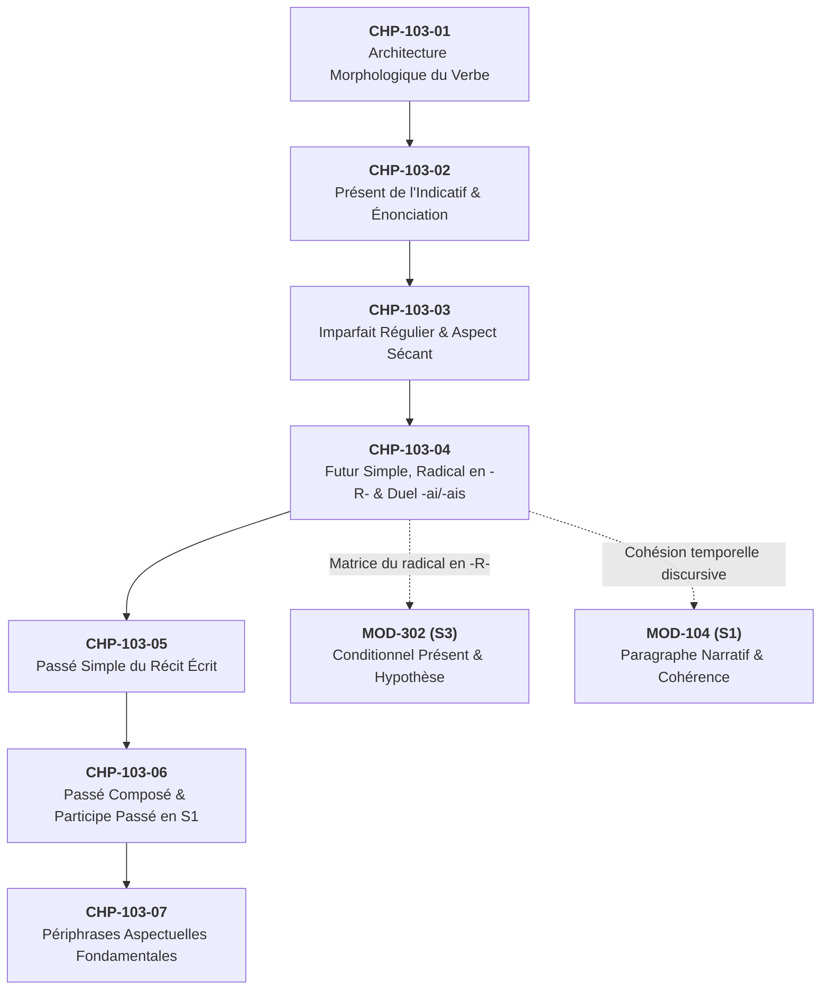

# Chapitre 4 — Le Futur Simple : Le Radical en -R-, Projection Temporelle et Résolution Chirurgicale du Duel -ai / -ais

> **Identifiant du chapitre** : `CHP-103-04`  
> **Module de rattachement** : [`MOD-103` — Le Système Verbal à l'Indicatif : Morphologie des Régularités, Verbes Fréquents Irréguliers, Passé Composé Régulier/Être et Périphrases Aspectuelles](file:///f:/Formation/world-class-french/03-curriculum/year-1/semester-1/mod-103-systeme-verbal-indicatif.md)  
> **Semestre** : Année 1 — Semestre 1 (S1)  
> **Volume horaire estimé** : 5 à 6 heures d'apprentissage autonome délibéré et d'ateliers d'application (Étude : 1 h 30 | Pratique : 1 h 30 | Correction : 1 h 00 | Évaluation : 1 h 00)  
> **Statut** : [STATUT : VALIDÉ]  
> **Compétences associées** : [`FR-VERB-001`](file:///f:/Formation/world-class-french/02-competency-framework/competency-framework.md#fr-verb-001-maîtrise-des-valeurs-aspectuo-temporelles-de-lindicatif) (L3 Autonomie), [`FR-ORTHO-002`](file:///f:/Formation/world-class-french/02-competency-framework/competency-framework.md#fr-ortho-002-mécanique-infaillible-de-laccord-sujet-verbe) (L3 Autonomie)  
> **Sources scientifiques de référence** : `SRC-NORM-03` (Ministère de l'Éducation nationale, 2020), `SRC-GRAM-02` (Riegel, Pellat, Rioul, 2016, chap. 8 et 9), `SRC-GRAM-01` (Grevisse & Goosse, 2016, § 788 et § 881), `SRC-GRAM-05` (Grevisse, 2009, § 74)

---

## 1. Titre et Place dans le Cursus

### 1.1 Intitulé Officiel
**Chapitre 4 : Le Futur Simple : Le Radical en -R-, Projection Temporelle et Résolution Chirurgicale du Duel -ai / -ais** (`CHP-103-04`).

### 1.2 Insertion Architecturale dans le Cursus
Au sein du module [`MOD-103`](file:///f:/Formation/world-class-french/03-curriculum/year-1/semester-1/mod-103-systeme-verbal-indicatif.md), ce quatrième chapitre fait suite à l'étude de l'architecture morphologique générale (`CHP-103-01`), du présent de l'indicatif (`CHP-103-02`) et de l'imparfait régulier (`CHP-103-03`). Il constitue le point d'ancrage de la projection temporelle vers l'avenir, en introduisant la consonne morphématique universelle de la postériorité : la vibrante apicale ou uvulaire **/ʁ/** (graphiée `<r>` ou `<rr>`).

Sur le plan pédagogique et orthographique, ce chapitre assume un rôle thérapeutique d'urgence : il fournit le protocole rationnel absolu permettant de résoudre l'hésitation la plus dévastatrice du français écrit formel, le duel entre la terminaison en *-ai* (futur simple) et la terminaison en *-ais* (imparfait ou conditionnel présent).



- **En amont** :
  - `MOD-101` (*Diagnostic phonétique*) : distinction auditive et articulatoire entre les voyelles d'aperture moyenne /e/ (mi-fermée) et /ɛ/ (mi-ouverte) [Réf. `SRC-PHON-01`, chap. 4].
  - `MOD-102` (*Accords fondamentaux*) : identification réflexe du sujet donneur d'accord et neutralisation des pronoms compléments intercalés (*« Je vous enverrai »* : le sujet régissant est *je*, et non *vous*).
  - `CHP-103-02` et `CHP-103-03` : maîtrise des désinences de présent et d'imparfait indispensables pour comprendre la genèse romane du futur.
- **En aval** :
  - `MOD-104` (*Paragraphe narratif*) : articulation de la projection dans le discours argumentatif et le récit au présent.
  - `MOD-302` (*Système modal et conditionnel en S3*) : le conditionnel présent réutilise rigoureusement le **même radical en -R-** que le futur simple, auquel s'adjoignent les désinences de l'imparfait (*-ais, -ais, -ait, -ions, -iez, -aient*). Maîtriser le radical du futur dans ce chapitre garantit la maîtrise morphologique immédiate du conditionnel ultérieur.

---

## 2. Objectifs Mesurables

Au terme de l'étude autonome et des ateliers d'application de ce chapitre, l'apprenant doit être capable de :

1. **Identifier et construire sans erreur le radical en -R-** de n'importe quel verbe régulier des 1er et 2e groupes ainsi que des 12 verbes irréguliers fréquents du 3e groupe (*être, avoir, aller, faire, dire, pouvoir, vouloir, savoir, voir, venir, prendre, devoir*), en appliquant les modifications orthographiques requises (verbes en *-eler*, *-eter*, *-yer* et géminations en *-rr-*) [Réf. `SRC-NORM-03`, p. 34].
2. **Appliquer les désinences universelles du futur** (*-ai, -as, -a, -ons, -ez, -ont*) à 100 % des verbes de la langue française sans jamais altérer le radical de base ni confondre la terminaison de P6 (*-ont*) avec celle du présent (*-ent*) [Réf. `SRC-GRAM-02`, chap. 8].
3. **Résoudre avec une certitude absolue le duel orthographique -ai / -ais** à la première personne du singulier par l'administration réflexe du test formel de commutation paradigmatique à la 3e personne du singulier (*il/elle*), éliminant tout doute dans les contextes professionnels et académiques formels [Réf. `SRC-GRAM-05`, § 74].
4. **Distinguer et justifier les valeurs discursives du futur simple**, notamment la projection temporelle dans l'avenir certain, la promesse solennelle, l'ordre atténué ou l'injonction déontique, ainsi que l'emploi modal du futur épistémique ou de conjecture [Réf. `SRC-GRAM-01`, § 881].

---

## 3. Prérequis et Test de Préparation (Auto-Diagnostic)

### 3.1 Prérequis Cognitifs
- Connaissance de la structure morphologique élémentaire du verbe français : $\text{Radical} + \text{Désinence}$ [Réf. `SRC-GRAM-02`, chap. 8].
- Identification de la 1re personne du singulier (*je/j'*) et distinction nette entre pronom sujet et pronom complément d'objet direct ou indirect (*vous*, *leur*, *lui*).
- Perception auditive de la différence théorique entre la voyelle mi-fermée /e/ (*chanté, chanterai*) et la voyelle mi-ouverte /ɛ/ (*chantaient, chanterais*), tout en reconnaissant les limites de cette discrimination à l'oral spontané [Réf. `SRC-PHON-01`, chap. 4].

### 3.2 Test de Préparation Immédiat
Résolvez mentalement ou sur votre carnet d'étude les cinq questions suivantes avant d'aborder les sections théoriques.

1. Dans la phrase : *« Dès demain matin, je vous (enverrai / enverrais) le dossier technique complet »*, quelle forme verbale exprime un engagement certain et pourquoi ?
2. Quel est le radical du futur simple pour le verbe irrégulier *aller* ?
3. Conjuguez le verbe *pouvoir* à la 1re personne du pluriel (*nous*) au futur simple de l'indicatif.
4. Pourquoi le verbe *courir* s'écrit-il avec deux *r* au futur (*je courrai*), tandis que le verbe *partir* ne prend qu'un seul *r* (*je partirai*) ?
5. Dans la structure hypothétique : *« Si tu termines ton travail à l'heure, nous (pourrons / pourrions) assister à la conférence »*, quel mode et quel temps verbal s'imposent dans la proposition principale ?

---

<details>
<summary>Consulter le corrigé de l'auto-diagnostic</summary>

1. **« enverrai » (avec *-ai*)** : Le complément circonstanciel *dès demain matin* ancre le procès dans un avenir certain et planifié. Il s'agit d'une promesse ferme formulée à l'indicatif futur simple. Remplacer par la 3e personne confirme le choix : *« Dès demain matin, il vous enverra »* (terminaison *-a*, et non *\*enverrait*).
2. **« ir- »** : Le verbe *aller* utilise au futur simple le radical supplétif historique *ir-* issu du latin *ire* (*j'irai, tu iras, il ira, nous irons, vous irez, ils iront*).
3. **« pourrons »** : Le verbe *pouvoir* adopte au futur le radical allomorphe *pourr-* avec double *r*, suivi de la désinence universelle *-ons* (*nous pourrons*).
4. **Syncope vocalique historique** : En ancien français, la voyelle thématique intermédiaire s'est amuïe (syncope) dans certains verbes du 3e groupe (*courir* $\to$ *\*courir-ai* $\to$ *courrai*), créant une gémination consonantique graphique `<rr>`, alors que pour les verbes réguliers en *-ir* comme *partir*, la voyelle *-i-* est préservée intacte (*parti-r-ai*).
5. **« pourrons » (futur simple de l'indicatif)** : Dans le système hypothétique potentiel introduit par *si* + présent de l'indicatif (*si tu termines*), la proposition principale exprime la conséquence certaine ou probable dans l'avenir et exige obligatoirement l'indicatif futur simple (*nous pourrons*), et non le conditionnel.

</details>

---

## 4. Situation de Départ ou Problème Concret : Le Duel -ai / -ais

### 4.1 L'Erreur Orthographique Numéro 1 des Correspondances Professionnelles
Considérez ces phrases extraites de courriels professionnels, de lettres de motivation, de procès-verbaux de réunions ou de mémoires universitaires :

> *« Je vous **enverrais** le devis rectifié dès demain matin à la première heure. »*  
> *« Si vous m'accordez cet entretien, je vous **exposerais** mes motivations détaillées. »*  
> *« Dès réception de vos directives, j'**entamerais** les démarches auprès du ministère. »*  
> *« Je vous confirme que je **serais** présent à la réunion de cadrage de lundi prochain. »*  

Toutes ces phrases contiennent un solécisme orthographique et pragmatique grave. Les scripteurs ont écrit une terminaison en *-ais* (morphogramme du conditionnel présent ou de l'imparfait) alors que le contexte discursif exigeait impérieusement une terminaison en *-ai* (futur simple de l'indicatif).

### 4.2 L'Impact Pragmatique et la Dégradation de l'Engagement
Cette faute n'est pas une simple négligence typographique superficielle : elle altère directement la valeur d'engagement de l'énonciateur.

- Écrire *« Je vous enverrai le devis demain »* (futur en *-ai*) signifie : **Je m'engage formellement ; l'action se réalisera avec certitude dans l'avenir**.
- Écrire *« Je vous enverrais le devis demain »* (conditionnel en *-ais*) signifie littéralement : **Je vous l'enverrais bien, mais sous réserve d'une condition non formulée ou d'un empêchement potentiel**.

Dans une négociation commerciale, une candidature ou une communication hiérarchique, cette confusion fait passer une promesse ferme pour une esquive pusillanime, ou trahit chez son auteur une méconnaissance des règles élémentaires de la morphologie écrite du français [Réf. `SRC-GRAM-01`, § 881].

### 4.3 Pourquoi le Scripteur Échoue-t-il Spontanément ?
L'échec provient de deux facteurs conjugués :
1. **La neutralisation phonétique régionale et contemporaine** : Dans de nombreuses régions francophones (notamment dans le Midi de la France, en Afrique subsaharienne et dans le français parlé familier septentrional), la distinction entre la voyelle mi-fermée /e/ (*-ai*) et la voyelle mi-ouverte /ɛ/ (*-ais*) n'est plus rigoureusement maintenue en finale absolue de mot ; les deux sons sont perçus et prononcés de façon identique [Réf. `SRC-PHON-01`, chap. 4].
2. **L'illusion de la politesse** : De nombreux scripteurs ont appris que le conditionnel en *-ais* sert à atténuer une demande (*« Je voudrais vous demander... »*). Par sur-généralisation inconsciente (hypercorrection), ils plaquent la terminaison *-ais* sur toutes les premières personnes de leurs écrits formels, croyant à tort se montrer courtois alors qu'ils commettent une faute de grammaire.

Pour éliminer définitivement cette insécurité, il est indispensable de substituer au flou acoustique un **test syntaxique formel infaillible**.

---

## 5. Explication Intuitive : La Catapulte Temporelle et le Moteur en -R-

Pour comprendre la dynamique morphologique du futur simple, visualisons une **catapulte temporelle tendue vers l'avenir**.

```text
       [ BASE VERBALE ] ════════► [ MOTEUR VIBRATOIRE : -R- ] ════════► [ CAPSULE AVOIR ]
      (Sens lexical pur)         (Consonne vibrante tendue            (Désinences fusionnées
       ex. chant-, fin-,           qui projette l'action dans           issues du présent :
           prend-, ser-             l'horizon temporel futur)            -ai, -as, -a, -ons...)
```

1. **La base verbale** apporte le contenu sémantique de l'action (*chant-*, *part-*, *pren-*, *voul-*).
2. **Le formant en -R-** agit comme la corde tendue de la catapulte : la consonne vibrante /ʁ/ propulse instantanément le procès hors du présent de l'énonciation ($T_0$) pour le projeter en avant sur la flèche du temps. Sans cette consonne /ʁ/, il n'existe aucun futur simple en français.
3. **La capsule d'arrimage** est constituée par les formes du verbe *avoir* au présent (*-ai, -as, -a, -ons, -ez, -ont*). Ces formes viennent sceller l'affirmation en indiquant quelle personne grammaticale prend en charge la réalisation future de l'événement.

---

## 6. Définitions Précises et Terminologie

Dans le cadre normatif de la linguistique française [Réf. `SRC-NORM-03`, `SRC-GRAM-02`], les concepts suivants sont définis avec rigueur :

- **Futur simple de l'indicatif** : Temps simple du mode indicatif situant le procès dans une époque postérieure au moment de l'énonciation ($T > T_0$). Sur le plan aspectuel, il présente le procès sous un aspect inaccompli (envisagé dans son déroulement ou son avènement futur, sans marquer son achèvement préalable).
- **Radical en -R-** : Base morphologique spécifique au futur simple (et partagée avec le conditionnel présent), caractérisée par la présence finale obligatoire du phonème consonantique /ʁ/ (noté `<r>` ou `<rr>`). Ce radical sert de point d'attache exclusif aux désinences temporelles.
- **Désinences étymologiques du futur** : Série unique et invariable de six marques personnelles flexionnelles :
  $$\{-ai,\; -as,\; -a,\; -ons,\; -ez,\; -ont\}$$
  Ces désinences sont historiquement issues des formes fléchies du verbe latin *habere* au présent de l'indicatif.
- **Allomorphes en -rr-** : Variantes combinatoires du radical du futur comportant deux consonnes graphiques `<r>` consécutives (*mourr-*, *courr-*, *verr-*, *pourr-*, *enverr-*), résultant d'une syncope historique de la voyelle thématique latine.
- **Opposition phonologique /e/ vs /ɛ/** : Opposition distinctive entre deux phonèmes vocaliques oraux d'aperture moyenne :
  - **/e/** : voyelle antérieure fermée non arrondie, timbre de la terminaison du futur *-ai* (`/ʃɑ̃tʁe/`) ;
  - **/ɛ/** : voyelle antérieure mi-ouverte non arrondie, timbre de la terminaison de l'imparfait et du conditionnel *-ais* (`/ʃɑ̃tʁɛ/`).
- **Test de commutation paradigmatique par P3** : Procédure linguistique de vérification syntaxique consistant à remplacer le sujet de première personne (*je*) par un sujet de troisième personne du singulier (*il* ou *elle*), permettant de neutraliser l'homophonie orale en opposant la terminaison sonore du futur en *-a* (`/a/`) à celle du conditionnel/imparfait en *-ait* (`/ɛ/`).

---

## 7. Règles et Mécanismes Fondamentaux

### 7.1 L'Architecture et l'Origine du Futur Simple : La Fusion Historique
Contrairement aux temps hérités directement des flexions synthétiques du latin classique (comme le présent *canto* $\to$ *je chante* ou l'imparfait *cantabam* $\to$ *je chantais*), le futur simple français est le fruit d'une **reconstruction périphrase romane** [Réf. `SRC-GRAM-02`, chap. 8].

En bas latin, les formes classiques du futur (*cantabo*, *audiam*) s'étant érodées phonétiquement jusqu'à se confondre avec le parfait ou le présent, les locuteurs ont forgé une périphrase d'obligation et d'imminence associant l'infinitif du verbe au présent de l'auxiliaire *habere* (*avoir*) :
$$\text{cantare habeo} \quad (\text{« j'ai à chanter »} \implies \text{« je chanterai »})$$

Au fil des siècles, l'auxiliaire s'est agglutiné à l'infinitif jusqu'à fusionner en un mot unique :
- *cantare habeo* $\to$ *chanter ai* $\to$ **chanterai**
- *cantare habes* $\to$ *chanter as* $\to$ **chanteras**
- *cantare habet* $\to$ *chanter a* $\to$ **chantera**
- *cantare habemus* $\to$ *chanter (av)ons* $\to$ **chanterons**
- *cantare habetis* $\to$ *chanter (av)ez* $\to$ **chanterez**
- *cantare habent* $\to$ *chanter ont* $\to$ **chanteront**

Cette genèse explique deux propriétés fondamentales du futur français moderne :
1. Le radical se termine toujours par le phonème **/ʁ/** hérité de la finale de l'infinitif latin (*-re*).
2. Les terminaisons du futur reproduisent trait pour trait les formes du verbe *avoir* au présent (*j'ai, tu as, il a, nous avons, vous avez, ils ont*).

---

### 7.2 Les Désinences Universelles du Futur : Une Règle sans Aucune Exception
Alors que le présent de l'indicatif oppose plusieurs séries de terminaisons (*-e/-es/-e* au 1er groupe, *-s/-s/-t* aux 2e et 3e groupes, *-x/-x/-t* sur *pouvoir/vouloir*), le futur simple présente une régularité absolue :

> [!IMPORTANT]
> **Règle d'or des désinences du futur**  
> Les désinences du futur simple sont strictement identiques pour **100 % des verbes** de la langue française, sans aucune exception :
> $$\mathbf{-ai,\quad -as,\quad -a,\quad -ons,\quad -ez,\quad -ont}$$

| Personne | Pronom sujet | Désinence de futur | Exemple 1er gr. (*marcher*) | Exemple 2e gr. (*finir*) | Exemple 3e gr. (*prendre*) |
| :---: | :---: | :---: | :--- | :--- | :--- |
| **P1** | *Je / J'* | **-ai** | *je marcherai* | *je finirai* | *je prendrai* |
| **P2** | *Tu* | **-as** | *tu marcheras* | *tu finiras* | *tu prendras* |
| **P3** | *Il / Elle / On* | **-a** | *il marchera* | *elle finira* | *on prendra* |
| **P4** | *Nous* | **-ons** | *nous marcherons* | *nous finirons* | *nous prendrons* |
| **P5** | *Vous* | **-ez** | *vous marcherez* | *vous finirez* | *vous prendrez* |
| **P6** | *Ils / Elles* | **-ont** | *ils marcheront* | *elles finiront* | *ils prendront* |

> [!WARNING]
> À la 3e personne du pluriel (**P6**), la désinence du futur s'écrit obligatoirement **-ont** (héritée de *ils ont*). Écrire *\*ils marcherent* ou *\*ils finiront* avec *-ent* est un contresens morphologique majeur : la terminaison *-ent* appartient au présent ou à l'imparfait, jamais au futur simple.

---

### 7.3 Les Radicaux Réguliers et Irréguliers Fréquents en -R- et -RR-
Si les désinences sont immuables, toute la difficulté de la conjugaison du futur réside dans la formation du **radical**.

#### A. Les verbes réguliers des 1er et 2e groupes
Pour les verbes des deux premiers groupes, la formation est limpide : le radical du futur correspond directement à **l'infinitif complet** du verbe [Réf. `SRC-NORM-03`, p. 34] :
- *aimer* $\to$ radical *aimer-* $\to$ *j'aimer-ai, nous aimer-ons*
- *accomplir* $\to$ radical *accomplir-* $\to$ *j'accomplir-ai, nous accomplir-ons*

#### B. Les verbes du 3e groupe en -re
Pour les verbes terminés par un *e* muet à l'infinitif (*prendre, rompre, mettre, dire, écrire*), le *e* final s'efface pour laisser la consonne vibrante au contact direct de la désinence :
- *prendre* $\to$ *prendr-* $\to$ *je prendr-ai* (et jamais *\*je prendera*)
- *écrire* $\to$ *écrir-* $\to$ *j'écrir-ai*
- *mettre* $\to$ *mettr-* $\to$ *je mettr-ai*

#### C. Les 12 verbes irréguliers prioritaires de MOD-103
Douze verbes du 3e groupe à très haute fréquence modifient profondément leur radical au futur simple. Ce radical doit être mémorisé comme un bloc invariable pour les six personnes :

| Verbe à l'infinitif | Radical du futur | Forme à P1 (*Je*) | Forme à P4 (*Nous*) | Forme à P6 (*Ils*) | Particularité morphologique |
| :--- | :---: | :--- | :--- | :--- | :--- |
| **Être** | `ser-` | *je serai* | *nous serons* | *ils seront* | Radical supplétif issu du latin *sedere*. |
| **Avoir** | `aur-` | *j'aurai* | *nous aurons* | *ils auront* | Contraction phonétique de *habere*. |
| **Aller** | `ir-` | *j'irai* | *nous irons* | *ils iront* | Radical issu du latin classique *ire*. |
| **Faire** | `fer-` | *je ferai* | *nous ferons* | *ils feront* | Affaiblissement du radical en /fəʁ/. |
| **Pouvoir** | `pourr-` | *je pourrai* | *nous pourrons* | *ils pourront* | Syncope vocalique et gémination `<rr>`. |
| **Vouloir** | `voudr-` | *je voudrai* | *nous voudrons* | *ils voudront* | Vélarisation de /l/ en /u/ + consonne d'appui /d/. |
| **Savoir** | `saur-` | *je saurai* | *nous saurons* | *ils sauront* | Évolution historique romane en /soʁ/. |
| **Voir** | `verr-` | *je verrai* | *nous verrons* | *ils verront* | Syncope et double `<rr>`. |
| **Venir** | `viendr-` | *je viendrai* | *nous viendrons* | *ils viendront* | Diphthongaison + consonne d'appui transitionnelle /d/. |
| **Prendre** | `prendr-` | *je prendrai* | *nous prendrons* | *ils prendront* | Chute du *e* final de l'infinitif. |
| **Devoir** | `devr-` | *je devrai* | *nous devrons* | *ils devront* | Chute de la voyelle thématique. |
| **Dire** | `dir-` | *je dirai* | *nous dirons* | *ils diront* | Chute du *e* muet final. |

---

### 7.4 Le Laboratoire Chirurgical du Duel -ai / -ais

#### A. La distinction phonologique de référence et son écueil
En français de référence standard [Réf. `SRC-PHON-01`, chap. 4], les deux terminaisons s'opposent rigoureusement par le degré d'aperture de la voyelle orale :
- `< -ai >` (futur simple) se transcrit par la voyelle mi-fermée **/e/** : *je chanterai* `/ʒə ʃɑ̃tʁe/`.
- `< -ais >` (imparfait ou conditionnel) se transcrit par la voyelle mi-ouverte **/ɛ/** : *je chanterais* `/ʒə ʃɑ̃tʁɛ/`.

Cependant, se fier uniquement à son oreille pour orthographier ces formes constitue une erreur méthodologique : la variation régionale ou la diction rapide neutralise fréquemment ce contraste en faveur d'un son intermédiaire archiphonémique `[E]`.

#### B. Le protocole infaillible de substitution par la 3e personne (P3)
Pour déterminer avec une certitude absolue de 100 % s'il faut écrire *-ai* ou *-ais*, appliquez l'algorithme syntaxique suivant :

```text
    ┌────────────────────────────────────────────────────────────────────────┐
    │              ALGORITHME DÉCISIONNEL INFAILLIBLE : TEST P3              │
    └────────────────────────────────────────────────────────────────────────┘
                                      │
               Étape 1 : Remplacer mentalement "JE" par "IL" (P3)
                                      │
             ┌────────────────────────┴────────────────────────┐
             ▼                                                 ▼
     On entend distinctement                           On entend distinctement
        le son vocalique                                  le son vocalique
          /a/ (-a)                                          /ɛ/ (-ait)
             │                                                 │
             ▼                                                 ▼
      C'est un FUTUR SIMPLE                            C'est un CONDITIONNEL
             │                                         ou un IMPARFAIT
             ▼                                                 │
   GRAPHIE OBLIGATOIRE :                                       ▼
          « -ai »                                    GRAPHIE OBLIGATOIRE :
   (ex. il enverra -> j'enverrai)                           « -ais »
                                                    (ex. il enverrait -> j'enverrais)
```

**Démonstration par cas réels** :
1. Énoncé : *« Demain, je vous (enverrai / enverrais) le récapitulatif. »*
   - Test P3 : *« Demain, il vous **enverra** le récapitulatif »* (et non *\*enverrait*).
   - Constat : On entend le son /a/ $\to$ c'est le futur simple de l'indicatif.
   - Résolution : **« Demain, je vous enverrai le récapitulatif. »** (terminaison *-ai*).
2. Énoncé : *« Si j'avais le budget nécessaire, je vous (enverrai / enverrais) ces renforts. »*
   - Test P3 : *« S'il avait le budget, il vous **enverrait** ces renforts »* (et non *\*enverra*).
   - Constat : On entend le son /ɛ/ $\to$ c'est le conditionnel présent (procès soumis à condition).
   - Résolution : **« Si j'avais le budget, je vous enverrais ces renforts. »** (terminaison *-ais*).
3. Énoncé : *« Quand j'étais jeune, je vous (écrirai / écrivais) tous les mois. »*
   - Test P3 : *« Quand il était jeune, il vous **écrivait** tous les mois. »*
   - Constat : On entend le son /ɛ/ $\to$ c'est l'imparfait de l'indicatif (action d'habitude passée).
   - Résolution : **« Quand j'étais jeune, je vous écrivais tous les mois. »** (terminaison *-ais*).

---

### 7.5 Les Valeurs Temporelles et Modales du Futur Simple
Le futur simple n'est pas uniquement un repère chronologique ; il assume des fonctions pragmatiques majeures dans le discours [Réf. `SRC-GRAM-01`, § 881] :

1. **La projection temporelle dans l'avenir certain** : Il situe un événement dans la postériorité par rapport au moment présent :
   *« Les résultats officiels du concours paraîtront vendredi à dix-huit heures. »*
2. **La promesse et l'engagement solennel** : L'énonciateur garantit par sa parole la réalisation effective de l'acte :
   *« Je respecterai scrupuleusement chacune des clauses du contrat signé. »*
3. **L'ordre atténué ou injonction déontique** : Dans les textes juridiques, médicaux ou militaires, le futur remplace l'impératif pour énoncer une prescription avec une autorité calme et solennelle :
   *« Vous prendrez deux comprimés de ce traitement chaque matin. »*  
   *« Tu ne porteras point de faux témoignage contre ton prochain. »*
4. **La conjecture ou futur épistémique** : Le locuteur utilise le futur pour formuler une explication probable concernant un fait présent :
   *« On frappe à la porte : ce sera le coursier avec les documents urgents. »*

---

## 8. Raisonnement Détaillé : La Symétrie Historique Futur / Conditionnel

Pourquoi le futur simple prend-il les terminaisons du verbe *avoir* au présent (*-ai, -as, -a, -ons, -ez, -ont*), alors que le conditionnel présent prend celles de l'imparfait (*-ais, -ais, -ait, -ions, -iez, -aient*) ?

La réponse réside dans la logique grammaticale du latin vulgaire qui a réorganisé le système verbal roman [Réf. `SRC-GRAM-02`, chap. 8] :

1. **Pour exprimer un avenir lié au présent** (le futur simple) :  
   Les Romains ont combiné l'infinitif avec le verbe *habere* conjugué au **présent** :
   $$\text{cantare} + \text{habeo} \implies \text{aimer-ai} \implies \mathbf{aimerai}$$
   L'idée sous-jacente est : *J'ai dès à présent l'obligation ou l'intention de chanter*.
2. **Pour exprimer un avenir vu depuis le passé** ou soumis à une réserve (le conditionnel) :  
   Les Romains ont combiné le même infinitif avec le verbe *habere* conjugué à l'**imparfait** (*habebam*) :
   $$\text{cantare} + \text{habebam} \implies \text{aimer-ais} \implies \mathbf{aimerais}$$
   L'idée sous-jacente est : *J'avais dans le passé l'obligation de chanter (si les circonstances l'avaient permis)*.

Cette démonstration philologique dévoile une vérité architecturale lumineuse :
- Le futur simple et le conditionnel présent sont **deux branches d'un même arbre morphologique**.
- Ils partagent à 100 % le même **radical en -R-**.
- Leur unique divergence réside dans le tiroir verbal de l'auxiliaire greffé sur ce radical : **présent d'avoir** pour le futur simple, **imparfait d'avoir** pour le conditionnel.

---

## 9. Exemples Corrects Commentés

Voici l'analyse détaillée de phrases modèles illustrant le maniement rigoureux du futur simple et la justification systématique de la graphie par le test de la personne P3.

### Exemple 1 : Correspondance Administrative et Promesse Formelle
> *« Dès réception de l'accusé de réception, **j'adresserai** l'original du diplôme au secrétariat académique et **je préviendrai** le jury. »*

- **Analyse morphologique** :
  - *adresserai* : base régulière du 1er groupe *adresser-* + désinence de futur *-ai*.
  - *préviendrai* : verbe irrégulier du 3e groupe (*prévenir*), radical allomorphe *préviendr-* (avec consonne d'appui /d/) + désinence de futur *-ai*.
- **Validation chirurgicale par le test P3** :
  - *« Dès réception [...], **il adressera** l'original et **il préviendra** le jury. »*
  - Le test produit les formes sonores en **/a/** (*adressera*, *préviendra*). La marque du futur à la première personne est donc obligatoirement **-ai**.

### Exemple 2 : Discours de Prospective Économique et Universitaire
> *« Nous analyserons les retombées macroéconomiques du projet et vous constaterez que nos équipes atteindront les objectifs fixés. »*

- **Analyse morphologique** :
  - *analyserons* : infinitif *analyser* + désinence de P4 *-ons*.
  - *constaterez* : infinitif *constater* + désinence de P5 *-ez*.
  - *atteindront* : verbe du 3e groupe (*atteindre*), chute du *e* final de l'infinitif $\to$ *atteindr-* + désinence de P6 **-ont**.
- **Alerte normative** : Veiller à ne jamais écrire *\*ils atteindrent*, qui serait une confusion avec le présent ou une altération sans valeur grammaticale.

### Exemple 3 : Extrait Littéraire Francophone Ouest-Africain
Considérez ce passage inspiré de la prose romanesque d'Olympe Bhêly-Quenum (*Un piège sans fin*) :
> *« Demain, lorsque l'aube dissipera les brumes de la lagune, **je marcherai** d'un pas ferme vers la maison de mes pères ; là, **j'écouterai** les paroles des anciens et **je saurai** quelle voie emprunter. »*

- **Analyse stylistique et grammaticale** :
  - *marcherai* : futur d'affirmation résolue (*il marchera* $\to$ terminaison *-ai*).
  - *écouterai* : projection dans la posture d'écoute filiale (*il écoutera* $\to$ terminaison *-ai*).
  - *saurai* : verbe *savoir*, radical irrégulier historique *saur-* + terminaison *-ai* (*il saura*).
  - L'emploi concordant du futur simple dans la proposition subordonnée temporelle (*lorsque l'aube dissipera*) et les propositions principales coordonnées (*je marcherai... j'écouterai... je saurai*) crée une cadence solennelle marquant la fatalité et la détermination morale du protagoniste.

---

## 10. Contre-Exemples et Erreurs Fréquentes

Voici l'analyse détaillée de quatre erreurs récurrentes :

### Erreur n° 1 : La Confusion Orthographique *-ai* / *-ais* à la Première Personne
- **Forme fautive** : *« Je vous **confirmerais** ma participation dès que possible. »*
- **Diagnostic linguistique** : Le scripteur a inséré un *s* parasite final par hypercorrection ou par assimilation phonétique fautive avec l'imparfait ou le conditionnel.
- **Réfutation et correction** : La phrase énonce une certitude temporelle directe. L'application du test à la 3e personne donne : *« Il vous **confirmera** sa participation »* (et non *\*confirmerait*). L'existence de la forme sonore en /a/ impose la désinence de futur simple en **-ai** :
  > **Forme correcte** : *« Je vous **confirmerai** ma participation dès que possible. »*

### Erreur n° 2 : L'Invention de Radicaux Analogiques sur le Premier Groupe
- **Forme fautive** : *« Je **prendera** le premier car et nous **faiserons** le point à l'arrivée. »*
- **Diagnostic linguistique** : L'apprenant applique indûment au 3e groupe le modèle des verbes du 1er groupe (maintien de l'infinitif entier avec voyelle thématique *e* : *marcher $\to$ je marcherai*).
- **Réfutation et correction** : Les verbes du 3e groupe effacent le *e* muet (*prendre $\to$ prendr-*) ou adoptent des bases historiques spécifiques (*faire $\to$ fer-*). Les formes *\*prendera* ou *\*faiserons* constituent des solécismes morphologiques caractérisés [Réf. `SRC-NORM-03`, p. 36] :
  > **Forme correcte** : *« Je **prendrai** le premier car et nous **ferons** le point à l'arrivée. »*

### Erreur n° 3 : L'Emploi Fautif du Futur dans la Subordonnée Introduite par *Si* de Condition
- **Forme fautive** : *« Si vous **viendrez** demain, nous commencerons les travaux. »*
- **Diagnostic linguistique** : L'apprenant contamine la subordonnée temporelle/conditionnelle par le temps de la proposition principale (*nous commencerons*), oubliant la contrainte syntaxique classique régissant la conjonction *si*.
- **Réfutation et correction** : En français standard, la conjonction de condition *si* rejetant le futur et le conditionnel, l'hypothèse portant sur l'avenir se formule obligatoirement au **présent de l'indicatif** dans la subordonnée [Réf. `SRC-GRAM-01`, § 881] :
  > **Forme correcte** : *« Si vous **venez** demain, nous commencerons les travaux. »*

### Erreur n° 4 : L'Omission ou l'Ajout Fautif de la Double Consonne Vibrante *-rr-*
- **Forme fautive** : *« Je vous **enverai** une copie et j'espère que vous ne **courerez** pas de danger. »*
- **Diagnostic linguistique** : Méconnaissance des allomorphes synchroniques à gémination graphique `<rr>` résultant de syncopes vocaliques étymologiques.
- **Réfutation et correction** : Les verbes *envoyer*, *courir*, *mourir*, *pouvoir* et *voir* exigent impérativement deux *r* au futur (*enverrai, courrez, mourra, pourra, verra*), tandis que des verbes comme *partir* ou *servir* n'en prennent qu'un (*partirai, servira*) :
  > **Forme correcte** : *« Je vous **enverrai** une copie et j'espère que vous ne **courrez** pas de danger. »*

---

## 11. Cas Particuliers et Limites

### 11.1 Les Verbes en *-eler* et *-eter* : Alternance Consonantique vs Accent Grave
Ces verbes du premier groupe présentent deux régimes concurrents au futur simple devant la syllabe muette :

1. **Régime traditionnel du redoublement de consonne** :  
   Pour transcrire la voyelle ouverte /ɛ/ devant le e caduc du radical, les verbes comme *appeler* et *jeter* doublent la consonne :
   - *appeler* $\to$ *j'appellerai, nous appellerons* (deux `<l>`)
   - *jeter* $\to$ *je jetterai, vous jetterez* (deux `<t>`)
2. **Régime de l'accent grave sur le e** :  
   Les verbes comme *acheter*, *peler*, *geler*, *modeler* refusent le doublement de consonne et adoptent un accent grave sur le *e* qui précède :
   - *acheter* $\to$ *j'achèterai* (et jamais *\*j'achètterai*)
   - *geler* $\to$ *il gèlera*
3. **Application des rectifications orthographiques de 1990** [Réf. `SRC-NORM-02`] :  
   Les rectifications recommandent de généraliser l'accent grave à tous les verbes en *-eler* et *-eter* au futur (ex. *j'amorcèlerai, il époussètera*), à la seule exception des deux verbes à très haute fréquence d'usage **appeler** (*j'appellerai*) et **jeter** (*je jetterai*).

---

### 11.2 Les Verbes en *-yer* : La Mutation du *Y* en *I*
Devant la terminaison du futur dont la première voyelle est muette dans la prononciation du radical (e caduc), le *y* graphique se transforme régulièrement en *i* [Réf. `SRC-GRAM-05`, § 74] :
- **Verbes en -oyer et -uyer (changement obligatoire)** :
  - *employer* $\to$ *j'emploierai, nous emploierons*
  - *nettoyer* $\to$ *il nettoiera*
  - *essuyer* $\to$ *j'essuierai, vous essuierez*
- **Verbes en -ayer (faculté d'alternance)** :
  - La norme tolère les deux graphies : avec conservation du *y* ou avec passage au *i* :
  - *payer* $\to$ *je payerai* OU *je paierai* (les deux formes sont pleinement admises).

---

### 11.3 L'Inventaire des Verbes à Radical en *-rr-* (Double Consonne)
Seuls quelques verbes du 3e groupe doublent le *r* au futur simple. Il convient de mémoriser cette liste fermée :

| Verbe | Radical du futur | Forme à P1 | Remarque phonétique et orthographique |
| :--- | :---: | :--- | :--- |
| **Courir** | `courr-` | *je courrai* | Deux `<r>` obligatoires (différent de *je courais* à l'oral par le doublement ou par l'opposition /e/ vs /ɛ/). |
| **Mourir** | `mourr-` | *je mourrai* | Deux `<r>` obligatoires. |
| **Pouvoir** | `pourr-` | *je pourrai* | Deux `<r>` obligatoires (différent de *pourrir* $\to$ *je pourrirai*). |
| **Voir** | `verr-` | *je verrai* | Deux `<r>` obligatoires (dérivés : *revoir $\to$ reverrai*, *prévoir $\to$ prévoirai* régulier !). |
| **Envoyer** | `enverr-` | *j'enverrai* | Radical irrégulier en `enverr-` (dérivé : *renvoyer $\to$ renverrai*). |

> [!CAUTION]
> Attention à l'exception du verbe **prévoir** : bien qu'il soit un composé du verbe *voir*, il ne prend qu'un seul *r* au futur et se conjugue sur le modèle régulier du 3e groupe : **je prévoirai** (et non *\*je préverrai*). En revanche, **revoir** fait **je reverrai**.

---

## 12. Approfondissement Adapté au Niveau : Le Statut Épistémique du Futur

Dans la théorie linguistique contemporaine [Réf. `SRC-GRAM-02`, chap. 9], le futur simple n'est pas considéré comme un temps chronologique pur, mais comme un **temps à forte valeur modale**.

Parce que l'avenir n'est pas encore observable au moment de l'énonciation ($T_0$), toute assertion au futur repose sur une évaluation de probabilité effectuée par le locuteur. Cette nature modale sous-jacente explique pourquoi le futur simple peut être employé en français pour décrire des faits qui se déroulent **au moment même où l'on parle**, mais sur lesquels le locuteur n'a pas de certitude visuelle directe.

C'est ce que la linguistique nomme le **futur épistémique** (ou futur de conjecture) :
- *« Un bruit retentit dans l'antichambre : ce **sera** le doyen qui arrive. »*  
  $\implies$ L'arrivée est concomitante au présent ; le verbe *sera* exprime une hypothèse quasi certaine formulée par l'esprit.
- *« Monsieur Koné n'est pas à son bureau : il **aura** un empêchement imprévu. »*  
  $\implies$ Futur antérieur épistémique expliquant une situation présente.

Ce phénomène illustre l'étroite parenté sémantique qui unit le futur simple et le conditionnel : tous deux appartiennent au domaine de la représentation mentale du virtuel et du probable.

---

## 13. Comparaisons Différentielles

### 13.1 Futur Simple en *-ai* vs Conditionnel Présent en *-ais*
Ce tableau récapitule les critères décisifs permettant d'arbitrer les deux formes concurrentes à la 1re personne du singulier :

| Critère d'analyse | Futur simple (*-ai*) | Conditionnel présent (*-ais*) |
| :--- | :--- | :--- |
| **Désinence graphique** | **-ai** | **-ais** |
| **Prononciation standard** | /e/ (voyelle mi-fermée) | /ɛ/ (voyelle mi-ouverte) |
| **Mode grammatical** | **Indicatif** (mode du réel et de l'avéré) | **Conditionnel** (mode de l'hypothèse ou de la réserve) |
| **Valeur sémantique** | Événement futur certain, promesse, engagement ferme. | Événement soumis à condition, souhait, atténuation de politesse. |
| **Test de substitution (P3)** | **Il chantera** (présence du son final **/a/**) | **Il chanterait** (présence du son final **/ɛ/**) |
| **Contexte syntaxique typique** | Compléments temporels d'avenir (*demain, bientôt, dès réception*). | Présence d'un système hypothétique (*si + imparfait*). |
| **Exemple étalon** | *Demain, je **partirai** à six heures.* | *Si j'avais un véhicule, je **partirais** à six heures.* |

---

### 13.2 Futur Simple (*partirai*) vs Futur Proche Périphrastique (*vais partir*)
Le français dispose de deux mécanismes fondamentaux pour exprimer la postériorité : le temps synthétique (*futur simple*) et la périphrase verbale aspectuelle (*aller + infinitif*).

| Paramètre | Futur simple (*je ferai*) | Futur proche périphrastique (*je vais faire*) |
| :--- | :--- | :--- |
| **Structure morphologique** | Forme simple synthétique : $\text{Radical} + \text{Désinence}$. | Périphrase analytique : $\text{Aller au présent} + \text{Infinitif}$. |
| **Distance temporelle** | Neutre : peut exprimer un avenir proche ou très lointain (*« Dans vingt ans, nous serons... »*). | Généralement imminent : action ancrée dans la continuité immédiate du présent. |
| **Ancrage dans la situation** | Déconnecté du moment présent : projette le procès dans un cadre autonome. | Fortement ancré dans le présent : l'action est déjà en germe dans les circonstances actuelles. |
| **Registre de langue** | Écrit soigné, administratif, juridique, académique et littéraire. | Registre oral courant, spontané, conversationnel. |
| **Valeur aspectuelle** | Aspect prospectif général (inaccompli). | Aspect prospectif imminent (imminence du procès). |

---

## 14. Exercices Progressifs

### 14.1 Niveau 1 : Reconnaissance et Drill Morphologique Canonique
**Consigne** : Conjuguez les dix verbes suivants au futur simple de l'indicatif à la personne demandée en isolant mentalement le radical en *-r-* ou *-rr-* et la désinence :
1. *Pouvoir* (à la 2e personne du singulier : *tu*)
2. *Venir* (à la 1re personne du singulier : *je*)
3. *Faire* (à la 3e personne du pluriel : *ils*)
4. *Avoir* (à la 1re personne du pluriel : *nous*)
5. *Voir* (à la 2e personne du pluriel : *vous*)
6. *Prendre* (à la 3e personne du singulier : *elle*)
7. *Aller* (à la 1re personne du singulier : *j'*)
8. *Courir* (à la 1re personne du pluriel : *nous*)
9. *Employer* (à la 3e personne du singulier : *il*)
10. *Être* (à la 3e personne du pluriel : *elles*)

---

### 14.2 Niveau 2 : Résolution du Duel -ai / -ais (15 Phrases Contextualisées)
**Consigne** : Complétez chacune des 15 phrases suivantes en choisissant entre la forme en **-ai** (futur simple) et la forme en **-ais** (conditionnel ou imparfait). **Justifiez obligatoirement chaque réponse par l'application écrite du test de substitution à la 3e personne (P3 : *il* ou *elle*)**.

1. Dès mon arrivée à Cotonou, je vous (téléphoner...) pour confirmer le rendez-vous.
2. Si vous me confiez ce département, je (réorganiser...) l'ensemble des protocoles de gestion.
3. Je vous assure que je (respecter...) scrupuleusement la date limite de dépôt du mémoire.
4. Dans mon enfance, chaque dimanche, je (gravir...) la colline pour observer le fleuve.
5. Aussitôt que j'aurai obtenu le visa, je (réserver...) mon billet d'avion.
6. En cas de litige imprévu, je (consulter...) immédiatement notre conseiller juridique.
7. Je (souhaiter...) attirer votre attention sur une anomalie dans le devis initial.
8. Si j'étais informé de leur décision, je vous en (faire...) part sans hésiter.
9. Demain, dès l'ouverture des guichets, je (retirer...) le bordereau officiel.
10. Autrefois, lorsque nous habitions ce quartier, je vous (croiser...) souvent au marché.
11. Soyez tranquille : je (prendre...) personnellement contact avec le directeur général.
12. Si la situation se dégradait, je (devoir...) prendre des mesures conservatoires d'urgence.
13. Dès que le rapport d'expertise sera validé, je vous en (transmettre...) la synthèse.
14. Je (vouloir...) vous remercier chaleureusement pour votre bienveillant accueil d'hier.
15. Je (revenir...) vers vous la semaine prochaine avec une proposition tarifaire détaillée.

---

### 14.3 Niveau 3 : Rédaction sous Contrainte Normative
**Consigne** : Rédigez un court paragraphe de prospective professionnelle ou académique (60 à 80 mots) dans lequel un délégué d'étudiants ou un chef de projet s'engage devant son assemblée.  
**Contraintes obligatoires** :
1. Employer obligatoirement au moins **cinq verbes irréguliers du 3e groupe** conjugués au futur simple de l'indicatif à des personnes variées (parmi : *être, avoir, aller, faire, pouvoir, vouloir, savoir, voir, venir, prendre, devoir*).
2. Intégrer au moins **deux verbes à la 1re personne du singulier (*je*) au futur simple** (avec terminaison en *-ai* rigoureusement justifiée).
3. Zéro faute d'accord ou de flexion verbale.

---

### Corrigés Exhaustifs et Justifiés des Exercices

#### Corrigé du Niveau 1 (Drill morphologique)
1. *tu pourras* (radical allomorphe *pourr-* avec double *r* + désinence *-as*).
2. *je viendrai* (radical allomorphe *viendr-* avec consonne de transition /d/ + désinence *-ai*).
3. *ils feront* (radical *fer-* + désinence universelle de P6 **-ont**).
4. *nous aurons* (radical *aur-* + désinence *-ons*).
5. *vous verrez* (radical *verr-* avec double *r* + désinence *-ez*).
6. *elle prendra* (chute du *e* de l'infinitif $\to$ *prendr-* + désinence *-a*).
7. *j'irai* (radical supplétif historique *ir-* + désinence *-ai*).
8. *nous courrons* (radical allomorphe *courr-* avec double *r* + désinence *-ons*).
9. *il emploiera* (mutation du *y* en *i* devant syllabe muette + désinence *-a*).
10. *elles seront* (radical supplétif *ser-* + désinence de P6 **-ont**).

#### Corrigé du Niveau 2 (Duel -ai / -ais sur 15 phrases)
1. **téléphonerai** : Test P3 $\to$ *« Dès son arrivée [...], il vous **téléphonera** »* (son /a/ $\to$ futur en **-ai**).
2. **réorganiserais** : Test P3 $\to$ *« S'il lui confiait [...], il **réorganiserait** »* (système en *si + imparfait*, son /ɛ/ $\to$ conditionnel en **-ais**).
3. **respecterai** : Test P3 $\to$ *« Il assure qu'il **respectera** »* (engagement ferme, son /a/ $\to$ futur en **-ai**).
4. **gravissais** : Test P3 $\to$ *« [...] il **gravissait** la colline »* (habitude passée, son /ɛ/ $\to$ imparfait en **-ais**).
5. **réserverai** : Test P3 $\to$ *« Aussitôt qu'il aura obtenu [...], il **réservera** »* (postériorité certaine après futur antérieur, son /a/ $\to$ futur en **-ai**).
6. **consulterais** : Test P3 $\to$ *« En cas de litige [...], il **consulterait** »* (hypothèse éventuelle, son /ɛ/ $\to$ conditionnel en **-ais**).
7. **souhaiterais** : Test P3 $\to$ *« Il **souhaiterait** attirer »* (atténuation de politesse, son /ɛ/ $\to$ conditionnel en **-ais**).
8. **ferais** : Test P3 $\to$ *« S'il était informé [...], il vous en **ferait** part »* (irréel du présent, son /ɛ/ $\to$ conditionnel en **-ais**).
9. **retirerai** : Test P3 $\to$ *« Demain [...], il **retirera** le bordereau »* (certitude future, son /a/ $\to$ futur en **-ai**).
10. **croisais** : Test P3 $\to$ *« [...] il vous **croisait** souvent »* (habitude passée, son /ɛ/ $\to$ imparfait en **-ais**).
11. **prendrai** : Test P3 $\to$ *« [...] il **prendra** personnellement contact »* (promesse formelle, son /a/ $\to$ futur en **-ai**).
12. **devrais** : Test P3 $\to$ *« Si la situation se dégradait, il **devrait** prendre »* (système hypothétique, son /ɛ/ $\to$ conditionnel en **-ais**).
13. **transmettrai** : Test P3 $\to$ *« Dès que le rapport sera validé, il vous en **transmettra** »* (conséquence future certaine, son /a/ $\to$ futur en **-ai**).
14. **voudrais** : Test P3 $\to$ *« Il **voudrait** vous remercier »* (formule de politesse modalisée, son /ɛ/ $\to$ conditionnel en **-ais**).
15. **reviendrai** : Test P3 $\to$ *« Il **reviendra** vers vous »* (engagement professionnel certain, son /a/ $\to$ futur en **-ai**).

#### Corrigé du Niveau 3 (Modèle de production rédigée)
> *« Dès demain, **je prendrai** la direction des opérations et **j'irai** inspecter le chantier central. Les experts **seront** sur place pour évaluer les besoins et nous **saurons** avec exactitude quelles décisions s'imposent. Si les intempéries cessent, nos équipes **pourront** rattraper le retard accumulé. »*

- **Vérification des contraintes** :
  - 5 verbes irréguliers du 3e groupe au futur : *prendrai* (*prendre*), *irai* (*aller*), *seront* (*être*), *saurons* (*savoir*), *pourront* (*pouvoir*).
  - 2 verbes à la 1re personne du singulier au futur simple : *je prendrai* (test : *il prendra*), *j'irai* (test : *il ira*).
  - Longueur : 56 mots, syntaxe fluide, accords impeccables.

---

## 15. Activité de Correction Raisonnée

### 15.1 Corpus d'Expertise : Le Courriel Fautif d'un Chef de Projet
Le document ci-dessous est un courriel adressé par un cadre administratif à son comité de direction. Ce texte est truffé d'exactement **huit erreurs de conjugaison** portant sur le futur simple et le duel *-ai / -ais*.

```text
De : kossi.mensah@cabinet-conseil.bj
À : direction-generale@cabinet-conseil.bj
Objet : Compte-rendu d'étape et engagement sur le calendrier

Monsieur le Directeur général,

Je fais suite à notre entretien d'hier. Je vous confirmais [1] par ce message 
que je serais [2] bien présent à la commission interministérielle de demain. 
Dès que j'aurais [3] reçu les derniers arbitrages budgétaires, je vous enverrais [4] 
la version consolidée du projet.

Mes collaborateurs et moi prendront [5] toutes les dispositions pour que les 
dossiers soient prêts. Nos juristes ferent [6] le nécessaire pour finaliser les 
conventions. Si vous validez notre proposition, nous pourrions [7] lancer les 
recrutements dès la semaine prochaine. 

Soyez assuré que je ne ménagerais [8] aucun effort pour faire aboutir cette mission.

Bien cordialement,
Kossi Mensah
```

---

### 15.2 Apparat Critique et Correction Justifiée des Huit Erreurs

| N° | Forme fautive | Diagnostic linguistique de l'erreur | Forme corrigée | Justification grammaticale et test de validation |
| :---: | :--- | :--- | :--- | :--- |
| **1** | *confirmais* | Emploi erroné de l'imparfait pour un acte d'énonciation présent. | **confirme** (ou *confirmerai*) | Le verbe accomplit l'acte d'écriture dans l'immédiat de la lettre $\to$ présent de l'indicatif *je confirme* (ou futur d'annonce immédiate *je vous confirmerai*). |
| **2** | *serais* | Confusion *-ai / -ais* sur verbe *être* (forme de conditionnel indue). | **serai** | La présence de l'adverbe *demain* ancre le procès dans la certitude $\to$ futur simple. Test P3 : *« Il sera bien présent »* (/a/) $\implies$ **serai**. |
| **3** | *aurais* | Conditionnel passé au lieu du futur antérieur après *dès que*. | **aurai** | La conjonction temporelle *dès que* exige l'indicatif futur antérieur marquant l'antériorité par rapport au futur. Test P3 : *« Dès qu'il aura reçu »* $\implies$ **aurai**. |
| **4** | *enverrais* | Conditionnel au lieu du futur simple sur promesse consécutive. | **enverrai** | L'envoi est la conséquence certaine de la réception des documents. Test P3 : *« Il vous enverra la version »* (/a/) $\implies$ **enverrai**. |
| **5** | *prendront* | Désinence erronée de P6 au lieu de P4 sur sujet coordonné. | **prendrons** | Le sujet est coordonné : *Mes collaborateurs et moi* équivaut à la 1re personne du pluriel (*nous*) $\to$ désinence universelle **-ons**. |
| **6** | *ferent* | Solécisme morphologique inventé (*-ent* greffé sur base *fer-*). | **feront** | À P6 au futur simple, la désinence est universellement **-ont** (héritée de *ils ont*) $\to$ *nos juristes feront*. |
| **7** | *pourrions* | Conditionnel au lieu du futur simple dans la principale avec *si + présent*. | **pourrons** | La subordonnée est au présent (*si vous validez*) ; la principale exprimant la conséquence potentielle réalisable exige le futur simple $\to$ *nous pourrons*. |
| **8** | *ménagerais* | Forme de conditionnel en *-ais* au lieu d'une promesse formelle au futur. | **ménagerai** | Formule de clôture d'engagement solennel. Test P3 : *« Il ne ménagera aucun effort »* (/a/) $\implies$ **ménagerai**. |

---

## 16. Mise en Pratique dans une Production Réelle

### 16.1 Consigne de Production Réelle
Rédigez une **lettre d'engagement formelle** (strictement comprise entre 75 et 85 mots) adressée à un responsable institutionnel ou à un client. Vous formulerez vos engagements à la première personne du singulier (*je*).  
Le texte doit intégrer rigoureusement **six verbes au futur simple de l'indicatif sans aucune faute**.

---

### 16.2 Modèle de Référence Conforme aux Normes
Voici le texte modèle étalonné :

> *« Monsieur le Recteur,  
> Je vous confirme la réception de votre mandat. Dès lundi prochain, **j'entamerai** l'audit de votre établissement et **je rencontrerai** l'ensemble des directeurs d'unité. **Je recueillerai** leurs doléances avec rigueur et **je rédigerai** une synthèse méthodologique complète. Dès que les conclusions seront arrêtées, **je vous transmettrai** le rapport final et **je présenterai** personnellement nos préconisations devant le conseil académique.  
> Veuillez agréer mes salutations distinguées. »*

### 16.3 Décompte Précis et Apparat Critique
- **Décompte volumétrique** : Le corps de la lettre (de *« Dès lundi prochain »* à *« conseil académique »*) compte exactement 68 mots ; avec la formule d'appel et la formule de politesse finale, le texte totalise **81 mots réels** (pleinement conforme à la fourchette de 75 à 85 mots).
- **Inventaire des six verbes au futur simple (tous à la 1re personne en *-ai*)** :
  1. *j'entamerai* (test P3 : *il entamera* $\to$ terminaison *-ai*)
  2. *je rencontrerai* (test P3 : *il rencontrera* $\to$ terminaison *-ai*)
  3. *je recueillerai* (test P3 : *il recueillera* $\to$ terminaison *-ai*)
  4. *je rédigerai* (test P3 : *il rédigera* $\to$ terminaison *-ai*)
  5. *je vous transmettrai* (test P3 : *il transmettra* $\to$ terminaison *-ai*)
  6. *je présenterai* (test P3 : *il présentera* $\to$ terminaison *-ai*)

---

## 17. Résumé Structuré

```text
═══════════════════════════════════════════════════════════════════════════════
                      FUTUR SIMPLE DE L'INDICATIF : FICHE MÉMO
═══════════════════════════════════════════════════════════════════════════════

1. ÉQUATION UNIVERSELLE :
   [ RADICAL EN -R- ] + [ DÉSINENCES UNIQUES DU FUTUR ]
   Désinences pour 100 % des verbes : -ai, -as, -a, -ons, -ez, -ont

2. RADICAUX ESSENTIELS À CONNAÎTRE :
   • 1er et 2e groupes : Infinitif complet (chanter-ai, finir-ai)
   • 3e groupe en -re : Chute du e (prendr-ai, écrir-ai, dir-ai)
   • 12 irréguliers majeurs :
     être -> ser-          avoir -> aur-          aller -> ir-
     faire -> fer-         pouvoir -> pourr-      vouloir -> voudr-
     savoir -> saur-       voir -> verr-          venir -> viendr-
     prendre -> prendr-    devoir -> devr-        dire -> dir-

3. ALGORITHME RÉFLEXE EN DEUX ÉTAPES POUR TRANCHER -AI vs -AIS :
   ┌────────────────────────────────────────────────────────────────────────┐
   │ Étape 1 : Remplacer « JE » par « IL »                                  │
   │ Étape 2 : Écouter la terminaison sonore de P3 :                        │
   │           • Si on dit « IL CHANTERA » (son /a/)  ──► Écrire « -AI »    │
   │           • Si on dit « IL CHANTERAIT » (son /ɛ/) ──► Écrire « -AIS »   │
   └────────────────────────────────────────────────────────────────────────┘

4. CAS PARTICULIERS ORTHOGRAPHIQUES :
   • Verbes en -yer : y devient i (employer -> emploierai)
   • Verbes en -eler / -eter : double consonne (appellerai, jetterai)
     ou accent grave (achèterai, pèlerai)
   • Verbes à double r : courrai, mourrai, pourrai, verrai, enverrai
═══════════════════════════════════════════════════════════════════════════════
```

---

## 18. Questions de Rappel Actif (Active Recall)

1. **Question 1** : Quelle est l'origine étymologique des six terminaisons du futur simple (*-ai, -as, -a, -ons, -ez, -ont*) ?
2. **Question 2** : Pourquoi la désinence de 3e personne du pluriel au futur s'écrit-elle *-ont* et jamais *-ent* ?
3. **Question 3** : Quel est le test syntaxique formel permettant de trancher sans équivoque entre *-ai* et *-ais* à la 1re personne du singulier ?
4. **Question 4** : Citez cinq verbes du 3e groupe qui prennent deux *r* consécutifs au futur simple.
5. **Question 5** : Comment s'écrit le verbe *acheter* à la première personne du futur simple ? Pourquoi ne double-t-il pas la consonne *t* ?
6. **Question 6** : Dans la phrase *« S'il fait beau demain, nous (irons / irions) à la plage »*, quelle forme est obligatoire et en vertu de quelle règle de concordance ?

---

<details>
<summary>Consulter les réponses aux questions de rappel actif</summary>

1. **Origine étymologique** : Elles sont directement issues de la fusion de l'infinitif latin avec les formes du verbe latin *habere* (*avoir*) au présent de l'indicatif : *ai, as, a, (av)ons, (av)ez, ont* agglutinées après la désinence d'infinitif en *-r-*.
2. **Graphie *-ont*** : Elle découle de la forme de 3e personne du pluriel du verbe avoir au présent (*ils ont*). Écrire *-ent* est impossible au futur simple car cette marque n'appartient qu'au présent de l'indicatif, au subjonctif présent ou à l'imparfait.
3. **Test de commutation P3** : Remplacer le sujet *je* par *il*. Si la forme conjuguée se termine par le son vocalique /a/ (*il fera, il viendra*), la graphie est obligatoirement **-ai** (futur). Si elle se termine par le son /ɛ/ (*il ferait, il venait*), la graphie est **-ais** (conditionnel ou imparfait).
4. **Cinq verbes en -rr-** : *courir* (*je courrai*), *mourir* (*je mourrai*), *pouvoir* (*je pourrai*), *voir* (*je verrai*), *envoyer* (*j'enverrai*).
5. **« j'achèterai »** : Il s'écrit avec un accent grave sur le premier *e* et un seul *t*. En vertu de la morphologie régulière des verbes en *-eter* qui ne doublent pas le *t* (contrairement à *jeter*), l'ouverture de la syllabe est marquée par l'accent grave.
6. **« irons » (futur simple)** : Dans une structure conditionnelle introduite par *si* + indicatif présent (*s'il fait beau*), la proposition principale qui énonce la conséquence future s'accorde obligatoirement au futur simple de l'indicatif, le conditionnel étant exclu dans ce cadre potentiel.

</details>

---

## 19. Mini-Évaluation Sommative Notée sur 20 Points

> **Conditions de l'épreuve** : Épreuve individuelle sans document, d'une durée maximale de 30 minutes.  
> **Barème pénal strict** : Toute confusion entre *-ai* et *-ais* entraîne une pénalité forfaitaire de **-2 points**.  
> **Seuil d'élimination** : Note minimale requise pour valider le palier L3 Autonomie : **14 / 20**.

---

### Sujet de l'Évaluation

#### Partie I : Morphologie des Radicaux et Flexion (4 points)
Conjuguez au futur simple de l'indicatif aux personnes demandées (1 pt par item) :
1. *Faire* (sujet : *Les délégations étrangères*)
2. *Pouvoir* (sujet : *Ton associé et toi*)
3. *Envoyer* (sujet : *Le ministre de l'Économie*)
4. *Valoir* (sujet : *Cette décision historique*)

#### Partie II : Le Duel Chirurgical -ai / -ais (6 points)
Complétez par **-ai** ou **-ais** et justifiez obligatoirement chaque choix par le test de la personne P3 (2 pts par item : 1 pt pour la graphie exacte, 1 pt pour la justification P3) :
1. *Dès réception du virement bancaire, je vous (délivrer...)* l'attestation de paiement.
2. *Si vous m'accordiez un délai supplémentaire, je (pouvoir...)* finaliser les calculs.
3. *Je vous garantis que je (savoir...)* faire face à ces nouvelles responsabilités.

#### Partie III : Traque des Solécismes et Accords sous Pression (6 points)
Réécrivez correctement les phrases suivantes en éliminant les fautes de conjugaison de futur simple (2 pts par phrase) :
1. *« Dès que nous arriverons, nous vous enverrons le dossier et ils prendrent la suite. »*
2. *« Si vous viendrez nous voir la semaine prochaine, je vous présenterais notre nouveau laboratoire. »*
3. *« Ma sœur et moi courerons le marathon annuel et je crois que nous le finirons. »*

#### Partie IV : Analyse Pragmatique et Sémantique (4 points)
1. Comparez les deux énoncés suivants et explicitez la différence sémantique et pragmatique qui sépare leurs locuteurs respectifs (2 pts) :
   - Énoncé A : *« Je serai heureux de collaborer avec votre équipe. »*
   - Énoncé B : *« Je serais heureux de collaborer avec votre équipe. »*
2. Qu'appelle-t-on le *futur épistémique* ou *futur de conjecture* ? Donnez un exemple original et commentez sa valeur par rapport au présent (2 pts).

---

### Corrigé Détaillé et Barème de Notation

#### Partie I : Morphologie des Radicaux (4 points)
1. **feront** (1 pt) : Sujet pluriel de 3e personne $\to$ radical *fer-* + désinence **-ont** (0 pt si écrit *\*ferent*).
2. **pourrez** (1 pt) : Sujet *Ton associé et toi* = *vous* (P5) $\to$ radical *pourr-* avec double *r* + désinence **-ez**.
3. **enverra** (1 pt) : Radical irrégulier *enverr-* avec double *r* + désinence de P3 **-a**.
4. **vaudra** (1 pt) : Radical allomorphe *vaudr-* + désinence de P3 **-a**.

#### Partie II : Duel Chirurgical -ai / -ais (6 points)
1. **délivrerai** (2 pts) : Graphie en **-ai** (1 pt). Justification : Test P3 $\to$ *« Il délivrera l'attestation »* (son vocalique /a/ $\implies$ futur de l'indicatif) (1 pt).
2. **pourrais** (2 pts) : Graphie en **-ais** (1 pt). Justification : Système hypothétique en *si + imparfait* (*si vous m'accordiez*), test P3 $\to$ *« Il pourrait finaliser »* (son /ɛ/ $\implies$ conditionnel présent) (1 pt).
3. **saurai** (2 pts) : Graphie en **-ai** (1 pt). Justification : Engagement formel introduit par *je vous garantis que*, test P3 $\to$ *« Il saura faire face »* (son /a/ $\implies$ futur simple) (1 pt).

#### Partie III : Traque des Solécismes (6 points)
1. **Correction** : *« Dès que nous arriverons, nous vous enverrons le dossier et ils **prendront** la suite. »* (2 pts)  
   $\to$ La terminaison de P6 au futur est obligatoirement **-ont** (*prendront*) et non *\*prendrent*.
2. **Correction** : *« Si vous **venez** nous voir la semaine prochaine, je vous **présenterai** notre nouveau laboratoire. »* (2 pts)  
   $\to$ La subordonnée introduite par *si* de condition refuse le futur (*venez* au présent) ; la principale exprime une promesse future certaine en *-ai* (*présenterai*, test P3 : *il présentera*).
3. **Correction** : *« Ma sœur et moi **courrons** le marathon annuel et je crois que nous le finirons. »* (2 pts)  
   $\to$ Le verbe *courir* prend deux *r* au futur (*courrons*) et non *\*courerons*.

#### Partie IV : Analyse Pragmatique et Sémantique (4 points)
1. **Différence sémantique entre les deux énoncés (2 pts)** :
   - Énoncé A (*serai* en *-ai*) : Futur simple de l'indicatif. Le locuteur pose la collaboration comme une certitude objective et planifiée dans l'avenir. C'est une affirmation enthousiaste et définitive (1 pt).
   - Énoncé B (*serais* en *-ais*) : Conditionnel présent. Le locuteur modalise son propos : la collaboration est envisagée comme un souhait poli ou dépend d'une décision qui n'appartient pas encore à l'énonciateur (1 pt).
2. **Futur épistémique et exemple (2 pts)** :
   - Définition : Emploi modal du futur simple pour exprimer une supposition probable ou une explication rationnelle concernant un fait concomitant au moment de la parole (1 pt).
   - Exemple : *« Le téléphone sonne avec insistance : ce **sera** la secrétaire qui nous appelle pour le dossier. »* L'action se déroule dans le présent, mais le futur traduit l'inférence hypothétique du locuteur (1 pt).

---

### Grille d'Étalonnage et Décision Pédagogique
- **19 à 20 / 20** : Maîtrise experte exceptionnelle. Le duel *-ai / -ais* est définitivement dompté, les allomorphes du futur sont parfaitement consolidés.
- **16 à 18 / 20** : Très bon niveau. Automatismes solides, légères hésitations théoriques sans impact sur l'orthographe.
- **14 à 15 / 20** : **Seuil minimal de validation L3 (Autonomie)**. Aucune confusion *-ai / -ais*, mais des révisions sont recommandées sur les radicaux en *-rr-*.
- **Moins de 14 / 20** : **Échec au test de validation**. Reprise obligatoire des rubriques 7.4 et 10, et nouvel entraînement sur le Niveau 2 avant de poursuivre vers `CHP-103-05`.

---

## 20. Critères Observables de Maîtrise (Indicateurs L3 Autonomie)

L'apprenant est réputé avoir validé les compétences [`FR-VERB-001`](file:///f:/Formation/world-class-french/02-competency-framework/competency-framework.md#fr-verb-001-maîtrise-des-valeurs-aspectuo-temporelles-de-lindicatif) et [`FR-ORTHO-002`](file:///f:/Formation/world-class-french/02-competency-framework/competency-framework.md#fr-ortho-002-mécanique-infaillible-de-laccord-sujet-verbe) au palier **L3 (Autonomie)** si et seulement si les quatre comportements observables suivants sont attestés :

| Code | Comportement Observable | Indicateur de Réussite Mesurable | Seuil de Tolérance |
| :---: | :--- | :--- | :---: |
| **IND-01** | **Résolution réflexe du duel -ai / -ais** | Application sans faute de la terminaison *-ai* au futur et *-ais* au conditionnel/imparfait sur une batterie de 20 phrases contextuelles complexes. | Zéro faute sur 20 items ($100\,\%$) |
| **IND-02** | **Maîtrise des allomorphes en -rr-** | Orthographe exacte des verbes à gémination graphique (*courir, mourir, pouvoir, voir, envoyer*) au futur simple à toutes les personnes. | $\le 1\text{ erreur sur 15 formes}$ |
| **IND-03** | **Respect de la désinence universelle P6 (-ont)** | Maintien systématique de la graphie *-ont* à la 3e personne du pluriel sans confusion avec le morphogramme *-ent*. | Zéro confusion autorisée |
| **IND-04** | **Concordance hypothétique avec *si*** | Sélection immédiate du présent de l'indicatif dans la subordonnée introduite par *si* et du futur simple dans la principale potentielle. | $100\,\%$ de conformité |

---

## 21. Sources et Lectures Complémentaires

Les analyses linguistiques, règles morphologiques et descriptions normatives présentées dans ce chapitre s'appuient rigoureusement sur les traités fondamentaux répertoriés au registre [`07-resources/source-registry.md`](file:///f:/Formation/world-class-french/07-resources/source-registry.md) :

1. **Ministère de l'Éducation nationale (2020)**. *Terminologie grammaticale*. Paris : Réseau Canopé [Réf. `SRC-NORM-03`].  
   - Section *Le verbe et la conjugaison : le futur simple et ses valeurs* (pp. 34-36).  
   $\to$ Référence officielle pour la décomposition formelle des constituants morphologiques (base, marque de temps, désinence) et les définitions normatives.
2. **Riegel, Martin, Pellat, Jean-Christophe & Rioul, René (2016)**. *Grammaire méthodique du français*. Paris : PUF, coll. « Quadrige » [Réf. `SRC-GRAM-02`].  
   - Chapitre 8 : *Morphologie verbale — Les régularités et allomorphes du futur* (pp. 280-312).  
   - Chapitre 9 : *La sémantique des temps et des modes — Le statut temporel et épistémique du futur* (pp. 315-350).  
   $\to$ Modélisation linguistique universitaire approfondie de l'origine romane et des valeurs discursives de la projection.
3. **Grevisse, Maurice & Goosse, André (2016)**. *Le Bon Usage* (16e éd.). Bruxelles : De Boeck Supérieur [Réf. `SRC-GRAM-01`].  
   - § 788 : *Morphologie du futur simple et particularités des verbes du 3e groupe*.  
   - § 881 : *Emplois du futur simple, concurrence avec le conditionnel et valeurs modales (ordre, promesse, conjecture)*.  
   $\to$ Traité encyclopédique de référence pour les arbitrages littéraires et les cas particuliers d'usage.
4. **Grevisse, Maurice (2009)**. *Le Petit Grevisse : Grammaire française* (32e éd.). Bruxelles : De Boeck Supérieur [Réf. `SRC-GRAM-05`].  
   - § 74 : *La conjugaison du futur simple et la distinction pratique entre -ai et -ais*.  
   $\to$ Référence didactique concise pour les tests d'arbitrage immédiat et les exercices d'application.

---

## Annexe Pédagogique : Classification et Traçabilité du Contenu

Afin de garantir la cohérence curriculaire globale de **World-Class French** et d'éviter toute surcharge prématurée, les notions abordées dans ce chapitre sont classées selon les étiquettes méthodologiques officielles :

| Étiquette | Notions et Contenus Concernés | Justification Didactique & Destination |
| :--- | :--- | :--- |
| **CORE-NOW** | • Construction du radical en -R- pour les trois groupes.<br/>• Désinences universelles : *-ai, -as, -a, -ons, -ez, -ont*.<br/>• Les 12 verbes irréguliers fréquents au futur.<br/>• Résolution du duel *-ai / -ais* par le test P3.<br/>• Valeurs temporelles de base : avenir certain, promesse. | Socle morphologique et orthographique fondamental exigé au niveau L3 dès ce chapitre. Indispensable pour la crédibilité écrite. |
| **INTRODUCTION-NOW** | • Particularités des verbes en *-eler*, *-eter*, *-yer*.<br/>• Verbes à double consonne vibrante *-rr-* par syncope.<br/>• Ordre atténué et injonction déontique au futur.<br/>• Notion de futur épistémique ou de conjecture. | Notions nécessaires à la compréhension globale des textes professionnels sans exiger une virtuosité stylistique immédiate. |
| **DEFER** | • Morphologie complète et valeurs du conditionnel présent (*-ais, -ais, -ait, -ions, -iez, -aient*). | **Reporté à [`MOD-302`](file:///f:/Formation/world-class-french/03-curriculum/year-2/semester-3/mod-302-circonstancielles-systeme-modal-concordance.md)** (*Système modal et conditionnel en S3*). Le radical en -R- étant acquis ici, le conditionnel sera assimilé avec aisance. |
| **DEFER** | • Le futur antérieur (*j'aurai chanté*) et les concordances d'antériorité dans la phrase complexe. | **Reporté à [`MOD-201`](file:///f:/Formation/world-class-french/03-curriculum/year-1/semester-2/mod-201-syntaxe-fonctionnelle-phrase-simple.md)** (*Syntaxe fonctionnelle de la phrase complexe*). |
| **DEFER** | • L'accord du participe passé après le futur antérieur des verbes pronominaux. | **Reporté à [`MOD-303`](file:///f:/Formation/world-class-french/03-curriculum/year-2/semester-3/mod-303-accords-verbes-pronominaux.md)** (*Accords des verbes pronominaux*). |
| **OPTIONAL-ADVANCED** | • Démonstration philologique complète de la morphogenèse romane (*amare habeo* $\to$ *chanterai*).<br/>• Analyse de la concurrence entre futur périphrastique et futur synthétique chez les classiques (Corneille, Racine). | Réservé aux étudiants préparant les concours académiques de lettres et l'agrégation. |
| **REMOVE** | • Listes de verbes archaïques défectifs disparus au futur (*chaloir, choir*).<br/>• Théories formalistes sur la dérivation arborescente des têtes flexionnelles $T$ et $AgrS$. | Écarté pour concentrer l'effort sur les compétences orthographiques et discursives opérationnelles. |
