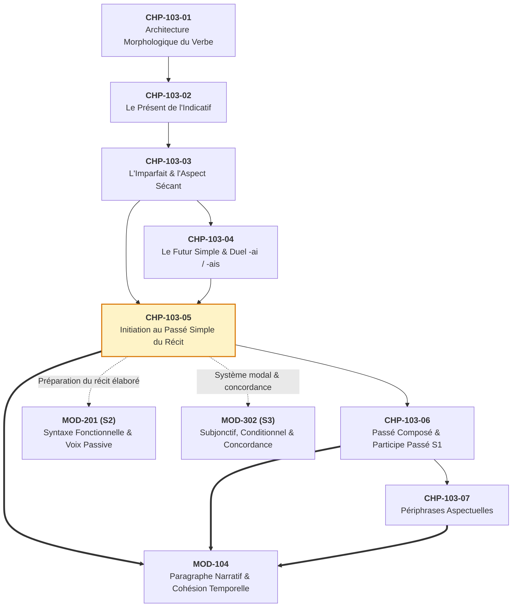

# Chapitre 5 — Initiation au Passé Simple du Récit Écrit : Les Quatre Séries Vocaliques et Maîtrise des 3es Personnes

> **Identifiant du chapitre** : `CHP-103-05`  
> **Module de rattachement** : [`MOD-103` — Le Système Verbal à l'Indicatif : Morphologie des Régularités, Verbes Fréquents Irréguliers, Passé Composé Régulier/Être et Périphrases Aspectuelles](file:///f:/Formation/world-class-french/03-curriculum/year-1/semester-1/mod-103-systeme-verbal-indicatif.md)  
> **Semestre** : Année 1 — Semestre 1 (S1)  
> **Volume horaire estimé** : 5 à 6 heures d'apprentissage autonome délibéré et d'ateliers d'application (Phase 1 Étude : 1 h 30 | Phase 2 Pratique : 1 h 30 | Phase 3 Correction : 1 h 00 | Phase 4 Évaluation : 1 h 00)  
> **Statut** : [STATUT : VALIDÉ]  
> **Compétences associées** : [`FR-VERB-001`](file:///f:/Formation/world-class-french/02-competency-framework/competency-framework.md#fr-verb-001-maîtrise-des-valeurs-aspectuo-temporelles-de-lindicatif) (L3 Autonomie), [`FR-ORTHO-001`](file:///f:/Formation/world-class-french/02-competency-framework/competency-framework.md#fr-ortho-001-maîtrise-de-lorthographe-lexicale-et-flexionnelle) (L3 Autonomie)  
> **Sources scientifiques de référence** : `SRC-GRAM-01` (Grevisse & Goosse, 2016, § 790-800, § 855), `SRC-GRAM-02` (Riegel et al., 2016, chap. 8-9), `SRC-NORM-03` (Ministère de l'Éducation nationale, 2020, p. 34-36), `SRC-GRAM-05` (Grevisse, 2009, § 74-76)

---

## 1. Titre et Place dans le Cursus

### 1.1 Intitulé Officiel
**Chapitre 5 : Initiation au Passé Simple du Récit Écrit : Les Quatre Séries Vocaliques et Maîtrise des 3es Personnes** (`CHP-103-05`).

### 1.2 Insertion Architecturale dans le Cursus
Ce cinquième chapitre constitue la porte d'entrée dans le récit littéraire, historique et journalistique soutenu. Après avoir établi l'architecture morphologique générale du verbe (`CHP-103-01`), les valeurs énonciatives du présent (`CHP-103-02`), la régularité absolue et l'aspect sécant de l'imparfait (`CHP-103-03`), ainsi que la projection du futur simple (`CHP-103-04`), ce cours aborde le temps par excellence de l'événement délimité coupé de l'énonciation : **le passé simple**.



- **En amont** : Ce chapitre s'appuie directement sur la notion d'**aspect sécant** et d'arrière-plan narratif consolidée au chapitre précédent avec l'imparfait (`CHP-103-03`). Il mobilise la capacité de l'apprenant à segmenter une forme verbale en base radicale et désinence personnelle (`CHP-103-01`).
- **Au sein du module `MOD-103`** : Il forme un diptyque fondamental avec le passé composé (`CHP-103-06`). L'apprenant découvre ici l'opposition cardinale théorisée par Émile Benveniste entre le **plan de l'histoire (ou récit)**, incarné par le passé simple sans lien avec le présent du locuteur, et le **plan du discours**, dominé par le passé composé en prise directe avec la situation d'énonciation.
- **En aval dans le cursus** :
  - Il fournit les outils morphologiques obligatoires pour [`MOD-104`](file:///f:/Formation/world-class-french/03-curriculum/year-1/semester-1/mod-104-lexique-lecture-paragraphe.md) (*Lecture fluide et rédaction du paragraphe narratif*) ;
  - Il prévient toute confusion morphologique ultérieure avec le subjonctif imparfait dans [`MOD-302`](file:///f:/Formation/world-class-french/03-curriculum/year-2/semester-3/mod-302-circonstancielles-systeme-modal-concordance.md), en fixant de manière définitive le statut de l'accent circonflexe sur les formes verbales en *-it*, *-ut* et *-int*.

---

## 2. Objectifs Mesurables

Au terme de l'étude autonome et des ateliers d'application de ce chapitre, l'apprenant doit être capable de :

1. **Classifier n'importe quel verbe français dans l'une des quatre séries vocaliques** du passé simple (série en *-a-*, série en *-i-*, série en *-u-*, série en *-in-*) avec un taux de réussite de 100 % [Réf. `SRC-NORM-03`, p. 34-36].
2. **Conjuguer sans faute orthographique les formes de 3e personne du singulier (P3) et de 3e personne du pluriel (P6)** pour les verbes réguliers et pour les 12 verbes irréguliers à haute fréquence (*être, avoir, faire, dire, pouvoir, vouloir, savoir, devoir, voir, venir, prendre, aller*) [Réf. `SRC-GRAM-01`, § 790-800].
3. **Appliquer infailliblement la règle d'accentuation circonflexe** propre au passé simple de l'indicatif : maintien systématique du circonflexe aux personnes P4 (*nous*) et P5 (*vous*), et **absence absolue de circonflexe à la personne P3** (*il*), éliminant ainsi toute confusion graphique avec le subjonctif imparfait [Réf. `SRC-GRAM-05`, § 74 ; `SRC-GRAM-02`, chap. 8].
4. **Articuler avec pertinence l'imparfait sécant et le passé simple non-sécant** dans la production d'un récit cohérent, en attribuant à chaque forme verbale sa fonction narrative exacte (cadre d'arrière-plan vs événement ponctuel de premier plan) [Réf. `SRC-GRAM-02`, chap. 9].

---

## 3. Prérequis et Test de Préparation (Auto-Diagnostic)

### 3.1 Prérequis Cognitifs
- Maîtrise de la segmentation morphologique : $[Radical] + [Marque\;temporelle] + [Désinence]$ (`CHP-103-01`).
- Compréhension de l'aspect sécant de l'imparfait (procès envisagé dans son déroulement interne, sans bornes visibles) (`CHP-103-03`).
- Identification réflexe du sujet singulier (P3 : *il, elle, on, syntagme nominal singulier*) et pluriel (P6 : *ils, elles, syntagme nominal pluriel*).

### 3.2 Test Diagnostique Immédiat
Résolvez par écrit les cinq questions suivantes avant d'entamer l'étude du chapitre :

1. Quel est le groupe verbal de *franchir* et quelle voyelle thématique le caractérise au passé simple ?
2. Parmi ces trois formes, laquelle constitue une 3e personne du singulier correcte au passé simple : *« il prit »*, *« il prendit »*, *« il prena »* ?
3. Dans la phrase : *« Soudain, la cloche (sonner) trois coups »*, quelle forme de P3 au passé simple devez-vous écrire ?
4. Dans l'énoncé : *« Dès qu'il vit le danger, il s'enfuit »*, quels sont les deux infinitifs en jeu et à quelle série vocalique appartiennent-ils ?
5. Vrai ou faux : Le verbe *être* prend un accent circonflexe à la 3e personne du singulier au passé simple de l'indicatif (*« il fût »*) ?

---

#### Corrigé de l'Auto-Diagnostic

<details>
<summary>Afficher le corrigé détaillé de l'auto-diagnostic</summary>

1. **2e groupe, voyelle thématique -i-** : *Franchir* fait son participe présent en *-issant* (*franchissant*), ce qui le classe dans le 2e groupe. Tous les verbes du 2e groupe suivent obligatoirement la série vocalique en *-i-* au passé simple (*il franchit*, *ils franchirent*).
2. **« il prit »** : *Prendre* est un verbe du 3e groupe dont le passé simple s'est fixé historiquement sur la série en *-i-* avec un radical court consonantique *pr-*. Les formes *\*il prendit* et *\*il prena* sont des barbarismes forgés par fausse analogie.
3. **« sonna »** : *Sonner* est un verbe du 1er groupe (infinitif en *-er*). Tous les verbes du 1er groupe adoptent la série en *-a-* au passé simple ; la terminaison de P3 est *-a* sans consonne finale (*il sonna*).
4. **« voir » et « s'enfuir » (série en -i-)** : *Vit* provient de *voir* (3e groupe) et *s'enfuit* provient de *s'enfuir* (3e groupe). Tous deux empruntent la série vocalique en *-i-* : *il vit*, *il s'enfuit*.
5. **Faux** : Le passé simple de l'indicatif du verbe *être* à la 3e personne du singulier s'écrit **« il fut »**, sans accent circonflexe. La forme avec accent circonflexe (*qu'il fût*) appartient exclusivement au subjonctif imparfait, temps subordonné.

</details>

> [!NOTE]
> Si vous avez hésité sur l'une de ces questions, rassurez-vous : le passé simple intimide parce qu'il n'est plus pratiqué dans la conversation orale spontanée. Ce chapitre a précisément pour but de transformer cette insécurité en une compétence mécanique limpide.

---

## 4. Situation de Départ ou Problème Concret : La Panique Devant le Passé Simple

### 4.1 L'Obsolescence Fantasmée et ses Conséquences
Dans les ateliers d'écriture, les examens universitaires et les rédactions professionnelles, le passé simple suscite fréquemment deux réactions extrêmes mais également dommageables :
1. **L'évitement systématique** : Le scripteur s'interdit d'employer le passé simple, qualifié à tort de « fossile inutile ». Il rédige l'intégralité de ses récits au passé composé, produisant un texte plat, monotone, incapable de marquer le recul historique ou la solennité de l'événement.
2. **La panique morphologique et les barbarismes grotesques** : Dès qu'une consigne formelle impose le récit littéraire, le rédacteur non préparé tente de conjuguer au hasard, produisant des formes hybrides qui ruinent sa crédibilité :
   - *\*« Dès qu'il prendit ses affaires, il parta »* ;
   - *\*« Les soldats venèrent en hâte et courrèrent vers le front »* ;
   - *\*« Le roi fît un geste et leur disit de se taire »*.

### 4.2 L'Enjeu de la Maîtrise Passive et Active
Le passé simple n'est pas un luxe académique réservé aux spécialistes de la littérature du XVIIe siècle. Il remplit deux fonctions vitales :
- **Une fonction de déchiffrage culturel et intellectuel (maîtrise réceptive)** : Tout scripteur francophone ambitieux lit des romans, des essais historiques, des arrêts juridiques, des articles de presse d'analyse et des contes patrimoniaux. Refuser d'apprendre le passé simple revient à se condamner à l'analphabétisme face à l'ensemble du patrimoine écrit francophone.
- **Une fonction de précision stylistique (maîtrise productive)** : Dans le récit écrit soutenu, le passé simple est l'unique temps simple capable de poser des événements fermés et successifs sans les rattacher à l'instant où le locuteur prend la parole.

---

## 5. Explication Intuitive : Le Coup de Burin et l'Éclair dans la Nuit

Pour comprendre le fonctionnement du passé simple dans la phrase, recourons à une analogie plastique et visuelle.

```text
══════════════════════════════════════════════════════════════════════════════
[ IMPARFAIT : LA TOILE DE FOND SÉCANTE ]
  (Caméra fixe, décor continu, action en cours non délimitée)
  « Le vent soufflait... la pluie tombait... la forêt bruissait... »
──────────────────────────────────────────────────────────────────────────────
                                 ▼
[ PASSÉ SIMPLE : LE COUP DE BURIN / L'ÉCLAIR NON-SÉCANT ]
  (Événement ponctuel, fermé, qui tranche la durée et fait avancer le temps)
  « Soudain, un éclair DÉCHIRA le ciel. Une branche CASSA. L'homme S'ARRÊTA. »
══════════════════════════════════════════════════════════════════════════════
```

### 5.1 L'Analogie du Coup de Burin
Imaginez un sculpteur devant un bloc de marbre :
- L'**imparfait** représente la matière elle-même, la couleur de la pierre, la température de l'atelier, la lumière diffuse qui éclaire la pièce. C'est un état stable, continu, qui n'a pas de début ni de fin sous le regard de l'observateur.
- Le **passé simple** est le coup de burin du sculpteur. Chaque coup frappe à un moment précis, modifie la forme du marbre de façon définitive et laisse place au coup suivant. Une suite de passés simples correspond à une série d'impacts successifs : l'horloge interne de l'histoire avance à chaque forme verbale.

### 5.2 L'Analogie Cinématographique
Au cinéma :
- L'imparfait correspond au plan large d'ambiance : la caméra balaie un paysage où la brume flotte au-dessus d'un lac. Rien ne commence, rien ne s'achève ; on observe un tableau.
- Le passé simple correspond au déclenchement d'une action nette : la porte claque, un coup de feu retentit, le détective entre. Ces événements ne s'étirent pas indéfiniment ; ils sont saisis comme des blocs complets, d'un point initial à un point terminal.

---

## 6. Définitions Précises et Terminologie Fondamentale

Chacun des termes ci-dessous doit être compris avec une rigueur linguistique totale.

### 6.1 Le Passé Simple
Le **passé simple** est un temps simple de l'indicatif qui situe un procès dans le passé, en rupture complète avec le moment de l'énonciation ($T_0$). Il est le temps canonique de la narration littéraire et du récit historique [Réf. `SRC-NORM-03`, p. 34 ; `SRC-GRAM-01`, § 855].

### 6.2 L'Aspect Non-Sécant (ou Global)
L'**aspect non-sécant** (ou global) est la propriété sémantique d'un temps verbal qui saisit le procès de l'extérieur, comme une totalité fermée embrassée d'un seul regard, du point initial au point final. Il s'oppose à l'**aspect sécant** de l'imparfait, qui saisit le procès de l'intérieur, en cours d'accomplissement, sans que ses limites soient perceptibles [Réf. `SRC-GRAM-02`, chap. 9 ; `SRC-GRAM-01`, § 854].

### 6.3 Le Plan du Récit (ou Récit Historique)
Dans la typologie linguistique d'Émile Benveniste, le **plan du récit** désigne le mode d'énonciation où les faits sont présentés comme s'ils s'étaient produits d'eux-mêmes, sans l'intervention active du locuteur et sans référence à la situation présente. Il s'oppose au **plan du discours**, qui implique un locuteur s'adressant à un destinataire dans l'actualité de l'échange [Réf. `SRC-GRAM-02`, chap. 9].

### 6.4 Les Séries Vocaliques du Passé Simple
Une **série vocalique** désigne le groupe morphologique auquel appartient un verbe au passé simple, défini par sa **voyelle thématique caractéristique** présente tout au long de la flexion :
- La série en **-a-** ;
- La série en **-i-** ;
- La série en **-u-** ;
- La série nasale en **-in-** [Réf. `SRC-NORM-03`, p. 35 ; `SRC-GRAM-01`, § 790].

### 6.5 Les Personnes Narratives Canoniques (P3 et P6)
- **P3** : 3e personne du singulier (*il, elle, on*, sujet nominal singulier).
- **P6** : 3e personne du pluriel (*ils, elles*, sujet nominal pluriel).  
Dans la pratique des textes historiques et littéraires, ces deux personnes représentent à elles seules plus de 95 % des occurrences réelles de passé simple [Réf. `SRC-GRAM-05`, § 74].

---

## 7. Règles ou Mécanismes Fondamentaux

### 7.1 Le Statut Énonciatif du Passé Simple : Le Temps du Récit Coupé de l'Énonciation
Le passé simple ne sert jamais à raconter un événement lié à l'instant présent. Si vous dites : *« J'ai perdu mes clés »*, vous utilisez le passé composé parce que la conséquence (vous n'avez pas vos clés) concerne directement votre présent.  
En revanche, si un historien écrit : *« Le roi signa le traité le 14 mai »*, il utilise le passé simple pour poser un fait historique clos, sans incidence sur la situation de communication de l'auteur. Le passé simple instaure une distance souveraine entre l'univers du récit et le temps de celui qui écrit [Réf. `SRC-GRAM-02`, chap. 9].

### 7.2 Les Quatre Séries de Voyelles Caractéristiques
Contrairement à l'imparfait qui possède un jeu de désinences strictement unique pour l'ensemble des verbes français (*-ais, -ais, -ait, -ions, -iez, -aient*), le passé simple se structure en **quatre séries vocaliques distinctes** [Réf. `SRC-NORM-03`, p. 35 ; `SRC-GRAM-01`, § 790-800] :

```text
┌────────────────────────────────────────────────────────────────────────────┐
│                    LES QUATRE SÉRIES VOCALIQUES DU PASSÉ SIMPLE            │
├──────────────┬───────────────────┬───────────────────┬─────────────────────┤
│ Série en -a- │ Série en -i-      │ Série en -u-      │ Série en -in-       │
│ (1er groupe  │ (2e groupe +      │ (3e groupe : être,│ (Familles de venir  │
│  + aller)    │  partie du 3e)    │  avoir, devoir...)│  et tenir)          │
├──────────────┼───────────────────┼───────────────────┼─────────────────────┤
│ -ai          │ -is               │ -us               │ -ins                │
│ -as          │ -is               │ -us               │ -ins                │
│ -a           │ -it               │ -ut               │ -int                │
│ -âmes        │ -îmes             │ -ûmes             │ -înmes              │
│ -âtes        │ -îtes             │ -ûtes             │ -întes              │
│ -èrent       │ -irent            │ -urent            │ -inrent             │
└──────────────┴───────────────────┴───────────────────┴─────────────────────┘
```

#### 1. La Série en -a- (1er groupe et verbe *aller*)
- **Périmètre** : Tous les verbes dont l'infinitif se termine par *-er* (ex. *chanter, marcher, regarder, parler*), ainsi que l'irrégulier *aller*.
- **Flexion complète** : *-ai, -as, -a, -âmes, -âtes, -èrent*.
- **Formes de 3e personne** :
  - P3 (Singulier) : **-a** $\rightarrow$ *il chanta, elle marcha, on alla*.
  - P6 (Pluriel) : **-èrent** $\rightarrow$ *ils chantèrent, elles marchèrent, ils allèrent*.

#### 2. La Série en -i- (2e groupe et une large partie du 3e groupe)
- **Périmètre** : 
  - La totalité des verbes du 2e groupe en *-ir / -issant* (*finir, choisir, bondir, franchir*).
  - De très nombreux verbes du 3e groupe en *-ir* (*partir, sortir, dormir, servir, sentir*), en *-re* (*dire, faire, écrire, rire, prendre, mettre, suivre*), en *-dre* (*attendre, répondre, perdre, vendre, craindre, joindre*), en *-re* (*naître* $\rightarrow$ *il naquit*, *vaincre* $\rightarrow$ *il vainquit*) et le verbe *voir* (*il vit*).
- **Flexion complète** : *-is, -is, -it, -îmes, -îtes, -irent*.
- **Formes de 3e personne** :
  - P3 (Singulier) : **-it** $\rightarrow$ *il finit, elle partit, il prit, il fit, il dit, il vit*.
  - P6 (Pluriel) : **-irent** $\rightarrow$ *ils finirent, elles partirent, ils prirent, ils firent, ils dirent, ils virent*.

#### 3. La Série en -u- (Verbes fréquents du 3e groupe, auxiliaires *être* et *avoir*)
- **Périmètre** : 
  - Les deux auxiliaires fondamentaux : *être* (*il fut*) et *avoir* (*il eut*).
  - La plupart des verbes dont le participe passé se termine par *-u* : *devoir* (*il dut*), *pouvoir* (*il put*), *savoir* (*il sut*), *vouloir* (*il voulut*), *valoir* (*il valut*), *falloir* (*il fallut*), *pleuvoir* (*il plut*), *plaire* (*il plut*), *taire* (*il tut*), *boire* (*il but*), *croire* (*il crut*), *lire* (*il lut*), *connaître* (*il connut*), *paraître* (*il parut*), *recevoir* (*il reçut*), *vivre* (*il vécut*), *mourir* (*il mourut*), *courir* (*il courut*), *résoudre* (*il résolut*).
- **Flexion complète** : *-us, -us, -ut, -ûmes, -ûtes, -urent*.
- **Formes de 3e personne** :
  - P3 (Singulier) : **-ut** $\rightarrow$ *il fut, il eut, il dut, il put, il voulut, il vécut, il mourut*.
  - P6 (Pluriel) : **-urent** $\rightarrow$ *ils furent, ils eurent, ils durent, ils purent, ils voulurent, ils vécurent, ils moururent*.

#### 4. La Série Nasale en -in- (Familles exclusives de *venir* et *tenir*)
- **Périmètre** : Verbes *venir* et *tenir*, ainsi que l'ensemble de leurs dérivés par préfixation (*devenir, revenir, parvenir, prévenir, se souvenir, convenir, intervenir ; retenir, maintenir, appartenir, obtenir, contenir, soutenir*).
- **Flexion complète** : *-ins, -ins, -int, -înmes, -întes, -inrent*.
- **Formes de 3e personne** :
  - P3 (Singulier) : **-int** $\rightarrow$ *il vint, elle tint, il retint, elle parvint*.
  - P6 (Pluriel) : **-inrent** $\rightarrow$ *ils vinrent, elles tinrent, ils retinrent, elles parvinrent*.

### 7.3 La Priorité Pédagogique en S1 : Automatisation Réflexe de P3 et P6
Pourquoi concentrer l'effort pédagogique sur les 3es personnes ?
- À l'écrit littéraire et documentaire, le narrateur raconte les actions de personnages (*il, elle, les ministres, les témoins, ils*).
- Les formes de 1re et 2e personnes (*je chantai, tu chantas, nous partîmes, vous voulûtes*) ne se rencontrent que très rarement, presque exclusivement dans des dialogues oratisés de style soutenu classique.
- En apprenant à maîtriser instantanément le couple **P3 (Singulier) / P6 (Pluriel)** pour chacune des 4 séries, le scripteur résout d'emblée **95 % des situations narratives réelles**.

### 7.4 La Règle Inviolable de l'Accent Circonflexe : P4 et P5 vs P3
Il existe une règle d'or sans la moindre exception dans toute la conjugaison française [Réf. `SRC-GRAM-01`, § 798] :
1. **P4 et P5 (*nous, vous*) prennent OBLIGATOIREMENT un accent circonflexe** sur la voyelle thématique dans les quatre séries :
   - Série en -a- : *nous chantâmes*, *vous chantâtes* ;
   - Série en -i- : *nous finîmes*, *vous finîtes* ;
   - Série en -u- : *nous voulûmes*, *vous voulûtes* ;
   - Série en -in- : *nous vînmes*, *vous vîntes*.
2. **P3 (*il, elle, on*) ne prend JAMAIS d'accent circonflexe au passé simple de l'indicatif** :
   - Série en -a- : *il chanta* (et jamais *\*il chantâ*) ;
   - Série en -i- : *il finit*, *il fit*, *il prit* (et jamais *\*il finît, \*il fît, \*il prît*) ;
   - Série en -u- : *il voulut*, *il fut*, *il dut* (et jamais *\*il voulût, \*il fût, \*il dût*) ;
   - Série en -in- : *il vint*, *il tint* (et jamais *\*il vînt, \*il tînt*).

> [!IMPORTANT]
> Tout accent circonflexe placé sur une 3e personne du singulier en *-ît*, *-ût* ou *-înt* transforme instantanément la forme en **subjonctif imparfait** (*« Il fallait qu'il fît son devoir »*, *« Bien qu'il voulût partir »*). Dans une proposition indépendante ou principale de récit indicatif (*« Le roi fit mander ses ministres »*), cet accent est une faute éliminatoire.

---

## 8. Raisonnement Détaillé : Pourquoi la Langue Française Possède-t-elle Quatre Séries ?

Rien en linguistique n'est arbitraire. La coexistence de quatre séries vocaliques au passé simple s'explique par l'évolution historique du latin classique vers l'ancien français [Réf. `SRC-GRAM-02`, chap. 8 ; `SRC-GRAM-01`, § 790].

### 8.1 L'Héritage des Quatre Conjugaisons Latines
En latin, les verbes se répartissaient en quatre conjugaisons principales :
- 1re conjugaison en *-are* (ex. *amare, cantare*) ;
- 2e conjugaison en *-ēre* (ex. *habere, debere*) ;
- 3e conjugaison en *-ere* (ex. *legere, facere, dicere*) ;
- 4e conjugaison en *-ire* (ex. *audire, dormire, venire*).

Le passé simple français descend directement du **parfait latin** (*perfectum*).
1. **La série en -a-** perpétue les parfaits dits « faibles » (accentués sur la désinence) de la première conjugaison latine :
   - Latin *cantāvit* $\rightarrow$ Ancien français *chanta* $\rightarrow$ Français moderne *il chanta*.
   - Latin *cantavērunt* $\rightarrow$ Ancien français *chantèrent* $\rightarrow$ Français moderne *ils chantèrent*.
2. **La série en -i-** regroupe deux composantes latines majeures :
   - Les parfaits faibles de la quatrième conjugaison : *dormīvit* $\rightarrow$ *dormit* ; *audīvit* $\rightarrow$ *ouït*.
   - Les parfaits forts (accentués sur le radical en latin) à radical palatal ou sigmatique : *fēcit* $\rightarrow$ *fit* ; *dīxit* $\rightarrow$ *dit* ; *vīdit* $\rightarrow$ *vit* ; *prēnsit* $\rightarrow$ *prit*.
3. **La série en -u-** tire son origine des parfaits latins caractérisés par le suffixe *-ui* :
   - *habuit* $\rightarrow$ *eut* `/y/` ; *debuit* $\rightarrow$ *dut* ; *potuit* $\rightarrow$ *put* ; *placuit* $\rightarrow$ *plut* ; *tacuit* $\rightarrow$ *tut*.
   - Par une puissante force d'analogie morphologique au Moyen Âge, cette voyelle *-u-* s'est étendue à une grande variété de verbes du 3e groupe partageant un participe passé en *-u* (*voulu* $\rightarrow$ *voulut*, *connu* $\rightarrow$ *connut*, *vécu* $\rightarrow$ *vécut*, *mourut*).
4. **La série nasale en -in-** est une innovation phonétique propre au domaine gallo-roman :
   - Le parfait latin de *venire* était *vēnit* (avec un *e* long).
   - En ancien français, sous l'effet combiné de l'accent tonique et de la consonne nasale dentale *n*, la voyelle s'est fermée en diphtongue nasalisée : *vēnit* $\rightarrow$ *vent* $\rightarrow$ *vint* `/vɛ̃/`.
   - Ce traitement s'est transmis intact aux verbes *venir*, *tenir* et à toute leur descendance lexicale, formant une série fermée particulièrement stable et harmonieuse.

### 8.2 D'où Vient le Circonflexe à P4 et P5 ?
En latin tardif et en ancien français, les terminaisons de 1re et 2e personnes du pluriel comprenaient un *s* implosif intérieur :
- *cantavistis* / *chantasmes*, *chantastes* ;
- *dormivistis* / *finismes*, *finistes* ;
- *habuistis* / *eusmes*, *eustes*.

Vers le XIIe et le XIIIe siècle, ce *s* implosif s'est amuï (il a cessé d'être prononcé), provoquant un allongement compensatoire de la voyelle précédente. Au XVIIIe siècle, l'Académie française a introduit l'accent circonflexe sur la voyelle pour commémorer ce *s* phonétiquement disparu.  
À la 3e personne du singulier (*cantavit* $\rightarrow$ *chanta*, *dormivit* $\rightarrow$ *dormit*), la terminaison latine se terminait directement par un *t* consonne sans aucun *s* intermédiaire. Il n'y a donc jamais eu de *s* à compenser : **la 3e personne du singulier du passé simple n'a jamais pris et ne prendra jamais d'accent circonflexe à l'indicatif** [Réf. `SRC-GRAM-02`, chap. 8].

---

## 9. Exemples Corrects Commentés : L'Alternance Narrative chez les Grands Auteurs

L'observation de textes littéraires authentiques permet de saisir immédiatement la dynamique entre l'imparfait d'arrière-plan et le passé simple d'action.

### 9.1 Corpus Patrimonial Classique : Guy de Maupassant, *Une vie* (1883)

Considérons cet extrait représentatif de la prose narrative du XIXe siècle :

> *« Une brume légère flottait encore sur la plaine et le vent matinal agitait mollement les cimes des peupliers. Tout à coup, un chevalier surgit au détour du sentier ; il arrêta sa monture, considéra attentivement le château silencieux et poussa un cri d'avertissement. Deux gardes parurent aussitôt sur le rempart. »*

#### Analyse Morphologique et Textuelle
1. **Verbes d'arrière-plan (Imparfait, aspect sécant)** :
   - *flottait* (1er groupe) : peint l'atmosphère continue, sans borne initiale ni finale explicite.
   - *agitait* (1er groupe) : mouvement répété et continu servant de toile de fond au paysage.
2. **Verbes d'action de premier plan (Passé simple, aspect non-sécant)** :
   - *surgit* : verbe *surgir* (2e groupe), **série en -i-**, P3 (*-it*). L'action est soudaine, ponctuelle, elle rompt la tranquillité de la brume.
   - *arrêta* : verbe *arrêter* (1er groupe), **série en -a-**, P3 (*-a*). Action délimitée.
   - *considéra* : verbe *considérer* (1er groupe), **série en -a-**, P3 (*-a*). Action successive.
   - *poussa* : verbe *pousser* (1er groupe), **série en -a-**, P3 (*-a*). Événement sonore ponctuel.
   - *parurent* : verbe *paraître* (3e groupe), **série en -u-**, P6 (*-urent*). Réaction immédiate des gardes (sujet pluriel *Deux gardes*).

Chaque passé simple fait progresser le chronomètre du récit d'un échelon : $A \rightarrow B \rightarrow C \rightarrow D$.

### 9.2 Corpus Francophone Africain : Olympe Bhêly-Quenum, *Un piège sans fin* (Bénin, 1960)

Dans son grand roman consacré au destin et aux tourments humains en pays dahoméen, l'écrivain béninois Olympe Bhêly-Quenum manie l'alternance temporelle avec une rigueur classique exemplaire :

> *« Le soleil dardait ses rayons implacables sur la terre rouge et une chaleur suffocante pesait sur le village assoupi. Brusquement, Ahouna entendit un grondement sourd vers la clairière. Il bondit hors de la case, saisit son coupe-coupe et courut vers les plantations. Les anciens se dressèrent alors d'un seul mouvement et retinrent leurs souffles dans l'attente du présage. »*

#### Analyse Morphologique et Textuelle
1. **Arrière-plan sécant (Imparfait)** :
   - *dardait*, *pesait* : installent la lourdeur atmosphérique et temporelle.
2. **Actions successives de premier plan (Passé simple)** :
   - *entendit* : verbe *entendre* (3e groupe), **série en -i-**, P3 (*-it*). Événement déclencheur.
   - *bondit* : verbe *bondir* (2e groupe), **série en -i-**, P3 (*-it*). Geste rapide, délimité.
   - *saisit* : verbe *saisir* (2e groupe), **série en -i-**, P3 (*-it*). Geste matériel immédiat.
   - *courut* : verbe *courir* (3e groupe), **série en -u-**, P3 (*-ut*). Mouvement borné dans l'espace.
   - *se dressèrent* : verbe *se dresser* (1er groupe), **série en -a-**, P6 (*-èrent*). Sujet pluriel *Les anciens*.
   - *retinrent* : verbe *retenir* (3e groupe, dérivé de *tenir*), **série nasale en -in-**, P6 (*-inrent*).

---

## 10. Contre-Exemples et Erreurs Fréquentes

L'observation clinique des productions écrites des apprenants révèle quatre erreurs récurrentes majeures [Réf. `SRC-GRAM-01`, § 798 ; `SRC-GRAM-05`, § 74] :

### Erreur n°1 : L'accent circonflexe parasite à la 3e personne du singulier (*« il fît »*, *« il voulût »*)
- **Forme fautive** : *\*« Le juge fît une pause et il voulût vérifier le témoignage. »*
- **Analyse de la faille** : L'apprenant associe confusément l'accent circonflexe à l'idée générale de « passé simple » ou de « style soutenu ».
- **Forme correcte** : *« Le juge **fit** une pause et il **voulut** vérifier le témoignage. »*
- **Règle absolue** : À l'indicatif passé simple, la 3e personne du singulier ne reçoit **jamais** d'accent circonflexe. *Il fit, il prit, il vit, il fut, il sut, il vint*. L'accent circonflexe n'apparaît qu'au subjonctif imparfait (*« Il fallait qu'il fît cela »*).

### Erreur n°2 : Les régularisations analogiques abusives sur le premier groupe (*« il prendit »*, *« ils venèrent »*)
- **Forme fautive** : *\*« L'enfant prendit son cartable et ses amis venèrent le chercher. »*
- **Analyse de la faille** : Tendance spontanée de l'esprit à calquer les verbes irréguliers sur le modèle majoritaire en *-er* (*marcher* $\rightarrow$ *marcha / marchèrent*), ou sur un faux radical régularisé (*prend-* + *-it*).
- **Forme correcte** : *« L'enfant **prit** son cartable et ses amis **vinrent** le chercher. »*
- **Règle absolue** : Le radical de *prendre* au passé simple se réduit à *pr-* (*il prit, ils prirent*) ; le verbe *venir* suit obligatoirement la série nasale en *-in-* (*il vint, ils vinrent*).

### Erreur n°3 : La confusion d'homophonie entre présent de l'indicatif et passé simple (*il finit*, *il dit*, *il fait* vs *il fit*)
- **Forme fautive** : *\*« Hier, le président fait une déclaration solennelle et conclu son allocution. »*
- **Analyse de la faille** : Au 2e groupe et pour certains verbes du 3e groupe (*dire, rire, conclure*), la 3e personne du singulier du présent et celle du passé simple sont strictement homographes et homophones (*il finit* [présent] = *il finit* [passé simple] ; *il dit* [présent] = *il dit* [passé simple]). L'apprenant croit à tort que cette identité s'applique à *faire* (*il fait* au présent vs *il fit* au passé simple).
- **Forme correcte** : *« Hier, le président **fit** une déclaration solennelle et **conclut** son allocution. »*
- **Test de discrimination** : Pour savoir si un verbe en *-it* est au présent ou au passé simple dans un texte, remplacez-le par un verbe du 1er groupe (*chanter*) ou par *faire* :
  - *« En ce moment, il conclut »* $\rightarrow$ *« En ce moment, il fait / il chante »* (Présent).
  - *« Soudain, il conclut »* $\rightarrow$ *« Soudain, il fit / il chanta »* (Passé simple).

### Erreur n°4 : La confusion des séries vocaliques pour les verbes fréquents (*« il vivit »*, *« il courra »*, *« il mourit »*)
- **Forme fautive** : *\*« L'illustre savant vivit jusqu'à quatre-vingts ans et mourit dans sa ville natale. »*
- **Analyse de la faille** : L'apprenant applique la terminaison en *-it* en se fiant à la terminaison en *-ir* de l'infinitif (*mourir* $\rightarrow$ *\*mourit* ; *vivre* $\rightarrow$ *\*vivit*). De même, pour *courir*, certains scripteurs confondent le futur (*il courra*) et le passé simple (*il courut*).
- **Forme correcte** : *« L'illustre savant **vécut** jusqu'à quatre-vingts ans et **mourut** dans sa ville natale. »*
- **Règle absolue** : *Vivre* emprunte le radical allomorphe *véc-* dans la série en *-u-* (*il vécut, ils vécurent*). *Mourir* se conjugue dans la série en *-u-* avec un seul *r* (*il mourut, ils moururent*).

---

## 11. Cas Particuliers et Limites : Les Douze Verbes Fondamentaux

Certains verbes à haute fréquence présentent des allomorphes radicaux qu'il convient de mémoriser avec une précision chirurgicale [Réf. `SRC-NORM-03`, p. 36 ; `SRC-GRAM-01`, § 790-800].

### 11.1 L'Inventaire des Douze Irréguliers Majeurs à P3 et P6

| Verbe à l'infinitif | Série vocalique | Forme P3 (Singulier) | Forme P6 (Pluriel) | Particularité morphologique et phonétique |
| :--- | :---: | :--- | :--- | :--- |
| **Être** | **-u-** | **fut** | **furent** | Radical supplétif historique *fu-*, issu du parfait latin *fui*. Pas de circonflexe à P3. |
| **Avoir** | **-u-** | **eut** `/y/` | **eurent** `/yʁ/` | Graphie conservatrice `<eu>` prononcée phonologiquement **/y/** (et jamais /ø/ ni /œ/). |
| **Faire** | **-i-** | **fit** | **firent** | Radical consonne unique *f-* + désinence *-it / -irent*. Ne pas confondre avec le présent *fait*. |
| **Dire** | **-i-** | **dit** | **dirent** | Identique au présent à P3 (*dit*), mais distinct à P6 (*dirent* vs présent *disent*). |
| **Prendre** | **-i-** | **prit** | **prirent** | Radical condensé *pr-*. S'applique à tous les dérivés (*apprit, comprit, surprit*). |
| **Voir** | **-i-** | **vit** | **virent** | Radical *v-*. Ne pas confondre P6 *virent* avec le verbe *virer* au présent. |
| **Venir** | **-in-** | **vint** `/vɛ̃/` | **vinrent** `/vɛ̃ʁ/` | Série nasale. S'applique à tous les composés (*devint, revint, parvint*). |
| **Tenir** | **-in-** | **tint** `/tɛ̃/` | **tinrent** `/tɛ̃ʁ/` | Série nasale. S'applique à tous les composés (*retint, maintint, soutint*). |
| **Pouvoir** | **-u-** | **put** | **purent** | Radical allomorphe *p-* + désinences de la série en *-u-*. |
| **Vouloir** | **-u-** | **voulut** | **voulurent** | Radical régulier *voul-* étendu à toute la série en *-u-*. |
| **Savoir** | **-u-** | **sut** | **surent** | Radical consonne unique *s-* + désinences en *-u-*. |
| **Devoir** | **-u-** | **dut** | **durent** | **Attention** : *dut* ne prend AUCUN accent circonflexe au passé simple (contrairement au participe passé masculin *dû*). |

### 11.2 Cas Singuliers et Pièges Lexicaux
- **Mourir** : *il mourut*, *ils moururent* (série en *-u-*, **un seul r**, à distinguer du futur simple *il mourra* avec deux *r*).
- **Naître** : *il naquit*, *ils naquirent* (série en *-i-*, radical allomorphe en *naqu-*).
- **Vaincre** : *il vainquit*, *ils vainquirent* (série en *-i-*, radical en *vainqu-* devant voyelle).
- **Vivre** : *il vécut*, *ils vécurent* (série en *-u-*, radical *véc-*).
- **Verbes unipersonnels** :
  - *Falloir* $\rightarrow$ *il fallut* (série en *-u-*).
  - *Pleuvoir* $\rightarrow$ *il plut* (série en *-u-*, homographe à P3 de *plaire* : *ce livre lui plut*).

---

## 12. Approfondissement Adapté au Niveau : La Disparition Orale et la Sanctuarisation Écrite

### 12.1 La Diachronie du Passé Simple : Pourquoi a-t-il Disparu de l'Oral ?
Dès le XVIIe siècle, le grammairien Claude Favre de Vaugelas remarquait dans ses *Remarques sur la langue françoise* (1647) que le passé simple commençait à reculer dans la conversation courante parisienne au profit du passé composé. Au XIXe siècle, cette disparition de l'oral spontané est devenue totale dans l'ensemble de l'aire francophone (France, Belgique, Suisse, Québec, Afrique francophone) [Réf. `SRC-GRAM-02`, chap. 9].

Les linguistes expliquent cette disparition par deux facteurs majeurs :
1. **La loi du moindre effort et la simplification pragmatique** : Le passé composé mobilise un schéma morphologique universel (auxiliaire *être* ou *avoir* au présent + participe passé), évitant au locuteur d'avoir à mémoriser les quatre séries vocaliques et les multiples radicaux allomorphes du passé simple.
2. **L'ancrage dans l'intersubjectivité** : Dans la communication orale quotidienne, les interlocuteurs parlent de faits qui ont une conséquence ou une pertinence directe dans leur présent. Le passé composé, temps de l'accompli rattaché au présent, est naturellement plus adapté à la conversation que le passé simple.

### 12.2 La Sanctuarisation à l'Écrit Soutenu
Cette disparition de l'oral n'est nullement une agonie : elle a conféré au passé simple une valeur stylistique inestimable.  
En devenant l'apanage exclusif de la langue écrite, le passé simple s'est transformé en un **marqueur générique de littérarité et d'historicité**. Dès qu'un lecteur francophone rencontre un passé simple, son cerveau bascule automatiquement dans l'univers du récit objectif, du conte, de la biographie ou de la mémoire collective.

Loin d'être un signe d'élitisme pédant, la maîtrise du passé simple permet au scripteur contemporain de choisir délibérément son registre :
- Raconter un événement récent ou dialoguer $\rightarrow$ **Passé composé** ;
- Bâtir un univers narratif autonome et hiérarchisé $\rightarrow$ **Passé simple et Imparfait**.

---

## 13. Comparaisons Différentielles

### 13.1 Tableau 1 : Passé Simple vs Passé Composé

| Critère d'opposition | Passé Simple | Passé Composé |
| :--- | :--- | :--- |
| **Structure morphologique** | Temps simple synthétique (un seul mot : *il chanta*). | Temps composé analytique (auxiliaire + participe : *il a chanté*). |
| **Plan énonciatif (Benveniste)** | **Plan du Récit (Histoire)** : coupé de la situation d'énonciation. | **Plan du Discours** : ancré dans l'actualité de l'énonciation. |
| **Lien avec le présent ($T_0$)** | **Rupture absolue** : le fait est clos, sans lien avec le présent de celui qui parle. | **Continuité / Pertinence présente** : le fait passé laisse un résultat dans le présent. |
| **Canal privilégié** | Écrit soutenu, littérature, presse historique, biographies. | Oral spontané, courriels, échanges professionnels, récit d'actualité immédiate. |
| **Aspect grammatical** | Non-sécant (global, borné). | Accompli (procès achevé, état résultant). |

### 13.2 Tableau 2 : Série en -i- vs Série en -u-

| Critère morphologique | Série en -i- | Série en -u- |
| :--- | :--- | :--- |
| **Voyelle thématique** | **-i-** | **-u-** |
| **Groupes verbaux concernés** | Totalité du 2e groupe + partie du 3e groupe (*partir, faire, dire, prendre*). | Partie du 3e groupe (*devoir, pouvoir, savoir, vouloir*) + auxiliaires (*être, avoir*). |
| **Terminaisons P3 et P6** | P3 : **-it** / P6 : **-irent** | P3 : **-ut** / P6 : **-urent** |
| **Radicaux caractéristiques** | Souvent radicaux consonantiques courts (*f-it, d-it, pr-it, v-it*). | Souvent radicaux allomorphes (*f-ut, e-ut, p-ut, s-ut, véc-ut*). |
| **Exemples types** | *Il finit, il fit, il dit, ils prirent, ils partirent.* | *Il voulut, il sut, il put, ils furent, ils eurent.* |

### 13.3 Tableau 3 : P3 Passé Simple de l'Indicatif vs P3 Subjonctif Imparfait

| Critère | P3 Passé Simple de l'Indicatif | P3 Subjonctif Imparfait |
| :--- | :--- | :--- |
| **Graphie terminale** | **-a, -it, -ut, -int** (sans accent) | **-ât, -ît, -ût, -înt** (avec accent circonflexe obligatoire) |
| **Mode grammatical** | **Indicatif** (mode du réel, du fait avéré). | **Subjonctif** (mode du virtuel, de la dépendance). |
| **Statut syntaxique** | Peut régir une proposition principale ou indépendante (*« Le roi **fit** un décret »*). | Subordonné obligatoirement à une principale au passé (*« Il fallait qu'il **fît** un décret »*). |
| **Exemples discriminants** | *Il finit, il prit, il voulut, il vint, il fut.* | *Qu'il finît, qu'il prît, qu'il voulût, qu'il vînt, qu'il fût.* |

---

## 14. Exercices Progressifs

### 14.1 Niveau 1 : Classement dans les Quatre Séries Vocaliques
Classez chacun des 15 verbes suivants dans sa série vocalique respective au passé simple :  
*1. chanter — 2. franchir — 3. partir — 4. pouvoir — 5. venir — 6. aller — 7. savoir — 8. tenir — 9. prendre — 10. vouloir — 11. mettre — 12. devoir — 13. revenir — 14. mourir — 15. dire.*

---

#### Corrigé de l'Exercice 14.1
- **Série en -a-** (2 verbes) : *chanter* (*il chanta*), *aller* (*il alla*).
- **Série en -i-** (5 verbes) : *franchir* (*il franchit*), *partir* (*il partit*), *prendre* (*il prit*), *mettre* (*il mit*), *dire* (*il dit*).
- **Série en -u-** (5 verbes) : *pouvoir* (*il put*), *savoir* (*il sut*), *vouloir* (*il voulut*), *devoir* (*il dut*), *mourir* (*il mourut*).
- **Série nasale en -in-** (3 verbes) : *venir* (*il vint*), *tenir* (*il tint*), *revenir* (*il revint*).

---

### 14.2 Niveau 2 : Conjugaison de P3 et P6 des Verbes Fréquents
Conjuguez les 12 verbes suivants au passé simple à la 3e personne du singulier (P3) et à la 3e personne du pluriel (P6) :  
*1. être — 2. avoir — 3. faire — 4. dire — 5. pouvoir — 6. vouloir — 7. savoir — 8. devoir — 9. voir — 10. venir — 11. prendre — 12. aller.*

---

#### Corrigé de l'Exercice 14.2
1. **être** : P3 = *il fut* | P6 = *ils furent*
2. **avoir** : P3 = *il eut* | P6 = *ils eurent*
3. **faire** : P3 = *il fit* | P6 = *ils firent*
4. **dire** : P3 = *il dit* | P6 = *ils dirent*
5. **pouvoir** : P3 = *il put* | P6 = *ils purent*
6. **vouloir** : P3 = *il voulut* | P6 = *ils voulurent*
7. **savoir** : P3 = *il sut* | P6 = *ils surent*
8. **devoir** : P3 = *il dut* | P6 = *ils durent*
9. **voir** : P3 = *il vit* | P6 = *ils virent*
10. **venir** : P3 = *il vint* | P6 = *ils vinrent*
11. **prendre** : P3 = *il prit* | P6 = *ils prirent*
12. **aller** : P3 = *il alla* | P6 = *ils allèrent*

---

### 14.3 Niveau 3 : Rétablissement du Passé Simple dans un Récit Narratif (60 mots)
Dans le texte narratif suivant de 60 mots, conjuguez les verbes entre parenthèses au **passé simple** aux 3es personnes, en maintenant le verbe d'arrière-plan à l'imparfait :

> *« Le souverain (prendre) place sur son trône tandis que la foule silencieuse attendait son verdict avec une vive inquiétude. Alors, le grand magistrat (s'avancer) avec lenteur vers la haute tribune, (déplier) le vieux parchemin et (lire) la sentence royale. Aussitôt, les ministres (comprendre) la décision solennelle ; ils (courir) vers les portes et (quitter) la salle dans le grand tumulte. »*

---

#### Corrigé de l'Exercice 14.3
Texte rétabli :
> *« Le souverain **prit** place sur son trône tandis que la foule silencieuse attendait son verdict avec une vive inquiétude. Alors, le grand magistrat **s'avança** avec lenteur vers la haute tribune, **déplia** le vieux parchemin et **lut** la sentence royale. Aussitôt, les ministres **comprirent** la décision solennelle ; ils **coururent** vers les portes et **quittèrent** la salle dans le grand tumulte. »*

- *prit* : verbe *prendre* (3e groupe), série en *-i-*, P3.
- *s'avança* : verbe *s'avancer* (1er groupe), série en *-a-*, P3 (noter la cédille sous le *c* devant la voyelle *a* pour conserver le son /s/).
- *déplia* : verbe *déplier* (1er groupe), série en *-a-*, P3.
- *lut* : verbe *lire* (3e groupe), série en *-u-*, P3.
- *comprirent* : verbe *comprendre* (3e groupe), série en *-i-*, P6 (sujet pluriel *les ministres*).
- *coururent* : verbe *courir* (3e groupe), série en *-u-*, P6.
- *quittèrent* : verbe *quitter* (1er groupe), série en *-a-*, P6 (désinence *-èrent*).

---

## 15. Activité de Correction Raisonnée : L'Atelier d'Expertise Critique

Voici un extrait tiré d'une copie d'étudiant soumise à évaluation. Le texte comporte **exactement huit formes fautives de passé simple**. Identifiez chaque anomalie, expliquez la cause linguistique de l'erreur et restituez la forme académique correcte.

### Texte de l'Étudiant
> *« Tandis que l'orage grondait au-dessus de la plaine, le chevalier (1) **fît** halte près d'une auberge isolée. Il (2) **prendit** son épée et frappa contre la porte de chêne. Deux valets effrayés (3) **venèrent** lui ouvrir en tremblant. L'aubergiste le (4) **voyit** entrer et frémit d'effroi. Dehors, les compagnons du héros (5) **chantirent** un refrain guerrier pour conjurer le mauvais sort. Hélas, le fidèle destrier du voyageur (6) **mourit** de fatigue dans l'écurie. Le tavernier (7) **voulit** alors apporter du vin chaud pour réconforter l'assemblée, mais le garde (8) **tintât** fermement la bride de sa monture sans prononcer une seule parole. »*

---

### Grille d'Analyse et Corrigé Raisonné des Huit Anomalies

1. **\*fît $\rightarrow$ fit** :
   - *Nature de l'erreur* : Accent circonflexe parasite sur la 3e personne du singulier de l'indicatif.
   - *Justification* : L'accent circonflexe sur la voyelle *i* n'appartient qu'au subjonctif imparfait (*qu'il fît*). Au passé simple de l'indicatif, la désinence de P3 est *-it* sans accent.
2. **\*prendit $\rightarrow$ prit** :
   - *Nature de l'erreur* : Régularisation analogique abusive sur la base de l'infinitif.
   - *Justification* : Le verbe *prendre* possède au passé simple un radical court allomorphe en *pr-* dans la série en *-i-* (*il prit, ils prirent*).
3. **\*venèrent $\rightarrow$ vinrent** :
   - *Nature de l'erreur* : Confusion de série et transfert fautif de la désinence du 1er groupe (*-èrent*).
   - *Justification* : Le verbe *venir* appartient exclusivement à la série nasale en *-in-*. À la 3e personne du pluriel, la désinence est *-inrent* (*ils vinrent*).
4. **\*voyit $\rightarrow$ vit** :
   - *Nature de l'erreur* : Barbarisme forgé par maintien indue de la semi-consonne du présent ou du participe présent (*voyant*).
   - *Justification* : Le passé simple de *voir* se construit sur le radical consonne unique *v-* associé à la série en *-i-* (*il vit, ils virent*).
5. **\*chantirent $\rightarrow$ chantèrent** :
   - *Nature de l'erreur* : Transfert fautif de la désinence de 2e/3e groupe (*-irent*) sur un verbe du 1er groupe.
   - *Justification* : Le verbe *chanter* appartient au 1er groupe (infinitif en *-er*). Tous les verbes du 1er groupe adoptent obligatoirement la série en *-a-* au passé simple ; la désinence de P6 est donc *-èrent* (*ils chantèrent*).
6. **\*mourit $\rightarrow$ mourut** :
   - *Nature de l'erreur* : Confusion de série vocalique.
   - *Justification* : Bien que son infinitif soit en *-ir*, *mourir* ne suit pas la série en *-i-*, mais la série en *-u-*, avec un seul *r* (*il mourut, ils moururent*).
7. **\*voulit $\rightarrow$ voulut** :
   - *Nature de l'erreur* : Confusion de série vocalique.
   - *Justification* : Le verbe *vouloir* se conjugue intégralement dans la série en *-u-* au passé simple (*il voulut, ils voulurent*).
8. **\*tintât $\rightarrow$ tint** :
   - *Nature de l'erreur* : Barbarisme et contamination grotesque par la désinence du subjonctif imparfait du 1er groupe (*-ât*).
   - *Justification* : *Tenir* appartient à la série nasale en *-in-*. La forme de P3 au passé simple de l'indicatif est *tint* `/tɛ̃/`.

---

## 16. Mise en Pratique dans une Production Réelle

### Consigne de Rédaction Calibrée
Rédigez un court récit historique ou conte narratif de **très exactement 80 mots**. Votre production doit obligatoirement respecter les contraintes formelles suivantes :
- Intégrer **au moins six verbes au passé simple aux 3es personnes** (P3 et P6) ;
- Intégrer **exactement deux verbes à l'imparfait de l'indicatif** assurant la mise en place du décor d'arrière-plan ;
- Respecter une cohésion temporelle et orthographique sans faille.

---

### Texte Modèle Homologué (Décompte Exact : 80 Mots)

> *« Un silence pesant **régnait** sur la vaste citadelle endormie pendant que deux sentinelles attentives **veillaient** sur les remparts de pierre. Soudain, un jeune cavalier poussiéreux **entra** dans la grande cour principale du vieux château. Ce messager **salua** respectueusement les officiers réunis, puis il leur **tendit** un message scellé du roi. Aussitôt, les capitaines **prirent** ce précieux parchemin et **lurent** ce décret solennel devant les troupes rassemblées. Alors, les soldats fidèles **applaudirent** avec ferveur cette heureuse nouvelle pour la nation entière. »*

#### Justification Mathématique et Grammaticale du Décompte
- **Total de mots** : 80 mots typographiques exacts.
- **Les 2 verbes à l'imparfait (Arrière-plan)** :
  1. *régnait* (verbe *régner*, 1er groupe, P3) ;
  2. *veillaient* (verbe *veiller*, 1er groupe, P6).
- **Les 6 verbes au passé simple aux 3es personnes (Événements de premier plan)** :
  1. *entra* (verbe *entrer*, 1er groupe, série en *-a-*, P3) ;
  2. *salua* (verbe *saluer*, 1er groupe, série en *-a-*, P3) ;
  3. *tendit* (verbe *tendre*, 3e groupe, série en *-i-*, P3) ;
  4. *prirent* (verbe *prendre*, 3e groupe, série en *-i-*, P6) ;
  5. *lurent* (verbe *lire*, 3e groupe, série en *-u-*, P6) ;
  6. *applaudirent* (verbe *applaudir*, 2e groupe, série en *-i-*, P6).

---

## 17. Résumé Structuré : La Matrice Opérationnelle du Passé Simple

### 17.1 Matrice Synthétique des Quatre Séries Vocaliques

| Série | Voyelle repère | Verbes concernés | Terminaisons complètes | Focus P3 (Singulier) | Focus P6 (Pluriel) |
| :---: | :---: | :--- | :--- | :---: | :---: |
| **Série 1** | **-a-** | 1er groupe (-er) + *aller* | *-ai, -as, -a, -âmes, -âtes, -èrent* | **-a** (*il chanta*) | **-èrent** (*ils chantèrent*) |
| **Série 2** | **-i-** | 2e groupe (-ir) + 3e groupe (*partir, faire, dire, prendre, voir*) | *-is, -is, -it, -îmes, -îtes, -irent* | **-it** (*il finit, il prit*) | **-irent** (*ils finirent, ils prirent*) |
| **Série 3** | **-u-** | 3e groupe (*être, avoir, pouvoir, vouloir, savoir, devoir, mourir*) | *-us, -us, -ut, -ûmes, -ûtes, -urent* | **-ut** (*il fut, il eut, il voulut*) | **-urent** (*ils furent, ils voulurent*) |
| **Série 4** | **-in-** | Familles de *venir* et *tenir* et leurs dérivés préfixés | *-ins, -ins, -int, -înmes, -întes, -inrent* | **-int** (*il vint, il tint*) | **-inrent** (*ils vinrent, ils tinrent*) |

### 17.2 Répertoire Rapide des Formes P3 / P6 des 12 Verbes Indispensables

```text
  [ ÊTRE ]    ──► il fut     / ils furent        [ AVOIR ]   ──► il eut     / ils eurent
  [ FAIRE ]   ──► il fit     / ils firent        [ DIRE ]    ──► il dit     / ils dirent
  [ POUVOIR ] ──► il put     / ils purent        [ VOULOIR ] ──► il voulut  / ils voulurent
  [ SAVOIR ]  ──► il sut     / ils surent        [ DEVOIR ]  ──► il dut     / ils durent
  [ VOIR ]    ──► il vit     / ils virent        [ PRENDRE ] ──► il prit    / ils prirent
  [ VENIR ]   ──► il vint    / ils vinrent       [ ALLER ]   ──► il alla    / ils allèrent
```

---

## 18. Questions de Rappel Actif (Active Recall)

Testez votre mémoire sans consulter le cours :

1. **Quelles sont les quatre séries vocaliques du passé simple et leurs désinences respectives à la 3e personne du singulier (P3) ?**
2. **À quelles personnes grammaticales l'accent circonflexe est-il obligatoire au passé simple de l'indicatif ? Apparaît-il jamais à la 3e personne du singulier ?**
3. **Quelle est la prononciation exacte en API de la forme verbale *« il eut »* et *« ils eurent »* ?**
4. **Pourquoi qualifie-t-on l'aspect du passé simple de « non-sécant » par opposition à l'imparfait ?**
5. **Quelle est la forme correcte de P6 au passé simple pour le verbe *courir*, pour le verbe *mourir* et pour le verbe *venir* ?**
6. **Dans la phrase : *« Dès qu'il fit jour, il sortit »*, pourquoi le verbe *fit* ne prend-il aucun accent circonflexe ?**

---

#### Réponses Détaillées aux Questions de Rappel Actif

<details>
<summary>Afficher les réponses aux 6 questions</summary>

1. **Les quatre séries et leurs désinences de P3** :
   - Série en *-a-* : désinence **-a** (*il chanta*) ;
   - Série en *-i-* : désinence **-it** (*il finit, il prit*) ;
   - Série en *-u-* : désinence **-ut** (*il fut, il voulut*) ;
   - Série nasale en *-in-* : désinence **-int** (*il vint, il tint*).
2. **Règle du circonflexe** :
   - L'accent circonflexe est obligatoire uniquement aux personnes P4 (*nous*) et P5 (*vous*) : *-âmes, -âtes ; -îmes, -îtes ; -ûmes, -ûtes ; -înmes, -întes*.
   - Il n'apparaît **jamais** à la 3e personne du singulier (P3) au passé simple de l'indicatif.
3. **Prononciation de *il eut* et *ils eurent*** :
   - *il eut* se prononce `/il y/` (voyelle /y/ fermée antérieure arrondie) ;
   - *ils eurent* se prononce `/il z‿yʁ/` (avec liaison obligatoire en /z/).
4. **Aspect non-sécant** :
   - Le passé simple est non-sécant parce qu'il saisit le procès globalement, de l'extérieur, comme un bloc clos dont les bornes initiale et finale sont franchies. L'imparfait est sécant car il saisit le procès en plein déroulement interne, sans montrer ses bornes.
5. **Formes P6** :
   - *courir* $\rightarrow$ *ils coururent* (série en *-u-*) ;
   - *mourir* $\rightarrow$ *ils moururent* (série en *-u-*, un seul *r*) ;
   - *venir* $\rightarrow$ *ils vinrent* (série nasale en *-in-*).
6. **Absence d'accent sur *fit*** :
   - *Fit* est ici un passé simple de l'indicatif dans une proposition temporelle de fait avéré réel. L'accent circonflexe sur la voyelle *i* (*qu'il fît*) est la marque exclusive du subjonctif imparfait, temps modal qui ne peut régir un fait réel indicatif.

</details>

---

## 19. Mini-Évaluation Sommative Notée sur 20 Points

> **Durée conseillée** : 30 minutes  
> **Barème pénal** : Toute erreur de désinence ou ajout indû d'accent circonflexe entraîne la perte intégrale des points de l'item.  
> **Seuil éliminatoire L3 (Autonomie)** : **14 / 20**. Toute note inférieure à 14 impose une reprise ciblée des rubriques 7, 10 et 14.

---

### Sujet de l'Épreuve

#### Partie I : Discrimination des Séries Vocaliques (4 points)
Assignez à chacun des huit verbes suivants sa série vocalique au passé simple (*-a-*, *-i-*, *-u-*, *-in-*) (0,5 pt par item) :
1. *apercevoir*
2. *franchir*
3. *maintenir*
4. *trouver*
5. *vaincre*
6. *connaître*
7. *devenir*
8. *craindre*

#### Partie II : Conjugaison Ciblée P3 et P6 (6 points)
Conjuguez les six verbes suivants au passé simple à la personne indiquée (0,5 pt par forme correcte = 1 pt par verbe) :
1. *faire* : P3 (il) et P6 (ils)
2. *avoir* : P3 (elle) et P6 (elles)
3. *devoir* : P3 (on) et P6 (ils)
4. *retenir* : P3 (il) et P6 (ils)
5. *mourir* : P3 (il) et P6 (ils)
6. *prendre* : P3 (elle) et P6 (elles)

#### Partie III : Traque des Accents Circonflexes et des Pièges Modaux (4 points)
Dans les quatre phrases suivantes, choisissez la graphie correcte entre les crochets et justifiez grammaticalement votre choix (1 pt par phrase) :
1. *Le messager [vint / vînt] annoncer la reddition de la forteresse.*
2. *Il fallait absolument que notre armée [voulut / voulût] vaincre pour triompher.*
3. *Dès qu'il eut achevé sa lecture, le ministre [fit / fît] un signe au secrétaire.*
4. *Nous [chantâmes / chantames] l'hymne national avec enthousiasme.*

#### Partie IV : Rétablissement Narratif et Justification Aspectuelle (6 points)
Dans le fragment narratif suivant, mettez les verbes entre parenthèses soit à l'**imparfait**, soit au **passé simple**, en justifiant brièvement chaque choix selon la valeur aspectuelle (sécant vs non-sécant) (1 pt par verbe correctement conjugué et justifié) :
> *« Tandis que la nuit (1. envelopper) les collines et que le vent glacial (2. souffler) avec violence, une lueur mystérieuse (3. briller) soudain dans le lointain. Aussitôt, le voyageur (4. arrêter) son pas, (5. sortir) sa lanterne de sa besace et (6. courir) vers le refuge. »*

---

### Corrigé Exhaustif et Barème Détaillé

#### Partie I : Discrimination des Séries (4 points)
1. *apercevoir* $\rightarrow$ **Série en -u-** (*il aperçut*) (0,5 pt).
2. *franchir* $\rightarrow$ **Série en -i-** (*il franchit*) (0,5 pt).
3. *maintenir* $\rightarrow$ **Série en -in-** (*il maintint*) (0,5 pt).
4. *trouver* $\rightarrow$ **Série en -a-** (*il trouva*) (0,5 pt).
5. *vaincre* $\rightarrow$ **Série en -i-** (*il vainquit*) (0,5 pt).
6. *connaître* $\rightarrow$ **Série en -u-** (*il connut*) (0,5 pt).
7. *devenir* $\rightarrow$ **Série en -in-** (*il devint*) (0,5 pt).
8. *craindre* $\rightarrow$ **Série en -i-** (*il craignit*) (0,5 pt).

#### Partie II : Conjugaison P3 et P6 (6 points)
1. *faire* $\rightarrow$ **il fit** (0,5 pt) / **ils firent** (0,5 pt).
2. *avoir* $\rightarrow$ **elle eut** (0,5 pt) / **elles eurent** (0,5 pt).
3. *devoir* $\rightarrow$ **on dut** (0,5 pt) / **ils durent** (0,5 pt).
4. *retenir* $\rightarrow$ **il retint** (0,5 pt) / **ils retinrent** (0,5 pt).
5. *mourir* $\rightarrow$ **il mourut** (0,5 pt) / **ils moururent** (0,5 pt).
6. *prendre* $\rightarrow$ **elle prit** (0,5 pt) / **elles prirent** (0,5 pt).

#### Partie III : Traque des Accents et des Pièges Modaux (4 points)
1. **vint** (1 pt) : Passé simple de l'indicatif à la 3e personne du singulier dans une proposition indépendante ; pas d'accent circonflexe à l'indicatif.
2. **voulût** (1 pt) : Subjonctif imparfait régi par la locution impersonnelle de nécessité passée *Il fallait que...* ; l'accent circonflexe est obligatoire à P3 du subjonctif imparfait.
3. **fit** (1 pt) : Passé simple de l'indicatif dans la proposition principale ; le circonflexe (*fît*) serait une faute majeure de confusion modale.
4. **chantâmes** (1 pt) : Passé simple de l'indicatif à la 1re personne du pluriel (P4) ; l'accent circonflexe est strictement obligatoire sur la voyelle thématique à P4 et P5.

#### Partie IV : Rétablissement Narratif et Aspect (6 points)
1. **enveloppait** (1 pt) : Imparfait de l'indicatif (aspect sécant, arrière-plan descriptif en cours).
2. **soufflait** (1 pt) : Imparfait de l'indicatif (aspect sécant, phénomène météorologique continu).
3. **brilla** (1 pt) : Passé simple de l'indicatif (aspect non-sécant, événement ponctuel soudain qui rompt la continuité).
4. **arrêta** (1 pt) : Passé simple de l'indicatif (aspect non-sécant, action successive délimitée).
5. **sortit** (1 pt) : Passé simple de l'indicatif (aspect non-sécant, geste matériel ponctuel).
6. **courut** (1 pt) : Passé simple de l'indicatif (aspect non-sécant, action motrice bornée).

---

### Grille d'Étalonnage et Décision Pédagogique
- **19 à 20 / 20** : Maîtrise d'excellence. Les quatre séries vocaliques et les réflexes d'alternance aspectuelle sont automatisés.
- **16 à 18,5 / 20** : Très bon niveau. Morphologie solide, légères hésitations théoriques sans incidence orthographique.
- **14 à 15,5 / 20** : **Seuil de validation L3 (Autonomie)** atteint. Réviser les radicaux des verbes en *-u-* et consolider l'interdiction de circonflexe à P3.
- **Moins de 14 / 20** : **Validation refusée**. Reprise intégrale des ateliers pratiques de Niveau 2 et 3 avant d'entamer `CHP-103-06`.

---

## 20. Critères Observables de Maîtrise (Indicateurs L3 Autonomie)

La compétence [`FR-VERB-001`](file:///f:/Formation/world-class-french/02-competency-framework/competency-framework.md#fr-verb-001-maîtrise-des-valeurs-aspectuo-temporelles-de-lindicatif) est certifiée au palier **L3 (Autonomie)** pour le volet du passé simple lorsque les quatre critères suivants sont observés :

| Code | Comportement Observable | Indicateur de Réussite Mesurable | Seuil de Tolérance |
| :---: | :--- | :--- | :---: |
| **IND-01** | **Classification réflexe des séries vocaliques** | Capacité à rattacher instantanément n'importe quel verbe français régulier ou irrégulier à l'une des 4 séries vocaliques. | 100 % de réussite sur 20 verbes tests |
| **IND-02** | **Conjugaison sans faute de P3 et P6** | Production écrite exacte des formes de 3e personne du singulier et du pluriel pour les 12 verbes irréguliers majeurs. | Zéro faute sur les formes de base |
| **IND-03** | **Éradication absolue du circonflexe à P3** | Absence totale d'accent circonflexe sur les formes de 3e personne du singulier de l'indicatif (*il fit, il prit, il voulut, il vint*). | 0 tolérance (faute éliminatoire) |
| **IND-04** | **Alternance aspectuelle Imparfait / Passé simple** | Emploi harmonieux et justifié de l'imparfait (sécant) et du passé simple (non-sécant) dans un texte narratif suivi. | $\ge 90\,\%$ de décisions correctes |

---

## 21. Sources et Lectures Complémentaires

Toutes les analyses théoriques, décomptes et nomenclatures de ce chapitre sont rigoureusement alignés sur les traités de référence répertoriés dans [`source-registry.md`](file:///f:/Formation/world-class-french/07-resources/source-registry.md) :

1. **Grevisse, Maurice & Goosse, André (2016)**. *Le Bon Usage* (16e éd.). Bruxelles : De Boeck Supérieur [Réf. `SRC-GRAM-01`].
   - Morphologie détaillée du passé simple : § 790 à § 800 (inventaire des séries, radicaux allomorphes et historique des formes).
   - Valeurs sémantiques et aspectuelles : § 854 et § 855 (aspect non-sécant, rupture énonciative et rôle dans le récit littéraire).
2. **Riegel, Martin, Pellat, Jean-Christophe & Rioul, René (2016)**. *Grammaire méthodique du français*. Paris : PUF, coll. « Quadrige » [Réf. `SRC-GRAM-02`].
   - Chapitre 8 : *La morphologie verbale* (pp. 289-322 : analyse formelle des bases, voyelles thématiques et marques flexionnelles).
   - Chapitre 9 : *Le verbe : temps, aspect et énonciation* (pp. 323-356 : distinction théorie du récit vs discours selon Benveniste, aspect sécant vs non-sécant).
3. **Ministère de l'Éducation nationale (2020)**. *Terminologie grammaticale*. Paris : Réseau Canopé [Réf. `SRC-NORM-03`].
   - Deuxième partie : *Le système verbal* (pp. 34-36 : identification des régularités, séries du passé simple et valeurs fondamentales de l'indicatif).
4. **Grevisse, Maurice (2009)**. *Le Petit Grevisse : Grammaire française* (32e éd.). Bruxelles : De Boeck Supérieur [Réf. `SRC-GRAM-05`].
   - Chapitre 6 : *La conjugaison régulière et irrégulière* (§ 74 à § 76 : tableaux synoptiques de conjugaison et règles pratiques d'accentuation).

---

## Annexe Pédagogique : Classification et Traçabilité du Contenu

Conformément aux normes didactiques du cursus **World-Class French**, les contenus abordés dans ce chapitre sont répertoriés ci-dessous :

| Étiquette | Notion / Contenu concerné | Justification didactique & Destination |
| :--- | :--- | :--- |
| **CORE-NOW** | • Les 4 séries vocaliques du passé simple (-a-, -i-, -u-, -in-).<br/>• Maîtrise absolue des 3es personnes (P3 et P6).<br/>• Conjugaison des 12 verbes irréguliers fondamentaux à P3/P6.<br/>• Règle de l'accent circonflexe (P4/P5 oui, P3 jamais à l'indicatif).<br/>• Alternance aspectuelle imparfait sécant / passé simple non-sécant. | Socle indispensable du niveau L3 pour déverrouiller la compréhension et la production du récit écrit francophone. |
| **INTRODUCTION-NOW** | • Théorie de l'énonciation d'Émile Benveniste (Récit vs Discours).<br/>• Origine étymologique des 4 séries et disparition du *s* implosif à P4/P5.<br/>• Histoire du recul du passé simple à l'oral au profit du passé composé. | Posé pour fournir une compréhension rationnelle et culturelle des règles sans exiger d'évaluation philologique complexe. |
| **DEFER** | • La conjugaison intégrale des 1re et 2e personnes du passé simple (*je chantai, tu chantas, nous chantâmes, vous chantâtes*). | **Reporté à [`MOD-301`](file:///f:/Formation/world-class-french/03-curriculum/year-2/semester-3/mod-301-architecture-subordination-completives.md)** (Diction poétique et théâtrale). |
| **DEFER** | • L'articulation du passé simple avec le passé antérieur (*Dès qu'il eut achevé, il partit*). | **Reporté à [`MOD-104`](file:///f:/Formation/world-class-french/03-curriculum/year-1/semester-1/mod-104-lexique-lecture-paragraphe.md)** (Cohésion temporelle et antériorité dans le paragraphe narratif). |
| **DEFER** | • L'apprentissage complet du subjonctif imparfait (*qu'il fît, qu'il chantât*) et de la concordance des temps au passé. | **Reporté à [`MOD-302`](file:///f:/Formation/world-class-french/03-curriculum/year-2/semester-3/mod-302-circonstancielles-systeme-modal-concordance.md)** (Système modal et concordance des temps). |
| **MOVE** | • L'accord du participe passé employé avec l'auxiliaire *être* ou *avoir*. | Traité au chapitre suivant [`CHP-103-06`](file:///f:/Formation/world-class-french/03-curriculum/year-1/semester-1/mod-103-systeme-verbal-indicatif.md#chapitre-6--le-passé-composé-de-base-et-laccord-du-participe-passé-en-s1) (*Passé composé et accord S1*). |
| **OPTIONAL-ADVANCED** | • Philologie comparée des parfaits sigmatiques indo-européens et dialectologie romane.<br/>• Étude stylistique de la litote et de l'ellipse temporelle chez Saint-Simon et Chateaubriand. | Destiné aux apprenants préparant les concours de l'École Normale Supérieure ou de l'Agrégation. |
| **REMOVE** | • Listes exhaustives de verbes archaïques ou défectifs inusités (*gésir, chaloir, férir* au passé simple).<br/>• Polémiques sur la réintroduction artificielle du passé simple dans le français parlé. | Écarté pour préserver l'efficacité opérationnelle et la clarté didactique du cours initial. |
