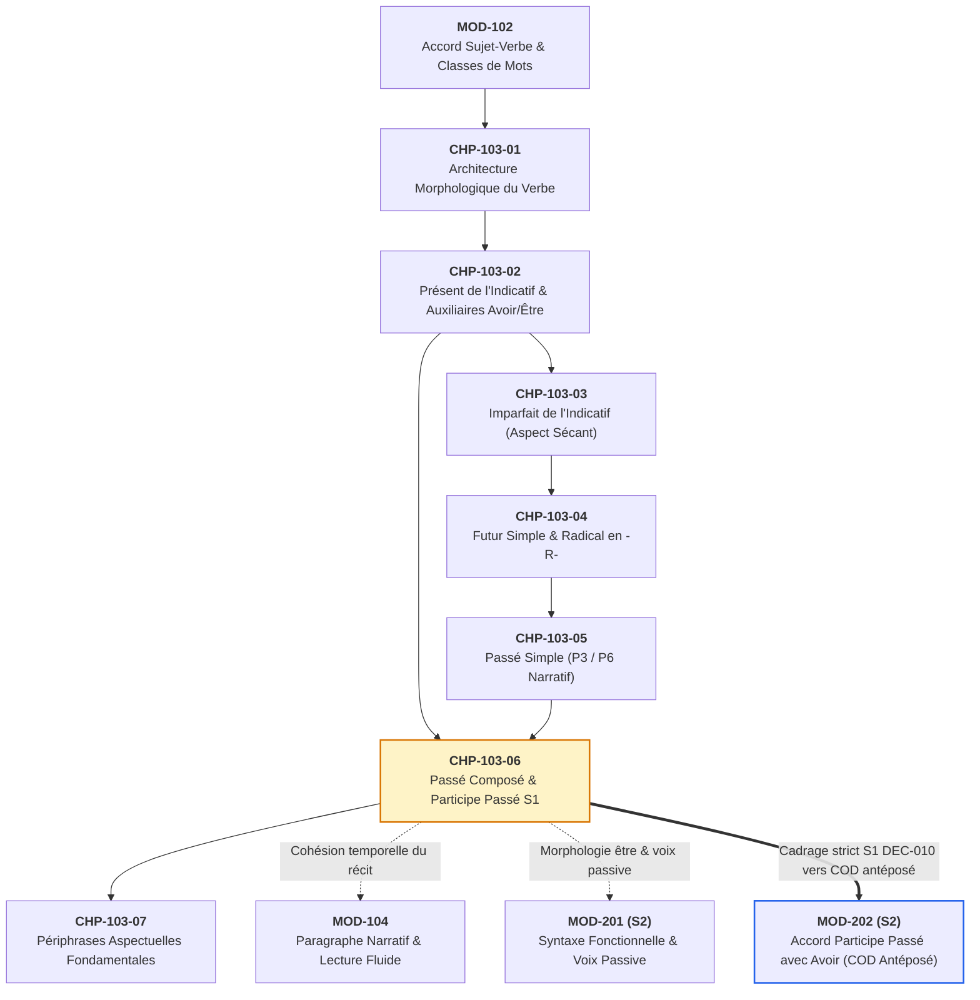
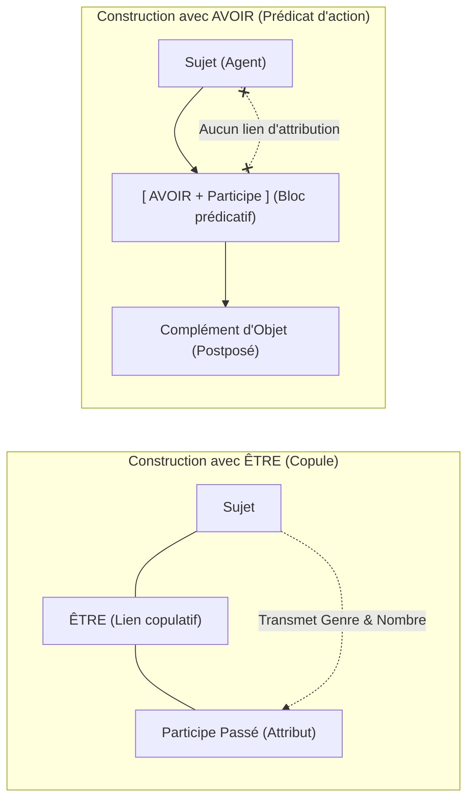
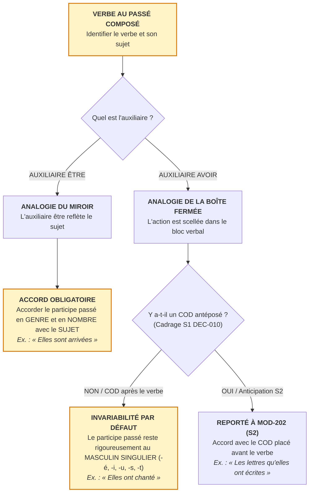

# Chapitre 6 — Le Passé Composé et l'Accord du Participe Passé en S1 : Auxiliaires, Accord avec Être et Invariabilité avec Avoir

> **Identifiant du chapitre** : `CHP-103-06`  
> **Module de rattachement** : [`MOD-103` — Le Système Verbal à l'Indicatif : Morphologie des Régularités, Verbes Fréquents Irréguliers, Passé Composé Régulier/Être et Périphrases Aspectuelles](file:///f:/Formation/world-class-french/03-curriculum/year-1/semester-1/mod-103-systeme-verbal-indicatif.md)  
> **Semestre** : Année 1 — Semestre 1 (S1)  
> **Volume horaire estimé** : 5 à 6 heures d'apprentissage autonome délibéré et d'ateliers d'application (Phase 1 Étude : 1 h 30 | Phase 2 Pratique : 1 h 30 | Phase 3 Correction : 1 h 00 | Phase 4 Évaluation : 1 h 00)  
> **Statut** : [STATUT : VALIDÉ]  
> **Compétences associées** : [`FR-VERB-001`](file:///f:/Formation/world-class-french/02-competency-framework/competency-framework.md#fr-verb-001-maîtrise-des-valeurs-aspectuo-temporelles-de-lindicatif) (L3 Autonomie), [`FR-ORTHO-002`](file:///f:/Formation/world-class-french/02-competency-framework/competency-framework.md#fr-ortho-002-mécanique-infaillible-de-laccord-sujet-verbe) (L3 Autonomie)  
> **Sources scientifiques de référence** : `SRC-NORM-03` (Ministère de l'Éducation nationale, 2020), `SRC-GRAM-02` (Riegel et al., 2016, chap. 8 & 17), `SRC-GRAM-01` (Grevisse & Goosse, 2016, § 805 & § 940-955), `SRC-GRAM-05` (Grevisse, 2009, § 78)

---

## 1. Titre et Place dans le Cursus

### 1.1 Intitulé Officiel
**Chapitre 6 : Le Passé Composé et l'Accord du Participe Passé en S1 : Auxiliaires, Accord avec Être et Invariabilité avec Avoir** (`CHP-103-06`).

### 1.2 Insertion Architecturale dans le Cursus
Ce sixième chapitre du module [`MOD-103`](file:///f:/Formation/world-class-french/03-curriculum/year-1/semester-1/mod-103-systeme-verbal-indicatif.md) constitue le point d'orgue de l'apprentissage de la morphologie verbale au premier semestre. Après avoir consolidé l'équation combinatoire du verbe (`CHP-103-01`), la conjugaison du présent de l'indicatif incluant les auxiliaires fondamentaux *avoir* et *être* (`CHP-103-02`), l'imparfait régulier sécant (`CHP-103-03`), le futur simple (`CHP-103-04`) et l'initiation aux formes de 3e personne du passé simple (`CHP-103-05`), ce cours installe la mécanique du premier **temps composé** de l'indicatif : **le passé composé**.



- **En amont** : Ce chapitre réinvestit directement :
  - La rection du verbe par son sujet donneur d'accord stabilisée dans [`MOD-102`](file:///f:/Formation/world-class-french/03-curriculum/year-1/semester-1/mod-102-classes-mots-accords-fondamentaux.md) (`CHP-102-05`) ;
  - La conjugaison au présent des deux verbes auxiliaires *avoir* et *être* maîtrisée dans `CHP-103-02`.
- **Cadrage strict du Semestre 1 ([DEC-010](file:///f:/Formation/world-class-french/00-governance/decisions-log.md#dec-010-application-des-résolutions-de-laudit-darchitecture-pédagogique))** :
  Conformément aux résolutions de gouvernance pédagogique, ce chapitre isole et sanctuarise le socle universel de l'accord du participe passé :
  1. La sélection rigoureuse de l'auxiliaire (*être* vs *avoir*) ;
  2. La formation régulière et les consonnes latentes du participe passé (-é, -i, -u, -s, -t) ;
  3. L'accord plein et entier avec le sujet sous l'auxiliaire *être* ;
  4. L'**invariabilité canonique par défaut avec l'auxiliaire *avoir*** en l'absence de complément d'objet direct (COD) antéposé.
  L'étude fonctionnelle du complément d'objet direct antéposé et ses accords complexes avec l'auxiliaire *avoir* (*« Les lettres que j'ai écrites »*) est **formellement déphasée vers le Semestre 2 dans [`MOD-202`](file:///f:/Formation/world-class-french/03-curriculum/year-1/semester-2/mod-202-participe-passe-avoir-ponctuation-interne.md)**, après l'étude de l'analyse actancielle et de la transitivité approfondie dans [`MOD-201`](file:///f:/Formation/world-class-french/03-curriculum/year-1/semester-2/mod-201-syntaxe-fonctionnelle-phrase-simple.md).
- **En aval** : Ce chapitre prépare directement :
  - `CHP-103-07` (*Les périphrases aspectuelles fondamentales*) ;
  - [`MOD-104`](file:///f:/Formation/world-class-french/03-curriculum/year-1/semester-1/mod-104-lexique-lecture-paragraphe.md) (*Cohésion temporelle et paragraphe narratif au passé*) ;
  - [`MOD-201`](file:///f:/Formation/world-class-french/03-curriculum/year-1/semester-2/mod-201-syntaxe-fonctionnelle-phrase-simple.md) (*La voix passive*, qui réinvestit l'accord systématique du participe avec *être*) ;
  - [`MOD-202`](file:///f:/Formation/world-class-french/03-curriculum/year-1/semester-2/mod-202-participe-passe-avoir-ponctuation-interne.md) (*Accord du participe passé avec avoir sur COD antéposé*).

---

## 2. Objectifs Mesurables

Au terme de l'étude autonome et des ateliers d'application de ce chapitre, l'apprenant doit être capable de :

1. **Former sans erreur le participe passé** des verbes réguliers des 1er et 2e groupes (-é, -i) ainsi que des verbes fréquents du 3e groupe (-u, -s, -t), en utilisant avec certitude le test morphologique du passage au féminin pour identifier les consonnes finales muettes (*pris $\rightarrow$ prise*, *fait $\rightarrow$ faite*, *écrit $\rightarrow$ écrite*) [Réf. `SRC-NORM-03`, p. 34].
2. **Sélectionner l'auxiliaire approprié (*être* vs *avoir*)** avec 100 % d'exactitude selon le sémantisme et la transitivité du verbe, en distinguant la liste fermée des verbes intransitifs de mouvement ou de mutation ontologique (« la maison d'être ») et les verbes à double auxiliaire (*monter, descendre, sortir, passer, rentrer, retourner*) [Réf. `SRC-GRAM-01`, § 805].
3. **Appliquer systématiquement l'accord en genre et en nombre** du participe passé avec le sujet grammatical lorsque le verbe est conjugué avec l'auxiliaire *être*, y compris dans les phrases à sujet inversé ou éloigné [Réf. `SRC-GRAM-02`, chap. 17].
4. **Maintenir l'invariabilité absolue au masculin singulier** du participe passé conjugué avec l'auxiliaire *avoir* dans l'ensemble des structures syntaxiques fondamentales de S1, en neutralisant tout réflexe fautif d'accord avec le sujet [Réf. `SRC-GRAM-05`, § 78].

---

## 3. Prérequis et Test de Préparation (Auto-Diagnostic)

### 3.1 Prérequis Cognitifs
- Maîtrise de la conjugaison au présent de l'indicatif des deux auxiliaires :
  - *avoir* : *j'ai, tu as, il/elle a, nous avons, vous avez, ils/elles ont* (`CHP-103-02`).
  - *être* : *je suis, tu es, il/elle est, nous sommes, vous êtes, ils/elles sont* (`CHP-103-02`).
- Identification infaillible du sujet donneur d'accord et de ses traits de genre (masculin / féminin) et de nombre (singulier / pluriel) acquise dans [`MOD-102`](file:///f:/Formation/world-class-french/03-curriculum/year-1/semester-1/mod-102-classes-mots-accords-fondamentaux.md) (`CHP-102-05`).
- Distinction élémentaire entre verbe transitif (qui appelle un objet : *fabriquer un meuble*) et verbe intransitif (qui n'admet aucun complément d'objet : *voyager, dormir, naître*).

### 3.2 Auto-Diagnostic Immédiat
Résolvez mentalement ou par écrit ces cinq questions d'auto-évaluation avant d'aborder le cours :

1. Conjuguez l'auxiliaire *être* au présent avec le pronom *Elles*, et l'auxiliaire *avoir* avec le pronom *Ils*.
2. Donnez la forme du féminin singulier des participes passés suivants : *écrit, pris, fait, dit, couvert*. Quelle consonne muette cela révèle-t-il au masculin singulier ?
3. Parmi les verbes suivants, lequel sélectionne l'auxiliaire *être* au passé composé : *chanter, arriver, regarder, vendre* ?
4. Dans la phrase : *« Les étudiantes ont rédigé un excellent mémoire »*, quel est le sujet grammatical du verbe ? Pourquoi le participe *rédigé* ne s'accorde-t-il pas avec ce sujet ?
5. Choisissez la seule graphie correcte : *« Mes deux collègues sont [venu / venus / venue / venues] ce matin. »* (Précision : il s'agit de deux femmes).

---

<details>
<summary><b>Corrigé de l'Auto-Diagnostic</b> (Cliquer pour dérouler)</summary>

1. **Elles sont** (auxiliaire *être* à la 3e personne du pluriel) et **Ils ont** (auxiliaire *avoir* à la 3e personne du pluriel).
2. Féminins : *écrite, prise, faite, dite, couverte*. Ces formes révèlent que le masculin singulier se termine par une consonne muette latente : **-t** pour *écrit, fait, dit, couvert* ; **-s** pour *pris*.
3. **arriver** : *arriver* est un verbe intransitif de mouvement appartenant à la liste canonique des verbes requérant l'auxiliaire *être* (*« Elles sont arrivées »*).
4. Le sujet grammatical est le syntagme nominal féminin pluriel *Les étudiantes*. Le participe *rédigé* ne s'accorde pas avec lui car il est conjugué avec l'auxiliaire **avoir** : en français, sous l'auxiliaire *avoir*, le participe passé ne s'accorde jamais avec le sujet.
5. **venues** : Le verbe *arriver/venir* se conjugue avec l'auxiliaire *être*. Le sujet donneur étant féminin pluriel (*Mes deux collègues*, désignant deux femmes), le participe passé reçoit les marques de genre et de nombre : *-es* (*venues*).

</details>

> [!NOTE]
> Si vous avez hésité à la question 4 ou cherché à accorder *rédigé* avec *les étudiantes*, vous avez subi le piège le plus dévastateur de la scolarité francophone : le réflexe pavlovien d'accord indiscriminé avec le sujet. Ce cours vous donne la méthode infaillible pour éradiquer cette habitude.

---

## 4. Situation de Départ ou Problème Concret : L'Accord Anarchique du Participe Passé

### 4.1 L'Hésitation Graphique Permanente
Observez ces phrases réelles relevées dans des procès-verbaux d'assemblées, des lettres officielles et des devoirs universitaires :

> 1. *\*« Les délégations ministérielles ont **arrivées** à l'aéroport à midi. »*  
> 2. *\*« Les directrices ont **signées** le contrat de partenariat. »*  
> 3. *\*« Elles ont **parties** en mission sans attendre l'ordre de mission. »*  
> 4. *\*« Mes collaboratrices sont **venu** présenter les conclusions de l'audit. »*  
> 5. *\*« Il a **refuser** de signer le procès-verbal. »*  
> 6. *\*« Le courrier qu'il a **pri** sur la table était confidentiel. »*

Toutes ces phrases sont gravement erronées. Elles manifestent une insécurité linguistique totale face au système du participe passé :
- Certaines confondent l'auxiliaire (*ont arrivées* au lieu de *sont arrivées*) ;
- D'autres appliquent un accord mécanique avec le sujet alors que l'auxiliaire est *avoir* (*ont signées*, *ont parties*) ;
- D'autres encore oublient l'accord pourtant obligatoire avec *être* (*sont venu*) ;
- Enfin, certaines confondent l'infinitif en *-er* et le participe en *-é* (*a refuser*), ou estropient la consonne finale muette (*a pri*).

### 4.2 La Triple Cause de l'Erreur
Pourquoi le participe passé constitue-t-il la première cause de fautes d'orthographe grammaticale chez les scripteurs adultes ?
1. **L'illusion phonique de l'homophonie** : Pour les verbes du premier groupe (90 % du lexique verbal), la prononciation est rigoureusement identique : `/mɑ̃ʒe/` peut s'écrire *manger* (infinitif), *mangez* (présent P5), *mangé* (participe masc. sg), *mangée* (participe fém. sg), *mangés* (participe masc. pl) ou *mangées* (participe fém. pl). L'oreille ne fournit aucun indice ; seule la syntaxe commande la graphie.
2. **Le réflexe d'accord de surface** : L'esprit humain retient la règle générale apprise dans l'enfance : *« le verbe s'accorde avec le sujet »*. Voyant un sujet pluriel (*les directrices*), le scripteur inattentif ajoute spontanément un *-s* sur le premier participe qui passe (*ont signées*), ignorant la présence neutralisante de l'auxiliaire *avoir*.
3. **La panique didactique** : De nombreux apprenants ont été traumatisés par des explications complexes et prématurées sur l'accord avec le complément d'objet direct antéposé. Dans le doute, ils accordent tout au hasard.

Ce chapitre réinstalle une architecture mentale limpide : une décision en **deux étapes**, appuyée sur deux modèles intuitifs indiscutables.

---

## 5. Explication Intuitive : Le Miroir et la Boîte Fermée

Pour maîtriser instantanément l'accord du participe passé en S1, visualisez le fonctionnement de chaque auxiliaire à travers deux analogies physiques :

```text
┌───────────────────────────────────────────────────────────────────────────┐
│                    LES DEUX MODÈLES CONCEPTUELS EN S1                    │
├───────────────────────────────────────────────────────────────────────────┤
│                                                                           │
│  1. L'AUXILIAIRE « ÊTRE » = LE MIROIR RÉFLÉCHISSANT                      │
│                                                                           │
│     [ SUJET ] ──────────> ( ÊTRE ) ──────────> [ PARTICIPE PASSÉ ]        │
│    (Fém. Plur.)             Miroir                Reflet intégral         │
│     Les femmes       sont                    parties (Fém. Plur.)         │
│                                                                           │
│  ───────────────────────────────────────────────────────────────────────  │
│                                                                           │
│  2. L'AUXILIAIRE « AVOIR » = LA BOÎTE FERMÉE (LE CONTENEUR)              │
│                                                                           │
│     [ SUJET ] ──────(dépose)──────> [ BOÎTE : AVOIR + PARTICIPE ]        │
│    (Fém. Plur.)                        Action scellée / Forme neutre     │
│     Les femmes                        ont chanté (Invariable -é)         │
│                                                                           │
│     * L'action est enfermée dans la boîte ; le sujet n'en reçoit aucun    │
│       reflet. Le participe reste dans sa forme d'usine : masc. singulier. │
└───────────────────────────────────────────────────────────────────────────┘
```

### 5.1 L'Auxiliaire Être : Le Miroir Réfléchissant
Le verbe *être* est une **copule**, c'est-à-dire un simple signe d'égalité syntaxique ($S = P$). Il ne possède aucune épaisseur sémantique propre qui ferait écran.  
Il fonctionne comme un **miroir plan** :
- Tout ce qui caractérise le sujet (son genre féminin, son nombre pluriel) traverse le verbe *être* et vient se refléter directement sur le participe passé.
- Le participe passé se comporte exactement comme un adjectif qualificatif attribut du sujet :
  - *« Ces femmes sont **patientes** »* (adjectif attribut : féminin pluriel) ;
  - *« Ces femmes sont **venues** »* (participe passé : féminin pluriel).

### 5.2 L'Auxiliaire Avoir : La Boîte Fermée (Le Coffre-Fort)
Le verbe *avoir* est, à l'origine, un verbe de possession. Dans un temps composé en S1, il forme avec le participe un bloc clos : un conteneur.
- Le sujet n'est pas qualifié par le participe ; le sujet est l'agent qui a accompli l'acte et qui le "possède" désormais à titre d'action achevée.
- Dans *« Les femmes ont chanté »*, les femmes ne sont pas « chantées » ! Elles ont accompli l'action de chanter. L'action est scellée dans la boîte verbale.
- N'étant pas en contact direct de qualification avec le sujet, le participe passé demeure dans son état grammatical par défaut, c'est-à-dire le **masculin singulier neutre non marqué** (*-é, -i, -u, -s, -t*).

---

## 6. Définitions Précises et Terminologie

Conformément à la nomenclature officielle (`SRC-NORM-03`) et à la description linguistique universitaire (`SRC-GRAM-02`, chap. 8 & 17), les notions suivantes doivent être maîtrisées avec rigueur :

### 6.1 Le Passé Composé
Forme verbale de l'indicatif constituée par l'association de l'auxiliaire *avoir* ou *être* conjugué au présent de l'indicatif et du participe passé du verbe lexical [Réf. `SRC-NORM-03`, p. 34].  
- *Exemple* : *« Nous **avons écouté** »* ; *« Elle **est partie** »*.

### 6.2 Temps Composé vs Temps Simple
- **Temps simple** : Forme verbale synthétique constituée d'un seul mot graphique qui fusionne dans son signifiant la base lexicale, la marque de temps/mode et la désinence de personne (*« nous chantons »*, *« elle partit »*).
- **Temps composé** : Forme verbale analytique associant deux éléments disjoints :
  1. Le **verbe auxiliaire** : porteur des flexions temporelles, modales, personnelles et numériques ;
  2. Le **participe passé** : porteur du sémantisme plein du verbe et de l'aspect accompli.

### 6.3 Verbe Auxiliaire vs Verbe Lexical (Principal)
- **Verbe auxiliaire (*avoir* ou *être*)** : Verbe ayant subi un processus historique de grammaticalisation, perdant son sens lexical d'origine (possession pour *avoir*, localisation ou existence pour *être*) pour servir d'instrument morphologique dans la conjugaison des temps composés et de la voix passive [Réf. `SRC-GRAM-02`, chap. 8].
- **Verbe lexical (ou principal)** : Verbe exprimant le procès sémantique concret (action, état, événement), apparaissant sous la forme du participe passé dans les temps composés.

### 6.4 Le Participe Passé
Mode impersonnel du verbe possédant une nature hybride verbo-adjectivale :
- *Nature verbale* : il exprime un procès, peut régir des compléments d'objet ou circonstanciels et reçoit la négation (*« n'ayant pas compris »*) ;
- *Nature adjectivale* : il est susceptible de fléchir en genre et en nombre (*-e, -s, -es*) pour s'accorder avec un support nominal ou pronominal [Réf. `SRC-GRAM-01`, § 940].

### 6.5 L'Aspect Accompli
Valeur sémantico-aspectuelle universelle des temps composés. L'aspect accompli envisage le procès non pas dans son déroulement interne (aspect sécant ou inaccompli de l'imparfait), mais comme parvenu à son terme final, achevé au moment repère considéré, laissant souvent un état résultant dans le présent [Réf. `SRC-GRAM-02`, chap. 9].  
- *Exemple* : *« L'ingénieur **a réparé** la machine »* (l'action de réparation est terminée ; la machine est désormais en état de marche).

### 6.6 Verbes Transitifs vs Verbes Intransitifs
- **Verbe transitif direct** : Verbe qui construit son complément sans préposition (*« lire un rapport »*).
- **Verbe transitif indirect** : Verbe qui construit son complément au moyen d'une préposition (*« téléphoner à ses proches »*, *« douter de la victoire »*).
- **Verbe intransitif** : Verbe dont la valence ne comporte aucun complément d'objet (*« dormir »*, *« marcher »*, *« tomber »*).

### 6.7 Verbes de Mouvement et de Mutation Ontologique
Sous-ensemble fermé de verbes intransitifs décrivant soit un déplacement spatial borné dans l'espace (*aller, venir, arriver, partir, monter, descendre, entrer, sortir, tomber, retourner*), soit un changement d'état vital ou existentiel fondamental (*naître, mourir, devenir, rester*). Ce sont ces verbes qui sélectionnent historiquement l'auxiliaire *être* au passé composé.

---

## 7. Règles et Mécanismes Fondamentaux

### 7.1 La Structure Binaire du Passé Composé
La formule syntaxique universelle du passé composé s'écrit :

$$\mathbf{\text{Passé Composé}} = \mathbf{\text{Auxiliaire au Présent de l'Indicatif}} + \mathbf{\text{Participe Passé}}$$

#### Tableau des Modèles de Conjugaison au Passé Composé

| Personne | Avec Auxiliaire *Avoir* (*Parler* - 1er gr.) | Avec Auxiliaire *Avoir* (*Finir* - 2e gr.) | Avec Auxiliaire *Être* (*Partir* - 3e gr.) |
| :--- | :--- | :--- | :--- |
| **P1** (*je*) | j'ai parlé | j'ai fini | je suis parti(e) |
| **P2** (*tu*) | tu as parlé | tu as fini | tu es parti(e) |
| **P3 masc.** (*il*) | il a parlé | il a fini | il est parti |
| **P3 fém.** (*elle*) | elle a parlé | elle a fini | elle est partie |
| **P4** (*nous*) | nous avons parlé | nous avons fini | nous sommes parti(e)s |
| **P5** (*vous*) | vous avez parlé | vous avez fini | vous êtes parti(e)(s) |
| **P6 masc.** (*ils*) | ils ont parlé | ils ont fini | ils sont partis |
| **P6 fém.** (*elles*) | elles ont parlé | elles ont fini | elles sont parties |

---

### 7.2 La Morphologie du Participe Passé

#### 1. Les Formes Régulières
Le participe passé se forme à partir du radical du verbe auquel s'ajoute une voyelle caractéristique selon le groupe verbal [Réf. `SRC-NORM-03`, p. 34] :
- **1er groupe (verbes en *-er*)** : terminaison universelle en **-é**  
  *chanter $\rightarrow$ chanté* ; *travailler $\rightarrow$ travaillé* ; *créer $\rightarrow$ créé* ; *aller $\rightarrow$ allé*.
- **2e groupe (verbes en *-ir / -issant*)** : terminaison universelle en **-i**  
  *finir $\rightarrow$ fini* ; *choisir $\rightarrow$ choisi* ; *bâtir $\rightarrow$ bâti* ; *réussir $\rightarrow$ réussi*.
- **3e groupe régulier en *-u*** : terminaison très fréquente en **-u**  
  *vendre $\rightarrow$ vendu* ; *rendre $\rightarrow$ rendu* ; *courir $\rightarrow$ couru* ; *entendre $\rightarrow$ entendu* ; *lire $\rightarrow$ lu* ; *voir $\rightarrow$ vu* ; *boire $\rightarrow$ bu* ; *croire $\rightarrow$ cru* ; *pouvoir $\rightarrow$ pu* ; *vouloir $\rightarrow$ voulu* ; *savoir $\rightarrow$ su* ; *tenir $\rightarrow$ tenu* ; *venir $\rightarrow$ venu*.

#### 2. Les Formes à Consonne Latente et le Test Infaillible du Féminin
Plusieurs verbes majeurs du 3e groupe possèdent une consonne finale muette au masculin singulier. Pour savoir si le participe masculin se termine par une voyelle nue (*-u, -i*), par un **-s** ou par un **-t**, il existe une règle absolue : **le passage au féminin singulier**.

> [!TIP]
> **Le Test Infaillible du Féminin** :  
> Mettez mentalement le participe passé au féminin en l'appliquant à un nom féminin (*une lettre...*, *une affaire...*).  
> La consonne orale prononcée au féminin est obligatoirement présente à l'écrit, sous forme muette, au masculin singulier !

```text
┌───────────────────────────────────────────────────────────────────────────┐
│              DÉTECTION DE LA CONSONNE LATENTE PAR LE FÉMININ              │
├───────────────────────────────────────────────────────────────────────────┤
│  FÉMININ ORAL ET ÉCRIT           CONSONNE RÉVÉLÉE    MASCULIN SINGULIER   │
├───────────────────────────────────────────────────────────────────────────┤
│  • prise       /pʁiz/      ──>        -s         ──> pris                 │
│  • mise        /miz/       ──>        -s         ──> mis                  │
│  • comprise    /kɔ̃pʁiz/    ──>        -s         ──> compris              │
│  • close       /kloz/      ──>        -s         ──> clos                 │
│  ───────────────────────────────────────────────────────────────────────  │
│  • faite       /fɛt/       ──>        -t         ──> fait                 │
│  • écrite      /ekʁit/     ──>        -t         ──> écrit                │
│  • dite        /dit/       ──>        -t         ──> dit                  │
│  • ouverte     /uvɛʁt/     ──>        -t         ──> ouvert               │
│  • offerte     /ɔfɛʁt/     ──>        -t         ──> offert               │
│  • morte       /mɔʁt/      ──>        -t         ──> mort                 │
│  • conduite    /kɔ̃dɥit/    ──>        -t         ──> conduit              │
│  • construite  /kɔ̃stʁɥit/  ──>        -t         ──> construit            │
│  ───────────────────────────────────────────────────────────────────────  │
│  • sue         /sy/        ──>      (aucune)     ──> su   (pas de -t)     │
│  • vue         /vy/        ──>      (aucune)     ──> vu   (pas de -t)     │
│  • crue        /kʁy/       ──>      (aucune)     ──> cru  (pas de -t)     │
└───────────────────────────────────────────────────────────────────────────┘
```

---

### 7.3 La Sélection de l'Auxiliaire

Le choix de l'auxiliaire n'est pas aléatoire : il dépend de la structure syntaxique et de la nature sémantique du verbe [Réf. `SRC-GRAM-01`, § 805].

#### 1. L'Auxiliaire *Avoir* : La Règle Quasi-Universelle
L'auxiliaire *avoir* est le pivot de la conjugaison française. Il est utilisé par plus de **98 % des verbes** :
- Tous les verbes transitifs directs (*manger une pomme $\rightarrow$ il a mangé*) ;
- Tous les verbes transitifs indirects (*parler à un ami $\rightarrow$ il a parlé*) ;
- La quasi-totalité des verbes intransitifs exprimant une action ou une durée (*travailler $\rightarrow$ elle a travaillé* ; *courir $\rightarrow$ nous avons couru* ; *régner $\rightarrow$ il a régné* ; *dormir $\rightarrow$ j'ai dormi*) ;
- Tous les verbes impersonnels de météo (*pleuvoir $\rightarrow$ il a plu* ; *neiger $\rightarrow$ il a neigé* ; *venter $\rightarrow$ il a venté*) ;
- Les deux verbes auxiliaires eux-mêmes (*avoir $\rightarrow$ j'ai eu* ; *être $\rightarrow$ j'ai été*).

#### 2. L'Auxiliaire *Être* : La Liste Canonique (« La Maison d'Être »)
Une liste restreinte et fermée d'environ **14 verbes intransitifs** de déplacement spatial ou de changement ontologique se conjugue obligatoirement avec l'auxiliaire *être* :

```text
═══════════════════════════════════════════════════════════════════════════════
               L'INVENTAIRE CANONIQUE DES VERBES CONJUGUÉS AVEC ÊTRE
═══════════════════════════════════════════════════════════════════════════════
 1. NAÎTRE        / MOURIR        (L'entrée et la sortie de l'existence)
 2. ALLER         / VENIR         (Et dérivés : revenir, devenir, intervenir,
                                                parvenir, survenir)
 3. ARRIVER       / PARTIR        (Le terme et l'amorce du trajet)
 4. ENTRER        / SORTIR        (Le franchissement d'un seuil)
 5. MONTER        / DESCENDRE     (Le changement d'élévation verticale)
 6. TOMBER        / RESTER        (La rupture de stabilité ou le maintien d'état)
 7. RETOURNER     / PASSER        (L'inversion de direction ou le transit)
═══════════════════════════════════════════════════════════════════════════════
```
*(Remarque : leurs préfixés en re- : repartir, remonter, redescendre, rentrer, renaître suivent rigoureusement le même régime).*

---

### 7.4 Règle n° 1 : L'Accord Obligatoire avec l'Auxiliaire *Être*

> [!IMPORTANT]
> **Règle d'or n° 1 (Auxiliaire Être)** :  
> Lorsque le passé composé est formé avec l'auxiliaire **être**, le participe passé s'accorde **en genre et en nombre avec le sujet grammatical**, exactement comme un adjectif attribut.

- **Sujet Masculin Singulier** $\rightarrow$ Terminaison de base (*-é, -i, -u, -s, -t*) :  
  *« Le délégué général **est venu** à Cotonou. »*
- **Sujet Féminin Singulier** $\rightarrow$ Ajout de la marque **-e** :  
  *« La directrice **est venue** à Cotonou. »*
- **Sujet Masculin Pluriel** $\rightarrow$ Ajout de la marque **-s** :  
  *« Les délégués généraux **sont venus** à Cotonou. »*
- **Sujet Féminin Pluriel** $\rightarrow$ Ajout des marques **-es** :  
  *« Les directrices **sont venues** à Cotonou. »*

Cette règle s'applique sans exception, y compris lorsque le sujet est inversé ou éloigné du verbe :
- *« De cette confrontation **sont nées** [sujet féminin pluriel] de fructueuses négociations. »*

---

### 7.5 Règle n° 2 : L'Invariabilité Canonique par Défaut avec l'Auxiliaire *Avoir* en S1

> [!IMPORTANT]
> **Règle d'or n° 2 (Auxiliaire Avoir en S1 — Cadrage [DEC-010])** :  
> Dans toutes les configurations de phrase simples de Semestre 1 (absence de complément d'objet direct ou complément d'objet direct placé **après** le verbe dans l'ordre canonique Sujet-Verbe-Objet), **le participe passé conjugué avec l'auxiliaire *avoir* ne s'accorde JAMAIS avec le sujet**.  
> Il reste **invariable au masculin singulier** (*-é, -i, -u, -s, -t*).

- *« Les artisanes **ont tissé** de magnifiques toiles. »*  
  *(Sujet féminin pluriel : les artisanes $\rightarrow$ le participe **tissé** reste invariable).*
- *« Mes collègues féminines **ont rédigé** l'ensemble des rapports. »*  
  *(Sujet féminin pluriel : mes collègues $\rightarrow$ le participe **rédigé** reste invariable).*
- *« Les deux voyageuses **ont pris** leurs billets d'avion. »*  
  *(Sujet féminin pluriel : les voyageuses $\rightarrow$ le participe **pris** reste invariable au masculin singulier avec son -s muet).*
- *« Toutes les ministres **ont parlé** avec fermeté. »*  
  *(Sujet féminin pluriel : toutes les ministres $\rightarrow$ le participe **parlé** reste invariable).*

> [!CAUTION]
> Écrire *\*« Elles ont chantées »*, *\*« Ils ont finis leurs devoirs »* ou *\*« Les femmes ont travaillées »* constitue une violation directe du système syntaxique français. C'est l'erreur la plus lourdement sanctionnée aux examens universitaires et concours administratifs.

---

## 8. Raisonnement Détaillé : Pourquoi le Système Fonctionne-t-il Ainsi ?

Loin d'être un caprice arbitraire des grammairiens, la divergence d'accord entre *être* et *avoir* est le produit d'une profonde logique syntaxique et historique issue du latin vulgaire [Réf. `SRC-GRAM-02`, chap. 17].



### 8.1 Pourquoi *Être* Impose l'Accord avec le Sujet
Le verbe *être* n'a pas de complément d'objet ; il introduit un **attribut du sujet**.  
Dans la proposition latine tardive d'où provient le français, des tournures comme *illa est mortua* (« elle est morte ») ou *illae sunt ventae* (« elles sont venues ») construisaient le participe passé exactement comme un adjectif qualificatif.  
Le participe passé avec *être* décrit **l'état du sujet** à l'issue de l'événement :
- Dans *« Les voyageuses sont arrivées »*, *arrivées* qualifie l'état résultant des voyageuses : elles sont désormais présentes.
- Comme tout attribut du sujet en français (*« Elles sont grandes »*, *« Elles sont prudentes »*), le participe passé reçoit par rection immédiate les marques de genre et de nombre du sujet donneur.

### 8.2 Pourquoi *Avoir* Bloque l'Accord avec le Sujet
À l'origine, en latin classique, le verbe *habere* (« avoir ») n'était pas un auxiliaire temporel, mais un verbe plein signifiant « posséder, tenir en sa possession ». Pour exprimer l'achèvement d'une action, on disait :
- *Habeo epistulam scriptam* = « Je tiens une lettre écrite » (l'adjectif verbal *scriptam* s'accordait avec le nom féminin *epistulam* qu'il qualifiait).
Au cours de l'évolution vers le français médiéval, deux mutations capitales se sont produites :
1. *Avoir* a perdu son sens de possession matérielle pour devenir un pur morphème grammatical d'aspect accompli ;
2. Le participe passé et l'auxiliaire se sont soudés en un **bloc verbal unique** (*« j'ai écrit »*).

Dans ce bloc verbal, le sujet grammatical n'est pas le réceptacle de l'action ; il est son **agent externe** :
- Dans *« Les ministres ont signé les accords »*, les ministres ne sont en aucun cas « signées » !
- Le participe ne qualifie absolument pas le sujet. Accorder le participe avec le sujet reviendrait à prétendre que les ministres possèdent l'attribut d'être signées, ce qui est absurde sémantiquement.
- L'action accomplie étant orientée vers l'objet ou restant intransitive, le participe reste dans sa forme non marquée par excellence en morphologie française : le **masculin singulier neutre**.

---

## 9. Exemples Corrects Commentés

Voici le décorticage analytique de six phrases modèles démontrant l'application rigoureuse des règles fondamentales :

### Exemple 1 : Verbe Intransitif de Mouvement avec l'Auxiliaire *Être* (Féminin Pluriel)
> *« Les nouvelles ambassadrices de l'Union africaine sont venues à Cotonou. »*

- **Repérage du verbe composé** : *sont venues* (passé composé du verbe *venir*).
- **Sélection de l'auxiliaire** : *Venir* est un verbe intransitif de déplacement canonique $\rightarrow$ auxiliaire **être** obligatoire.
- **Analyse du sujet donneur** : *Les nouvelles ambassadrices de l'Union africaine*.
  - Nom noyau : *ambassadrices* (féminin pluriel).
- **Application de l'accord** : L'auxiliaire étant *être*, le participe passé s'accorde en genre et en nombre avec le sujet : radical *ven-* + voyelle *-u* + marque du féminin *-e* + marque du pluriel *-s* $\rightarrow$ **venues**.
- **Transcription phonologique du verbe** : `/sɔ̃ vny/`.

### Exemple 2 : Verbe Transitif Direct avec l'Auxiliaire *Avoir* (Sujet Féminin Pluriel)
> *« Les artisanes d'Abomey ont fabriqué ces tentures historiques. »*

- **Repérage du verbe composé** : *ont fabriqué* (passé composé du verbe *fabriquer*).
- **Sélection de l'auxiliaire** : *Fabriquer* est un verbe transitif direct régulier $\rightarrow$ auxiliaire **avoir** obligatoire.
- **Analyse du sujet** : *Les artisanes d'Abomey* (féminin pluriel).
- **Application de la règle d'accord** : L'auxiliaire étant *avoir*, et l'objet direct *ces tentures historiques* étant placé **après** le verbe dans l'ordre canonique, le participe passé **ne s'accorde jamais avec le sujet**. Il demeure rigoureusement invariable au masculin singulier $\rightarrow$ **fabriqué**.
- **Transcription phonologique du verbe** : `/ɔ̃ fabʁike/`.

### Exemple 3 : Verbe du 3e Groupe à Consonne Latente avec l'Auxiliaire *Avoir*
> *« La haute direction a transmis les instructions budgétaires aux chefs de service. »*

- **Repérage du verbe composé** : *a transmis* (passé composé du verbe *transmettre*).
- **Sélection de l'auxiliaire** : *Transmettre* est un verbe transitif direct $\rightarrow$ auxiliaire **avoir**.
- **Morphologie du participe passé** : Test du féminin : *une instruction transmise* `/tʁɑ̃smiz/` $\rightarrow$ présence de la consonne latente **-s**.
- **Application de la règle d'accord** : Auxiliaire *avoir* avec COD postposé $\rightarrow$ invariabilité par rapport au sujet féminin singulier *La haute direction*. Le participe prend sa forme masculine singulière de base avec consonne latente $\rightarrow$ **transmis** (avec un *-s* muet).
- **Transcription phonologique du verbe** : `/a tʁɑ̃smi/`.

### Exemple 4 : Phrase à Sujet Inversé avec l'Auxiliaire *Être*
> *« De cette confrontation fraternelle sont nées trois initiatives décisives. »*

- **Repérage du verbe composé** : *sont nées* (passé composé du verbe *naître*).
- **Sélection de l'auxiliaire** : *Naître* est un verbe intransitif de mutation ontologique $\rightarrow$ auxiliaire **être**.
- **Traque du sujet réel** : Le sujet n'est pas le syntagme singulier en tête *De cette confrontation* (qui est un complément circonstanciel de provenance). Le sujet réel est postposé : *trois initiatives décisives* (féminin pluriel).
- **Application de l'accord** : Sous l'auxiliaire *être*, le participe s'accorde avec le sujet inversé : *né* + féminin *-e* + pluriel *-s* $\rightarrow$ **nées**.
- **Transcription phonologique du verbe** : `/sɔ̃ ne/`.

### Exemple 5 : Verbe Impersonnel avec l'Auxiliaire *Avoir*
> *« Durant toute la nuit dernière, il a plu abondamment sur la ville. »*

- **Repérage du verbe composé** : *a plu* (passé composé du verbe impersonnel *pleuvoir*).
- **Sélection de l'auxiliaire** : Les verbes météorologiques se conjuguent avec **avoir**.
- **Application de la règle** : Le sujet syntaxique est le pronom neutre invariable *il*. Le participe *plu* est invariable au masculin singulier $\rightarrow$ **plu**.
- **Transcription phonologique du verbe** : `/a ply/`.

### Exemple 6 : Sujets Coordonnés de Genres Hétérogènes avec l'Auxiliaire *Être*
> *« Le professeur émérite et son assistante sont arrivés avant l'ouverture du colloque. »*

- **Repérage du verbe composé** : *sont arrivés* (passé composé du verbe *arriver*).
- **Sélection de l'auxiliaire** : *Arriver* requiert l'auxiliaire **être**.
- **Analyse du sujet donneur** : Sujet composé par coordination de deux syntagmes de genres différents : *Le professeur* (masculin) + *son assistante* (féminin) = Pluriel mixte.
- **Règle de résolution des genres** : En grammaire normative française, l'association du masculin et du féminin se résout par la marque du masculin pluriel $\rightarrow$ **arrivés** (*-és*).
- **Transcription phonologique du verbe** : `/sɔ̃ z‿aʁive/` (avec liaison obligatoire en diction soignée) ou `/sɔ̃ aʁive/`.

---

## 10. Contre-Exemples et Erreurs Fréquentes

Voici l'inventaire clinique de six fautes récurrentes d'accord du participe passé et de sélection d'auxiliaire :

### Erreur n° 1 : L'Accord Fautif du Participe Passé avec le Sujet sous Auxiliaire *Avoir*
- **Énoncé fautif** : *\*« Les deux directrices ont travaillées toute la nuit et ont rédigées un compte rendu. »*
- **Diagnostic de la méprise** : L'esprit du scripteur associe visuellement le sujet féminin pluriel *Les deux directrices* avec les participes qui suivent, oubliant que l'auxiliaire est *ont* (*avoir*).
- **Forme corrigée** : *« Les deux directrices ont **travaillé** toute la nuit et ont **rédigé** un compte rendu. »*
- **Règle salvatrice** : Sous l'auxiliaire *avoir*, le participe passé reste hermétique au sujet : il demeure strictement **invariable au masculin singulier** (*-é*).

---

### Erreur n° 2 : L'Omission de l'Accord en Genre ou en Nombre sous Auxiliaire *Être*
- **Énoncé fautif** : *\*« Mes collaboratrices sont venu ce matin mais elles sont déjà reparti. »*
- **Diagnostic de la méprise** : À l'oral, les formes masculines et féminines de *venu/venue* et *reparti/repartie* se prononcent de façon identique (`/vny/`, `/ʁəpaʁti/`). Le scripteur omet d'écrire les marques morphologiques requises par la vue.
- **Forme corrigée** : *« Mes collaboratrices sont **venues** ce matin mais elles sont déjà **reparties**. »*
- **Règle salvatrice** : Dès que l'auxiliaire est *être*, le miroir fonctionne : accord plein et entier en genre et en nombre avec le sujet (*collaboratrices* = féminin pluriel $\rightarrow$ *-es*).

---

### Erreur n° 3 : L'Erreur de Sélection d'Auxiliaire sur les Verbes Intransitifs de Mouvement
- **Énoncé fautif** : *\*« Elles ont arrivées en retard parce qu'elles ont allées au marché. »*
- **Diagnostic de la méprise** : Par calque sur l'immense majorité des verbes français qui prennent *avoir*, le scripteur applique abusivement *avoir* aux verbes intransitifs de mouvement.
- **Forme corrigée** : *« Elles **sont arrivées** en retard parce qu'elles **sont allées** au marché. »*
- **Règle salvatrice** : *Arriver* et *aller* font partie de la liste fermée de « la maison d'être ». Ils imposent l'auxiliaire *être* et l'accord consécutif avec le sujet féminin pluriel.

---

### Erreur n° 4 : La Confusion Graphique et Phonétique entre Participe en *-é* et Infinitif en *-er*
- **Énoncé fautif** : *\*« L'accusé a refuser de parler et le greffier a dû recommencé. »*
- **Diagnostic de la méprise** : Les deux formes se prononcent `/ʁəfyze/` et `/ʁəkɔmɑ̃se/`. Le scripteur confond l'infinitif en *-er* et le participe passé en *-é*.
- **Forme corrigée** : *« L'accusé a **refusé** de parler et le greffier a dû **recommencer**. »*
- **Test de substitution infaillible** : Remplacez par un verbe du 3e groupe dont les formes orales diffèrent, comme *mordre, vendre* ou *battre* :
  - *« L'accusé a [mordu / mordre] »* $\rightarrow$ on dit *a mordu* (participe) $\rightarrow$ écrivez **refusé** (-é).
  - *« Le greffier a dû [mordre / mordu] »* $\rightarrow$ on dit *a dû mordre* (infinitif) $\rightarrow$ écrivez **recommencer** (-er).

---

### Erreur n° 5 : L'Altération de la Consonne Latente au Masculin Singulier
- **Énoncé fautif** : *\*« Le candidat a pri son dossier, a fé un salut et a écri son nom. »*
- **Diagnostic de la méprise** : Comme les consonnes finales ne se prononcent pas à l'oral au masculin (`/pʁi/`, `/fɛ/`, `/ekʁi/`), le scripteur écrit une graphie phonétique tronquée.
- **Forme corrigée** : *« Le candidat a **pris** son dossier, a **fait** un salut et a **écrit** son nom. »*
- **Règle salvatrice** : Passer immédiatement au féminin pour entendre la consonne : *prise* $\rightarrow$ **pris** (-s) ; *faite* $\rightarrow$ **fait** (-t) ; *écrite* $\rightarrow$ **écrit** (-t).

---

### Erreur n° 6 : Le Maintien Erroné de l'Auxiliaire *Être* en Présence d'un COD Postposé
- **Énoncé fautif** : *\*« Les voyageuses sont descendues leurs valises sur le quai. »*
- **Diagnostic de la méprise** : Le scripteur sait que *descendre* se conjugue avec *être* lorsqu'il est intransitif (*« Elles sont descendues du train »*). Il ne s'aperçoit pas que le verbe est ici devenu transitif direct avec le complément d'objet *leurs valises*.
- **Forme corrigée** : *« Les voyageuses ont **descendu** leurs valises sur le quai. »*
- **Règle salvatrice** : Dès qu'un verbe de mouvement régit un complément d'objet direct, il bascule obligatoirement sous l'auxiliaire **avoir**, et son participe devient invariable avec le sujet.

---

## 11. Cas Particuliers et Limites de la Règle Générale

### 11.1 Les Verbes à Double Auxiliaire selon la Transitivité
Six verbes majeurs changent d'auxiliaire selon qu'ils sont employés de manière **intransitive** (mouvement du sujet lui-même) ou **transitive directe** (action exercée sur un objet) [Réf. `SRC-GRAM-01`, § 805] :
- **Monter, Descendre, Sortir, Entrer / Rentrer, Passer, Retourner**.

```text
┌───────────────────────────────────────────────────────────────────────────┐
│              LES VERBES À DOUBLE AUXILIAIRE SELON LA TRANSITIVITÉ         │
├───────────────────────────────────────────────────────────────────────────┤
│  VERBE        EMPLOI INTRANSITIF (ÊTRE)       EMPLOI TRANSITIF (AVOIR)    │
│               [Accord avec le sujet]          [Invariable avec le sujet]  │
├───────────────────────────────────────────────────────────────────────────┤
│  MONTER       Elle est montée au grenier.     Elle a monté les cartons.   │
│  DESCENDRE    Ils sont descendus au salon.    Ils ont descendu l'escalier.│
│  SORTIR       Elles sont sorties de la salle. Elles ont sorti leurs clés. │
│  RENTRER      Elle est rentrée tard ce soir.  Elle a rentré la voiture.   │
│  PASSER       Il est passé par la forêt.      Il a passé un examen rude.  │
│  RETOURNER    Elle est retournée chez elle.   Elle a retourné la feuille. │
└───────────────────────────────────────────────────────────────────────────┘
```

> [!NOTE]
> La règle de détection est limpide : posez la question *« Quoi ? »* ou *« Qui ? »* après le verbe.  
> S'il y a un complément d'objet direct, l'auxiliaire est obligatoirement **avoir** (*« Elle a monté quoi ? $\rightarrow$ les cartons »*). S'il s'agit d'un lieu introduit par une préposition (*au grenier, dans la rue*), le verbe est intransitif et prend l'auxiliaire **être**.

### 11.2 Le Verbe *Demeurer*
Le verbe *demeurer* présente une nuance sémantique et aspectuelle remarquable :
- Avec l'auxiliaire **avoir** : il signifie « habiter, résider » ou insiste sur la durée du procès  
  *« J'ai demeuré cinq ans à Porto-Novo. »*
- Avec l'auxiliaire **être** : il signifie « rester dans un état » et marque l'aspect accompli résultant  
  *« Elle est demeurée muette de stupeur. »*

### 11.3 Cadrage Strict et Déphasage Didactique vers MOD-202 ([DEC-010](file:///f:/Formation/world-class-french/00-governance/decisions-log.md#dec-010-application-des-résolutions-de-laudit-darchitecture-pédagogique))
En Semestre 1, l'apprentissage de l'accord avec l'auxiliaire *avoir* se limite délibérément à la règle d'invariabilité canonique dans l'ordre de la phrase simple (SVO).  
La célèbre règle de l'accord sur le complément d'objet direct **antéposé** (*« Les lettres que j'ai écrites »*, *« La décision que nous avons prise »*) ainsi que l'invariabilité devant le pronom *en* (*« Des erreurs, j'en ai fait »*) requièrent la maîtrise préalable de l'analyse fonctionnelle des compléments et des pronoms relatifs. Ces notions feront l'objet d'un module entier au Semestre 2 : [`MOD-202`](file:///f:/Formation/world-class-french/03-curriculum/year-1/semester-2/mod-202-participe-passe-avoir-ponctuation-interne.md).

---

## 12. Approfondissement Adapté au Niveau : Clément Marot et la Genèse de la Règle

Pourquoi le système des participes passés en français présente-t-il cette singularité entre *être* et *avoir* ?

```text
┌───────────────────────────────────────────────────────────────────────────┐
│           CLÉMENT MAROT ET L'ÉPÎTRE DE 1538 (EXTRAIT HISTORIQUE)          │
├───────────────────────────────────────────────────────────────────────────┤
│                                                                           │
│    « Enfans, oyez une leçon :                                             │
│      Nostre langue a ceste façon,                                         │
│      Que le terme qui va devant                                           │
│      Voluntiers régit le suyvant.                                         │
│      Les vieux exemples je suivray                                        │
│      Pour le mieulx : car à dire vray,                                    │
│      La plume les lettres que j'ay escrites                               │
│      A mis au net, et non pas escrits. »                                  │
│                                                                           │
│    — Clément Marot, Épître à Lyon Jamet (1538)                            │
└───────────────────────────────────────────────────────────────────────────┘
```

### 12.1 L'Emprunt Italien du XVIe Siècle
Au Moyen Âge, l'usage était extrêmement fluide : les scripteurs accordaient souvent le participe avec l'objet, qu'il fût placé avant ou après (*« J'ai faites les lettres »* ou *« J'ai fait les lettres »*).  
En 1538, le poète Clément Marot, de retour d'Italie où il avait découvert la syntaxe toscane codifiée par Pietro Bembo, publie une célèbre épître en vers recommandant d'imiter l'usage italien : n'accorder le participe avec *avoir* que lorsque l'objet direct précède le verbe.

### 12.2 La Fixation Classique par Vaugelas (1647)
Au XVIIe siècle, Claude Favre de Vaugelas consacre cette règle dans ses *Remarques sur la langue françoise* (1647), reprise ensuite par l'Académie française.  
La justification philosophique de l'époque était séduisante : lorsque l'écrivain écrit le verbe, si l'objet n'a pas encore été prononcé ou tracé sur le papier, l'esprit ne connaît ni son genre ni son nombre ; le verbe reste donc au neutre (*-é*). En revanche, si l'objet a déjà été formulé (*« les lettres que j'ai... »*), l'esprit en a déjà la pleine conscience et peut accorder le participe (*« écrites »*).

Cette doctrine classique explique pourquoi, en S1, dans la proposition canonique où l'objet arrive après le verbe (*« J'ai écrit les lettres »*), le participe demeure invariable.

---

## 13. Comparaisons Différentielles

### 13.1 Tableau Comparatif Global : Auxiliaire *Être* vs Auxiliaire *Avoir*

| Critère d'Analyse | Auxiliaire *ÊTRE* | Auxiliaire *AVOIR* (Cadrage S1) |
| :--- | :--- | :--- |
| **Nature syntaxique de l'auxiliaire** | Verbe copule (conducteur d'égalité $S = P$). | Verbe d'action formant un bloc prédicatif clos. |
| **Types de verbes concernés** | Verbes intransitifs de déplacement et mutation (« maison d'être »). | Verbes transitifs directs, indirects et 98 % des intransitifs. |
| **Rôle sémantique du sujet** | Le sujet est le siège de l'état résultant. | Le sujet est l'agent qui accomplit l'action. |
| **Statut grammatical du participe** | Attribut du sujet. | Forme verbale prédicative non attributive. |
| **Règle d'accord du participe** | **Accord obligatoire en genre et nombre avec le sujet.** | **Invariabilité absolue par rapport au sujet (masc. singulier).** |
| **Exemple modèle féminin pluriel** | *« Elles sont **parties** hier. »* | *« Elles ont **chanté** hier. »* |
| **Piège récurrent à éradiquer** | Oubli du *-e* ou du *-s* (*\*sont parti*). | Ajout fautif de marques d'accord (*\*ont mangées*). |

---

### 13.2 Tableau Différentiel : Participe Passé en *-é* vs Infinitif en *-er*

| Forme Verbale | Terminaison Graphique | Fonction Syntaxique | Test Infaillible de Substitution | Phrase Témoin |
| :--- | :---: | :--- | :--- | :--- |
| **Participe Passé** | **-é** (ou *-ée, -és, -ées*) | Élément d'un temps composé après *avoir* ou *être*. | Se remplace par un participe du 3e groupe : **mordu**, **battu**, **vendu**. | *« Le ministre a **signé** le décret. »*<br/>*(Test : « Le ministre a **vendu** le décret » $\rightarrow$ -é)* |
| **Infinitif Présent** | **-er** | Complément d'un verbe conjugué ou tête d'une proposition infinitive. | Se remplace par un infinitif du 3e groupe : **mordre**, **battre**, **vendre**. | *« Le ministre doit **signer** le décret. »*<br/>*(Test : « Le ministre doit **vendre** le décret » $\rightarrow$ -er)* |

---

## 14. Exercices Progressifs

### 14.1 Niveau 1 : Sélection d'Auxiliaire et Morphologie du Participe Passé

**Consigne** : Pour chacun des dix verbes suivants, indiquez l'auxiliaire requis au passé composé (*avoir* ou *être*) et formez le participe passé au masculin singulier en révélant toute consonne muette par le test du féminin :

1. *Naître*
2. *Écrire*
3. *Réussir*
4. *Prendre*
5. *Partir*
6. *Construire*
7. *Travailler*
8. *Mourir*
9. *Mettre*
10. *Vendre*

---

<details>
<summary><b>Corrigé Détaillé du Niveau 1</b> (Cliquer pour dérouler)</summary>

1. **Naître** : Auxiliaire **être** (verbe de mutation ontologique). Participe : **né** (féminin : *née* $\rightarrow$ aucune consonne latente).
2. **Écrire** : Auxiliaire **avoir** (transitif direct). Participe : **écrit** (féminin : *écrite* $\rightarrow$ consonne latente **-t**).
3. **Réussir** : Auxiliaire **avoir** (transitif direct ou indirect). Participe : **réussi** (2e groupe régulier en *-i*).
4. **Prendre** : Auxiliaire **avoir** (transitif direct). Participe : **pris** (féminin : *prise* $\rightarrow$ consonne latente **-s**).
5. **Partir** : Auxiliaire **être** (intransitif de mouvement). Participe : **parti** (féminin : *partie* $\rightarrow$ aucune consonne latente).
6. **Construire** : Auxiliaire **avoir** (transitif direct). Participe : **construit** (féminin : *construite* $\rightarrow$ consonne latente **-t**).
7. **Travailler** : Auxiliaire **avoir** (intransitif d'activité). Participe : **travaillé** (1er groupe régulier en *-é*).
8. **Mourir** : Auxiliaire **être** (mutation ontologique). Participe : **mort** (féminin : *morte* $\rightarrow$ consonne latente **-t**).
9. **Mettre** : Auxiliaire **avoir** (transitif direct). Participe : **mis** (féminin : *mise* $\rightarrow$ consonne latente **-s**).
10. **Vendre** : Auxiliaire **avoir** (transitif direct). Participe : **vendu** (3e groupe régulier en *-u*).

</details>

---

### 14.2 Niveau 2 : Accord avec *Être* et Invariabilité avec *Avoir* (15 Phrases)

**Consigne** : Conjuguez les verbes entre parenthèses au **passé composé de l'indicatif** en accordant ou en laissant invariable le participe passé conformément aux règles de S1 :

1. *Les députées (arriver) à l'Assemblée nationale dès huit heures.*
2. *Nos collaboratrices (terminer) la révision des statuts administratifs.*
3. *Ces deux étudiantes brillantes (partir) poursuivre leurs recherches à Dakar.*
4. *Les directrices du laboratoire (examiner) tous les échantillons prélevés.*
5. *De nombreuses délégations étrangères (venir) assister à la cérémonie d'investiture.*
6. *Toutes les artisanes du village (participer) à la grande foire régionale.*
7. *La présidente et sa vice-présidente (monter) à la tribune sous les acclamations.*
8. *Les scientifiques (publier) leurs conclusions dans une revue internationale.*
9. *Trois nouvelles réformes audacieuses (naître) de cette concertation nationale.*
10. *Les habitantes du quartier (nettoyer) les caniveaux avant la saison des pluies.*
11. *Ces vieilles bâtisses coloniales (tomber) en ruine faute d'entretien.*
12. *Les commissions d'audit (rendre) leur rapport définitif au ministre.*
13. *Les femmes mareyeuses de Ouidah (vendre) l'ensemble de leur cargaison de poissons.*
14. *Mes deux sœurs aînées (rester) à la maison pendant les vacances.*
15. *Les enseignantes de l'école primaire (rédiger) un recueil de contes pédagogiques.*

---

<details>
<summary><b>Corrigé Détaillé du Niveau 2</b> (Cliquer pour dérouler)</summary>

1. **sont arrivées** : Auxiliaire *être* (verbe de mouvement) $\rightarrow$ accord féminin pluriel avec *Les députées*.
2. **ont terminé** : Auxiliaire *avoir* $\rightarrow$ invariabilité par rapport au sujet *Nos collaboratrices*.
3. **sont parties** : Auxiliaire *être* (verbe de mouvement) $\rightarrow$ accord féminin pluriel avec *Ces deux étudiantes brillantes*.
4. **ont examiné** : Auxiliaire *avoir* $\rightarrow$ invariabilité par rapport au sujet *Les directrices*.
5. **sont venues** : Auxiliaire *être* (verbe de mouvement) $\rightarrow$ accord féminin pluriel avec *De nombreuses délégations étrangères*.
6. **ont participé** : Auxiliaire *avoir* $\rightarrow$ invariabilité par rapport au sujet *Toutes les artisanes du village*.
7. **sont montées** : Auxiliaire *être* (verbe intransitif de déplacement vertical) $\rightarrow$ accord féminin pluriel avec le sujet coordonné *La présidente et sa vice-présidente*.
8. **ont publié** : Auxiliaire *avoir* $\rightarrow$ invariabilité par rapport au sujet *Les scientifiques*.
9. **sont nées** : Auxiliaire *être* (mutation ontologique) $\rightarrow$ accord féminin pluriel avec *Trois nouvelles réformes audacieuses*.
10. **ont nettoyé** : Auxiliaire *avoir* $\rightarrow$ invariabilité par rapport au sujet *Les habitantes du quartier*.
11. **sont tombées** : Auxiliaire *être* (verbe d'état/mouvement) $\rightarrow$ accord féminin pluriel avec *Ces vieilles bâtisses coloniales*.
12. **ont rendu** : Auxiliaire *avoir* $\rightarrow$ invariabilité par rapport au sujet *Les commissions d'audit*.
13. **ont vendu** : Auxiliaire *avoir* $\rightarrow$ invariabilité par rapport au sujet *Les femmes mareyeuses de Ouidah*.
14. **sont restées** : Auxiliaire *être* (maintien d'état) $\rightarrow$ accord féminin pluriel avec *Mes deux sœurs aînées*.
15. **ont rédigé** : Auxiliaire *avoir* $\rightarrow$ invariabilité par rapport au sujet *Les enseignantes*.

</details>

---

### 14.3 Niveau 3 : Arbitrage des Verbes à Double Auxiliaire et Syntaxe Complexe

**Consigne** : Dans chacune des phrases suivantes, choisissez l'auxiliaire adéquat (*avoir* ou *être*) en analysant la transitivité du verbe, et orthographiez le participe passé avec exactitude :

1. *Les techniciennes (descendre) le matériel informatique au rez-de-chaussée.*
2. *Ces mêmes techniciennes (descendre) par l'escalier de service.*
3. *La secrétaire générale (sortir) les dossiers confidentiels du coffre-fort.*
4. *Elle (sortir) de la salle de conférence en toute hâte.*
5. *Les voyageuses (monter) leurs lourdes valises dans le compartiment supérieur.*
6. *Elles (monter) dans le train dès l'annonce du départ.*

---

<details>
<summary><b>Corrigé Détaillé du Niveau 3</b> (Cliquer pour dérouler)</summary>

1. **ont descendu** : Emploi transitif direct (*descendre quoi ? $\rightarrow$ le matériel*) $\rightarrow$ auxiliaire **avoir** obligatoire. Le participe passé est invariable par rapport au sujet féminin pluriel *Les techniciennes*.
2. **sont descendues** : Emploi intransitif avec complément de lieu prépositionnel (*par l'escalier*) $\rightarrow$ auxiliaire **être** obligatoire. Le participe s'accorde au féminin pluriel avec *Ces mêmes techniciennes*.
3. **a sorti** : Emploi transitif direct (*sortir quoi ? $\rightarrow$ les dossiers*) $\rightarrow$ auxiliaire **avoir** obligatoire. Le participe est invariable au masculin singulier.
4. **est sortie** : Emploi intransitif de mouvement avec complément de provenance prépositionnel (*de la salle*) $\rightarrow$ auxiliaire **être** obligatoire. Le participe s'accorde au féminin singulier avec *Elle*.
5. **ont monté** : Emploi transitif direct (*monter quoi ? $\rightarrow$ leurs lourdes valises*) $\rightarrow$ auxiliaire **avoir** obligatoire. Le participe est invariable avec le sujet féminin pluriel.
6. **sont montées** : Emploi intransitif de déplacement avec complément de lieu prépositionnel (*dans le train*) $\rightarrow$ auxiliaire **être** obligatoire. Le participe s'accorde au féminin pluriel avec *Elles*.

</details>

---

## 15. Activité de Correction Raisonnée

### 15.1 Énoncé de l'Épreuve : Procès-Verbal de Réunion
Le texte administratif suivant, extrait du procès-verbal d'une assemblée générale tenue à Cotonou, comporte **exactement huit fautes d'accord ou de morphologie de participe passé**.  
Identifiez chaque faute, expliquez le mécanisme de l'erreur et donnez la graphie corrigée.

```text
PROCES-VERBAL DE LA SEANCE PLENIERE DU CONSEIL D'ADMINISTRATION
================================================================
A neuf heures, les administratrices sont venu dans la grande salle de
deliberation. La presidente de seance a presenter l'ordre du jour adopte
a l'unanimite. Les directrices financieres ont exposees le bilan d'etape
et ont repondu a toutes les questions des commissaires aux comptes. A midi,
trois inspectrices sont monte les dossiers d'audit a l'etage superieur pour
verification immediate. Des la reprise des travaux, les commissions mixtes
ont redigees leurs avis consultatifs. Plusieurs delegations regionales sont
parti avant le vote final en raison des intemperies. Les delegues ont pri
bonne note des recommandations formulees, puis les membres du bureau ont
signes la convention collective avant de lever la seance a dix-huit heures.
```

---

### 15.2 Corrigé Raisonné et Grille d'Audit

| N° | Forme Fautive | Diagnostic Linguistique de l'Erreur | Correction Normative |
| :---: | :--- | :--- | :--- |
| **1** | *sont venu* | **Omission d'accord avec l'auxiliaire *être*** : Le sujet donneur est le syntagme féminin pluriel *les administratrices*. L'auxiliaire étant *être*, le participe passé doit obligatoirement s'accorder en genre et en nombre avec le sujet. | **sont venues** |
| **2** | *a presenter* | **Confusion infinitif en *-er* vs participe en *-é*** : Après l'auxiliaire *a* (*avoir*), le verbe principal doit être au participe passé. Test de substitution : *« a [vendu / vendre] »* $\rightarrow$ on dit *a vendu*, donc participe en *-é*. | **a présenté** |
| **3** | *ont exposees* | **Accord fautif avec le sujet sous l'auxiliaire *avoir*** : Le verbe est conjugué avec *ont* (*avoir*). Sous *avoir*, en S1, le participe passé ne s'accorde jamais avec le sujet grammatical (*Les directrices financières*). Il demeure invariable au masculin singulier. | **ont exposé** |
| **4** | *sont monte* | **Double erreur d'auxiliaire et d'accord sur verbe transitif** : Le verbe régit un complément d'objet direct placé après lui : *les dossiers d'audit* (*monter quoi ?*). Le verbe est transitif direct et requiert l'auxiliaire **avoir** (*ont monté*) ; de plus, le participe reste invariable. | **ont monté** |
| **5** | *ont redigees* | **Accord fautif avec le sujet sous l'auxiliaire *avoir*** : Le sujet féminin pluriel *les commissions mixtes* ne transmet aucun trait au participe passé conjugué avec *avoir*. Invariabilité absolue au masculin singulier. | **ont rédigé** |
| **6** | *sont parti* | **Omission d'accord féminin pluriel sous l'auxiliaire *être*** : Le sujet est *Plusieurs délégations régionales* (féminin pluriel). Avec l'auxiliaire *être*, l'accord complet est impératif : radical *part-* + désinence *-ies*. | **sont parties** |
| **7** | *ont pri* | **Troncation de la consonne latente muette** : Le participe passé de *prendre* possède un **-s** final muet au masculin singulier, révélé par le passage au féminin : *une note prise* `/pʁiz/` $\rightarrow$ présence du *-s*. | **ont pris** |
| **8** | *ont signes* | **Accord fautif avec le sujet sous l'auxiliaire *avoir*** : Le sujet pluriel *les membres du bureau* est associé à tort au participe passé alors que l'auxiliaire est *avoir*. Invariabilité au masculin singulier requise. | **ont signé** |

---

## 16. Mise en Pratique dans une Production Réelle

### 16.1 Consigne de Production
Rédigez un compte rendu de mission administrative de **strictement 80 mots typographiques** au passé composé, respectant les contraintes formelles suivantes :
1. Comporter au moins **quatre verbes conjugués avec l'auxiliaire *être***, correctement accordés en genre et en nombre avec leur sujet ;
2. Comporter au moins **quatre verbes conjugués avec l'auxiliaire *avoir***, rigoureusement invariables au masculin singulier ;
3. Zéro faute de morphologie verbale et de sélection d'auxiliaire.

---

### 16.2 Texte Modèle de Compte Rendu

> *Hier matin notre délégation est arrivée à Cotonou. Les inspectrices sont descendues au centre universitaire avec promptitude. Dès leur accueil officiel elles ont examiné les registres administratifs. Ensuite les deux auditrices sont montées au premier étage pour inspecter les locaux. Les autorités ont validé le calendrier des opérations sans réserve. Trois directeurs sont venus saluer les délégués officiels. À midi les fonctionnaires ont achevé la première phase de travail. Après une courte pause elles ont rédigé le compte rendu final.*

---

### 16.3 Justification des Contraintes et Décompte Exhaustif

#### 1. Vérification des Contraintes Syntaxiques
- **Quatre verbes avec l'auxiliaire *être* accordés avec le sujet** :
  1. *« est arrivée »* : accord féminin singulier avec *notre délégation*.
  2. *« sont descendues »* : accord féminin pluriel avec *Les inspectrices*.
  3. *« sont montées »* : accord féminin pluriel avec *les deux auditrices*.
  4. *« sont venus »* : accord masculin pluriel avec *Trois directeurs*.
- **Quatre verbes avec l'auxiliaire *avoir* invariables avec le sujet** :
  1. *« ont examiné »* : invariable au masculin singulier avec sujet *elles* (fém. pl.).
  2. *« ont validé »* : invariable au masculin singulier avec sujet *Les autorités* (fém. pl.).
  3. *« ont achevé »* : invariable au masculin singulier avec sujet *les fonctionnaires* (masc./épicène pl.).
  4. *« ont rédigé »* : invariable au masculin singulier avec sujet *elles* (fém. pl.).

#### 2. Décompte Typographique Mot par Mot (1 à 80)
1: *Hier* | 2: *matin* | 3: *notre* | 4: *délégation* | 5: *est* | 6: *arrivée* | 7: *à* | 8: *Cotonou.* | 9: *Les* | 10: *inspectrices* | 11: *sont* | 12: *descendues* | 13: *au* | 14: *centre* | 15: *universitaire* | 16: *avec* | 17: *promptitude.* | 18: *Dès* | 19: *leur* | 20: *accueil* | 21: *officiel* | 22: *elles* | 23: *ont* | 24: *examiné* | 25: *les* | 26: *registres* | 27: *administratifs.* | 28: *Ensuite* | 29: *les* | 30: *deux* | 31: *auditrices* | 32: *sont* | 33: *montées* | 34: *au* | 35: *premier* | 36: *étage* | 37: *pour* | 38: *inspecter* | 39: *les* | 40: *locaux.* | 41: *Les* | 42: *autorités* | 43: *ont* | 44: *validé* | 45: *le* | 46: *calendrier* | 47: *des* | 48: *opérations* | 49: *sans* | 50: *réserve.* | 51: *Trois* | 52: *directeurs* | 53: *sont* | 54: *venus* | 55: *saluer* | 56: *les* | 57: *délégués* | 58: *officiels.* | 59: *À* | 60: *midi* | 61: *les* | 62: *fonctionnaires* | 63: *ont* | 64: *achevé* | 65: *la* | 66: *première* | 67: *phase* | 68: *de* | 69: *travail.* | 70: *Après* | 71: *une* | 72: *courte* | 73: *pause* | 74: *elles* | 75: *ont* | 76: *rédigé* | 77: *le* | 78: *compte* | 79: *rendu* | 80: *final.*

**Total certifié** : **80 mots typographiques**.

---

## 17. Résumé Structuré : L'Algorithme Décisionnel du Passé Composé en S1

### 17.1 Arbre de Décision Algorithmique



---

### 17.2 Protocole Réflexe en Trois Étapes

```text
═══════════════════════════════════════════════════════════════════════════════
                 LE PROTOCOLE RÉFLEXE EN 3 ÉTAPES (P.R.E.)
═══════════════════════════════════════════════════════════════════════════════
 ÉTAPE 1 : IDENTIFIER L'AUXILIAIRE
   • Est-ce le verbe ÊTRE ? (suis, es, est, sommes, êtes, sont)
   • Est-ce le verbe AVOIR ? (ai, as, a, avons, avez, ont)

 ÉTAPE 2 : APPLIQUER LA RÈGLE DIRECTRICE
   • Si ÊTRE  ──> Flécher vers le SUJET ──> ACCORD TOTAL (Genre & Nombre).
   • Si AVOIR ──> Bloquer tout accord avec le sujet ──> INVARIABLE (-é, -i, -u).

 ÉTAPE 3 : CONTRÔLER LA CONSONNE LATENTE
   • Passer mentalement le participe au féminin :
     prise ──> pris (-s) | faite ──> fait (-t) | écrite ──> écrit (-t).
═══════════════════════════════════════════════════════════════════════════════
```

---

## 18. Questions de Rappel Actif (Active Recall)

Répondez mentalement ou par écrit à ces six questions de haute rétention sans consulter le cours avant de vérifier vos réponses :

1. **Question 1** : Pourquoi le participe passé conjugué avec l'auxiliaire *être* s'accorde-t-il avec le sujet, alors qu'il ne s'accorde jamais avec le sujet sous l'auxiliaire *avoir* ?
2. **Question 2** : Quel est le test morphologique simple et infaillible permettant de savoir si un participe passé masculin singulier se termine par un *-s*, un *-t* ou une voyelle nue ? Donnez un exemple pour chaque cas.
3. **Question 3** : Citez six verbes intransitifs appartenant à la liste canonique de « la maison d'être ».
4. **Question 4** : Dans quelle circonstance précise le verbe *monter* se conjugue-t-il avec l'auxiliaire *avoir*, et comment s'orthographie alors son participe passé dans la phrase : *« Les artisanes ont (monter) les meubles »* ?
5. **Question 5** : Quel test syntaxique permet d'éviter la confusion orthographique entre le participe passé en *-é* et l'infinitif en *-er* ?
6. **Question 6** : Quelle décision de gouvernance didactique ([DEC-010](file:///f:/Formation/world-class-french/00-governance/decisions-log.md#dec-010-application-des-résolutions-de-laudit-darchitecture-pédagogique)) régit l'accord du participe passé avec l'auxiliaire *avoir* au Semestre 1, et quel cas d'accord complexe a été reporté au Semestre 2 dans `MOD-202` ?

---

<details>
<summary><b>Réponses aux Questions de Rappel Actif</b> (Cliquer pour dérouler)</summary>

1. **Réponse 1** : L'auxiliaire *être* est un verbe copule : le participe passé y assume la fonction d'**attribut du sujet** et qualifie l'état résultant du sujet, recevant ainsi ses traits par rection immédiate. À l'inverse, sous l'auxiliaire *avoir*, le sujet est l'agent externe de l'action qui forme avec le verbe un bloc prédicatif ; le participe ne qualifie pas le sujet et reste donc sous sa forme par défaut, le masculin singulier.
2. **Réponse 2** : C'est le **test du passage au féminin singulier**. La consonne prononcée au féminin est obligatoirement présente à l'écrit au masculin singulier :
   - Présence d'un *-s* : *prise* $\rightarrow$ *pris* ;
   - Présence d'un *-t* : *écrite* $\rightarrow$ *écrit* ;
   - Voyelle nue : *connue* $\rightarrow$ *connu*.
3. **Réponse 3** : Par exemple : *naître, mourir, aller, venir, arriver, partir, monter, descendre, tomber, rester*.
4. **Réponse 4** : Le verbe *monter* se conjugue avec *avoir* lorsqu'il est employé de manière **transitive directe**, c'est-à-dire lorsqu'il régit un complément d'objet direct (*monter quoi ? $\rightarrow$ les meubles*). Dans la phrase citée, l'auxiliaire étant *avoir* avec un COD postposé, le participe reste invariable au masculin singulier : *« Les artisanes ont **monté** les meubles »*.
5. **Réponse 5** : Le **test de substitution par un verbe du 3e groupe** (comme *mordre*, *vendre* ou *battre*) : si l'on peut dire *mordu*, on écrit le participe en **-é** (*« Il a chanté »* $\rightarrow$ *« Il a mordu »*) ; si l'on peut dire *mordre*, on écrit l'infinitif en **-er** (*« Il veut chanter »* $\rightarrow$ *« Il veut mordre »*).
6. **Réponse 6** : La décision [`DEC-010`](file:///f:/Formation/world-class-french/00-governance/decisions-log.md#dec-010-application-des-résolutions-de-laudit-darchitecture-pédagogique) stipule qu'en Semestre 1, l'apprentissage avec l'auxiliaire *avoir* se limite à l'**invariabilité par défaut par rapport au sujet**. L'accord du participe passé avec le complément d'objet direct placé **avant** le verbe (*« Les lettres qu'elles ont écrites »*) a été formellement reporté au Semestre 2 dans [`MOD-202`](file:///f:/Formation/world-class-french/03-curriculum/year-1/semester-2/mod-202-participe-passe-avoir-ponctuation-interne.md).

</details>

---

## 19. Mini-Évaluation Sommative

Cette épreuve chronométrée de **30 minutes sans document** est notée sur **20 points**.  
Conformément aux directives de [`assessment-rubrics.md`](file:///f:/Formation/world-class-french/02-competency-framework/assessment-rubrics.md) :
- **Barème pénal éliminatoire** : Tout accord faussé de participe passé entraîne une pénalité de **-2 points**.
- **Seuil minimal de validation L3 (Autonomie)** : **14 / 20**. Toute note inférieure impose une reprise immédiate des ateliers.

---

### 19.1 Sujet de l'Épreuve

#### Partie I : Morphologie du Participe Passé et Consonnes Latentes (4 points)
Donnez le participe passé au masculin singulier des quatre verbes suivants en précisant la forme féminine qui justifie sa terminaison graphique (1 pt par item) :
1. *Ouvrir*
2. *Comprendre*
3. *Dire*
4. *Résoudre*

#### Partie II : Sélection de l'Auxiliaire et Accord sous Contrainte (6 points)
Conjuguez les verbes entre parenthèses au **passé composé de l'indicatif** (2 pts par phrase ; toute erreur d'auxiliaire ou d'accord donne 0 pt à l'item) :
1. *Ces deux délégations ministérielles (arriver) hier soir à Dakar.*
2. *Les inspectrices du travail (vérifier) scrupuleusement la conformité des ateliers.*
3. *De ce dialogue politique fécond (naître) une charte de concorde nationale.*

#### Partie III : Arbitrage sur Verbes à Double Transitivité (6 points)
Conjuguez le verbe *sortir* au passé composé dans les deux phrases suivantes, en justifiant le choix de l'auxiliaire et la graphie du participe (3 pts par phrase) :
1. *Dès le lever du jour, les paysannes (sortir) de leur concession villageoise.*
2. *À midi, ces mêmes paysannes (sortir) leurs récoltes de manioc pour le marché.*

#### Partie IV : Analyse Critique et Réfutation Linguistique (4 points)
Réfutez et corrigez l'énoncé suivant en rédigeant une justification linguistique de 3 lignes :  
*\« Les candidates ont fournies d'immenses efforts mais elles sont échoué au concours. \»*

---

### 19.2 Corrigé Détaillé et Barème de Notation

#### Partie I : Morphologie du Participe Passé (4 points)
1. **ouvert** (1 pt) : féminin *ouverte* `/uvɛʁt/` $\rightarrow$ consonne latente **-t**.
2. **compris** (1 pt) : féminin *comprise* `/kɔ̃pʁiz/` $\rightarrow$ consonne latente **-s**.
3. **dit** (1 pt) : féminin *dite* `/dit/` $\rightarrow$ consonne latente **-t**.
4. **résolu** (1 pt) : féminin *résolue* `/ʁezɔly/` $\rightarrow$ voyelle nue sans consonne latente.

#### Partie II : Sélection de l'Auxiliaire et Accord (6 points)
1. **sont arrivées** (2 pts) : *Arriver* requiert l'auxiliaire **être** (verbe de mouvement). Accord féminin pluriel avec le sujet *Ces deux délégations ministérielles*.
2. **ont vérifié** (2 pts) : *Vérifier* requiert l'auxiliaire **avoir** (transitif). Le participe reste invariable au masculin singulier avec le sujet *Les inspectrices*.
3. **est née** (2 pts) : *Naître* requiert l'auxiliaire **être**. Le sujet réel est postposé : *une charte de concorde nationale* (féminin singulier) $\rightarrow$ accord **née**.

#### Partie III : Arbitrage sur Verbes à Double Transitivité (6 points)
1. **sont sorties** (3 pts) : Emploi intransitif de déplacement avec complément de lieu prépositionnel (*de leur concession*) $\rightarrow$ auxiliaire **être** obligatoire (1,5 pt). Accord féminin pluriel avec *les paysannes* $\rightarrow$ **sorties** (1,5 pt).
2. **ont sorti** (3 pts) : Emploi transitif direct avec COD postposé (*sortir quoi ? $\rightarrow$ leurs récoltes*) $\rightarrow$ auxiliaire **avoir** obligatoire (1,5 pt). Le participe reste invariable au masculin singulier par rapport au sujet $\rightarrow$ **sorti** (1,5 pt).

#### Partie IV : Analyse Critique et Réfutation (4 points)
- **Corrections obligatoires (2 pts)** : *« Les candidates ont **fourni** d'immenses efforts mais elles **ont échoué** au concours. »* (ou *sont tombées*).
- **Justification linguistique (2 pts)** :
  1. *Ont fourni* : sous l'auxiliaire *avoir*, le participe passé ne s'accorde jamais avec le sujet féminin pluriel *Les candidates* ; de plus, le participe de *fournir* est régulier en *-i* sans marque féminine.
  2. *Ont échoué* : le verbe *échouer* n'appartient pas à la liste des verbes de « la maison d'être » ; c'est un verbe intransitif d'action qui se conjugue obligatoirement avec l'auxiliaire **avoir** (*elles ont échoué*).

---

### 19.3 Grille d'Étalonnage et Décision Pédagogique
- **19 à 20 / 20** : Maîtrise parfaite et réflexe d'expert.
- **16 à 18 / 20** : Très bon niveau. Les règles d'or sont stabilisées sans hésitation.
- **14 à 15 / 20** : **Seuil minimal de validation L3 (Autonomie)**. Révision recommandée des verbes à double auxiliaire.
- **Moins de 14 / 20** : **Échec au test de validation**. Reprise obligatoire des rubriques 7, 10 et 14 avant l'accès au chapitre suivant.

---

## 20. Critères Observables de Maîtrise (Indicateurs L3 Autonomie)

L'apprenant est réputé avoir validé les compétences [`FR-VERB-001`](file:///f:/Formation/world-class-french/02-competency-framework/competency-framework.md#fr-verb-001-maîtrise-des-valeurs-aspectuo-temporelles-de-lindicatif) et [`FR-ORTHO-002`](file:///f:/Formation/world-class-french/02-competency-framework/competency-framework.md#fr-ortho-002-mécanique-infaillible-de-laccord-sujet-verbe) au palier **L3 (Autonomie)** pour le chapitre `CHP-103-06` si et seulement si les quatre comportements observables suivants sont attestés :

| Code Indicateur | Comportement Observable | Indicateur de Réussite Mesurable | Seuil de Tolérance |
| :---: | :--- | :--- | :---: |
| **IND-01** | **Sélection infaillible de l'auxiliaire** | Choix correct entre *être* et *avoir* sur une batterie de 30 verbes d'action, d'état et de mouvement. | $100\,\%$ d'exactitude (zéro faute) |
| **IND-02** | **Accord systématique sous auxiliaire *être*** | Application réflexe des marques de genre et de nombre (-e, -s, -es) avec le sujet donneur sous *être*. | $100\,\%$ de réussite |
| **IND-03** | **Neutralisation du sujet sous auxiliaire *avoir*** | Maintien de l'invariabilité au masculin singulier du participe passé avec *avoir* dans l'ordre SVO. | Zéro accord fautif avec le sujet |
| **IND-04** | **Arbitrage des verbes à double auxiliaire** | Discrimination exacte entre emploi transitif (*avoir*) et intransitif (*être*) sur *monter, descendre, sortir, passer, rentrer*. | $\le 1$ erreur sur 15 items |

---

## 21. Sources et Lectures Complémentaires

Toutes les règles, descriptions morphologiques et analyses historiques présentées dans ce chapitre s'appuient rigoureusement sur les traités linguistiques de référence du registre [`07-resources/source-registry.md`](file:///f:/Formation/world-class-french/07-resources/source-registry.md) :

1. **Ministère de l'Éducation nationale (2020)**. *Terminologie grammaticale*. Paris : Réseau Canopé [Réf. `SRC-NORM-03`].  
   - Section *Le verbe : formes simples et formes composées* (pp. 34-36) : définition du passé composé, des auxiliaires et de la morphologie participiale.
2. **Riegel, Martin, Pellat, Jean-Christophe & Rioul, René (2016)**. *Grammaire méthodique du français*. Paris : PUF, coll. « Quadrige » [Réf. `SRC-GRAM-02`].  
   - Chapitre 8 : *La morphologie verbale* (analyse des bases et de l'aspect accompli).  
   - Chapitre 17 : *Le participe et les formes non finies* (syntaxe de l'attribut du sujet et rection participiale sous copule).
3. **Grevisse, Maurice & Goosse, André (2016)**. *Le Bon Usage* (16e éd.). Bruxelles : De Boeck Supérieur [Réf. `SRC-GRAM-01`].  
   - § 805 : *L'emploi des auxiliaires avoir et être avec les verbes intransitifs et de mouvement*.  
   - § 940 à § 955 : *L'accord du participe passé : principes généraux, accord avec être et invariabilité canonique*.
4. **Grevisse, Maurice (2009)**. *Le Petit Grevisse : Grammaire française* (32e éd.). Bruxelles : De Boeck Supérieur [Réf. `SRC-GRAM-05`].  
   - § 78 : *Règles pratiques de l'accord du participe passé et tests de substitution*.

---

## Annexe Pédagogique : Classification et Traçabilité du Contenu

Afin de préserver la clarté du cursus et de respecter scrupuleusement la décision de cadrage didactique [`DEC-010`](file:///f:/Formation/world-class-french/00-governance/decisions-log.md#dec-010-application-des-résolutions-de-laudit-darchitecture-pédagogique), les notions de ce chapitre sont classées selon la taxonomie de **World-Class French** :

| Étiquette Didactique | Notion / Contenu Concerné | Justification Pédagogique & Destination |
| :--- | :--- | :--- |
| **CORE-NOW** | • Structure binaire Auxiliaire au présent + Participe passé.<br/>• Morphologie régulière (-é, -i, -u) et test du féminin pour les consonnes latentes.<br/>• Liste canonique des verbes intransitifs se conjuguant avec *être*.<br/>• Règle d'or de l'accord obligatoire avec le sujet sous l'auxiliaire *être*.<br/>• Règle d'or de l'invariabilité canonique du participe passé sous l'auxiliaire *avoir* en S1. | Socle morphosyntaxique fondamental obligatoire. Tout scripteur francophone doit automatiser ces 5 règles pour éradiquer 90 % des fautes d'accord de participe. |
| **INTRODUCTION-NOW** | • Analogie du miroir (*être*) et de la boîte fermée (*avoir*).<br/>• Verbes à double auxiliaire selon la transitivité (*monter, descendre, sortir, passer, rentrer*).<br/>• Nuance sémantique de l'auxiliaire avec le verbe *demeurer*. | Fournit des modèles explicatifs clairs pour comprendre le système sans hésitation. |
| **DEFER** | • L'accord du participe passé conjugué avec *avoir* lorsque le complément d'objet direct est antéposé (*les lettres que j'ai écrites*). | **Reporté à [`MOD-202`](file:///f:/Formation/world-class-french/03-curriculum/year-1/semester-2/mod-202-participe-passe-avoir-ponctuation-interne.md)** (*Accord du participe passé avec avoir en S2*) après l'étude de la valence dans [`MOD-201`](file:///f:/Formation/world-class-french/03-curriculum/year-1/semester-2/mod-201-syntaxe-fonctionnelle-phrase-simple.md) [DEC-010]. |
| **DEFER** | • L'accord des participes passés des verbes pronominaux (*se laver, se parler, s'enfuir*). | **Reporté à [`MOD-303`](file:///f:/Formation/world-class-french/03-curriculum/year-2/semester-3/mod-303-accords-verbes-pronominaux.md)** (*Accords des verbes pronominaux en S3*). |
| **DEFER** | • Les cas d'accord litigieux des participes passés suivis d'un infinitif (*fait, laissé, vu, entendu*). | **Reporté à [`MOD-401`](file:///f:/Formation/world-class-french/03-curriculum/year-2/semester-4/mod-401-pragmatique-accords-limites-rectifications-1990.md)** (*Pragmatique, accords limites et rectifications de 1990 en S4*). |
| **OPTIONAL-ADVANCED** | • Histoire de la règle des participes : Clément Marot (1538) et Vaugelas (1647).<br/>• Analyse philologique de la périphrase latine *habere + participe*. | Cultive la perspective historique et stylistique pour les étudiants visant les concours d'excellence. |
| **REMOVE** | • Digressions sur l'accord du participe en espagnol (invariable avec *haber*) ou en italien contemporain.<br/>• Polémiques orthographiques non stabilisées sur la suppression pure et simple de l'accord. | Écarté pour concentrer l'effort d'apprentissage sur la maîtrise opérationnelle de la norme académique. |
