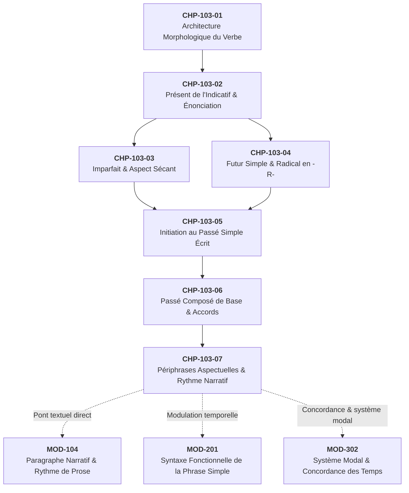
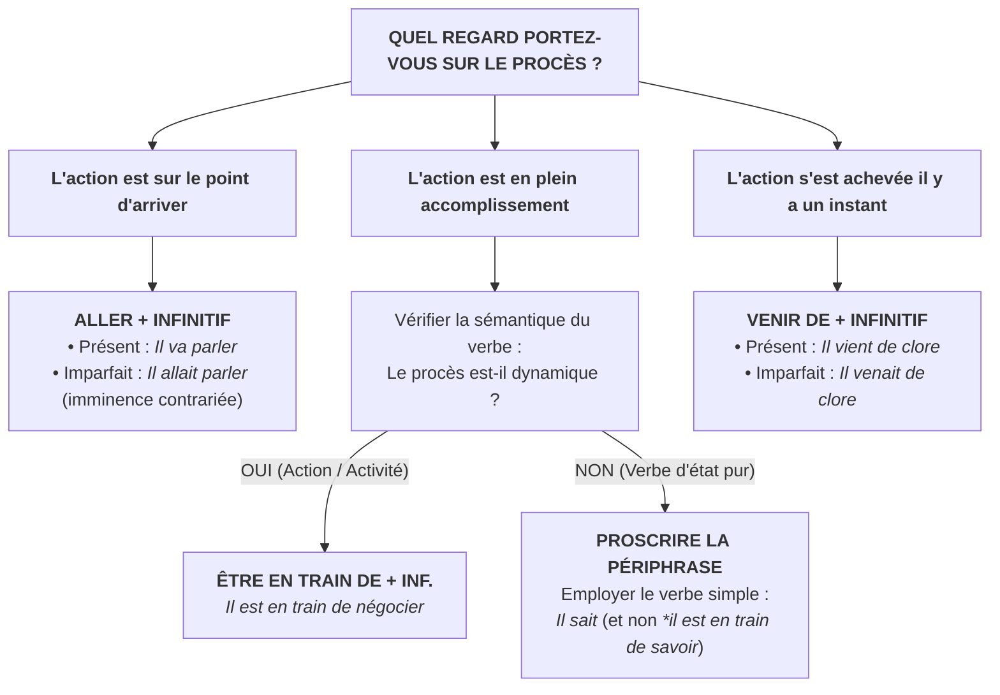

# Chapitre 7 — Les Périphrases Aspectuelles Fondamentales : Être en train de, Venir de, Aller + Infinitif et Rythme Narratif

> **Identifiant du chapitre** : `CHP-103-07`  
> **Module de rattachement** : [`MOD-103` — Le Système Verbal à l'Indicatif : Morphologie des Régularités, Verbes Fréquents Irréguliers, Passé Composé Régulier/Être et Périphrases Aspectuelles](file:///f:/Formation/world-class-french/03-curriculum/year-1/semester-1/mod-103-systeme-verbal-indicatif.md)  
> **Semestre** : Année 1 — Semestre 1 (S1)  
> **Volume horaire estimé** : 5 à 6 heures d'apprentissage autonome délibéré et d'ateliers d'application (Étude : 1 h 30 | Pratique : 1 h 30 | Correction : 1 h 00 | Évaluation : 1 h 00)  
> **Statut** : [STATUT : VALIDÉ]  
> **Compétences associées** : [`FR-VERB-001`](file:///f:/Formation/world-class-french/02-competency-framework/competency-framework.md#fr-verb-001-maîtrise-des-valeurs-aspectuo-temporelles-de-lindicatif) (L3 Autonomie), [`FR-INT-001`](file:///f:/Formation/world-class-french/02-competency-framework/competency-framework.md#fr-int-001-rédiger-un-texte-long-cohérent-en-maîtrisant-accords-et-ponctuation) (L3 Autonomie)  
> **Sources scientifiques de référence** : `SRC-NORM-03` (Ministère de l'Éducation nationale, 2020, p. 38-41), `SRC-GRAM-02` (Riegel et al., 2016, chap. 8 & 9), `SRC-GRAM-01` (Grevisse & Goosse, 2016, § 812-820), `SRC-GRAM-05` (Grevisse, 2009, § 74-78)

---

## 1. Titre et Place dans le Cursus

### 1.1 Intitulé Officiel
**Chapitre 7 : Les Périphrases Aspectuelles Fondamentales : Être en train de, Venir de, Aller + Infinitif et Rythme Narratif** (`CHP-103-07`).

### 1.2 Insertion Architecturale dans le Cursus
Ce septième chapitre clôture l'architecture du module [`MOD-103`](file:///f:/Formation/world-class-french/03-curriculum/year-1/semester-1/mod-103-systeme-verbal-indicatif.md). Après avoir exploré la combinatoire morphologique canonique (`CHP-103-01`), les valeurs énonciatives du présent (`CHP-103-02`), la régularité et l'aspect sécant de l'imparfait (`CHP-103-03`), le déploiement prospectif du futur simple (`CHP-103-04`), les bases du passé simple écrit (`CHP-103-05`) et la mécanique binaire du passé composé avec auxiliaire *être* ou *avoir* (`CHP-103-06`), ce cours dote l'apprenant des outils linguistiques permettant de s'affranchir de la raideur des tiroirs morphologiques synthétiques.



- **En amont** : Ce chapitre s'appuie sur la parfaite maîtrise de la conjugaison des verbes irréguliers à haute fréquence étudiés au chapitre 2 (`CHP-103-02`), particulièrement *être*, *aller* et *venir*, ainsi que sur la distinction entre formes verbales conjuguées (fléchies) et formes nominales du verbe (l'infinitif).
- **Au sein du module `MOD-103`** : Il constitue la clé de voûte sémantique et aspectuelle du module, permettant d'articuler le temps grammatical objectif et la vision interne subjective que le locuteur porte sur le déroulement du procès.
- **En aval dans le cursus** :
  - Il forme le pont direct vers [`MOD-104`](file:///f:/Formation/world-class-french/03-curriculum/year-1/semester-1/mod-104-lexique-lecture-paragraphe.md) (*Lexique, lecture experte et rédaction du paragraphe narratif*), où la gestion de la vitesse narrative, de la tension dramatique et des plans de récit dépend de l'alternance entre temps simples et périphrases ;
  - Il fournit les fondations syntaxiques nécessaires à [`MOD-201`](file:///f:/Formation/world-class-french/03-curriculum/year-1/semester-2/mod-201-syntaxe-fonctionnelle-phrase-simple.md) (*Syntaxe fonctionnelle de la phrase simple*), en établissant la distinction entre un verbe plein recteur de compléments d'objet et un verbe semi-auxiliaire dépouillé de sa valence primitive ;
  - Il prépare le terrain de [`MOD-302`](file:///f:/Formation/world-class-french/03-curriculum/year-2/semester-3/mod-302-circonstancielles-systeme-modal-concordance.md) (*Système modal et concordance des temps*), où la transposition des repères temporels dans le passé mettra en jeu les variantes à l'imparfait des périphrases (*il allait partir*, *il venait de sortir*).

---

## 2. Objectifs Mesurables

Au terme de l'étude autonome et des ateliers d'application de ce chapitre, l'apprenant doit être capable de :

1. **Identifier formellement la structure syntaxique d'une périphrase verbale aspectuelle**, en isolant le semi-auxiliaire fléchi (porteur des marques de temps, mode, personne et nombre) du verbe à l'infinitif (porteur du sémantisme lexical plein et de la valence actancielle), et en distinguant sans équivoque les verbes semi-auxiliaires des verbes de mouvement spatial ou de causalité [Réf. `SRC-NORM-03`, p. 38 ; `SRC-GRAM-02`, chap. 9].
2. **Employer et transposer avec exactitude les trois périphrases fondamentales** (*être en train de + infinitif* pour l'aspect progressif/duratif, *venir de + infinitif* pour l'aspect rétrospectif immédiat, *aller + infinitif* pour l'aspect prospectif immédiat) au présent et à l'imparfait de l'indicatif, afin de situer le procès avec une granularité chronologique fine sans rupture de repère énonciatif [Réf. `SRC-GRAM-01`, § 813-815].
3. **Neutraliser les incompatibilités sémantiques et les confusions de rection**, notamment en proscrivant l'usage d'*être en train de* avec des verbes d'état purs (*savoir*, *connaître*, *posséder*) et en distinguant la périphrase rétrospective *venir de* de la locution éventuelle *venir à* [Réf. `SRC-GRAM-02`, chap. 9 ; `SRC-GRAM-05`, § 76].
4. **Structurer et rythmer un récit narratif sous tension**, en articulant les tiroirs verbaux synthétiques (présent, imparfait, passé simple ou passé composé) et les périphrases aspectuelles pour créer du relief, ménager des suspensions, exprimer l'urgence et régler la vitesse de déroulement des événements [Réf. `SRC-GRAM-01`, § 812 ; `SRC-NORM-03`, p. 40].

---

## 3. Prérequis et Test de Préparation (Auto-Diagnostic)

### 3.1 Prérequis Cognitifs
- Maîtrise des désinences régulières et irrégulières du présent de l'indicatif des verbes *être*, *aller* et *venir* (`CHP-103-02`).
- Connaissance de la morphologie de l'imparfait de l'indicatif (`CHP-103-03`).
- Distinction formelle entre forme conjuguée à un mode personnel et forme nominale non fléchie (l'infinitif présent).
- Repérage de la fonction sujet et de la rection des pronoms clitiques compléments d'objet (`CHP-102-05`).

### 3.2 Test de Préparation Immédiat
Résolvez par écrit les cinq questions suivantes avant d'aborder la lecture du cours :

1. Dans la phrase : *« Paul va à la bibliothèque pour travailler »*, le verbe *va* constitue-t-il un semi-auxiliaire temporel ou un verbe lexical de mouvement ? Justifiez brièvement.
2. Quelle nuance sémantique immédiate sépare l'énoncé *« L'avion atterrit »* de l'énoncé *« L'avion est en train d'atterrir »* ?
3. Dans la phrase : *« Nous venons de terminer la relecture de votre manuscrit »*, quel est le rôle grammatical de la préposition *de* ? Fait-elle partie d'un complément d'objet ou relie-t-elle les composantes d'une périphrase ?
4. La phrase suivante est-elle recevable selon la norme grammaticale : *« Depuis ce matin, je suis en train de savoir la réponse à cette énigme »* ? Pourquoi ?
5. Conjuguez la phrase *« Il va monter à la tribune »* en transposant l'action dans un cadre passé au moyen de l'imparfait. Quelle nuance de perspective cette transposition apporte-t-elle ?

---

<details>
<summary><b>Corrigé de l'Auto-Diagnostic (cliquer pour afficher)</b></summary>

1. **Verbe lexical de mouvement** : Dans cet énoncé, *va* a son plein sens spatial de déplacement vers un lieu concret (*à la bibliothèque*). Le syntagme *pour travailler* est une proposition infinitive circonstancielle de but introduite par la préposition *pour*, et non le complément infinitif immédiat d'une périphrase.
2. **Actualisation en cours d'accomplissement (aspect progressif)** : *L'avion atterrit* constate le fait de manière globale ou descriptive au présent. *L'avion est en train d'atterrir* isole le procès au cœur exact de son déroulement physique, soulignant que l'action est inaccomplie et en cours d'exécution.
3. **Morphème de liaison de la périphrase** : La préposition *de* ne marque pas ici une relation de dépendance casuelle ou un complément prépositionnel du verbe ; elle fonctionne comme un simple mot de liaison grammaticalisé unissant le semi-auxiliaire *venons* à l'infinitif *terminer*.
4. **Non recevable (solécisme sémantique)** : Le verbe *savoir* est un verbe d'état (statif), qui n'admet pas de découpage en phases dynamiques successives. La périphrase *être en train de* exige un verbe de procès dynamique (action ou activité). On écrira : *« Depuis ce matin, je sais la réponse... »*.
5. **« Il allait monter à la tribune »** : La transposition à l'imparfait exprime une imminence située dans le passé (futur du passé), souvent porteuse d'une suspension dramatique ou d'une imminence contrariée par un événement soudain.

</details>

---

## 4. Situation de Départ ou Problème Concret

### 4.1 L'Indigence Temporelle et la Raideur Narrative
Considérons ce fragment rédigé par un scripteur dont l'apprentissage s'est limité aux tiroirs verbaux synthétiques élémentaires :

> *« Le président entre dans l'hémicycle. Les députés crient. Les gardes interviennent. Le président parle. Les députés se taisent. »*

Ce texte souffre d'une **raideur expressive invalidante**. Tous les procès sont aplatis sur une grille temporelle uniforme au présent. Le lecteur est incapable de percevoir :
- Ce qui précède immédiatement l'événement ;
- Ce qui est en train de se dérouler au moment où survient un incident ;
- Ce qui est sur le point d'éclater.

Pour pallier ce manque de souplesse, les apprenants recourent fréquemment à une accumulation indigeste de syntagmes adverbiaux pesants :
> *« En ce moment même où je vous parle, les députés crient. Il y a une seconde à peine, le président est entré. Dans quelques instants, il parlera. »*

Cette surcharge lexicale alourdit le texte, ralentit l'attention du lecteur et trahit une méconnaissance des **mécanismes aspectuels internes** de la langue française.

### 4.2 La Défaillance dans l'Urgence et le Reportage
Dans l'écriture journalistique, le procès-verbal d'audience, le rapport d'incident ou le récit littéraire, la restitution de l'action exige une précision millimétrique. Lorsqu'un témoin déclare : *« Quand j'ai tiré le frein d'alarme, le train déraillait »*, le sens est flou. En revanche :
- *« Le train était en train de dérailler »* (procès saisi en plein déroulement dramatique) ;
- *« Le train venait de dérailler »* (conséquence immédiate de la catastrophe) ;
- *« Le train allait dérailler »* (imminence tragique évitée de justesse ou interrompue).

La maîtrise des périphrases aspectuelles est l'instrument syntaxique qui transforme une chronique plate en une narration vivante, hiérarchisée et maîtrisée.

---

## 5. Explication Intuitive : L'Analogie de l'Obturateur et du Zoom de Caméra

Pour comprendre comment opèrent les périphrases aspectuelles, empruntons une modélisation visuelle claire : **la caméra de cinéma**.

```text
═══════════════════════════════════════════════════════════════════════════════════════
                    L'OPTIQUE CINÉMATOGRAPHIQUE DE L'ASPECT VERBAL
═══════════════════════════════════════════════════════════════════════════════════════

   [ VENIR DE + INF. ]           [ ÊTRE EN TRAIN DE + INF. ]          [ ALLER + INF. ]
     (Passé Récent)                 (Progressif / Duratif)            (Futur Proche)
            │                                  │                            │
   ◄────────┴────────                   ───────┼───────                  ───┴────────►
    TRAVELLING ARRIÈRE                     GROS PLAN SUR                  TRAVELLING AVANT
    (L'action vient juste                  L'ACCOMPLISSEMENT              (L'action est sur
     de sortir du champ)                  (Au cœur de l'action)            le point d'entrer)
═══════════════════════════════════════════════════════════════════════════════════════
```

1. **Les tiroirs morphologiques synthétiques (temps simples)** fournissent un plan moyen ou un plan d'ensemble : ils situent l'action sur la ligne du temps (hier, aujourd'hui, demain) sans entrer dans sa texture interne.
2. **La périphrase progressif (*être en train de + infinitif*)** effectue un **zoom avant maximal** : la caméra se focalise sur le cœur du procès en cours. Les bornes initiale (début) et terminale (fin) sont occultées ; seul compte l'accomplissement actif.
3. **La périphrase rétrospective (*venir de + infinitif*)** opère un **travelling arrière immédiat** : l'obturateur capture la poussière qui retombe, l'écho d'un acte qui vient de s'achever une fraction de seconde auparavant.
4. **La périphrase prospective (*aller + infinitif*)** arme l'obturateur en **amorce imminente** : le ressort est tendu, le procès va basculer dans l'existence d'un instant à l'autre.

Les périphrases aspectuelles sont les régulateurs de focale qui permettent au scripteur d'ajuster au millimètre près la saisie de l'action.

---

## 6. Définitions Précises et Terminologie Fondamentale

Chaque terme ci-dessous doit être manié avec une exactitude linguistique rigoureuse [Réf. `SRC-NORM-03`, p. 38-41 ; `SRC-GRAM-02`, chap. 9].

### 6.1 Périphrase Verbale Aspectuelle
Une **périphrase verbale aspectuelle** est une unité syntaxique complexe formée de deux verbes indissociables :
- un **verbe semi-auxiliaire** conjugué à un mode personnel ou impersonnel ;
- un **verbe à l'infinitif** (précédé ou non d'une préposition de liaison comme *de* ou *à*).  
Cette structure forme un prédicat sémantique unique dont la fonction exclusive est de préciser le stade de réalisation (le début, la durée, l'achèvement ou l'imminence) du procès exprimé par l'infinitif [Réf. `SRC-NORM-03`, p. 38].

### 6.2 Semi-Auxiliaire
Un **semi-auxiliaire** est un verbe qui, tout en conservant une morphologie verbale complète, a perdu son sens lexical plein de verbe d'action concrète (comme le déplacement dans l'espace pour *aller* et *venir*) ainsi que sa capacité à sélectionner des actants autonomes. Il agit comme un outil grammaticalisateur au service du verbe à l'infinitif [Réf. `SRC-GRAM-01`, § 812].

### 6.3 Infinitif Complément
L'**infinitif complément** est la composante lexicale rectrice de la périphrase. C'est lui qui détermine le sens de l'action, impose le cadre actanciel (sujet logique, compléments d'objet direct ou indirect) et gouverne les relations sémantiques de la proposition [Réf. `SRC-GRAM-02`, chap. 9].

### 6.4 Grammaticalisation
La **grammaticalisation** est le processus diachronique (historique) par lequel une unité lexicale pleine et autonome (par exemple le verbe *aller* au sens de « marcher vers un lieu ») acquiert progressivement le statut d'élément grammatical abstrait (marqueur du futur immédiat), en subissant une désémantisation et un figement syntaxique [Réf. `SRC-GRAM-02`, chap. 8].

### 6.5 Aspect Progressif (ou Duratif)
L'**aspect progressif** saisit un procès en cours de déroulement, envisagé de l'intérieur de son accomplissement, sans regard sur son point de départ ni sur son point d'aboutissement. En français, il s'exprime canoniquement par la périphrase *être en train de + infinitif* [Réf. `SRC-NORM-03`, p. 40].

### 6.6 Aspect Rétrospectif Immédiat (Passé Récent)
L'**aspect rétrospectif immédiat** pose le procès comme accompli dans un intervalle de temps immédiatement antérieur au point de repère énonciatif ou narratif. Il s'exprime par la périphrase *venir de + infinitif* [Réf. `SRC-GRAM-01`, § 814].

### 6.7 Aspect Prospectif Immédiat (Futur Proche)
L'**aspect prospectif immédiat** pose le procès comme orienté vers une réalisation imminente, découlant de conditions déjà réunies au moment de repère. Il s'exprime par la périphrase *aller + infinitif* [Réf. `SRC-GRAM-01`, § 813].

---

## 7. Règles et Mécanismes Fondamentaux

```text
═══════════════════════════════════════════════════════════════════════════════════════
                 L'ARCHITECTURE D'UNE PÉRIPHRASE VERBALE EN FRANÇAIS
═══════════════════════════════════════════════════════════════════════════════════════

    [ SEMI-AUXILIAIRE FLÉCHI ]  +  [ LIAISON ÉVENTUELLE ]  +  [ INFINITIF PLEIN ]
      (Porteur des marques          (Morphème vide             (Porteur du sens lexical
       Mode, Temps, Personne)        grammaticalisé : "de")     et de la valence COD/COI)
               │                                                          │
          "Il vient"                          "de"                    "comprendre"
          "Nous sommes"                  "en train de"                  "rédiger"
          "Elles vont"                        —                         "partir"
═══════════════════════════════════════════════════════════════════════════════════════
```

### 7.1 La Nature Linguistique et Syntaxique de la Périphrase Verbale
Une périphrase verbale se distingue formellement d'une construction verbale libre à deux verbes (verbe régissant + proposition infinitive complément) par trois critères syntaxiques fondamentaux [Réf. `SRC-GRAM-02`, chap. 9] :

1. **La cliticisation des pronoms conjoints (placement des pronoms personnels)** :
   Dans une périphrase verbale en français moderne, les pronoms compléments du verbe à l'infinitif viennent se placer immédiatement devant l'infinitif, et non devant le semi-auxiliaire :
   - *« Je vais **la** voir »* (et non *\*Je la vais voir*, tournure archaïque en français moderne).
   - *« Il vient de **lui** téléphoner »* (et non *\*Il lui vient de téléphoner*).
   - *« Nous sommes en train de **les** relire »*.
2. **L'indivisibilité sémantique et l'impossibilité de coordination hétérogène** :
   Le semi-auxiliaire ne peut pas être coordonné avec un complément nominal ordinaire sans créer une rupture agrammaticale ou un zeugma fautif :
   - On ne peut pas dire : *\*« Il vient de Dakar et d'atterrir »* (*de Dakar* = complément de lieu du verbe lexical *venir* ; *d'atterrir* = infinitif de la périphrase aspectuelle).
3. **Le transfert de valence** :
   C'est l'infinitif qui gouverne l'existence des compléments d'objet. Dans *« Il va construire une école »*, *une école* est le COD de *construire*, tandis qu'*aller* ne gouverne aucun objet direct.

---

### 7.2 L'Aspect Progressif / Duratif : *Être en train de + Infinitif*

#### 7.2.1 Saisie interne du procès
La locution *être en train de + infinitif* installe une focalisation interne absolue :
- Elle signifie que le procès a déjà commencé, qu'il n'est pas encore achevé, et qu'il se déroule activement au moment où l'on parle ou au moment pris comme repère.
- Elle équivaut à la forme progressive de l'anglais (*to be + -ing*), tout en étant plus marquée et plus insistante en français. En français, le présent simple exprime déjà couramment la durée (*« Je travaille »*), mais *être en train de* souligne explicitement l'occupation active exclusive : *« Ne me dérangez pas, je suis en train de rédiger le rapport final. »*

#### 7.2.2 La contrainte sémantique cardinale : l'incompatibilité stative
La règle fondamentale régissant *être en train de* repose sur la classification sémantique des verbes :
- **Verbes compatibles** : Les verbes d'action, d'activité ou de transformation (verbes dynamiques : *écrire, courir, construire, réparer, négocier, apprendre*).
- **Verbes incompatibles** : Les **verbes d'état purs** (verbes statifs : *être, avoir [au sens de possession], savoir, connaître, sembler, paraître, appartenir, dépendre*).

> [!CAUTION]
> On ne peut pas dire : *\*« Je suis en train de savoir mes leçons »*, ni *\*« Cette voiture est en train d'appartenir à mon oncle »*.  
> Un état n'a pas de phases dynamiques successives observables en train de s'effectuer.

---

### 7.3 L'Aspect Rétrospectif Immédiat : *Venir de + Infinitif*

#### 7.3.1 Le passé récent
La périphrase *venir de + infinitif* exprime que l'achèvement du procès est quasi-contigu au moment de l'énonciation :
- *« Le train vient d'entrer en gare. »* (Le procès est terminé, mais ses répercussions immédiates sont vivantes dans le présent).
- Elle dispense l'auteur de recourir à des formules adverbiales comme *« il y a une minute »*, *« il y a un instant »* ou *« à l'instant même »*.

#### 7.3.2 Restrictions de tiroirs temporels
Contrairement aux verbes ordinaires, le semi-auxiliaire *venir de* ne se conjugue qu'à des temps imperfectifs :
- **Au présent** : pour exprimer le passé récent par rapport au moment présent (*« Il vient de sortir »*).
- **À l'imparfait** : pour exprimer le passé récent par rapport à un repère dans le passé (*« Il venait de sortir quand l'alarme a retenti »*).
- **Proscription aux temps composés et au passé simple** : On ne dit jamais *\*« Il est venu de sortir »* ni *\*« Il vint de sortir »* avec valeur aspectuelle de passé récent [Réf. `SRC-GRAM-01`, § 814].

---

### 7.4 L'Aspect Prospectif Immédiat : *Aller + Infinitif*

#### 7.4.1 L'imminence et le futur proche
La périphrase *aller + infinitif* marque que le procès est orienté vers une réalisation imminente :
- Elle exprime une certitude fondée sur des indices immédiatement perceptibles : *« Regarde ces nuages noirs : il va pleuvoir. »*
- Elle traduit une décision ferme ou une intention résolue de l'énonciateur : *« Je vais vous expliquer la méthode. »*

#### 7.4.2 Distinction aspectuelle avec le Futur Simple
Tandis que le futur simple (*il partira*) projette le procès dans une temporalité chronologique abstraite et ouverte, le futur proche (*il va partir*) lie organiquement le procès au présent : les conditions de sa réalisation sont déjà rassemblées au moment présent [Réf. `SRC-GRAM-02`, chap. 8].

---

### 7.5 Articulation Narrative et Rythme du Texte

L'emploi judicieux des périphrases aspectuelles est le ressort secret du **rythme narratif** :
1. **La dilatation temporelle (effet de ralenti)** : L'emploi d'*être en train de* suspend le temps événementiel pour immerger le lecteur dans la matérialité sensorielle d'une action.
2. **L'accélération et l'urgence** : La succession d'un passé récent (*venir de*) et d'un futur imminent (*aller + infinitif*) crée une sensation de course contre la montre : *« Le navire vient de heurter le récif ; la coque va céder. »*
3. **Le contrepoint dramatique à l'imparfait** : La formule *« il allait [action] quand soudain [incident au passé composé/simple] »* est le modèle classique de l'événement perturbateur interrompant un dessein imminent.

---

## 8. Raisonnement Détaillé : La Nécessité Historique et Logique des Périphrases

### 8.1 Pourquoi le français a-t-il créé ces périphrases ?
En latin classique, la conjugaison reposait sur un système synthétique perfectionné où les désinences portaient l'essentiel des valeurs temporelles et modales. Cependant, le latin ne possédait pas de forme synthétique spécifique pour distinguer nettement :
- L'action qui se déroule au moment même de la parole (*je suis en train d'écrire*) ;
- De l'action habituelle ou générale (*j'écris des lettres*).

Au cours de la transition vers le bas latin et l'ancien français, le système verbal roman a développé un besoin croissant de **granularité aspectuelle**. Comme la création de nouveaux tiroirs morphologiques synthétiques (avec des désinences inédites) est un processus lourd et rare dans l'évolution des langues, le français a recouru au procédé linguistique le plus économique : **la composition analytique par périphrase** [Réf. `SRC-GRAM-02`, chap. 8].

### 8.2 La Métaphore Universelle de l'Espace vers le Temps
La création des périphrases avec *aller* et *venir* illustre une loi cognitive universelle de la linguistique humaine : **la métaphorisation de l'espace vers le temps**.
1. Dans toutes les civilisations, le temps est conceptualisé comme une ligne spatiale sur laquelle l'être humain se déplace ou voit les événements s'avancer vers lui.
2. Le verbe spatial *aller* exprime un mouvement vers l'avant dans l'espace $\rightarrow$ il s'est naturellement reconverti pour exprimer un mouvement vers l'avant dans le temps (*le futur*).
3. Le verbe spatial *venir* exprime une provenance depuis un point spatial d'origine $\rightarrow$ il s'est naturellement reconverti avec la préposition *de* pour exprimer une provenance temporelle immédiate (*le passé récent*).

Cette logique cognitive explique pourquoi ces périphrases sont d'une acquisition si intuitive pour les locuteurs du monde entier, tout en exigeant une grande rigueur de rection syntaxique à l'écrit soutenu.

---

## 9. Exemples Corrects Commentés

Examinons trois séquences narratives illustrant le fonctionnement interconnecté des trois périphrases.

### Exemple 1 : L'Arrière-Plan Dramatique avec *Être en train de* à l'Imparfait
> *« Lorsque les inspecteurs enfoncèrent la porte de l'atelier clandestin, le faussaire **était en train de brûler** les registres comptables dans la cheminée. »*

- **Analyse syntaxique** : *était* (semi-auxiliaire, indicatif imparfait, 3e personne du singulier) + *en train de* (locution prépositive de liaison) + *brûler* (infinitif plein transitif direct régissant *les registres comptables*).
- **Rôle aspectuel et narratif** : L'effraction des policiers est un événement ponctuel délimité (passé simple : *enfoncèrent*). L'action du faussaire est saisie en pleine exécution (aspect duratif et sécant renforcé) ; elle n'est ni commencée ni terminée au regard du lecteur, ce qui maximise la tension dramatique.

---

### Exemple 2 : L'Articulé Rétrospectif et Prospectif dans la Décision Politique
> *« Le chef de l'État **vient de promulguer** la loi sur la décentralisation ; le Premier ministre **va en détailler** les modalités d'application devant la représentation nationale. »*

- **Analyse syntaxique** :
  - *vient de promulguer* : semi-auxiliaire *vient* au présent + préposition *de* + infinitif *promulguer*. L'action d'État est achevée depuis un instant.
  - *va en détailler* : semi-auxiliaire *va* au présent + pronom clitique *en* antéposé à l'infinitif + infinitif *détailler*. L'allocution ministérielle est imminente et inéluctable.
- **Rôle aspectuel et narratif** : Le texte installe une articulation logique rigoureuse entre un acte accompli immédiat et sa conséquence prospective directe, sans aucun alourdissement adverbial.

---

### Exemple 3 : L'Imminence Contrariée dans le Récit au Passé
> *« L'avocat **allait signer** le protocole d'accord transactionnel quand un coursier fit irruption dans la salle avec une pièce à conviction inédite. »*

- **Analyse syntaxique** : semi-auxiliaire *allait* (imparfait) + infinitif *signer*.
- **Rôle aspectuel et narratif** : Cette structure modélise l'« imminence contrariée » : l'action de signer était sur le point de basculer dans le réel, mais la survenue brusque du coursier (passé simple : *fit*) interrompt définitivement le procès avant son actualisation.

---

## 10. Contre-Exemples et Erreurs Fréquentes

L'observation des copies universitaires et des écrits professionnels révèle quatre erreurs récurrentes majeures lors de l'emploi des périphrases aspectuelles :

### Erreur n° 1 : Emploi d'« être en train de » avec des verbes statifs (verbes d'état)
- **Formulation fautive** : *\*« En écoutant ce cours magistral, je suis en train de comprendre toutes les subtilités du système verbal. »*
- **Diagnostic scientifique** : Le verbe *comprendre* (tout comme *savoir*, *croire*, *connaître*, *posséder*) dénote un état mental ou une acquisition cognitive globale, et non une action mécanique décomposable en tranches d'accomplissement matériel.
- **Correction rigoureuse** : *« En écoutant ce cours magistral, **je comprends** toutes les subtilités... »* ou, si l'on veut souligner la progression, employer la périphrase inchoative/graduelle adéquate : *« **je commence à comprendre** toutes les subtilités... »*.

---

### Erreur n° 2 : Confusion syntaxique et sémantique entre « venir de » et « venir à »
- **Formulation fautive** : *\*« Si le ministre vient de démissionner, tout le calendrier des réformes sera bouleversé. »* (employé avec le sens de : *s'il advenait que le ministre démissionne*).
- **Diagnostic scientifique** : Il y a confusion paronymique de rection prépositionnelle :
  - *Venir de + infinitif* marque l'antériorité immédiate (l'événement a eu lieu il y a un instant) ;
  - *Venir à + infinitif* marque l'éventualité inopinée dans une proposition hypothétique (*« Si le ministre **venait à démissionner**... »*).
- **Correction rigoureuse** : *« Si le ministre **venait à démissionner**, tout le calendrier... »*.

---

### Erreur n° 3 : Redondance pléonastique et surcharge adverbiale d'immédiateté
- **Formulation fautive** : *\*« La délégation internationale vient tout juste d'atterrir il y a deux minutes sur le tarmac. »*
- **Diagnostic scientifique** : La périphrase *venir de* porte intrinsèquement la sémantique de l'antériorité immédiate. L'accumulation *tout juste* + *il y a deux minutes* constitue un pléonasme lourd qui encombre la phrase sans apporter la moindre nuance sémantique supplémentaire.
- **Correction rigoureuse** : *« La délégation internationale **vient d'atterrir** sur le tarmac. »*.

---

### Erreur n° 4 : Affaiblissement stylistique par empilement mécanique de périphrases
- **Formulation fautive** : *\*« Les experts sont en train de commencer à vouloir aller étudier le dossier. »*
- **Diagnostic scientifique** : Empilement de quatre semi-auxiliaires successifs (*être en train de* + *commencer à* + *vouloir* + *aller*). Cet enchaînement détruit toute vigueur stylistique et signale une pensée confuse incapable de hiérarchiser le procès principal.
- **Correction rigoureuse** : *« Les experts **commencent à étudier** le dossier »* ou *« Les experts **vont examiner** le dossier. »*.

---

## 11. Cas Particuliers et Limites

### 11.1 Transposition des Périphrases à l'Imparfait de l'Indicatif
Le tableau suivant récapitule la translation du point de repère temporel :

| Périphrase au Présent ($T_0 = \text{maintenant}$) | Périphrase à l'Imparfait ($T_1 = \text{passé}$) | Valeur sémantique acquise dans le récit |
| :--- | :--- | :--- |
| *Il est en train d'écrire.* | *Il était en train d'écrire.* | **Simultanéité active** dans le passé ; sert d'arrière-plan duratif à un fait soudain. |
| *Il vient de signer.* | *Il venait de signer.* | **Passé récent du passé** ; équivaut à un plus-que-parfait d'immédiateté absolue. |
| *Il va prononcer son discours.* | *Il allait prononcer son discours.* | **Futur dans le passé** ou **imminence contrariée** ; prépare une rupture événementielle. |

---

### 11.2 Les Périphrases Aspectuelles Périphériques
Au-delà des trois périphrases cardinales, le français mobilise un ensemble de semi-auxiliaires spécialisés pour découper les différentes phases du procès [Réf. `SRC-GRAM-01`, § 816-819] :

1. **Phase inchoative (déclenchement du procès)** :
   - *Commencer à / de + infinitif* (*« La pluie commence à tomber »*) ;
   - *Se mettre à + infinitif* (*« Il se mit à rédiger avec frénésie »* — plus soudain et volontaire).
2. **Phase d'imminence renforcée** :
   - *Être sur le point de + infinitif* (*« L'accord est sur le point d'être ratifié »* — imminence plus étroite et critique qu'*aller + infinitif*).
3. **Phase terminative (achèvement du procès)** :
   - *Finir de + infinitif* (*« Il finit de relire son plaidoyer »*) ;
   - *Cesser de + infinitif* (*« Le vent cesse de souffler »*).
4. **Phase itérative ou continuative (maintien du procès)** :
   - *Continuer à / de + infinitif* (*« Il continue de proclamer son innocence »*) ;
   - *Ne cesser de + infinitif* (*« Elle ne cesse de réclamer justice »*).

---

## 12. Approfondissement Adapté au Niveau : La Théorie Linguistique de la Grammaticalisation

### 12.1 La Découverte d'Antoine Meillet (1912)
Dans son article fondateur *« L'évolution des formes grammaticales »*, le grand linguiste français Antoine Meillet a formalisé le concept de **grammaticalisation** :
> *« La grammaticalisation est l'attribution du caractère grammatical à un mot jadis autonome. »*

Ce processus historique suit une trajectoire unidirectionnelle bien documentée par la typologie linguistique contemporaine (Paul Hopper, Elizabeth Traugott, Bernd Heine) :

$$\mathbf{\text{Mot lexical plein}} \longrightarrow \mathbf{\text{Semi-auxiliaire}} \longrightarrow \mathbf{\text{Auxiliaire grammatical}} \longrightarrow \mathbf{\text{Désinence affixée}}$$

### 12.2 Les Trois Étapes de la Transformation de *Aller* et *Venir*
1. **La désémantisation (blanchiment sémantique)** : Le verbe *aller* perd ses traits physiques sémantiques (déplacement d'un point A à un point B par locomotion pédestre). Dans la phrase *« Ce projet va réussir »*, nul ne se déplace physiquement dans l'espace. Le sens spatial concret s'est évaporé au profit d'un repère purement temporel.
2. **La décatégorisation syntaxique** : Alors qu'un verbe plein gouverne des compléments circonstanciels de lieu obligatoires (*« Je vais au marché »*), le semi-auxiliaire *aller* perd cette propriété : il ne sélectionne plus qu'un verbe à l'infinitif.
3. **Le figement de la rection** : La structure se fige et devient incapable de recevoir des insertions lexicales lourdes. On ne peut plus intercaler d'adverbe long entre le verbe et la préposition : on dit *« Il vient immédiatement de partir »* ou *« Il vient de partir immédiatement »*, mais difficilement *\*« Il vient considérablement de partir »*.

Ce regard théorique démontre que les périphrases aspectuelles ne sont pas des « facilités orales », mais des étapes fondamentales de la création vivante des formes dans l'histoire générale des langues.

---

## 13. Comparaisons Différentielles

Les trois tableaux synoptiques ci-dessous permettent de fixer définitivement les distinctions sémantiques et fonctionnelles fondamentales.

### Tableau 1 : Futur Simple morphologique vs Futur Proche périphrastique

| Critère de comparaison | Futur Simple (*Il partira*) | Futur Proche (*Il va partir*) |
| :--- | :--- | :--- |
| **Structure formelle** | Forme synthétique (radical en *-r-* + désinence *-a*). | Forme périphrastique analytique (*aller* au présent + infinitif). |
| **Ancrage temporel** | Avenir chronologique décroché du présent ; terme lointain ou indéterminé. | Avenir immédiat organiquement enraciné dans le présent d'énonciation. |
| **Nuance sémantique** | Déclaration de prévision, promesse, engagement solennel, ordre distancié. | Imminence concrète, constat d'indices perceptibles, intention ferme immédiate. |
| **Exemple révélateur** | *« Un jour, la vérité triomphera. »* | *« Écoutez bien : la vérité va éclater d'un moment à l'autre. »* |

---

### Tableau 2 : Passé Composé vs Passé Récent périphrastique

| Critère de comparaison | Passé Composé (*Il a parlé*) | Passé Récent (*Il vient de parler*) |
| :--- | :--- | :--- |
| **Structure formelle** | Auxiliaire (*avoir/être*) au présent + Participe passé. | Semi-auxiliaire *venir* au présent + préposition *de* + Infinitif. |
| **Aspect verbal** | Aspect accompli global ; le procès peut dater d'une heure, d'un mois ou d'un siècle. | Aspect rétrospectif immédiat ; contiguïté temporelle quasi absolue avec le présent. |
| **Lien avec la situation** | Constate le résultat d'un fait achevé dans le bilan temporel du sujet. | Saisit l'écho acoustique ou la retombée directe d'un acte qui s'achève à l'instant. |
| **Exemple révélateur** | *« Le ministre a démissionné en mai dernier. »* | *« Silence ! Le ministre vient de démissionner à la tribune. »* |

---

### Tableau 3 : *Aller* Verbe Lexical Plein de Mouvement vs *Aller* Semi-Auxiliaire Temporel

| Critère linguistique | *Aller* Verbe Plein Intransitif | *Aller* Semi-Auxiliaire Temporel |
| :--- | :--- | :--- |
| **Sémantisme** | Locomotion physique dans l'espace vers une destination. | Projection temporelle vers l'avenir immédiat sans mouvement physique. |
| **Complément requis** | Complément essentiel de lieu (*à l'école, en France*). | Verbe à l'infinitif obligatoire (*travailler, dormir, partir*). |
| **Test de suppression** | L'effacement du lieu détruit l'énoncé canonique (*\*Paul va*). | L'infinitif est l'élément régissant fondamental de la phrase. |
| **Sens de l'énoncé** | *« Les diplomates vont à Genève. »* (Déplacement géographique). | *« Les négociations vont échouer. »* (Événement temporel imminent). |

---

## 14. Exercices Progressifs

### Niveau 1 : Discrimination et Identification du Statut Verbal (Guidé)
Dans chacune des six phrases suivantes, indiquez si le verbe souligné en gras fonctionne comme un **verbe lexical plein** ou comme un **semi-auxiliaire d'une périphrase aspectuelle**. Justifiez votre réponse en identifiant la valeur aspectuelle ou le sens de mouvement.

1. *« La secrétaire **va** au bureau d'enregistrement déposer les requêtes. »*
2. *« Le ciel s'assombrit ; l'orage **va** éclater sur la plaine. »*
3. *« Ces étudiants **viennent** de Parakou pour concourir à l'université nationale. »*
4. *« Le procureur **vient** de clore son réquisitoire devant les jurés. »*
5. *« Le mécanicien **est** dans l'atelier pour réparer la pompe d'injection. »*
6. *« Silence dans la salle : le témoin **est en train de** prêter serment. »*

---

#### Corrigé du Niveau 1
1. **Verbe lexical plein** : *va* exprime un déplacement spatial concret vers un lieu (*au bureau d'enregistrement*). L'infinitif *déposer* fait partie d'une proposition infinitive circonstancielle de but implicite (*pour déposer*).
2. **Semi-auxiliaire aspectuel** : *va* ne dénote aucun mouvement physique. Il forme avec *éclater* une périphrase aspectuelle prospective d'imminence (futur proche).
3. **Verbe lexical plein** : *viennent* exprime l'origine géographique spatiale du déplacement (*de Parakou*).
4. **Semi-auxiliaire aspectuel** : *vient* forme avec *de clore* une périphrase aspectuelle rétrospective immédiate (passé récent).
5. **Verbe lexical plein (verbe copule / d'état et de localisation)** : *est* localise le sujet dans un espace physique (*dans l'atelier*).
6. **Semi-auxiliaire aspectuel** : *est en train de* forme avec *prêter* la périphrase aspectuelle durative/progressive (focalisation sur l'action en cours d'accomplissement).

---

### Niveau 2 : Transformation et Substitution Aspectuelle Ciblée (Semi-Autonome)
Transformez les énoncés suivants selon la consigne aspectuelle indiquée entre parenthèses, en effectuant les adaptations nécessaires sans altérer le sens lexical :

1. *« Le comité directeur adopte le nouveau règlement intérieur. »* (Transposer à l'**aspect rétrospectif immédiat au présent**).
2. *« L'ingénieur examine les failles de la structure en béton armé. »* (Transposer à l'**aspect progressif / duratif au présent**).
3. *« L'arbitre siffle le coup d'envoi de la finale de coupe. »* (Transposer à l'**aspect prospectif immédiat au présent**).
4. *« Les manifestants forçaient les grilles de la préfecture quand les renforts sont arrivés. »* (Remplacer le verbe imparfait par la **périphrase durative à l'imparfait** pour accentuer l'action en plein déroulement).
5. *« Le chirurgien achevait l'intervention délicate quand la coupure d'électricité est survenue. »* (Transposer à l'**aspect rétrospectif immédiat à l'imparfait**).
6. *« L'avion décollait quand un oiseau a été aspiré par le réacteur droit. »* (Transposer à l'**aspect prospectif à l'imparfait** pour marquer l'imminence contrariée).

---

#### Corrigé du Niveau 2
1. *« Le comité directeur **vient d'adopter** le nouveau règlement intérieur. »*
2. *« L'ingénieur **est en train d'examiner** les failles de la structure en béton armé. »*
3. *« L'arbitre **va siffler** le coup d'envoi de la finale de coupe. »*
4. *« Les manifestants **étaient en train de forcer** les grilles de la préfecture quand les renforts sont arrivés. »*
5. *« Le chirurgien **venait d'achever** l'intervention délicate quand la coupure d'électricité est survenue. »*
6. *« L'avion **allait décoller** quand un oiseau a été aspiré par le réacteur droit. »*

---

### Niveau 3 : Rythmer un Récit Statique par l'Injection Raisonnée de Périphrases (Autonome)
Voici un récit descriptif statique de 100 mots rédigé uniformément au présent de l'indicatif :

> *« Le calme règne encore dans le quartier diplomatique désert. Les sentinelles surveillent les accès du palais présidentiel. Dans la grande cour d'honneur, les journalistes internationaux vérifient leurs caméras et attendent les déclarations des ministres. Soudain, les portes centrales s'ouvrent avec un grand fracas. Les négociateurs sortent du salon d'apparat. Leurs visages graves traduisent une intense émotion contenue. Le cortège officiel avance vers le pupitre officiel préparé pour l'allocution solennelle. La foule des correspondants se précipite pour enregistrer la déclaration finale. Tous les regards attentifs se fixent sur le porte-parole qui ouvre calmement son dossier confidentiel. »*

**Consigne** : Réécrivez ce texte en un paragraphe faisant exactement 100 mots en y injectant de manière raisonnée et justifiée les **trois périphrases fondamentales** (*être en train de*, *venir de*, *aller + infinitif*), afin de créer du relief, de l'urgence et une hiérarchie temporelle dramatique.

---

#### Corrigé du Niveau 3
Voici la version réécrite étalonnée à exactement 100 mots :

> *« Le calme règne encore dans le quartier diplomatique désert. Les sentinelles surveillent les accès du palais présidentiel. Dans la grande cour d'honneur, les journalistes internationaux **sont en train de vérifier** leurs caméras et attendent les déclarations des ministres. Soudain, les portes centrales s'ouvrent avec un grand fracas. Les négociateurs **viennent de sortir** du salon d'apparat. Leurs visages graves traduisent une intense émotion. Le cortège officiel avance vers le pupitre officiel préparé pour l'allocution solennelle. La foule se précipite pour enregistrer la déclaration. Le porte-parole **va enfin ouvrir** calmement son dossier confidentiel devant les envoyés spéciaux. »*

**Justification critique des choix stylistiques** :
1. *sont en train de vérifier* : installe un zoom sur l'activité préparatoire des journalistes (arrière-plan actif) qui contraste avec l'immobilité des sentinelles.
2. *viennent de sortir* : marque la rupture événementielle immédiate ; le franchissement de la porte est tout juste consommé, ce qui explique l'émotion fraîche sur les visages.
3. *va enfin ouvrir* : crée une tension dramatique prospective sur l'instant culminant de l'allocution, suspendant l'attente du lecteur juste avant la prise de parole.

---

## 15. Activité de Correction Raisonnée

Considérez ce compte rendu rédigé par un stagiaire d'un cabinet juridique. Ce document comporte **six anomalies d'emploi ou de syntaxe des périphrases aspectuelles**. Identifiez chaque anomalie, réfutez scientifiquement la formulation fautive et proposez une réécriture impeccable.

```text
Texte du compte rendu à auditer :
« Le magistrat instructeur était en train de posséder toutes les pièces du dossier (1) 
lors de l'ouverture des débats. S'il venait de refuser de comparaître devant le tribunal (2), 
le prévenu risquait un mandat d'amener immédiat. D'ailleurs, les forces de police viennent 
tout juste d'appréhender le complice présumé il y a deux secondes à peine (3) aux abords 
du palais. L'avocat principal de la défense va bientôt plaider d'un instant à l'autre (4) 
pour obtenir la relaxe pure et simple. Dans le couloir, le jeune greffier est en train 
de commencer à se préparer à enregistrer (5) les dépositions solennelles. Enfin, le président 
de la chambre criminelle va pour ordonner (6) l'ouverture solennelle des débats publics. »
```

---

### Grille d'Audit et Corrigé Raisonné des 6 Anomalies

| N° | Segment fautif | Diagnostic linguistique & Réfutation scientifique | Correction rigoureuse proposée |
| :---: | :--- | :--- | :--- |
| **1** | *« était en train de posséder »* | **Incompatibilité sémantique stative** : Le verbe *posséder* est un verbe d'état abstrait pur. Il n'implique aucune action matérielle dynamique en cours d'effectuation. L'aspect progressif est irrecevable [Réf. `SRC-GRAM-02`, chap. 9]. | *« possédait toutes les pièces du dossier »* |
| **2** | *« S'il venait de refuser »* | **Confusion de rection aspectuelle / modale** : *Venir de* exprime le passé récent accompli. Dans une subordonnée hypothétique en *si*, l'éventualité future requiert la préposition *à* (*venir à + inf.*) [Réf. `SRC-GRAM-05`, § 76]. | *« S'il **venait à refuser** de comparaître »* |
| **3** | *« viennent tout juste d'appréhender [...] il y a deux secondes »* | **Pléonasme temporel lourd** : La périphrase *venir de* encode déjà l'antériorité immédiate. L'adjonction conjointe de *tout juste* et du syntagme adverbial *il y a deux secondes à peine* alourdit inutilement le texte. | *« viennent **d'appréhender** le complice présumé »* |
| **4** | *« va bientôt plaider d'un instant à l'autre »* | **Redondance pléonastique prospective** : Le semi-auxiliaire *aller* marque déjà l'imminence du procès. Le cumul de *bientôt* et de *d'un instant à l'autre* constitue un double emploi fautif. | *« **va plaider** pour obtenir la relaxe »* |
| **5** | *« est en train de commencer à se préparer à enregistrer »* | **Empilement affaiblissant de semi-auxiliaires** : Télescopage grotesque de quatre verbes fléchis ou semi-auxiliaires successifs. Cet empilement paralyse la dynamique narrative et dilue la clarté du propos. | *« **se prépare à enregistrer** »* ou *« **commence à enregistrer** »* |
| **6** | *« va pour ordonner »* | **Solécisme de rection prépositionnelle** : Le semi-auxiliaire *aller* régit directement l'infinitif sans aucune préposition de liaison (*\*aller pour + inf.* est un tour populaire ou calqué irrecevable dans la prose soignée) [Réf. `SRC-GRAM-01`, § 813]. | *« **va ordonner** l'ouverture solennelle »* |

---

## 16. Mise en Pratique dans une Production Réelle

### Consigne de l'Atelier
Vous êtes journaliste en direct pour une agence de presse internationale. Rédigez un reportage de crise faisant **exactement 80 mots** relatant une opération de secours d'urgence, en alternant impérativement les **trois périphrases fondamentales** (*venir de*, *être en train de*, *aller + infinitif*) au présent et à l'imparfait pour créer une tension d'urgence dramatique.

---

### Production Étalon (Exactement 80 mots)

> *« Ici Cotonou, en direct de la salle de crise ministérielle. L'équipe médicale **vient d'atterrir** sur le tarmac de l'aéroport. Les secouristes **sont en train d'extraire** les passagers blessés sous une pluie torrentielle continue. Le chef de mission **va prendre** la parole devant la presse internationale pour détailler le plan de prise en charge hospitalière d'urgence. La tension monte à chaque seconde dans le centre de commandement où les médecins coordonnent les évacuations critiques sans répit. »*

```text
Décompte rigoureux des mots (norme typographique française standard) :
1.Ici 2.Cotonou 3.en 4.direct 5.de 6.la 7.salle 8.de 9.crise 10.ministérielle 
11.L 12.équipe 13.médicale 14.vient 15.d 16.atterrir 17.sur 18.le 19.tarmac 20.de 
21.l 22.aéroport 23.Les 24.secouristes 25.sont 26.en 27.train 28.d 29.extraire 30.les 
31.passagers 32.blessés 33.sous 34.une 35.pluie 36.torrentielle 37.continue 38.Le 39.chef 40.de 
41.mission 42.va 43.prendre 44.la 45.parole 46.devant 47.la 48.presse 49.internationale 50.pour 
51.détailler 52.le 53.plan 54.de 55.prise 56.en 57.charge 58.hospitalière 59.d 60.urgence 
61.La 62.tension 63.monte 64.à 65.chaque 66.seconde 67.dans 68.le 69.centre 70.de 
71.commandement 72.où 73.les 74.médecins 75.coordonnent 76.les 77.évacuations 78.critiques 79.sans 80.répit.
TOTAL = EXACTEMENT 80 MOTS.
```

---

## 17. Résumé Structuré

### 17.1 Tableau Synoptique Complet des Trois Périphrases Fondamentales

| Périphrase | Semi-Auxiliaire & Forme | Valeur Aspectuelle Fondamentale | Transposition à l'Imparfait | Contraintes Sémantiques & Pièges |
| :--- | :--- | :--- | :--- | :--- |
| **Aspect Progressif / Duratif** | *Être en train de* + Infinitif | Action saisie au cœur de son accomplissement dynamique (zoom interne). | *Était en train de* + Infinitif (durée active dans le passé, arrière-plan). | Incompatible avec les verbes statifs (*savoir, avoir, être*). |
| **Aspect Rétrospectif Immédiat** | *Venir de* + Infinitif | Action achevée dans la contiguïté immédiate du repère (passé récent). | *Venait de* + Infinitif (passé récent dans le passé ; devance un fait passé). | Ne s'emploie pas aux temps composés (*\*a venu de*) ni au passé simple. |
| **Aspect Prospectif Immédiat** | *Aller* (présent) + Infinitif | Action imminente, intention ferme ou fatalité objective (futur proche). | *Allait* + Infinitif (futur dans le passé ou imminence contrariée). | Construction directe sans préposition (proscrire *\*aller pour + inf.*). |

---

### 17.2 Algorithme de Sélection Aspectuelle



---

## 18. Questions de Rappel Actif (Active Recall)

Répondez mentalement ou sur une feuille libre à ces six questions de haute rétention avant d'ouvrir les solutions repliables :

1. **Question 1** : Quels sont les deux constituants obligatoires d'une périphrase verbale aspectuelle en français moderne ?
2. **Question 2** : En quoi consiste le processus de « grammaticalisation » lorsqu'un verbe de mouvement spatial comme *aller* ou *venir* devient un semi-auxiliaire temporel ?
3. **Question 3** : Pourquoi la périphrase *être en train de + infinitif* est-elle formellement exclue avec des verbes comme *savoir*, *appartenir* ou *connaître* ?
4. **Question 4** : Quelle nuance d'ancrage dans la situation distingue le futur proche (*aller + infinitif*) du futur simple morphologique (*il partira*) ?
5. **Question 5** : Comment s'interprète la périphrase *aller + infinitif* lorsqu'elle est transposée à l'imparfait de l'indicatif devant une proposition subordonnée introduite par *quand* au passé simple ?
6. **Question 6** : Où se placent obligatoirement les pronoms personnels conjoints compléments d'objet de l'infinitif dans une périphrase verbale contemporaine ? Donnez un exemple avec *venir de*.

---

<details>
<summary><b>Réponses aux Questions de Rappel Actif (cliquer pour afficher)</b></summary>

1. **Réponse 1** : Une périphrase verbale associe obligatoirement un **semi-auxiliaire conjugué** (qui porte les marques flexionnelles de temps, mode et personne) et un **verbe à l'infinitif** (qui apporte le sens lexical plein et régit les compléments d'objet), éventuellement réunis par une préposition de liaison grammaticalisée (*de*).
2. **Réponse 2** : La grammaticalisation entraîne une **désémantisation** (perte du sens concret de déplacement physique dans l'espace) et une **décatégorisation** (perte de la capacité à régir des compléments circonstanciels de lieu propres), le verbe devenant un simple marqueur abstrait de temps et d'aspect.
3. **Réponse 3** : Parce que ces verbes sont des **verbes d'état purs (statifs)**, non sécables en étapes dynamiques observables. L'aspect progressif exige un procès actif ou une transformation matérielle en cours de réalisation.
4. **Réponse 4** : Le futur simple (*il partira*) projette le procès dans une temporalité abstraite déconnectée de l'instant présent. Le futur proche (*il va partir*) lie le procès au présent : les conditions de sa réalisation imminente sont déjà perceptibles au moment de l'énonciation.
5. **Réponse 5** : Elle exprime l'**imminence contrariée** (ou interrompue) : le procès était sur le point de basculer dans la réalité quand un événement soudain est venu l'empêcher ou en modifier le cours (*« Il allait signer quand le coup de feu retentit »*).
6. **Réponse 6** : Les pronoms compléments se placent **immédiatement avant l'infinitif** qu'ils complètent, et non devant le semi-auxiliaire : *« Il vient de **lui** remettre le dossier »* (et jamais *\*Il lui vient de remettre le dossier*).

</details>

---

## 19. Mini-Évaluation Sommative avec Corrigé Justifié

Cette épreuve est conçue pour être réalisée en **30 minutes sans document**. Elle est notée sur **20 points**.  
Conformément aux directives officielles de [`assessment-rubrics.md`](file:///f:/Formation/world-class-french/02-competency-framework/assessment-rubrics.md) et du module `MOD-103` :
- **Pénalité éliminatoire** : Tout solécisme de rection prépositionnelle ou toute confusion entre verbe statif et progressif entraîne une pénalité de **-3 points**.
- **Seuil minimal de validation L3 (Autonomie)** : **14 / 20**. Toute note inférieure à 14/20 impose une reprise intégrale des exercices de Niveau 2 et 3.

---

### Sujet de l'Évaluation

#### Partie I : Discrimination du Statut Verbal (4 points)
Pour chacune des quatre phrases suivantes, indiquez si la forme soulignée est un **verbe lexical plein** ou un **semi-auxiliaire aspectuel** (1 pt par item) :
1. *Le cortège des ministres **va** directement à l'ambassade.*
2. *Prenez garde : la passerelle en bois **va** s'effondrer sous le poids des caisses.*
3. *Le diplomate **vient** d'un pays d'Afrique centrale réputé pour sa diplomatie.*
4. *Le porte-parole **vient** d'annoncer la signature du cessez-le-feu.*

#### Partie II : Sélection et Transposition Aspectuelle au Présent (6 points)
Réécrivez les phrases suivantes au présent en appliquant la périphrase aspectuelle demandée et en plaçant correctement les pronoms compléments (2 pts par phrase) :
1. *« Le juriste consulte les archives secrètes. »* $\rightarrow$ Transposer à l'**aspect progressif** (*être en train de*).
2. *« Le témoin lui remet la lettre confidentielle. »* $\rightarrow$ Transposer à l'**aspect rétrospectif immédiat** (*venir de*).
3. *« Les ingénieurs nous présentent la nouvelle maquette. »* $\rightarrow$ Transposer à l'**aspect prospectif immédiat** (*aller*).

#### Partie III : Transposition au Repère Passé / Imparfait (6 points)
Conjuguez les verbes entre parenthèses aux périphrases aspectuelles appropriées à l'**imparfait de l'indicatif** pour insérer ces faits dans un récit au passé (2 pts par phrase) :
1. *Quand l'alarme a retenti, les gardiens (être en train de fermer) les grilles de l'enceinte.*
2. *L'avion (venir d'atterrir) sur la piste principale lorsqu'un violent orage a éclaté.*
3. *L'accusé (aller avouer) son forfait quand son avocat lui a fait signe de se taire.*

#### Partie IV : Réfutation Linguistique et Analyse Critique (4 points)
1. Réfutez scientifiquement l'énoncé suivant et corrigez-le : *« En ce moment, le suspect est en train d'ignorer les clauses de la loi. »* (2 pts).
2. Expliquez la différence de sens et de syntaxe entre : *« Si le coursier vient de déposer le colis »* et *« Si le coursier venait à déposer le colis »* (2 pts).

---

### Corrigé Détaillé et Barème de Notation

#### Partie I : Discrimination du Statut Verbal (4 points)
1. **Verbe lexical plein** (1 pt) : *va* exprime un mouvement spatial vers une destination (*à l'ambassade*).
2. **Semi-auxiliaire aspectuel** (1 pt) : *va* forme avec *s'effondrer* une périphrase de futur immédiat (imminence objective).
3. **Verbe lexical plein** (1 pt) : *vient* indique la provenance géographique d'origine (*d'un pays d'Afrique centrale*).
4. **Semi-auxiliaire aspectuel** (1 pt) : *vient* forme avec *de + annoncer* la périphrase de passé récent (antériorité immédiate).

#### Partie II : Sélection et Transposition au Présent (6 points)
1. **« Le juriste est en train de consulter les archives secrètes. »** (2 pts : 1 pt pour la périphrase, 1 pt pour l'absence de faute d'accord sur *est*).
2. **« Le témoin vient de lui remettre la lettre confidentielle. »** (2 pts : 1 pt pour *vient de*, 1 pt pour le placement du pronom clitique *lui* devant l'infinitif).
3. **« Les ingénieurs vont nous présenter la nouvelle maquette. »** (2 pts : 1 pt pour *vont*, 1 pt pour le placement du pronom clitique *nous* devant l'infinitif).

#### Partie III : Transposition à l'Imparfait (6 points)
1. **« étaient en train de fermer »** (2 pts : accord au pluriel avec *les gardiens*).
2. **« venait d'atterrir »** (2 pts : semi-auxiliaire à l'imparfait singulier, élision *d'*).
3. **« allait avouer »** (2 pts : semi-auxiliaire à l'imparfait singulier, construction directe).

#### Partie IV : Réfutation et Analyse Critique (4 points)
1. **Réfutation (2 pts)** : Le verbe *ignorer* est un verbe d'état cognitif (statif). Il ne comporte aucune dimension active décomposable en tranches d'accomplissement. L'emploi d'*être en train de* constitue un solécisme sémantique (1 pt). Correction : *« En ce moment, le suspect **ignore** les clauses de la loi »* (1 pt).
2. **Explication comparative (2 pts)** :
   - *« vient de déposer »* : Périphrase rétrospective constatant un fait accompli il y a un instant (le colis a été déposé juste avant l'énonciation) (1 pt).
   - *« venait à déposer »* : Locution conditionnelle marquant une éventualité inopinée future (dans l'hypothèse où le coursier déposerait le colis) (1 pt).

---

### Grille d'Étalonnage et Décision Pédagogique
- **19 à 20 / 20** : Maîtrise experte exceptionnelle. Sémantique aspectuelle et placement clitique parfaits.
- **16 à 18 / 20** : Très bon niveau. Les distinctions aspectuelles sont intégrées ; légères hésitations terminologiques.
- **14 à 15 / 20** : **Seuil minimal de validation L3 (Autonomie)**. Aucune erreur sur les rections de base, mais révision recommandée des transpositions à l'imparfait.
- **Moins de 14 / 20** : **Échec au test de validation**. Reprise obligatoire des rubriques 7, 10 et 14 (Niveau 2) avant d'aborder le module `MOD-104`.

---

## 20. Critères Observables de Maîtrise (Indicateurs L3 Autonomie)

L'apprenant est réputé avoir acquis la compétence [`FR-VERB-001`](file:///f:/Formation/world-class-french/02-competency-framework/competency-framework.md#fr-verb-001-maîtrise-des-valeurs-aspectuo-temporelles-de-lindicatif) et contribué à [`FR-INT-001`](file:///f:/Formation/world-class-french/02-competency-framework/competency-framework.md#fr-int-001-rédiger-un-texte-long-cohérent-en-maîtrisant-accords-et-ponctuation) au palier **L3 (Autonomie)** si et seulement si les quatre comportements observables suivants sont attestés de manière autonome :

| Code | Comportement Observable | Indicateur de Réussite Mesurable | Seuil de Tolérance |
| :---: | :--- | :--- | :---: |
| **IND-01** | **Discrimination formelle du semi-auxiliaire vs verbe lexical plein** | Capacité à distinguer un verbe plein de mouvement spatial d'un semi-auxiliaire aspectuel dans une série de 15 phrases variées. | Zéro erreur sur 15 phrases ($100\,\%$) |
| **IND-02** | **Respect des compatibilités sémantiques (incompatibilité stative)** | Proscription absolue de la périphrase *être en train de* avec des verbes d'état pur dans toute production écrite spontanée ou surveillée. | Taux de conformité de $100\,\%$ |
| **IND-03** | **Transposition temporelle rigoureuse à l'imparfait de l'indicatif** | Conjugaison sans faute des trois périphrases au repère passé (*était en train de*, *venait de*, *allait*) pour marquer la durée active, l'antériorité immédiate et l'imminence contrariée. | $\le 1\text{ erreur sur 10 items}$ |
| **IND-04** | **Placement infaillible des pronoms clitiques compléments de l'infinitif** | Positionnement systématique des pronoms personnels objets immédiatement devant l'infinitif régissant dans les constructions périphrastiques. | Zéro inversion clitique |

---

## 21. Sources et Lectures Complémentaires

Les règles, démonstrations et analyses présentées dans ce chapitre s'appuient rigoureusement sur les traités linguistiques fondamentaux répertoriés au registre [`07-resources/source-registry.md`](file:///f:/Formation/world-class-french/07-resources/source-registry.md) :

1. **Ministère de l'Éducation nationale (2020)**. *Terminologie grammaticale*. Paris : Réseau Canopé [Réf. `SRC-NORM-03`].  
   - Première partie : *Les formes verbales — Les périphrases verbales et les semi-auxiliaires* (pp. 38-41).  
   $\rightarrow$ Référence terminologique officielle fixant la distinction entre verbes auxiliaires, semi-auxiliaires et formes périphrastiques d'aspect.
2. **Riegel, Martin, Pellat, Jean-Christophe & Rioul, René (2016)**. *Grammaire méthodique du français*. Paris : PUF, coll. « Quadrige » [Réf. `SRC-GRAM-02`].  
   - Chapitre 8 : *Le verbe : morphologie et valeurs temporelles* (pp. 473-532).  
   - Chapitre 9 : *L'aspect verbal et les périphrases aspectuelles* (pp. 533-568).  
   $\rightarrow$ Ouvrage de référence pour la modélisation linguistique de la grammaticalisation, de la désémantisation et des critères syntaxiques des semi-auxiliaires.
3. **Grevisse, Maurice & Goosse, André (2016)**. *Le Bon Usage* (16e éd.). Bruxelles : De Boeck Supérieur [Réf. `SRC-GRAM-01`].  
   - Chapitre 11 : *Les verbes semi-auxiliaires et les périphrases verbales* (§ 812 à § 820) :  
     - § 812 : Définition des semi-auxiliaires et cliticisation des pronoms.  
     - § 813 : La périphrase prospective *aller + infinitif*.  
     - § 814 : La périphrase rétrospective *venir de + infinitif*.  
     - § 815 : La périphrase progressive *être en train de + infinitif*.  
   $\rightarrow$ Référence normative monumentale pour l'analyse des restrictions d'usage et des tolérances stylistiques.
4. **Grevisse, Maurice (2009)**. *Le Petit Grevisse : Grammaire française* (32e éd.). Bruxelles : De Boeck Supérieur [Réf. `SRC-GRAM-05`].  
   - Chapitre 7 : *Les auxiliaires et semi-auxiliaires* (§ 74 à § 78).  
   $\rightarrow$ Synthèse pédagogique pratique pour la manipulation des tiroirs de substitution.

---

## Annexe Pédagogique : Classification et Traçabilité du Contenu

Afin de préserver la lisibilité de la progression didactique et d'éviter toute surcharge cognitive prématurée, les notions de ce chapitre sont catégorisées selon la grille d'arbitrage de **World-Class French** :

| Étiquette | Notion / Contenu concerné | Justification didactique & Destination |
| :--- | :--- | :--- |
| **CORE-NOW** | • Identification de la structure semi-auxiliaire + infinitif.<br/>• Maniement des 3 périphrases fondamentales au présent : *être en train de*, *venir de*, *aller + infinitif*.<br/>• Placement des pronoms clitiques compléments devant l'infinitif.<br/>• Règle d'incompatibilité des verbes statifs avec *être en train de*.<br/>• Transposition des trois périphrases à l'imparfait. | Socle morphosyntaxique absolu requis dès le palier L3 à l'issue de `MOD-103`. |
| **INTRODUCTION-NOW** | • Périphrases aspectuelles secondaires (*commencer à*, *finir de*, *être sur le point de*).<br/>• Distinction stylistique entre futur proche et futur simple.<br/>• Notion diachronique de grammaticalisation et de désémantisation. | Fournit des repères conceptuels clairs pour enrichir la palette sans exiger une virtuosité exhaustive. |
| **DEFER** | • L'intégration des périphrases dans la dynamique macro-narrative et le rythme du paragraphe de prose. | **Reporté à [`MOD-104`](file:///f:/Formation/world-class-french/03-curriculum/year-1/semester-1/mod-104-lexique-lecture-paragraphe.md)** (*Lexique, lecture experte et paragraphe narratif*). |
| **DEFER** | • L'analyse syntaxique approfondie de la montée du clitique en diachronie (*« Je le veux faire »* vs *« Je veux le faire »*). | **Reporté à [`MOD-201`](file:///f:/Formation/world-class-french/03-curriculum/year-1/semester-2/mod-201-syntaxe-fonctionnelle-phrase-simple.md)** (*Syntaxe fonctionnelle de la phrase simple*). |
| **DEFER** | • Le maniement des périphrases modales (*devoir + inf.*, *pouvoir + inf.*, *faire + inf.* factitif). | **Reporté à [`MOD-302`](file:///f:/Formation/world-class-french/03-curriculum/year-2/semester-3/mod-302-circonstancielles-systeme-modal-concordance.md)** (*Système modal et concordance des temps*). |
| **DEFER** | • L'arbitrage historique des rectifications et tolérances sur les semi-auxiliaires rares. | **Reporté à [`MOD-401`](file:///f:/Formation/world-class-french/03-curriculum/year-2/semester-4/mod-401-pragmatique-accords-limites-rectifications-1990.md)** (*Pragmatique, accords limites et rectifications de 1990*). |
| **OPTIONAL-ADVANCED** | • Formalisation générative complète du mouvement verbal dans le syntagme fonctionnel $AspP$ (Aspect Phrase).<br/>• Étude philologique comparée des périphrases en ancien français, espagnol (*estar + gérondif*) et italien (*stare per*). | Destiné aux apprenants préparant les concours de l'enseignement supérieur (Agrégation de Lettres modernes). |
| **REMOVE** | • Digressions comparatives sur l'aspect slave (perfectif/imperfectif par préfixation morphologique intégrale).<br/>• Controverses typologiques sur la délimitation formelle entre temps et aspect dans les langues sans flexion temporelle. | Écarté pour concentrer les forces cognitives sur la maîtrise active et irréprochable du français académique écrit. |
