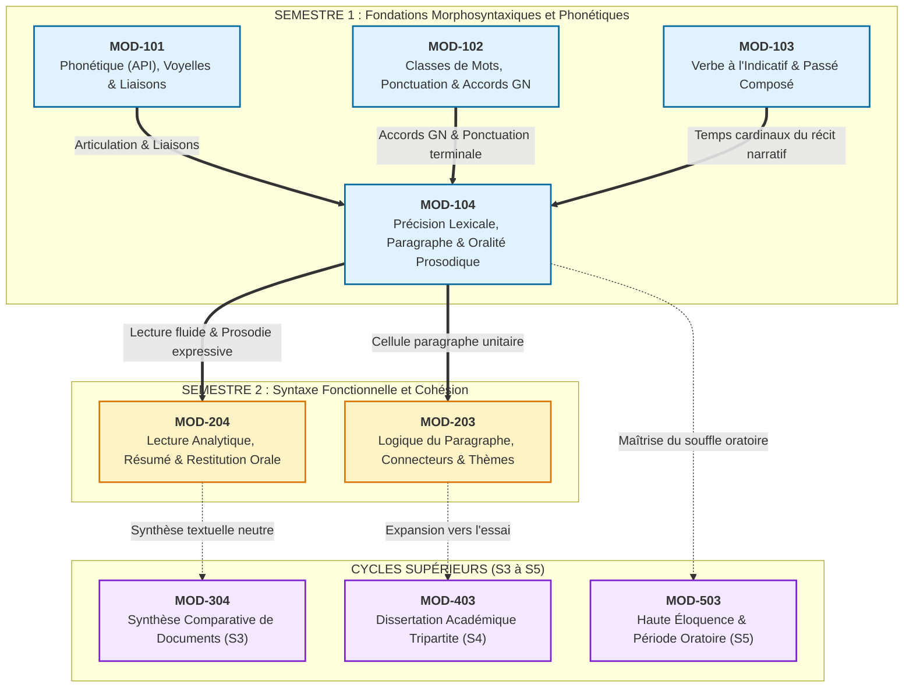

# Fiche Pédagogique Opérationnelle — Module MOD-104

> **Identifiant** : `MOD-104`  
> **Titre** : *Précision Lexicale de Base, Familles de Mots, Lecture Fluide, Paragraphe Narratif/Descriptif et Oralité Prosodique*  
> **Semestre** : Année 1 — Semestre 1 (S1)  
> **Domaines mobilisés** : DOM-05 (Lexique et sémantique), DOM-06 (Compréhension écrite), DOM-07 (Expression écrite), DOM-08 (Expression orale)  
> **Volume horaire estimé** : 16 heures (Étude : 4 h | Pratique : 6 h 30 | Correction : 3 h | Révision : 2 h 30)  
> *Statut* : [STATUT : VALIDÉ]  
> **Alignement** : [`syllabus.md` (S1)](file:///f:/Formation/world-class-french/03-curriculum/year-1/semester-1/syllabus.md), [`dependency-graph.md`](file:///f:/Formation/world-class-french/01-architecture/dependency-graph.md), [`competency-framework.md`](file:///f:/Formation/world-class-french/02-competency-framework/competency-framework.md), [`source-registry.md`](file:///f:/Formation/world-class-french/07-resources/source-registry.md)

---

## 1. Présentation et Intérêt du Module

Le module `MOD-104` constitue l'aboutissement intégrateur et la clé de voûte du Semestre 1 du cursus **World-Class French**. Après l'assainissement phonétique et graphémique (`MOD-101`), la stabilisation des catégories grammaticales et des accords fondamentaux (`MOD-102`), ainsi que la maîtrise des conjugaisons cardinaux de l'indicatif (`MOD-103`), l'apprenant doit dépasser la simple correction mécanique pour accéder à la **qualité expressive de la pensée**, tant sur la page qu'à la voix.

Ce module répond à un triple enjeu linguistique et didactique :
1. **Éradiquer l'indigence et l'approximation lexicales** : la pauvreté du vocabulaire (« verbes et substantifs passe-partout » comme *faire, mettre, avoir, problème, chose*) atrophie la précision de la pensée. L'apprenant apprend à substituer systématiquement le mot propre au mot terne, à manipuler les réseaux synonymiques et à employer les collocations soutenues du français soigné [Réf. SRC-LEX-01 ; Réf. SRC-LEX-04] ;
2. **Dévoiler la morphologie dérivationnelle et le génie des racines** : en explorant la formation des mots (affixation, allomorphie radicale, matrices gréco-latines), l'apprenant n'apprend plus les termes un par un de façon amorphe, mais comprend l'architecture interne du lexique français, ce qui décuple son autonomie de décodage et de création lexicale [Réf. SRC-LEX-03 ; Réf. SRC-GRAM-02, chap. 8] ;
3. **Construire la cellule de base du texte : le paragraphe unitaire** : l'écrit soutenu ne consiste pas en une juxtaposition désordonnée de phrases simples, mais en une structure architecturée (phrase d'amorce, développement textuel ordonné, phrase de clôture) assurant une cohésion sans faille ;
4. **Réconcilier le texte écrit et l'oralité vivante par la prosodie** : la lecture à voix haute n'est ni un déchiffrement mécanique ni une emphase artificielle. Elle repose sur la segmentation rigoureuse en **groupes de souffle** (groupes rythmiques), le respect absolu de la hiérarchie des pauses et la projection d'une courbe mélodique expressive [Réf. SRC-PHON-01, chap. 6 ; Réf. SRC-PHON-02].

---

## 2. Place dans le Cursus

- **Position séquentielle** : Quatrième et dernier module d'enseignement actif du Semestre 1 (Semaines 8 à 12).
- **Rôle architectural** : Module d'intégration terminale du Cycle 1, opérant la synthèse vivante entre morphosyntaxe, enrichissement lexical et performance oratoire.
- **Relations amont/aval** :
  - *En amont* : Prend directement appui sur :
    - `MOD-101` pour la discrimination phonétique, la maîtrise des liaisons obligatoires/interdites et l'articulation soignée ;
    - `MOD-102` pour l'identification des natures de mots, le respect de la chaîne d'accord du syntagme nominal et la délimitation graphique par la ponctuation terminale ;
    - `MOD-103` pour l'emploi des temps de l'indicatif (imparfait/passé composé régulier et valeurs aspectuelles) mobilisés dans le paragraphe narratif.
  - *En aval* : Prépare directement le Semestre 2 (S2) :
    - `MOD-203` (Logique du paragraphe, typologie des connecteurs, progression thématique et élimination des redondances) ;
    - `MOD-204` (Lecture analytique guidée, méthodologie du résumé de texte informatif, restitution orale synthétique) ;
    - Les exercices de longue haleine : synthèse comparative (`MOD-304`), dissertation (`MOD-403`) et haute éloquence (`MOD-503`).

---

## 3. Prérequis et Diagnostic

### 3.1 Prérequis
- Discrimination phonétique stabilisée et zéro liaison fautive (*cuir*, *velours*, liaison après *et*) [Validé en `MOD-101`].
- Identification sûre des 9 parties du discours et délimitation stricte des phrases par la ponctuation terminale [Validé en `MOD-102`].
- Conjugaison sans faute au présent, à l'imparfait et au passé composé canonique [Validé en `MOD-103`].

### 3.2 Protocole Diagnostique Spécifique (Semaine 8)
Avant d'aborder les chapitres de `MOD-104`, l'apprenant est soumis à une évaluation diagnostique ciblée en trois volets (durée : 45 minutes) :
1. **Épreuve A — Détection des termes ternes et substitution lexicale** : Un texte narratif bref de 150 mots comportant 12 verbes passe-partout (*faire, mettre, avoir, voir, dire*) et 5 substantifs indéterminés (*chose, problème, fait, truc*) doit être nettoyé. L'apprenant propose une alternative propre en contexte.
2. **Épreuve B — Analyse d'ordonnancement de paragraphe** : Cinq phrases non coordonnées d'une description sont présentées dans le désordre. L'apprenant doit identifier la phrase d'amorce, classer le développement selon une logique spatiale et repérer la clôture conclusive.
3. **Épreuve C — Enregistrement audio de lecture diagnostique (90 secondes)** : Lecture à première vue d'un paragraphe descriptif contemporain pour relever les blocages de souffle, les pauses mal placées (séparation fautive sujet/verbe ou verbe/objet) et les hésitations d'intonation.
- **Livrable** : *Fiche individuelle de positionnement lexical et prosodique*, répertoriant les tics de langage récurrents et les faiblesses respiratoires.

---

## 4. Objectifs Pédagogiques Mesurables

Au terme des 16 heures de travail du module `MOD-104`, l'apprenant doit être capable de :
1. **Analyser et exploiter la morphologie lexicale dérivationnelle** : Décomposer n'importe quel mot dérivé régulier en préfixe, base lexicale et suffixe, expliciter la valeur sémantique des affixes et identifier la parenté morphologique au sein de familles régulières ou allomorphiques [Réf. SRC-LEX-03 ; Réf. SRC-GRAM-02, chap. 8].
2. **Mobiliser un stock de racines gréco-latines fondamentales** : Déduire et justifier le sens d'au moins 50 termes du vocabulaire abstrait et concret à partir de 30 racines d'origine latine et grecque majeures.
3. **Bannir les verbes et substantifs passe-partout** : Remplacer systématiquement *faire, mettre, avoir, problème, chose* par un terme spécifique précis, adapté au champ sémantique et respectant les collocations usuelles du français standard soutenu [Réf. SRC-LEX-01 ; Réf. SRC-LEX-04].
4. **Construire un paragraphe unitaire narratif ou descriptif de 150 à 200 mots** : Rédiger un texte cohérent comportant une phrase d'amorce distincte, un déploiement ordonné sans rupture thématique ni répétition abusive, et une phrase de clôture conclusive, avec une exactitude absolue des accords syntaxiques.
5. **Lire à voix haute un texte suivi avec une prosodie maîtrisée** : Découper le texte en groupes de souffle pertinents, marquer la hiérarchie des pauses dictées par la ponctuation, déployer une courbe intonative juste (montante sur l'inachevé, descendante sur le conclusif) et maintenir une élocution fluide exempte de liaisons vicieuses [Réf. SRC-PHON-01, chap. 6 ; Réf. SRC-PHON-02].

---

## 5. Compétences Visées et Niveaux de Maîtrise Attendus

| Identifiant | Intitulé officiel de la compétence | Palier d'entrée | Palier cible MOD-104 | Indicateur de preuve observable |
| :--- | :--- | :---: | :---: | :--- |
| [`FR-LEXIC-001`](file:///f:/Formation/world-class-french/02-competency-framework/competency-framework.md#fr-lexic-001-précision-sémantique-nuances-synonymiques-et-collocations) | Précision sémantique, nuances synonymiques et collocations | L2 | **L3 (Autonomie)** | Substitution réussie de 20 termes vagues par des termes propres et respect des collocations idiomatiques dans une production originale. |
| [`FR-PHON-001`](file:///f:/Formation/world-class-french/02-competency-framework/competency-framework.md#fr-phon-001-maîtrise-des-contrastes-phonologiques-et-de-la-prosodie-formelle) | Maîtrise des contrastes phonologiques et de la prosodie formelle | L2 | **L3 (Autonomie)** | Lecture prosodique fluide de 200 mots à voix haute sans rupture de groupe de souffle, avec gestion nette des pauses et intonations. |
| [`FR-INT-001`](file:///f:/Formation/world-class-french/02-competency-framework/competency-framework.md#fr-int-001-rédaction-dun-texte-long-cohérent-avec-maîtrise-des-accords-et-de-la-ponctuation) | Rédaction d'un texte cohérent bien ponctué (palier Paragraphe Unitaire) | L1 | **L2 (Application guidée)** | Rédaction d'un paragraphe unitaire de 200 mots respectant le schéma tripartite canonique, sans faute d'accord ni anacoluthe. |

---

## 6. Plan Détaillé des Chapitres

```text
ARCHITECTURE DES ENSEIGNEMENTS DU MODULE MOD-104
├── CHAPITRE 1 : MORPHOLOGIE LEXICALE, DÉRIVATION AFFIXALE ET RACINES SAVANTES
│   ├── 1.1 La fabrique du mot : base lexicale (radical), morphèmes dérivationnels vs flexionnels.
│   ├── 1.2 La préfixation sémantique :
│   │   ├── Préfixes spatiaux et temporels (anté-, post-, pré-, trans-, sub-, circum- / péri-).
│   │   ├── Préfixes de négation, d'opposition et de privation (in-/im-/il-/ir-, dis-/dé-, a-/an-).
│   │   └── Préfixes d'intensité, de répétition et d'itérativité (sur-, hyper-, re-/ré-).
│   ├── 1.3 La suffixation et les changements de classe grammaticale :
│   │   ├── Nominalisations d'action ou de résultat (-tion, -ment, -age, -ure).
│   │   ├── Nominalisations de qualité, d'état ou de disposition (-ité, -eur, -esse, -itude).
│   │   ├── Adjectivations modales et relationnelles (-able/-ible, -eux, -al, -ique).
│   │   └── Adverbialisation par le suffixe régulier -ment et règles de formation sur l'adjectif féminin.
│   ├── 1.4 Les familles de mots régulières et l'allomorphie radicale (fleur/floral, œil/oculaire, mer/marin/maritime).
│   └── 1.5 Les matrices étymologiques gréco-latines fondamentales (corpus de 30 racines génératrices).
├── CHAPITRE 2 : PRÉCISION SÉMANTIQUE, DÉNOTATION/CONNOTATION ET ÉRADICATION DES TERMES VAGUES
│   ├── 2.1 Le diagnostic de l'approximation : la pathologie des verbes et substantifs passe-partout.
│   ├── 2.2 Tableaux de substitution méthodique du verbe faire (accomplir, bâtir, confectionner, commettre, perpétrer, etc.).
│   ├── 2.3 Tableaux de substitution méthodique des verbes mettre, avoir, dire et prendre.
│   ├── 2.4 Éradication des substantifs passe-partout : chose, problème, fait, affaire, truc.
│   ├── 2.5 Dénotation, connotation et registres d'intensité au sein d'un réseau synonymique.
│   └── 2.6 Les collocations idiomatiques stables du français soigné (verbe-substantif et substantif-adjectif).
├── CHAPITRE 3 : ARCHITECTURE TEXTUELLE : LE PARAGRAPHE UNITAIRE NARRATIF ET DESCRIPTIF
│   ├── 3.1 La notion de paragraphe : unité sémantique, typographique et respiratoire.
│   ├── 3.2 L'armature tripartite canonique :
│   │   ├── La phrase d'amorce (énoncé du thème directeur ou ancrage spatio-temporel initial).
│   │   ├── Le corps du paragraphe (déploiement chronologique narratif ou balayage spatial descriptif).
│   │   └── La phrase de clôture (chute, résonance conclusive, ouverture ou synthèse).
│   ├── 3.3 Cohésion et coréférence : le jeu des anaphores pronominales et lexicales (hyperonymes, synonymes).
│   └── 3.4 Les balises spatiales et temporelles de base pour éviter le morcellement syntaxique.
└── CHAPITRE 4 : ORALITÉ PROSODIQUE, GROUPES DE SOUFFLE ET LECTURE EXPRESSE
    ├── 4.1 Physiologie et mécanique vocale : souffle abdominal, détente laryngée et pose de la voix.
    ├── 4.2 Le groupe de souffle (groupe rythmique) : découpage phonosyntaxique naturel de la phrase.
    ├── 4.3 La hiérarchie des pauses : silence bref de continuité (virgule) vs silence d'arrêt (point terminal).
    ├── 4.4 Les courbes mélodiques fondamentales : intonation montante (inachèvement/suspension) vs descendante (clôture).
    └── 4.5 Diction et justesse expressive : bannir la psalmodie scolaire sans verser dans la préciosité théâtrale.
```

---

## 7. Concepts Fondamentaux et Notions Avancées

### 7.1 Concepts Fondamentaux
- **Base lexicale (ou radical)** : Élément morphologique porteur du sens sémantique principal autour duquel s'articulent affixes et désinences (*port-* dans *porter, emporter, transportable*) [Réf. SRC-GRAM-02, chap. 8].
- **Dérivation affixale** : Processus morphologique consistant à créer un nouveau lexème par l'adjonction d'un préfixe (sans modification de la classe grammaticale : *faire $\rightarrow$ défaire*) ou d'un suffixe (avec modification fréquente de classe : *lente $\rightarrow$ lenteur, lentement*) [Réf. SRC-LEX-03].
- **Dénotation vs Connotation** :
  - *Dénotation* : Sens premier, objectif, stable et conceptuel partagé par l'ensemble des locuteurs (sens du dictionnaire).
  - *Connotation* : Halo de significations secondes, affectives, appréciatives, stylistiques ou idéologiques adjointes au mot selon le contexte (*demeure* connote le faste et la permanence, tandis que *baraque* connote la précarité ou le dédain) [Réf. SRC-LEX-04].
- **Collocation idiomatique** : Association privilégiée, statistiquement et culturellement consacrée, de deux mots sans constituer une locution totalement figée (*nourrir un espoir*, *essuyer un échec*, *une pluie battante*, *un froid de canard*, *intenter une action en justice*) [Réf. SRC-LEX-01].
- **Groupe de souffle (groupe rythmique)** : Tranche d'énoncé articulée en une seule émission respiratoire continue, délimitée par la syntaxe et couronnée par un accent tonique final sur la dernière syllabe prononcée [Réf. SRC-PHON-01, chap. 6].

### 7.2 Notions Avancées
- **Allomorphie radicale** : Phénomène morphologique dans lequel une même base lexicale historique se réalise sous plusieurs formes phonétiques et graphiques distinctes à la suite de l'évolution diachronique ou d'emprunts savants au latin classique :
  - *Mer* (forme héréditaire) $\rightarrow$ *marin* $\rightarrow$ base savante allomorphique *maritim-* (*maritime*).
  - *Œil* (singulier populaire) $\rightarrow$ *yeux* (pluriel) $\rightarrow$ base savante allomorphique *ocul-* (*oculaire, oculiste*).
  - *Père* $\rightarrow$ allomorphe latin *patern-* (*paternel, paternité*).
  [Réf. SRC-LEX-03 ; Réf. SRC-GRAM-02, § 185].
- **Polysémie régulée et rection sémantique** : Capacité d'un mot à posséder plusieurs sens distincts dont l'ambiguïté est immédiatement dissoute par la rection syntaxique et le réseau collocationnel du cotexte (comparer *dresser une échelle*, *dresser un procès-verbal*, *dresser un animal*, *dresser la table*) [Réf. SRC-LEX-01].
- **Accent d'insistance (expressif ou intellectuel)** : Déplacement phonologique volontaire de l'énergie articulatoire sur la première syllabe consonnantique d'un mot pour marquer un relief contrastif (*« C'est **in**admissible ! »*), distinct de l'accent tonique de groupe qui frappe toujours la syllabe finale en français [Réf. SRC-PHON-01, chap. 7].

---

## 8. Erreurs et Confusions Fréquentes

| Type d'anomalie | Exemple fautif / relâché | Rectification normée et justification savante | Référence source |
| :--- | :--- | :--- | :--- |
| **Barbarisme paronymique** | *« Il faut élucider ce règlement. »* | *« Il faut **éluder** ce règlement. »* — Confusion entre *éluder* (éviter adroitement) et *élucider* (éclaircir un mystère). | [Réf. SRC-LEX-01, s.v. "éluder"] |
| **Barbarisme paronymique** | *« Au vu de la conjoncture politique... »* | *« Au vu de la **conjoncture**... »* vs *« Cette hypothèse est une pure **conjecture** (supposition sans preuve) »*. | [Réf. SRC-LEX-03, s.v. "conjecture"] |
| **Barbarisme paronymique** | *« Les moustiques ont infecté la maison. »* | *« Les moustiques ont **infesté** la maison. »* — *Infester* (envahir en grand nombre) vs *infecter* (contaminer par des germes morbides). | [Réf. SRC-LEX-01, s.v. "infester"] |
| **Pléonasme vicieux** | *« Il faut voire même agir. »* | *« Il faut **voire** agir »* ou *« Il faut **même** agir. »* — *Voire* signifiant déjà *et même*, l'association est un pléonasme condamné. | [Réf. SRC-GRAM-01, § 1028] |
| **Pléonasme vicieux** | *« Au jour d'aujourd'hui, nous constatons... »* | *« **Aujourd'hui** »* ou *« **À ce jour**, nous constatons... »* — Redoublement tautologique lourd et abusif du latin *ad diem*. | [Réf. SRC-GRAM-01, § 987] |
| **Calque oral et verbe passe-partout** | *« Le gouvernement a fait une loi pour faire face au problème de pauvreté. »* | *« Le gouvernement a **promulgué** une loi pour **endiguer** le **fléau** de la pauvreté. »* — Éradication du double emploi terne de *faire*. | [Réf. SRC-LEX-04, s.v. "promulguer"] |
| **Hachage prosodique fautif** | *« L'ambassadeur de / France a prononcé son / discours. »* | *« [L'ambassadeur de France] ↗ [a prononcé son discours.] ↘ »* — Interdiction absolue de marquer une pause au milieu d'un groupe nominal ou d'un syntagme verbal indissociable. | [Réf. SRC-PHON-01, chap. 6] |
| **Monotonie et voix monocorde** | Lecture sans relief, ton plat descendant sur chaque virgule comme sur un point. | Modulation rigoureuse : voix montante (inflexion aiguë) sur la continuité syntaxique, voix descendante (inflexion grave) sur le point d'arrêt. | [Réf. SRC-PHON-02, p. 74] |

---

## 9. Exemples Progressifs

### 9.1 Niveau Simple (Fondations Morphologiques et Lexicales)
- **Dérivation affixale transparente** :
  - Base *clair* (adj.) $\rightarrow$ Préfixation : *éclairer* (v.) $\rightarrow$ Suffixation nominale : *clarté* (n. f.) $\rightarrow$ Adverbialisation : *clairement* (adv.).
- **Éradication élémentaire de "faire"** :
  - *Faire une maison* $\rightarrow$ **Bâtir / Construire / Élever** une maison.
  - *Faire une erreur* $\rightarrow$ **Commettre** une erreur.
  - *Faire 100 kilos* $\rightarrow$ **Peser** 100 kilos.
- **Groupe de souffle canonique sur phrase simple** :
  - *« [Le vieux professeur] ↗ [ferma son livre.] ↘ »* (Deux groupes rythmiques, pause médiane ascendante, conclusion descendante).

### 9.2 Niveau Intermédiaire (Collocations, Allomorphie et Paragraphe)
- **Allomorphie radicale et racines latines** :
  - Racine latine *caput / capitis* (tête) : dérivation populaire en *chef, achever, chevet* ; dérivation savante allomorphique en *cap-* (*capital, capitaine, décapiter, récapituler*).
- **Substitution de substantifs passe-partout en contexte** :
  - *« Nous avons une chose urgente à régler, c'est un vrai problème. »* $\rightarrow$ *« Nous devons trancher une **urgence impérieuse**, car nous affrontons un **dilemme critique** / un **écueil majeur**. »*
- **Structure d'un paragraphe descriptif unitaire calibré (120 mots)** :
  > **[Phrase d'amorce]** : Dès l'aube, la cour de la préfecture s'animait d'un tumulte ordonné.  
  > **[Développement ordonné]** : Tandis que les fonctionnaires franchissaient le péristyle d'un pas empressé, les greffiers disposaient avec minutie les volumineux registres sur les tables de chêne ciré. Dans la travée centrale, une file de requérants silencieux patientait sous le regard austère des gardes républicains, dont les mousquetons étincelaient dans les premières lueurs du soleil matinal. Un murmure continu de voix feutrées emplissait l'atmosphère fraîche.  
  > **[Phrase de clôture]** : Ainsi s'ouvrait une journée laborieuse où chaque formalité engageait le destin de la province.

### 9.3 Niveau Complexe (Diction de Haute Tenue et Réécriture Intégrale)
- **Réécriture stylistique d'un extrait corrompu (Chasse aux impropriétés)** :
  - *Version relâchée* : *« L'avocat a mis en avant le fait que la victime avait eu des choses bizarres à dire et que ça faisait un gros problème pour l'affaire. »*
  - *Version réécrite de haut niveau* : *« Le conseil a **souligné** les **incohérences manifestes** contenues dans la déposition de la victime, arguant que ces **contradictions flagrantes** fragilisaient irrémédiablement l'acte d'accusation. »*
- **Découpage prosodique intégral d'un extrait classique** :
  - Texte : *« [Longtemps,] ↗ [je me suis couché de bonne heure.] ↘ [Parfois,] ↗ [à peine ma bougie éteinte,] ↗ [mes yeux se fermaient si vite] ↗ [que je n'avais même pas le temps] ↗ [de me dire :] ↗ [« Je m'endors. »] ↘ »* [Marcel Proust].  
  - *Annotation didactique* : Observation scrupuleuse des suspensions intonatives (↗) maintenant l'attente de la proposition corrélative finale descendante (↘).

---

## 10. Activités d'Observation et de Découverte

1. **Atelier "L'autopsie du verbe faire"** :
   - À partir d'un corpus authentique de 25 phrases de la presse et de correspondances administratives comportant le verbe *faire*, identifier le champ notionnel visé (création matérielle, écriture, calcul, sport, maléfice, sentiment) et sélectionner le terme propre dans le *TLFi* [Réf. SRC-LEX-01].
2. **Atelier "La constellation des racines gréco-latines"** :
   - À partir des racines génératrices *graph-* (écrire), *duc-/duct-* (conduire), *dic-/dict-* (dire), les apprenants doivent reconstituer une arborescence de 15 mots pour chaque racine en identifiant le préfixe adjoint et la modification morphologique induite.
3. **Laboratoire "L'écoute critique des silences et des courbes"** :
   - Écoute comparative de deux lectures enregistrées d'une même description littéraire : l'une exécutée de façon scolaire et précipitée (pauses anarchiques, respiration haletante) et l'autre découpée par groupes de souffle équilibrés.
   - Les apprenants matérialisent sur le texte imprimé les césures respiratoires réelles par des barres obliques (`/` et `//`) et confrontent leurs relevés.

---

## 11. Exercices Progressifs

### 11.1 Niveau 1 : Discrimination Morphologique et Remplacement de Base
- **Exercice 1.1 — Décomposition affixale** : Décomposer les mots suivants en isolant préfixe, radical et suffixe, puis expliciter le sens du préfixe : *irrévocable, transatlantique, déshydratation, extraordinaire, subordonné, prédestination, illégitime*.
- **Exercice 1.2 — Nominalisation d'action** : Former le nom d'action dérivé à partir des verbes suivants en choisissant le bon suffixe (*-tion, -ment, -age, -ure*) : *publier, rompre, nettoyer, agrandir, sceller, ajuster, détruire, brancher*.
- **Exercice 1.3 — Éradication du verbe mettre** : Remplacer dans 10 phrases le verbe *mettre* par un verbe précis (*arborer, apposer, introduire, consigner, consacrer, assigner, installer*).

### 11.2 Niveau 2 : Collocations, Allomorphie et Découpage Prosodique
- **Exercice 2.1 — Les couples paronymiques à piège** : Compléter les énoncés par le terme exact entre parenthèses en justifiant sémantiquement la décision :
  1. *L'accusé a cherché à (éluder / élucider) les questions du juge.*
  2. *Cette décision créera un (précédent / président) fâcheux dans notre jurisprudence.*
  3. *Le directeur a manifesté une grande (attention / intention) à notre égard.*
  4. *Ces produits chimiques risquent de (corroder / corrompre) les conduites d'acier.*
- **Exercice 2.2 — Collocations stables du français soigné** : Associer chaque substantif à l'adjectif ou au verbe qui forme avec lui une collocation consacrée :
  - *Une pluie* $\rightarrow$ (torrentielle / diluvienne / battante)
  - *Un secret* $\rightarrow$ (inviolable / de polichinelle / impénétrable)
  - *... une objection* $\rightarrow$ (soulever / formuler / écarter)
  - *... un revers* $\rightarrow$ (essuyer / subir)
- **Exercice 2.3 — Segmentation en groupes de souffle** : Découper un extrait de 60 mots en groupes rythmiques en traçant une barre simple `/` pour les pauses mineures de continuité et une double barre `//` pour les pauses majeures terminales, puis indiquer les flèches d'intonation (↗ / ↘).

### 11.3 Niveau 3 : Réécriture de Haute Tenue et Composition Textuelle
- **Exercice 3.1 — Nettoyage intégral d'un paragraphe relâché** : Réécrire un paragraphe de 100 mots truffé de mots passe-partout (*avoir, faire, chose, problème, voir*) pour en faire une page de prose soutenue et élégante, sans modifier l'intrigue sous-jacente.
- **Exercice 3.2 — Composition sous contraintes formelles** : Rédiger un paragraphe unitaire narratif de 150 mots respectant les contraintes suivantes :
  - Phrase d'amorce assertive sans connecteur initial ;
  - Présence obligatoire de 4 verbes précis d'action excluant *faire, mettre, aller* ;
  - Présence d'au moins 2 mots issus d'une même famille allomorphique (ex. *sang / sanguin / consanguinité*) ;
  - Phrase de clôture conclusive marquant la chute du paragraphe.

---

## 12. Ateliers de Correction et de Révision

### 12.1 Le Crible de Révision Lexicale et Stylistique (Protocole en deux passes)
Avant de soumettre tout écrit narratif ou descriptif, l'apprenant applique le protocole d'auto-révision systématique :
- **Passe 1 : Traque des verbes et substantifs passe-partout (Le Crible Lexical)** :
  - Surligner en jaune chaque occurrence des verbes *faire, mettre, avoir, dire, prendre, donner, voir* et des mots *chose, problème, fait, truc*.
  - Pour chaque terme surligné, obligation d'ouvrir le dictionnaire de synonymes ou le *TLFi* [Réf. SRC-LEX-01] et de sélectionner un verbe propre décrivant l'action matérielle ou intellectuelle exacte.
- **Passe 2 : Examen de la voûte du paragraphe (Le Crible Architectural)** :
  - Vérifier que la première phrase pose le cadre ou l'idée directrice sans s'égarer dans un détail secondaire.
  - Vérifier qu'aucune phrase n'est orpheline de verbe principal et que les connecteurs spatio-temporels assurent une transition fluide.
  - Vérifier que la dernière phrase clôt l'unité textuelle sans laisser le lecteur dans l'attente d'une suite immédiate à l'intérieur du même paragraphe.

### 12.2 Laboratoire d'Auto-Écoute et Correction Prosodique
- L'apprenant s'enregistre au dictaphone en lisant son propre texte.
- Il réécoute son enregistrement les yeux fermés en répondant à trois critères cliniques :
  1. *Ai-je respiré au milieu d'un groupe grammatical soudé (ex. entre le sujet pronominal et le verbe) ?*
  2. *Mon intonation monte-t-elle sur les virgules pour indiquer que la phrase n'est pas achevée ?*
  3. *Mon débit est-il régulier, sans précipitation sur les finales de mots ?*
- En cas de pause fautive ou d'intonation monocorde, ré-enregistrement immédiat de la section défectueuse.

---

## 13. Production Intégratrice

La validation du module `MOD-104` repose sur une **double production intégratrice (écrite et orale)** témoignant de la maîtrise synchronisée de la précision lexicale, de l'architecture textuelle et de l'oralité prosodique :

### Volet 1 : Production Écrite (Paragraphe Unitaire Calibré)
- **Consigne** : Rédiger un **paragraphe unitaire narratif ou descriptif de 200 mots ($\pm 10\,\%$)** sur l'un des deux thèmes au choix :
  - *Sujet A (Descriptif)* : La découverte d'un atelier d'artisanat d'art ou d'un laboratoire ancien au crépuscule.
  - *Sujet B (Narratif)* : Un incident soudain venant interrompre une cérémonie officielle solennelle.
- **Cahier des charges formel** :
  1. Structure tripartite rigoureuse et visible : phrase d'amorce thématique, corps de développement textuel cohérent, phrase de clôture conclusive ;
  2. Zéro verbe ou substantif passe-partout (*faire, mettre, avoir, voir, chose, problème*) sous peine de rejet immédiat ;
  3. Intégration naturelle d'au moins 3 collocations soutenues et de 2 mots issus d'une même matrice morphologique (famille dérivationnelle) ;
  4. Respect irréprochable des chaînes d'accord du syntagme nominal et sujet-verbe consolidées en `MOD-102`.

### Volet 2 : Production Orale (Enregistrement Prosodique Étalonné)
- **Consigne** : À partir du texte rédigé au Volet 1 :
  1. Préparer le texte en annotant les groupes de souffle (`/`), les pauses terminales (`//`), les courbes intonatives (↗ / ↘) et les liaisons obligatoires sous forme d'arcs de liaison ;
  2. Réaliser un **enregistrement audio de 2 minutes** de la lecture à voix haute du paragraphe.
- **Critères d'évaluation orale** : Clarté articulatoire, conformité du découpage en groupes de souffle, expressivité de la courbe mélodique, respect absolu des liaisons obligatoires et proscription de toute liaison fautive.

---

## 14. Évaluation et Barème

L'évaluation sommative finale du module `MOD-104` est notée sur **20 points**, répartie à parts égales entre la compétence scripturale et la compétence prosodique orale :

| Volet / Critère | Description des exigences et décompte des points | Seuil éliminatoire |
| :--- | :--- | :---: |
| **VOLET ÉCRIT (sur 10 points)** | | $< 7/10$ |
| 1. Architecture du paragraphe (3 pts) | • Phrase d'amorce nette et accrocheuse (1 pt)<br/>• Continuité logique et spatio-temporelle du développement (1 pt)<br/>• Phrase de clôture efficace assurant la cohésion finale (1 pt) | $< 2/3$ |
| 2. Précision lexicale et richesse sémantique (4 pts) | • Éradication totale des verbes et noms passe-partout (1,5 pt — pénalité de -0,5 pt par terme terne résiduel)<br/>• Emploi pertinent de termes propres et nuances exactes (1,5 pt)<br/>• Présence de collocations idiomatiques et dérivation conforme (1 pt) | $< 2,5/4$ |
| 3. Correction morphosyntaxique et ponctuation (3 pts) | • Zéro faute d'accord sujet-verbe et syntagme nominal (-0,5 pt par faute)<br/>• Respect de la ponctuation terminale et absence d'anacoluthe (-0,25 pt par écart) | $< 2/3$ |
| **VOLET ORAL (sur 10 points)** | | $< 7/10$ |
| 4. Découpage en groupes de souffle et pauses (3 pts) | • Respect des frontières syntagmatiques naturelles (1,5 pt — pénalité de -0,5 pt par rupture interne d'un syntagme)<br/>• Différenciation claire pause courte (virgule) vs pause longue (point) (1,5 pt) | $< 2/3$ |
| 5. Expressivité prosodique et courbes intonatives (3 pts) | • Modulation ascendante sur la continuité et descendante sur la clôture (1,5 pt)<br/>• Élocution vivante sans emphase artificielle ni récitation monocorde (1,5 pt) | $< 2/3$ |
| 6. Articulation, liaisons et phonétique (3 pts) | • Respect absolu des liaisons obligatoires (1 pt)<br/>• Zéro liaison interdite ou fautive (*pataquès*) (1 pt — éliminatoire si > 1 faute)<br/>• Articulation nette des voyelles et consonnes (1 pt) | $< 2/3$ |
| 7. Débit, respiration et aisance (1 pt) | • Vitesse de lecture maîtrisée (environ 110 à 130 mots/minute), respiration diaphragmatique inaudible et calme (1 pt) | $< 0,5/1$ |

> **Conditions de validation du module** :
> - Note globale minimale requise : **14/20 (70 %)**.
> - **Double seuil éliminatoire** : Une note inférieure à **7/10** au Volet Écrit OU au Volet Oral ajourne automatiquement le candidat, indépendamment de la moyenne globale, et déclenche une semaine de remédiation en atelier d'écriture ou laboratoire de diction.

---

## 15. Critères de Maîtrise

Le module `MOD-104` est déclaré validé aux paliers cibles si et seulement si l'apprenant manifeste de façon constante et autonome les comportements observables suivants :
- **Sur le plan lexical (`FR-LEXIC-001` - Palier L3)** :
  - Il n'emploie plus spontanément *faire, mettre, avoir, voir* dans ses écrits rédigés lorsqu'un verbe précis existe en français standard ;
  - Il sait mobiliser le préfixe ou le suffixe adéquat pour changer la catégorie d'un mot ou en nuancer la portée sémantique ;
  - Il reconnaît et rectifie immédiatement les barbarismes paronymiques (*éluder/élucider, conjecture/conjoncture*).
- **Sur le plan phonétique et prosodique (`FR-PHON-001` - Palier L3)** :
  - Sa lecture à voix haute d'un texte continu ne brise jamais la cohésion d'un syntagme nominal ou verbal par une inspiration inopinée ;
  - Il applique 100 % des liaisons obligatoires et ne commet **aucune liaison interdite** ;
  - La courbe de sa voix soutient activement le sens de la phrase en signalant à l'oreille les virgules et les points.
- **Sur le plan de l'expression écrite intégrée (`FR-INT-001` - Palier L2 Paragraphe)** :
  - Il structure son texte en un bloc harmonieux gouverné par une idée maîtresse explicite ;
  - Son paragraphe commence par une amorce claire et s'achève par une clôture nette, sans dériver vers des thèmes parasites.

---

## 16. Révisions Espacées Recommandées

Afin de cristalliser durablement les automatismes lexicaux et prosodiques acquis dans `MOD-104`, le calendrier suivant de rappel actif espacé est prescrit :

```text
CALENDRIER DE RAPPEL ACTIF — MODULE MOD-104
├── J+3 après validation : Flashcards sur les 30 racines gréco-latines fondamentales (15 min).
├── J+10 : Test rapide d'éradication du verbe faire sur 10 phrases complexes (15 min).
├── J+21 : Lecture à voix haute enregistrée d'un paragraphe descriptif classique inconnu (10 min).
├── J+45 : Composition impromptue d'un paragraphe narratif sous contrainte lexicale (30 min).
└── Semestre 2 (S2) : Réinvestissement immédiat et permanent dans MOD-203 (connecteurs et logique du paragraphe)
                      et MOD-204 (lecture analytique et restitution orale synthétique).
```

---

## 17. Sources de Référence Vérifiées

Toutes les notions, taxonomies morphologiques, règles normatives et prescriptions prosodiques de ce module sont adossées aux références réelles et vérifiées du registre officiel du cursus [`source-registry.md`](file:///f:/Formation/world-class-french/07-resources/source-registry.md) :

1. **ATILF / CNRS**. *Trésor de la Langue Française informatisé (TLFi)*. Base lexicographique en ligne (`atilf.atilf.fr`).  
   $\rightarrow$ Référence lexicographique cardinale pour les définitions précises, les réseaux synonymiques, la rection sémantique des verbes et les collocations littéraires [Réf. `SRC-LEX-01`].
2. **Rey, Alain (dir.) (2016)**. *Dictionnaire historique de la langue française*. Paris : Dictionnaires Le Robert.  
   $\rightarrow$ Référence étymologique pour l'histoire des mots, la filiation des racines gréco-latines et les phénomènes d'allomorphie radicale [Réf. `SRC-LEX-03`].
3. **Robert, Paul & Rey, Alain (dir.)**. *Le Grand Robert de la langue française*. Paris : Dictionnaires Le Robert.  
   $\rightarrow$ Référence pour les collocations idiomatiques stables, les gradations d'intensité synonymique et la distinction des registres de langue [Réf. `SRC-LEX-04`].
4. **Léon, Pierre (2011)**. *Phonétique du français contemporain*. Paris : Armand Colin (éd. refondue).  
   $\rightarrow$ Référence scientifique fondamentale pour l'analyse phonétique du groupe de souffle (chap. 6), l'accentuation tonique et expressive (chap. 7) et les courbes intonatives [Réf. `SRC-PHON-01`].
5. **Wioland, François (1991)**. *Prononcer les mots du français : des sons et des rythmes*. Paris : Hachette FLE.  
   $\rightarrow$ Référence didactique pour la pédagogie du rythme syllabique, le placement des pauses respiratoires et la fluidité de la lecture oralisée [Réf. `SRC-PHON-02`].
6. **Grevisse, Maurice & Goosse, André (2016)**. *Le Bon Usage* (16e éd.). Bruxelles : De Boeck Supérieur.  
   $\rightarrow$ Référence normative pour la formation des mots par dérivation et composition (§ 156 à § 200), la chasse aux pléonasmes vicieux (§ 987, § 1028) et l'emploi du mot propre [Réf. `SRC-GRAM-01`].
7. **Riegel, Martin, Pellat, Jean-Christophe & Rioul, René (2016)**. *Grammaire méthodique du français*. Paris : PUF, coll. « Quadrige ».  
   $\rightarrow$ Référence universitaire majeure pour la morphologie dérivationnelle (chap. 8 : préfixation, suffixation), la sémantique lexicale et la structuration du texte et du paragraphe (chap. 21) [Réf. `SRC-GRAM-02`].

---

## 18. Liens avec les Modules Précédents et Suivants


