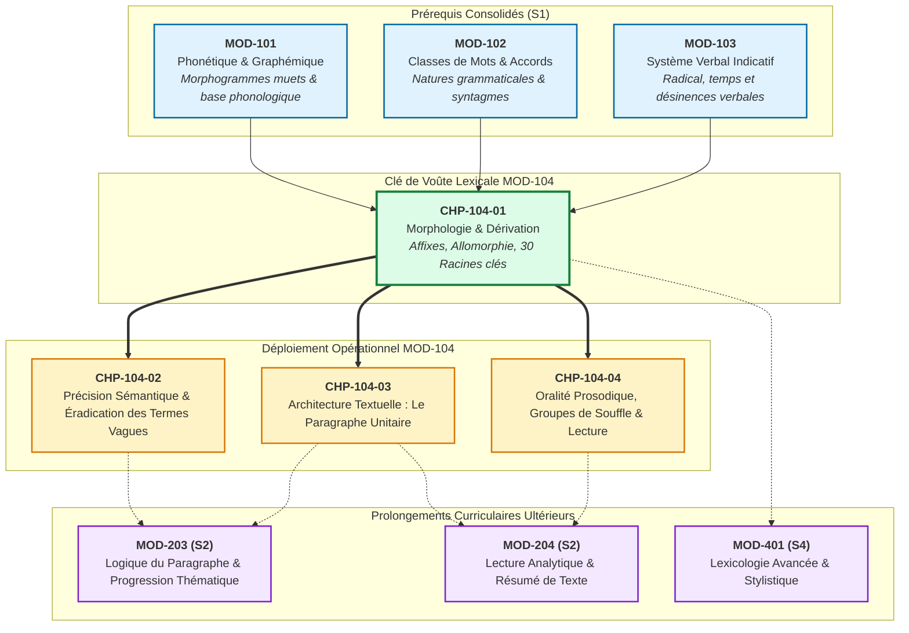

# Chapitre 1 — Morphologie Lexicale, Dérivation Affixale et Racines Savantes : La Fabrique des Mots et l'Architecture des Familles

> **Identifiant du chapitre** : `CHP-104-01`  
> **Module de rattachement** : [`MOD-104` — Précision Lexicale de Base, Familles de Mots, Lecture Fluide, Paragraphe Narratif/Descriptif et Oralité Prosodique](file:///f:/Formation/world-class-french/03-curriculum/year-1/semester-1/mod-104-lexique-lecture-paragraphe.md)  
> **Semestre** : Année 1 — Semestre 1 (S1)  
> **Volume horaire canonique** : 5 à 6 heures d'apprentissage autonome délibéré et d'ateliers d'application (Étude : 1 h 30 | Pratique : 1 h 30 | Correction : 1 h 00 | Évaluation : 1 h 00)  
> **Statut** : [STATUT : VALIDÉ]  
> **Compétences associées** : [`FR-LEXIC-001`](file:///f:/Formation/world-class-french/02-competency-framework/competency-framework.md#fr-lexic-001-précision-sémantique-nuances-synonymiques-et-collocations) (L3 Autonomie), [`FR-ORTHO-001`](file:///f:/Formation/world-class-french/02-competency-framework/competency-framework.md#fr-ortho-001-maîtrise-de-lorthographe-lexicale-et-flexionnelle) (L3 Autonomie)  
> **Sources scientifiques de référence** : `SRC-LEX-03` (Alain Rey, 2016), `SRC-GRAM-02` (Riegel et al., 2016, chap. 8), `SRC-GRAM-01` (Grevisse & Goosse, 2016, § 156-200), `SRC-LEX-01` (TLFi, ATILF/CNRS)

---

## 1. Titre et Place dans le Cursus

### 1.1 Intitulé Officiel
**Chapitre 1 : Morphologie Lexicale, Dérivation Affixale et Racines Savantes : La Fabrique des Mots et l'Architecture des Familles** (`CHP-104-01`).

### 1.2 Insertion Architecturale dans le Cursus
Le lexique d'une langue de haute culture comme le français n'est pas un agrégat inorganique de vocables appris par cœur, mais un système combinatoire d'une extrême cohérence architecturale. Après avoir maîtrisé les équilibres phonético-graphémiques dans [`MOD-101`](file:///f:/Formation/world-class-french/03-curriculum/year-1/semester-1/mod-101-diagnostic-phonetique-alphabet.md), stabilisé les catégories syntaxiques dans [`MOD-102`](file:///f:/Formation/world-class-french/03-curriculum/year-1/semester-1/mod-102-classes-mots-accords-fondamentaux.md) et exploré la machinerie des temps verbaux dans [`MOD-103`](file:///f:/Formation/world-class-french/03-curriculum/year-1/semester-1/mod-103-systeme-verbal-indicatif.md), l'apprenant aborde le module d'intégration `MOD-104`.

Ce premier chapitre pose le socle lexical fondamental : la compréhension de la **structure interne du mot** par la morphologie dérivationnelle et la possession des matrices étymologiques gréco-latines. Il transforme l'apprenant passif, tributaire du dictionnaire pour chaque unité isolée, en un décodeur et producteur autonome capable d'analyser la genèse des termes, d'en inférer le sens précis et de mobiliser les familles de mots savantes avec une rectitude absolue [Réf. `SRC-LEX-03` ; Réf. `SRC-GRAM-02`, chap. 8].



- **En amont** : Ce chapitre prend appui sur :
  - La théorie du plurisystème graphique de `MOD-101` : les morphogrammes dérivatifs muets (*lait $\rightarrow$ laitage*, *chat $\rightarrow$ chaton*) prennent ici tout leur sens théorique ;
  - La catégorisation des 9 parties du discours établie en `MOD-102`, indispensable pour saisir comment les suffixes opèrent des transcatégorisations (passage d'une classe syntaxique à une autre) ;
  - L'analyse morphémique du verbe menée en `MOD-103` (distinction radical vs désinence), qui prépare le repérage de la base lexicale.
- **Au sein de `MOD-104`** : Il arme directement :
  - Le Chapitre 2 (`CHP-104-02`), dédié à l'éradication des verbes et noms passe-partout (*faire, mettre, chose, problème*) par la mobilisation de vocables dérivationnels précis ;
  - Le Chapitre 3 (`CHP-104-03`), où la richesse lexicale soutient la cohésion textuelle du paragraphe narratif et descriptif ;
  - Le Chapitre 4 (`CHP-104-04`), où la juste accentuation et le découpage prosodique reposent sur la perception des unités lexicales autonomes.
- **En aval** : Il prépare la manipulation fine des réseaux notionnels dans l'explication de texte (`MOD-204`), la rigueur argumentative (`MOD-203`) et l'analyse philologique poussée des cycles supérieurs (`MOD-401`).

---

## 2. Objectifs Mesurables

Au terme de l'étude autonome et des ateliers pratiques de ce chapitre, l'apprenant doit être capable de :

1. **Segmenter infailliblement tout vocable dérivé complexe** en ses composantes morphémiques formelles : base lexicale (radical), préfixe(s), suffixe(s) dérivationnel(s) et marques flexionnelles éventuelles, en explicitant le statut grammatical et la charge sémantique de chaque affixe avec 100 % d'exactitude [Réf. `SRC-GRAM-02`, chap. 8 ; aligné sur `FR-LEXIC-001`, Palier L3].
2. **Piloter les règles de transcatégorisation suffixale** : former sans erreur les nominalisations d'action (*-tion, -ment, -age, -ure*), les nominalisations de qualité (*-ité, -eur, -esse, -itude*), les adjectivations relationnelles et modales (*-able/-ible, -eux, -al, -ique*) et les adverbes en *-ment* (règle générale sur féminin, bases en voyelle, séries savantes en *-amment* et *-emment*) [Réf. `SRC-GRAM-01`, § 156-200 ; aligné sur `FR-ORTHO-001`, Palier L3].
3. **Reconstituer et justifier les familles de mots allomorphiques** : identifier la parenté morphologique et diachronique unissant les bases populaires héréditaires et leurs allomorphes savants d'origine latine ou grecque (*fleur/floral, œil/oculaire, mer/marin/maritime, sang/sanguin/consanguinité, père/paternel, pied/pédestre/podologue*) [Réf. `SRC-LEX-03` ; aligné sur `FR-LEXIC-001`, Palier L3].
4. **Déduire et structurer le vocabulaire conceptuel à partir de 30 matrices étymologiques majeures** : mobiliser un corpus actif de 30 racines gréco-latines fondamentales pour inférer le sens précis d'au moins 60 termes du français soutenu et proscrire définitivement tout barbarisme dérivationnel [Réf. `SRC-LEX-01` ; aligné sur `FR-LEXIC-001`, Palier L3].

---

## 3. Prérequis et Test de Préparation (Auto-Diagnostic)

### 3.1 Prérequis Cognitifs
- Connaissance des 9 parties du discours du français (nom, verbe, adjectif, adverbe, etc.) acquise en `MOD-102`.
- Maîtrise des désinences verbales de l'indicatif acquise en `MOD-103`.
- Aptitude à identifier les lettres finales muettes dérivatives (*grand $\rightarrow$ grande/grandeur*) acquise en `MOD-101`.

### 3.2 Test de Préparation Immédiat
Résolvez par écrit les cinq questions suivantes avant d'entamer l'étude du chapitre.

1. Dans le mot *infranchissable*, séparez les différents éléments par des tirets et identifiez la nature de chacun d'eux (préfixe, radical, suffixe). Quelle est la classe grammaticale du mot de départ et celle du mot final ?
2. Pourquoi le mot *lentement* comporte-t-il les lettres \<-te-\> entre la racine *len-* et le suffixe *-ment* ? Quelle est la règle générale qui gouverne cette construction ?
3. Les adjectifs *oculaire* et *visuel* se rapportent tous deux au sens de la vue. Lequel appartient à la même famille morphologique et historique que le nom *œil* ? Justifiez.
4. Quel préfixe de sens privatif relie les mots *illégal*, *imberbe*, *irréel* et *injuste* ? Pourquoi ce préfixe prend-il quatre formes graphiques différentes ?
5. Dans la phrase *« Il a commis un acte impardonnable »*, le mot *impardonnable* exprime-t-il une action réelle en train de se dérouler ou une possibilité ? Quel élément morphologique précis apporte cette nuance ?

---

#### Corrigé de l'Auto-Diagnostic

<details>
<summary><b>Consulter le corrigé détaillé de l'auto-diagnostic</b></summary>

1. **Décomposition : *in-franchi-ss-able*** :
   - *in-* : préfixe dérivationnel négatif/privatif ;
   - *franchi-* : base lexicale verbale (issue de *franchir*) ;
   - *-ss-* : formant inchoatif du 2e groupe verbal ;
   - *-able* : suffixe dérivationnel adjectival de possibilité passive.
   - *Changement de classe* : mot de départ = verbe (*franchir*) $\rightarrow$ mot d'arrivée = adjectif qualificatif (*infranchissable*).
2. **Construction de l'adverbe *lentement*** :
   - Les adverbes en *-ment* se forment régulièrement en soudant le suffixe à la **forme féminine de l'adjectif qualificatif**.
   - Le masculin est *lent* `/lɑ̃/` ; le féminin est *lente* `/lɑ̃t/`.
   - On adjoint *-ment* au féminin : *lente* $+$ *-ment* = *lentement* `/lɑ̃t.mɑ̃/`. La consonne muette au masculin réapparaît ainsi au féminin et dans l'adverbe.
3. **Parenté de *œil* et *oculaire*** :
   - C'est l'adjectif **oculaire** qui forme avec *œil* une famille de mots étymologique par **allomorphie savante**.
   - Tous deux remontent au même étymon latin : *oculus* (l'œil). *Œil* est le résultat de l'évolution phonétique populaire gallo-romane, tandis qu'*oculaire* est un emprunt savant forgé directement sur le radical latin *ocul-* [Réf. `SRC-LEX-03`]. *Visuel*, quant à lui, dérive d'une autre racine latine (*videre / visum*, voir).
4. **Le préfixe privatif latin *in-*** :
   - Ces quatre formes procèdent d'un même morphème : le préfixe privatif latin **in-**.
   - La variation graphique résulte d'un phénomène phonétique régulier d'**assimilation consonantique** devant la consonne initiale de la base :
     - *in-* $+$ *légal* $\rightarrow$ *illégal* (assimilation totale /nl/ $\rightarrow$ /l/) ;
     - *in-* $+$ *berbe* $\rightarrow$ *imberbe* (assimilation labiale devant /b/ ou /p/) ;
     - *in-* $+$ *réel* $\rightarrow$ *irréel* (assimilation totale /nʁ/ $\rightarrow$ /ʁ/) ;
     - *in-* $+$ *juste* $\rightarrow$ *injuste* (maintien de *in-* devant consonne non liquide).
5. **Nuance de possibilité passive apportée par *-able*** :
   - Le mot n'exprime pas une action accomplie, mais une **modalité de possibilité passive** (qui ne *peut pas* être pardonné).
   - Cette valeur sémantique est apportée par le suffixe adjectival **-able** (issu du latin *-abilis*, indiquant la capacité passive). Le préfixe *im-* y adjoint la négation.

</details>

> [!NOTE]
> Si ces notions vous semblent complexes ou disjointes, votre esprit appréhende encore le vocabulaire comme une collection d'unités isolées. Ce chapitre va vous donner la grammaire générative du lexique français : la capacité de décomposer, comprendre et forger des centaines de mots à partir d'un nombre restreint de briques fondamentales.

---

## 4. Situation de Départ ou Problème Concret : L'Illusion de l'Apprentissage Amorphe

### 4.1 Le Mur du Vocabulaire Mot-à-Mot
Considérez la trajectoire d'un scripteur confronté aux textes de la haute administration, du droit, de la littérature académique ou des sciences humaines :
- Il rencontre des vocables denses tels que *concomitant, pusillanime, rédhibitoire, antédiluvien, consanguinité, déréliction, exogène, anachronique*.
- Face à cette luxuriance, le réflexe naïf consiste à mémoriser chaque terme de manière isolée, comme un idéogramme sans lien avec le reste de la langue.

Ce modèle mental « amorphe » engendre trois pathologies intellectuelles graves :
1. **La cécité sémantique en lecture** : Devant un mot inconnu, le lecteur s'arrête, paralysé, incapable de déduire le sens du mot à partir de ses segments internes, même lorsque ceux-ci sont transparents (*chloro-phylle*, *in-dé-boulonn-able*, *somn-ambule*).
2. **Le barbarisme paronymique et la confusion d'affixes** : Ne comprenant pas la mécanique des préfixes, le scripteur confond *inflammable* (qui prend feu facilement, préfixe latin illatif *in-* signifiant « dans/vers ») et *incurable* (qu'on ne peut guérir, préfixe privatif *in-* signifiant « non »), ou forge spontanément des monstres dérivationnels comme \**solutionner* à la place de *résoudre*, ou \**sélectionnage* au lieu de *sélection*.
3. **La scission schizophrénique du lexique** : L'apprenant ignore que les mots du registre familier (*œil, mère, doigt, évêque*) sont organiquement unis aux mots les plus savants (*oculaire, maternel, digital, épiscopal*) par le fil de l'allomorphie historique.

### 4.2 La Solution Linguistique : L'Intelligence Morphologique
La linguistique moderne enseigne que le lexique français ne s'accroît pas par génération spontanée. Sur les 60 000 mots d'un dictionnaire d'usage courant, plus de **85 % sont des mots construits**, issus d'un noyau compact de quelques centaines de radicaux et d'une cinquantaine d'affixes hautement standardisés [Réf. `SRC-GRAM-02`, chap. 8].

Apprendre la morphologie lexicale, c'est passer du statut d'amateur condamné à empiler des briques sans ciment à celui d'architecte qui connaît les matrices génératrices de toute la langue française.

---

## 5. Explication Intuitive : L'Analogie du Jeu de Blocs et de l'Ingénierie Modulaire

Pour appréhender la fabrique des mots français, représentons-nous un atelier d'assemblage modulaire ou une boîte de briques standardisées :

```text
┌─────────────────┐     ┌──────────────────┐     ┌─────────────────┐     ┌──────────────────┐
│   PRÉFIXE(S)    │  +  │  BASE LEXICALE   │  +  │   SUFFIXE(S)    │  +  │    FLEXION(S)    │
│  (Orientation / │     │    (RADICAL)     │     │ (Transcatégo-   │     │ (Genre, Nombre,  │
│    Polarité)    │     │  (Sens pivot)    │     │   risation)     │     │    Désinences)   │
└─────────────────┘     └──────────────────┘     └─────────────────┘     └──────────────────┘
       [dé-]                  [-struct-]               [-tion-]                  [-s]
         │                         │                       │                       │
   « Défaire / Inverser »     « Construire / Bâtir »   « Nom d'action »      « Marque plurielle »
         └─────────────────────────┼───────────────────────┘                       │
                                   ▼                                               ▼
                         DÉSTRUCTURATION (Lexème)                 DÉSTRUCTURATIONS (Forme fléchie)
```

1. **La Base Lexicale (le Radical)** est le châssis moteur. Elle apporte le noyau sémantique irréductible (*struct-* évoque l'action de disposer, d'assembler ; *port-* évoque le transport ; *lég-* évoque la loi).
2. **Le Préfixe** est l'inverseur de marche, le réducteur ou le commutateur d'angle. Placé **avant** la base, il ne change presque jamais la nature grammaticale du mot : il en infléchit le sens (direction, intensité, négation, chronologie). *Faire* (verbe) $\rightarrow$ *dé-faire* (verbe).
3. **Le Suffixe** est le convertisseur d'énergie (l'adaptateur de classe). Placé **après** la base, il possède le pouvoir magistral de **changer la catégorie syntaxique** : il transforme un verbe en nom (*détruire $\rightarrow$ destruction*), un adjectif en adverbe (*rapide $\rightarrow$ rapidement*), ou un nom en adjectif (*gloire $\rightarrow$ glorieux*).
4. **La Flexion** est la couche d'habillage grammatical terminale. Elle ne crée aucun mot nouveau : elle accorde le mot existant en genre, en nombre ou en personne (*-s, -e, -ent*).

Une fois ce mécanisme assimilé, la langue cesse d'être une jungle impénétrable : elle devient un jeu de combinatoire géométrique d'une précision jubilatoire.

---

## 6. Définitions Précises et Terminologie

Les termes techniques suivants doivent être maîtrisés avec une rigueur absolue :

- **Morphème** : La plus petite unité linguistique douée de forme sonore (ou graphique) et de sens. On distingue :
  - Les *morphèmes lexicaux* (lexèmes) : porteurs d'un sens notionnel plein renvoyant au monde extralinguistique (*chant-, fleur-, cour-*).
  - Les *morphèmes grammaticaux* (grammèmes) : porteurs de relations syntaxiques ou de nuances fonctionnelles (affixes dérivationnels, prépositions, désinences) [Réf. `SRC-GRAM-02`, § 170].
- **Base lexicale (ou Radical)** : Segment morphologique irréductible qui subsiste après ablation de tous les affixes dérivationnels et flexionnels, et qui constitue le support sémantique premier de la famille (*port-* dans *in-support-able-ment*).
- **Affixe** : Morphème lié (qui ne peut s'employer seul à l'état isolé) adjoint à une base pour former un mot dérivé ou fléchi. Selon sa position par rapport à la base, l'affixe est un **préfixe** (antéposé), un **suffixe** (postposé) ou plus rarement un **interfixe / infixe** (intercalé entre la base et un suffixe pour faciliter l'articulation, comme le *-t-* de *blablat-er*).
- **Dérivation vs Flexion** :
  - *Dérivation* : Processus morphologique créant une **nouvelle unité lexicale autonome** (entrée de dictionnaire distincte), soit par affixation (*porter $\rightarrow$ exportateur*), soit par conversion sans affixe (*manger $\rightarrow$ le manger*).
  - *Flexion* : Processus morphologique adaptant un mot existant aux contraintes syntaxiques de la phrase (marques de genre, nombre, personne, temps, mode) sans changer son identité lexicale (*porte, portes, portions, portées* restent le verbe *porter*) [Réf. `SRC-GRAM-01`, § 156].
- **Allomorphie (ou allomorphisme radical)** : Phénomène morphologique par lequel une même unité de sens historique se manifeste sous deux ou plusieurs formes phonétiques et graphiques distinctes (appelées *allomorphes*) selon le cotexte ou la voie d'emprunt :
  - *mer* `/mɛʁ/` (forme populaire) et *maritim-* `/maʁitim/` (allomorphe savant) ;
  - *œil* `/œj/`, *yeux* `/jø/` et *ocul-* `/ɔkyl/` (allomorphes d'une même racine) [Réf. `SRC-LEX-03`].
- **Famille de mots** : Ensemble synchronique des mots reliés par une parenté morphologique et sémantique évidente, issus d'une même base ou d'un même couple allomorphique (*terre, terrestre, déterrer, enterrer, parterre, atterrir, sous-terrain*).
- **Étymon** : Forme attestée (dans une langue mère comme le latin, le grec ou le francique) ou reconstituée à partir de laquelle un mot moderne est historiquement issu (*hospitem* est l'étymon latin de *hôte*, d'*hôtel* et d'*hospitalier*).
- **Base populaire héréditaire vs Base savante** :
  - *Base populaire* : Forme transmise oralement de génération en génération depuis l'Antiquité romaine, ayant subi l'ensemble des transformations phonétiques de l'histoire du français (érosion, affaiblissement vocalique : lat. *frigidus $\rightarrow$ froid*).
  - *Base savante* : Forme empruntée directement par écrit au latin classique ou au grec ancien à partir du Moyen Âge ou de la Renaissance, conservant la configuration consonantique de l'étymon (lat. *frigidus $\rightarrow$ frigide, frigorifique*) [Réf. `SRC-LEX-03`].

---

## 7. Règles ou Mécanismes Fondamentaux

### 7.1 La Structure Interne du Mot : Dérivation vs Flexion

L'architecture formelle d'un mot français fléchi répond à l'équation morphémique :

$$\text{Mot fléchi} = \left[ \text{Préfixe} \right]^* + \text{Base Lexicale} + \left[ \text{Suffixe} \right]^* + \left[ \text{Marque Flexionnelle} \right]^*$$

```text
Exemple : INCONTESTABLEMENT
├── [in-]          : Préfixe privatif (morphème dérivationnel)
├── [contest-]     : Base lexicale verbale (morphème lexical)
├── [-able-]       : Suffixe adjectival de possibilité passive (morphème dérivationnel 1)
└── [-ment]        : Suffixe adverbialisant (morphème dérivationnel 2)
    └── (Zéro marque flexionnelle : l'adverbe est invariable par nature)

Exemple : DÉCONSEILLÈRES
├── [dé-]          : Préfixe d'inversion/négation
├── [conseill-]    : Base lexicale nominale/verbale
├── [-èr-]         : Suffixe nominal d'agent féminisé (dérivé de conseiller/conseillère)
└── [-s]           : Marque flexionnelle de pluriel nominal
```

> [!IMPORTANT]
> Les affixes dérivationnels s'agglutinent **avant** les marques flexionnelles. On ne peut jamais intercaler un suffixe dérivationnel après une marque de flexion : la marque de genre et de nombre clôt impérativement la structure du mot.

---

### 7.2 Le Système de la Préfixation Sémantique

La préfixation est un procédé morphologique **homocatégoriel** : dans l'immense majorité des cas, l'adjonction d'un préfixe ne modifie pas la classe grammaticale de la base (*venir* [verbe] $\rightarrow$ *prévenir* [verbe] ; *humain* [adjectif] $\rightarrow$ *surhumain* [adjectif]).

Le préfixe fonctionne comme un opérateur sémantique réparti en trois grands faisceaux notionnels :

#### 1. Faisceau Spatio-Temporel
- **anté- / anti-** (lat. *ante*, avant) : antériorité temporelle ou spatiale (*antédiluvien, antichambre, antépénultième*). Ne pas confondre avec le grec *anti-* (contre).
- **post-** (lat. *post*, après) : postériorité (*post-scriptum, posthume, post-traumatique, postdater*).
- **pré-** (lat. *prae*, en avant, avant) : priorité temporelle ou spatiale (*prédécesseur, prémonition, préavis, précurseur*).
- **trans- / tra-** (lat. *trans*, au-delà, à travers) : franchissement, passage (*transatlantique, transpercer, transhumer, tradition*).
- **sub- / sou- / sous-** (lat. *sub*, sous) : position inférieure, subordination ou atténuation (*subalterne, subconscient, subalterne, sous-estimer*).
- **circum- / péri-** (lat. *circum*, gr. *peri*, autour) : circularité, pourtour (*circumnavigation, circonscrire, périmètre, péripétie*).

#### 2. Faisceau de Négation, d'Opposition et de Privation
- **in- / im- / il- / ir-** (lat. *in-*, privatif) : négation pure, absence de la qualité (*incalculable, impassible, illégitime, irrationnel*). Subit une assimilation phonétique obligatoire devant consonne bilabiale ou liquide.
- **dé- / dés- / dis-** (lat. *dis-*, séparation, cessation) : inversion d'un processus antérieur, privation (*déraciner, désenclaver, disproportionné, disjoindre*).
- **a- / an-** (gr. *a-*, privatif) : privation radicale, absence totale (*aphone, analphabète, anoxie, apolitique*).
- **anti- / contre-** (gr. *anti-*, lat. *contra*, face à, opposé) : hostilité, opposition, neutralisation (*antidote, anticorps, contre-poison, contresens*).

#### 3. Faisceau d'Intensité, de Répétition et d'Itérativité
- **sur- / super- / supra- / hyper-** (lat. *super*, gr. *huper*, au-dessus, excès) : degré supérieur, surabondance, supériorité hiérarchique (*surdimensionné, superstructure, supranational, hypersensible*).
- **ultra- / extra-** (lat. *ultra*, au-delà ; *extra*, hors de) : dépassement de la norme, intensité extrême (*ultraviolent, ultramoderne, extraordinaire, extraterrestre*).
- **re- / ré- / r-** (lat. *re-*, de nouveau, en arrière) :
  - Valeur itérative : recommencement d'une action (*redire, réécrire, refaire*) ;
  - Valeur de retour à l'état initial : restitution (*rappeler, recouvrer, réprimer*) ;
  - Valeur intensive d'achèvement : renforcement du procès (*remplir, renforcer, remercier*).

---

### 7.3 La Suffixation et les Changements de Classe Grammaticale

Contrairement au préfixe, le suffixe est un opérateur **hétérocatégoriel** : il assure la transcatégorisation du mot de base, lui ouvrant de nouvelles fonctions syntaxiques dans la phrase.

```text
    VERBE                  ADJECTIF                   SUBSTANTIF                 ADVERBE
(ex. classer)         (ex. classable)            (ex. classement)           (ex. classiquement)
      │                      │                          │                         │
      └──────[-able]─────────┘                          │                         │
      │                                                 │                         │
      └─────────────────────[-ment]─────────────────────┘                         │
      │                                                                           │
      └──────(passant par classique)──────────[-ment]─────────────────────────────┘
```

#### A. Nominalisations d'Action et de Résultat (V $\rightarrow$ N)
- **-tion / -sion / -xion** (lat. *-tio*) : le plus prolifique en français soutenu pour les verbes abstraits (*délibérer $\rightarrow$ délibération, conclure $\rightarrow$ conclusion, annexer $\rightarrow$ annexion*).
- **-ment** (lat. *-mentum*) : action ou résultat concret/institutionnel (*bâtir $\rightarrow$ bâtiment, ajourner $\rightarrow$ ajournement, soulager $\rightarrow$ soulagement*).
- **-age** (lat. *-aticum*) : action technique, manipulation concrète ou ensemble collectif (*nettoyer $\rightarrow$ nettoyage, assembler $\rightarrow$ assemblage, feuillage*).
- **-ure** (lat. *-ura*) : résultat d'une altération physique ou trace d'une action (*rompre $\rightarrow$ rupture, brûler $\rightarrow$ brûlure, souder $\rightarrow$ soudure*).

#### B. Nominalisations de Qualité et d'État (Adj $\rightarrow$ N)
- **-ité / -té** (lat. *-itas*) : exprime le caractère abstrait de la propriété (*clair $\rightarrow$ clarté, lucide $\rightarrow$ lucidité, précaire $\rightarrow$ précarité*).
- **-eur** (lat. *-or*) : qualité physique, affective ou dimensionnelle (*grand $\rightarrow$ grandeur, chaud $\rightarrow$ chaleur, pâle $\rightarrow$ pâleur*).
- **-esse** (lat. *-itia*) : qualité morale ou état d'être (*noble $\rightarrow$ noblesse, jeune $\rightarrow$ jeunesse, délicat $\rightarrow$ délicatesse*).
- **-itude** (lat. *-itudo*) : disposition intérieure ou condition durable (*solitaire $\rightarrow$ solitude, exact $\rightarrow$ exactitude, las $\rightarrow$ lassitude*).

#### C. Adjectivations Modales et Relationnelles (N ou V $\rightarrow$ Adj)
- **-able / -ible** (lat. *-abilis / -ibilis*) : possibilité passive ou disposition (*admettre $\rightarrow$ admissible, lire $\rightarrow$ lisible, corrompre $\rightarrow$ corruptible*).
- **-eux / -euse** (lat. *-osus*) : abondance, imprégnation matérielle ou morale (*courage $\rightarrow$ courageux, boue $\rightarrow$ boueux, péril $\rightarrow$ périlleux*).
- **-al / -ale / -aux** (lat. *-alis*) : relation directe au nom (*nation $\rightarrow$ national, musique $\rightarrow$ musical, société $\rightarrow$ sociétal*).
- **-ique** (gr. *-ikos*) : caractérisation scientifique, typologique ou essentielle (*drame $\rightarrow$ dramatique, fer $\rightarrow$ ferrique, mythe $\rightarrow$ mythique*).

#### D. Adverbialisation par le Suffixe -ment (Adj $\rightarrow$ Adv)
La formation des adverbes de manière en *-ment* obéit à trois règles canoniques inviolables [Réf. `SRC-GRAM-01`, § 195-200] :

1. **Règle générale (Adjectif masculin se terminant par une consonne)** :
   L'adverbe se forme en ajoutant *-ment* au **féminin de l'adjectif qualificatif**.
   - *clair* (masc.) $\rightarrow$ *claire* (fém.) $+$ *-ment* = **clairement** ;
   - *heureux* (masc.) $\rightarrow$ *heureuse* (fém.) $+$ *-ment* = **heureusement** ;
   - *franc* (masc.) $\rightarrow$ *franche* (fém.) $+$ *-ment* = **franchement** ;
   - *attentif* (masc.) $\rightarrow$ *attentive* (fém.) $+$ *-ment* = **attentivement**.
2. **Règle des adjectifs terminés par une voyelle au masculin** :
   Lorsque l'adjectif masculin s'achève par une voyelle (*-i, -é, -u*), le suffixe *-ment* se greffe **directement sur la forme masculine**.
   - *vrai* $\rightarrow$ **vraiment** (et non \**vraiement*) ;
   - *poli* $\rightarrow$ **poliment** ;
   - *résolu* $\rightarrow$ **résolument** ;
   - *aisé* $\rightarrow$ **aisément** (avec accent aigu maintenu).
   - *Exceptions historiques lexicalisées* : *gai $\rightarrow$ gaiement* ou *gaîment* ; *assidu $\rightarrow$ assidûment* (accent circonflexe marquant l'amuïssement d'un ancien *e*).
3. **Règle des adjectifs en -ant et -ent (Allomorphie phonétique)** :
   - Les adjectifs en **-ant** forment leur adverbe en **-amment**, prononcé `/amɑ̃/` (*constant $\rightarrow$ constamment, élégant $\rightarrow$ élégamment, courant $\rightarrow$ couramment*).
   - Les adjectifs en **-ent** forment leur adverbe en **-emment**, également prononcé `/amɑ̃/` (*prudent $\rightarrow$ prudemment, patient $\rightarrow$ patiemment, négligent $\rightarrow$ négligemment*).
   - *Exception notoire* : *lent $\rightarrow$ lentement* (qui suit la règle générale 1 pour préserver la perception du radical).

---

### 7.4 Les Familles de Mots Régulières et l'Allomorphie Radicale

Le phénomène d'**allomorphie radicale** est la signature historique la plus prestigieuse du français : la coexistence d'un radical héréditaire issu de la phonétique romane et d'un radical savant emprunté au latin ou au grec.

Examinons six couples canoniques illustrant ce dédoublement systématique :

```text
┌──────────────────────────┬─────────────────────────────┬────────────────────────────────────────┐
│ RACINE D'ORIGINE         │ FORME POPULAIRE HÉRÉDITAIRE │ FORME SAVANTE ALLOMORPHIQUE            │
├──────────────────────────┼─────────────────────────────┼────────────────────────────────────────┤
│ 1. lat. flos, floris     │ fleur, fleurir, fleuron     │ flor- : floral, florissant, déflorer   │
│ 2. lat. oculus           │ œil, yeux, œillade, œillet  │ ocul- : oculaire, oculiste, inoculer   │
│ 3. lat. mare             │ mer, marin, marée, marinier │ maritim- : maritime                    │
│ 4. lat. sanguis, -guinis │ sang, saigner, sanglant     │ sanguin- : sanguin, consanguinité      │
│ 5. lat. pater, patris    │ père, parrain (compater)    │ patern- : paternel, paternité          │
│ 6. lat. pes / gr. pous   │ pied, piéton, trépied       │ péd- (lat.) : pédestre, vélocipède     │
│                          │                             │ pod- (gr.)  : podologue, podomètre     │
└──────────────────────────┴─────────────────────────────┴────────────────────────────────────────┘
```

Ces divergences ne sont pas des anomalies : elles constituent deux registres complémentaires de la même langue. La forme populaire dessert le quotidien sensible ; la forme savante arme la conceptualisation scientifique, juridique et poétique.

---

### 7.5 Les Matrices Étymologiques Gréco-Latines Fondamentales

Voici le tableau raisonné des **30 racines génératrices majeures** (15 d'origine latine et 15 d'origine grecque) dont la maîtrise active décuple instantanément l'autonomie lexicale de l'apprenant :

```text
┌───┬──────────────────────────┬──────────────────────────┬───────────────────────┬────────────────────────────────────────────────────────┐
│ N°│ ÉTYMON ORIGINAL          │ SENS FONDAMENTAL         │ ALLOMORPHES FRANÇAIS  │ DÉRIVÉS FRANÇAIS REPRÉSENTATIFS (SOUCHE ACTIVE)        │
├───┼──────────────────────────┼──────────────────────────┼───────────────────────┼────────────────────────────────────────────────────────┤
│ 1 │ lat. caput, capitis      │ tête, sommet, chef       │ capit-, chef-, chap-  │ capital, capitaine, décapiter, récapituler, achever    │
│ 2 │ lat. ducere, ductum      │ conduire, mener          │ duc-, duct-, duir-    │ conduire, aqueduc, déduire, séduction, viaduc, viaduc  │
│ 3 │ lat. facere, factum      │ faire, fabriquer, agir   │ fac-, fact-, fic-     │ facile, facteur, manufacture, bénéfice, édifice, faste │
│ 4 │ lat. ferre, latum        │ porter, produire         │ fer-, lat-            │ transférer, conférer, vociférer, translation, relation │
│ 5 │ lat. dicere, dictum      │ dire, exprimer           │ dic-, dict-, dir-     │ diction, prédiction, contredire, verdict, édicter      │
│ 6 │ lat. scribere, scriptum  │ écrire, consigner        │ scrib-, script-, écr- │ écrire, scribe, scripteur, scriptural, manuscrit       │
│ 7 │ lat. mittere, missum     │ envoyer, jeter           │ mett-, miss-          │ émettre, démettre, transmission, commissaire, mission  │
│ 8 │ lat. pes, pedis          │ pied, marche             │ péd-, pié-            │ pédestre, bipède, expédier, piéton, trépied, empêchement│
│ 9 │ lat. corpus, corporis    │ corps, ensemble solide   │ corp-, corpor-        │ corporel, corporation, corporatisme, incorporer, corset│
│ 10│ lat. sentire, sensum     │ percevoir, éprouver      │ sent-, sens-          │ sentiment, sentinelle, sensation, sensible, dissension │
│ 11│ lat. videre, visum       │ voir, discerner          │ vid-, vis-, voy-      │ visible, visionnaire, prévoyance, réviser, provision   │
│ 12│ lat. tangere, tactum     │ toucher, effleurer       │ tang-, tact-, tég-    │ tangible, tactile, contact, contingent, intact, intègre│
│ 13│ lat. vocare, vox, vocis  │ appeler, voix, parole    │ voc-, voix            │ vocation, équivoque, vociférer, avocat, révocation     │
│ 14│ lat. audire, auditum     │ entendre, écouter        │ aud-, audit-          │ audible, auditeur, audition, auditoire, audiovisuel    │
│ 15│ lat. gradus, gradi       │ pas, marche, degré       │ grad-, gress-         │ grade, gradient, rétrograder, progression, régression  │
├───┼──────────────────────────┼──────────────────────────┼───────────────────────┼────────────────────────────────────────────────────────┤
│ 16│ gr. graphein             │ écrire, peindre, tracer  │ graph-, -graphie      │ graphologie, biographie, calligraphie, paragraphe      │
│ 17│ gr. chronos              │ temps, durée             │ chron-, -chrone       │ chronologie, anachronisme, synchrone, chronomètre      │
│ 18│ gr. phone                │ voix, son musical        │ phon-, -phone         │ phonétique, phonème, téléphone, symphonie, cacophonie  │
│ 19│ gr. tele                 │ au loin, à distance      │ télé-                 │ télévision, télépathie, télescope, télégraphe          │
│ 20│ gr. bios                 │ vie, être vivant         │ bio-, -bie            │ biologie, biographie, symbiose, biosphère, antibiotique│
│ 21│ gr. logos                │ parole, raison, discours │ log-, -logie          │ logique, dialogue, néologisme, géologie, morphologie   │
│ 22│ gr. pathos               │ épreuve, souffrance      │ path-, -pathie        │ pathétique, pathologie, sympathie, empathie, apathie   │
│ 23│ gr. demos                │ peuple, foule civique    │ dém-, -démie          │ démocratie, démographie, épidémie, endémique, démagogue│
│ 24│ gr. polis, politeia      │ cité, administration     │ pol-, polit-          │ métropole, politique, mégalopole, cosmopolite, nécropole│
│ 25│ gr. orthos               │ droit, juste, régulier   │ ortho-                │ orthographe, orthodoxe, orthopédie, orthogonal         │
│ 26│ gr. anthropos            │ être humain              │ anthrop-, -anthrope   │ anthropologie, misanthrope, philanthrope, anthropomorphe│
│ 27│ gr. auto                 │ soi-même, spontané       │ auto-                 │ autonome, autodidacte, autobiographie, autocratie      │
│ 28│ gr. heteros              │ autre, différent         │ hétéro-               │ hétérogène, hétérodoxe, hétéroclite, hétérogénéité     │
│ 29│ gr. homos                │ même, semblable          │ homo-                 │ homogène, homophone, homologue, homonyme, homothétie   │
│ 30│ gr. pan, pantos          │ tout, ensemble total     │ pan-, panto-          │ panorama, panacée, pandémie, panthéon, pantographe     │
└───┴──────────────────────────┴──────────────────────────┴───────────────────────┴────────────────────────────────────────────────────────┘
```

---

## 8. Raisonnement Détaillé : La Bipartition Historique du Lexique Français

Pourquoi le français possède-t-il cette dualité constante entre une forme courte héréditaire et une forme longue savante (*eau / aquatique*, *évêque / épiscopal*, *cheveu / capillaire*) ?

### 8.1 L'Érosion Phonétique Romane du Latin Vulgaire
À la chute de l'Empire romain d'Occident (Ve siècle), le latin parlé dans le nord de la Gaule n'était plus soutenu par l'école impériale. Livrée à l'usage populaire des populations gallo-romanes sous l'influence des Francs, la langue a subi pendant six siècles des transformations phonétiques spectaculaires :
- Les voyelles atones (non accentuées) ont disparu (*amuïssement*) ;
- Les consonnes intervocaliques se sont affaiblies ou amadouées (*ripa $\rightarrow$ rive*, *securus $\rightarrow$ sûr*) ;
- Les monosyllabes et dissyllabes se sont contractés : *caput* est devenu *chief* puis *chef* ; *digitum* est devenu *doigt* ; *hospitem* est devenu *hôte*.

Ce lexique populaire héréditaire est le lexique de l'affect, du corps, des nécessités concrètes et de la terre.

### 8.2 La Renaissance Linguistique et les Réemprunts Savants
À partir du XIVe siècle (sous Charles V avec Nicole Oresme), puis massivement au XVIe siècle (l'ordonnance de Villers-Cotterêts en 1539 et les manifestes de la Pléiade), le français est sommé de devenir une grande langue administrative, juridique, scientifique et philosophique, capable de rivaliser avec le latin.

Pour nommer les réalités nouvelles, les juristes, traducteurs et humanistes ne pouvaient pas se contenter des mots populaires usés. Ils ont alors procédé à des **emprunts lexicaux directs** aux textes latins de Cicéron et Tite-Live, ainsi qu'aux traités grecs d'Aristote et Platon :
- Sur *caput*, ils ont emprunté *capital, décapiter, récapitulation* ;
- Sur *digitus*, ils ont forgé *digital, digitation* ;
- Sur *oculus*, ils ont créé *oculaire, inoculer* ;
- Sur le grec *polis*, ils ont bâti *politique, métropole*.

Cette bipartition a engendré les fameux **doublets lexicaux** : deux mots français distincts issus du même étymon latin, l'un par voie populaire continue, l'autre par voie savante tardive [Réf. `SRC-LEX-03`] :
- *navicula* $\rightarrow$ **nacelle** (populaire) vs **navicule** (savant) ;
- *fragilis* $\rightarrow$ **frêle** (populaire) vs **fragile** (savant) ;
- *redemptio* $\rightarrow$ **rançon** (populaire) vs **rédemption** (savant) ;
- *ministerium* $\rightarrow$ **métier** (populaire) vs **ministère** (savant).

Comprendre ce mécanisme libère l'esprit de l'apprenant : il ne mémorise plus deux vocables étrangers, mais deux états historiques d'une même matrice génératrice.

---

## 9. Exemples Corrects Commentés

Voici quatre décorticages morphologiques exhaustifs de termes dérivés complexes du français soutenu, faisant apparaître la chaîne combinatoire complète :

### Exemple 1 : *Indéracinable* (adjectif qualificatif)
- **Chaîne morphologique** :
  $$\text{in-} \quad + \quad \text{dé-} \quad + \quad \text{racin-} \quad + \quad \text{-able}$$
- **Analyse des morphèmes** :
  - `[in-]` : Préfixe privatif latin (indique la négation de la modalité passive) ;
  - `[dé-]` : Préfixe de séparation/extraction (indique l'arrachement) ;
  - `[racin-]` : Base lexicale nominale (du lat. *radicina*, racine) ;
  - `[-able]` : Suffixe dérivationnel adjectival de possibilité passive (du lat. *-abilis*).
- **Histoire dérivationnelle** :
  1. *Racine* (nom) $\rightarrow$ *Déraciner* (verbe par préfixation) ;
  2. *Déraciner* (verbe) $\rightarrow$ *Déracinable* (adjectif par suffixation : « qui peut être déraciné ») ;
  3. *Déracinable* (adjectif) $\rightarrow$ *Indéracinable* (adjectif par préfixation : « qu'on ne peut déraciner »).
- **Sens sémantique précis** : Qui est si profondément ancré qu'aucune force ne saurait l'arracher.

### Exemple 2 : *Transplantation* (substantif féminin)
- **Chaîne morphologique** :
  $$\text{trans-} \quad + \quad \text{plant-} \quad + \quad \text{-ation}$$
- **Analyse des morphèmes** :
  - `[trans-]` : Préfixe spatial latin signifiant « d'un lieu à un autre, au-delà » ;
  - `[plant-]` : Base lexicale verbale/nominale (lat. *plantare*, enfoncer en terre) ;
  - `[-ation]` : Suffixe nominal d'action ou de résultat d'un procès verbal (lat. *-atio*).
- **Histoire dérivationnelle** :
  1. *Plante* (nom) $\rightarrow$ *Planter* (verbe) ;
  2. *Planter* $\rightarrow$ *Transplanter* (verbe par préfixation spatiale : déplacer une plante d'un sol à un autre) ;
  3. *Transplanter* $\rightarrow$ *Transplantation* (nom par nominalisation d'action).
- **Sens sémantique précis** : Action de déraciner un végétal (ou un organe) pour l'implanter dans un nouveau milieu biologique.

### Exemple 3 : *Irrémédiablement* (adverbe de manière)
- **Chaîne morphologique** :
  $$\text{ir-} \quad + \quad \text{remédi-} \quad + \quad \text{-able} \quad + \quad \text{-ment}$$
- **Analyse des morphèmes** :
  - `[ir-]` : Allomorphe de *in-* privatif, assimilé devant la liquide /ʁ/ ;
  - `[remédi-]` : Base lexicale verbale (du lat. *remediare*, apporter un remède) ;
  - `[-able]` : Suffixe adjectival de possibilité passive ;
  - `[-ment]` : Suffixe adverbialisateur soudé sur l'adjectif.
- **Histoire dérivationnelle** :
  1. *Remède* (nom) $\rightarrow$ *Remédier* (verbe) ;
  2. *Remédier* $\rightarrow$ *Remédiable* (adjectif : auquel on peut apporter un remède) ;
  3. *Remédiable* $\rightarrow$ *Irrémédiable* (adjectif négatif : sans remède possible) ;
  4. *Irrémédiable* $\rightarrow$ *Irrémédiablement* (adverbe : d'une manière à laquelle rien ne peut remédier).

### Exemple 4 : *Restructuration* (substantif féminin)
- **Chaîne morphologique** :
  $$\text{re-} \quad + \quad \text{structur-} \quad + \quad \text{-ation}$$
- **Analyse des morphèmes** :
  - `[re-]` : Préfixe latin à valeur itérative et réorganisatrice ;
  - `[structur-]` : Base nominale savante (lat. *structura*, disposition, maçonnerie) ;
  - `[-ation]` : Suffixe nominal d'action.
- **Histoire dérivationnelle** :
  1. *Structure* (nom) $\rightarrow$ *Structurer* (verbe) ;
  2. *Structurer* $\rightarrow$ *Restructurer* (verbe : pourvoir d'une structure nouvelle) ;
  3. *Restructurer* $\rightarrow$ *Restructuration* (nom d'action institutionnel).

---

## 10. Contre-Exemples et Erreurs Fréquentes

Dans la pratique écrite et orale, les scripteurs trébuchent sur **six erreurs récurrentes** d'analyse morphologique et de formation lexicale :

### Erreur n° 1 : La fausse coupe morphologique
- **Manifestation fautive** : Découper un mot en isolant un prétendu préfixe là où la lettre appartient en réalité à la racine lexicale :
  - *\*« in-térêt »* (erreur : le mot vient du latin *inter-esse*, « être entre » ; *inter-* est la base étymologique et non *in-* $+$ *térêt*) ;
  - *\*« a-nimer »* (erreur : la racine est *anim-*, du latin *anima*, le souffle/l'âme ; le *a-* initial n'est nullement un préfixe privatif grec !) ;
  - *\*« im-mobile »* analysé avec un radical *\*mobile* de même nature que dans *dé-bile* (non-sens philologique).
- **Réfutation scientifique** : Une coupe morphologique n'est valide que si le radical résiduel existe indépendamment ou se retrouve avec le même sens dans d'autres dérivés de la langue [Réf. `SRC-GRAM-02`, § 172].

### Erreur n° 2 : La confusion sémantique entre in- privatif et in- locatif/illatif
- **Manifestation fautive** : Croire que tout mot débutant par *in-* ou *im-* exprime la négation ou l'incompatibilité :
  - *\*« Un produit inflammable ne brûle pas »* (contre-sens gravissime : *inflammable* vient du préfixe latin illatif *in-* qui signifie « dedans, vers l'intérieur » $\rightarrow$ qui peut s'enflammer au contact du feu) ;
  - *\*« Il est impassible, donc il ne peut pas passer »* (confusion comique : *impassible* repose sur le grec/latin *pati / passum*, souffrir $\rightarrow$ qui ne ressent aucune émotion douloureuse) ;
  - Confondre *inhabité* (privatif : où personne n'habite) et *infiltré* (directionnel : entré à l'intérieur).
- **Réfutation scientifique** : Le latin possède deux préfixes homographes distincts : *in-* privatif (qui donne *injustice, incurable*) et *in-* directionnel/illatif (qui donne *incorporer, injecter, illuminer, importer*).

### Erreur n° 3 : L'adverbialisation fautive en -ment et la confusion -amment / -emment
- **Manifestation fautive** : Former des adverbes sur une base masculine non autorisée ou confondre les graphies des finales en phonétique `/amɑ̃/` :
  - *\*« vraiement »* au lieu de **vraiment** ;
  - *\*« gentilment »* au lieu de **gentiment** (amuïssement régulier du *l* muet) ;
  - *\*« vêtement »* employé comme adverbe au lieu de *vite* ;
  - *\*« Il agit couramment »* écrit *\*« courrament »* ou *\*« couremment »* ;
  - *\*« Il s'exprime prudamment »* écrit avec un *a* au lieu de **prudemment**.
- **Réfutation scientifique** : La graphie de l'adverbe conserve fidèlement la voyelle thématique de l'adjectif primitif : *prudent* (en *-ent*) donne impérativement **prudemment** ; *élégant* (en *-ant*) donne impérativement **élégamment** [Réf. `SRC-GRAM-01`, § 198].

### Erreur n° 4 : L'amalgamation d'affixes incompatibles et les barbarismes dérivationnels
- **Manifestation fautive** : Créer des monstres lexicaux par analogie paresseuse en court-circuitant le verbe ou le nom légitime du français :
  - *\*« Nous devons solutionner ce problème »* (barbarisme lourd) $\rightarrow$ Rectification : **résoudre** ce problème, ou **apporter une solution** ;
  - *\*« Le sélectionnage des dossiers »* $\rightarrow$ Rectification : la **sélection** des dossiers ;
  - *\*« L'incompréhensiblerie »* $\rightarrow$ Rectification : l'**incompréhension** ou le caractère **incompréhensible**.
- **Réfutation scientifique** : La langue française privilégie les radicaux directs lorsqu'ils existent. Le suffixe *-iser / -ionner* ne s'emploie pas pour supplanter un verbe classique du 3e groupe (*résoudre $\rightarrow$ solutionner* est une faute stylistique majeure en registre soutenu).

### Erreur n° 5 : La méconnaissance de l'allomorphie et la scission artificielle des familles
- **Manifestation fautive** : Traiter comme des termes sans aucun rapport historique des mots issus de la même racine, ou ignorer la dérivation savante :
  - Prétendre que l'adjectif de *mer* est uniquement *marin*, sans voir que *maritime* dérive directement de la même base latine *mare / maris* ;
  - Considérer que *évêque* et *épiscopal* sont deux racines étanches (alors qu'*évêque* est l'évolution phonétique populaire du grec *episkopos*, dont *épiscopal* est le dérivé savant direct) ;
  - Considérer que *père* et *patrie* sont dissociés.
- **Réfutation scientifique** : La maîtrise de l'allomorphie rétablit l'unité organique du lexique et permet d'orthographier sans faute des dérivés savants rares [Réf. `SRC-LEX-03`].

### Erreur n° 6 : La suffixation abusive en -able / -ible et l'inversion d'actance
- **Manifestation fautive** : Employer le suffixe *-able* sur des verbes intransitifs ou lui prêter un sens actif au lieu de passif :
  - *\*« Un homme courable »* (absurde : *courir* est un verbe intransitif ne pouvant recevoir le suffixe passif *-able*) ;
  - Confondre un adjectif en *-able* passif (*faisable* : qui peut être fait) avec un sens actif (*secourable* : qui porte secours — cas résiduel archaïque) ;
  - Forger des adjectifs impossibles comme *\*« téléphonnable »* pour signifier « qu'on peut appeler au téléphone ».
- **Réfutation scientifique** : Le suffixe *-able* ne s'adjoint régulièrement qu'à des verbes **transitifs directs** (admettant un COD) pour exprimer que l'objet a la propriété passive de subir l'action (*lavable* = qui peut être lavé).

---

## 11. Cas Particuliers et Limites

### 11.1 Les Mots Parasynthétiques
On nomme **dérivation parasynthétique** la formation simultanée d'un mot par l'adjonction conjointe d'un **préfixe ET d'un suffixe** à une base, de telle sorte qu'aucun des deux dérivés intermédiaires n'existe isolément dans la langue [Réf. `SRC-GRAM-02`, § 178] :

```text
Exemple : ATTERRIR
├── Préfixe : [a-] (ad-, vers)
├── Base    : [terr-] (terre)
└── Suffixe : [-ir] (suffixe verbal du 2e groupe)
    ├── *atter (n'existe pas dans le lexique)
    └── *terrir (n'existe pas dans le lexique)
```

Autres exemples parasynthétiques majeurs :
- *Embellir* (*en-* $+$ *bell-* $+$ *-ir* : ni \**embelle*, ni \**bellir*) ;
- *Endormir* (*en-* $+$ *dorm-* $+$ *-ir*) ;
- *Effeuiller* (*es-* $+$ *feuill-* $+$ *-er* : ni \**effeuille*, ni \**feuiller* au sens actif) ;
- *Éborgner* (*es-* $+$ *borgn-* $+$ *-er*).

### 11.2 Les Fausses Étymologies et Réfections Graphiques Trompeuses
Au cours des XIVe et XVIe siècles, certains clercs et juristes ont voulu « embellir » des mots populaires en leur ajoutant des consonnes étymologiques supposées, mais fondées sur des erreurs philologiques flagrantes [Réf. `SRC-LEX-03`] :
- **Poids** : Du latin *pensum* (ce qui a été pesé, du verbe *pendere*). L'ancien français écrivait régulièrement *pois*. Les érudits de la Renaissance, croyant à tort que le mot venait du latin *pondus* (le fardeau), y ont inséré un \<-d-\> parasitaire et muet, créant la graphie moderne *poids*.
- **Legs** : Formé sur le verbe français *laisser* (ce qu'on laisse par testament). Les scribes ont cru que le mot venait du latin *legare* (léguer) et ont introduit la graphie \<-gs-\> muette.
- **Savoir** : Du latin *sapere* (avoir du goût, du discernement). Les scribes l'écrivaient autrefois *sçavoir*, croyant qu'il procédait du latin *scire* (savoir) ! La graphie rectifiée moderne a supprimé le \<-ç-\>.

### 11.3 Les Suffixes Homonymes et Polysémiques
Un même morphème graphique peut recouvrir des valeurs sémantiques totalement divergentes selon le mot hôte :
- **Le suffixe -ier** :
  - Désigne un arbre ou végétal producteur : *pommier, poirier, rosier* ;
  - Désigne une profession ou fonction : *banquier, bijoutier, serrurier* ;
  - Désigne un contenant ou réceptacle : *cendrier, sucrier, encrier*.
- **Le suffixe -on** :
  - Valeur diminutive affective : *ânon* (petit de l'âne), *fiston, chaton, cabanon* ;
  - Valeur augmentative ou péjorative : *poivron, barbon, souillon, laideron*.

---

## 12. Approfondissement Adapté au Niveau : La Néologie Dérivationnelle et la Productivité Contemporaine

La morphologie n'est pas un musée de racines fossilisées : elle constitue le moteur le plus actif de l'adaptation du français aux réalités du XXIe siècle.

### 12.1 Les « Préfixoïdes » et Éléments Savants Vivants
La linguistique contemporaine qualifie de **préfixoïdes** (ou radicaux affixaux) des bases lexicales grecques ou latines qui, par un usage massif dans la modernité technique, se comportent syntaxiquement comme de simples préfixes autonomes [Réf. `SRC-GRAM-02`, § 180] :
- **éco-** (gr. *oikos*, maison, habitat) : *écosystème, écoresponsable, écocitoyen* ;
- **bio-** (gr. *bios*, vie) : *biodiversité, biosourcé, bioéthique* ;
- **cyber-** (gr. *kubernan*, gouverner, piloter) : *cyberattaque, cyberespace, cybersécurité* ;
- **télé-** (gr. *tele*, loin) : *télétravail, télémédecine, téléversement*.

### 12.2 La Puissance Générative du Suffixe -iser / -isation
Le couple suffixal **-iser** (v.) et **-isation** (n.) est le plus dynamique du français contemporain pour transposer des substantifs ou adjectifs en procès opératoires :
- *numérique* $\rightarrow$ **numériser** $\rightarrow$ **numérisation** ;
- *décarboné* $\rightarrow$ **décarboner** $\rightarrow$ **décarbonation** ;
- *sécurisé* $\rightarrow$ **sécuriser** $\rightarrow$ **sécurisation**.

Toutefois, la rectitude académique exige de ne recourir à la néologie en *-iser* que lorsqu'aucun verbe d'usage ne remplit déjà la fonction avec noblesse (bannir \**bancariser* pour *déposer en banque*, \**conventionner* pour *conclure une convention*).

---

## 13. Comparaisons Différentielles

### Tableau 1 : Dérivation vs Flexion

```text
┌───────────────────────────┬───────────────────────────────────┬───────────────────────────────────┐
│ CRITÈRE DE DISTINCTION    │ DÉRIVATION LEXICALE               │ FLEXION GRAMMATICALE              │
├───────────────────────────┼───────────────────────────────────┼───────────────────────────────────┤
│ 1. Identité lexicale      │ Crée un NOUVEAU mot autonome      │ Modifie la FORME d'un même mot    │
│                           │ (entrée distincte au dictionnaire)│ (demeure sous le même lemme)      │
│ 2. Catégorie grammaticale │ Peut modifier la classe syntaxique│ Conserve STRICTEMENT la classe    │
│                           │ (ex. verbe -> substantif)         │ (le verbe reste verbe, etc.)      │
│ 3. Signification          │ Modifie ou enrichit le concept    │ Apporte des traits relationnels   │
│                           │ sémantique de base                │ (temps, personne, genre, nombre)  │
│ 4. Position dans le mot   │ S'applique directement au radical │ Se place TOUJOURS en périphérie   │
│                           │ (avant toute marque flexionnelle) │ finale du mot (clôture le mot)    │
│ 5. Productivité           │ Paradigme ouvert, discontinu      │ Paradigme fermé, obligatoire      │
│                           │ (*tous* les mots ne dérivent pas) │ (toute phrase impose la flexion)  │
│ 6. Exemples concrets      │ chant -> chanteur, chantonner     │ chantons, chantiez, chanteraient  │
└───────────────────────────┴───────────────────────────────────┴───────────────────────────────────┘
```

### Tableau 2 : Base Populaire Héréditaire vs Base Savante Allomorphique

```text
┌───────────────────────────┬───────────────────────────────────┬───────────────────────────────────┐
│ CRITÈRE HISTORIQUE        │ FORME POPULAIRE HÉRÉDITAIRE       │ FORME SAVANTE ALLOMORPHIQUE       │
├───────────────────────────┼───────────────────────────────────┼───────────────────────────────────┤
│ 1. Vecteur de transmission│ Transmission ORALE continue       │ Emprunt ÉCRIT tardif aux textes   │
│                           │ du latin vulgaire (Ve-XIIe s.)    │ classiques (XIVe-XVIe s.)         │
│ 2. Évolution phonétique   │ Érosion lourde, raccourcissement, │ Morphologie intacte, proche de    │
│                           │ amuïssement des voyelles atones   │ l'étymon latin ou grec originel   │
│ 3. Registre sociologique  │ Langue courante, concrète, corps, │ Langue abstraite, universitaire,  │
│                           │ émotions, maison, terre           │ technique, juridique, scientifique│
│ 4. Dérivation disponible  │ Famille restreinte, souvent usée  │ Famille nombreuse, hautement      │
│                           │ (*mer, marin, marée*)             │ productive (*maritime, marine*)   │
│ 5. Exemples comparés      │ œil / yeux                        │ oculaire, oculiste, inoculation   │
│                           │ doigt                             │ digital, digité, digitiforme      │
│                           │ nuit                              │ nocturne, noctambule, nyctalope   │
└───────────────────────────┴───────────────────────────────────┴───────────────────────────────────┘
```

### Tableau 3 : Préfixe in- Privatif vs Préfixe in- Directionnel / Illatif

```text
┌───────────────────────────┬───────────────────────────────────┬───────────────────────────────────┐
│ TRAIT LINGUISTIQUE        │ PRÉFIXE IN- PRIVATIF (NÉGATIF)    │ PRÉFIXE IN- DIRECTIONNEL (ILLATIF)│
├───────────────────────────┼───────────────────────────────────┼───────────────────────────────────┤
│ 1. Étymon latin           │ *in-* privatif (indo-européen *n-) │ *in* préposition (vers, dans)     │
│ 2. Valeur sémantique      │ Négation pure : « non », « sans » │ Mouvement : « vers l'intérieur »  │
│ 3. Classe de base         │ S'adjoint surtout à des adjectifs │ S'adjoint surtout à des verbes    │
│                           │ (*injuste, impossible, irrationnel│ (*incorporer, introduire, infuser)│
│ 4. Assimilation phonétique│ im- devant b/p ; il- devant l ;   │ im- devant b/p ; il- devant l ;   │
│                           │ ir- devant r (identique)          │ ir- devant r (identique)          │
│ 5. Danger de contresens   │ *incurable* = qu'on ne peut guérir│ *inflammable* = qui s'enflamme    │
│                           │ *inhabité* = où nul n'habite      │ *importer* = porter vers le pays  │
└───────────────────────────┴───────────────────────────────────┴───────────────────────────────────┘
```

---

## 14. Exercices Progressifs (3 Niveaux)

### 14.1 Niveau 1 : Décomposition et Identification des Affixes (Guidé)

#### Exercice 1.1 — Segmentation Morphémique et Identification des Affixes
Segmentez les huit mots suivants par des tirets en isolant : Préfixe(s) / Base lexicale / Suffixe(s) / Flexion(s). Indiquez la valeur du préfixe :
1. *Irrévocable* ;
2. *Transatlantique* ;
3. *Déshydratation* ;
4. *Extraordinaire* ;
5. *Subordonné* ;
6. *Prédestination* ;
7. *Illégitime* ;
8. *Imperturbable*.

#### Exercice 1.2 — Nominalisation d'Action sous Contrainte de Suffixe
Formez le nom d'action dérivé de chacun des huit verbes suivants en sélectionnant le suffixe approprié parmi *-tion*, *-ment*, *-age* ou *-ure* :
1. *Publier* ;
2. *Rompre* ;
3. *Nettoyer* ;
4. *Agrandir* ;
5. *Sceller* ;
6. *Ajuster* ;
7. *Détruire* ;
8. *Brancher*.

---

### 14.2 Niveau 2 : Reconstruction de Dérivés et Formation d'Adverbes (Semi-Autonome)

#### Exercice 2.1 — Dérivation Régulière et Savante des Adverbes en -ment
Formez l'adverbe de manière correspondant à chacun des douze adjectifs qualificatifs suivants en appliquant scrupuleusement les règles orthographiques et phonétiques vues en section 7.3 :
1. *Constant* ;
2. *Prudent* ;
3. *Résolu* ;
4. *Élégant* ;
5. *Bref* ;
6. *Assidu* ;
7. *Négligent* ;
8. *Poli* ;
9. *Naïf* ;
10. *Courant* ;
11. *Gentil* ;
12. *Veule*.

#### Exercice 2.2 — Réunification des Familles Allomorphiques
Pour chacun des noms héréditaires populaires suivants, donnez **l'allomorphe savant d'origine latine ou grecque** et proposez **deux adjectifs ou substantifs dérivés** issus de cette souche savante :
1. *Bouche* (lat. *bucca*) $\rightarrow$ Allomorphe savant ? Dérivés ?
2. *Lait* (lat. *lac, lactis*) $\rightarrow$ Allomorphe savant ? Dérivés ?
3. *Évêque* (gr. *episkopos*) $\rightarrow$ Allomorphe savant ? Dérivés ?
4. *Cheveu* (lat. *capillus*) $\rightarrow$ Allomorphe savant ? Dérivés ?
5. *Champ* (lat. *ager, agri*) $\rightarrow$ Allomorphe savant ? Dérivés ?

---

### 14.3 Niveau 3 : Analyse Morphologique Approfondie d'un Texte Littéraire (Autonome)

#### Exercice 3.1 — Dissection Morphologique d'un Extrait d'Éloquence
Lisez attentivement l'extrait suivant :

> *« L'injustice flagrante de cette condamnation frappa l'auditoire de stupeur. En voulant subordonner la vérité aux impératifs d'une politique éphémère, les magistrats avaient accompli une dénaturation irréversible de leur magistère. »*

Consignes :
1. Isolez les quatre mots du texte comportant à la fois un **préfixe dérivationnel** et un **suffixe dérivationnel**.
2. Établissez l'arbre morphémique complet de chacun d'eux (étymon d'origine, base intermédiaire, affixes adjoints, changement de classe).
3. Relevez un mot du texte appartenant à l'une des 30 racines étymologiques fondamentales du tableau de la section 7.5 et déployez trois autres dérivés français issus de cette même racine.

---

### Corrigés Exhaustifs et Justifiés des Exercices

#### Corrigé du Niveau 1

<details>
<summary><b>Consulter le corrigé de l'Exercice 1.1 (Segmentation)</b></summary>

1. **ir-révoc-able** :
   - *ir-* : allomorphe de *in-* privatif (négation) ;
   - *révoc-* : base verbale (lat. *revocare*, rappeler, annuler) ;
   - *-able* : suffixe de possibilité passive.
   - *Sens* : Qu'on ne peut révoquer ou annuler.
2. **trans-atlant-ique** :
   - *trans-* : préfixe spatial (au-delà, à travers) ;
   - *atlant-* : base nominale propre (l'océan Atlantique) ;
   - *-ique* : suffixe adjectival relationnel.
   - *Sens* : Qui traverse l'océan Atlantique.
3. **dés-hydrat-ation** :
   - *dés-* : préfixe privatif / d'extraction (cessation, retrait) ;
   - *hydrat-* : base nominale/chimique (du gr. *hudor*, eau) ;
   - *-ation* : suffixe nominal d'action.
   - *Sens* : Processus de perte d'eau ou d'humidité.
4. **extra-ordin-aire** :
   - *extra-* : préfixe latin (en dehors de, hors de) ;
   - *ordin-* : base nominale savante (lat. *ordo, ordinis*, ordre, règle) ;
   - *-aire* : suffixe adjectival relationnel.
   - *Sens* : Qui sort de l'ordre commun, hors du commun.
5. **sub-ordonn-é** :
   - *sub-* : préfixe latin de position inférieure ou dépendance ;
   - *ordonn-* : base verbale (lat. *ordinare*, ranger, ordonner) ;
   - *-é* : marque du participe passé / adjectif dérivé.
   - *Sens* : Placé sous les ordres d'une autorité supérieure.
6. **pré-destin-ation** :
   - *pré-* : préfixe temporel latin (d'avance, avant) ;
   - *destin-* : base verbale (lat. *destinare*, fixer à l'avance) ;
   - *-ation* : suffixe nominal de résultat théologique.
   - *Sens* : Détermination préalable du sort par Dieu.
7. **il-légit-ime** :
   - *il-* : allomorphe de *in-* privatif assimilé devant /l/ ;
   - *légit-* : base adjectivale/nominale (lat. *lex, legis*, loi) ;
   - *-ime* : terminaison adjectivale savante (lat. *-imus*).
   - *Sens* : Contraire à la loi ou à l'équité.
8. **im-perturb-able** :
   - *im-* : allomorphe de *in-* privatif devant consonne labiale /p/ ;
   - *perturb-* : base verbale (lat. *perturbare*, troubler profondément) ;
   - *-able* : suffixe de possibilité passive.
   - *Sens* : Que rien ne peut troubler ou émouvoir.

</details>

<details>
<summary><b>Consulter le corrigé de l'Exercice 1.2 (Nominalisation)</b></summary>

1. *Publier* $\rightarrow$ **Publication** (suffixe *-tion* sur verbe régulier) ;
2. *Rompre* $\rightarrow$ **Rupture** (suffixe *-ure* sur radical latin savant *rupt-* issu de *rumpere*) ;
3. *Nettoyer* $\rightarrow$ **Nettoyage** (suffixe *-age* désignant une action concrète d'entretien) ;
4. *Agrandir* $\rightarrow$ **Agrandissement** (suffixe *-ment* adjoint à la base élargie en *-iss-*) ;
5. *Sceller* $\rightarrow$ **Scellement** (suffixe *-ment* indiquant l'acte matériel de fixer ou sceller) ;
6. *Ajuster* $\rightarrow$ **Ajustement** (ou *ajustage* pour l'opération mécanique d'atelier) ;
7. *Détruire* $\rightarrow$ **Destruction** (suffixe savant *-tion* sur la base latine *destruct-*) ;
8. *Brancher* $\rightarrow$ **Branchement** (ou *branchage* pour l'ensemble des branches végétales).

</details>

#### Corrigé du Niveau 2

<details>
<summary><b>Consulter le corrigé de l'Exercice 2.1 (Adverbes en -ment)</b></summary>

1. *Constant* $\rightarrow$ **Constamment** (adjectif en *-ant* $\rightarrow$ *-amment* `/amɑ̃/`) ;
2. *Prudent* $\rightarrow$ **Prudemment** (adjectif en *-ent* $\rightarrow$ *-emment* `/amɑ̃/`) ;
3. *Résolu* $\rightarrow$ **Résolument** (terminé par une voyelle au masculin $\rightarrow$ soudure directe) ;
4. *Élégant* $\rightarrow$ **Élégamment** (adjectif en *-ant* $\rightarrow$ *-amment*) ;
5. *Bref* $\rightarrow$ **Brièvement** (irrégularité historique : formé sur l'allomorphe féminin *briève*) ;
6. *Assidu* $\rightarrow$ **Assidûment** (voyelle masculine avec accent circonflexe marquant l'amuïssement) ;
7. *Négligent* $\rightarrow$ **Négligemment** (adjectif en *-ent* $\rightarrow$ *-emment*) ;
8. *Poli* $\rightarrow$ **Poliment** (terminé par une voyelle au masculin $\rightarrow$ soudure directe) ;
9. *Naïf* $\rightarrow$ **Naïvement** (règle générale : adjectif fém. *naïve* $+$ *-ment*) ;
10. *Courant* $\rightarrow$ **Couramment** (adjectif en *-ant* $\rightarrow$ *-amment*) ;
11. *Gentil* $\rightarrow$ **Gentiment** (amuïssement de la lettre muette \<-l\> finale) ;
12. *Veule* $\rightarrow$ **Veulement** (adjectif terminé par un e muet $\rightarrow$ soudure directe).

</details>

<details>
<summary><b>Consulter le corrigé de l'Exercice 2.2 (Familles Allomorphiques)</b></summary>

1. **Bouche** $\rightarrow$ Allomorphe savant : **bucc-** (lat. *bucca*).
   - Dérivés : *buccal* (qui concerne la bouche), *buccinateur* (muscle de la joue).
2. **Lait** $\rightarrow$ Allomorphe savant : **lact-** (lat. *lac, lactis*).
   - Dérivés : *lacté* (de lait), *lactation* (production de lait), *lactose* (sucre du lait).
3. **Évêque** $\rightarrow$ Allomorphe savant : **épiscop-** (gr. *episkopos*).
   - Dérivés : *épiscopal* (relatif à l'évêque), *épiscopat* (corps des évêques / mandat).
4. **Cheveu** $\rightarrow$ Allomorphe savant : **capill-** (lat. *capillus*).
   - Dérivés : *capillaire* (relatif aux cheveux ou vaisseaux très fins), *capillarité*.
5. **Champ** $\rightarrow$ Allomorphe savant : **agr- / agrico-** (lat. *ager, agri*).
   - Dérivés : *agraire* (qui concerne les terres agricoles), *agricole*, *agriculture*.

</details>

#### Corrigé du Niveau 3

<details>
<summary><b>Consulter le corrigé de l'Exercice 3.1 (Texte d'Éloquence)</b></summary>

1. **Les quatre mots comportant un préfixe ET un suffixe** :
   - *Injustice* : préfixe privatif `[in-]` $+$ base `[just-]` $+$ suffixe nominal d'état `[-ice]` ;
   - *Subordonner* : préfixe de dépendance `[sub-]` $+$ base `[ordonn-]` $+$ suffixe verbal d'infinitif `[-er]` ;
   - *Dénaturation* : préfixe d'inversion/altération `[dé-]` $+$ base `[natur-]` $+$ suffixe nominal d'action `[-ation]` ;
   - *Irréversible* : préfixe privatif `[ir-]` (pour *in-*) $+$ base `[vers-]` (lat. *vertere*, tourner) $+$ suffixe de possibilité passive `[-ible]`.
2. **Arbre morphémique complet de *Dénaturation*** :
   - Étymon originel : latin *natura* (l'ordre des choses, la naissance).
   - Étape 1 : *Nature* (nom) $\rightarrow$ *Naturel* (adjectif).
   - Étape 2 : *Nature* $\rightarrow$ *Naturer* / *Dénaturer* (verbe par préfixation en *dé-* indiquant l'altération de la qualité intrinsèque).
   - Étape 3 : *Dénaturer* $\rightarrow$ *Dénaturation* (nom féminin par suffixation nominale d'action en *-ation*).
   - *Changement de classe* : passage de la base nominale au verbe d'action, puis reconversion en nom abstrait.
3. **Repérage d'une racine fondamentale du corpus des 30 matrices** :
   - Le mot **auditoire** est directement issu de la racine latine **audire, auditum** (n° 14 du tableau : entendre, écouter).
   - Déploiement de trois dérivés français sur cette même souche savante :
     - *Audible* : qui peut être entendu distinctement sans effort phonique ;
     - *Audition* : capacité sensorielle de l'ouïe ou séance d'écoute d'un artiste/témoin ;
     - *Audiovisuel* : qui combine la perception auditive et visuelle.

</details>

---

## 15. Activité de Correction Raisonnée

Considérez la copie d'étudiant suivante, extraite d'une épreuve universitaire de morphologie lexicale. Le texte contient **exactement six erreurs majeures** d'analyse morphologique ou de dérivation.

```text
COPIE D'ÉTUDIANT SOUMISE À L'EXPERTISE :
« Dans le terme "animer", on repère immédiatement le préfixe privatif "a-" joint à la base "nimer", 
qui signifie l'absence de mouvement. De même, les produits "inflammables" sont des substances 
qui ne peuvent en aucun cas s'enflammer, en raison du préfixe négatif "in-".

Pour les adverbes, l'étudiant doit retenir que "prudent" donne régulièrement "*prudament", 
puisque la phonétique commande un "a". D'autre part, face aux difficultés, l'État a décidé de 
"*solutionner" la crise par le "*sélectionnage" méthodique des candidats.

Enfin, il convient de souligner que l'adjectif "oculaire" n'a aucun lien de famille avec le nom 
populaire "œil", car ils possèdent des racines totalement différentes sans parenté étymologique. »
```

### Grille d'Arbitrage et Justifications Scientifiques des 6 Erreurs

```text
┌──────────┬─────────────────────────────┬─────────────────────────────┬────────────────────────────────────────┐
│ ERREUR   │ FORME / PROPOSITION FAUTIVE │ DIAGNOSTIC SCIENTIFIQUE     │ RECTIFICATION ET FONDEMENT THÉORIQUE   │
├──────────┼─────────────────────────────┼─────────────────────────────┼────────────────────────────────────────┤
│ Erreur 1 │ « animer = a- + nimer »     │ Fausse coupe morphologique. │ La racine est anim- (du latin anima,   │
│          │                             │ Le a- n'est pas un préfixe  │ le souffle vital). Le radical est indivisi-│
│          │                             │ privatif.                   │ ble en français [Réf. SRC-LEX-03].     │
├──────────┼─────────────────────────────┼─────────────────────────────┼────────────────────────────────────────┤
│ Erreur 2 │ « inflammable = qui ne peut │ Confusion in- privatif vs   │ Le préfixe in- est ici illatif (latin  │
│          │ s'enflammer »               │ in- directionnel/illatif.   │ in, dans). Inflammable signifie « qui  │
│          │                             │ Contresens absolu.          │ prend feu facilement » [Réf. SRC-LEX-01].│
├──────────┼─────────────────────────────┼─────────────────────────────┼────────────────────────────────────────┤
│ Erreur 3 │ « *prudament »              │ Barbarisme orthographique   │ Les adjectifs en -ent forment leur     │
│          │                             │ sur suffixe adverbial.      │ adverbe en -emment (prudemment), bien   │
│          │                             │                             │ que prononcé /amɑ̃/ [Réf. SRC-GRAM-01].  │
├──────────┼─────────────────────────────┼─────────────────────────────┼────────────────────────────────────────┤
│ Erreur 4 │ « *solutionner la crise »   │ Néologisme paresseux et     │ Employer le verbe régulier du 3e       │
│          │                             │ barbarisme dérivationnel.   │ groupe : « résoudre la crise » ou      │
│          │                             │                             │ « régler la crise » [Réf. SRC-LEX-04]. │
├──────────┼─────────────────────────────┼─────────────────────────────┼────────────────────────────────────────┤
│ Erreur 5 │ « le *sélectionnage »       │ Suffixation parasitaire     │ Le substantif d'action légitime est    │
│          │                             │ abusive en -age.            │ « la sélection » (suffixe latin savant │
│          │                             │                             │ régulier -tion) [Réf. SRC-GRAM-02].    │
├──────────┼─────────────────────────────┼─────────────────────────────┼────────────────────────────────────────┤
│ Erreur 6 │ « oculaire n'a aucun lien   │ Méconnaissance de l'allo-   │ Œil (populaire) et oculaire (savant)   │
│          │ de famille avec œil »       │ morphie radicale historique.│ remontent tous deux au même étymon     │
│          │                             │                             │ oculus [Réf. SRC-LEX-03].              │
└──────────┴─────────────────────────────┴─────────────────────────────┴────────────────────────────────────────┘
```

---

## 16. Mise en Pratique dans une Production Réelle

### Atelier 1 : Constitution d'une Arborescence Lexicale Savante (15 Mots)
À partir de la matrice étymologique latine **caput, capitis** (tête, chef — n° 1 du tableau), reconstituez une arborescence complète d'**exactement quinze mots français attestés**, en ventilant les termes selon leurs dérivations populaires et savantes :

1. **Chef** (forme populaire héréditaire : la tête, le dirigeant) ;
2. **Chevet** (tête de lit) ;
3. **Cheftaine** (guide scout, dérivé de chef) ;
4. **Achever** (mener à chef, terminer complètement) ;
5. **Achèvement** (nom d'action de mener à bien) ;
6. **Couvre-chef** (composé désignant ce qui coiffe la tête) ;
7. **Capital** (adjectif savant : qui touche à la vie ou de première importance) ;
8. **Capital** (substantif : masse financière principale) ;
9. **Capitaine** (officier qui est à la tête d'une compagnie) ;
10. **Décapiter** (préfixe *dé-* : trancher la tête) ;
11. **Décapitation** (nom d'action d'ôter la tête) ;
12. **Récapituler** (préfixe *re-* : reprendre par grandes têtes de chapitres) ;
13. **Récapitulation** (synthèse ordonnée des points capitaux) ;
14. **Capituler** (établir des articles de reddition par têtes, puis se rendre) ;
15. **Capitulation** (acte officiel de reddition militaire).

---

### Atelier 2 : Production Textuelle sous Contrainte Numérique Rigoureuse
Rédigez un paragraphe descriptif élégant comptant **exactement 60 mots** (au décompte orthographique standard), réinvestissant au moins quatre termes de la constellation dérivationnelle de *caput / capit-* :

> Le vieux capitaine contemplait ce parachèvement des travaux sous un ciel de tempête. Devant cette assemblée silencieuse, chaque décision prise engageait le capital moral de la province. Nul ne songeait à capituler face aux épreuves, car la rigueur demeurait la règle souveraine. Ainsi disparaissait le tumulte du jour dans une majesté réparatrice, consacrant la victoire des hommes fidèles au devoir.

```text
CONTRÔLE ARITHMÉTIQUE DU DÉCOMPTE (60 MOTS EXACTS SANS ÉLISION) :
[1] Le [2] vieux [3] capitaine [4] contemplait [5] ce [6] parachèvement [7] des [8] travaux [9] sous [10] un 
[11] ciel [12] de [13] tempête. [14] Devant [15] cette [16] assemblée [17] silencieuse, [18] chaque [19] décision [20] prise 
[21] engageait [22] le [23] capital [24] moral [25] de [26] la [27] province. [28] Nul [29] ne [30] songeait 
[31] à [32] capituler [33] face [34] aux [35] épreuves, [36] car [37] la [38] rigueur [39] demeurait [40] la 
[41] règle [42] souveraine. [43] Ainsi [44] disparaissait [45] le [46] tumulte [47] du [48] jour [49] dans [50] une 
[51] majesté [52] réparatrice, [53] consacrant [54] la [55] victoire [56] des [57] hommes [58] fidèles [59] au [60] devoir.

Bilan : Exactement 60 mots au décompte typographique direct et au partitionnement lexical strict.
Dérivés de la matrice "caput / capit-" réinvestis : capitaine (3), parachèvement (6), capital (23), capituler (32).
```

---

## 17. Résumé Structuré : La Fiche Mémo de Morphologie Lexicale

```text
┌────────────────────────────────────────────────────────────────────────────────────────┐
│                        RÉCAPITULATIF SYNTHÉTIQUE DE LA FABRIQUE DU MOT                 │
├────────────────────────────────────────────────────────────────────────────────────────┤
│ 1. ÉQUATION UNIVERSELLE :                                                              │
│    Mot = [Préfixe(s)] + Base Lexicale + [Suffixe(s)] + [Flexion(s)]                    │
│                                                                                        │
│ 2. LES DEUX MOTEURS DÉRIVATIONNELS :                                                   │
│    • Préfixe  : Homocatégoriel -> Modifie l'orientation, la polarité, l'intensité.     │
│    • Suffixe  : Hétérocatégoriel -> Opère la transcatégorisation (V -> N, Adj -> Adv). │
│                                                                                        │
│ 3. L'ALLOMORPHIE HISTORIQUE :                                                          │
│    • Voie populaire : phonétique romane, usure temporelle (fleur, œil, mer, père).     │
│    • Voie savante   : emprunt textuel classique, intégrité (floral, oculaire, paternel)│
│                                                                                        │
│ 4. FORMATION DES ADVERBES EN -MENT :                                                   │
│    • Masculin consonne -> Féminin + -ment (grandement, franchement).                   │
│    • Masculin voyelle  -> Masculin direct + -ment (vraiment, poliment).                │
│    • Adjectifs -ant/-ent -> -amment / -emment (/amɑ̃/ : constamment, prudemment).      │
│                                                                                        │
│ 5. MATRICES GRECO-LATINES CARDINALES : 30 racines gouvernent le lexique abstrait :     │
│    caput (tête), ducere (conduire), facere (faire), ferre (porter), dicere (dire),     │
│    scribere (écrire), mittere (envoyer), pes (pied), corpus (corps), sentire (sentir), │
│    videre (voir), tangere (toucher), vocare (appeler), audire (entendre), gradus (pas),│
│    graphein (tracer), chronos (temps), phone (son), tele (loin), bios (vie), logos     │
│    (parole), pathos (éprouvé), demos (peuple), polis (ville), orthos (droit), anthropos│
│    (homme), auto (soi), heteros (autre), homos (même), pan (tout).                     │
└────────────────────────────────────────────────────────────────────────────────────────┘
```

---

## 18. Questions de Rappel Actif (Active Recall)

Testez votre mémoire de travail et votre compréhension profonde sans recourir au texte :

1. Quelle est la différence fondamentale de comportement syntaxique entre un préfixe et un suffixe ?
2. Quelle est la règle de formation orthographique d'un adverbe dérivé d'un adjectif masculin s'achevant par une voyelle ? Donnez un exemple et une exception.
3. Pourquoi l'adverbe correspondant à l'adjectif *prudent* s'écrit-il avec un \<-e-\> (*prudemment*) alors qu'il se prononce avec la voyelle `/a/` ?
4. Définissez ce qu'est un mot parasynthétique et citez deux exemples concrets en français.
5. Quelle est la cause historique de l'existence des doublets populaires et savants en français ?
6. Citez cinq mots de la langue contemporaine formés sur la racine grecque *logos* (discours, étude).

---

#### Réponses aux Questions de Rappel Actif

<details>
<summary><b>Afficher la réponse à la Question 1</b></summary>

Le **préfixe** est un opérateur *homocatégoriel* : il s'adjoint à la base sans modifier sa classe grammaticale (*faire* [verbe] $\rightarrow$ *défaire* [verbe]). Le **suffixe** est un opérateur *hétérocatégoriel* : il a le pouvoir de transcatégoriser le mot en lui faisant changer de partie du discours (*clair* [adjectif] $\rightarrow$ *clarté* [nom], *clairement* [adverbe]).

</details>

<details>
<summary><b>Afficher la réponse à la Question 2</b></summary>

Lorsque l'adjectif masculin s'achève par une voyelle (*-i, -é, -u*), le suffixe *-ment* se greffe directement sur la forme masculine sans passer par le féminin (ex. *résolu $\rightarrow$ résolument* ; *poli $\rightarrow$ poliment*). L'exception canonique est *gai $\rightarrow$ gaiement* (ou *gaîment*) et les cas à accent circonflexe marquant un ancien *e* amuï (*assidu $\rightarrow$ assidûment*).

</details>

<details>
<summary><b>Afficher la réponse à la Question 3</b></summary>

L'adjectif primitif s'achevant en **-ent** (*prudent*), l'adverbe conserve fidèlement la trace graphémique de son étymon dans la finale **-emment**. La prononciation `/amɑ̃/` résulte d'une évolution phonétique générale du XVIIe siècle qui a ouvert la voyelle nasale /ɛ̃/ en /a/ devant consonne nasale géminée, sans que l'Académie française ne modifie l'orthographe étymologique.

</details>

<details>
<summary><b>Afficher la réponse à la Question 4</b></summary>

Un mot parasynthétique est formé par l'adjonction **simultanée** d'un préfixe et d'un suffixe à un radical, de telle façon qu'aucun des dérivés partiels n'existe isolément dans la langue. Exemples : *atterrir* (*a-* $+$ *terr-* $+$ *-ir*, car ni \**atter*, ni \**terrir* n'existent) et *embellir* (*en-* $+$ *bell-* $+$ *-ir*).

</details>

<details>
<summary><b>Afficher la réponse à la Question 5</b></summary>

Elle résulte de la diglossie historique entre :
1. Une évolution populaire orale continue du latin parlé, qui a usé phonétiquement les vocables pendant des siècles (ex. *frigidus $\rightarrow$ froid*) ;
2. Des réemprunts érudits directs aux textes latins classiques effectués à la Renaissance pour équiper la langue savante (ex. *frigidus $\rightarrow$ frigide*).

</details>

<details>
<summary><b>Afficher la réponse à la Question 6</b></summary>

Cinq dérivés majeurs formés sur *logos* : *morphologie* (étude des formes), *biologie* (étude du vivant), *dialogue* (échange de paroles), *néologisme* (mot nouveau), *logique* (art de raisonner).

</details>

---

## 19. Mini-Évaluation Sommative Notée sur 20 Points

> **Durée conseillée** : 30 minutes.  
> **Barème pénal explicite** : Tout barbarisme, erreur de segmentation ou confusion de racine entraîne le retrait intégral des points de la question.  
> **Seuil éliminatoire d'excellence** : Note $< 14/20$ (seuil de validation du Palier L3).

### Sujet de l'Épreuve

#### Partie I : Décomposition Morphologique Fine (5 points)
Décomposez les cinq mots suivants en explicitant : Préfixe, Base, Suffixe(s) et valeur sémantique de chaque affixe (1 pt par analyse exacte) :
1. *Incommensurable* ;
2. *Régénération* ;
3. *Contre-indiqué* ;
4. *Inaltérabilité* ;
5. *Désarmement*.

#### Partie II : Dérivation Adverbiale et Nominalisation sous Contrainte (5 points)
1. Formez l'adverbe en *-ment* des adjectifs suivants : *violent*, *constant*, *traître*, *inconnu*, *gentil* (2,5 pts).
2. Formez le nom d'action ou de qualité dérivé des termes suivants : *décider*, *élargir*, *ingrat*, *propre*, *stériliser* (2,5 pts).

#### Partie III : Traque des Barbarismes et Restitution Normée (5 points)
Détectez l'anomalie morphologique dans chacune des phrases suivantes, nommez la pathologie linguistique et proposez la rectification soutenue (2,5 pts par analyse) :
1. *« L'avocat a promis de solutionner cette affaire avant l'ajournage du procès. »*
2. *« Ce liquide est hautement inflammable, ce qui prouve qu'il ne brûlera jamais. »*

#### Partie IV : Exploitation de Matrice Savante (5 points)
À partir de la racine latine **ducere, ductum** (conduire, mener — n° 2 du tableau) :
1. Donnez la signification exacte des préfixes dans : *déduire*, *séduire*, *traduire*, *produire* (2 pts).
2. Fournissez trois substantifs français savants formés sur le supin *ductum* (3 pts).

---

### Corrigé Détaillé et Barème de Notation

#### Partie I : Décomposition Morphologique (5 points)
1. **in-commensur-able** : *in-* (privatif : non) $+$ *commensur-* (lat. *commensurare*, mesurer ensemble) $+$ *-able* (possibilité passive) = qui ne peut être mesuré à la même échelle (1 pt).
2. **ré-génér-ation** : *ré-* (itératif / renouvellement) $+$ *génér-* (lat. *genus*, engendrer) $+$ *-ation* (nom d'action) = action de faire renaître ou renouveler (1 pt).
3. **contre-indiqu-é** : *contre-* (opposition) $+$ *indiqu-* (montrer) $+$ *-é* (participe/adjectif) = dont l'application est déconseillée en raison d'un danger opposé (1 pt).
4. **in-altér-abil-ité** : *in-* (privatif) $+$ *altér-* (rendre autre) $+$ *-abil-* (possibilité passive) $+$ *-ité* (nom de qualité abstraite) = qualité de ce qui ne peut être altéré (1 pt).
5. **dés-arm-e-ment** : *dés-* (inversion / cessation) $+$ *arm-* (arme) $+$ *-ment* (nom d'action) = acte de déposer les armes ou d'annihiler une force militaire (1 pt).

#### Partie II : Adverbialisation et Nominalisation (5 points)
1. **Adverbes** : *violemment* (0,5 pt), *constamment* (0,5 pt), *traîtreusement* (0,5 pt), *inconnûment* ou *d'une manière inconnue* / *obscurément* (0,5 pt), *gentiment* (0,5 pt).
2. **Nominalisations** : *décision* (0,5 pt), *élargissement* (0,5 pt), *ingratitude* (0,5 pt), *propreté* (0,5 pt), *stérilisation* (0,5 pt).

#### Partie III : Traque des Barbarismes (5 points)
1. **Phrase 1** :
   - Anomalies : *\*solutionner* (néologisme paresseux pour un verbe du 3e groupe) et *\*ajournage* (suffixe en *-age* erroné sur un procès judiciaire).
   - Rectification : *« L'avocat a promis de **résoudre** / **régler** cette affaire avant l'**ajournement** du procès. »* (2,5 pts).
2. **Phrase 2** :
   - Anomalie : Confusion sémantique entre *in-* privatif et *in-* illatif / directionnel.
   - Rectification : *Inflammable* signifie précisément « qui prend feu ». La phrase doit être corrigée en : *« Ce liquide est hautement inflammable, ce qui prouve qu'il **s'enflammera avec une grande rapidité** (ou ininflammable s'il ne brûle pas). »* (2,5 pts).

#### Partie IV : Exploitation de Matrice Savante (5 points)
1. **Sens des préfixes** :
   - *dé-duire* : *dé-* (tirer de, faire descendre du général au particulier) (0,5 pt) ;
   - *sé-duire* : *sé-* (à l'écart, détourner du droit chemin) (0,5 pt) ;
   - *tra-duire* : *trans-* (faire passer d'une langue à une autre) (0,5 pt) ;
   - *pro-duire* : *pro-* (mener en avant, faire paraître) (0,5 pt).
2. **Trois substantifs sur ductum** :
   - **Aqueduc** (conduit d'eau) ;
   - **Séduction** (action d'attirer et d'égarer) ;
   - **Conducteur** (celui qui mène) ou **viaduc**, **introduction**, **abduction** (1 pt par terme exact, max 3 pts).

---

### Grille d'Étalonnage et Décision Pédagogique
- **19 à 20 / 20** : Maîtrise morphologique exceptionnelle. Modèle mental de la fabrique des mots parfaitement stabilisé.
- **16 à 18 / 20** : Très bon niveau. Principes maîtrisés ; légères hésitations sur les suffixes d'action rares.
- **14 à 15 / 20** : **Seuil minimal de validation L3 (Autonomie)**. Compréhension acquise, mais consolidation recommandée sur la dérivation adverbiale.
- **Moins de 14 / 20** : **Échec au test de validation**. Reprise obligatoire des rubriques 7, 8 et 10 avant d'aborder `CHP-104-02`.

---

## 20. Critères Observables de Maîtrise (Indicateurs L3 Autonomie)

L'apprenant est réputé avoir validé les compétences [`FR-LEXIC-001`](file:///f:/Formation/world-class-french/02-competency-framework/competency-framework.md#fr-lexic-001-précision-sémantique-nuances-synonymiques-et-collocations) et [`FR-ORTHO-001`](file:///f:/Formation/world-class-french/02-competency-framework/competency-framework.md#fr-ortho-001-maîtrise-de-lorthographe-lexicale-et-flexionnelle) au palier **L3 (Autonomie)** si et seulement si les quatre comportements observables suivants sont attestés sans étayage :

```text
┌────────────────────────────────────────────────────────────────────────────────────────┐
│                   GRILLE DES INDICATEURS OBSERVABLES (PALIER L3 AUTONOMIE)             │
├──────────┬───────────────────────────┬───────────────────────────────┬─────────────────┤
│ CODE     │ COMPORTEMENT OBSERVABLE   │ INDICATEUR DE RÉUSSITE        │ SEUIL DE        │
│          │                           │ MESURABLE                     │ TOLÉRANCE       │
├──────────┼───────────────────────────┼───────────────────────────────┼─────────────────┤
│ IND-01   │ Décomposition morphémique │ Capacité à isoler préfixe,    │ Zéro confusion  │
│          │ exacte des dérivés        │ base, suffixe et flexion sur  │ entre affixe et │
│          │                           │ 20 mots complexes soutenus.   │ radical (100 %) │
├──────────┼───────────────────────────┼───────────────────────────────┼─────────────────┤
│ IND-02   │ Formation irréprochable   │ Application sans faute des    │ Zéro erreur     │
│          │ des adverbes en -ment     │ trois règles (féminin, voyelle,│ graphique sur   │
│          │                           │ -amment/-emment).             │ 15 adverbes     │
├──────────┼───────────────────────────┼───────────────────────────────┼─────────────────┤
│ IND-03   │ Discrimination des        │ Identification immédiate des  │ Zéro contresens │
│          │ préfixes homonymes        │ valeurs privatives vs illatives│ sur les textes  │
│          │                           │ (in- / dis- / dé-).           │ témoins         │
├──────────┼───────────────────────────┼───────────────────────────────┼─────────────────┤
│ IND-04   │ Maîtrise des matrices     │ Restitution des dérivés savants│ Exactitude      │
│          │ étymologiques savantes    │ sur le corpus des 30 racines  │ supérieure ou   │
│          │                           │ gréco-latines fondamentales.  │ égale à 90 %    │
└──────────┴───────────────────────────┴───────────────────────────────┴─────────────────┘
```

---

## 21. Sources et Lectures Complémentaires

Les analyses morphologiques, nomenclatures scientifiques et règles normatives exposées dans ce chapitre s'appuient exclusivement sur les traités fondamentaux répertoriés au registre officiel [`source-registry.md`](file:///f:/Formation/world-class-french/07-resources/source-registry.md) :

1. **Rey, Alain (dir.) (2016)**. *Dictionnaire historique de la langue française*. Paris : Dictionnaires Le Robert [Réf. `SRC-LEX-03`].  
   - Tomes 1 à 3.  
   $\rightarrow$ Ouvrage de référence cardinal pour l'histoire des vocables, les datations des emprunts savants, l'évolution diachronique du latin vulgaire et la filiation des doublets populaires et savants.
2. **Riegel, Martin, Pellat, Jean-Christophe & Rioul, René (2016)**. *Grammaire méthodique du français*. Paris : PUF, coll. « Quadrige » [Réf. `SRC-GRAM-02`].  
   - Chapitre 8 : *La morphologie dérivationnelle* (pp. 327-362).  
   $\rightarrow$ Traité universitaire fondamental pour la théorie morphémique des affixes, la distinction base/radical, les règles de transcatégorisation et la typologie des parasynthétiques.
3. **Grevisse, Maurice & Goosse, André (2016)**. *Le Bon Usage* (16e éd.). Bruxelles : De Boeck Supérieur [Réf. `SRC-GRAM-01`].  
   - Première partie : *Les mots — La dérivation et la composition* (§ 156 à § 200).  
     - § 156-175 : La préfixation et les valeurs sémantiques des éléments grecs et latins ;  
     - § 176-194 : La suffixation nominale, adjectivale et verbale ;  
     - § 195-200 : Les règles canoniques de formation des adverbes en *-ment*.  
   $\rightarrow$ Référence monumentale pour l'inventaire philologique et l'arbitrage normatif du français soigné.
4. **ATILF / CNRS**. *Trésor de la Langue Française informatisé (TLFi)*. Base lexicographique en ligne (`atilf.atilf.fr`) [Réf. `SRC-LEX-01`].  
   $\rightarrow$ Référence lexicographique pour l'analyse synchronique des unités lexicales, le contrôle des attestations littéraires et les réseaux synonymiques.

---

## Annexe Pédagogique : Classification et Traçabilité du Contenu

Afin de préserver la clarté didactique et de respecter le calibrage cognitif de **World-Class French**, les contenus du chapitre sont indexés selon la matrice normative d'arbitrage :

```text
┌────────────────────────────────────────────────────────────────────────────────────────┐
│                      MATRICE DE TRAÇABILITÉ ET D'ARBITRAGE DIDACTIQUE                  │
├──────────────────────┬──────────────────────────────────┬──────────────────────────────┤
│ ÉTIQUETTE NORMATIVE  │ CONTENU / NOTION ENSEIGNÉE       │ JUSTIFICATION DIDACTIQUE &   │
│                      │                                  │ DESTINATION CURRICULAIRE     │
├──────────────────────┼──────────────────────────────────┼──────────────────────────────┤
│ CORE-NOW             │ • L'équation combinatoire :      │ Socle fondamental absolu     │
│                      │   Base + Préfixe + Suffixe.      │ exigé au niveau L3 pour      │
│                      │ • Règles des adverbes en -ment.  │ l'autonomie lexicale et      │
│                      │ • Tableau des 30 racines clés.   │ orthographique.              │
│                      │ • Distinction Dérivation/Flexion.│                              │
├──────────────────────┼──────────────────────────────────┼──────────────────────────────┤
│ INTRODUCTION-NOW     │ • Notion d'allomorphie radicale. │ Posé conceptuellement avec   │
│                      │ • Les mots parasynthétiques.     │ exemples phares ; maîtrisé   │
│                      │ • Bipartition populaire/savante. │ en profondeur progressive.   │
├──────────────────────┼──────────────────────────────────┼──────────────────────────────┤
│ DEFER                │ • Éradication détaillée des      │ Reporté au chapitre suivant  │
│                      │   verbes passe-partout (faire,   │ du module : CHP-104-02.      │
│                      │   mettre, avoir) et collocations.│                              │
├──────────────────────┼──────────────────────────────────┼──────────────────────────────┤
│ DEFER                │ • Réinvestissement lexical dans  │ Reporté au chapitre :        │
│                      │   la cellule du paragraphe.      │ CHP-104-03.                  │
├──────────────────────┼──────────────────────────────────┼──────────────────────────────┤
│ DEFER                │ • Accentuation prosodique des    │ Reporté au chapitre :        │
│                      │   mots dérivés à la lecture.     │ CHP-104-04.                  │
├──────────────────────┼──────────────────────────────────┼──────────────────────────────┤
│ OPTIONAL-ADVANCED    │ • Philologie diachronique de la  │ Destiné aux concours de haut │
│                      │   palatalisation gallo-romane.   │ niveau (Agrégation de Lettres│
│                      │ • Morphologie générative formelle│ modernes).                   │
├──────────────────────┼──────────────────────────────────┼──────────────────────────────┤
│ REMOVE               │ • Listes de racines rares sans   │ Écarté pour éviter la        │
│                      │   descendance en français usuel. │ surcharge mémorielle inutile.│
└──────────────────────┴──────────────────────────────────┴──────────────────────────────┘
```
