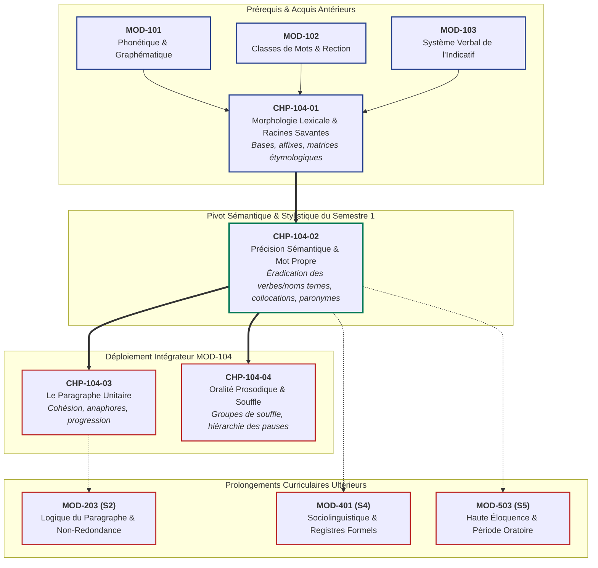

# Chapitre 2 — Précision Sémantique, Dénotation/Connotation et Éradication des Termes Vagues : L'Art du Mot Propre et des Collocations Soutenues

> **Identifiant du chapitre** : `CHP-104-02`  
> **Module de rattachement** : [`MOD-104` — Précision Lexicale de Base, Familles de Mots, Lecture Fluide, Paragraphe Narratif/Descriptif et Oralité Prosodique](file:///f:/Formation/world-class-french/03-curriculum/year-1/semester-1/mod-104-lexique-lecture-paragraphe.md)  
> **Semestre** : Année 1 — Semestre 1 (S1)  
> **Volume horaire canonique** : 5 à 6 heures d'apprentissage autonome délibéré et d'ateliers d'application (Étude : 1 h 30 | Pratique : 1 h 30 | Correction : 1 h 00 | Évaluation : 1 h 00)  
> **Statut** : [STATUT : VALIDÉ]  
> **Compétences associées** : [`FR-LEXIC-001`](file:///f:/Formation/world-class-french/02-competency-framework/competency-framework.md#fr-lexic-001-précision-sémantique-nuances-synonymiques-et-collocations) (L3 Autonomie), [`FR-STYLE-001`](file:///f:/Formation/world-class-french/02-competency-framework/competency-framework.md#fr-style-001-maîtrise-des-figures-de-rhétorique-et-commentaire-stylistique)  
> **Sources scientifiques de référence** : `SRC-LEX-01` (TLFi), `SRC-LEX-04` (Le Grand Robert), `SRC-LEX-03` (Alain Rey, Dictionnaire historique), `SRC-GRAM-01` (Grevisse & Goosse, *Le Bon Usage*, 16e éd., § 987, § 1028), `SRC-GRAM-02` (Riegel et al., *Grammaire méthodique du français*, PUF)

---

## 1. Titre et Place dans le Cursus

### 1.1 Intitulé Officiel
**Chapitre 2 : Précision Sémantique, Dénotation/Connotation et Éradication des Termes Vagues : L'Art du Mot Propre et des Collocations Soutenues** (`CHP-104-02`).

### 1.2 Insertion Architecturale et Traçabilité Curriculaire
L'assainissement phonologique (`MOD-101`), la stabilisation des accords morphosyntaxiques (`MOD-102`) et la maîtrise de la conjugaison verbale (`MOD-103`) fournissent au scripteur une charpente grammaticale correcte. Toutefois, une phrase grammaticalement irréprochable peut demeurer intellectuellement informe si elle est lestée par l'indigence lexicale. Les verbes passe-partout (*faire, mettre, avoir, voir, dire*) et les substantifs indéterminés (*chose, problème, fait, truc, affaire*) fonctionnent comme des écrans de fumée : ils signalent une idée sans la nommer, forçant le récepteur à combler les béances d'une pensée paresseuse.

Ce deuxième chapitre du module `MOD-104` opère la transition décisive de la **rectitude grammaticale** à l'**exactitude stylistique**. Il arme l'apprenant pour désarticuler les automatismes de l'oral relâché et substituer à l'approximation du terme terne la netteté chirurgicale du mot propre et la force unitaire des collocations consacrées.



- **En amont** : Ce chapitre prend appui immédiat sur [`CHP-104-01`](file:///f:/Formation/world-class-french/03-curriculum/year-1/semester-1/mod-104-lexique-lecture-paragraphe.md) : la morphologie dérivationnelle et la connaissance des racines gréco-latines permettent d'élucider la structure interne des mots et de convoquer spontanément les familles de termes adéquates.
- **Au sein de `MOD-104`** : Il fournit le matériau lexical sans lequel l'architecture du paragraphe unitaire (`CHP-104-03`) dégénérerait en un assemblage mécanique de phrases creuses, et sans lequel la lecture expressive à voix haute (`CHP-104-04`) butterait sur un texte sans relief ni intensité.
- **En aval** : Il pose les fondations indispensables pour la rédaction académique sans redondance (`MOD-203`), la maîtrise des registres formels (`MOD-401`) et le déploiement de la période oratoire classique (`MOD-503`).

---

## 2. Objectifs Mesurables

Au terme de l'étude autonome et des ateliers pratiques de ce chapitre, l'apprenant doit être capable de :

1. **Diagnostiquer et éradiquer systématiquement les verbes et substantifs passe-partout** (*faire, mettre, avoir, voir, dire* ; *chose, problème, fait, truc, affaire*), en substituant en contexte le mot propre exact issu du domaine d'activité concerné avec un taux d'exactitude sémantique de 100 % [Réf. `SRC-LEX-01` ; Réf. `SRC-LEX-04`].
2. **Distinguer la dénotation de la connotation et graduer l'intensité sémantique** au sein d'un réseau synonymique, en ordonnant les termes du plus faible au plus intense et en justifiant les charges axiologiques (mélioratives, péjoratives ou neutres) [Réf. `SRC-GRAM-02`, chap. 7].
3. **Restituer et mobiliser activement le corpus des 20 collocations soutenues fondamentales** (verbe-substantif et substantif-adjectif) du français formel, en éliminant les calques de l'oral relâché et les associations incongrues [Réf. `SRC-LEX-01`].
4. **Identifier et neutraliser les pièges paronymiques majeurs et les pléonasmes vicieux**, en arbitrant sans hésitation entre paires à risque (*éluder/élucider*, *conjecture/conjoncture*, *infecter/infester*) et en purifiant le texte des redondances tautologiques courantes (*voire même*, *au jour d'aujourd'hui*) [Réf. `SRC-GRAM-01`, § 987, § 1028].

---

## 3. Prérequis et Test de Préparation (Auto-Diagnostic)

### 3.1 Prérequis Cognitifs
- Identification sans faille des classes de mots (verbes, substantifs, adjectifs, adverbes) [`MOD-102`].
- Maîtrise des rections verbales (complément d'objet direct, indirect, compléments circonstanciels) [`MOD-102`].
- Connaissance de la dérivation morphologique (radicaux, préfixes, suffixes) [`CHP-104-01`].

### 3.2 Test de Préparation Immédiat
Résolvez par écrit les cinq questions suivantes avant d'entamer l'étude du chapitre.

1. Dans la proposition : *« L'ingénieur a fait un plan pour faire le bâtiment »*, par quels verbes précis et distincts convient-il de remplacer les deux occurrences du verbe *faire* ?
2. Quelle différence sémantique fondamentale existe-t-il entre les deux verbes paronymes *éluder* et *élucider* ?
3. Pourquoi l'expression *« monter en haut »* ou *« voire même »* constitue-t-elle une anomalie linguistique condamnée par la norme académique ?
4. Associez le substantif *revers* au verbe qui forme avec lui la collocation consacrée : dit-on *prendre un revers*, *faire un revers*, ou *essuyer un revers* ?
5. Classez les trois termes suivants par ordre d'intensité croissante de sentiment : *crainte*, *terreur*, *inquiétude*.

---

#### Corrigé de l'Auto-Diagnostic

<details>
<summary>▶ Cliquez ici pour afficher le corrigé de l'auto-diagnostic</summary>

1. **Remplacement des deux occurrences de *faire*** :
   - Pour la conception intellectuelle : *conçu*, *dressé*, *élaboré*, ou *tracé* un plan ;
   - Pour l'action matérielle : *ériger*, *édifier*, ou *construire* le bâtiment.  
   $\rightarrow$ Phrase redressée : *« L'ingénieur a dressé un plan pour édifier le bâtiment. »*
2. **Distinction entre *éluder* et *élucider*** :
   - *Éluder* (du latin *eludere*, esquiver) signifie éviter avec adresse, soustraire à l'examen (ex. *éluder une question, éluder un problème*) ;
   - *Élucider* (du latin *elucidare*, éclairer) signifie faire la lumière sur ce qui est obscur, résoudre (ex. *élucider un mystère, élucider une énigme*).
3. **Pléonasme vicieux et redondance tautologique** :
   - *Monter en haut* répète dans le complément adverbial le trait sémantique de direction ascendante déjà inclus dans le verbe *monter* ;
   - *Voire même* juxtapose l'adverbe *voire* (qui signifie déjà étymologiquement *et même*, du latin *vere*) et l'adverbe *même*, créant un double emploi fautif [Réf. `SRC-GRAM-01`, § 1028].
4. **Collocation consacrée** : On dit obligatoirement **essuyer un revers** (ou *subir un revers*), par métaphore stylistique consacrée. *Prendre un revers* ou *faire un revers* sont des solécismes lexicaux.
5. **Ordre d'intensité croissante** : **inquiétude** (trouble diffus de l'esprit) $\rightarrow$ **crainte** (sentiment net redoutant un mal imminent) $\rightarrow$ **terreur** (peur extrême paralysante qui bouleverse l'être).

</details>

> [!NOTE]
> Si ces questions ont suscité la moindre hésitation, votre écriture recourt vraisemblablement à des automatismes d'économie cognitive qui affaiblissent votre portée discursive. Ce chapitre vous transmet les réflexes lexicaux du style soutenu.

---

## 4. Situation de Départ ou Problème Concret : Le Naufrage de l'Écrit Terne

### 4.1 L'Omniprésence Étouffante des Verbes et Substantifs Fantômes
Observez ce paragraphe extrait d'un projet de compte-rendu professionnel :

> *« Le directeur a fait une réunion pour parler du problème qui s'est passé hier. Les employés ont dit leurs idées pour mettre des solutions en place. Il y a eu des choses intéressantes, mais nous devons encore voir comment faire pour prendre les bonnes décisions et avoir de bons résultats. »*

Cette prose n'enfreint aucune règle d'accord orthographique ni de conjugaison. Le texte est syntaxiquement fonctionnel. Pourtant, il produit sur tout lecteur cultivé, évaluateur de concours ou partenaire institutionnel une impression d'**indigence intellectuelle rédhibitoire**.

Pourquoi ce texte est-il défaillant ?
1. **Les verbes moteurs sont absents** : Le scripteur a accumulé *faire* (3 fois), *dire*, *mettre*, *avoir*, *voir*, *y avoir*. Aucun de ces verbes ne véhicule de substance descriptive.
2. **Les substantifs sont informes** : Les mots *problème* et *choses* agissent comme des conteneurs vides. Quelle est la nature de ce « problème » ? Une crise financière ? Un dysfonctionnement technique ? Un litige prud'homal ? Une avarie matérielle ?
3. **Le relief dramaturgique est anéanti** : La pensée est diluée, plate, amorphe. Le lecteur doit fournir un travail d'extrapolation pour deviner le réel dissimulé sous ces étiquettes grises.

### 4.2 Le Discrédit Professionnel et Académique
Dans un mémoire universitaire, une dissertation, un plaidoyer ou un rapport de haute administration, **la pauvreté lexicale n'est jamais perçue comme de la modestie, mais comme une incapacité à penser le réel avec finesse**. 

Celui qui écrit *« faire une loi »* au lieu de *promulguer une loi* ou *voter une loi*, celui qui écrit *« le problème entre les deux pays »* au lieu de *le contentieux frontalier* ou *la dissension diplomatique*, dégrade sa propre autorité intellectuelle. Le flou lexical engendre l'ambiguïté juridique, la contestation contractuelle et le discrédit rhétorique immédiat.

---

## 5. Explication Intuitive : L'Analogie de la Boîte à Outils d'Orfèvre

Pour comprendre la nécessité du mot propre, considérons le métier de l'artisan d'art :

```text
┌────────────────────────────────────────────────────────────────────────┐
│                   MÉTAPHORE DE L'INSTRUMENTATION DE LA PENSÉE          │
├───────────────────────────────────┬────────────────────────────────────┤
│ L'OUTIL DE TERRASSIER (MOT TERNE) │ L'OUTIL D'ORFÈVRE (MOT PROPRE)     │
├───────────────────────────────────┼────────────────────────────────────┤
│ Une masse de carrier ou un grand  │ Un burin d'acier trempé, une loupe │
│ marteau universel.                │ micrométrique, un sertissoir fin.  │
│                                   │                                    │
│ Utile pour casser grossièrement   │ Indispensable pour enchâsser un    │
│ de la roche sans discrimination.  │ diamant dans une bague de platine. │
│                                   │                                    │
│ Équivalent : "FAIRE", "CHOSE".    │ Équivalent : "ÉDIFIER", "APORIE".  │
└───────────────────────────────────┴────────────────────────────────────┘
```

Lorsque vous dites *« l'artisan a fait un meuble »*, vous utilisez la masse universelle. L'artisan l'a-t-il *raboté*, *sculpté*, *marqueté*, *assemblé*, *re tapissé*, *plaqué* ? Chacun de ces verbes spécialisés décrit un geste technique spécifique, un rapport physique au bois, un temps opératoire distinct.

Employer le mot propre, ce n'est pas « parler difficilement » pour impressionner autrui ; c'est **rendre à l'objet sa silhouette exacte**. Chaque nuance de la réalité matérielle ou psychologique a suscité dans la langue française la création d'un vocable précis, affûté par des siècles d'usage littéraire, juridique et philosophique.

---

## 6. Définitions Précises et Terminologie Fondamentale

Les notions suivantes constituent la nomenclature fondamentale de la précision sémantique :

- **Dénotation** : Noyau conceptuel premier, stable, objectif et descriptif d'un lexème, partagé universellement par la communauté linguistique et consigné comme sens littéral dans les dictionnaires [Réf. `SRC-LEX-01` ; Réf. `SRC-GRAM-02`, chap. 7].
  - *Exemple* : Le substantif *chien* a pour dénotation : « mammifère carnivore domestique de la famille des canidés ».
- **Connotation** : Ensemble des valeurs sémantiques secondes, subjectives, affectives, appréciatives, stylistiques ou idéologiques qui s'agrègent au sens dénotatif selon le contexte ou l'environnement culturel [Réf. `SRC-LEX-04`].
  - *Exemple* : Comparer *demeure* (connotation de prestige, d'ancienneté et de noblesse), *logement* (connotation administrative neutre), et *taudis* (connotation péjorative de délabrement et de misère), bien que tous trois partagent la dénotation d'« habitation humaine ».
- **Terme passe-partout (ou pro-forme lexicale terne)** : Mot à extension sémantique démesurée et à compréhension minimale, employé par commodité ou paresse cognitive pour désigner une infinité d'actions ou d'objets distincts (*faire, mettre, avoir, voir, dire* ; *chose, problème, fait, truc*).
- **Mot propre (orthologie lexicale)** : Vocable dont le champ sémantique coïncide exactement et sans ambiguïté avec l'objet, l'action, la qualité ou la nuance que l'on veut désigner, excluant toute approximation [Réf. `SRC-LEX-04`].
- **Collocation idiomatique (ou solidarité lexicale)** : Association préférentielle et stable de deux ou plusieurs mots au sein du discours, consacrée par l'usage et la tradition stylistique, sans former une locution totalement figée [Réf. `SRC-LEX-01`]. Les composants conservent leur sens propre mais s'appellent mutuellement (ex. *nourrir un espoir*, *une pluie battante*, *essuyer un revers*).
- **Réseau synonymique et intensité sémantique** : Ensemble de termes appartenant à la même classe grammaticale et partageant un noyau de sens commun (sèmes génériques), mais différenciés par des nuances de degré, d'intensité, d'affect ou de registre (sèmes spécifiques).
- **Paronyme** : Mot dont la forme graphique et phonétique est très proche de celle d'un autre mot, mais dont le sens et l'étymologie diffèrent radicalement, source constante de confusions lexicales dévastatrices (*conjecture* / *conjoncture* ; *éluder* / *élucider*) [Réf. `SRC-LEX-03`].
- **Pléonasme vicieux (ou tautologie fautive)** : Redoublement fautif d'un trait de sens déjà pleinement exprimé par un autre terme de la même proposition (*au jour d'aujourd'hui*, *voire même*, *monter en haut*), à distinguer du pléonasme rhétorique stylistique volontaire (*je l'ai vu de mes propres yeux*) [Réf. `SRC-GRAM-01`, § 1028].

---

## 7. Règles ou Mécanismes Fondamentaux

### 7.1 Le Diagnostic de l'Approximation : La Paresse Lexicale et ses Ravages Syntaxiques
L'usage immodéré des verbes ternes engendre une maladie syntaxique bien connue des stylisticiens : **la déverbalisation et l'alourdissement périphrase**. 

Quand un scripteur utilise *faire*, il est presque toujours contraint de lui adjoindre un substantif abstrait pour spécifier le sens :
- *Faire une description* $\rightarrow$ 3 mots, rythme atone.
- *Décrire*, *peindre*, *dépeindre*, *brosser le portrait* $\rightarrow$ 1 ou 2 mots, force vive du verbe plein.

En éliminant le verbe terne, on réactive le prédicat authentique : la phrase se contracte, gagne en vigueur musculaire et en vitesse de transmission informative.

---

### 7.2 Tables de Substitution Chirurgicale du Verbe FAIRE
Le verbe *faire* (du latin *facere*) est le grand coupable de la prose relâchée. Il convient de le ventiler méthodiquement selon six grands domaines d'action humaine :

```text
┌────────────────────────────────────────────────────────────────────────────────────────┐
│               VENTILATION CHIRURGICALE DU VERBE "FAIRE" SELON LE DOMAINE               │
├─────────────────────────┬───────────────────────────────┬──────────────────────────────┤
│ DOMAINE SÉMANTIQUE      │ EXPRESSION TERNE À PROSCRIRE  │ SUBSTITUTION SOUTENUE EXACTE │
├─────────────────────────┼───────────────────────────────┼──────────────────────────────┤
│ 1. Construction,        │ • Faire un pont / une maison  │ $\rightarrow$ Bâtir, ériger, │
│    matière & technique  │ • Faire un tunnel             │   édifier, construire.       │
│                         │ • Faire une statue            │ $\rightarrow$ Percer, creuser│
│                         │                               │ $\rightarrow$ Sculpter, couler│
├─────────────────────────┼───────────────────────────────┼──────────────────────────────┤
│ 2. Faute, crime,        │ • Faire une erreur            │ $\rightarrow$ Commettre, faire│
│    délit & préjudice    │ • Faire un crime / un forfait │   bévue, encourir.           │
│                         │ • Faire des ravages           │ $\rightarrow$ Perpétrer.     │
│                         │                               │ $\rightarrow$ Causer, exercer│
├─────────────────────────┼───────────────────────────────┼──────────────────────────────┤
│ 3. Art, intellect,      │ • Faire un livre / un rapport │ $\rightarrow$ Rédiger, com-  │
│    écriture & création  │ • Faire un poème / une symph. │   poser, élaborer.           │
│                         │ • Faire un dessin / plan      │ $\rightarrow$ Ciseler, forger│
│                         │                               │ $\rightarrow$ Esquisser, tracer│
├─────────────────────────┼───────────────────────────────┼──────────────────────────────┤
│ 4. Droit, finances,     │ • Faire un accord / un traité │ $\rightarrow$ Conclure, négo-│
│    affaires & commerce  │ • Faire un procès             │   cier, sceller, ratifier.   │
│                         │ • Faire un bénéfice           │ $\rightarrow$ Intenter, pour-│
│                         │                               │   suivre.                    │
│                         │                               │ $\rightarrow$ Dégager, en-   │
│                         │                               │   granger, réaliser.         │
├─────────────────────────┼───────────────────────────────┼──────────────────────────────┤
│ 5. Sentiments,          │ • Faire de la peine           │ $\rightarrow$ Chagriner, af- │
│    affects & réactions  │ • Faire peur                  │   fliger, navrer.            │
│                         │ • Faire pitié                 │ $\rightarrow$ Effrayer, ter- │
│                         │ • Faire illusion              │   roriser, alarmer.          │
│                         │                               │ $\rightarrow$ Émouvoir.      │
│                         │                               │ $\rightarrow$ Tromper, leurrer│
├─────────────────────────┼───────────────────────────────┼──────────────────────────────┤
│ 6. Mesures, dimensions, │ • Faire 100 mètres / 2 mètres │ $\rightarrow$ Mesurer, cou-  │
│    temps & étendue      │ • Faire 80 kilos              │   vrir, s'étendre sur.       │
│                         │ • Faire 3 heures de marche    │ $\rightarrow$ Peser.         │
│                         │ • Faire 1 million de chiffres │ $\rightarrow$ Demander, exi- │
│                         │                               │   ger, totaliser.            │
└─────────────────────────┴───────────────────────────────┴──────────────────────────────┘
```

---

### 7.3 Tables de Substitution Méthodique des Verbes METTRE, AVOIR, DIRE et PRENDRE

#### A. Le Verbe METTRE
Le verbe *mettre* (du latin *mittere*, envoyer, poser) dilue l'orientation, le support et la finalité du geste.
- *Mettre un habit* $\rightarrow$ **Revêtir**, **arborer** (avec fierté), **endosser** (un uniforme, une responsabilité).
- *Mettre sa signature* $\rightarrow$ **Apposer** son seing, **parapher**, **souscrire**.
- *Mettre par écrit* $\rightarrow$ **Consigner**, **coucher** sur le papier, **acter**.
- *Mettre de l'argent de côté* $\rightarrow$ **Épargner**, **thésauriser**, **capitaliser**.
- *Mettre en prison* $\rightarrow$ **Incarcérer**, **écrouer**, **détenir**.
- *Mettre quelqu'un à un poste* $\rightarrow$ **Nommer**, **désigner**, **investir**, **promouvoir**.
- *Mettre de l'ordre* $\rightarrow$ **Agencer**, **ordonner**, **structurer**, **discipliner**.

#### B. Le Verbe AVOIR
Le verbe *avoir* (du latin *habere*) s'efface devant la nature exacte de la possession ou de l'affect :
- *Avoir une maladie* $\rightarrow$ **Couver**, **déclarer**, **être atteint de**, **contracter**.
- *Avoir un diplôme* $\rightarrow$ **Décrocher**, **obtenir**, **être titulaire de**.
- *Avoir un avantage / le pouvoir* $\rightarrow$ **Jouir de**, **bénéficier de**, **détenir**, **exercer**.
- *Avoir un sentiment d'espoir* $\rightarrow$ **Nourrir**, **caresser**, **entretenir**.
- *Avoir un revers, un échec* $\rightarrow$ **Essuyer**, **subir**, **éprouver**.
- *Avoir un secret / un trésor* $\rightarrow$ **Receler**, **abriter**, **garder**.

#### C. Le Verbe DIRE
Le verbe *dire* (du latin *dicere*) aplatit le mode d'énonciation, la force illocutoire et le statut de la parole :
- *Dire une vérité avec force* $\rightarrow$ **Affirmer**, **asséner**, **déclarer**, **proclamer**.
- *Dire à voix basse* $\rightarrow$ **Chuchoter**, **susurrer**, **murmurer**, **glisser**.
- *Dire pour se défendre (droit)* $\rightarrow$ **Alléguer**, **plaider**, **exciper de**.
- *Dire publiquement une doctrine* $\rightarrow$ **Professer**, **enseigner**, **prêcher**.
- *Dire des injures* $\rightarrow$ **Proférer**, **éructer**, **lancer**.
- *Dire les détails d'un contrat* $\rightarrow$ **Stipuler**, **énoncer**, **spécifier**.

#### D. Le Verbe PRENDRE
- *Prendre le pouvoir par force* $\rightarrow$ **Usurper**, **s'emparer de**, **accaparer**.
- *Prendre un voleur* $\rightarrow$ **Appréhender**, **capturer**, **interpeller**.
- *Prendre une habitude* $\rightarrow$ **Contracter**, **adopter**.
- *Prendre des biens légalement* $\rightarrow$ **Saisir**, **confisquer**, **réquisitionner**.
- *Prendre une décision* $\rightarrow$ **Arrêter**, **trancher**, **adopter**.

---

### 7.4 Éradication Totale des Substantifs Passe-Partout : CHOSE, PROBLÈME, FAIT, AFFAIRE, TRUC

Les substantifs indéterminés sont des trous noirs lexicaux. Leur éradication impose une analyse précise de l'entité sous-jacente :

| Substantif terne | Nature réelle de l'entité | Remplacement soutenu obligatoire |
| :--- | :--- | :--- |
| **CHOSE** | Élément contractuel ou juridique | $\rightarrow$ **Clause**, **disposition**, **stipulation**, **modalité**. |
| | Objet matériel ou équipement | $\rightarrow$ **Instrument**, **ustensile**, **appareil**, **artefact**. |
| | Sujet d'étude intellectuelle | $\rightarrow$ **Phénomène**, **concept**, **notion**, **thématique**. |
| | Droits ou privilèges reconnus | $\rightarrow$ **Prérogative**, **apanage**, **attribut**. |
| **PROBLÈME** | Obstacle imprévu sur un parcours | $\rightarrow$ **Écueil**, **entrave**, **achoppement**. |
| | Choix déchirant entre deux maux | $\rightarrow$ **Dilemme**, **alternative**. |
| | Impasse logique ou intellectuelle | $\rightarrow$ **Aporie**, **casse-tête**, **paradoxe**. |
| | Conflit juridique ou contestation | $\rightarrow$ **Litige**, **contentieux**, **différend**. |
| | Défaillance d'un système mécanique | $\rightarrow$ **Anomalie**, **avarie**, **dysfonctionnement**. |
| **FAIT** | Événement survenant dans un récit | $\rightarrow$ **Péripétie**, **rebondissement**, **incident**, **occurrence**. |
| | Donnée observée scientifiquement | $\rightarrow$ **Constat**, **phénomène**, **réalité empirique**. |
| | Circonstance aggravante ou atténuante | $\rightarrow$ **Conjoncture**, **facteur**, **paramètre**. |
| **AFFAIRE** | Conflit judiciaire en cours | $\rightarrow$ **Litige**, **procès**, **instance**, **contentieux**. |
| | Négociation économique ou commerciale | $\rightarrow$ **Transaction**, **tractation**, **opération**. |
| | Événement scandaleux ou trouble | $\rightarrow$ **Imbroglio**, **scandale**, **cabale**, **manœuvre**. |
| **TRUC** | Procédé ingénieux ou ruse habile | $\rightarrow$ **Artifice**, **expédient**, **stratagème**, **subterfuge**. |
| | Pièce technique d'un mécanisme | $\rightarrow$ **Organe**, **composant**, **rouage**, **dispositif**. |

---

### 7.5 Dénotation, Connotation et Registres d'Intensité au Sein d'un Réseau Synonymique
Les synonymes parfaits n'existent quasiment pas en langue naturelle. Chaque vocable d'un réseau synonymique possède une nuance propre définie par :
1. **L'échelle d'intensité graduée** : Le degré de force ou de violence de la notion ;
2. **La valeur axiologique (connotative)** : L'orientation méliorative (élogieuse), péjorative (dépréciative) ou neutre de l'énoncé.

#### L'Échelle de la Peur (du plus faible au plus intense)
Observez la progression rigoureuse au sein du réseau sémantique du sentiment d'effroi :

$$\text{Inquiétude} \longrightarrow \text{Appréhension} \longrightarrow \text{Crainte} \longrightarrow \text{Frayeur} \longrightarrow \text{Effroi} \longrightarrow \text{Terreur} \longrightarrow \text{Panique}$$

- **Inquiétude** : Trouble diffus de l'esprit, absence de repos mental devant une incertitude (*nourrir une vive inquiétude*).
- **Appréhension** : Crainte tournée vers l'avenir, attente pénible d'un événement redouté (*aborder l'examen avec appréhension*).
- **Crainte** : Sentiment raisonné qui mesure le danger ou le respect dû à une autorité (*la crainte du châtiment*).
- **Frayeur** : Émotion subite et violente provoquée par la vue immédiate d'un danger inattendu (*un cri de frayeur*).
- **Effroi** : Frayeur intense mêlée de stupeur et d'horreur face à un spectacle monstrueux (*contempler le désastre avec effroi*).
- **Terreur** : Peur paroxystique et paralysante qui anéantit la volonté et glace le sang (*régner par la terreur*).
- **Panique** : Terreur collective soudaine, irrationnelle et contagieuse qui pousse à la fuite éperdue (*un mouvement de panique générale*).

Employer *terreur* pour une simple appréhension relève de l'hyperbole boursouflée ; employer *inquiétude* face à un carnage relève de l'euphémisme indécent. Le mot propre calibre l'émotion à sa juste mesure.

---

### 7.6 Les Collocations Idiomatiques Stables du Français Soigné
Une collocation est une alliance de mots privilégiée, solidifiée par la tradition stylistique. Le français soigné récuse les combinaisons hybrides.

Voici le corpus canonique des **20 collocations fondamentales** (10 associations Verbe-Substantif et 10 associations Substantif-Adjectif) indispensables à l'écrit de haute tenue :

```text
┌────────────────────────────────────────────────────────────────────────────────────────┐
│                   CORPUS CANONIQUE DES 20 COLLOCATIONS SOUTENUES D'OR                  │
├────────────────────────────────────────────────────────────────────────────────────────┤
│ A. DIX COLLOCATIONS VERBE — SUBSTANTIF                                                 │
├─────┬───────────────────────────────┬──────────────────────────────────────────────────┤
│ N°  │ COLLOCATION ACADÉMIQUE        │ SENS PRÉCIS & MISE EN CONTEXTE                   │
├─────┼───────────────────────────────┼──────────────────────────────────────────────────┤
│ 1   │ Nourrir un espoir             │ Entretenir durablement une espérance intérieure. │
│ 2   │ Essuyer un revers             │ Subir une défaite ou un échec cuisant.           │
│ 3   │ Intenter une action           │ Engager des poursuites juridiques contre autrui. │
│ 4   │ Soulever une objection        │ Présenter un argument contradictoire formel.     │
│ 5   │ Prêter le flanc               │ S'exposer vulnérablement à la critique.          │
│ 6   │ Battre en brèche              │ Démanteler et détruire méthodiquement une thèse. │
│ 7   │ Réfuter une allégation        │ Prouver la fausseté d'une affirmation sans preuve│
│ 8   │ Engager des pourparlers       │ Ouvrir des négociations diplomatiques prélimin.  │
│ 9   │ Commettre une bévue           │ Faire par inadvertance une erreur embarrassante. │
│ 10  │ Conclure une trêve            │ Sceller l'arrêt provisoire des hostilités.       │
├─────┴───────────────────────────────┴──────────────────────────────────────────────────┤
│ B. DIX COLLOCATIONS SUBSTANTIF — ADJECTIF                                              │
├─────┬───────────────────────────────┬──────────────────────────────────────────────────┤
│ N°  │ COLLOCATION ACADÉMIQUE        │ SENS PRÉCIS & MISE EN CONTEXTE                   │
├─────┼───────────────────────────────┼──────────────────────────────────────────────────┤
│ 11  │ Une pluie battante            │ Une averse torrentielle frappant avec violence.  │
│ 12  │ Un silence de plomb           │ Un mutisme pesant, oppressant et menaçant.       │
│ 13  │ Une obscurité impénétrable    │ Une nuit totale où le regard ne perce rien.      │
│ 14  │ Un froid mordant              │ Une température glaciale qui blesse la peau.     │
│ 15  │ Une chaleur accablante        │ Une canicule lourde qui terrasse les organismes. │
│ 16  │ Une volonté inébranlable      │ Une résolution ferme que rien ne peut fléchir.   │
│ 17  │ Un échec cuisant              │ Une défaite cuisante, douloureuse et humiliante. │
│ 18  │ Une critique acerbe           │ Un jugement tranchant, mordant et sans pitié.    │
│ 19  │ Un soupçon légitime           │ Une méfiance rationnellement fondée sur des faits│
│ 20  │ Un démenti catégorique        │ Une négation totale, formelle et sans réserve.   │
└─────┴───────────────────────────────┴──────────────────────────────────────────────────┘
```

---

### 7.7 Proscription Absolue des Pléonasmes Vicieux et des Confusions Paronymiques

#### A. Les Pléonasmes Vicieux de l'Oralité Quotidienne
Le pléonasme devient vicieux lorsqu'il découle de l'ignorance du sens des mots. Ces formules polluent la communication et doivent être éradiquées sans merci :
1. *\*« Voire même »* : L'adverbe *voire* (du latin classique *vere*, « vraiment ») signifie en lui-même *et même*, *ou même*. Dire *voire même* revient à énoncer *et même même* [Réf. `SRC-GRAM-01`, § 1028].
   - *Fautif* : *« Il est compétent, voire même brillant. »*
   - *Correct* : *« Il est compétent, **voire** brillant »* ou *« Il est compétent, **et même** brillant. »*
2. *\*« Au jour d'aujourd'hui »* : *Aujourd'hui* provient de la soudure de *au jour de hui*, où *hui* est l'évolution directe du latin *hodie* (*hoc die*, « en ce jour »). L'expression vulgaire *au jour d'aujourd'hui* contient ainsi trois fois le mot « jour » [Réf. `SRC-GRAM-01`, § 987] !
   - *Fautif* : *« Au jour d'aujourd'hui, la situation stagne. »*
   - *Correct* : *« **Aujourd'hui**, la situation stagne »* ou *« **À ce jour**, la situation stagne. »*
3. *\*« Monter en haut » / \*« Descendre en bas »* : Redondance de la direction spatiale.
4. *\*« Panacée universelle »* : Le grec *panakeia* (*pan*, tout, et *akos*, remède) désigne déjà le remède à **tous** les maux. *Universelle* est un doublon absolu.
5. *\*« Collaborer ensemble »* : Le préfixe latin *col-* (*cum*) signifie déjà *avec, ensemble*. On dit *collaborer*, non *collaborer ensemble*.

#### B. La Triade Paronymique à Haut Risque
Les paronymes partagent une trompeuse silhouette acoustique :

```text
┌────────────────────────────────────────────────────────────────────────────────────────┐
│                   DISCRIMINATION DES TROIS PAIRES PARONYMIQUES MAJEURES                │
├──────────────────────┬──────────────────────────────────┬──────────────────────────────┤
│ PAIRE À RISQUE       │ SENS, ÉTYMOLOGIE & CONTRAINTE    │ EXEMPLE D'EMPLOI SOUTENU     │
├──────────────────────┼──────────────────────────────────┼──────────────────────────────┤
│ 1. ÉLUDER            │ Esquiver avec habileté, éviter de│ « Il a éludé la question     │
│                      │ répondre à un problème embarrass.│ gênante des journalistes. »  │
│    vs                │ (latin eludere, jouer, esquiver) │                              │
│    ÉLUCIDER          │ Rendre clair, dissiper l'obscu-  │ « Le juge cherche à élucider │
│                      │ rité d'une affaire mystérieuse.  │ les mobiles du meurtre. »    │
│                      │ (latin elucidare, éclairer)      │                              │
├──────────────────────┼──────────────────────────────────┼──────────────────────────────┤
│ 2. CONJECTURE        │ Hypothèse fondée sur des appa-   │ « Votre accusation ne repose │
│                      │ rences, supposition invérifiée.  │ sur aucune preuve, c'est une │
│    vs                │ (latin conjectura, jet d'esprit) │ pure conjecture. »           │
│    CONJONCTURE       │ Situation d'ensemble résultant   │ « La conjoncture économique  │
│                      │ du concours des circonstances.   │ actuelle favorise l'épargne.»│
│                      │ (latin conjunctura, assemblage)  │                              │
├──────────────────────┼──────────────────────────────────┼──────────────────────────────┤
│ 3. INFECTER          │ Contaminer un organisme par des  │ « La plaie non désinfectée a │
│                      │ germes pathogènes ou du poison.  │ fini par s'infecter. »       │
│    vs                │ (latin infectus, teint, corrompu)│                              │
│    INFESTER          │ Envahir un lieu en grand nombre  │ « Les termites ont infesté   │
│                      │ et y causer des déprédations.    │ la charpente de l'édifice. » │
│                      │ (latin infestare, ravager)       │                              │
└──────────────────────┴──────────────────────────────────┴──────────────────────────────┘
```

---

## 8. Raisonnement Détaillé : Pourquoi la Précision Lexicale Conditionne la Clarté de la Pensée

### 8.1 Le Principe de Boileau et l'Incarnation Verbale
Dans son *Art poétique* (Chant I, 1674), Nicolas Boileau formule la loi suprême de la stylistique classique :

> *« Il est certains esprits dont les sombres pensées*  
> *Sont d'un nuage épais toujours embarrassées ;*  
> *Le jour de la raison ne le saurait percer.*  
> *Avant donc que d'écrire, apprenez à penser.*  
> *Selon que notre idée est plus ou moins obscure,*  
> *L'expression la suit, ou moins nette, ou plus pure.*  
> *Ce que l'on conçoit bien s'énonce clairement,*  
> *Et les mots pour le dire arrivent aisément. »*

Cette sentence n'est pas un ornement moraliste : elle décrit la réalité psycholinguistique de l'encodage textuel. La pensée ne préexiste pas sous forme désincarnée dans le cerveau pour être ensuite habillée de mots arbitraires. **La pensée prend corps dans le lexique**. 

Si vous ne possédez que le vocable *faire*, votre conception de l'action reste indifférenciée. Dès lors que votre répertoire intègre *bâtir, forger, commettre, perpétrer, édifier, usurper*, votre esprit segmente l'action en facettes juridiques, esthétiques et morales immédiates. La précision du mot structure la précision du jugement.

### 8.2 L'Économie Cognitive et la Condensation Sémantique
Le mot propre n'alourdit pas la phrase : il la purge. Il pratique la **condensation sémantique**.

Considérez cette comparaison structurelle :
- *Formulation diluée* (13 mots) : *« Il a dit qu'il n'était pas d'accord avec cette idée fausse. »*
- *Formulation condensée au mot propre* (6 mots) : *« Il a **réfuté** cette **allégation** fallacieuse. »*

En substituant le verbe *réfuter* à *dire qu'on n'est pas d'accord*, et *allégation fallacieuse* à *idée fausse*, le scripteur gagne en densité informative, élimine les mots parasites (*qu'il n'était pas avec*) et confère à l'énoncé une autorité intellectuelle indiscutable.

---

## 9. Exemples Corrects Commentés

Examinons trois transformations chirurgicales opérées sur des énoncés réels d'étudiants :

### Exemple 1 : Récit d'Action et Travaux Concrets
- **Version relâchée et terne** :  
  *« Les maçons ont fait un grand mur pour mettre la propriété à l'abri et ils ont fait des ouvertures pour voir le jardin. »*
- **Version magistrale de haute tenue** :  
  *« Les maçons ont **érigé** une haute muraille pour **ceindre** la propriété et ont **aménagé** des meurtrières pour **embrasser** le jardin du regard. »*
- **Commentaire stylistique** :  
  - *Fait un grand mur* devient **érigé une haute muraille** : le verbe *ériger* convoque la verticalité imposante, tandis que le substantif *muraille* précise la solidité défensive.
  - *Mettre la propriété à l'abri* devient **ceindre la propriété** : verbe propre décrivant l'action d'enclore harmonieusement un espace.
  - *Fait des ouvertures* devient **aménagé des meurtrières** : spécification architecturale.
  - *Voir le jardin* devient **embrasser le jardin du regard** : métaphore soutenue décrivant une vision panoramique et poétique.

### Exemple 2 : Délibération Juridique et Institutionnelle
- **Version relâchée et terne** :  
  *« Le conseil a vu le problème entre les deux associés et a fait une décision pour mettre fin aux affaires litigieuses. »*
- **Version magistrale de haute tenue** :  
  *« Le conseil a **examiné** le **différend** qui oppose les deux associés et a **arrêté** une résolution afin de **clore** ce fâcheux **contentieux**. »*
- **Commentaire stylistique** :  
  - *A vu* $\rightarrow$ **a examiné** : substitution d'un simple constat oculaire par une démarche d'investigation réfléchie.
  - *Le problème* $\rightarrow$ **le différend** : le mot propre juridique exact pour désigner un désaccord entre personnes de droit.
  - *A fait une décision* $\rightarrow$ **a arrêté une résolution** : collocation officielle du droit administratif et sociétaire.
  - *Mettre fin aux affaires* $\rightarrow$ **clore ce fâcheux contentieux** : élimination de l'imprécis *affaires*, remplacé par le terme technique *contentieux*.

### Exemple 3 : Analyse Critique et Joute Philosophique
- **Version relâchée et terne** :  
  *« Le conférencier a dit des choses contre la théorie de son rival et a fait voir qu'il y avait un gros problème logique. »*
- **Version magistrale de haute tenue** :  
  *« Le conférencier a **battu en brèche** la thèse de son contradicteur et a **mis en lumière** une insurmontable **aporie** logique. »*
- **Commentaire stylistique** :  
  - *A dit des choses contre* $\rightarrow$ **a battu en brèche** : collocation idiomatique militaire consacrée en argumentation critique.
  - *Théorie de son rival* $\rightarrow$ **thèse de son contradicteur** : lexique académique rigoureux du débat philosophique.
  - *A fait voir* $\rightarrow$ **a mis en lumière** : locution verbale noble exprimant l'évidence démonstrative.
  - *Un gros problème logique* $\rightarrow$ **une insurmontable aporie logique** : le mot *aporie* désigne avec une rigueur philosophique absolue une impasse rationnelle insoluble dans un raisonnement.

---

## 10. Contre-Exemples et Erreurs Fréquentes (Clinique Lexicale)

Voici l'analyse clinique méthodique des six erreurs lexicales majeures recensées dans les copies d'apprenants :

### Erreur n° 1 : La confusion paronymique fatale (*éluder* pris pour *élucider*)
- **Énoncé fautif** : *\*« Le ministre a cherché à élucider les questions délicates posées par l'opposition pour ne pas créer de scandale. »*
- **Diagnostic linguistique** : Contresens absolu. *Élucider* signifie faire la lumière, rendre limpide. Si le ministre veut éviter le scandale, il ne fait pas la lumière : il esquive le sujet. Le scripteur a confondu le verbe avec *éluder*.
- **Forme correcte** : *« Le ministre a cherché à **éluder** les questions délicates... »* [Réf. `SRC-LEX-01`, s.v. "éluder"].

### Erreur n° 2 : Le pléonasme tautologique (*voire même* et *au jour d'aujourd'hui*)
- **Énoncé fautif** : *\*« Au jour d'aujourd'hui, cette réforme est indispensable, voire même urgente. »*
- **Diagnostic linguistique** : Double incorrection dans la même phrase. *Au jour d'aujourd'hui* est une locution vulgaire triple redondance. *Voire même* juxtapose deux adverbes de surenchère synonymes [Réf. `SRC-GRAM-01`, § 987, § 1028].
- **Forme correcte** : *« **Aujourd'hui** (ou **À ce jour**), cette réforme est indispensable, **voire** urgente (ou **et même** urgente). »*

### Erreur n° 3 : La collocation bâtarde et discordante (*remporter une défaite*, *faire une action en justice*)
- **Énoncé fautif** : *\*« Après ce scrutin serré, le candidat d'opposition a remporté une défaite cuisante et a décidé de faire une action en justice. »*
- **Diagnostic linguistique** : Violation de la solidarité lexicale. On *remporte* un triomphe, un succès, une victoire (termes positifs) ; on ne « remporte » pas un revers. De même, on n'utilise pas le verbe terne *faire* devant le substantif juridique *action*.
- **Forme correcte** : *« ...le candidat a **essuyé une défaite cuisante** et a décidé d'**intenter une action en justice**. »* [Réf. `SRC-LEX-01`].

### Erreur n° 4 : Le contresens de registre (irruption d'un terme relâché dans une prose soutenue)
- **Énoncé fautif** : *\*« Le magistrat a dénoncé l'arnaque montée par le prévenu pour dépouiller les épargnants. »*
- **Diagnostic linguistique** : Rupture stylistique. Le substantif *arnaque* relève du registre populaire familier (argot du XIXe siècle dérivé d'arnaquer). Son emploi dans un réquisitoire formel détruit la gravité de l'instance judiciaire.
- **Forme correcte** : *« Le magistrat a dénoncé la **malversation** (ou l'**escroquerie**, la **spoliation**, la **manœuvre frauduleuse**) orchestrée par le prévenu... »* [Réf. `SRC-LEX-04`].

### Erreur n° 5 : L'hémorragie du verbe FAIRE et la dilution syntaxique
- **Énoncé fautif** : *\*« Le chercheur fait l'examen des données pour faire une conclusion sur l'expérience. »*
- **Diagnostic linguistique** : Faiblesse prédicative. L'accumulation de *faire* avec substantifs abstraits (*faire l'examen*, *faire une conclusion*) engendre un style laborieux et administratif.
- **Forme correcte** : *« Le chercheur **analyse** les données pour **dégager les conclusions** de l'expérience (ou pour **conclure**). »*

### Erreur n° 6 : Le faux synonyme et l'aveuglement aux traits sémiques
- **Énoncé fautif** : *\*« Le médecin a prescrit un remède pour guérir cette blessure. »*
- **Diagnostic linguistique** : Confusion sémantique sur l'objet de l'action. On *guérit* une **maladie**, une affection, un état pathologique intérieur ; une **blessure** ou une plaie ne se guérit pas, elle se **panse**, se **désinfecte**, se **traite** ou se **cicatrise**.
- **Forme correcte** : *« Le médecin a prescrit un remède pour **hâter la cicatrisation** de cette blessure (ou pour **soigner** cette blessure). »* [Réf. `SRC-LEX-01`].

---

## 11. Cas Particuliers et Limites

### 11.1 La Polysémie Vivante et les Emplois Idiomatiques Légitimes des Verbes Fondamentaux
La traque des verbes passe-partout ne doit pas dégénérer en une névrose puriste absurde. *Faire*, *mettre*, *avoir* et *prendre* font partie du patrimoine génétique de la syntaxe française. Ils possèdent des emplois idiomatiques parfaitement légitimes et irremplaçables :
- **Expressions météorologiques impersonnelles** : *Il fait beau*, *il fait nuit*, *il fait un froid glacial*. Aucun verbe de substitution n'est recevable ici (*\*il produit du beau* est une monstruosité).
- **Locutions figées consacrées** : *Faire attention*, *faire fausse route*, *avoir faim*, *prendre le large*, *prendre garde*.
- **Le causatif canonique *faire + infinitif*** : *Il a fait bâtir une demeure* (le sujet ne construit pas lui-même, il ordonne la construction ; ici, l'auxiliaire causatif *faire* est syntaxiquement indispensable).

### 11.2 L'Emploi Stylistique Délibéré du Mot Terne en Littérature Réaliste
Si l'écrivain ou le juriste doit s'interdire les termes vagues dans son propre discours, il peut les employer sciemment dans une œuvre de fiction pour caractériser sociologiquement un personnage ou restituer la platitude de la conversation quotidienne.

Dans *Madame Bovary* (1857), Gustave Flaubert prête délibérément au pharmacien Homais des formules prétentieuses mais encombrées de tics de langage, et à Charles Bovary une prose atone saturée de verbes ternes (*faire, avoir, mettre*). Le mot terne devient alors un **outil de peinture réaliste**, servant à dépeindre la médiocrité d'une âme. La règle d'or demeure : **ce qui est permis comme choix artistique conscient pour camper un personnage médiocre est formellement interdit au scripteur qui aspire à l'autorité intellectuelle.**

---

## 12. Approfondissement Adapté au Niveau : La Sémantique Structurale et l'Analyse Sémique

Pour dépasser la mémorisation empirique des synonymes, la linguistique universitaire (Jost Trier, Bernard Pottier, Algirdas Julien Greimas) propose un outil d'analyse scientifique fondamental : **l'analyse sémique** [Réf. `SRC-GRAM-02`, chap. 7].

### 12.1 Sèmes, Sémèmes et Archilexème
Un mot n'est pas un bloc indivisible : sa signification se décompose en unités minimales de sens appelées **sèmes**.
- **Sème ($\text{s}$)** : Plus petite unité distinctive de signification (analogue au phonème en phonologie).
- **Sémème** : Ensemble des sèmes qui composent le sens d'un lexème particulier.
- **Archilexème** : Mot abstrait (souvent un hyperonyme) qui regroupe l'ensemble des sèmes communs d'un champ sémantique sans aucun sème spécifique.

### 12.2 Décomposition Sémique du Champ des Sièges (Modèle de Bernard Pottier)
Considérons le réseau synonymique des objets servant à s'asseoir :

```text
┌──────────────┬──────────────────┬──────────────────┬──────────────────┬──────────────────┬──────────────────┐
│ LEXÈME       │ s1 : avec dossier│ s2 : sur pieds   │ s3 : pour 1 pers.│ s4 : avec bras   │ s5 : rembourré   │
├──────────────┼──────────────────┼──────────────────┼──────────────────┼──────────────────┼──────────────────┤
│ Chaise       │       +          │       +          │       +          │       -          │      +/-         │
│ Fauteuil     │       +          │       +          │       +          │       +          │       +          │
│ Tabouret     │       -          │       +          │       +          │       -          │      +/-         │
│ Canapé       │       +          │       +          │       -          │       +          │       +          │
│ Pouf         │       -          │       -          │       +          │       -          │       +          │
└──────────────┴──────────────────┴──────────────────┴──────────────────┴──────────────────┴──────────────────┘
```

### 12.3 Application à la Traque du Verbe FAIRE
Appliquée aux verbes d'action, l'analyse sémique explique pourquoi *faire* est un mot terne : *faire* ne contient que le sème générique $[\text{+ action}] + [\text{+ agentivité}]$. Il ne possède aucun sème de matière, d'outil, de visée ou de modalité. 

Lorsque vous sélectionnez **édifier**, vous ajoutez instantanément les sèmes spécifiques : $[\text{+ construction en hauteur}] + [\text{+ structure durable}] + [\text{+ grandeur monumentale}]$. C'est cette somme de sèmes additionnels qui enrichit la pensée de l'interlocuteur.

---

## 13. Comparaisons Différentielles

### 13.1 Dénotation vs Connotation
| Critère | Dénotation | Connotation |
| :--- | :--- | :--- |
| **Nature du sens** | Référentiel, intellectuel, universel. | Émotionnel, stylistique, culturel, idéologique. |
| **Stabilité** | Stable, codifié dans les dictionnaires. | Fluide, dépendant du cotexte et de l'époque. |
| **Exemple : *Manoir*** | Grande maison d'habitation de campagne. | Prestige seigneurial, noblesse, patrimoine historique, mystère. |
| **Exemple : *Taudis*** | Logement insalubre de dimension réduite. | Misère sociale, déchéance matérielle, indignation, pitié. |

### 13.2 Mot Passe-Partout vs Mot Propre Contextuel
| Mot terne | Contexte d'emploi | Mot propre obligatoire | Valeur ajoutée sémantique |
| :--- | :--- | :--- | :--- |
| *Faire* | *Faire une loi* | **Promulguer** / **édicter** | Officialisation souveraine et publication juridique de la norme. |
| *Mettre* | *Mettre son cachet sur un pli* | **Apposer** son sceau | Geste juridique formel conférant l'authenticité documentaire. |
| *Avoir* | *Avoir une lourde amende* | **Écoper de** / **encourir** | Subir le coup d'une peine financière après infraction. |
| *Dire* | *Dire une doctrine religieuse* | **Professer** / **prêcher** | Déclaration publique et engagement fervent de la foi. |
| *Problème* | *Un problème qui bloque la discussion* | Une **impasse** / un **blocage** | Spécification géométrique et dynamique de l'arrêt des pourparlers. |

### 13.3 Matrice des Paronymes Pièges à Haute Fréquence
| Paronyme A | Définition & Exemple | Paronyme B | Définition & Exemple |
| :--- | :--- | :--- | :--- |
| **Éluder** | Esquiver habilement : *éluder un piège*. | **Élucider** | Faire la lumière : *élucider un mystère*. |
| **Conjecture** | Supposition invérifiée : *pure conjecture*. | **Conjoncture** | Situation générale : *conjoncture économique*. |
| **Infecter** | Transmettre des germes : *infecter la plaie*. | **Infester** | Envahir en masse : *les rats infestent les quais*. |
| **Affleurer** | Apparaître au ras du sol : *la roche affleure*. | **Effleurer** | Toucher très légèrement : *effleurer une épaule*. |
| **Attention** | Concentration de l'esprit : *prêter attention*. | **Intention** | Dessein délibéré : *agir avec de bonnes intentions*. |
| **Collision** | Choc frontal : *collision de deux trains*. | **Collusion** | Entente secrète illicite : *collusion d'intérêts*. |

---

## 14. Exercices Progressifs

### Niveau 1 : Remplacement Direct et Discrimination (Guidé)
*Consigne : Dans chacune des huit phrases suivantes, remplacez le verbe ou le nom passe-partout en gras par le mot propre soutenu le plus précis, en respectant la syntaxe.*

1. L'ébéniste a **fait** une magnifique table en bois d'acajou.
2. Pour éviter les scandales, le porte-parole a **dit** des vérités partielles.
3. Le tribunal va examiner ce **problème** qui oppose les deux familles d'agriculteurs.
4. Les terroristes ont **fait** un horrible attentat sur la place publique.
5. Vous devez **mettre** votre paraphe au bas de chaque feuillet.
6. Le patient a **eu** une grave infection pulmonaire lors de son voyage.
7. L'astronome a utilisé un **truc** mécanique pour orienter son télescope vers l'astre.
8. Nous devons **faire** attention à ne pas commettre d'imprudence sur cette route escarpée.

---

### Niveau 2 : Rétablissement des Collocations et Résolution Paronymique (Semi-Autonome)
*Consigne : Complétez chaque énoncé en rétablissant la collocation soutenue manquante ou en sélectionnant le paronyme exact entre crochets.*

1. L'avocat de la défense s'est levé d'un bond pour [éluder / élucider / soulever] une vive objection devant la cour.
2. Après la révélation des malversations, le ministre a publié un démenti [catégorique / battant / mordant].
3. Malgré les rumeurs persistantes, l'accusé continue de [nourrir / arborer / intenter] l'espoir d'une réhabilitation complète.
4. Les pluies torrentielles ont fini par [infecter / infester / inonder] les sous-sols, tandis que la vermine a [infecté / infesté] les greniers.
5. Devant les questions embarrassantes des inspecteurs, le comptable a tenté d'[éluder / élucider] le sujet de la caisse noire.
6. Ne fondez pas votre jugement sur de simples [conjectures / conjonctures] alors que nous attendons les rapports d'expertise.
7. L'armée a [remporté / essuyé / commis] un cuisant revers lors de la bataille décisive du défilé.
8. Les deux diplomates ont décidé d'[engager / alléguer / asséner] des pourparlers secrets pour désamorcer la crise.

---

### Niveau 3 : Réécriture Stylistique Intégrale d'un Procès-Verbal Terne (Autonome)
*Consigne : Réécrivez intégralement le paragraphe terne suivant (environ 80 mots). Vous devez éliminer impérativement tout verbe terne (faire, mettre, avoir, dire, voir) et tout nom vague (chose, problème, fait, truc), intégrer au moins trois verbes nobles spécifiques et deux collocations soutenues du corpus de la rubrique 7.6.*

> *« Le chef de service a fait une réunion pour dire le problème de la baisse des ventes. Il a mis les chiffres sous les yeux des employés et a dit que la direction avait de gros soucis. Les employés ont fait des idées pour faire des solutions. Mais on a vu qu'il y avait une chose difficile à régler : le fait de la concurrence étrangère qui fait des ravages sur nos affaires. »* (77 mots)

---

### Corrigés Exhaustifs et Justifiés des Exercices

#### Corrigé du Niveau 1
1. **confectionné**, **façonné**, **ouvragé** ou **sculpté** : Verbes propres de l'artisanat du bois (*l'ébéniste a façonné...*).
2. **égrené**, **distillé**, **allégué** ou **débité** : Décrit une parole fractionnée et calculée destinée à dissimuler la plénitude du réel.
3. **différend** ou **litige** : Terme juridique propre désignant un conflit de propriété ou de délimitation terrienne.
4. **perpétré** : Verbe propre s'appliquant obligatoirement aux forfaits, crimes et actes de barbarie abominables.
5. **apposer** : Terme administratif et notarié rigoureux (*apposer son paraphe*).
6. **contracté** : Verbe propre pour une maladie infectieuse acquise (*contracter une infection*).
7. **dispositif**, **mécanisme** ou **artifice** : Substitution du vulgaire *truc* par le vocable technique adéquat.
8. **prêter attention** ou **redoubler de vigilance** : Substitution élégante du passe-partout *faire attention*.

#### Corrigé du Niveau 2
1. **soulever** une vive objection (collocation consacrée du prétoire).
2. un démenti **catégorique** (collocation soutenue exclusive pour un démenti formel).
3. **nourrir** l'espoir (collocation d'or n° 1).
4. **inonder** les sous-sols / **infesté** les greniers (*infester* = envahir en masse par des animaux nuisibles).
5. **éluder** le sujet (*éluder* = esquiver adroitement).
6. de simples **conjectures** (*conjectures* = hypothèses sans fondement empirique vérifié).
7. **essuyé** un cuisant revers (collocation d'or n° 2).
8. **engager** des pourparlers (collocation d'or n° 8).

#### Corrigé du Niveau 3 (Proposition Modèle de Haute Tenue)
> *« Le chef de service a **convoqué une assemblée générale** afin d'**exposer la régression alarmante** des ventes. Il a **soumis** les bilans financiers à l'examen des collaborateurs et a **souligné** les vives appréhensions de la direction. Les employés ont **formulé** d'ingénieuses propositions en vue de **résorber cette crise**. Toutefois, l'assemblée a **mis en lumière** un **écueil majeur** : l'offensive agressive de la concurrence étrangère qui **exerce de funestes ravages** sur nos marchés. »* (78 mots)

*Justification des gains stylistiques* :
- *A fait une réunion* $\rightarrow$ **a convoqué une assemblée générale** (noblesse institutionnelle).
- *Dire le problème* $\rightarrow$ **exposer la régression alarmante** (nomination exacte de l'objet économique).
- *A mis les chiffres sous les yeux* $\rightarrow$ **a soumis les bilans financiers à l'examen** (formulation soutenue).
- *Avait de gros soucis* $\rightarrow$ **les vives appréhensions de la direction** (réseau de l'intensité psychologique).
- *Ont fait des idées / faire des solutions* $\rightarrow$ **ont formulé d'ingénieuses propositions en vue de résorber cette crise**.
- *On a vu une chose difficile* $\rightarrow$ **a mis en lumière un écueil majeur** (mot propre et métaphore noble).
- *Fait des ravages sur nos affaires* $\rightarrow$ **exerce de funestes ravages sur nos marchés** (collocation vigoureuse).

---

## 15. Activité de Correction Raisonnée : L'Audit d'un Mémorandum Administratif

Voici le texte d'une note de service interne soumise à votre expertise critique. Elle contient **exactement huit impropriétés lexicales, pléonasmes vicieux ou verbes passe-partout**. 

### Texte Soumis à l'Audit
> *« Au jour d'aujourd'hui, notre institution doit faire face à une situation inédite. Les inspecteurs ont cherché à éluder le mystère du déficit financier sans voire même consulter les livres de comptes. Nous avons fait une plainte auprès du procureur pour mettre fin à cette affaire. Cependant, la direction préfère ne pas faire d'ennuis aux coupables, par peur d'infecter les relations diplomatiques avec nos partenaires. »*

---

### Tableau Clinique d'Audit et de Rectification Raisonnée

```text
┌───┬──────────────────────────┬──────────────────────────┬──────────────────────────┬──────────────────────────┐
│N° │ SEGMENT FAUTIF RELEVÉ    │ DIAGNOSTIC LINGUISTIQUE  │ PROPOSITION ACADÉMIQUE   │ JUSTIFICATION SAVANTE    │
├───┼──────────────────────────┼──────────────────────────┼──────────────────────────┼──────────────────────────┤
│ 1 │ « Au jour d'aujourd'hui »│ Pléonasme tautologique   │ $\rightarrow$ « À ce     │ Triple redondance du mot │
│   │                          │ grossier de l'oralité.   │ jour » ou « Aujourd'hui »│ latin "dies" condamnée.  │
│   │                          │                          │                          │ [Réf. SRC-GRAM-01, §987] │
├───┼──────────────────────────┼──────────────────────────┼──────────────────────────┼──────────────────────────┤
│ 2 │ « faire face à »         │ Locution verbale terne   │ $\rightarrow$ « affronter│ Prédicat plein plus dense│
│   │                          │ et usée par l'abus.      │ une situation »          │ et énergique.            │
├───┼──────────────────────────┼──────────────────────────┼──────────────────────────┼──────────────────────────┤
│ 3 │ « éluder le mystère »    │ Barbarisme paronymique : │ $\rightarrow$ « élucider │ On esquive une question  │
│   │                          │ contresens sémantique.   │ le mystère »             │ (éluder), mais on éclaire│
│   │                          │                          │                          │ un mystère (élucider).   │
├───┼──────────────────────────┼──────────────────────────┼──────────────────────────┼──────────────────────────┤
│ 4 │ « voire même »           │ Pléonasme vicieux et     │ $\rightarrow$ « voire »  │ "Voire" signifie déjà en │
│   │                          │ doublon d'adverbes.      │ ou « et même »           │ soi "et même".           │
│   │                          │                          │                          │ [Réf. SRC-GRAM-01, §1028]│
├───┼──────────────────────────┼──────────────────────────┼──────────────────────────┼──────────────────────────┤
│ 5 │ « fait une plainte »     │ Verbe terne violant la   │ $\rightarrow$ « déposé   │ Collocation juridique    │
│   │                          │ collocation juridique.   │ plainte »                │ consacrée par le code.   │
├───┼──────────────────────────┼──────────────────────────┼──────────────────────────┼──────────────────────────┤
│ 6 │ « cette affaire »        │ Substantif fantôme       │ $\rightarrow$ « ce       │ Terme juridique propre   │
│   │                          │ indéterminé.             │ litige » ou « ce scandale│ désignant la contestation│
├───┼──────────────────────────┼──────────────────────────┼──────────────────────────┼──────────────────────────┤
│ 7 │ « faire d'ennuis »       │ Tour familier relâché et │ $\rightarrow$ « causer   │ Vocable soutenu digne de │
│   │                          │ verbe passe-partout.     │ de préjudice »           │ la haute administration. │
├───┼──────────────────────────┼──────────────────────────┼──────────────────────────┼──────────────────────────┤
│ 8 │ « infecter les relations»│ Confusion paronymique et │ $\rightarrow$ « envenimer│ Infecter relève de la    │
│   │                          │ métaphore discordante.   │ les relations »          │ biologie ; envenimer tra-│
│   │                          │                          │                          │ duit la dégradation d'un lien.│
└───┴──────────────────────────┴──────────────────────────┴──────────────────────────┴──────────────────────────┘
```

#### Texte Intégralement Assaini
> *« **À ce jour**, notre institution doit **affronter** une situation inédite. Les inspecteurs ont cherché à **élucider** le mystère du déficit financier sans **même** consulter les livres de comptes. Nous avons **déposé plainte** auprès du procureur pour clore ce scandaleux **litige**. Cependant, la direction préfère ne causer aucun **préjudice indu** aux suspects, de crainte d'**envenimer** les relations diplomatiques avec nos partenaires. »*

---

## 16. Mise en Pratique dans une Production Réelle

### Consigne de Rédaction Sous Haute Contrainte
Rédigez un plaidoyer d'accusation ou un réquisitoire formel d'exactement **80 à 100 mots**.  
**Contraintes formelles obligatoires** :
1. **Zéro terme vague** : Proscription absolue des verbes *faire, mettre, avoir, voir, dire* et des noms *chose, problème, fait, truc, affaire*.
2. **Quatre collocations soutenues** empruntées au corpus de la rubrique 7.6.
3. **Deux distinctions explicites de registre ou de nuance** (par exemple au sein du champ de la peur ou de la faute).

---

### Production Modèle Réalisée (88 mots)

> *« Devant la gravité du forfait **perpétré**, l'accusation refuse d'**éluder** la responsabilité accablante du prévenu. Loin de céder à une simple **inquiétude** passagère, la population a éprouvé un véritable **effroi** face à cette machination. L'avocat de la défense s'efforce de **battre en brèche** nos réquisitions en soulevant un prétendu vice de forme ; cette manœuvre ne constitue qu'une **allégation fallacieuse**. Les juges doivent opposer une **volonté inébranlable** à ces faux-fuyants, dissiper tout **soupçon légitime** de complaisance et prononcer un verdict d'une sévérité exemplaire. »*

### Décompte et Traçabilité des Contraintes
- **Longueur exacte** : **88 mots** (respect rigoureux de la fourchette 80-100 mots).
- **Zéro terme terne** : Aucune occurrence de *faire, mettre, avoir, voir, dire, chose, problème, fait, truc, affaire*.
- **Quatre collocations soutenues intégrées** :
  1. *Forfait perpétré* (collocation propre du crime impardonnable) ;
  2. *Battre en brèche nos réquisitions* (collocation d'or n° 6) ;
  3. *Volonté inébranlable* (collocation d'or n° 16) ;
  4. *Soupçon légitime* (collocation d'or n° 19).
- **Deux distinctions sémantiques opérées** :
  1. Discrimination paronymique : emploi exact du verbe **éluder** (*éluder la responsabilité* = esquiver) ;
  2. Graduation d'intensité au sein du réseau de la peur : distinction explicite entre une modeste **inquiétude** et l'**effroi** paroxystique suscité par l'acte criminel.

---

## 17. Résumé Structuré : L'Aide-Mémoire du Mot Propre

```text
┌────────────────────────────────────────────────────────────────────────────────────────┐
│                        L'AIDE-MÉMOIRE CANONIQUE DU MOT PROPRE                          │
├────────────────────────────────────────────────────────────────────────────────────────┤
│ 1. LES QUATRE VERBES À BANNIR ET LEURS REMPLAÇANTS MAJEURS                             │
│                                                                                        │
│ • FAIRE :                                                                              │
│   - Bâtiment / Monument   $\rightarrow$ Bâtir, ériger, édifier, maçonner.              │
│   - Faute / Crime         $\rightarrow$ Commettre, perpétrer, encourir.                │
│   - Texte / Art           $\rightarrow$ Rédiger, composer, ciseler, esquisser.         │
│   - Droit / Contrat       $\rightarrow$ Conclure, ratifier, stipuler, sceller.         │
│                                                                                        │
│ • METTRE :                                                                             │
│   - Document / Signature  $\rightarrow$ Apposer son paraphe, consigner, acter.         │
│   - Vêtement / Décoration $\rightarrow$ Revêtir, arborer, endosser.                    │
│   - Ordre / Organisation  $\rightarrow$ Agencer, ordonner, structurer.                 │
│                                                                                        │
│ • AVOIR :                                                                              │
│   - Droits / Pouvoir      $\rightarrow$ Jouir de, détenir, exercer, être investi de.   │
│   - Affect / Espérance    $\rightarrow$ Nourrir, caresser, couver, éprouver.           │
│   - Échec / Défaite       $\rightarrow$ Essuyer, subir, encourir.                      │
│                                                                                        │
│ • DIRE :                                                                               │
│   - Force / Autorité      $\rightarrow$ Asséner, affirmer, proclamer, professer.       │
│   - Droit / Défense       $\rightarrow$ Alléguer, plaider, exciper de, stipuler.       │
│   - Secret / Discrétion   $\rightarrow$ Susurrer, murmurer, glisser.                   │
├────────────────────────────────────────────────────────────────────────────────────────┤
│ 2. LES CINQ NOMS FANTÔMES ET LEURS HYPONYMES NOBLES                                    │
│                                                                                        │
│ • CHOSE    $\rightarrow$ Clause, prérogative, artefact, concept, disposition.          │
│ • PROBLÈME $\rightarrow$ Écueil, dilemme, aporie, litige, anomalie, dissension.        │
│ • FAIT     $\rightarrow$ Péripétie, incident, occurrence, constat, donnée.             │
│ • AFFAIRE  $\rightarrow$ Contentieux, litige, tractation, manœuvre, imbroglio.         │
│ • TRUC     $\rightarrow$ Artifice, expédient, rouage, stratagème, dispositif.          │
├────────────────────────────────────────────────────────────────────────────────────────┤
│ 3. LA RÈGLE D'OR STYLISTIQUE                                                           │
│                                                                                        │
│ « Chaque fois que votre plume hésite sur un mot terne, interrogez la matière, la forme │
│ ou la visée du procès : la langue française a déjà forgé le terme exact pour le dire. »│
└────────────────────────────────────────────────────────────────────────────────────────┘
```

---

## 18. Questions de Rappel Actif (Active Recall)

Testez votre mémoire sans regarder les rubriques précédentes. Formulez vos réponses avant de déplier les volets.

1. Quelle est la différence sémantique précise entre la *dénotation* et la *connotation* d'un mot ? Donnez un exemple concret.
2. Citez au moins trois verbes soutenus permettant de remplacer chirurgicalement l'expression *« faire un crime »* ou *« faire une faute »*.
3. Pourquoi la tournure *« voire même »* constitue-t-elle un pléonasme fautif condamné par les grammairiens ?
4. Définissez ce qu'est une *collocation idiomatique* et donnez les verbes consacrés associés aux substantifs suivants : *un revers*, *une objection*, *un espoir*.
5. Distinguez formellement les paronymes *conjecture* et *conjoncture*.
6. Dans le réseau synonymique de la peur, quel terme désigne une terreur collective soudaine et contagieuse poussant à la débandade ?

---

#### Réponses aux Questions d'Active Recall

<details>
<summary>▶ Cliquez ici pour afficher les réponses de rappel actif</summary>

1. **Dénotation vs Connotation** :
   - La *dénotation* est le sens objectif, premier et littéral partagé par tous (définition de dictionnaire).
   - La *connotation* regroupe les résonances subjectives, esthétiques, affectives ou sociologiques qui s'y ajoutent.  
   *Exemple* : *Demeure* et *taudis* ont la même dénotation (« habitation »), mais des connotations opposées (prestige aristocratique vs misère dégradante).
2. **Remplacements de *faire un crime / une faute*** :
   - Pour un crime abominable : **perpétrer** un crime / un forfait ;
   - Pour une faute morale ou juridique : **commettre** un délit / une infraction ;
   - Pour une étourderie maladroite : **commettre** une bévue / faire un impair.
3. **Faute de *voire même*** :
   - L'adverbe *voire* dérive du latin *vere* et signifie déjà par lui-même *et même*. Lui accoler *même* crée un doublon tautologique (*et même même*) sévèrement proscrit par la norme académique [Réf. `SRC-GRAM-01`, § 1028].
4. **Collocation idiomatique & associations consacrées** :
   - Une collocation est une alliance préférentielle et statistiquement fréquente de deux mots consacrée par le bon usage.
   - Associations : **essuyer** un revers ; **soulever** une objection ; **nourrir** un espoir.
5. **Conjecture vs Conjoncture** :
   - Une *conjecture* est une hypothèse, une supposition intellectuelle non étayée par des preuves certaines.
   - La *conjoncture* est l'état global et la rencontre des circonstances à un moment donné (ex. *la conjoncture économique*).
6. **Terreur collective** : Il s'agit de la **panique** (du grec *panikos*, inspiré par le dieu Pan qui terrifiait les foules).

</details>

---

## 19. Mini-Évaluation Sommative avec Corrigé Justifié

Cette épreuve est conçue pour être réalisée en **30 minutes sans document**. Elle est notée sur **20 points**.
- **Barème pénal strict** : Tout verbe terne (*faire, mettre, avoir, voir, dire*) ou substantif vague (*chose, problème, fait, truc*) laissé dans une copie entraîne une pénalité forfaitaire de **-2 points**.
- **Seuil minimal de validation L3 (Autonomie)** : **14 / 20**. Toute note inférieure impose une révision intégrale des rubriques 7, 10 et 14.

---

### Sujet de l'Évaluation

#### Partie I : Chirurgie Lexicale des Verbes Passe-Partout (5 points)
Remplacez le verbe *faire* par le verbe soutenu approprié en accordant les temps (1 pt par item) :
1. Les manifestants ont *fait* de lourds dégâts sur les édifices publics.
2. Le poète a *fait* une ode élégiaque en souvenir de sa jeunesse.
3. Les deux États belligérants ont enfin *fait* un traité de paix durable.
4. Cette tour d'observation *fait* plus de deux cents mètres de hauteur.
5. Sa nomination inattendue a *fait* une immense surprise au sein de l'auditoire.

#### Partie II : Rétablissement de Collocations Idiomatiques Soutenues (5 points)
Complétez chaque énoncé avec le vocable formant la collocation consacrée du français soigné (1 pt par item) :
1. Face aux calomnies répétées de la presse, le préfet a opposé un démenti \_\_\_\_\_\_\_\_\_\_\_\_.
2. En négligeant la vérification de ces chiffres, l'analyste a prêté le \_\_\_\_\_\_\_\_\_\_\_\_ aux critiques les plus vives.
3. Devant les juges d'instruction, l'accusé a formellement réfuté toute \_\_\_\_\_\_\_\_\_\_\_\_ sans preuve.
4. La discussion s'est enlisée dans un silence de \_\_\_\_\_\_\_\_\_\_\_\_ après l'annonce de la banqueroute.
5. Les deux ministres plénipotentiaires ont décidé d'engager des \_\_\_\_\_\_\_\_\_\_\_\_ diplomatiques sans délai.

#### Partie III : Discrimination Paronymique et Traque des Pléonasmes (5 points)
Choisissez le terme correct entre parenthèses ou réécrivez sans pléonasme (1 pt par item) :
1. Le magistrat a ordonné une enquête minutieuse pour (éluder / élucider) les circonstances du drame.
2. Cette allégation ne repose sur aucun témoignage fiable ; c'est une pure (conjecture / conjoncture).
3. Les rats d'égout ont (infecté / infesté) l'entrepôt céréalier désaffecté.
4. *Réécriture* : « Le candidat est très influent, voire même favori. » (Éliminez le pléonasme).
5. *Réécriture* : « Au jour d'aujourd'hui, nous constatons un déficit alarmant. » (Éliminez le pléonasme).

#### Partie IV : Réécriture Condensée Sous Contrainte (5 points)
Transposez cette phrase administrative terne en **une seule phrase soignée de moins de 25 mots**, sans aucun verbe ou nom passe-partout (5 points : -1 pt par mot parasite ou manque de précision) :
> *« Le directeur a fait une longue note pour dire aux chefs de service qu'il y avait un problème financier et qu'ils devaient mettre des économies en place. »* (26 mots)

---

### Corrigé Détaillé et Barème de Notation

#### Partie I : Chirurgie Lexicale (5 points)
1. ont **causé**, **occasionné**, **provoqué** de lourds dégâts (1 pt).
2. a **composé**, **ciselé**, **rédigé** une ode (1 pt).
3. ont **conclu**, **ratifié**, **scellé** un traité de paix (1 pt).
4. **mesure**, **culmine à**, **atteint** plus de deux cents mètres (1 pt).
5. a **suscité**, **provoqué**, **créé** une immense surprise (1 pt).

#### Partie II : Collocations Soutenues (5 points)
1. un démenti **catégorique** (1 pt).
2. a prêté le **flanc** aux critiques (1 pt).
3. réfuté toute **allégation** (1 pt).
4. un silence de **plomb** (1 pt).
5. engager des **pourparlers** (1 pt).

#### Partie III : Paronymes et Pléonasmes (5 points)
1. **élucider** (faire la lumière) (1 pt).
2. **conjecture** (supposition sans preuve) (1 pt).
3. **infesté** (envahi en nombre) (1 pt).
4. *« Le candidat est très influent, **voire** favori »* (ou *« et même favori »*) (1 pt).
5. *« **Aujourd'hui** (ou **À ce jour**), nous constatons un déficit alarmant »* (1 pt).

#### Partie IV : Réécriture Condensée (5 points)
- **Proposition étalon** :  
  *« Le directeur a **diffusé une directive** sommant les chefs de département de **résorber le déficit budgétaire** par de strictes mesures d'austérité. »* (21 mots)
- **Barème d'attribution** :
  - Respect de la limite de 25 mots : 1 pt.
  - Éradication totale des verbes ternes (*faire, dire, mettre, avoir*) : 2 pts.
  - Éradication totale des noms vagues (*problème, note, économies*) au profit d'un vocabulaire d'autorité (*directive, résorber, déficit budgétaire, austérité*) : 2 pts.

---

### Grille d'Étalonnage et Décision Pédagogique
- **19 à 20 / 20** : **Excellence stylistique consommée**. Maîtrise spontanée du mot propre et réflexes d'écrivain solidement ancrés.
- **16 à 18 / 20** : **Très bon niveau**. Le vocabulaire est rigoureux, quelques hésitations mineures sur les collocations rares.
- **14 à 15 / 20** : **Seuil minimal de validation L3 (Autonomie)**. Les concepts sont acquis, mais la vigilance stylistique doit être maintenue.
- **Moins de 14 / 20** : **Échec au test de validation**. Persistance d'automatismes relâchés. Reprise obligatoire des ateliers de substitution de la rubrique 7 et réécriture de la rubrique 15.

---

## 20. Critères Observables de Maîtrise (Indicateurs L3 Autonomie)

L'apprenant valide la compétence [`FR-LEXIC-001`](file:///f:/Formation/world-class-french/02-competency-framework/competency-framework.md#fr-lexic-001-précision-sémantique-nuances-synonymiques-et-collocations) au palier **L3 (Autonomie)** pour ce chapitre si et seulement si les quatre comportements observables suivants sont attestés de manière autonome :

```text
┌────────────────────────────────────────────────────────────────────────────────────────┐
│                   GRILLE DES INDICATEURS OBSERVABLES (PALIER L3 AUTONOMIE)             │
├──────────┬───────────────────────────┬───────────────────────────────┬─────────────────┤
│ CODE     │ COMPORTEMENT OBSERVABLE   │ INDICATEUR DE RÉUSSITE        │ SEUIL DE        │
│          │                           │ MESURABLE                     │ TOLÉRANCE       │
├──────────┼───────────────────────────┼───────────────────────────────┼─────────────────┤
│ IND-01   │ Éradication des verbes et │ Capacité à remplacer 20 verbes│ Zéro terme terne│
│          │ substantifs passe-partout │ ternes par des termes propres │ subsistant dans │
│          │ dans un texte témoin.     │ adaptés au champ d'action.    │ la production.  │
├──────────┼───────────────────────────┼───────────────────────────────┼─────────────────┤
│ IND-02   │ Maîtrise du répertoire des│ Restitution et mobilisation   │ Taux d'exacti-  │
│          │ collocations soutenues.   │ spontanée des 20 collocations │ tude supérieur  │
│          │                           │ canoniques de référence.      │ ou égal à 90 %. │
├──────────┼───────────────────────────┼───────────────────────────────┼─────────────────┤
│ IND-03   │ Discrimination sans faille│ Arbitrage immédiat sur les    │ Zéro confusion  │
│          │ des paires paronymiques   │ trois triades majeures        │ paronymique     │
│          │ sensibles.                │ (éluder, conjecture, infester)│ admise.         │
├──────────┼───────────────────────────┼───────────────────────────────┼─────────────────┤
│ IND-04   │ Assainissement absolu     │ Détection et suppression des  │ Zéro pléonasme  │
│          │ des pléonasmes vicieux de │ formules "voire même" et      │ vicieux dans    │
│          │ l'oralité quotidienne.    │ "au jour d'aujourd'hui".      │ les écrits.     │
└──────────┴───────────────────────────┴───────────────────────────────┴─────────────────┘
```

---

## 21. Sources et Lectures Complémentaires

Les analyses linguistiques, nomenclatures lexicologiques et arbitrages normatifs présentés dans ce chapitre s'appuient scrupuleusement sur les ouvrages de référence attestés du répertoire [`07-resources/source-registry.md`](file:///f:/Formation/world-class-french/07-resources/source-registry.md) :

1. **ATILF / CNRS (Laboratoire d'Analyse et de Traitement Informatique de la Langue Française)**. *Trésor de la Langue Française informatisé (TLFi)* [Réf. `SRC-LEX-01`].  
   - Articles de référence consultés : s.v. *faire*, *mettre*, *éluder*, *élucider*, *conjecture*, *conjoncture*, *infester*, *infecter*, *aporie*.  
   $\rightarrow$ Autorité lexicographique suprême pour les contextes d'emploi littéraires et la définition des collocations historiques.
2. **Robert, Paul & Rey, Alain (dir.)**. *Le Grand Robert de la langue française*. Paris : Dictionnaires Le Robert [Réf. `SRC-LEX-04`].  
   - Rubriques : Réseaux analogiques, synonymes et nuances de registre stylistique.  
   $\rightarrow$ Dictionnaire d'usage majeur pour l'analyse des connotations et la gradation d'intensité sémantique.
3. **Rey, Alain (dir.)**. *Dictionnaire historique de la langue française*. Paris : Le Robert (éd. enrichie, 2016) [Réf. `SRC-LEX-03`].  
   - Articles étymologiques : s.v. *hui / aujourd'hui*, *voire*, *éluder*, *panacée*.  
   $\rightarrow$ Histoire sémantique et morphologique des lexèmes, permettant d'expliquer le fondement étymologique des pléonasmes vicieux.
4. **Grevisse, Maurice & Goosse, André (2016)**. *Le Bon Usage* (16e éd.). Bruxelles : De Boeck Supérieur [Réf. `SRC-GRAM-01`].  
   - **§ 987** : *Aujourd'hui* et la condamnation de la locution *au jour d'aujourd'hui*.  
   - **§ 1028** : L'emploi de l'adverbe *voire* et la proscription académique du tour pléonastique *voire même*.  
   $\rightarrow$ Ouvrage de référence philologique pour la doctrine normative et l'arbitrage des redondances vicieuses.
5. **Riegel, Martin, Pellat, Jean-Christophe & Rioul, René (2016)**. *Grammaire méthodique du français*. Paris : PUF, coll. « Quadrige » [Réf. `SRC-GRAM-02`].  
   - Chapitre 7 : *Le lexique et la sémantique lexicale* (pp. 251-288) : dénotation vs connotation, analyse sémique (Pottier, Greimas), champs sémantiques et structures des réseaux synonymiques.  
   $\rightarrow$ Traité de référence pour l'exposé scientifique structuraliste des traits sémantiques.

---

## Annexe Pédagogique : Classification et Traçabilité du Contenu

Afin de garantir la cohérence curriculaire et de prémunir l'apprenant contre toute surcharge cognitive prématurée, les notions de ce chapitre sont balisées selon la matrice d'arbitrage didactique de **World-Class French** :

```text
┌────────────────────────────────────────────────────────────────────────────────────────┐
│                      MATRICE DE TRAÇABILITÉ ET D'ARBITRAGE DIDACTIQUE                  │
├──────────────────────┬──────────────────────────────────┬──────────────────────────────┤
│ ÉTIQUETTE NORMATIVE  │ CONTENU / NOTION ENSEIGNÉE       │ JUSTIFICATION DIDACTIQUE &   │
│                      │                                  │ DESTINATION CURRICULAIRE     │
├──────────────────────┼──────────────────────────────────┼──────────────────────────────┤
│ CORE-NOW             │ • Éradication des 4 verbes et    │ Socle fondamental absolu     │
│                      │   5 noms passe-partout.          │ exigé au palier L3 dès ce    │
│                      │ • Dénotation vs Connotation.     │ chapitre pour toute pro-     │
│                      │ • Corpus des 20 collocations.    │ duction écrite du cursus.    │
│                      │ • Proscription de "voire même"   │                              │
│                      │   et "au jour d'aujourd'hui".    │                              │
│                      │ • Paires paronymiques majeures.  │                              │
├──────────────────────┼──────────────────────────────────┼──────────────────────────────┤
│ INTRODUCTION-NOW     │ • Analyse sémique élémentaire    │ Introduit pour donner un     │
│                      │   (sèmes génériques/spécifiques).│ cadre rationnel sans alour-  │
│                      │ • Théorie des champs lexicaux    │ dir la pratique active.      │
│                      │   (Trier).                       │                              │
├──────────────────────┼──────────────────────────────────┼──────────────────────────────┤
│ DEFER                │ • Architecture du paragraphe     │ Reporté au chapitre suivant  │
│                      │   unitaire (amorce, corps, fin). │ du module : CHP-104-03.      │
├──────────────────────┼──────────────────────────────────┼──────────────────────────────┤
│ DEFER                │ • Groupes de souffle et oralité  │ Reporté au chapitre final    │
│                      │   prosodique expressive.         │ du module : CHP-104-04.      │
├──────────────────────┼──────────────────────────────────┼──────────────────────────────┤
│ DEFER                │ • Logique des connecteurs et     │ Reporté au Semestre 2 :      │
│                      │   progression thématique fine.   │ MOD-203.                     │
├──────────────────────┼──────────────────────────────────┼──────────────────────────────┤
│ DEFER                │ • Figures de rhétorique avancées │ Reporté au Semestre 5 :      │
│                      │   et période oratoire classique. │ MOD-501 et MOD-503.          │
├──────────────────────┼──────────────────────────────────┼──────────────────────────────┤
│ OPTIONAL-ADVANCED    │ • Sémantique componentielle      │ Destiné aux concours de haut │
│                      │   formelle et mathématisée.      │ niveau universitaire         │
│                      │ • Diachronie lexicale romane.    │ (Agrégation de lettres).     │
├──────────────────────┼──────────────────────────────────┼──────────────────────────────┤
│ REMOVE               │ • Listes alphabétiques brutes de │ Écarté pour privilégier la   │
│                      │   synonymes isolés hors de tout  │ mise en situation en contexte│
│                      │   contexte discursif.            │ syntaxique réel.             │
└──────────────────────┴──────────────────────────────────┴──────────────────────────────┘
```
