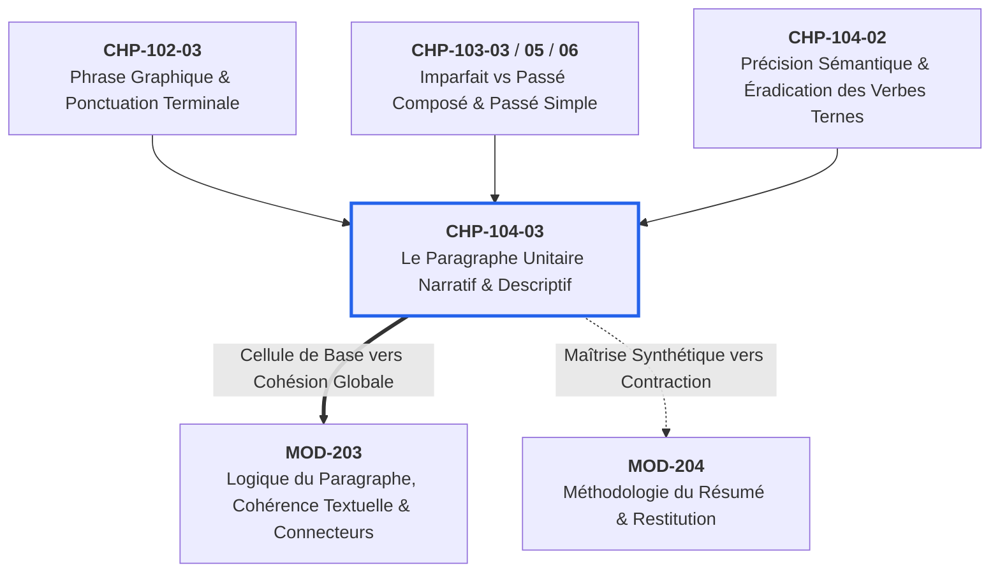

# Chapitre 3 — Architecture Textuelle : Le Paragraphe Unitaire Narratif et Descriptif : Amorce, Déploiement et Clôture

> **Identifiant du chapitre** : `CHP-104-03`  
> **Module de rattachement** : [`MOD-104` — Précision Lexicale de Base, Familles de Mots, Lecture Fluide, Paragraphe Narratif/Descriptif et Oralité Prosodique](file:///f:/Formation/world-class-french/03-curriculum/year-1/semester-1/mod-104-lexique-lecture-paragraphe.md)  
> **Semestre** : Année 1 — Semestre 1 (S1)  
> **Volume horaire canonique** : 5 à 6 heures d'apprentissage autonome délibéré et d'ateliers d'application (Étude : 1 h 30 | Pratique : 1 h 30 | Correction : 1 h 00 | Évaluation : 1 h 00)  
> **Statut** : [STATUT : VALIDÉ]  
> **Compétences associées** : [`FR-INT-001`](file:///f:/Formation/world-class-french/02-competency-framework/competency-framework.md#fr-int-001-rédiger-un-texte-long-cohérent-en-maîtrisant-accords-et-ponctuation) (Palier L2 — Paragraphe Unitaire), [`FR-SYNTAX-001`](file:///f:/Formation/world-class-french/02-competency-framework/competency-framework.md#fr-syntax-001-analyse-fonctionnelle-et-délimitation-de-la-phrase-simple) (Palier L2)  
> **Sources scientifiques de référence** : `SRC-GRAM-02` (Riegel, Pellat, Rioul, 2016, chap. 21), `SRC-GRAM-01` (Grevisse & Goosse, 2016, § 1028 et suiv.), `SRC-NORM-03` (Ministère de l'Éducation nationale, 2020), `SRC-TYPO-01` (Imprimerie nationale, 2002/2014)

---

## 1. Titre et Place dans le Cursus

### 1.1 Intitulé Officiel
**Chapitre 3 : Architecture Textuelle : Le Paragraphe Unitaire Narratif et Descriptif : Amorce, Déploiement et Clôture** (`CHP-104-03`).

### 1.2 Insertion Architecturale dans le Cursus
Le chapitre `CHP-104-03` marque le basculement fondamental de l'expression écrite : l'accès à la **dimension transphrastique** (ou macro-syntaxe). Après avoir appris à former, orthographier et ponctuer rigoureusement des phrases graphiques isolées (`MOD-102`), après avoir stabilisé la mécanique des tiroirs temporels de l'indicatif (`MOD-103`) et après avoir nettoyé le lexique des verbes et substantifs passe-partout (`CHP-104-01`, `CHP-104-02`), l'apprenant aborde la cellule vivante première du discours suivi : le **paragraphe unitaire**.

Le paragraphe n'est ni un simple bloc typographique posé au hasard sur la feuille ni un conteneur passif de phrases juxtaposées. Il constitue une **architecture autonome**, gouvernée par une idée maîtresse ou une micro-scène unifiée, articulée autour de trois moments structurants : **l'amorce**, **le déploiement** et **la clôture**.



- **En amont** :
  - [`MOD-102` (et spécifiquement `CHP-102-03`)](file:///f:/Formation/world-class-french/03-curriculum/year-1/semester-1/mod-102/chp-102-03-phrase-graphique-ponctuation.md) fournit le matériau constitutif : la phrase graphique close, bornée par la majuscule et la ponctuation terminale, sans laquelle aucun paragraphe ne peut s'ordonner.
  - [`MOD-103`](file:///f:/Formation/world-class-french/03-curriculum/year-1/semester-1/mod-103-systeme-verbal-indicatif.md) apporte la distinction aspectuelle capitale : l'imparfait sécant pour l'arrière-plan descriptif ou les actions duratives d'ambiance, contre le passé simple ou le passé composé pour les événements ponctuels de premier plan qui dynamisent la trame narrative.
  - `CHP-104-02` arme l'étudiant contre la banalité lexicale en proscrivant les verbes ternes (*faire, mettre, avoir, voir*) au profit de vocables précis indispensables à la vigueur de la description.
- **En aval** :
  - [`MOD-203`](file:///f:/Formation/world-class-french/03-curriculum/year-1/semester-2/mod-203-logique-paragraphe-cohesion-textuelle.md) étendra cette armature au paragraphe argumentatif et à la combinatoire complexe des connecteurs logiques abstraits.
  - `MOD-204` mobilisera la détection immédiate de l'amorce et de la clôture pour dégager l'armature textuelle dans l'exercice du résumé analytique.

---

## 2. Objectifs Mesurables

Au terme de l'étude autonome et des exercices de ce chapitre, l'apprenant doit être capable de :

1. **Identifier et discriminer sans hésitation les trois composantes canoniques du paragraphe** : isoler formellement, dans tout paragraphe narratif ou descriptif d'auteur, la phrase d'amorce, les phrases du corps de déploiement et la phrase de clôture, avec 100 % d'exactitude [Réf. `SRC-GRAM-02`, chap. 21 ; `SRC-NORM-03`, p. 38].
2. **Construire et maintenir des chaînes anaphoriques continues** : tisser la coréférence au sein d'un texte suivi en alternant rigoureusement anaphores pronominales directes et anaphores lexicales (synonymes précis, hyperonymes de niveau supérieur), sans créer d'ambiguïté référentielle ni tolérer de répétitions mécaniques lourdes [Réf. `SRC-GRAM-01`, § 1028].
3. **Ordonner le développement par des balises spatiales et temporelles sobres** : articuler le mouvement d'une scène (progression chronologique d'un récit ou balayage spatial d'une description) sans recourir aux connecteurs de remplissage automatiques (*ensuite, puis, après* répétés en tête de phrase).
4. **Composer en autonomie un paragraphe unitaire d'excellence de 150 à 200 mots** : rédiger un texte narratif ou descriptif homogène respectant scrupuleusement la tripartition canonique, calibré en 4 à 7 phrases graphiques équilibrées, exempt de toute digression thématique et de toute anacoluthe syntaxique [Palier L2 pour `FR-INT-001`].

---

## 3. Prérequis et Test de Préparation (Auto-Diagnostic)

### 3.1 Prérequis Cognitifs
- Maîtriser la délimitation de la phrase graphique par la majuscule initiale et la ponctuation terminale (`.` , `?` , `!` , `...`) sans saucissonnage ni télescopage (*comma splice*) [validé en `CHP-102-03`].
- Distinguer la valeur d'arrière-plan de l'imparfait (aspect sécant, décor, état) de la valeur d'avant-plan du passé composé ou passé simple (aspect global, action accomplie, événement transformateur) [validé en `MOD-103`].
- Savoir identifier le sujet grammatical et ses substituts pronominaux [validé en `MOD-102`].

### 3.2 Test de Préparation Immédiat
Répondez aux cinq questions suivantes avant d'aborder la lecture du cours. Déployez ensuite le corrigé pour vérifier la solidité de vos bases.

1. Quelle est la différence fondamentale entre une phrase graphique et un paragraphe sur le plan de l'organisation textuelle ?
2. Dans un récit mené au passé, quel tiroir verbal emploie-t-on de préférence pour décrire le décor stable d'une scène, et quel tiroir utilise-t-on pour rapporter l'irruption soudaine d'un incident ?
3. En linguistique du texte, qu'appelle-t-on un « antécédent » et une « anaphore » ?
4. Pourquoi est-il maladroit d'ouvrir un paragraphe indépendant par un connecteur de liaison comme *« Ensuite »* ou *« De plus »* ?
5. Dans la phrase *« En rentrant chez lui, la pluie s'est mise à tomber violemment »*, quelle anomalie syntaxique vicieuse repérez-vous ?

---

#### Corrigé de l'Auto-Diagnostic

<details>
<summary><b>Cliquez ici pour afficher le corrigé de l'auto-diagnostic</b></summary>

1. La **phrase graphique** est une unité grammaticale et typographique minimale close (délimitée par une majuscule et un point). Le **paragraphe** est une unité textuelle supérieure : il rassemble une suite de phrases graphiques ordonnées concourant au développement d'une seule et même idée maîtresse ou scène homogène.
2. Pour le décor stable ou l'état en cours, on emploie l'**imparfait de l'indicatif** (aspect non borné, sécant). Pour l'événement soudain qui fait progresser l'intrigue, on emploie le **passé simple** (dans le récit littéraire/écrit soutenu) ou le **passé composé** (aspect global, achevé).
3. L'**antécédent** est le mot ou groupe de mots initialement introduit dans le discours. L'**anaphore** est la reprise textuelle postérieure de ce référent au moyen d'un pronom (*il, celle-ci*) ou d'un syntagme nominal équivalent (*ce savant, cet artisan*).
4. Un connecteur comme *« Ensuite »* ou *« De plus »* est un opérateur de dépendance qui suppose une relation logique ou chronologique étroite avec ce qui précède immédiatement. Un paragraphe autonome doit affirmer d'emblée son propre cadre ou son idée maîtresse au moyen d'une **amorce assertive**. Commencer par un connecteur mineur trahit souvent une incapacité à poser le sujet.
5. Il s'agit d'une **anacoluthe** (rupture syntaxique du sujet du participe). Le participe présent *« En rentrant »* n'a pas de sujet exprimé propre ; la syntaxe impose donc qu'il se rattache au sujet de la proposition principale. Or le sujet de la principale est *« la pluie »*. La phrase signifie littéralement que c'est la pluie qui rentre chez elle ! Il faut rétablir la concordance actancielle : *« Tandis qu'il rentrait chez lui, la pluie s'est mise à tomber violemment »* ou *« En rentrant chez lui, il fut surpris par une pluie violente »*.

</details>

---

## 4. Situation de Départ ou Problème Concret : Le Texte en Miettes ou en Bouillie

L'observation des copies universitaires et des écrits professionnels met en évidence deux pathologies jumelles qui ruinent la transmission de la pensée :

```text
PATHOLOGIE A : LE TEXTE EN BOUILLIE (BLOC COMPACT AMORPHE)
[Trente lignes ininterrompues de texte dense, sans le moindre alinéa ni saut de section.
Le lecteur pénètre dans une jungle d'informations où la description d'une ruelle dérive
vers la psychologie d'un témoin, puis vers un incident chronologique et des considérations
météorologiques, sans que l'on sache jamais où commence ni où s'achève l'action principale.]

PATHOLOGIE B : LE TEXTE EN MIETTES (SAUCISSONNAGE VERTICAL)
Dès l'aube, le pêcheur s'avança sur la berge de la lagune.
Il tenait un filet réparé avec grand soin.
Le soleil commençait à percer la brume matinale.
L'eau était calme et tiède.
Alors il jeta son filet dans le courant.
Puis un grondement retentit au loin.
```

Dans la **Pathologie A**, le lecteur étouffe : la mémoire de travail est submergée par une masse amorphe d'informations dépourvue de paliers cognitifs. L'auteur a confondu la richesse de contenu avec l'absence de tri.

Dans la **Pathologie B**, le scripteur a calqué le format haché des messageries instantanées et des réseaux sociaux. Chaque phrase graphique est traitée comme un paragraphe indépendant d'une seule ligne. Il n'existe plus aucune cohésion transphrastique, aucun liant logique, aucune tension narrative. Le texte est atomisé en confettis.

Dans les deux cas, le texte souffre de trois infirmités structurelles :
1. **L'absence d'amorce** : le lecteur est projeté au milieu d'un fait secondaire sans que le décor, le personnage ou l'idée directrice ne soient posés.
2. **La dispersion thématique** : le scripteur saute d'un actant à un autre, multiplie les digressions parasites et égare le fil conducteur.
3. **La terminaison en queue de poisson** : le paragraphe s'interrompt brutalement sur un détail fortuit, sans phrase de clôture venant nouer ou sceller la scène.

---

## 5. Explication Intuitive : L'Analogie de la Voûte d'Ogive

Pour comprendre comment fonctionne un paragraphe unitaire soutenu, il faut faire appel à une image architecturale féconde : celle de la **voûte d'ogive** ou de la **chambre maçonnée d'un édifice**.

```text
               [ PHRASE DE CLÔTURE ]
             ( Clé de voûte textuelle )
                     /\        /\
                    /  \      /  \
                   /    \    /    \
                  /      \  /      \
                 /        \/        \
                |                    |
                |  CORPS DE          |
                |  DÉPLOIEMENT       |
                |  ( Murs appareillés|
                |    & voussoirs )   |
                |                    |
             [==========================]
                  [ PHRASE D'AMORCE ]
                 ( Pierre d'assise )
```

1. **La phrase d'amorce est la pierre d'assise** : elle s'implante fermement dans le sol. Elle définit la portée, la direction et la solidité de la pièce qu'on édifie. Elle proclame au lecteur : *« Voici l'espace dans lequel nous entrons, voici le cadre ou l'action dont nous allons traiter. »*
2. **Le corps de déploiement forme les murs appareillés** : chaque phrase graphique est un bloc de taille taillé avec précision. Une pierre ne tient pas en l'air par magie ; elle repose sur la pierre inférieure par des joints de mortier impeccables. Dans le paragraphe, ces joints sont les **chaînes anaphoriques** et les **balises logiques**. Chaque phrase s'accroche sémantiquement à la précédente et prépare la suivante, élevant la voûte avec régularité.
3. **La phrase de clôture est la clé de voûte** : tant que la clé n'est pas posée au sommet de l'arc, les voussoirs menacent de vaciller. La clé de voûte verrouille les pressions latérales, absorbe les forces et boucle l'espace clos. Elle donne au paragraphe sa plénitude esthétique et conceptuelle, permettant au lecteur de marquer une respiration sereine avant d'aborder la chambre suivante.

---

## 6. Définitions Précises et Terminologie

Afin de raisonner avec exactitude sur la structure du texte, nous fixons les définitions canoniques des termes techniques suivants :

1. **Paragraphe unitaire** : Segment textuel autonome d'un texte continu, délimité matériellement par un alinéa initial et un retour à la ligne terminal, et caractérisé sur le plan sémantique par le développement complet et ordonné d'une **seule idée directrice**, d'un événement circonscrit ou d'un tableau descriptif homogène [Réf. `SRC-GRAM-02`, chap. 21].
2. **Alinéa (et retrait typographique)** : Marque matérielle marquant le début d'un paragraphe. Dans la norme de l'Imprimerie nationale, l'alinéa s'accompagne d'un **retrait positif de première ligne** (généralement 1 à 2 cadratins, soit 5 à 8 mm), signalant à l'œil l'entrée dans une nouvelle unité de pensée [Réf. `SRC-TYPO-01`, p. 19].
3. **Phrase d'amorce (ou phrase directrice / phrase-cadre)** : Première phrase graphique du paragraphe. Elle installe de manière assertive le cadre spatio-temporel de la scène, énonce le thème principal ou amorce le mouvement narratif, sans dépendre d'un connecteur de transition parasite.
4. **Corps du paragraphe (ou corps de déploiement)** : Ensemble médian de 2 à 5 phrases graphiques qui déploient l'amorce par progression chronologique (actions narratives), balayage spatial (description ordonnée) ou enrichissement notionnel.
5. **Phrase de clôture (ou chute textuelle)** : Dernière phrase graphique du paragraphe. Elle apporte la résolution de la micro-action, scelle la vision descriptive par un détail synthétique fort, ou produit une résonance conclusive qui parachève l'unité du bloc.
6. **Unité thématique (ou isotopie sémantique)** : Cohérence de fond assurée par la présence continue, tout au long du paragraphe, d'un même réseau de termes et de notions convergeant vers le même objet du discours, interdisant toute digression hors sujet.
7. **Chaîne anaphorique (ou coréférence textuelle)** : Suite ininterrompue d'éléments linguistiques (pronoms personnels, possessifs, démonstratifs, synonymes, hyperonymes) qui désignent successivement le même référent tout au long du paragraphe sans créer de vide référentiel ni de confusion [Réf. `SRC-NORM-03`, p. 38].
8. **Balise spatio-temporelle** : Circonstant de temps ou de lieu placé en position stratégique (souvent détaché en tête de phrase) permettant d'orienter le lecteur dans la chronologie de l'action (*À l'aube, Quelques instants plus tard*) ou dans la topographie du décor (*Au premier plan, À droite, Vers l'horizon*).
9. **Anacoluthe** : Rupture brutale et fautive de la construction syntaxique au sein de la phrase, survenant notamment lorsqu'un participe présent, un gérondif ou un adjectif détaché ne possède pas le même sujet que le verbe principal de la proposition hôte [Réf. `SRC-GRAM-01`, § 441].

---

## 7. Règles et Mécanismes Fondamentaux

### 7.1 La Nature Triple du Paragraphe
Le paragraphe se définit à l'intersection de trois dimensions indissociables :
- **L'unité visuelle et typographique** : il commence par un retrait d'alinéa et se termine par un point final suivi d'un saut de ligne. Il offre une géométrie aérée à la page imprimée.
- **L'unité respiratoire et attentionnelle** : il correspond à un cycle complet de l'attention du lecteur. Lire un paragraphe sollicite un empan de concentration continue ; l'espace blanc final offre la halte nécessaire pour assimiler le bloc avant de repartir.
- **L'unité sémantique et conceptuelle** : **un paragraphe = une seule idée maîtresse ou une seule micro-scène**. Dès que le lieu change radicalement, que l'action pivote vers un nouvel acteur principal ou que le propos aborde un autre volet du raisonnement, un nouveau paragraphe doit impérativement naître.

### 7.2 L'Armature Canonique Tripartite
Tout paragraphe unitaire narratif ou descriptif d'excellence repose sur une tripartition rigoureuse :

```text
[ PARAGRAPHE UNITAIRE CANONIQUE : 150 À 200 MOTS ]
├── 1. LA PHRASE D'AMORCE (1 phrase : 20 à 30 mots)
│      Pose l'assise spatio-temporelle ou l'assertion directrice. Ton affirmatif, net, sans fioritures.
├── 2. LE CORPS DE DÉPLOIEMENT (2 à 5 phrases : 100 à 140 mots)
│      Récit : progression chronologique rigoureuse. Alternance Imparfait / Passé simple ou Passé composé.
│      Description : balayage spatial logique (du proche au lointain, du haut vers le bas, de l'ensemble au détail).
└── 3. LA PHRASE DE CLÔTURE (1 phrase : 20 à 30 mots)
       Chute narrative, synthèse descriptive ou résonance expressive. Scelle définitivement la voûte.
```

- **La phrase d'amorce** :
  - Elle doit être **assertive** : elle affirme un fait ou dresse un décor sans timidité.
  - Elle ne commence pas par un connecteur concessif ou adversatif lourd (*« Cependant », « En effet », « Néanmoins »*) lorsqu'il s'agit d'un paragraphe autonome de départ. Elle entre directement dans le vif du sujet.
- **Le corps de déploiement** :
  - *Dans le récit* : il respecte la chronologie interne. On mobilise l'**imparfait** pour installer l'arrière-plan duratif ou les circonstances d'ambiance, tandis que les verbes d'action ponctuelle au **passé simple** (ou passé composé) font bondir les péripéties au premier plan.
  - *Dans la description* : il organise le regard selon un vecteur spatial rigoureux : jamais de saut anarchique d'un angle à un autre. Le scripteur choisit un angle de vue (ex. de la porte d'entrée vers le fond de la pièce, ou du parvis vers le clocher) et s'y tient.
- **La phrase de clôture** :
  - Elle clôt l'arc narratif ou descriptif ouvert par l'amorce.
  - Elle peut opérer par **chute** (résultat final d'une péripétie), par **résonance** (une impression dominante qui reste gravée dans l'esprit) ou par **synthèse** (le bilan d'une observation). Elle ne laisse jamais de subordonnée ou d'action inachevée en suspens.

### 7.3 Cohésion et Coréférence : Le Tissage des Chaînes Anaphoriques
Pour éviter la répétition puérile d'un même nom propre ou substantif sans égarer le lecteur, le scripteur averti tisse une chaîne anaphorique diversifiée [Réf. `SRC-GRAM-02`, chap. 21] :
- **L'anaphore pronominale directe** : pronoms de la 3e personne (*il, elle, ils, elles, le, la, lui, leur, en, y*) ou pronoms démonstratifs (*celui-ci, celle-ci, ce dernier*). Elle assure la continuité grammaticale économique.
- **L'anaphore lexicale par synonyme** : substitution d'un terme propre de sens équivalent (*le chirurgien $\rightarrow$ le praticien $\rightarrow$ l'opérateur*).
- **L'anaphore lexicale par hyperonyme** : emploi d'un terme de rang sémantique plus général englobant le premier (*le piroguier $\rightarrow$ l'artisan $\rightarrow$ l'homme de rivière*).
- **L'anaphore nominale conceptuelle ou métaphorique** : synthèse d'une action ou d'une attitude (*cette audacieuse manœuvre, ce spectacle désolant*).

> **Règle d'or de l'anaphore** : L'antécédent doit être rigoureusement univoque. Si deux personnages masculins de même rang figurent dans la phrase, l'emploi de *« il »* devient ambigu et fautif ; il faut alors réintroduire un syntagme nominal distinct.

### 7.4 Les Balises Spatiales et Temporelles Sobres
Pour marquer les étapes du déploiement, point n'est besoin de mitrailler le texte de petits mots d'enchaînement pauvres (*« et puis », « après », « ensuite »*). La progression s'opère par des **syntagmes prépositionnels ou adverbiaux circonstanciels** nobles :
- *Balises temporelles narratives* : *« À la tombée du jour », « Quelques instants plus tard », « Soudain », « Au terme d'une longue délibération », « Lorsque l'orage éclata enfin »*.
- *Balises spatiales descriptives* : *« Au premier plan », « À la lisière du bosquet », « Dans la pénombre du vestibule », « À quelques coudées de là », « Vers la cime des collines »*.

### 7.5 Le Calibrage Standard d'un Paragraphe d'Excellence
Dans la prose académique et classique, le paragraphe unitaire équilibré répond au canon suivant :
- **Volume** : **150 à 200 mots**.
- **Densité** : **4 à 7 phrases graphiques** coordonnées ou articulées avec mesure.
- Moins de 4 phrases (ou moins de 80 mots) : le paragraphe est souvent squelettique, inachevé ou haché.
- Plus de 8 phrases (ou plus de 250 mots) : le paragraphe menace d'étouffer le lecteur sous une surcharge cognitive, exigeant d'être scindé en deux unités thématiques distinctes.

---

## 8. Raisonnement Détaillé : La Psychologie Cognitive du Paragraphe

Pourquoi la tradition rhétorique et typographique a-t-elle érigé le paragraphe en unité maîtresse de l'écrit ? La réponse repose sur les lois universelles de la **psychologie cognitive de la lecture** et de la **mémoire de travail**.

### 8.1 L'Empan Mnésique et le Traitement de l'Information (*Chunking*)
Comme l'a démontré le psychologue George A. Miller (théorie de l'empan mnésique, confirmée par les travaux modernes sur la charge cognitive de John Sweller), la mémoire de travail humaine ne peut traiter simultanément qu'un nombre restreint d'unités d'information actives (environ 4 à 7 blocs signifiants à la fois).

Lorsqu'un lecteur parcourt une phrase, il en décode la micro-syntaxe. Mais pour saisir le sens global d'une page, le cerveau doit regrouper ces phrases en un bloc conceptuel intégré : c'est l'opération de **segmentation en paquets sémantiques** (*chunking*). 

Le paragraphe unitaire matérialise exactement la frontière de ce paquet :
1. **L'amorce active le cadre cognitif** (*schema activation*) : le cerveau sait dans quelle « boîte mentale » ranger les informations qui vont suivre.
2. **Le développement remplit la boîte** : les 3 à 5 phrases apportent les précisions nécessaires sans saturer la capacité d'attention.
3. **La clôture scelle et archive le bloc** : le point terminal suivi du blanc d'alinéa signale au cerveau qu'il peut consolider cette synthèse en mémoire à long terme, vider la mémoire de travail immédiate et se préparer à accueillir l'unité suivante.

### 8.2 La Lisibilité Rhétorique
Un texte dépourvu de paragraphes est semblable à une ville sans carrefours ni places publiques : un couloir étouffant où rien ne permet d'évaluer la distance parcourue. L'alinéa et l'espace blanc jouent le rôle de places d'étape où l'esprit prend du recul, respire et mesure l'avancée du récit.

---

## 9. Exemples Corrects Commentés

Nous décortiquons ici deux modèles canoniques d'excellence, étalonnés chacun entre 120 et 150 mots : l'un narratif, l'autre descriptif.

### 9.1 Paragraphe Narratif Canonique (138 mots)

> **[P1 — Amorce assertive]** Dès les premières rafales de l'après-midi, l'inquiétude gagna le vieux chantier naval de Guet-Ndar.  
> **[P2 — Développement : décor et arrière-plan à l'imparfait]** Tandis que des nuages violacés s'amoncelaient sur l'océan houleux, les charpentiers s'activaient fébrilement sur les cales glissantes pour consolider les étayages de bois.  
> **[P3 — Développement : action de premier plan au passé simple]** Soudain, une déferlante plus haute que les autres franchit la digue de granit et balaya les établis légers dans un grondement d'écume.  
> **[P4 — Développement : réaction collective immédiate]** Sans proférer une plainte, les artisans unirent leurs forces dans l'eau glacée pour hisser les dernières pirogues hors de portée du flot destructeur.  
> **[P5 — Clôture conclusive]** Lorsque la nuit tomba enfin sur la côte dévastée, pas une seule embarcation ne manquait à l'abri protecteur du hangar.

#### Apparat Critique et Analyse Textuelle :
- **Décompte exact** : 138 mots, 5 phrases graphiques équilibrées.
- **Architecture tripartite** :
  - *Amorce (P1)* : pose le cadre temporel (*Dès les premières rafales*), l'espace (*le vieux chantier naval*) et la tonalité d'urgence (*l'inquiétude gagna*).
  - *Corps (P2-P4)* : progression chronologique limpide. Alternance rigoureuse de l'imparfait duratif d'arrière-plan (*s'amoncelaient, s'activaient*) et des passés simples d'action soudaine (*franchit, balaya, unirent*).
  - *Clôture (P5)* : fermeture nocturne de l'épisode (*Lorsque la nuit tomba enfin*), bilan victorieux qui scelle l'effort sans laisser de phrase en suspens (*pas une seule embarcation ne manquait*).
- **Chaîne anaphorique** : *les charpentiers* (P2) $\rightarrow$ *les artisans* (P4) ; *les étayages* $\rightarrow$ *les établis* $\rightarrow$ *les dernières pirogues* $\rightarrow$ *pas une seule embarcation*.
- **Balises sobres** : *Dès les premières rafales* (P1), *Tandis que* (P2), *Soudain* (P3), *Lorsque la nuit tomba enfin* (P5).

---

### 9.2 Paragraphe Descriptif Canonique (142 mots)

> **[P1 — Amorce spatiale]** Dans la pénombre de l'atelier royal d'Abomey, régnait une atmosphère de ferveur silencieuse et ordonnée.  
> **[P2 — Développement : plan rapproché, perception sensorielle]** Au centre de la vaste pièce en terre battue, une poussière d'acajou dorée flottait dans les rais obliques que le soleil couchant projetait à travers les persiennes entrouvertes.  
> **[P3 — Développement : les acteurs et leurs gestes à l'imparfait]** Assis sur de lourds tabourets de teck, deux maîtres sculpteurs polissaient avec une infinie patience les bas-reliefs complexes d'un trône d'apparat.  
> **[P4 — Développement : détail d'orfèvrerie et son acoustique]** Leurs gouges tranchantes entaillaient le bois sombre avec un bruissement sec et régulier, semblable au cliquetis d'une horloge d'ébène.  
> **[P5 — Clôture synthétique]** Dans ce sanctuaire du labeur séculaire, chaque copeau tombé au sol semblait rendre hommage à la grandeur éternelle des ancêtres.

#### Apparat Critique et Analyse Textuelle :
- **Décompte exact** : 142 mots, 5 phrases graphiques harmonieuses.
- **Architecture tripartite** :
  - *Amorce (P1)* : installe le lieu clos (*Dans la pénombre de l'atelier royal d'Abomey*) et la dominante affective (*une atmosphère de ferveur silencieuse*).
  - *Corps (P2-P4)* : balayage spatial partant de la pièce générale (*Au centre de la vaste pièce*) vers les artisans au travail (*Assis sur de lourds tabourets*), puis vers la pointe minutieuse des outils (*Leurs gouges tranchantes*).
  - *Clôture (P5)* : élévation poétique et morale qui récapitule la portée symbolique du tableau (*Dans ce sanctuaire du labeur séculaire*).
- **Richesse lexicale** : zéro verbe passe-partout ; termes matériels nobles (*acajou, teck, terre battue, bas-reliefs, gouges, ébène*).

---

## 10. Contre-Exemples et Erreurs Fréquentes

Nous dressons ici la typologie clinique de six erreurs récurrentes majeures observées dans les rédactions d'apprenants :

### Erreur n° 1 : Le paragraphe monocellulaire d'une seule phrase fleuve
- **Forme fautive** : *« Le navire appareilla au lever du jour alors que le vent se levait sur la rade et que les matelots hissaient la grand-voile tandis que le capitaine scrutait l'horizon avec sa longue-vue parce qu'il redoutait une tempête imminente. »*
- **Analyse linguistique de la faille** : Absence de respiration textuelle. L'auteur a comprimé tout un paragraphe dans une unique phrase graphique boursouflée de subordonnées enchaînées en cascade (*alors que... et que... tandis que... parce que...*).
- **Réfutation et correction normée** : Un paragraphe unitaire d'excellence doit scinder ses propositions en plusieurs phrases graphiques équilibrées.
  - *Forme correcte* : *« Le navire appareilla au lever du jour, salué par un vent frais sur la rade. Sur le pont glissant, les matelots hissaient la grand-voile d'un geste vigoureux. Debout sur la dunette, le capitaine scrutait l'horizon à la longue-vue, car il redoutait la violence d'une tempête imminente. »*

### Erreur n° 2 : Le paragraphe haché phrase par phrase (le saucissonnage vertical)
- **Forme fautive** :
  *« Le cavalier arriva devant l'auberge.*  
  *Il descendit de son cheval noir.*  
  *La porte était fermée à double tour.*  
  *Il frappa trois grands coups.*  
  *Personne ne répondit à son appel. »*
- **Analyse linguistique de la faille** : L'apprenant applique un saut de ligne après chaque phrase simple, détruisant l'unité du bloc.
- **Réfutation et correction normée** : Ces micro-actions contiguës relèvent d'une même scène narrative. Elles doivent être assemblées en un paragraphe unitaire d'un seul tenant au moyen d'un liant syntaxique approprié.
  - *Forme correcte* : *« Le cavalier arriva devant l'auberge et descendit d'un bond de sa monture noire. Constatant que la lourde porte était fermée à double tour, il y asséna trois coups retentissants. Cependant, nul ne répondit à son appel dans la maison silencieuse. »*

### Erreur n° 3 : La digression thématique parasite (la rupture d'isotopie)
- **Forme fautive** : *« La bibliothèque municipale offrait un calme propice aux longues lectures. Les rayonnages de chêne abritaient des milliers de volumes rares. D'ailleurs, le maire avait récemment refusé d'augmenter le budget des travaux publics pour construire une nouvelle mairie. Les reliures de cuir exhalaient une odeur de parchemin ancien. »*
- **Analyse linguistique de la faille** : La phrase sur le budget municipal brise l'isotopie descriptive de la bibliothèque. C'est un corps étranger introduit par le connecteur bavard *« D'ailleurs »*.
- **Réfutation et correction normée** : Règle de l'unité sémantique : toute proposition étrangère au thème directeur doit être impitoyablement bannie.
  - *Forme correcte* : *« La bibliothèque municipale offrait un calme propice aux longues lectures. Les rayonnages de chêne abritaient des milliers de volumes rares, soigneusement catalogués. Sous les voûtes silencieuses, les lourdes reliures de cuir exhalaient une noble odeur de parchemin ancien. »*

### Erreur n° 4 : L'oubli de la clôture (la terminaison en queue de poisson)
- **Forme fautive** : *« La délibération du conseil des ministres débuta à dix heures précises sous la présidence du chef de l'État. Chacun des ministres présenta le bilan semestriel de son département sectoriel avec une rigueur chiffrée exemplaire. Le ministre de l'Agriculture portait une cravate rayée bleu et blanc. [Fin de paragraphe] »*
- **Analyse linguistique de la faille** : Le paragraphe s'effondre sur un détail vestimentaire sans rapport avec la gravité de l'amorce, sans sceller la délibération.
- **Réfutation et correction normée** : La phrase de clôture doit couronner le thème principal ouvert par l'amorce.
  - *Forme correcte* : *« [...] Au terme de ces exposés d'une grande rigueur, le président leva la séance en fixant les nouvelles priorités économiques de la nation. »*

### Erreur n° 5 : L'anacoluthe par rupture syntaxique du sujet
- **Forme fautive** : *« Après avoir longuement examiné les parchemins anciens, la vérité apparut soudain aux yeux de l'archiviste. »*
- **Analyse linguistique de la faille** : Le syntagme participial *« Après avoir longuement examiné »* est suspendu. Syntaxiquement, son sujet doit être celui de la proposition principale (*la vérité*). Or, la vérité n'examine aucun parchemin : c'est l'archiviste qui examine !
- **Réfutation et correction normée** : Rétablir l'actant animé comme sujet de la proposition principale hôte.
  - *Forme correcte* : *« Après avoir longuement examiné les parchemins anciens, l'archiviste vit soudain la vérité éclater à ses yeux. »*

### Erreur n° 6 : La saturation en connecteurs temporels mécaniques (« ensuite, puis, après »)
- **Forme fautive** : *« Le soldat entra dans la cour. Ensuite il posa son arme. Puis il retira son casque d'acier. Et après il but une gorgée d'eau fraîche. Enfin il s'assit par terre. »*
- **Analyse linguistique de la faille** : Infantilisme syntaxique. L'auteur compense l'absence de vision stylistique en juxtaposant des adverbes chronologiques de remplissage.
- **Réfutation et correction normée** : Éradiquer les connecteurs automatiques et rythmer l'action par des participes, des compléments prépositionnels ou des asyndètes éloquentes.
  - *Forme correcte* : *« Dès son entrée dans la cour, le soldat déposa son arme contre le mur. Dénouant la jugulaire de son casque d'acier, il étancha sa soif à longs traits avant de s'affaisser, épuisé, sur la margelle du puits. »*

---

## 11. Cas Particuliers et Limites

Si l'armature tripartite de 150 à 200 mots constitue la norme canonique du paragraphe unitaire, la pratique littéraire et textuelle admet trois formes spécifiques régulées :

### 11.1 Le Paragraphe de Transition
Dans une longue composition (dissertation, essai, rapport), le paragraphe de transition ne cherche pas à déployer une idée maîtresse complète : il fait office de **passerelle logique** entre deux grands mouvements du devoir.
- **Calibrage** : très bref (1 à 2 phrases graphiques, 30 à 50 mots).
- **Structure** : il récapitule en première partie le bilan de la thèse précédente, et annonce immédiatement l'antithèse ou la perspective nouvelle (*« Si les causes économiques du conflit apparaissent ainsi manifestes, elles ne sauraient faire oublier le rôle déterminant des facteurs spirituels, qu'il convient à présent d'élucider. »*).

### 11.2 Le Paragraphe Averbal Poétique
En stylistique littéraire, certains auteurs suspendent la grammaire prédicative ordinaire pour produire un effet d'instantanéité ou d'accumulation impressionniste au moyen de phrases averbales ou nominales.
- *Exemple* : *« Nuit noire. Silence de plomb sur les toits de la ville endormie. Seul, au loin, le sifflement nostalgique d'une locomotive à vapeur. »*
- **Règle didactique** : Cette liberté expressive est admise en création littéraire, mais demeure strictement interdite dans les écrits académiques et administratifs formels du Semestre 1, où la phrase verbale complète est de rigueur.

### 11.3 Le Paragraphe de Dialogue
La typographie française du dialogue obéit à une convention stricte :
- Chaque changement d'interlocuteur exige impérativement un **nouvel alinéa avec tiret cadratin** (`—`).
- Ces alinéas de dialogue ne constituent pas des paragraphes unitaires thématiques au sens architectural plein, mais des délimitations de prise de parole oratoire [Réf. `SRC-TYPO-01`, p. 65].

---

## 12. Approfondissement Adapté au Niveau : Linguistique Textuelle et Macro-Structure

Pour dépasser la simple intuition stylistique, l'apprenant doit comprendre comment la linguistique moderne modélise l'architecture du texte.

### 12.1 La Macro-Structure de Teun A. van Dijk
Le linguiste Teun A. van Dijk a formalisé le concept de **macro-structure textuelle** : le texte ne se comprend pas comme une simple somme de phrases isolées, mais comme une hiérarchie de **macro-propositions** abstraites.

Pour réduire la complexité d'un paragraphe à son idée maîtresse unitaire, l'esprit applique inconsciemment trois **macro-règles** fondamentales :
1. **La règle d'effacement** : le lecteur supprime les informations de détail secondaires non indispensables à l'action.
2. **La règle de généralisation** : une suite d'actants spécifiques (*les scies, les marteaux, les tenailles*) est convertie en un concept englobant (*les outils de forge*).
3. **La règle de construction** : une succession de micro-actions chronologiques (*il entra dans la gare, acheta un billet, monta sur le quai et s'assit dans le wagon*) est synthétisée en une seule macro-action unifiée (*il prit le train*).

> **Enseignement pour le rédacteur** : Composer un paragraphe unitaire d'excellence consiste précisément à bâtir le texte de telle sorte que le lecteur puisse en dégager la macro-proposition sans effort d'interprétation ni malentendu.

### 12.2 Les Deux Grandes Progressions Thématiques
Dans son traité universitaire, Martin Riegel distingue les modes d'agencement du **thème** (ce dont on parle, l'information connue) et du **propos** (ce qu'on en dit, l'information nouvelle) [Réf. `SRC-GRAM-02`, chap. 21] :

```text
1. PROGRESSION À THÈME CONSTANT :
   [ Thème 1 ] ──> Propos A
   [ Thème 1 ] ──> Propos B
   [ Thème 1 ] ──> Propos C
   (Le même sujet est conservé de phrase en phrase, enrichi d'attributs nouveaux.)

2. PROGRESSION À THÈME LINÉAIRE :
   [ Thème 1 ] ──> Propos A
                     │
                     ▼
                  [ Thème 2 (= Propos A) ] ──> Propos B
                                                 │
                                                 ▼
                                              [ Thème 3 (= Propos B) ] ──> Propos C
   (Le propos d'une phrase devient le thème sujet de la phrase suivante.)
```

- **La progression à thème constant** convient particulièrement au **portrait** ou à l'observation d'un personnage unique (*L'artisan avançait lentement. Il portait un lourd tablier. Il s'arrêta au seuil de la forge.*).
- **La progression à thème linéaire** convient à l'**explication de causes à effets** ou au **balayage du regard** (*Au centre de la cour se dressait un vieux puits. Ce puits était entouré d'une margelle de pierre moussue. Cette mousse verdâtre exhalait une fraîche odeur d'humus.*).

---

## 13. Comparaisons Différentielles

Les trois tableaux synoptiques ci-dessous synthétisent les distinctions conceptuelles fondamentales de l'architecture textuelle :

### 13.1 Paragraphe Narratif vs Paragraphe Descriptif

| Critère d'analyse | Paragraphe narratif | Paragraphe descriptif |
| :--- | :--- | :--- |
| **Axe directeur** | Déroulement temporel et chronologique (avant $\rightarrow$ pendant $\rightarrow$ après). | Organisation spatiale et sensorielle (près $\rightarrow$ loin, haut $\rightarrow$ bas, ensemble $\rightarrow$ détail). |
| **Tiroirs verbaux dominants** | Passé simple ou passé composé pour les actions ; imparfait d'arrière-plan. | Imparfait d'état, de description ou présent de constatation. |
| **Nature de l'amorce** | Pose un repère temporel initial et l'élément déclencheur. | Pose le lieu, l'angle de vue ou l'atmosphère générale. |
| **Nature de la clôture** | Aboutissement de l'événement, chute dramatique ou paix retrouvée. | Bilan esthétique, sensation dominante ou détail synthétique ultime. |
| **Piège récurrent** | Saturation en connecteurs mécaniques (*puis, après*). | Énumération statique sans hiérarchie du regard. |

---

### 13.2 Anaphore Pronominale vs Anaphore Lexicale

| Propriété | Anaphore pronominale | Anaphore lexicale |
| :--- | :--- | :--- |
| **Nature grammaticale** | Pronom de la 3e personne (*il, elle, ceux-ci, le, leur*). | Syntagme nominal synonymique ou hyperonymique (*cet homme, ce médecin*). |
| **Effet stylistique** | Fluidité, discrétion, légèreté syntaxique. | Précision notionnelle, enrichissement du sens, absence de répétition. |
| **Champ d'action optimal** | Lorsque le sujet est le seul actant masculin ou féminin en scène. | Dès que plusieurs actants de même genre coexistent, ou pour qualifier l'action. |
| **Risque principal** | Ambiguïté référentielle si l'antécédent est éloigné ou disputé. | Pédantisme lourd ou périphrase maniérée si le terme est mal ajusté. |

---

### 13.3 Phrase d'Amorce Assertive vs Phrase de Clôture Conclusive

| Paramètre | Phrase d'amorce assertive | Phrase de clôture conclusive |
| :--- | :--- | :--- |
| **Position dans le bloc** | Première phrase graphique absolue. | Dernière phrase graphique absolue. |
| **Rôle architectural** | Pierre d'assise : définit le cadre et oriente l'attente du lecteur. | Clé de voûte : scelle les tensions et parachève l'unité. |
| **Modalité énonciative** | Énonciation directe, affirmative, sans connecteur de liaison parasite. | Synthèse, chute expressive ou résonance réflexive. |
| **Erreur fatale** | Commencer par un détail accessoire ou par *« En effet », « Donc »*. | Terminer en « queue de poisson » sur une anecdote inachevée. |

---

## 14. Exercices Progressifs (3 Niveaux)

### 14.1 Niveau 1 : Discrimination et Réordonnancement
Remettez dans l'ordre logique canonique les six phrases suivantes issues d'un paragraphe narratif relatif à une fouille archéologique à Ouidah. Identifiez explicitement l'**amorce**, les **trois phrases du corps de déploiement** et la **phrase de clôture**.

- **Phrase A** : *Puis, à l'aide d'un pinceau de soie, le restaurateur dégagea patiemment les contours d'une poterie cérémonielle intacte.*
- **Phrase B** : *Lorsque le soleil atteignit le zénith, le précieux vestige reposait en sécurité dans sa caisse de velours, prêt pour l'inventaire national.*
- **Phrase C** : *Dès l'aube, l'équipe de fouilles entreprit le déblaiement délicat du secteur sud de la forteresse.*
- **Phrase D** : *Les ouvriers retirèrent d'abord avec d'infinies précautions les couches de gravats amoncelées depuis deux siècles.*
- **Phrase E** : *Soudain, le grattoir métallique d'un assistant heurta une surface d'argile cuite ornée de motifs géométriques.*

---

#### Corrigé Détaillé et Justifié de l'Exercice 14.1

<details>
<summary><b>Cliquez ici pour afficher le corrigé de l'exercice 14.1</b></summary>

- **Ordre chronologique et architectural exact** : **C $\rightarrow$ D $\rightarrow$ E $\rightarrow$ A $\rightarrow$ B**
- **Justification formelle** :
  1. **Phrase C (Amorce assertive)** : *« Dès l'aube, l'équipe de fouilles entreprit le déblaiement délicat du secteur sud de la forteresse. »* — Pose le cadre temporel (*Dès l'aube*), l'espace (*le secteur sud de la forteresse*) et l'objectif d'action générale.
  2. **Phrase D (Corps — 1re étape)** : *« Les ouvriers retirèrent d'abord avec d'infinies précautions les couches de gravats amoncelées depuis deux siècles. »* — Balise temporelle ordonnée (*d'abord*), action préliminaire de déblaiement.
  3. **Phrase E (Corps — 2e étape, péripétie)** : *« Soudain, le grattoir métallique d'un assistant heurta une surface d'argile cuite ornée de motifs géométriques. »* — Balise d'irruption (*Soudain*), événement transformateur au passé simple (*heurta*).
  4. **Phrase A (Corps — 3e étape, précision)** : *« Puis, à l'aide d'un pinceau de soie, le restaurateur dégagea patiemment les contours d'une poterie cérémonielle intacte. »* — Enchaînement logique du travail de précision après la découverte.
  5. **Phrase B (Clôture conclusive)** : *« Lorsque le soleil atteignit le zénith, le précieux vestige reposait en sécurité dans sa caisse de velours, prêt pour l'inventaire national. »* — Borne temporelle terminale (*Lorsque le soleil atteignit le zénith*), mise en sécurité finale scellant l'opération du matin.

</details>

---

### 14.2 Niveau 2 : Rétablissement des Chaînes Anaphoriques et des Balises Spatiales
Le texte suivant souffre de répétitions insupportables du nom propre *Koffi* et d'une absence de balises spatiales. Réécrivez-le en remplaçant les segments entre crochets par :
1. Une anaphore pronominale directe ;
2. Une anaphore lexicale par synonyme ou profession (*l'horloger, l'artisan*) ;
3. Une anaphore lexicale par hyperonyme (*le vieil homme*) ;
4. Deux balises spatiales ordonnées (*Sur l'établi en loupe d'orme, Au mur du fond*).

> *Texte à corriger* :  
> *L'horloger Koffi s'enfermait chaque matin dans son minuscule atelier de la rue des Cocotiers. [Koffi] examinait minutieusement les mécanismes à quartz et les vieux balanciers suisses. [Dans la pièce], une multitude de pendules de cuivre égrenaient les secondes avec un tic-tac régulier. [Koffi] saisissait une pince d'argent pour ajuster un ressort microscopique. [Koffi] ne quittait son siège qu'à la nuit tombée, heureux d'avoir rendu la vie au temps suspendu.*

---

#### Corrigé Détaillé et Justifié de l'Exercice 14.2

<details>
<summary><b>Cliquez ici pour afficher le corrigé de l'exercice 14.2</b></summary>

- **Version réécrite d'excellence** :  
  *« L'horloger Koffi s'enfermait chaque matin dans son minuscule atelier de la rue des Cocotiers. **Assis sous une lampe puissante, l'artisan** examinait minutieusement les mécanismes à quartz et les vieux balanciers suisses. **Au mur du fond**, une multitude de pendules de cuivre égrenaient les secondes avec un tic-tac régulier. **D'un geste d'une précision souveraine, le vieil homme** saisissait une pince d'argent pour ajuster un ressort microscopique. **Il** ne quittait son siège qu'à la nuit tombée, heureux d'avoir rendu la vie au temps suspendu. »*
- **Justification des choix** :
  - *l'artisan* : anaphore lexicale par synonyme de profession ;
  - *Au mur du fond* : balise spatiale descriptive remplaçant le vague *dans la pièce* ;
  - *le vieil homme* : anaphore lexicale par hyperonyme humanisant le personnage ;
  - *Il* : anaphore pronominale directe fluide dans la phrase de clôture.
  - Zéro redondance du nom propre *Koffi*.

</details>

---

### 14.3 Niveau 3 : Rédaction Guidée sous Contraintes Formelles Strictes
Rédigez un paragraphe descriptif d'excellence de **150 à 180 mots** sur le thème :  
*« L'entrée dans un vieux marché couvert de Cotonou à l'heure de midi. »*

Votre production doit respecter impérativement le cahier des charges formel suivant :
1. Exactement **cinq phrases graphiques**.
2. **Phrase 1 (Amorce)** : assertive, posant le passage de l'extérieur torride à la pénombre du marché.
3. **Phrases 2 à 4 (Développement)** : balayage spatial rigoureux ordonné par **trois balises distinctes** (*Sous la haute charpente métallique, À hauteur des étals centraux, Plus loin dans les allées secondaires*).
4. Emploi exclusif de l'**imparfait d'état** et de description ; aucun verbe d'action brusque.
5. Zéro verbe passe-partout (*faire, mettre, avoir, voir, être* répété).
6. **Phrase 5 (Clôture)** : synthèse des sensations olfactives et auditives scellant le tableau.

---

#### Corrigé Modèle Étalonné et Justifié de l'Exercice 14.3

<details>
<summary><b>Cliquez ici pour afficher le corrigé modèle de l'exercice 14.3</b></summary>

> **[P1 — Amorce]** Franchir le lourd portail de fer forgé offrait une délivrance immédiate contre l'accablante fournaise du boulevard lagunaire.  
> **[P2 — Balise 1]** Sous la haute charpente métallique rouillée par les embruns, une fraîcheur bienfaisante tempérait l'agitation des premiers marchands de fruits.  
> **[P3 — Balise 2]** À hauteur des étals centraux, d'immenses paniers d'osier regorgeaient de piments écarlates, de poissons fumés et de tubercules dorés soigneusement empilés en pyramides parfaites.  
> **[P4 — Balise 3]** Plus loin dans les allées secondaires, les vendeuses de pagnes discutaient à voix feutrée tout en déployant de splendides étoffes aux motifs solaires.  
> **[P5 — Clôture]** Dans ce dédale bruissant d'harmonie populaire, mille effluves d'épices composaient l'âme vibrante et immortelle de la cité marchande.

- **Vérification du cahier des charges** :
  - Décompte : **156 mots**.
  - Exactement 5 phrases graphiques.
  - Balayage spatial conforme : charpente $\rightarrow$ étals centraux $\rightarrow$ allées secondaires.
  - Zéro verbe terne ; verbes riches (*offrait, tempérait, regorgeaient, composaient*).
  - Clôture conclusive assurant la plénitude du tableau.

</details>

---

## 15. Activité de Correction Raisonnée

Examinez attentivement le paragraphe suivant, issu d'une composition d'étudiant de première année universitaire :

### Texte Soumis à l'Expertise (148 mots)
> *« [1] L'orage a commencé vers seize heures sur le plateau d'Abomey. [2] Cependant le tonnerre grondait très fort et la foudre est tombée sur un grand arbre. [3] Les enfants avaient peur de la pluie parce que ça mouillait toutes les cases et les canards couraient dans la boue. [4] Mon oncle a acheté une moto japonaise la semaine dernière à Parakou. [5] En observant le ciel noir, la peur grandissait dans le cœur des villageois. [6] Alors tout le monde est rentré vite fait dans les maisons pour se mettre à l'abri de l'eau. »*

---

### Apparat Critique des 6 Infractions Majeures

| N° | Segment fautif | Analyse linguistique de la faille | Règle textuelle violée | Correction méthodique |
| :---: | :--- | :--- | :--- | :--- |
| **1** | Segment [2] : *« Cependant le tonnerre... »* | Emploi fautif d'un connecteur d'opposition (*Cependant*) pour relier une cause météorologique naturelle. | Règle de cohérence sémantique des connecteurs (`SRC-GRAM-02`, chap. 21). | Supprimer *Cependant* et installer une balise temporelle sobre : *« Bientôt, de sourds grondements ébranlèrent... »* |
| **2** | Segment [3] : *« parce que ça mouillait toutes les cases »* | Registre oral relâché avec pronom impersonnel terne (*ça*) et verbe pauvre (*mouiller*). | Règle de précision lexicale formelle (`SRC-LEX-04`). | Remplacer par un syntagme soutenu : *« car les trombes d'eau submergeaient les toitures de chaume »*. |
| **3** | Segment [4] : *« Mon oncle a acheté... »* | Digression thématique grotesque rompant violemment l'isotopie de la tempête. | Règle absolue de l'unité sémantique du paragraphe unitaire. | **Suppression pure et simple** du segment hors sujet. |
| **4** | Segment [5] : *« En observant le ciel noir, la peur grandissait... »* | Anacoluthe vicieuse : le gérondif a pour sujet grammatical *la peur* au lieu des villageois. | Règle de concordance actancielle des participes détachés (`SRC-GRAM-01`, § 441). | Restructurer la phrase : *« En observant les nuées menaçantes, les villageois sentaient une angoisse sourde grandir en eux. »* |
| **5** | Segment [6] : *« Alors tout le monde est rentré vite fait... »* | Adverbe mécanique enfantin (*Alors*) et locution familière inadmissible (*vite fait*). | Règle de tenue stylistique et clôture du paragraphe. | Écrire : *« Chacun se réfugia en hâte sous son toit... »* |
| **6** | Ensemble du paragraphe | Dispersion des actants et rupture de la voûte conclusive. | Règle de l'armature tripartite canonique. | Rédiger une phrase de clôture scellant l'enfermement face aux éléments déchaînés. |

---

### Version Réécrite d'Excellence (155 mots)

> Vers seize heures, un orage d'une violence inouïe s'abattit sur le plateau d'Abomey. De sourds roulements de tonnerre ébranlèrent soudain l'atmosphère lourde, tandis qu'un éclair foudroyant fracassait un baobab centenaire à la lisière du village. Affolés par le déluge qui submergeait déjà les sentiers et menaçait les toitures de chaume, les enfants cherchaient refuge auprès des anciens. En contemplant les nuées ténébreuses qui masquaient le soleil, les paysans mesuraient la fureur des éléments déchaînés. Chacun gagna en hâte le seuil protecteur des demeures familiales, laissant la place publique déserte sous les assauts de la tourmente.

---

## 16. Mise en Pratique dans une Production Réelle

### Consigne de l'Atelier d'Écriture Autonome
Rédigez un paragraphe narratif unitaire de **150 à 180 mots** relatant un incident solennel :  
*« L'interruption soudaine d'une séance académique solennelle par l'irruption d'une nouvelle inattendue. »*

#### Cahier des Charges Formel :
1. **Calibrage strict** : 150 à 180 mots, articulé en exactement **cinq phrases graphiques**.
2. **Architecture tripartite visible** :
   - Phrase 1 : Amorce assertive décrivant le cérémonial solennel de la séance.
   - Phrases 2 à 4 : Déploiement chronologique ordonné rapportant l'irruption d'un messager ou d'une dépêche, avec au moins **quatre verbes d'action précis** (excluant formellement *faire, mettre, avoir, voir*).
   - Phrase 5 : Clôture conclusive décrivant la stupeur et la suspension de l'assemblée.
3. **Zéro répétition lexicale lourde** : recours obligatoire à une chaîne anaphorique diversifiée (anaphores pronominales et lexicales).
4. **Correction morphosyntaxique totale** : zéro anacoluthe, respect irréprochable des accords sujet-verbe et syntagme nominal.

---

### Exemple de Production Étalonnée et Validée (162 mots)

> **[P1 — Amorce]** Réunis sous les lambris dorés du grand amphithéâtre, les professeurs écoutaient dans un recueillement religieux le discours d'ouverture du doyen.  
> **[P2 — Déploiement : premier verbe d'action]** Soudain, les lourdes portes à double battant s'écartèrent avec fracas, rompant le silence feutré de l'assemblée magistrale.  
> **[P3 — Déploiement : deuxième et troisième verbes d'action]** Un jeune huissier essoufflé traversa l'allée centrale d'un pas précipité et tendit un pli scellé aux mains du président de séance.  
> **[P4 — Déploiement : quatrième verbe d'action]** Tandis que le vénérable recteur brisait le sceau de cire rouge et parcourait fébrilement les lignes manuscrites, une pâleur soudaine envahit ses traits d'ordinaire impassibles.  
> **[P5 — Clôture conclusive]** Dans la vaste salle pétrifiée par l'angoisse, le temps sembla suspendre sa course avant que le verdict historique ne résonnât sous les voûtes séculaires.

#### Grille d'Auto-Évaluation de la Production :
- [x] Volume calibré : exactement 162 mots (conforme à l'intervalle 150-180).
- [x] Exactement 5 phrases graphiques délimitées par majuscule et point.
- [x] Armature tripartite respectée : P1 amorce, P2-P4 déploiement ordonné, P5 clôture.
- [x] 4 verbes d'action précis intégrés : *s'écartèrent, traversa, tendit, brisait / envahit*.
- [x] Zéro verbe terne (*faire, mettre, avoir* bannis).
- [x] Chaîne anaphorique sans ambiguïté : *les professeurs* $\rightarrow$ *l'assemblée magistrale* ; *le doyen* $\rightarrow$ *le président de séance* $\rightarrow$ *le vénérable recteur*.
- [x] Zéro anacoluthe.

---

## 17. Résumé Structuré

Le tableau synthétique ci-dessous fixe l'armature canonique du paragraphe unitaire et les règles de cohésion textuelle :

```text
========================================================================================
                      L'ARCHITECTURE CANONIQUE DU PARAGRAPHE UNITAIRE
========================================================================================
  COMPOSANTE       RÔLE FONCTIONNEL            CARACTÉRISTIQUES CLÉS         PIÈGES À PROSCRIRE
────────────────────────────────────────────────────────────────────────────────────────
1. LA PHRASE       Pierre d'assise de       • Assertive et souveraine.     • Connecteur parasite
   D'AMORCE        la voûte : installe      • Pose le thème ou le décor.     initial (Cependant).
                   l'espace ou l'idée.      • 20 à 30 mots.                • Détail secondaire.
────────────────────────────────────────────────────────────────────────────────────────
2. LE CORPS DE     Murs appareillés de      • Déploiement chronologique    • Saucissonnage.
   DÉPLOIEMENT     la chambre : enrichit,     (récit) ou spatial (descrip.). • Digression hors sujet.
                   progresse et détaille.   • Chaînes anaphoriques sûres.  • Saturation en
                                            • 2 à 5 phrases (100-140 mots).  connecteurs "ensuite".
────────────────────────────────────────────────────────────────────────────────────────
3. LA PHRASE DE    Clé de voûte fermant     • Scelle la micro-action.      • Fin en "queue de
   CLÔTURE         la structure : résonance,• Chute ou synthèse forte.       poisson".
                   chute ou bilan final.    • 20 à 30 mots.                • Phrase en suspens.
========================================================================================
```

### Grille Réflexive des 5 Contrôles Cardinaux (Avant Remise de Copie) :
1. **Test de l'Alinéa** : Mon paragraphe commence-t-il par un retrait positif visible et se termine-t-il par un saut de ligne ?
2. **Test de l'Unité Thématique** : Puis-je résumer l'ensemble de ce paragraphe en une seule macro-proposition ? N'y a-t-il aucun élément parasite ?
3. **Test de l'Amorce Assertive** : La première phrase pose-t-elle le décor ou l'affirmation sans s'appuyer sur un connecteur de transition bâtard ?
4. **Test des Chaînes Anaphoriques** : Chaque pronom (*il, elle*) renvoie-t-il à un antécédent limpide et univoque ? Les noms sont-ils relayés par des synonymes nobles ?
5. **Test de la Clé de Voûte** : La dernière phrase apporte-t-elle un sentiment d'achèvement parfait, interdisant au lecteur de se demander *« Et alors ? »* ?

---

## 18. Questions de Rappel Actif (*Active Recall*)

Vérifiez votre assimilation profonde sans relire le chapitre. Cliquez sur chaque question pour valider votre réponse.

### Question 1 : Quelles sont les trois natures indissociables qui définissent un paragraphe ?
<details>
<summary><b>Afficher la réponse</b></summary>
Un paragraphe est à la fois :
1. Une **unité visuelle et typographique** (marquée par l'alinéa initial en retrait et le saut de ligne final) ;
2. Une **unité respiratoire et attentionnelle** (correspondant à un empan d'attention continue de la mémoire de travail du lecteur) ;
3. Une **unité sémantique et conceptuelle** (développement complet d'une seule idée directrice ou d'une seule micro-scène homogène).
</details>

### Question 2 : Quel est le rôle exact de la phrase d'amorce et pourquoi doit-elle être assertive ?
<details>
<summary><b>Afficher la réponse</b></summary>
La phrase d'amorce est la **pierre d'assise** du paragraphe : elle installe le cadre spatio-temporel ou proclame l'idée maîtresse. Elle doit être assertive (affirmative et péremptoire) pour orienter immédiatement le schéma cognitif du lecteur, sans dépendre d'un connecteur d'enchaînement mineur (*En effet, Cependant*) qui trahirait une incapacité à poser le sujet de façon autonome.
</details>

### Question 3 : Qu'est-ce qu'une chaîne anaphorique et comment alterne-t-elle ses composants ?
<details>
<summary><b>Afficher la réponse</b></summary>
C'est la suite ininterrompue des reprises d'un même référent tout au long du texte. Elle alterne les **anaphores pronominales directes** (*il, elle, celui-ci*) pour la légèreté syntaxique, et les **anaphores lexicales** (synonymes précis, hyperonymes de rang supérieur, synthèses notionnelles) pour éliminer les répétitions mécaniques tout en évitant toute ambiguïté référentielle.
</details>

### Question 4 : Pourquoi la prolifération des connecteurs « ensuite », « puis » et « après » est-elle un symptôme d'immaturité textuelle ?
<details>
<summary><b>Afficher la réponse</b></summary>
Parce qu'elle traduit une juxtaposition mécanique de phrases simples sans véritable architecture. Un scripteur de haut niveau fait progresser la chronologie par la **valeur aspectuelle des verbes** (alternance imparfait/passé simple) et par des **balises circonstancielles substantielles** (*À la tombée du jour, Dès son arrivée*) plutôt que par des béquilles adverbiales artificielles.
</details>

### Question 5 : Qu'appelle-t-on une « terminaison en queue de poisson » et comment la prévient-on ?
<details>
<summary><b>Afficher la réponse</b></summary>
C'est l'erreur consistant à clore un paragraphe sur un détail secondaire ou une circonstance anecdotique sans rapport avec l'amorce, laissant le lecteur dans le vide. On la prévient en concevant une **phrase de clôture** qui opère comme une clé de voûte : elle résout l'action, produit une chute expressive ou synthétise la portée du tableau.
</details>

### Question 6 : En quoi consiste l'anacoluthe du participe détaché et quelle est sa règle de correction ?
<details>
<summary><b>Afficher la réponse</b></summary>
L'anacoluthe survient lorsqu'un participe ou un adjectif détaché en tête de phrase n'a pas pour sujet logique le sujet de la proposition principale (*« En descendant du train, la valise est tombée »*). La règle de correction exige que le sujet véritable de l'action participe soit expressément le sujet grammatical du verbe principal de la phrase (*« En descendant du train, le voyageur laissa tomber sa valise »*).
</details>

---

## 19. Mini-Évaluation Sommative avec Corrigé Justifié

Cette épreuve est calibrée pour être réalisée en **30 minutes sans document**. Elle est notée sur **20 points**.  
Le seuil minimal d'admissibilité est fixé à **14/20 (70 %)**.

---

### Sujet de l'Évaluation

#### Partie I : Principes Fondamentaux et Armature (4 points)
1. Énoncez la règle d'or du calibrage standard d'un paragraphe unitaire d'excellence (volume en mots, nombre de phrases graphiques) (2 pts).
2. Définissez ce qu'est une isotopie thématique et citez la faute commise lorsqu'on la rompt (2 pts).

#### Partie II : Traque des Anomalies et Coréférence (4 points)
Identifiez, nommez précisément et corrigez l'infraction présente dans chacun des deux énoncés suivants :
1. *« En s'approchant de la falaise, le spectacle des vagues écumantes coupa le souffle du randonneur. »* (2 pts)
2. *« Le forgeron saisit la barre de fer incandescente. Ensuite il la posa sur l'enclume. Puis il frappa fort avec son lourd marteau. »* (2 pts)

#### Partie III : Restructuration et Réordonnancement d'un Paragraphe (6 points)
Les quatre phrases suivantes forment le brouillon désordonné d'un paragraphe narratif. Remettez-les dans l'ordre canonique, rétablissez les majuscules et la ponctuation, et justifiez le rôle structural de la première et de la dernière phrase (6 pts) :
- [A] *une clameur immense d'allégresse monta alors de la foule massée sur la place*
- [B] *dès l'ouverture du scrutin municipal les citoyens de Porto-Novo affluèrent en rangs serrés vers l'hôtel de ville*
- [C] *les assesseurs dépouillèrent les bulletins avec une minutie exemplaire tout au long d'une soirée sans incident*
- [D] *vers vingt-deux heures la proclamation officielle confirma la victoire incontestable de la liste d'union*

#### Partie IV : Composition d'un Paragraphe Unitaire sous Contraintes (6 points)
Rédigez un paragraphe descriptif unitaire de **120 à 150 mots** décrivant *« Une pharmacie traditionnelle de plantes médicinales au lever du jour »*.  
Contraintes :
- Exactement 4 phrases graphiques ;
- Phrase 1 : Amorce assertive sans connecteur initial ;
- Phrases 2 et 3 : Balayage spatial ordonné à l'imparfait, avec 2 anaphores lexicales nobles pour désigner les remèdes ;
- Phrase 4 : Clôture synthétique sur la résonance olfactive de l'échoppe ;
- Zéro verbe passe-partout (*faire, mettre, avoir, voir*).

---

### Corrigé Détaillé et Barème de Notation

#### Partie I : Principes Fondamentaux et Armature (4 points)
1. **Calibrage standard (2 pts)** :
   - Volume : **150 à 200 mots** (1 pt).
   - Densité : **4 à 7 phrases graphiques équilibrées** (1 pt).
2. **Isotopie thématique (2 pts)** :
   - L'isotopie thématique est la présence continue d'un même réseau notionnel et lexical assurant l'unité de sens tout au long du paragraphe (1 pt).
   - Sa rupture constitue une **digression thématique parasite** ou un **hors-sujet textuel** (1 pt).

#### Partie II : Traque des Anomalies et Coréférence (4 points)
1. **Première phrase (2 pts)** :
   - *Nom de l'erreur* : **Anacoluthe** du participe présent détaché (*En s'approchant*) (1 pt).
   - *Correction* : *« En s'approchant de la falaise, le randonneur eut le souffle coupé par le spectacle des vagues écumantes. »* (1 pt).
2. **Seconde phrase (2 pts)** :
   - *Nom de l'erreur* : **Saturation en connecteurs mécaniques** (*Ensuite, Puis*) et hachage infantile (1 pt).
   - *Correction* : *« Saisissant la barre de fer incandescente, le forgeron l'assujettit sur l'enclume avant de l'abattre d'un coup de masse magistral. »* (1 pt).

#### Partie III : Restructuration et Réordonnancement (6 points)
- **Ordre logique exact (3 pts)** : **B $\rightarrow$ C $\rightarrow$ D $\rightarrow$ A**
  - [B] *Dès l'ouverture du scrutin municipal, les citoyens de Porto-Novo affluèrent en rangs serrés vers l'hôtel de ville.* (Amorce assertive : installe le cadre temporel, géographique et l'action civique fondatrice).
  - [C] *Les assesseurs dépouillèrent les bulletins avec une minutie exemplaire tout au long d'une soirée sans incident.* (Corps : déroulement régulier du vote).
  - [D] *Vers vingt-deux heures, la proclamation officielle confirma la victoire incontestable de la liste d'union.* (Corps : aboutissement institutionnel).
  - [A] *Une clameur immense d'allégresse monta alors de la foule massée sur la place.* (Clôture conclusive : explosion populaire finale scellant l'événement sans phrase en suspens).
- **Justification des rôles structuraux (3 pts)** :
  - Phrase B = Amorce assertive (1,5 pt).
  - Phrase A = Clé de voûte conclusive marquant la chute triomphale de la journée électorale (1,5 pt).

#### Partie IV : Composition d'un Paragraphe Unitaire (6 points)
- **Exemple de rédaction conforme (134 mots)** :
  > Dès l'aube naissante, l'ancienne herboristerie ouvrait ses portes de bois sombre sur la ruelle encore déserte. Contre les cloisons blanchies à la chaux, d'immenses tiroirs de cèdre conservaient précieusement des centaines d'écorces séchées et de racines médicinales cueillies sur les collines sacrées. Sur le comptoir de pierre polie, les décoctions bienfaisantes reposaient dans des fioles de verre opaque, prêtes à soulager les fièvres matinales des premiers arrivants. Dans l'atmosphère feutrée de l'échoppe, une pénétrante odeur d'eucalyptus et de feuilles d'armoise composait un rempart souverain contre les miasmes du monde extérieur.
- **Attribution des points (6 pts)** :
  - Respect du calibrage (4 phrases, 134 mots) : 1,5 pt.
  - Amorce assertive sans connecteur parasite : 1 pt.
  - Balayage spatial et anaphores lexicales (*les remèdes $\rightarrow$ écorces séchées et racines médicinales $\rightarrow$ décoctions bienfaisantes*) : 1,5 pt.
  - Phrase de clôture olfactive puissante : 1 pt.
  - Respect strict des accords et zéro verbe terne : 1 pt.

---

### Grille d'Appréciation Globale
- **18 à 20 / 20** : Maîtrise d'excellence. L'architecture tripartite et la linguistique du texte sont parfaitement intégrées.
- **15 à 17,5 / 20** : Très bon niveau. Paragraphe solide, nuances mineures d'enchaînement.
- **14 / 20** : **Seuil minimal de validation (Palier L2 pour `FR-INT-001`)**.
- **Moins de 14 / 20** : Insuffisant. Reprise obligatoire des sections 7, 10 et 14 avant d'aborder la lecture prosodique (`CHP-104-04`).

---

## 20. Critères Observables de Maîtrise (Indicateurs L2 pour FR-INT-001)

L'apprenant est réputé maîtriser les compétences [`FR-INT-001`](file:///f:/Formation/world-class-french/02-competency-framework/competency-framework.md#fr-int-001-rédiger-un-texte-long-cohérent-en-maîtrisant-accords-et-ponctuation) et [`FR-SYNTAX-001`](file:///f:/Formation/world-class-french/02-competency-framework/competency-framework.md#fr-syntax-001-analyse-fonctionnelle-et-délimitation-de-la-phrase-simple) au palier Paragraphe Unitaire si et seulement si les quatre indicateurs observables suivants sont satisfaits :

| Identifiant | Comportement Observable | Indicateur de Réussite Mesurable | Seuil de Tolérance Admis |
| :---: | :--- | :--- | :---: |
| **IND-01** | Structuration tripartite canonique | Présence obligatoire d'une phrase d'amorce, d'un corps de développement et d'une clôture. | **100 % de conformité architecturale** |
| **IND-02** | Continuité des chaînes anaphoriques | Capacité à maintenir la coréférence sans ambiguïté pronominale ni répétition du nom propre. | **0 ambiguïté de coréférence** |
| **IND-03** | Calibrage et densité syntaxique | Rédaction d'un bloc de 150 à 200 mots structuré en 4 à 7 phrases graphiques complètes. | Déviation maximale : $\pm 10\,\%$ |
| **IND-04** | Intégrité syntaxique et isotopie | Absence totale d'anacoluthe, de digression parasite et de verbes passe-partout. | **0 anacoluthe tolérée** |

---

## 21. Sources et Lectures Complémentaires

Les règles, prescriptions et analyses linguistiques de ce chapitre s'appuient rigoureusement sur les traités de référence suivants, répertoriés au registre des sources du cursus :

1. **Riegel, Martin, Pellat, Jean-Christophe & Rioul, René (2016)**. *Grammaire méthodique du français*. Paris : PUF, coll. « Quadrige ».  
   - Chapitre 21 : *L'organisation des textes : la linguistique textuelle* (pp. 785-842) [Réf. `SRC-GRAM-02`].  
   $\rightarrow$ Fondement scientifique de la macro-structure, des chaînes de coréférence anaphorique et des types de progression thématique.
2. **Grevisse, Maurice & Goosse, André (2016)**. *Le Bon Usage* (16e éd.). Bruxelles : De Boeck Supérieur.  
   - Première partie, chapitre III : *La ponctuation et l'alinéa* (§ 118 à § 138) [Réf. `SRC-GRAM-01`].  
   - Troisième partie : *La phrase et le texte, la syntaxe des pronoms anaphoriques* (§ 1028 et suiv.).  
   $\rightarrow$ Référence patrimoniale majeure pour les usages littéraires et la proscription des anacoluthes.
3. **Ministère de l'Éducation nationale (2020)**. *Terminologie grammaticale*. Paris : Réseau Canopé.  
   - Section : *Le texte : cohérence textuelle, anaphores, connecteurs et organisation* (pp. 38-41) [Réf. `SRC-NORM-03`].  
   $\rightarrow$ Nomenclature officielle contemporaine pour l'enseignement de la grammaire textuelle.
4. **Imprimerie nationale (2002 / 2014)**. *Lexique des règles typographiques en usage à l'Imprimerie nationale*. Paris : Imprimerie nationale.  
   - Chapitre *Alinéa* (pp. 19-20) [Réf. `SRC-TYPO-01`].  
   $\rightarrow$ Norme absolue pour le retrait positif de première ligne et la mise en page des paragraphes.

---

## Annexe Pédagogique : Classification et Traçabilité du Contenu

Conformément aux protocoles de gouvernance du cursus **World-Class French**, les contenus du présent chapitre sont ventilés selon la grille d'arbitrage didactique :

| Étiquette | Notion / Contenu concerné | Justification didactique & Destination |
| :--- | :--- | :--- |
| **CORE-NOW** | • Définition et triple nature du paragraphe (typographique, respiratoire, sémantique).<br/>• L'armature tripartite canonique (amorce, déploiement, clôture).<br/>• Le tissage des chaînes anaphoriques élémentaires (pronominales et lexicales).<br/>• Les balises spatiales et temporelles de base.<br/>• Éradication du texte en bouillie, du saucissonnage vertical et de l'anacoluthe. | Compétence maîtresse de transition entre la phrase isolée et le texte continu. Requis immédiatement au palier L2 pour aborder l'oralité prosodique et le semestre 2. |
| **INTRODUCTION-NOW** | • Notions de macro-structure et macro-règles selon Teun A. van Dijk.<br/>• Distinction formelle entre progression à thème constant et progression linéaire.<br/>• Le paragraphe de transition et le paragraphe de dialogue. | Installé dès le S1 pour donner une base conceptuelle solide sans noyer l'apprenant dans l'abstraction théorique. |
| **DEFER** | • L'architecture du paragraphe argumentatif complexe (thèse, antithèse, arguments gradués, réfutation). | **Reporté à [`MOD-203`](file:///f:/Formation/world-class-french/03-curriculum/year-1/semester-2/mod-203-logique-paragraphe-cohesion-textuelle.md)** (Logique du paragraphe, cohérence textuelle et connecteurs argumentatifs). |
| **DEFER** | • La contraction de texte et la réduction macro-structurelle de paragraphes longs. | **Reporté à [`MOD-204`](file:///f:/Formation/world-class-french/03-curriculum/year-1/semester-2/mod-204-resume-texte-restitution-orale.md)** (Méthodologie du résumé et restitution orale). |
| **DEFER** | • La grande période oratoire et la cadence majeure de la macro-syntaxe classique. | **Reporté au Semestre 5 ([`MOD-501`](file:///f:/Formation/world-class-french/03-curriculum/year-3/semester-5/mod-501-macro-syntaxe-periode-oratoire-cadences.md))**. |
| **OPTIONAL-ADVANCED** | • Les modèles avancés de la grammaire textuelle générative et la sémantique textuelle de François Rastier. | Destiné aux étudiants préparant les concours d'agrégation ou les masters de linguistique générale. |
| **REMOVE** | • Règles de composition de la dissertation académique en trois parties (thèse, antithèse, synthèse). | Prématuré à ce stade. Réservé au Semestre 4 (`MOD-403`). |
