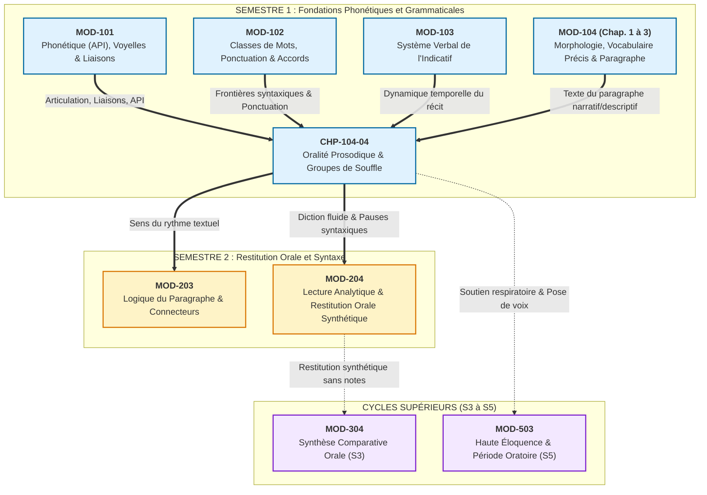

# Chapitre 4 — Oralité Prosodique, Groupes de Souffle et Lecture Expresse : Physiologie Vocale, Pauses Hiérarchisées et Courbes Mélodiques

> **Identifiant du chapitre** : `CHP-104-04`  
> **Module de rattachement** : [`MOD-104` — Précision Lexicale de Base, Familles de Mots, Lecture Fluide, Paragraphe Narratif/Descriptif et Oralité Prosodique](file:///f:/Formation/world-class-french/03-curriculum/year-1/semester-1/mod-104-lexique-lecture-paragraphe.md)  
> **Semestre académique** : Année 1 — Semestre 1 (S1)  
> **Volume horaire canonique** : 5 à 6 heures d'apprentissage autonome délibéré et d'ateliers d'application  
> - *Phase 1 — Étude conceptuelle & observation* : 1 h 30 min (rubriques 1 à 13)  
> - *Phase 2 — Pratique délibérée & exercices progressifs* : 1 h 30 min (rubrique 14)  
> - *Phase 3 — Correction critique & production réelle* : 1 h 00 min (rubriques 15 et 16)  
> - *Phase 4 — Ancrage mnésique & évaluation sommative* : 1 h 00 min (rubriques 17 à 20)  
> **Statut du document** : [STATUT : VALIDÉ]  
> **Compétences cibles du référentiel** :  
> - [`FR-PHON-001` — Maîtrise des contrastes phonologiques et de la prosodie formelle](file:///f:/Formation/world-class-french/02-competency-framework/competency-framework.md#fr-phon-001-maîtrise-des-contrastes-phonologiques-et-de-la-prosodie-formelle) (Cible : Palier L3 — Autonomie)  
> - [`FR-INT-001` — Rédaction d'un texte long cohérent avec maîtrise des accords et de la ponctuation](file:///f:/Formation/world-class-french/02-competency-framework/competency-framework.md#fr-int-001-rédaction-dun-texte-long-cohérent-avec-maîtrise-des-accords-et-de-la-ponctuation) (Cible : Palier L2 — Application guidée au paragraphe)  
> **Sources savantes de référence** : Pierre Léon, *Phonétisme et prononciations du français* (6e éd. refondue, 2011, chap. 6 & 7) [`SRC-PHON-01`](file:///f:/Formation/world-class-french/07-resources/source-registry.md#5-phonétique-phonologie-et-prosodie) ; François Wioland, *Prononcer les mots du français : des sons et des rythmes* (1991) [`SRC-PHON-02`](file:///f:/Formation/world-class-french/07-resources/source-registry.md#5-phonétique-phonologie-et-prosodie) ; Bernard Tranel, *The Sounds of French: An Introduction* (1987) [`SRC-PHON-03`](file:///f:/Formation/world-class-french/07-resources/source-registry.md#5-phonétique-phonologie-et-prosodie) ; Maurice Grevisse et André Goosse, *Le Bon Usage* (16e éd., 2016, § 42-47) [`SRC-GRAM-01`](file:///f:/Formation/world-class-french/07-resources/source-registry.md#1-grammaires-et-traités-de-référence-norme-et-description).

---

## 1. Titre et Place dans le Cursus

Le présent chapitre s'intitule **« Oralité Prosodique, Groupes de Souffle et Lecture Expresse : Physiologie Vocale, Pauses Hiérarchisées et Courbes Mélodiques »** (`CHP-104-04`).

Dans l'économie générale du cursus **World-Class French**, ce chapitre représente la **clé de voûte et le couronnement oral du Semestre 1**. Après avoir assaini l'inventaire phonétique, les oppositions vocaliques et les liaisons obligatoires dans `MOD-101`, stabilisé l'armature morphosyntaxique des classes de mots dans `MOD-102`, et exploré les temps fondamentaux du récit dans `MOD-103`, l'apprenant aborde dans le module `MOD-104` le passage décisif du mot isolé au texte vivant.

Tandis que les chapitres 1, 2 et 3 de `MOD-104` construisent la précision morphologique, l'éradication du vague lexical et l'architecture du paragraphe unitaire écrit, le chapitre 4 réalise la synthèse concrète entre la structure syntaxique écrite et sa profération vocale. Il enseigne comment transformer des signes graphiques silencieux en une ligne mélodique intelligible, respirable et expressive.



### Articulation amont et aval
- **En amont** : Ce chapitre réinvestit directement l'automatisation des liaisons obligatoires et l'interdiction absolue des liaisons fautives acquises en [`MOD-101`](file:///f:/Formation/world-class-french/03-curriculum/year-1/semester-1/mod-101-diagnostic-phonetique-alphabet.md) (`CHP-101-04`), ainsi que le repérage de la phrase graphique et des signes de ponctuation acquis en [`MOD-102`](file:///f:/Formation/world-class-french/03-curriculum/year-1/semester-1/mod-102-classes-mots-accords-fondamentaux.md) (`CHP-102-03`).
- **En aval** : Il pose les fondations neuromotrices indispensables à la lecture analytique et à la restitution orale de synthèse au Semestre 2 dans [`MOD-204`](file:///f:/Formation/world-class-french/03-curriculum/year-1/semester-1/mod-104-lexique-lecture-paragraphe.md), puis à la déclamation des périodes oratoires au Semestre 5 dans le cadre de la haute éloquence.

---

## 2. Objectifs Mesurables

Au terme des 5 à 6 heures d'apprentissage autonome et d'entraînement délibéré de ce chapitre, l'apprenant doit maîtriser les **quatre objectifs opérationnels** suivants, alignés sur le palier **L3 (Autonomie)** de la compétence [`FR-PHON-001`](file:///f:/Formation/world-class-french/02-competency-framework/competency-framework.md#fr-phon-001-maîtrise-des-contrastes-phonologiques-et-de-la-prosodie-formelle) :

1. **Segmenter un texte continu en groupes de souffle conformes à la syntaxe** : Identifier et annoter formellement sur partition de texte les frontières de groupes rythmiques (`/`) et de pauses terminales (`//`), en respectant à 100 % l'intégrité des syntagmes nominaux, prépositionnels et verbaux sans jamais couper un constituant immédiat [Réf. `SRC-PHON-01`, chap. 6].
2. **Projeter les courbes intonatives canoniques** : Réaliser distinctement à voix haute l'opposition mélodique entre inflexion montante de continuité (↗, suspension aiguë en fin de groupe non terminal) et inflexion descendante de clôture (↘, chute grave sur la syllabe finale précédant un point), sans verser dans l'intonation monocorde ni dans la récitation scolaire enfantine [Réf. `SRC-PHON-02`, p. 74].
3. **Hiérarchiser les silences et réguler le soutien respiratoire** : Différencier acoustiquement la micro-pause de suspension (virgule, point-virgule : 150 à 300 ms, sans inspiration profonde) de la macro-pause de renouvellement (point : 500 à 900 ms, inspiration diaphragmatique inaudible et détendue), en stabilisant son débit d'élocution dans la fourchette d'orateur de 110 à 130 mots par minute.
4. **Maintenir une diction irréprochable en lecture suivie** : Lire à voix haute un texte de 150 mots sans aucun accident de liaison (zéro cuir en [t], zéro velours en [z], zéro liaison après la conjonction *et*), en plaçant l'accent tonique exclusivement sur la voyelle de la dernière syllabe prononcée de chaque groupe rythmique [Réf. `SRC-GRAM-01`, § 42-47].

---

## 3. Prérequis et Test de Préparation

### Prérequis indispensables
Avant d'aborder ce cours, l'apprenant doit avoir validé :
- La discrimination des phonèmes vocaliques et consonantiques du français standard en alphabet phonétique international (`MOD-101`) ;
- Le système formel des liaisons obligatoires et des liaisons prohibées, en particulier l'interdiction stricte de lier après *et* (`CHP-101-04`) ;
- L'analyse des frontières de constituants syntaxiques majeurs (Sujet, Verbe, Compléments) et la reconnaissance de la ponctuation graphique (`MOD-102`).

### Test de préparation (Diagnostic d'entrée en 5 questions)

Répondez par écrit avant d'aborder la lecture des sections conceptuelles :

1. Dans la phrase *« Les députés de l'assemblée ont voté la loi »*, est-il permis de marquer une pause respiratoire entre *de* et *l'assemblée* ? Pourquoi ?
2. Quelle est la différence phonétique fondamentale entre la syllabe accentuée en français et la syllabe accentuée en anglais ou en espagnol ?
3. Que se produit-il sur le plan mélodique (hauteur de la voix) à la fin d'une proposition subordonnée circonstancielle placée en tête de phrase (*« Lorsque le jour se leva,... »*) ?
4. Dans l'énoncé oral *« Il est parti et a pris son sac »*, quelle faute phonétique grave consisterait à prononcer un son [t] entre *et* et *a* ?
5. Quelle est la vitesse moyenne recommandée (en mots par minute) pour une lecture à voix haute claire et intelligible devant un auditoire ?

<details>
<summary><b>Consulter le corrigé du test de préparation</b></summary>

* **Réponse 1** : **Non, absolument pas.** Le syntagme prépositionnel *de l'assemblée* forme une unité syntaxique indissociable avec son déterminant et son nom. Couper entre la préposition et le groupe nominal (*de / l'assemblée*) constitue une rupture de constituant immédiat qui détruit l'intelligibilité syntaxique pour l'auditeur.
* **Réponse 2** : En français, l'accent tonique est un **accent de groupe** (ou accent syntagmatique) qui frappe quasi invariablement la **dernière syllabe prononcée** du groupe rythmique par allongement de durée, alors qu'en anglais ou en espagnol, l'accent est lexical, mobile et frappe chaque mot individuel avec une forte intensité expiratoire.
* **Réponse 3** : L'intonation est obligatoirement **montante (↗)**. Elle signale la continuation de la pensée, le lien de dépendance syntaxique et l'attente de la proposition principale à venir.
* **Réponse 4** : Il s'agit d'une transgression de l'interdiction absolue de liaison après la conjonction *et*, combinée à un **cuir** (liaison vicieuse en [t]). La prononciation normée exige une disjonction nette : `[e a pʁi]` sans consonne intercalaire [Réf. `SRC-GRAM-01`, § 46].
* **Réponse 5** : Le débit oratoire de référence se situe entre **110 et 130 mots par minute**. En deçà (moins de 90 mots/min), la parole devient traînante et soporifique ; au-delà (plus de 150 mots/min), la clarté articulatoire se dégrade et le cerveau de l'auditeur sature cognitivement.

</details>

---

## 4. Situation de Départ ou Problème Concret

Considérez les trois profils typiques observés dans les universités, les concours administratifs et les présentations professionnelles lors de l'exercice de la lecture à voix haute ou de la prise de parole sur texte :

1. **L'élocution « mitraillette »** : L'orateur entame le premier paragraphe sur une inspiration thoracique précipitée. Terrifié par le silence, il accélère sans cesse son débit pour « en finir au plus vite ». Arrivé au tiers de la phrase, il manque cruellement d'air, asphyxié, et coupe le mot en plein milieu pour reprendre une goulée d'air bruyante et stridente (*« le gouvernement a décidé de / (inspiration haletante) / financer ce projet »*). L'auditoire ne retient rien d'autre que la sensation de panique du lecteur.
2. **Le hachoir syntaxique** : L'orateur prononce les mots deux par deux, au hasard de son regard qui bute sur la page, sans perception des groupes de sens : *« Les... nouveaux... / étudiants de... / l'université ont... / reçu leurs... / attestations hier... »*. Chaque mot semble flotter dans le vide sans relation avec son voisin. Le sens global du texte s'évapore.
3. **La psalmodie scolaire monocorde** : L'orateur applique une ritournelle enfantine mécanique : la voix monte artificiellement sur chaque virgule avec une intonation maniérée, puis descend pesamment sur chaque point, toujours sur la même note, sans aucune vibration émotionnelle ni gradation intellectuelle. L'auditoire s'engourdit en moins de deux minutes.

Face au micro, à un jury d'examen ou à une assemblée, la plupart des locuteurs croient que le problème réside dans un manque de confiance ou dans une « mauvaise voix » naturelle. C'est une erreur de diagnostic : la voix n'est que l'instrument physique d'un **système prosodique inconscient**. Sans méthode explicite pour dompter le souffle, identifier les frontières de groupes et tracer la courbe des hauteurs, l'oralisation demeure une épreuve physique et un échec de communication.

---

## 5. Explication Intuitive

Pour maîtriser intuitivement l'oralité prosodique, prenons l'analogie de la **navigation maritime au milieu des vagues** ou de la **marche en montagne**.

Lorsque vous marchez sur un sentier escarpé, vous ne respirez pas à contretemps de vos pas : vous synchronisez naturellement votre souffle avec le rythme régulier de votre foulée. Si vous tentez de courir en apnée puis d'aspirer de l'air par saccades désordonnées au moment précis où vous franchissez un obstacle, vous vous épuisez en quelques mètres.

Il en va exactement de même pour la phrase française :
- La phrase n'est pas une ligne droite uniforme, mais une **suite de vagues syntaxiques successives**.
- Chaque vague forme un **groupe de souffle (groupe rythmique)**. À l'intérieur de la vague, les mots nagent ensemble dans un flux continu, sans accroc, parfaitement soudés.
- Au sommet de la vague intermédiaire, la voix s'élève légèrement : c'est la crête d'écume montante (↗), qui annonce que la vague suivante arrive. Vous ne reprenez pas une grande gorgée d'air : vous marquez une imperceptible suspension de continuité.
- À la fin de la phrase graphique, la vague déferle sur la grève et s'éteint : la voix descend naturellement dans le grave (↘), dans un sentiment de détente et de clôture achevée. C'est ici, au creux du repos complet, que le diaphragme s'abaisse sans bruit pour renouveler la réserve d'air de manière invisible et automatique.

Tant que vous respirez au creux naturel des vagues syntaxiques, **vous ne manquez jamais d'air**, et le larynx ne subit aucune fatigue musculaire. La mélodie porte le sens sans aucun effort d'emphase.

---

## 6. Définitions Précises et Terminologie

Les traités de phonétique et de linguistique descriptive [Réf. `SRC-PHON-01`, `SRC-PHON-02`, `SRC-PHON-03`, `SRC-GRAM-01`] établissent une terminologie technique rigoureuse pour l'analyse de l'oralité :

| Terme technique | Définition formelle rigoureuse | Exemple ou ancrage acoustique |
| :--- | :--- | :--- |
| **Prosodie** | Ensemble des caractéristiques phonétiques suprasegmentales de la parole, comprenant l'intonation (hauteur mélodique $F_0$), le rythme (durée des syllabes et pauses) et l'intensité acoustique [Réf. `SRC-PHON-01`, chap. 6]. | La différence mélodique entre l'affirmation *« Il vient. »* et l'interrogation *« Il vient ? »*. |
| **Groupe de souffle (ou groupe rythmique)** | Segment de chaîne parlée émis sur une seule expiration continue, unifié par la syntaxe et couronné sur sa dernière syllabe par un accent tonique [Réf. `SRC-PHON-02`, p. 45]. | *« [Les étudiants de première année] / [préparent leurs examens.] »* (2 groupes). |
| **Accent tonique de groupe** | Allongement de durée acoustique (doublé d'une légère variation de hauteur) frappant la dernière syllabe prononcée d'un groupe rythmique en français standard [Réf. `SRC-PHON-01`, chap. 7]. | Dans *« la républi**que** »*, la syllabe */lik/* est 1,5 à 2 fois plus longue que les précédentes. |
| **Accent d'insistance (expressif)** | Accentuation facultative à valeur affective ou contrastive frappant la première consonne (ou syllabe) d'un mot pour le mettre en relief [Réf. `SRC-PHON-01`, p. 142]. | *« C'est **for**midable ! »*, *« C'est **in**tolérable ! »* (énergie d'attaque sur l'initiale). |
| **Intonation montante (↗)** | Trajectoire ascendante de la fréquence fondamentale vocale marquant l'inachèvement syntaxique, la suspension ou la dépendance [Réf. `SRC-PHON-01`, chap. 6]. | Fin de la subordonnée : *« Dès que le soleil paraîtra, ↗ [...] »*. |
| **Intonation descendante (↘)** | Trajectoire descendante de la fréquence fondamentale sous la ligne de hauteur moyenne, signalant la complétude sémantique et la fin de phrase [Réf. `SRC-PHON-02`, p. 74]. | Fin d'assertion : *« [...] la caravane reprendra sa route. ↘ »*. |
| **Pause de continuité** | Suspension brève du son (150 à 300 ms), généralement sans inspiration, maintenant la tension syntaxique active [Réf. `SRC-PHON-01`]. | La pause matérialisée par la virgule à l'intérieur de la phrase complexe. |
| **Pause terminale** | Arrêt complet du flux phonatoire (500 à 900 ms) permettant le renouvellement diaphragmatique inaudible de l'air [Réf. `SRC-PHON-02`]. | Le silence séparant deux phrases graphiques au point. |
| **Débit de parole** | Vitesse d'élocution mesurée en nombre de syllabes ou de mots prononcés par unité de temps (minute) [Réf. `SRC-PHON-02`]. | Vitesse de lecture standardisée : 110 à 130 mots/min (soit environ 3 à 4 syllabes/sec). |
| **Soutien abdominal** | Engagement coordonné des muscles abdominaux profonds (transverse) régulant la pression sous-glottique lors de l'expiration vocale. | La sensation de maintien ferme du bas-ventre qui évite le pincement de la gorge. |

---

## 7. Règles et Mécanismes Fondamentaux

L'oralité prosodique maîtrisée s'articule autour de cinq mécanismes physiologiques et phonosyntaxiques complémentaires.

### 7.1 Physiologie et Mécanique Respiratoire : Le Moteur du Son

Le son de la parole est le produit d'une colonne d'air expiratoire mise en vibration par les cordes vocales dans le larynx, puis sculptée et amplifiée par les résonateurs (pharynx, cavité buccale, fosses nasales).

```
   [ Résonateurs supérieurs : bouche, voile du palais, fosses nasales ]
                                   ▲
                     [ Larynx : cordes vocales ]  <-- Détente laryngée absolue
                                   ▲
                    [ Trachée & cage thoracique ]
                                   ▲
               [ Diaphragme & muscles abdominaux profonds ]  <-- Moteur du souffle
```

1. **La respiration diaphragmatique basse** : L'inspiration ne doit jamais être claviculaire ou thoracique haute (épaules qui montent, cou qui se crispe). Elle s'opère par l'abaissement du diaphragme, provoquant un gonflement naturel souple du bas-ventre et des côtes flottantes.
2. **Le soutien abdominal continu** : Pendant la phonation, les muscles abdominaux (le transverse notamment) exercent une pression douce, régulière et continue vers l'intérieur et le haut. C'est ce soutien qui assure une **pression sous-glottique constante**, permettant à la voix d'être timbrée, audible et stable sans forcer sur la gorge.
3. **La détente laryngée et la mâchoire libre** : Le larynx doit demeurer en position basse et détendue. Toute tension dans la mâchoire inférieure bride les voyelles et étouffe la projection acoustique.
4. **Le calibre du débit oratoire** : Un débit de lecture maîtrisé se situe rigoureusement entre **110 et 130 mots par minute**. Cette vitesse garantit la réalisation intégrale des voyelles pleines, prévient la déglutition hâtive des finales de mots et ménage l'espace acoustique pour les pauses d'intelligibilité.

### 7.2 Le Groupe de Souffle : Découpage Phonosyntaxique Naturel

Le groupe de souffle (ou groupe rythmique) est l'unité de base de la structure prosodique du français. En français standard, la langue refuse d'accentuer chaque mot isolément : elle accentue des **groupes de mots unis par le sens**.

> **Règle d'or de l'intégrité syntagmatique** :  
> Le groupe rythmique coïncide obligatoirement avec un constituant syntaxique majeur. Il est strictement interdit d'interrompre l'intérieur d'un syntagme soudé par une pause ou une rupture de flux phonatoire.

Les frontières autorisées et interdites de groupes de souffle se définissent ainsi :

- **Frontières interdites (intégrité absolue)** :
  - À l'intérieur d'un syntagme nominal : interdiction de séparer le déterminant du nom (*\*le / président*), l'adjectif antéposé du nom (*\*un grand / homme*), ou le nom de son complément prépositionnel direct figé (*\*le ministre de / l'intérieur*).
  - Entre le pronom personnel conjoint (clitique) et le verbe : interdiction de couper entre le pronom sujet et le verbe (*\*il / viendra*), ou entre le pronom objet et le verbe (*\*je vous / prie*).
  - À l'intérieur d'une locution conjonctive ou prépositionnelle : (*\*alors / que*, *\*afin / de*).
- **Frontières autorisées et naturelles** :
  - Entre le syntagme nominal sujet développé et le syntagme verbal : *[Le directeur général de l'entreprise] / [a signé le décret.]*
  - Devant ou après un complément circonstanciel détaché : *[Hier matin,] / [dans la cour du palais,] / [la cérémonie a commencé.]*
  - Entre deux propositions coordonnées ou subordonnées : *[Il a présenté son projet,] / [mais l'assemblée a refusé de voter.]*

### 7.3 La Hiérarchie des Pauses : Signaux de Conduite de l'Auditeur

Le silence en parole n'est pas un vide : c'est un opérateur grammatical et cognitif. Deux types de silences doivent être scrupuleusement hiérarchisés par l'orateur :

```
                  ┌──────────────────────────────────────────────┐
                  │          HIÉRARCHIE DES SILENCES             │
                  └──────────────────────────────────────────────┘
                                  │
         ┌────────────────────────┴────────────────────────┐
         ▼                                                 ▼
[ Micro-pause de continuité ]                    [ Macro-pause terminale ]
• Durée : 150 à 300 ms                           • Durée : 500 à 900 ms
• Graphie : virgule, point-virgule               • Graphie : point, !, ?
• Rôle : suspension sans inspiration             • Rôle : clôture & renouveau d'air
• Geste : maintien de la tension                 • Geste : détente abdominale inaudible
```

1. **La micro-pause de continuité (150 à 300 millisecondes)** :
   - Correspond graphiquement à la virgule, au tiret d'incise ou au point-virgule.
   - Acoustiquement, la voix s'arrête une fraction de seconde, mais **la cage thoracique reste suspendue** : le lecteur ne reprend pas d'air ou ne prend qu'une inspiration buccale infinitésimale inaudible. L'énergie vocale reste mobilisée.
2. **La macro-pause terminale (500 à 900 millisecondes)** :
   - Correspond graphiquement au point simple, au point d'exclamation, au point d'interrogation ou au changement de paragraphe.
   - Acoustiquement, le son s'éteint complètement. C'est l'espace réservé au **renouvellement de l'air diaphragmatique** : les muscles abdominaux se relâchent instantanément, le diaphragme descend, l'air entre par le nez et la bouche entrouverte sans bruit d'aspiration. Le lecteur est prêt pour la phrase suivante.

### 7.4 Les Courbes Mélodiques Cardinales : La Trajectoire du Sens

La hauteur de la voix (sa fréquence fondamentale $F_0$) varie en permanence selon une grammaire intonative universelle en français :

1. **L'inflexion montante de continuité (↗)** :
   - Elle caractérise la syllabe finale accentuée d'un groupe non terminal.
   - La voix monte d'un intervalle musical perceptible (vers l'aigu). Ce signal acoustique avertit l'auditeur : *« Ne déconnectez pas votre attention, la proposition n'est pas complète, la suite arrive ! »*.
2. **L'inflexion descendante de clôture (↘)** :
   - Elle caractérise la syllabe finale de la phrase déclarative.
   - La voix descend nettement sous la ligne mélodique moyenne de l'énoncé. Ce signal avertit l'auditeur : *« L'idée est close, la proposition est syntaxiquement et sémantiquement achevée. »*.
3. **L'intonation interrogative totale directe (⤢ ou forte montée finale ↗↗)** :
   - La voix s'élève très haut sur la dernière syllabe (*« Viendrez-vous demain ? ↗↗ »*).
4. **L'accent circonflexe d'insistance expressive (⤹↗↘)** :
   - Lorsque le locuteur veut souligner un terme (*« C'est un **scandale** absolu ! »*), il place une attaque percutante sur la première syllabe consonnantique, créant une courbe en relief avant de regagner la mélodie courante.

### 7.5 Diction et Justesse Expressive : Synthèse Normative avec MOD-101

Une lecture prosodique de haute volée n'est ni un déchiffrement mécanique ni une caricature théâtrale compassée. Elle exige la réactivation intégrale des règles de prononciation standard consolidées au Semestre 1 :

- **Respect rigoureux des liaisons obligatoires** :
  - Déterminant + Nom : *les‿enfants* [le.zɑ̃.fɑ̃], *un‿homme* [œ̃.nɔm].
  - Pronom sujet clitique + Verbe : *ils‿arrivent* [il.za.ʁiv], *on‿écoute* [ɔ̃.ne.kut].
  - Adjectif antéposé + Nom : *un grand‿ami* [œ̃.gʁɑ̃.ta.mi], *de beaux‿arbres* [də.bo.zaʁbʁ].
- **Tolérance zéro pour les anomalies de liaison** :
  - Interdiction absolue après la conjonction *et* : *Pierre et | André* [pjɛʁ e ɑ̃.dʁe] (jamais *\*et-t-André*).
  - Proscription absolue des cuirs (liaisons indues en [t] : *\*il a-t-été*) et des velours (liaisons indues en [z] : *\*cent-z-euros*).
- **Sobriété de l'élocution** :
  - Éviter la « diction du bon élève d'école primaire » qui insiste lourdement sur chaque syllabe sans jamais lier les mots en groupes organiques.
  - Éviter la fausse préciosité grandiloquente qui multiplie les trémolos vocaux et les liaisons facultatives désuètes.

---

## 8. Raisonnement Détaillé (Le Pourquoi Phonosyntaxique)

Pourquoi la prosodie est-elle considérée par les linguistes et les sciences cognitives comme le « sous-titre intellectuel et émotionnel » de la parole ?

Lorsque nous lisons un texte des yeux, notre cerveau s'appuie sur une armure visuelle de symboles graphiques :
- Les espaces blancs entre les mots délimitent les morphèmes ;
- Les virgules et les points découpent les propositions ;
- Les majuscules marquent le commencement d'une unité de pensée.

À l'oral, **cette armature visuelle n'existe pas**. Le flux sonore continu n'est qu'une onde acoustique ininterrompue qui frappe le tympan de l'auditeur. Si le lecteur se contentait de proférer une succession de syllabes à intensité et hauteur égales, le cerveau de l'auditeur serait incapable de segmenter le message en temps réel. Il devrait analyser chaque son après coup, ce qui provoquerait une saturation cognitive immédiate.

C'est ici qu'intervient la prosodie. En élevant la voix sur les syllabes de continuation (↗) et en allongeant la durée de la voyelle finale de chaque groupe rythmique, le lecteur fournit à l'auditeur des **balises acoustiques de calcul syntaxique** :
1. L'allongement de la syllabe finale annonce la fin d'un bloc de sens ;
2. La montée de la hauteur mélodique maintient la mémoire de travail de l'auditeur ouverte en attendant le verbe ou le complément ;
3. La chute mélodique terminale (↘) ordonne au cerveau de l'auditeur de clore le traitement de la proposition et de l'archiver dans sa compréhension globale.

La prosodie n'est donc pas un ornement esthétique : c'est l'interface acoustique indispensable sans laquelle la grammaire demeure inaudible.

---

## 9. Exemples Corrects Commentés

Examinons deux textes modèles disséqués avec le système formel d'annotation prosodique de référence :
- `/` : Frontière de groupe de souffle (pause brève ou continuité)
- `//` : Frontière de phrase / pause terminale (reprise diaphragmatique d'air)
- `↗` : Inflexion montante de continuité (suspension mélodique)
- `↘` : Inflexion descendante de clôture (chute mélodique conclusive)
- `‿` : Liaison obligatoire réalisée

### Texte Modèle 1 : Prose Classique Narrative (Marcel Proust réinvesti)

Texte source :
> *« Longtemps, je me suis couché de bonne heure. Parfois, à peine ma bougie éteinte, mes yeux se fermaient si vite que je n'avais même pas le temps de me dire : "Je m'endors." »*

Partition prosodique annotée :
```
[Longtemps,] ↗ /
[je me suis couché de bonne heure.] ↘ //

[Parfois,] ↗ /
[à peine ma bougie éteinte,] ↗ /
[mes yeux se fermaient si vite] ↗ /
[que je n'avais même pas le temps] ↗ /
[de me dire :] ↗ /
[« Je m'endors. »] ↘ //
```

**Commentaire analytique détaillé** :
1. *Premier groupe : [Longtemps,] ↗ /* — Adverbe cadratif détaché d'une seule syllabe. La voyelle nasale /ɑ̃/ est allongée, la mélodie s'élève nettement pour créer l'attente du sujet.
2. *Deuxième groupe : [je me suis couché de bonne heure.] ↘ //* — Six syllabes métriques en flux continu sans aucune coupure interne. L'accent tonique frappe la dernière syllabe *heure* /œʁ/, sur laquelle la voix descend franchement dans le grave. Arrêt complet (//), renouvellement d'air diaphragmatique inaudible.
3. *Seconde phrase (progression en arche) :*
   - *[Parfois,] ↗ /* : Première suspension cadractive ;
   - *[à peine ma bougie éteinte,] ↗ /* : Complément circonstanciel temporel, montée mélodique progressive ;
   - *[mes yeux se fermaient si vite] ↗ /* : Proposition principale, tension maximale, la voix reste haut perchée ;
   - *[que je n'avais même pas le temps] ↗ /* : Subordonnée consécutive, maintien de la hauteur d'attente ;
   - *[de me dire :] ↗ /* : Infinitif d'annonce, brève suspension suspendue au bord du vide ;
   - *[« Je m'endors. »] ↘ //* : Citation finale, chute abrupte et complète de la hauteur sur */dɔʁ/*, détente complète.

### Texte Modèle 2 : Prose Oratoire Contemporaine et Francophone

Texte source :
> *« Au cœur de la ville nouvelle, les jeunes entrepreneurs bâtissent l'avenir avec audace, refusant les fatalismes du passé et traçant chaque jour les voies de la prospérité commune. »*

Partition prosodique annotée :
```
[Au cœur de la ville nouvelle,] ↗ /
[les jeunes‿entrepreneurs] ↗ /
[bâtissent l'avenir avec‿audace,] ↗ /
[refusant les fatalismes du passé] ↗ /
[et traçant chaque jour] ↗ /
[les voies de la prospérité commune.] ↘ //
```

**Commentaire analytique détaillé** :
1. *[Au cœur de la ville nouvelle,] ↗ /* : Syntagme prépositionnel circonstanciel de 7 syllabes. Accent de groupe sur *-velle*, montée intonative sans inspiration.
2. *[les jeunes‿entrepreneurs] ↗ /* : Syntagme nominal sujet. Noter l'enchaînement avec liaison obligatoire de l'adjectif antéposé pluriel : *jeunes‿entrepreneurs* [ʒœn.zɑ̃.tʁə.pʁə.nœʁ]. L'accent frappe la finale *-neurs*.
3. *[bâtissent l'avenir avec‿audace,] ↗ /* : Syntagme verbal principal. Liaison facultative soignée ou enchaînement sur *avec‿audace* [a.vɛ.ko.das]. Montée de continuité.
4. *[refusant les fatalismes du passé] ↗ /* : Participe présent en apposition, maintien de la tension vers l'avant.
5. *[et traçant chaque jour] ↗ /* : Jonction par coordination. Attention : disjonction absolue après *et* [e tʁa.sɑ̃], zéro liaison en [t].
6. *[les voies de la prospérité commune.] ↘ //* : Chute conclusive majestueuse. Le ton descend graduellement sur *prospérité* puis s'installe dans le registre grave terminal sur la dernière syllabe de *commune* [kɔ.myn]. Pause terminale majeure de 800 ms.

---

## 10. Contre-Exemples et Erreurs Fréquentes

L'apprentissage de la lecture à haute voix et de la prise de parole soignée révèle six erreurs récurrentes majeures chez les locuteurs en phase de consolidation :

### Erreur n° 1 : Le coup de glotte inspiratoire au milieu du syntagme nominal

- **Manifestation pathologique** : Le lecteur s'arrête brusquement d'émettre du son entre le nom et son complément déterminatif : *« Le conseil des / (inspiration bruyante) / ministres s'est réuni. »*
- **Réfutation scientifique** : Le syntagme nominal *le conseil des ministres* constitue une tête syntaxique indécomposable. Intercaler une pause respiratoire sépare le noyau de son expansion directe, brisant la relation de rection dans l'esprit de l'auditeur.
- **Rectification normée** : Inspirer avant le groupe nominal et prononcer l'intégralité du syntagme en un seul souffle continu : *[Le conseil des ministres] ↗ / [s'est réuni.] ↘ //*.

### Erreur n° 2 : La descente intonative prématurée sur chaque virgule

- **Manifestation pathologique** : À chaque virgule de la phrase, la voix chute dans le grave comme s'il s'agissait d'un point final : *« Bien que la pluie tombât, (ton grave ↘) les marcheurs poursuivirent leur route. »*
- **Réfutation scientifique** : L'intonation descendante signale acoustiquement l'achèvement sémantique. Chuter sur une subordonnée concessive ou temporelle indique faussement à l'auditeur que l'idée est terminée, créant un contresens architectural et une impression de hachage morose.
- **Rectification normée** : Maintenir l'intonation montante (↗) sur toute virgule non terminale : *[Bien que la pluie tombât,] ↗ / [les marcheurs poursuivirent leur route.] ↘ //*.

### Erreur n° 3 : Le débit précipité asphyxiant

- **Manifestation pathologique** : L'orateur prononce 170 à 190 mots par minute, trébuche sur les consonnes doubles, escamote les syllabes intérieures et termine chaque phrase à bout de souffle dans un râle étouffé.
- **Réfutation scientifique** : L'accélération du débit réduit la durée vocalique en deçà du seuil de perception des timbres et interdit la mise en place du soutien abdominal. L'orateur passe en apnée réflexe, ce qui amplifie son anxiété cardiaque.
- **Rectification normée** : Contraindre le métronome intérieur à **120 mots par minute**. Allonger délibérément les voyelles des accents de groupe et savourer les silences des points.

### Erreur n° 4 : L'accentuation tonique sur chaque mot à l'anglo-saxonne

- **Manifestation pathologique** : Le lecteur frappe chaque mot avec une secousse d'intensité sur sa première ou deuxième syllabe : *« **NOUS** **A-VONS** **DÉ-CI-DÉ** de **PAR-TIR** »*.
- **Réfutation scientifique** : Le français est une langue à chronométrie syllabique (*syllable-timed*), caractérisée par l'isochronie relative des syllabes atones et par un unique accent tonique final de groupe. Tenter d'accentuer chaque mot individuel crée une cacophonie rythmique heurtée, étrangère au génie acoustique de la langue française.
- **Rectification normée** : Glisser avec fluidité et légèreté sur l'ensemble des syllabes atones jusqu'à la dernière syllabe du groupe, qui reçoit seule l'allongement expressif : *[Nous avons décidé de partir.] ↘ //*.

### Erreur n° 5 : La liaison interdite après « et »

- **Manifestation pathologique** : Faire entendre une consonne [t] entre la conjonction *et* et le mot suivant à initiale vocalique : *« Il a lu le livre et-t-a compris la leçon. »*
- **Réfutation scientifique** : C'est la faute d'oralité la plus lourdement pénalisée dans les jurys académiques et les concours d'éloquence. Historiquement et normativement, la conjonction *et* provient du latin *et*, dont le *t* s'est totalement amuï sans jamais entrer dans le paradigme des consonnes latentes réactivables. Tous les grammairiens [Réf. `SRC-GRAM-01`, § 46] classent cette liaison comme un cuir intolérable.
- **Rectification normée** : Marquer une disjonction articulatoire nette : *« [Il a lu le livre] ↗ / [et | a compris la leçon.] ↘ // »* [e a kɔ̃.pʁi].

### Erreur n° 6 : La récitation monocorde et la voix blanche

- **Manifestation pathologique** : Lire un texte d'une voix totalement plate, sur une seule fréquence hertzienne fixe, sans aucune modulation d'inflexion ni variation d'intensité, du premier au dernier mot.
- **Réfutation scientifique** : La voix blanche résulte de l'inhibition du système laryngé et de la peur de s'exposer. Acoustiquement, un signal monotone régulier désactive la vigilance du cortex auditif de l'auditeur en moins de 90 secondes par accoutumance neurophysiologique.
- **Rectification normée** : Varier la hauteur : monter d'une tierce ou d'une quinte sur les incises et les relances, descendre d'une quarte sur les chutes conclusives, et projeter l'intention de communiquer avec le regard relevé vers l'auditoire.

---

## 11. Cas Particuliers et Limites

### 11.1 L'Incise de Dialogue : Changement de Registre et Débit Accéléré
Lorsqu'une phrase intègre une incise de dialogue (*dit-il, répondit l'ambassadeur, s'exclama-t-elle*), la loi prosodique classique commande une rupture de plan acoustique :
- La citation s'énonce sur la hauteur moyenne normale ;
- L'incise s'énonce sur une **hauteur plus basse (registre grave)** et avec un **débit légèrement accéléré**, comme une parenthèse discrète ;
- Dès la reprise du dialogue ou du récit principal, la voix réintègre immédiatement sa hauteur initiale.
> Exemple : *« [Je ne renoncerai jamais,] ↗ [déclara le ministre d'une voix calme,] (grave et rapide) [à défendre cette liberté.] ↘ // »*

### 11.2 La Lecture de Vers Poétiques vs La Prose : Le Sort du Schwa /ə/
En prose courante ou oratoire soignée, le *e caduc* (schwa) final s'amuït presque constamment (*une grande porte* = [yn gʁɑ̃d pɔʁt], 3 syllabes phoniques).
En revanche, dans la récitation classique de vers réguliers (l'alexandrin de 12 syllabes métriques notamment) :
- Le schwa compte obligatoirement pour une syllabe métrique devant un mot commençant par une consonne (*« Les vêmeneux / secrets... »*) ;
- Il s'élide obligatoirement devant un mot commençant par une voyelle ou un *h* muet (*« Vastes‿oiseaux »* = 3 syllabes, prononcé [vast.zwa.zo] sans schwa intercalaire) ;
- La pause médiane obligatoire à l'hémistiche (6e syllabe) commande une inflexion montante majeure de suspension.

### 11.3 La Citation Directe et les Deux-Points
Devant une citation directe introduite par deux-points et guillemets, l'orateur doit marquer une **pause d'annonce** (environ 400 ms) accompagnée d'une intonation suspendue en hauteur moyenne-haute, sans chuter dans le grave, pour matérialiser acoustiquement l'ouverture des guillemets.

---

## 12. Approfondissement Adapté au Niveau

### 12.1 Le Modèle Prosodique de Pierre Delattre et Philippe Mertens
Dans ses travaux pionniers sur les intonations de base du français [Réf. `SRC-PHON-01`, chap. 6], le phonéticien Pierre Delattre a formalisé une échelle de **quatre niveaux mélodiques de référence** :
- **Niveau 4 (Aigu extrême)** : Intonation interrogative totale directe ou exclamation véhémente ;
- **Niveau 3 (Aigu moyen)** : Continuation majeure (fin de proposition subordonnée ou de grand membre de période) ;
- **Niveau 2 (Médium)** : Continuation mineure (fin de petit groupe nominal à l'intérieur de la proposition) et hauteur d'attaque de phrase ;
- **Niveau 1 (Grave)** : Clôture déclarative définitive (chute terminale au point).

```
Niveau 4 : ---------------------------------------- (Interrogation / Exclamation)
Niveau 3 :                   [Continuation majeure ↗]
Niveau 2 : [Attaque] ─── [Cont. mineure ↗]
Niveau 1 :                                            [Chute terminale ↘]
```

L'application consciente de ces quatre paliers permet à l'apprenant d'architecturer n'importe quelle période oratoire complexe sans jamais perdre la direction de la phrase.

### 12.2 Typologie Rythmique : Langues Isochroniques vs Langues Syllabiques
Les recherches typologiques [Réf. `SRC-PHON-02`] distinguent deux grandes familles de langues selon leur organisation temporelle :
1. **Les langues à accentuation temporelle (*stress-timed*)** : Comme l'anglais, l'allemand ou le russe. Les intervalles entre deux accents toniques sont de durée constante, ce qui contraint les voyelles inaccentuées à être réduites, neutralisées ou compressées.
2. **Les langues à chronométrie syllabique (*syllable-timed*)** : Comme le français ou l'espagnol. Chaque syllabe possède une durée approximativement égale (isochronie syllabique), à l'exception de la dernière syllabe du groupe rythmique qui s'allonge. C'est pourquoi le français donne cette impression de régularité fluide et mélodique, souvent comparée à un ruban sonore continu.

---

## 13. Comparaisons Différentielles

Les tableaux comparatifs suivants permettent d'ancrer définitivement les distinctions prosodiques fondamentales :

### Tableau 1 : Pause Courte (de Continuité) vs Pause Longue (Terminale)

| Critère d'opposition | Pause Courte de Continuité | Pause Longue Terminale |
| :--- | :--- | :--- |
| **Marqueur graphique associé** | Virgule, point-virgule, tiret d'incise, deux-points. | Point simple, point d'exclamation, point d'interrogation. |
| **Durée acoustique moyenne** | 150 à 300 millisecondes. | 500 à 900 millisecondes. |
| **Comportement respiratoire** | Suspension du souffle, pas d'inspiration complète. | Détente abdominale complète, inspiration inaudible. |
| **Tension syntaxique** | Active : l'auditeur attend la suite du message. | Résolue : l'auditeur intègre l'unité de pensée. |
| **Mouvement mélodique associé** | Inflexion montante (↗) ou tenue en palier. | Inflexion descendante marquée vers le grave (↘). |

### Tableau 2 : Intonation Montante (↗) vs Intonation Descendante (↘)

| Critère d'opposition | Intonation Montante (↗) | Intonation Descendante (↘) |
| :--- | :--- | :--- |
| **Trajectoire acoustique ($F_0$)** | Élévation vers l'aigu au-dessus du médium. | Abaissement net vers le grave sous le médium. |
| **Fonction grammaticale** | Marque d'inachèvement, de corrélation ou de question. | Marque d'assertion close et d'achèvement syntaxique. |
| **Localisation type** | Syllabe finale d'un groupe rythmique intermédiaire. | Syllabe finale précédant le point de clôture. |
| **Effet cognitif sur l'auditeur** | Mobilisation de l'attention et mémoire de travail ouverte. | Soulagement attentionnel et archivage du sens. |
| **Erreur fréquente à proscrire** | Chuter prématurément sur la virgule. | Laisser traîner la voix en suspension sur le point. |

### Tableau 3 : Diction Naturelle Soignée vs Psalmodie Théâtrale Affectée

| Critère d'opposition | Diction Naturelle Soignée (Excellence Cursus) | Psalmodie Théâtrale Affectée (À Éradiquer) |
| :--- | :--- | :--- |
| **Liaisons facultatives** | Rares et mesurées, réservées aux contextes soutenus. | Multipliées artificiellement jusqu'au ridicule pédant. |
| **Modulation intonative** | Organique, calquée sur les liens logiques de la syntaxe. | Grandiloquente, trémolos superficiels et accents déplacés. |
| **Débit** | Régulier, posé, stable (110 à 130 mots/min). | Saccadé, ralentissements affectés et emphase théâtrale. |
| **Perception par l'auditoire** | Clarté, autorité sereine, élégance intellectuelle. | Artifice, gêne de l'auditeur, perte d'authenticité. |

---

## 14. Exercices Progressifs

### Niveau 1 : Repérage des Frontières de Groupes de Souffle sur Phrases Simples (Guidé)

**Consigne** : Pour chacune des phrases suivantes, découpez la chaîne en groupes de souffle en traçant des crochets `[...]`, placez une barre simple `/` à chaque frontière intermédiaire et une double barre `//` en fin de phrase. Indiquez la flèche mélodique (↗ ou ↘) sur la syllabe accentuée de chaque groupe :

1. *Dès l'aube les paysans marchaient vers les champs.*
2. *Le directeur du laboratoire a présenté les résultats de sa recherche.*
3. *Bien qu'il fît froid nous avons décidé de poursuivre notre excursion.*

<details>
<summary><b>Consulter le corrigé du Niveau 1</b></summary>

1. `[Dès l'aube] ↗ / [les paysans] ↗ / [marchaient vers les champs.] ↘ //`  
   *Justification* : Le complément circonstanciel initial forme le premier groupe ; le sujet nominal forme le deuxième groupe ; le prédicat verbal et son complément de lieu forment le groupe terminal.
2. `[Le directeur du laboratoire] ↗ / [a présenté les résultats] ↗ / [de sa recherche.] ↘ //`  
   *(Variante admise à débit légèrement plus rapide : [Le directeur du laboratoire] ↗ / [a présenté les résultats de sa recherche.] ↘ //)*  
   *Justification* : Respect absolu du groupe nominal sujet sans couper entre *directeur* et *du laboratoire*.
3. `[Bien qu'il fît froid,] ↗ / [nous avons décidé] ↗ / [de poursuivre notre excursion.] ↘ //`  
   *Justification* : La subordonnée concessive reçoit l'inflexion montante de continuation majeure ; la principale monte également sur l'infinitif régissant ; la chute descendante s'opère sur *excursion*.

</details>

---

### Niveau 2 : Notation Prosodique Complète d'un Texte Continu (Semi-Autonome)

**Consigne** : Annotez intégralement le texte suivant de 58 mots issu d'un discours académique. Indiquez :
- Les crochets de groupes rythmiques `[...]` ;
- Les barres de pauses mineures `/` et majeures `//` ;
- Les flèches d'intonation ↗ et ↘ ;
- Les arcs de liaisons obligatoires sous forme d'un trait d'union bas `‿` et les disjonctions absolues sous forme de barre verticale `|`.

Texte à annoter :
> *« En cette heure solennelle, nous mesurons l'ampleur de notre tâche. Les anciens maîtres ont tracé la voie avec constance et courage, et les nouvelles générations doivent maintenant assumer leurs responsabilités face aux défis immenses du monde moderne. »*

<details>
<summary><b>Consulter le corrigé du Niveau 2</b></summary>

**Partition modèle annotée** :
```
[En cette‿heure solennelle,] ↗ /
[nous mesurons l'ampleur de notre tâche.] ↘ //

[Les‿anciens maîtres] ↗ /
[ont tracé la voie] ↗ /
[avec constance‿et courage,] ↗ /
[et | les nouvelles générations] ↗ /
[doivent maintenant‿assumer leurs responsabilités] ↗ /
[face‿aux défis‿immenses du monde moderne.] ↘ //
```

**Justifications critiques** :
1. *En cette‿heure* : Liaison obligatoire en [t] après la préposition monosyllabique *en* devant voyelle [ɑ̃.sɛ.tœʁ].
2. *Les‿anciens* : Liaison obligatoire déterminant + adjectif antéposé en [z] [le.zɑ̃.sjɛ̃].
3. *constance‿et* : Enchaînement régulier consonantique /s/ + voyelle /e/.
4. *et | les* : Disjonction catégorique après la conjonction *et*, zéro consonne latente.
5. *maintenant‿assumer* : Liaison facultative soutenue admise en [t] ou disjonction douce.
6. *face‿aux* et *défis‿immenses* : Enchaînement vocalique et liaison pluriel obligatoire adjectif épithète.
7. Équilibre des pauses : Deux grandes phrases graphiques, chacune achevée par une chute mélodique descendante (↘) et une pause macro de renouvellement d'air (//).

</details>

---

### Niveau 3 : Protocole d'Enregistrement Oral sous Chronomètre (Autonome)

**Consigne** :
1. Prenez le texte littéraire étalonné de 105 mots suivant (extrait adapté d'une méditation littéraire francophone) :
   > *« Le soleil descendait lentement sur la lagune endormie, parant les eaux calmes de reflets d'or et de pourpre. Au loin, les barques des pêcheurs regagnaient le rivage dans un balancement régulier, tandis que la brise du soir apportait les premières fraîcheurs. Tout semblait suspendu dans une paix souveraine, comme si la terre entière prenait congé du tumulte pour accueillir la nuit. Dans ce silence recueilli, l'âme attentive trouvait enfin le repos qu'elle cherchait depuis l'aube. »*
2. Préparez au crayon votre partition prosodique complète (groupes, pauses, flèches, liaisons).
3. Déclenchez le chronomètre de votre smartphone ou dictaphone et enregistrez votre lecture à haute voix.
4. **Critère chronométrique d'admissibilité** : Votre lecture doit durer très exactement entre **48 et 57 secondes** (ce qui correspond rigoureusement à la fourchette idéale de 110 à 130 mots par minute). Si vous terminez en moins de 45 secondes, vous lisez trop vite ; si vous dépassez 62 secondes, vous traînez.
5. Écoutez votre enregistrement en cochant la grille d'auto-évaluation du tableau suivant.

| Indicateur d'écoute critique | Résultat observé | Action corrective si non validé |
| :--- | :---: | :--- |
| **1. Durée totale de la lecture** | Entre 48 s et 57 s ? | Ajuster le métronome et ré-enregistrer. |
| **2. Bruit inspiratoire** | Inaudible à 100 % ? | Relâcher le bas-ventre au lieu de forcer l'aspiration par la gorge. |
| **3. Intonation sur les virgules** | Toujours montante (↗) ? | Corriger la tendance à baisser la voix sur *lagune endormie* ou *au loin*. |
| **4. Intonation sur les points** | Toujours descendante (↘) ? | Vérifier la chute nette sur *nuit* et *aube*. |
| **5. Intégrité des syntagmes** | Zéro coupure de groupe ? | Vérifier qu'aucun arrêt n'intervient entre *la brise* et *du soir*. |
| **6. Liaisons** | Zéro faute, zéro cuir ? | Vérifier *d'or et de pourpre* (zéro liaison après *et*). |

---

## 15. Activité de Correction Raisonnée

### Analyse Clinique d'un Enregistrement Fautif

Un étudiant de première année a enregistré la lecture du passage suivant :
> *« L'ambassadeur de France a salué les hôtes illustres et a rappelé les engagements de son pays. »*

La transcription phonétique et prosodique de son enregistrement révèle **six accidents prosodiques et phonétiques majeurs** :

```
Transcription de l'enregistrement de l'étudiant :
[L'ambassadeur de / (inspiration bruyante) / France] ↘ /
[a-t-été saluer] /
[les-z-hôtes illustres] ↗ /
[et-t-a rappelé] ↘ /
[les engagements de / son pays.] ↘ //
```

### Grille d'Audit et Réfutation Méthodique

Rédigez l'expertise clinique pour chacun des six accidents répertoriés :

1. **Accident 1 : La coupure interne du syntagme nominal [L'ambassadeur de / France]** :
   - *Diagnostic* : Rupture de constituant immédiat par inspiration fautive entre la préposition régie et le nom propre régissant.
   - *Réfutation* : Le complément du nom fait corps avec le substantif. L'inspiration doit être bannie à cet endroit.
   - *Correction* : Réunir le groupe en un seul flux : *[L'ambassadeur de France] ↗ /*.
2. **Accident 2 : La descente mélodique prématurée sur [France] ↘** :
   - *Diagnostic* : Chute de la voix dans le grave sur le groupe sujet.
   - *Réfutation* : Le sujet annonce le verbe ; il ne clôt pas l'énoncé. Faire chuter le sujet désarticule la phrase.
   - *Correction* : Maintenir une inflexion ascendante nette : *[L'ambassadeur de France] ↗ /*.
3. **Accident 3 : Le cuir et l'inversion verbale [a-t-été saluer]** :
   - *Diagnostic* : Barbarisme oral double (hypercorrection vicieuse par insertion d'un [t] parasite et altération de la forme verbale *a salué* en *a-t-été saluer*).
   - *Réfutation* : L'auxiliaire *a* ne possède aucune consonne de liaison latente avec son participe dans cette structure.
   - *Correction* : Prononcer simplement : *[a salué]*.
4. **Accident 4 : Le velours sur [les-z-hôtes] vs disjonction fautive** :
   - *Diagnostic* : La liaison [le.zot] est correcte en soi car *hôte* commence par un *h* muet, mais l'intonation montante aiguë excessive ↗ sur *illustres* déséquilibre le syntagme.
   - *Correction* : *[les‿hôtes‿illustres] ↗ /* avec double liaison obligatoire et enchaînement régulier.
5. **Accident 5 : Le cuir proscrit après et [et-t-a rappelé]** :
   - *Diagnostic* : Liaison interdite après la conjonction de coordination *et*.
   - *Réfutation* : Règle absolue de la grammaire française : interdiction inviolable de lier après *et* [Réf. `SRC-GRAM-01`, § 46].
   - *Correction* : Marquer une disjonction articulatoire nette : *[et | a rappelé]*.
6. **Accident 6 : La coupure entre préposition et syntagme final [de / son pays]** :
   - *Diagnostic* : Hésitation et coupure avant l'adjectif possessif.
   - *Réfutation* : La préposition monosyllabique *de* s'appuie obligatoirement sur le mot qui la suit.
   - *Correction* : Lier la fin de phrase en un bloc conclusif : *[les engagements de son pays.] ↘ //*.

---

## 16. Mise en Pratique dans une Production Réelle

### Protocole de Production Orale Étalonnée

Vous devez préparer et réaliser l'enregistrement audio d'une lecture à voix haute d'un **texte oratoire de 120 mots**, calibré pour une durée exacte comprise entre **55 et 65 secondes**.

#### Texte support de l'épreuve :
> *« En ouvrant cette session académique, nous affirmons avec force notre foi dans la puissance des humanités. La maîtrise rigoureuse de la langue n'est point un luxe réservé à quelques érudits solitaires, mais le levier souverain par lequel chaque citoyen conquiert sa liberté de pensée, affine son jugement critique et fait entendre sa voix dans la cité. Face aux simplifications trompeuses et aux discours hâtifs qui encombrent l'espace public, soyons les gardiens vigilants de la nuance, de la clarté syntaxique et de la probité intellectuelle. C'est à ce prix, et à ce prix seulement, que nos paroles porteront un témoignage durable au service du bien commun. »*

#### Protocole opératoire en 3 étapes :
1. **Étape 1 — Préparation scripturale de la partition** : Imprimez ou recopiez le texte. Tracez au stylo rouge toutes les frontières de groupes (`/`), au stylo vert les pauses terminales (`//`), indiquez les flèches mélodiques (↗ / ↘) et surlignez les 4 liaisons obligatoires du passage (*cette‿session*, *quelques‿érudits*, *son‿espace*, *cet‿appel* le cas échéant).
2. **Étape 2 — Échauffement vocal et respiratoire (5 minutes)** :
   - 3 inspirations lentes par le bas-ventre (le diaphragme s'abaisse, les épaules restent immobiles) ;
   - 3 expirations prolongées sur un son continu */sssss/* en maintenant le soutien abdominal ferme ;
   - Mobilisation de la mâchoire et résonance sur la voyelle ouverte */a/* et nasale */ɑ̃/*.
3. **Étape 3 — Enregistrement audio étalonné** : Réalisez votre prise en position debout, le buste ouvert, le téléphone ou micro placé à 30 cm de la bouche.

---

## 17. Résumé Structuré : Le Guide Prosodique de Poche

```
┌─────────────────────────────────────────────────────────────────────────────┐
│                   LE GUIDE PROSODIQUE DE POCHE                              │
├─────────────────────────────────────────────────────────────────────────────┤
│ 1. LE SOUFFLE (LE MOTEUR)                                                   │
│    • Respiration basse par le ventre (abaissement du diaphragme).           │
│    • Jamais de haussements d'épaules ni de crispation du cou.               │
│    • Soutien abdominal continu pour réguler le débit.                       │
│    • Débit étalon : 110 à 130 mots par minute.                              │
├─────────────────────────────────────────────────────────────────────────────┤
│ 2. LE GROUPE RYTHMIQUE (L'UNITÉ DE SENS)                                    │
│    • Ne jamais couper un groupe nominal, sujet clitique + verbe, ou prép.  │
│    • Les mots d'un même groupe sont soudés sans aucun silence intérieur.    │
│    • Accent tonique unique sur la dernière syllabe prononcée du groupe.     │
├─────────────────────────────────────────────────────────────────────────────┤
│ 3. LA HIÉRARCHIE DES PAUSES                                                 │
│    • Micro-pause (virgule) : 150-300 ms, suspension sans inspiration.       │
│    • Macro-pause (point)   : 500-900 ms, arrêt complet & inspiration calme. │
├─────────────────────────────────────────────────────────────────────────────┤
│ 4. LES COURBES INTOGÉNÉTIQUES                                               │
│    • Inflexion montante (↗) : marque l'attente et l'inachèvement.           │
│    • Inflexion descendante (↘) : marque la clôture et la fin de phrase.     │
├─────────────────────────────────────────────────────────────────────────────┤
│ 5. LA DISCIPLINE DES LIAISONS                                               │
│    • Réaliser 100 % des liaisons obligatoires (dét. + nom, pronom + verbe).  │
│    • Zéro liaison après "et" (disjonction absolue [e | ...]).               │
│    • Zéro cuir en [t], zéro velours en [z].                                 │
└─────────────────────────────────────────────────────────────────────────────┘
```

---

## 18. Questions de Rappel Actif (Active Recall)

Répondez sans consulter le texte pour ancrer définitivement les mécanismes dans votre mémoire à long terme :

1. Pourquoi est-il strictement interdit de respirer entre un sujet pronominal et son verbe (*« Il / mangeait »*) ?
2. Quelle est la différence anatomique entre la respiration claviculaire (haute) et la respiration diaphragmatique (basse) ? Laquelle est requise pour l'élocution ?
3. Quelle durée moyenne caractérise respectivement la micro-pause de continuité et la macro-pause terminale ?
4. Quel est le comportement intonatif (montant ou descendant) attendu sur la dernière syllabe d'une proposition principale située avant une subordonnée ?
5. Pourquoi le français est-il qualifié de langue à chronométrie syllabique (*syllable-timed*), et quelle en est la conséquence pour l'accent tonique ?
6. Quelle est la règle normative inviolable concernant la prononciation du mot *et* devant une voyelle ?

<details>
<summary><b>Consulter les réponses aux questions de rappel actif</b></summary>

1. Le pronom personnel conjoint (clitique) ne possède aucune autonomie prosodique : il fait corps avec la base verbale. Couper entre le pronom et le verbe détruit le lien syntaxique immédiat et crée une anomalie phonétique majeure.
2. La respiration claviculaire sollicite le haut de la cage thoracique et les muscles du cou, ce qui crispe le larynx et provoque un essoufflement rapide. La respiration diaphragmatique sollicite le bas-ventre et les côtes flottantes par abaissement du diaphragme ; elle est la seule requise car elle garantit une réserve d'air profonde, silencieuse et décontractée.
3. La micro-pause de continuité dure **150 à 300 millisecondes** (suspension sans reprise d'air) ; la macro-pause terminale dure **500 à 900 millisecondes** (arrêt complet permettant l'inspiration inaudible).
4. L'intonation attendue est **montante (↗)** ou maintenue en palier de suspension, afin d'indiquer que la phrase syntaxique globale se poursuit.
5. Parce que chaque syllabe du français possède une durée approximativement égale (isochronie relative), sans réduction des voyelles inaccentuées. La conséquence est que l'accent tonique n'est pas lexical mais syntagmatique : il frappe exclusivement la **dernière syllabe prononcée du groupe rythmique**.
6. La conjonction *et* ne se lie **jamais**. La liaison est rigoureusement interdite devant toute voyelle ou consonne : disjonction articulatoire obligatoire, zéro consonne de transition [Réf. `SRC-GRAM-01`, § 46].

</details>

---

## 19. Mini-Évaluation Sommative Notée sur 20 Points

Cette épreuve officielle évalue votre maîtrise pratique et analytique de la prosodie et de la lecture expresse.  
- **Durée de préparation** : 15 minutes  
- **Durée de passation orale** : 3 minutes  
- **Total des points** : /20 points  
- **Note éliminatoire** : Tout score inférieur à **14/20** ajourne le candidat pour le volet oral de `MOD-104` et exige une semaine de remédiation en laboratoire de diction.

### Barème Officiel Oral et Décomposition des Épreuves

```
┌─────────────────────────────────────────────────────────────────────────────┐
│                 BARÈME DE L'ÉVALUATION ORALE SOMMATIVE                      │
├─────────────────────────────────────────────────────────────────────────────┤
│ 1. Découpage en groupes de souffle et respect syntaxique       : /5 points  │
│ 2. Exactitude des courbes intonatives (montées & descentes)     : /5 points  │
│ 3. Maîtrise des liaisons obligatoires et zéro liaison interdite : /5 points  │
│ 4. Débit oratoire, respiration diaphragmatique et posture       : /5 points  │
│                                                   TOTAL OFFICIEL : /20 points│
└─────────────────────────────────────────────────────────────────────────────┘
```

#### Épreuve A : Partition Prosodique Annotée (8 points répartis dans le barème)
Annotez formellement le texte suivant avant l'enregistrement oral :
> *« Quand les pionniers abordèrent le rivage inconnu, ils contemplèrent la forêt immense avec un mélange d'admiration et de crainte, sachant que leur courage seul déciderait de l'issue de l'aventure. »*

#### Épreuve B : Lecture Orale Enregistrée (12 points répartis dans le barème)
Lisez à voix haute le texte ci-dessus devant l'examinateur ou dans le micro. Le texte compte 35 mots : la lecture doit durer entre **16 et 19 secondes**.

---

### Corrigé Justifié et Grille de Notation

#### 1. Découpage en groupes de souffle (5 points)
- Partition attendue :
  `[Quand les pionniers] ↗ / [abordèrent le rivage‿inconnu,] ↗ / [ils contemplèrent la forêt‿immense] ↗ / [avec un mélange d'admiration et | de crainte,] ↗ / [sachant que leur courage seul] ↗ / [déciderait de l'issue de l'aventure.] ↘ //`
- Attribution des points :
  - Respect de l'intégrité des 6 groupes : 5/5
  - Déduction de **-1 point** par coupure fautive (ex. entre *forêt* et *immense*, ou entre *déciderait* et *de*).

#### 2. Exactitude des courbes intonatives (5 points)
- Montée nette (↗) sur *pionniers*, *inconnu*, *immense*, *crainte*, *seul* : 3 points.
- Chute terminale franche dans le grave (↘) sur *l'aventure* : 2 points.
- Déduction de **-1,5 point** pour toute voix monocorde ou chute intonative sur une virgule.

#### 3. Maîtrise des liaisons et phonétique (5 points)
- Liaison obligatoire *les‿pionniers* (pas de liaison devant consonne), *rivage‿inconnu* (enchaînement consonne fixe), *forêt‿immense* (liaison facultative soignée en [t] ou disjonction douce), *ils contemplèrent* (pas de liaison devant consonne), *issue‿de l'aventure* (enchaînement) : 3 points.
- Zéro liaison après *et* (*et | de crainte*) : 2 points.
- **Pénalité fatale** : Tout cuir (*et-t-un mélange*, *seul-t-aurait*) entraîne **-2 points directs**.

#### 4. Débit, respiration diaphragmatique et posture (5 points)
- Durée comprise entre 16 et 19 secondes (débit de 110 à 130 mots/min) : 2 points.
- Inspiration inaudible et soutien abdominal perceptible : 2 points.
- Articulation nette des voyelles orales et nasales : 1 point.
- Déduction de **-1 point** si la durée est inférieure à 14 secondes (précipitation) ou supérieure à 22 secondes (traînement).

---

## 20. Critères Observables de Maîtrise (Palier L3 Autonomie)

Pour certifier que l'apprenant a atteint le niveau d'autonomie requis par le référentiel de compétences [`FR-PHON-001`](file:///f:/Formation/world-class-french/02-competency-framework/competency-framework.md#fr-phon-001-maîtrise-des-contrastes-phonologiques-et-de-la-prosodie-formelle) et [`FR-INT-001`](file:///f:/Formation/world-class-french/02-competency-framework/competency-framework.md#fr-int-001-rédaction-dun-texte-long-cohérent-avec-maîtrise-des-accords-et-de-la-ponctuation), les observables suivants doivent être validés sans réserve :

| Domaine observable | Comportement physique et acoustique directement mesurable | Seuil minimal d'exigence (L3) |
| :--- | :--- | :---: |
| **Intégrité des syntagmes** | Zéro rupture de groupe de souffle à l'intérieur d'un groupe nominal, prépositionnel ou clitique lors d'une lecture de 150 mots. | **100 % de conformité** |
| **Courbes d'intonation** | Différenciation nette entre intonation montante sur la virgule et descendante sur le point terminal. | **100 % des occurrences** |
| **Gestion du débit** | Vitesse moyenne d'élocution maintenue entre 110 et 130 mots par minute sur un texte de 200 mots. | **Tolérance $\pm 5\,\%$** |
| **Discrétion respiratoire** | Bruit d'aspiration inaudible au microphone à une distance d'enregistrement de 30 cm. | **0 bruit d'inspiration perçu** |
| **Pureté des liaisons** | Respect de 100 % des liaisons obligatoires et zéro réalisation d'une liaison interdite (notamment après *et*). | **0 faute tolérée** |
| **Pose de voix et projection** | Voix timbrée sans forçage laryngé, soutenue par la sangle abdominale basse. | **Validation par l'évaluateur** |

---

## 21. Sources et Lectures Complémentaires

Les principes physiologiques, taxonomies phonosyntaxiques et règles normatives de ce chapitre sont rigoureusement adossés aux sources fondamentales vérifiées du registre [`source-registry.md`](file:///f:/Formation/world-class-french/07-resources/source-registry.md) :

1. **Léon, Pierre (2011)**. *Phonétisme et prononciations du français* (6e éd. refondue). Paris : Armand Colin [`SRC-PHON-01`](file:///f:/Formation/world-class-french/07-resources/source-registry.md#5-phonétique-phonologie-et-prosodie).
   - *Chapitre 6 (« L'accent et le rythme »)* : Analyse scientifique du groupe rythmique, de l'isochronie syllabique et des variations de durée acoustique.
   - *Chapitre 7 (« L'intonation »)* : Description des contours mélodiques fondamentaux, distinction entre intonation linguistique et intonation expressive.
2. **Wioland, François (1991)**. *Prononcer les mots du français : des sons et des rythmes*. Paris : Hachette FLE [`SRC-PHON-02`](file:///f:/Formation/world-class-french/07-resources/source-registry.md#5-phonétique-phonologie-et-prosodie).
   - *Ouvrage de référence pédagogique* pour l'apprentissage du rythme syllabique, la maîtrise des groupes de souffle et la pédagogie de la lecture à haute voix fluide.
3. **Tranel, Bernard (1987)**. *The Sounds of French: An Introduction*. Cambridge : Cambridge University Press [`SRC-PHON-03`](file:///f:/Formation/world-class-french/07-resources/source-registry.md#5-phonétique-phonologie-et-prosodie).
   - *Chapitres 10 et 11* : Formalisation théorique des frontières de constituants syntaxiques, comportement des clitiques et modélisation phonologique de la syllabation.
4. **Grevisse, Maurice et Goosse, André (2016)**. *Le Bon Usage : Grammaire française* (16e édition). Bruxelles : De Boeck Supérieur [`SRC-GRAM-01`](file:///f:/Formation/world-class-french/07-resources/source-registry.md#1-grammaires-et-traités-de-référence-norme-et-description).
   - *Paragraphes § 42 à § 47* : Règles normatives complètes des liaisons obligatoires, facultatives et interdites, et proscription des cuirs et velours.

---

## Annexe : Classification Didactique et Traçabilité Pédagogique

Conformément aux directives de gouvernance pédagogique du cursus **World-Class French**, les contenus et notions abordés dans le présent chapitre sont formellement classifiés ci-dessous :

| Notion ou Segment Pédagogique | Statut Didactique | Justification Opérationnelle et Calendaire |
| :--- | :---: | :--- |
| **Respiration diaphragmatique et soutien abdominal** | `CORE-NOW` | Socle physique indispensable dès le S1 pour libérer la voix et éliminer l'asphyxie de lecture. |
| **Découpage en groupes de souffle (intégrité syntagmatique)** | `CORE-NOW` | Compétence charnière de S1 garantissant l'intelligibilité syntaxique immédiate. |
| **Hiérarchie des pauses (micro-pause 150-300 ms vs macro-pause 500-900 ms)** | `CORE-NOW` | Opérateur indispensable pour rythmer la lecture et structurer la réception auditive. |
| **Courbes mélodiques fondamentales (montante ↗ vs descendante ↘)** | `CORE-NOW` | Clé de voûte de la prosodie du français standard pour éradiquer la monotonie scolaire. |
| **Proscription des cuirs, velours et liaison après "et" en lecture** | `CORE-NOW` | Consolidation terminale de `MOD-101` avec tolérance zéro en fin de Semestre 1. |
| **Modèle des 4 niveaux mélodiques de Delattre (1 à 4)** | `INTRODUCTION-NOW` | Présenté pour outiller l'analyse de la phrase complexe, réinvesti en lecture analytique dans `MOD-204`. |
| **L'incise de dialogue et modulation de registre** | `INTRODUCTION-NOW` | Abordé sur le plan technique, pratiqué en atelier de lecture expressive. |
| **Isochronie syllabique vs langues stress-timed** | `OPTIONAL-ADVANCED` | Éclairage théorique pour les étudiants linguistes ou bilingues anglais/français. |
| **Déclamation d'alexandrins classiques et règles du e caduc métrique** | `DEFER` | Reporté au module de haute éloquence et poétique du Semestre 5 ([`MOD-503`](file:///f:/Formation/world-class-french/03-curriculum/year-3/semester-5/mod-503-haute-eloquence-declamation-presence-oratoire.md)). |
| **Restitution orale synthétique sans notes d'un texte d'idées** | `DEFER` | Reporté au module d'expression orale de Semestre 2 ([`MOD-204`](file:///f:/Formation/world-class-french/03-curriculum/year-1/semester-1/mod-104-lexique-lecture-paragraphe.md)). |
