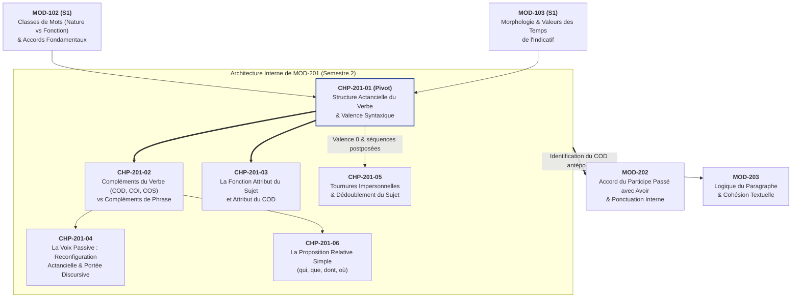
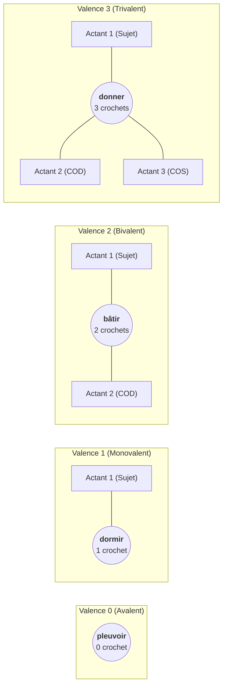
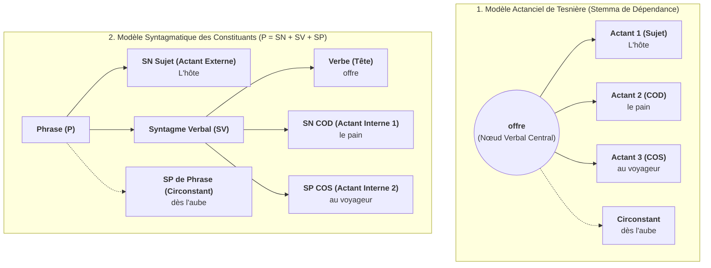

# Chapitre 1 — La Structure Actancielle du Verbe et la Valence Syntaxique : De Tesnière à la Prédication Moderne

> **Identifiant du chapitre** : `CHP-201-01`  
> **Module de rattachement** : [`MOD-201` — Syntaxe Fonctionnelle de la Phrase Simple, Voix Passive, Tournures Impersonnelles et Relative Simple](file:///f:/Formation/world-class-french/03-curriculum/year-1/semester-2/mod-201-syntaxe-fonctionnelle-phrase-simple.md)  
> **Semestre** : Année 1 — Semestre 2 (S2)  
> **Volume horaire canonique** : 5 à 6 heures d'apprentissage autonome délibéré et d'ateliers d'application (Phase 1 Étude : 1 h 30 | Phase 2 Pratique : 1 h 30 | Phase 3 Correction : 1 h 00 | Phase 4 Évaluation : 1 h 00)  
> **Statut** : [STATUT : VALIDÉ]  
> **Compétences associées** : [`FR-SYNTAX-001`](file:///f:/Formation/world-class-french/02-competency-framework/competency-framework.md#fr-syntax-001-analyse-fonctionnelle-et-délimitation-de-la-phrase-simple) (L3), [`FR-VERB-001`](file:///f:/Formation/world-class-french/02-competency-framework/competency-framework.md#fr-verb-001-maîtrise-des-valeurs-aspectuo-temporelles-de-lindicatif) (L2/L3), [`FR-ORTHO-002`](file:///f:/Formation/world-class-french/02-competency-framework/competency-framework.md#fr-ortho-002-mécanique-infaillible-de-laccord-sujet-verbe) (L3)  
> **Sources scientifiques de référence** : `SRC-GRAM-02` (Riegel, Pellat, Rioul, *Grammaire méthodique du français*, chap. 8), `SRC-GRAM-01` (Grevisse & Goosse, *Le Bon Usage*, § 225-245), `SRC-NORM-03` (Ministère de l'Éducation nationale, *Terminologie grammaticale*, 2020)

---

## 1. Titre et Place dans le Cursus

### 1.1 Intitulé Officiel
**Chapitre 1 : La Structure Actancielle du Verbe et la Valence Syntaxique : De Tesnière à la Prédication Moderne** (`CHP-201-01`).

### 1.2 Insertion Architecturale dans le Cursus
Ce chapitre inaugural du Semestre 2 opère le passage décisif de la **morphologie catégorielle** (étudiée au Semestre 1) à la **syntaxe fonctionnelle et relationnelle**. Après avoir appris à identifier la nature intrinsèque des neuf classes de mots dans [`MOD-102`](file:///f:/Formation/world-class-french/03-curriculum/year-1/semester-1/mod-102-classes-mots-accords-fondamentaux.md) et à maîtriser l'architecture flexionnelle et aspectuo-temporelle des verbes à l'indicatif dans [`MOD-103`](file:///f:/Formation/world-class-french/03-curriculum/year-1/semester-1/mod-103-systeme-verbal-indicatif.md), l'apprenant aborde désormais le verbe sous son angle architectural majeur : son rôle de **pivot prédicatif** organisant autour de lui la charpente de la phrase simple [Réf. `SRC-GRAM-02`, chap. 8 ; `SRC-NORM-03`, p. 20-28].

Comprendre la **valence verbale**, c'est comprendre que le verbe n'est pas une simple étiquette conjuguée, mais un programme de construction qui sélectionne et gouverne un nombre précis de participants (les *actants*), tout en laissant graviter à sa périphérie des éléments de cadrage facultatifs (les *circonstants*).

- **En amont** : Ce chapitre mobilise directement la distinction entre nature et fonction acquise dans [`CHP-102-01`](file:///f:/Formation/world-class-french/03-curriculum/year-1/semester-1/mod-102/chp-102-01-nature-vs-fonction.md), la reconnaissance des prépositions et pronoms de [`CHP-102-02`](file:///f:/Formation/world-class-french/03-curriculum/year-1/semester-1/mod-102/chp-102-02-inventaire-neuf-classes.md), ainsi que la morphologie verbale de [`CHP-103-01`](file:///f:/Formation/world-class-french/03-curriculum/year-1/semester-1/mod-103/chp-103-01-architecture-morphologique-verbe.md).
- **Au sein du module [`MOD-201`](file:///f:/Formation/world-class-french/03-curriculum/year-1/semester-2/mod-201-syntaxe-fonctionnelle-phrase-simple.md)** : Il fournit le cadre théorique et opératoire de tous les chapitres suivants : l'opposition entre compléments du verbe et compléments de phrase (`CHP-201-02`), la prédication seconde et les verbes copules (`CHP-201-03`), la permutation des actants à la voix passive (`CHP-201-04`), et les constructions impersonnelles (`CHP-201-05`).
- **En aval dans le cursus** : La maîtrise de la transitivité directe et indirecte acquise ici constitue le prérequis absolu du module [`MOD-202`](file:///f:/Formation/world-class-french/03-curriculum/year-1/semester-2/mod-202-participe-passe-avoir-ponctuation-interne.md) consacré à l'accord du participe passé employé avec *avoir*.

---

## 2. Objectifs Mesurables

Au terme des 5 à 6 heures d'étude et de pratique délibérée de ce chapitre, l'apprenant sera capable de :

1. **Identifier et délimiter les actants et les circonstants** au sein d'une phrase simple ou complexe en appliquant des critères formels de sous-catégorisation verbale (sélection par le verbe, non-suppression, pronominalisation), sans recourir aux questions sémantiques intuitives [Réf. `SRC-GRAM-02`, chap. 8 ; `SRC-NORM-03`, p. 28]. (`FR-SYNTAX-001` — Palier L3).
2. **Classifier avec 100 % d'exactitude la valence syntaxique d'un verbe en contexte** selon les cinq schémas canoniques du français : avalent (valence 0), monovalent intransitif (valence 1), bivalent transitif direct ou indirect (valence 2), bivalent attributif/copule (valence 2), et trivalent ditransitif (valence 3) [Réf. `SRC-GRAM-02`, chap. 8]. (`FR-SYNTAX-001` — Palier L3).
3. **Analyser les variations de valence et les régimes multiples d'un même lexème verbal** en fonction du cotexte syntaxique (emplois absolus, basculement intransitif/transitif, alternances prépositionnelles telles que *manquer de / manquer à / manquer quelque chose*) et justifier le changement de sens induit [Réf. `SRC-GRAM-01`, § 226-235]. (`FR-SYNTAX-001`, `FR-VERB-001` — Palier L3).
4. **Diagnostiquer, réfuter et rectifier les erreurs d'analyse actancielle** (confusion entre complément de mesure et COD, assimilation d'un verbe transitif indirect à un verbe intransitif, confusion entre attribut du sujet et COD) en rédigeant un apparat critique fondé sur la rection verbale. (`FR-SYNTAX-001` — Palier L3).

---

## 3. Prérequis et Test de Préparation (Auto-Diagnostic)

### 3.1 Prérequis Cognitifs Exigibles
- Distinguer sans erreur la **nature** (classe grammaticale : nom, pronom, verbe, adjectif, préposition, adverbe) et la **fonction** syntaxique ([`MOD-102`](file:///f:/Formation/world-class-french/03-curriculum/year-1/semester-1/mod-102-classes-mots-accords-fondamentaux.md)).
- Identifier le noyau verbal conjugué d'une proposition et restituer son infinitif ([`MOD-103`](file:///f:/Formation/world-class-french/03-curriculum/year-1/semester-1/mod-103-systeme-verbal-indicatif.md)).
- Reconnaître les prépositions usuelles (*à, de, par, pour, sur, envers, contre*) et les pronoms personnels conjoints (*le, la, les, lui, leur, en, y*).

### 3.2 Test de Préparation Immédiat (5 Questions)
Répondez par écrit aux cinq questions suivantes sans consulter le cours, puis vérifiez vos réponses à l'aide du corrigé repliable.

1. Dans la phrase *« Le jardinier taille les rosiers au sécateur dès l'aube »*, quels groupes de mots sont exigés par le sens même du verbe *tailler*, et lesquels peuvent être supprimés sans que la structure du verbe soit affectée ?
2. Dans la phrase *« Il pleut abondamment sur les collines »*, le pronom *Il* désigne-t-il une personne ou un objet précis du monde réel ? Peut-on le remplacer par *Le ciel* sans changer la construction du verbe ?
3. Comparez *« L'accusé paraît un homme honnête »* et *« L'accusé salue un homme honnête »*. Le groupe *un homme honnête* occupe-t-il la même fonction dans les deux phrases ? Quel test formel permet de le prouver ?
4. Pourquoi dit-on que le verbe *succéder* (dans *« Le fils succède à son père »*) est un verbe transitif, alors même qu'il est suivi de la préposition *à* ?
5. Le verbe *dormir* est réputé n'avoir besoin d'aucun complément d'objet (*« L'enfant dort »*). Comment expliquez-vous alors la phrase *« L'enfant dort d'un sommeil profond »* ?

---

#### Corrigé Détaillé de l'Auto-Diagnostic

<b>Consulter le corrigé raisonné des 5 questions de préparation</b>

1. **Sélection verbale vs éléments périphériques** :
   - Le verbe *tailler* implique nécessairement un agent qui taille (*Le jardinier*, sujet) et un objet subissant l'action (*les rosiers*, complément d'objet direct). Ce sont les **actants** du verbe.
   - En revanche, *au sécateur* (instrument) et *dès l'aube* (temps) précisent le cadre de l'action mais ne sont pas exigés par le programme syntaxique du verbe : *« Le jardinier taille les rosiers »* forme une phrase complète et grammaticale. Ce sont des **circonstants**.
2. **Statut du pronom *Il* devant *pleut*** :
   - Le pronom *Il* ne renvoie à aucun référent du monde réel (ni personne, ni chose). C'est un pur **indice grammatical de 3e personne du singulier** (sujet apparent ou explétif d'un verbe impersonnel).
   - On ne peut jamais écrire *« *Le ciel pleut »* en français standard : le verbe *pleuvoir* au sens propre refuse tout sujet référentiel.
3. **Comparaison entre *paraît* et *salue*** :
   - Non, la fonction est radicalement différente. Avec *salue* (verbe d'action transitif direct), *un homme honnête* est **COD** : on peut le pronominaliser par *le* (*« L'accusé le salue »* où *le* = cet homme) et mettre la phrase au passif (*« Un homme honnête est salué par l'accusé »*).
   - Avec *paraît* (verbe attributif / copule), *un homme honnête* est **attribut du sujet** *L'accusé* : il désigne le même individu que le sujet et refuse absolument la mise au passif (*« *Un homme honnête est paru par l'accusé »* est impossible).
4. **Transitivité de *succéder*** :
   - Un verbe est dit **transitif** dès lors qu'il régit un complément d'objet indispensable pour saturer son sens. Lorsque ce complément est relié au verbe par l'intermédiaire d'une préposition obligatoire (*succéder à quelqu'un*), le verbe est **transitif indirect** (il gouverne un COI). Le caractère indirect ne supprime nullement la transitivité.
5. **Le cas de *dormir d'un sommeil profond*** :
   - Bien que *dormir* soit un verbe intransitif (monovalent), la langue autorise l'ajout d'un **complément d'objet interne** (figura etymologica) tiré de la même racine ou du même champ sémantique que le verbe, à condition qu'il soit caractérisé par un adjectif ou un déterminant spécifique (*dormir d'un sommeil profond*, *vivre une belle vie*).

---

## 4. Situation de Départ ou Problème Concret : La Faillite des Questions Scolaires Naïves

### 4.1 L'Illusion des Questions « Qui est-ce qui ? », « Quoi ? », « Où ? »
Dans l'enseignement élémentaire, on apprend souvent à identifier les fonctions grammaticales en posant de simples questions sémantiques après le verbe :
- *« Qui est-ce qui + verbe ? »* donnerait le sujet ;
- *« Sujet + verbe + qui / quoi ? »* donnerait le COD ;
- *« Sujet + verbe + où / quand / comment ? »* donnerait les compléments circonstanciels.

Or, dès que l'apprenant est confronté à la langue académique, juridique ou littéraire, ce procédé purement intuitif provoque des **erreurs systématiques d'analyse et d'orthographe** [Réf. `SRC-GRAM-02`, chap. 8]. Observons quatre énoncés authentiques où les questions naïves conduisent droit au contresens grammatical :

1. **Énoncé A** : *« Il manque trois pièces justificatives à votre dossier administratif. »*  
   - *Piège de la question naïve* : L'apprenant demande : *« Il manque quoi ? $\rightarrow$ trois pièces justificatives »* et conclut que *trois pièces justificatives* est un COD. S'il passe la phrase au passé composé avec un pronom relatif (*« Les trois pièces qu'il a manqué »*), il commettra une faute grave en accordant le participe passé (*« *qu'il a manquées »*), alors qu'il s'agit de la **séquence postposée (sujet réel)** d'un verbe impersonnel et jamais d'un COD [Réf. `SRC-GRAM-01`, § 943].
2. **Énoncé B** : *« Ce sac de cacao pèse soixante kilogrammes. »*  
   - *Piège de la question naïve* : L'apprenant demande : *« Ce sac pèse quoi ? $\rightarrow$ soixante kilogrammes »* et étiquette ce groupe comme COD. Or, il est impossible de dire au passif : *« *Soixante kilogrammes sont pesés par ce sac de cacao »*. Ce groupe n'est pas un patient subissant une action, mais un **complément essentiel de mesure**.
3. **Énoncé C** : *« Les plénipotentiaires se rendent à Genève. »*  
   - *Piège de la question naïve* : L'apprenant demande : *« Ils se rendent où ? $\rightarrow$ à Genève »* et classe *à Genève* comme « complément circonstanciel de lieu » supprimable. Pourtant, si l'on supprime *à Genève*, la phrase *« *Les plénipotentiaires se rendent »* change totalement de sens (capituler au lieu de voyager) ! Ici, le lieu fait partie intégrante de la structure obligatoire du verbe.
4. **Énoncé D** : *« Cet avocat deviendra un magistrat redoutable. »*  
   - *Piège de la question naïve* : *« Cet avocat deviendra qui ? $\rightarrow$ un magistrat redoutable »*. En le prenant pour un COD au lieu d'un **attribut du sujet**, l'apprenant méconnaît la nature copulative du verbe *devenir*.

### 4.2 La Nécessité d'un Modèle Structural
Pour ne plus être victime de ces mirages sémantiques, le grammairien doit cesser d'interroger le *sens vague* de la phrase par des devinettes. Il doit analyser le **programme syntaxique inscrit dans le verbe lui-même** : combien de places d'actants ce verbe ouvre-t-il, et comment les gouverne-t-il ? C'est tout l'objet de la **théorie de la valence verbale**.

---

## 5. Explication Intuitive : L'Atome Chimique et le Petit Drame de Lucien Tesnière

En 1959, le linguiste français **Lucien Tesnière**, dans son ouvrage fondateur *Éléments de syntaxe structurale*, propose deux métaphores lumineuses qui ont révolutionné la grammaire moderne [Réf. `SRC-GRAM-02`, chap. 8, § 1.1] :

### 5.1 La Métaphore Théâtrale : Procès, Actants et Circonstants
Tesnière compare le noyau verbal à un **petit drame** joué sur une scène de théâtre :
- **Le Verbe** exprime le **procès** (l'action, l'événement ou l'état qui se déroule).
- **Les Actants** sont les **acteurs indispensables** sans lesquels la pièce ne peut tout simplement pas être jouée. Par exemple, pour jouer la scène de *« offrir »*, il faut impérativement trois participants : quelqu'un qui offre (Actant 1 : le donateur), quelque chose qui est offert (Actant 2 : l'objet), et quelqu'un à qui l'on offre (Actant 3 : le destinataire).
- **Les Circonstants** représentent le **décor, l'éclairage et le moment** de la représentation (où cela se passe-t-il ? quand ? pourquoi ? de quelle manière ?). On peut changer le décor ou l'éteindre complètement : l'action de *offrir un livre à un ami* reste structurellement intacte, qu'elle ait lieu *le mardi*, *à Cotonou*, *avec joie* ou *sous la pluie*.

### 5.2 La Métaphore Chimique : L'Atome à Crochets (La Valence)
En chimie, chaque atome possède à sa périphérie un nombre déterminé d'électrons célibataires — appelés **liaisons de valence** — qui lui permettent de s'accrocher à d'autres atomes pour former une molécule stable :
- L'**hélium** a une valence de **0** : il est saturé d'emblée et ne s'accroche à rien (comme le verbe *pleuvoir*).
- L'**hydrogène** ($\text{H}$) a une valence de **1** : il possède un seul crochet (comme le verbe *dormir*, qui n'attire qu'un sujet : *L'enfant dort*).
- L'**oxygène** ($\text{O}$) a une valence de **2** : il possède deux crochets (comme le verbe *bâtir*, qui attire un sujet et un objet : *L'architecte bâtit un pont*).
- L'**azote** ($\text{N}$) a une valence de **3** : il possède trois crochets (comme le verbe *donner*, qui attire un sujet, un objet direct et un destinataire : *Paul donne son manteau au mendiant*).

Tant que tous les crochets obligatoires d'un verbe ne sont pas remplis (ou implicitement saturés en contexte), la « molécule-phrase » demeure instable ou incomplète.

---

## 6. Définitions Précises et Terminologie Officielle

Avant d'exposer les mécanismes de chaque classe de verbes, fixons avec précision les dix concepts techniques de la syntaxe actancielle contemporaine [Réf. `SRC-GRAM-02`, chap. 8 ; `SRC-NORM-03`, p. 20-34 ; `SRC-GRAM-01`, § 225-245].

### Bloc 1 : L'Architecture Relationnelle du Procès
*Exemple d'ancrage* : *« Dès l'ouverture de la séance, le président du tribunal lit l'acte d'accusation aux jurés avec gravité. »*

1. **Prédicat** : Élément central de la proposition qui affirme une action, un état ou une propriété à propos d'un ou plusieurs arguments. Sur le plan sémantique, le verbe (*lit*) est le prédicat qui met en relation ses arguments ; sur le plan de la syntaxe des constituants, le groupe verbal entier (*lit l'acte d'accusation aux jurés*) assure la fonction prédicative par rapport au sujet [Réf. `SRC-NORM-03`, p. 21].
2. **Actant** : Syntagme nominal (ou équivalent pronominal, infinitif, subordonné) désignant un être ou une entité qui participe directement et nécessairement au procès exprimé par le verbe (*le président du tribunal*, *l'acte d'accusation*, *aux jurés*). Les actants correspondent aux fonctions de **sujet** et de **compléments essentiels du verbe** [Réf. `SRC-GRAM-02`, chap. 8, § 1.1].
3. **Circonstant** : Syntagme périphérique non exigé par le sens du verbe, qui indique les coordonnées extérieures du procès (temps, lieu, cause, manière, but, concession, instrument : *Dès l'ouverture de la séance*, *avec gravité*). Les circonstants correspondent aux **compléments circonstanciels** (ou compléments de phrase) [Réf. `SRC-NORM-03`, p. 32].
4. **Valence verbale** : Nombre d'actants qu'un verbe est susceptible de régir en vertu de son programme sémantico-syntaxique propre. La valence totale d'un verbe inclut le sujet (actant 1) et ses compléments essentiels (actants 2 et 3) [Réf. `SRC-GRAM-02`, chap. 8, § 1.2].
5. **Rection verbale** : Propriété syntaxique qu'a un verbe d'exiger la présence d'un complément et de lui imposer sa forme grammaticale (construction directe sans préposition, ou construction indirecte via une préposition spécifique telle que *à* ou *de*, ou encore imposition d'un mode verbal comme le subjonctif dans une subordonnée) [Réf. `SRC-GRAM-01`, § 225].

### Bloc 2 : La Typologie Valencielle des Verbes
*Exemples d'ancrage* : *« Il grêle. »* (0) | *« Le cheval galope. »* (1) | *« L'orfèvre cisèle l'or. »* (2) | *« La loi demeure claire. »* (2-copule) | *« Le maître enseigne la syntaxe aux élèves. »* (3).

6. **Verbe avalent (valence 0)** : Verbe impersonnel pur (notamment météorologique) qui ne comporte aucun actant sémantique réel. Le pronom *il* qui le précède en français est un simple marqueur morphologique de flexion verbale, dépourvu de référent (*Il neige*, *Il faut*) [Réf. `SRC-GRAM-02`, chap. 8, § 1.2].
7. **Verbe monovalent (valence 1 / intransitif strict)** : Verbe qui n'appelle qu'un seul actant : son **sujet**. Le procès s'accomplit intégralement dans la sphère du sujet sans transiter vers un objet (*naître, mourir, dormir, voyager, resplendir*) [Réf. `SRC-NORM-03`, p. 28].
8. **Verbe bivalent (valence 2 / transitif)** : Verbe qui exige deux actants : un **sujet** (actant 1) et un **complément d'objet** (actant 2). Il est dit **transitif direct** lorsque le second actant (COD) est rattaché sans préposition (*franchir un obstacle*), et **transitif indirect** lorsque le second actant (COI) est introduit par une préposition régie par le verbe (*renoncer à un projet*, *hériter d'un domaine*) [Réf. `SRC-GRAM-01`, § 230-234].
9. **Verbe attributif (ou verbe copule)** : Verbe bivalent particulier (*être, paraître, sembler, devenir, demeurer, rester*) qui, dépourvu de contenu lexical plein d'action, sert de lien prédicatif pour attribuer une propriété ou un état (l'**attribut du sujet**) au premier actant (le sujet) [Réf. `SRC-GRAM-02`, chap. 8, § 3 ; `SRC-NORM-03`, p. 30].
10. **Verbe trivalent (valence 3 / ditransitif)** : Verbe à double complémentation qui exige trois actants : un **sujet** (actant 1), un **complément d'objet direct** (actant 2) et un **complément d'objet second / COS** (actant 3, de forme prépositionnelle, ou vice versa) (*donner quelque chose à quelqu'un*, *priver quelqu'un de quelque chose*) [Réf. `SRC-NORM-03`, p. 30].

---

## 7. Règles et Mécanismes Fondamentaux

### 7.1 Le Verbe comme Pivot de la Phrase : La Théorie de la Valence Verbale
Dans la tradition grammaticale héritée de la logique d'Aristote et de Port-Royal, la phrase était divisée en deux pôles symétriques : le *sujet* (ce dont on parle) et le *prédicat* (ce qu'on en dit). La linguistique structurale moderne (Lucien Tesnière) et les grammaires universitaires de référence (`SRC-GRAM-02`, chap. 8) montrent que d'un point de vue strictement relationnel, **le verbe est le sommet hiérarchique de la phrase**.

Pourquoi le verbe est-il le pivot central ? Parce que c'est le choix du lexème verbal qui détermine l'architecture entière de la proposition :
1. **Sélection quantitative (nombre de places)** : Choisir le verbe *éternuer* impose une structure à 1 place ; choisir *dévorer* impose 2 places ; choisir *restituer* impose 3 places.
2. **Sélection qualitative ou sémantique (traits de sélection)** : Le verbe sélectionne la nature sémantique de ses actants. Par exemple, le verbe *rédiger* exige un Actant 1 doté du trait `[+ Humain]` (*l'étudiant, la greffière*) et un Actant 2 doté du trait `[+ Texte / Écrit]` (*une requête, un poème*). Une phrase comme *« *La pierre rédige une montagne »* est syntaxiquement construite mais sémantiquement anomale car elle viole les restrictions de sélection du verbe.
3. **Sélection formelle (sous-catégorisation et rection)** : Le verbe décide si son complément sera un syntagme nominal direct (*attendre le train*), un syntagme prépositionnel en *à* (*consentir à un effort*), un syntagme prépositionnel en *de* (*se souvenir de son enfance*) ou une proposition subordonnée.

---

### 7.2 Les Verbes Avalents (Valence 0 : Impersonnels Stricts)
Un verbe est dit **avalent** (valence $= 0$) lorsqu'il exprime un phénomène global autosuffisant qui ne met en jeu aucun participant distinct, ni agent, ni patient [Réf. `SRC-GRAM-02`, chap. 8, § 1.2].

- **Inventaire canonique** :
  - Les verbes météorologiques stricts : *pleuvoir, neiger, grêler, bruiner, venter, geler, dégeler, tonner*.
  - Les verbes impersonnels d'obligation ou d'existence pure : *falloir* (*Il faut partir* — où l'infinitif ou la complétive occupe toutefois une place d'actant propositionnel, tandis que l'emploi absolu météorologique est strictement à zéro actant), *s'agir de* (*Il s'agit d'une erreur*).
- **Le paradoxe du français : le sujet apparent *il*** :
  En latin (*pluit*) ou en espagnol (*llueve*), le verbe avalent s'emploie absolument seul, sans aucun pronom. En français moderne, langue à sujet obligatoire, la syntaxe impose la présence d'un pronom de 3e personne du singulier : ***Il** pleut*.
  - Ce *il* est appelé **sujet grammatical apparent** (ou pronom explétif / postiche).
  - Il est strictement **non référentiel** : on ne peut pas demander *« Qui est-ce qui pleut ? »*, ni le remplacer par un nom (*« *L'orage pleut »*, *« *La nuée neige »*).
  - Il commande néanmoins l'accord orthographique exclusif du verbe à la 3e personne du singulier (`FR-ORTHO-002`).

> [!IMPORTANT]
> **Emploi métaphorique et acquisition d'actants** : Dès qu'un verbe météorologique est employé au sens figuré (*« Les projectiles pleuvaient sur la tranchée »*, *« Ses cheveux neigeaient sur ses épaules »*), il cesse d'être avalent et devient un verbe **monovalent** doté d'un véritable sujet pluriel [Réf. `SRC-GRAM-01`, § 227].

---

### 7.3 Les Verbes Monovalents (Valence 1 : Intransitifs Stricts)
Un verbe est **monovalent** (valence $= 1$) lorsqu'il n'ouvre qu'une seule place d'actant : celle du **sujet** ($\text{Actant 1}$). La tradition grammaticale les nomme **verbes intransitifs** [Réf. `SRC-NORM-03`, p. 28].

$$\text{Schéma actanciel monovalent} : \quad \text{Actant 1 (Sujet)} \longleftarrow \textbf{Verbe}_{\text{intransitif}}$$

- **Sous-classes sémantiques principales** :
  1. *Verbes d'existence, de vie et de mort* : *exister, naître, vivre, végéter, agoniser, mourir, périr, décéder*.
  2. *Verbes de comportement physiologique ou de cri* : *dormir, ronfler, éternuer, tousser, frissonner, sangloter, sourire, aboyer, rugir, hennir*.
  3. *Verbes de mouvement ou d'évolution autonome* : *circuler, errer, déambuler, bondir, jaillir, surgir, éclore, clignoter, resplendir*.
- **Propriétés syntaxiques formelles** :
  - Ils se suffisent pleinement à eux-mêmes après le sujet : *« Les étoiles scintillent. »* | *« Le témoin a frémi. »*
  - Ils **n'admettent aucun complément d'objet** (ni COD, ni COI). Tout syntagme ajouté à leur suite est un circonstant facultatif (*« Les étoiles scintillent [dans le ciel nocturne] [depuis minuit] »*).
  - Ils **refusent radicalement la transformation passive personnelle** : on ne peut jamais dire *« *Il est dormi par l'enfant »* ni *« *Il est péri par le soldat »*.

---

### 7.4 Les Verbes Bivalents (Valence 2 : Transitifs Directs, Indirects et Attributifs)
Un verbe est **bivalent** (valence $= 2$) lorsqu'il exige deux éléments pour saturer sa structure : le **sujet** ($\text{Actant 1}$) et un **second terme obligatoire** au sein du groupe verbal. Cette valence 2 se subdivise en **trois constructions syntaxiques distinctes** [Réf. `SRC-GRAM-02`, chap. 8, § 2-3] :

#### A. Les Verbes Transitifs Directs ($\text{Sujet} + \text{COD}$)
Le verbe gouverne directement son second actant sans l'intermédiaire d'aucune préposition :
$$\text{Actant 1 (Sujet)} \longleftarrow \textbf{Verbe}_{\text{trans. dir.}} \longrightarrow \text{Actant 2 (COD)}$$
- *Exemples* : *bâtir un édifice, vaincre l'adversité, rédiger un mémoire, convoquer l'assemblée, admirer un paysage, franchir le fleuve*.
- *Tests d'identification* :
  1. **Pronominalisation clitique** par *le, la, les, l'* (placés devant le verbe : *« Il le bâtit »*, *« Elle la rédige »*).
  2. **Aptitude à la passivisation** : l'Actant 2 (COD) devient le sujet de la phrase passive, tandis que l'Actant 1 devient complément d'agent (*« L'édifice est bâti par l'architecte »*).

#### B. Les Verbes Transitifs Indirects ($\text{Sujet} + \text{COI}$)
Le verbe exige un second actant, mais lui impose le passage par une **préposition rectrice fixe** (le plus souvent *à* ou *de*, parfois *sur, en, contre, après*) :
$$\text{Actant 1 (Sujet)} \longleftarrow \textbf{Verbe}_{\text{trans. ind.}} \xrightarrow{\text{prép. (à, de, sur...)}} \text{Actant 2 (COI)}$$
- *Exemples avec la préposition **à*** : *obéir à la loi, nuire à autrui, succéder à un monarque, renoncer à ses privilèges, ressembler à son aïeul, plaire à l'auditoire, survivre à un naufrage*.
- *Exemples avec la préposition **de*** : *douter de la sincérité, hériter d'un patrimoine, dépendre d'un ministère, jouir d'une immunité, se souvenir d'une promesse, manquer de discernement*.
- *Exemples avec d'autres prépositions* : *compter sur un allié, croire en la justice, lutter contre la corruption*.
- *Tests d'identification* :
  1. **Pronominalisation** par *lui / leur* (pour un animé introduit par *à* : *« Il lui obéit »*), par le pronom adverbial ***y*** (pour un inanimé introduit par *à* ou *en* : *« Il y renonce »*), ou par le pronom adverbial ***en*** (pour un complément introduit par *de* : *« Il en doute »*).
  2. **Impossibilité de la passivisation canonique** (sauf très rares exceptions historiques figées comme *obéir* et *pardonner* étudiées au Chapitre 4) : *« *Autrui est nui par ce mensonge »* est un barbarisme syntaxique.
  3. **Invariabilité absolue du participe passé** avec *avoir* (`MOD-202`) : *« Les lois auxquelles ils ont obéi »* (jamais *obéies*), *« Les rois auxquels ils ont succédé »* (jamais *succédés*).

#### C. Les Verbes Attributifs ou Copules ($\text{Sujet} + \text{Attribut du Sujet}$)
Les verbes attributifs (ou copules) tels que *être, paraître, sembler, devenir, demeurer, rester, avoir l'air, passer pour* ont également besoin de deux termes pour former une phrase complète (*« *Cet argument semble »* est incomplet). Toutefois, le second terme **n'est pas un actant autonome distinct du sujet** : c'est un prédicat nominal ou adjectival (l'**attribut du sujet**) qui exprime une propriété ou une identité du sujet lui-même [Réf. `SRC-GRAM-02`, chap. 8, § 3 ; `SRC-NORM-03`, p. 30].
$$\text{Actant 1 (Sujet)} \stackrel{\text{identité / propriété}}{\Longleftrightarrow} \textbf{Verbe}_{\text{copule}} \longleftarrow \text{Attribut du Sujet}$$
- *Propriétés formelles* :
  - Coréférence absolue entre le sujet et l'attribut (*« Cotonou demeure la métropole économique »* : *Cotonou* $=$ *la métropole économique*).
  - Accord en genre et en nombre de l'adjectif attribut avec le sujet.
  - Pronominalisation par le pronom neutre invariable ***le*** (*« Ces magistrats sont intègres $\rightarrow$ Ils **le** sont »*, et non *« *Ils les sont »*).

> [!NOTE]
> **Le cas des compléments essentiels de lieu** : Certains verbes de localisation ou de mouvement orienté (*habiter, résider, demeurer [au sens spatial], aller, se rendre, venir, partir*) exigent obligatoirement un syntagme locatif pour être complets (*« Ma famille réside à Porto-Novo »*, *« L'ambassadeur va à Genève »*). Ces verbes sont **bivalents** : le groupe locatif est un **actant (complément essentiel de lieu)** sélectionné par la valence du verbe, et non un circonstant facultatif [Réf. `SRC-NORM-03`, p. 28].

---

### 7.5 Les Verbes Trivalents (Valence 3 : Ditransitifs)
Un verbe est **trivalent** (valence $= 3$, ou **ditransitif**) lorsqu'il gouverne simultanément trois actants : un **sujet** ($\text{Actant 1}$), un **complément d'objet direct** ($\text{Actant 2}$ — COD) et un **complément d'objet second** ($\text{Actant 3}$ — COS, introduit par une préposition, généralement *à* ou *de*) [Réf. `SRC-GRAM-02`, chap. 8, § 2.3 ; `SRC-NORM-03`, p. 30].

$$\text{Actant 1 (Sujet)} \longleftarrow \textbf{Verbe}_{\text{trivalent}} \begin{cases} \longrightarrow \text{Actant 2 (COD)} \\ \xrightarrow{\text{prép. (à / de)}} \text{Actant 3 (COS)} \end{cases}$$

- **Grandes familles sémantiques de verbes trivalents** :
  1. *Verbes de don, d'attribution et de transfert matériel* (schéma $\text{Sujet} + \text{V} + \text{COD} + \text{à COS}$) : *donner, offrir, remettre, confier, prêter, restituer, distribuer, transmettre, léguer, décerner, attribuer, envoyer, expédier*.  
     *Exemple* : *« Le recteur décerne une médaille d'honneur au lauréat. »*
  2. *Verbes de parole, de communication et d'enseignement* (schéma $\text{Sujet} + \text{V} + \text{COD} + \text{à COS}$) : *dire, annoncer, révéler, avouer, expliquer, enseigner, promettre, conseiller, ordonner, interdire*.  
     *Exemple* : *« Le rapporteur expose les conclusions de l'enquête à la commission. »*
  3. *Verbes d'imputation, de privation ou de réception* (schéma $\text{Sujet} + \text{V} + \text{COD} + \text{à/de COS}$) : *imputer (une faute à quelqu'un), reprocher (un retard à quelqu'un), priver (un citoyen de ses droits), déposséder (un héritier de ses biens), recevoir (un pli d'un messager), obtenir (une audience du ministre)*.  
     *Exemple* : *« La cour impute cette négligence au comptable. »*
- **Double pronominalisation conjointe** :
  La preuve formelle de la trivalence réside dans la possibilité de pronominaliser simultanément le COD et le COS devant le verbe :
  - *« Le recteur **la** [la médaille, COD] **lui** [au lauréat, COS] décerne. »*
  - *« Le juge **l'** [le citoyen, COD] **en** [de ses droits, COS] prive. »*

---

### 7.6 Les Variations de Valence et Verbes à Double ou Triple Régime
La valence d'un verbe n'est pas toujours un bloc monolithique figé. En français, de nombreux verbes présentent une **plasticité valencielle** rigoureusement codifiée par le lexique [Réf. `SRC-GRAM-02`, chap. 8, § 1.3 ; `SRC-GRAM-01`, § 235-238]. On distingue trois phénomènes majeurs :

#### 1. L'Emploi Absolu d'un Verbe Transitif (Réduction de Valence $2 \to 1$)
Un verbe fondamentalement bivalent (transitif direct) peut être employé sans que son COD soit exprimé, lorsque l'accent est mis sur l'activité générale ou l'aptitude du sujet :
- *« Cet écrivain **publie** un roman historique »* (Bivalent : COD exprimé) $\rightarrow$ *« Cet écrivain **publie** régulièrement »* (Emploi absolu : réduction à 1 actant réalisé).
- *« L'enfant **lit** une fable »* (Bivalent) $\rightarrow$ *« L'enfant sait déjà **lire** »* (Emploi absolu).
- *« Le prévenu **avoue** son forfait »* (Bivalent) $\rightarrow$ *« Le prévenu **a avoué** »* (Emploi absolu).

#### 2. Les Verbes à Alternance Causative / Ergative (Basculement $1 \leftrightarrow 2$)
Certains verbes d'état ou de changement d'état (*brûler, cuire, fondre, sécher, rougir, vieillir, grandir, augmenter, diminuer, sortir, monter, descendre*) fonctionnent tantôt comme **monovalents intransitifs** (le sujet subit la transformation), tantôt comme **bivalents transitifs directs** (le sujet cause la transformation sur un COD patient) :
- **Monovalent (Valence 1)** : *« La neige **fond** au soleil. »* | *« Les tarifs douaniers **augmentent**. »* | *« Les passagers **descendent**. »*
- **Bivalent causatif (Valence 2)** : *« Le fondeur **fond** le bronze. »* | *« Le gouvernement **augmente** les tarifs douaniers. »* | *« Le porteur **descend** les valises. »* (Notez qu'au passé composé, ce basculement entraîne le changement d'auxiliaire : *Il **est** descendu* [valence 1] vs *Il **a** descendu les valises* [valence 2]).

#### 3. Les Verbes Polysémiques à Régimes Multiples
Un même verbe change de signification selon qu'il est construit sans complément, avec un COD, ou avec telle ou telle préposition régie :

| Verbe | Construction 1 | Construction 2 | Construction 3 |
| :--- | :--- | :--- | :--- |
| ***Changer*** | **Monovalent** : *« Le vent change. »* (= se modifier soi-même) | **Transitif direct** : *« Il change sa roue. »* (= remplacer un objet par un autre) | **Transitif indirect (*de*)** : *« Il change d'avis / de méthode. »* (= quitter un état/objet pour un autre) |
| ***Manquer*** | **Transitif direct** : *« Le tireur a manqué la cible. »* (= rater, ne pas atteindre) | **Transitif indirect (*de*)** : *« Cette province manque d'eau. »* (= être dépourvu de, avoir besoin de) | **Transitif indirect (*à*)** : *« Il a manqué à sa parole / Vous manquez à vos amis. »* (= faillir à un devoir / faire défaut affectivement) |
| ***Tenir*** | **Transitif direct** : *« Elle tient le gouvernail. »* (= saisir fermement) | **Transitif indirect (*à*)** : *« Elle tient à son indépendance. »* (= être attaché à, vouloir) | **Transitif indirect (*de*)** : *« Il tient de son grand-père. »* (= ressembler par hérédité) |
| ***Servir*** | **Transitif direct** : *« Il sert sa patrie / ses hôtes. »* (= être au service de, présenter un plat) | **Transitif indirect (*à*)** : *« Cet outil sert à tailler le bois. »* (= être utile pour un usage) | **Transitif indirect (*de*)** : *« Cette grotte sert de refuge. »* (= remplir provisoirement la fonction de) |
| ***Veiller*** | **Monovalent** : *« La sentinelle veille toute la nuit. »* (= rester éveillé) | **Transitif direct** : *« La famille veille le défunt. »* (= garder pieusement un mort/malade) | **Transitif indirect (*à / sur*)** : *« Le magistrat veille au respect des lois / sur l'orphelin. »* (= prendre soin de, surveiller) |

---

## 8. Raisonnement Détaillé : Pourquoi la Valence Structure Toute la Syntaxe Française

Pourquoi l'analyse de la valence verbale constitue-t-elle le fondement indispensable de tout le Semestre 2, plutôt qu'une simple curiosité théorique ? Parce que **quatre opérations grammaticales majeures** du français écrit dépendent directement de la structure actancielle du verbe :

### 8.1 La Délimitation de la Phrase Minimale et la Ponctuation
En distinguant les **actants** (sélectionnés par la valence du verbe) des **circonstants** (ajoutés librement au niveau de la phrase), le scripteur comprend immédiatement les lois de l'ordre des mots et de la virgule :
- En français, **on ne sépare jamais par une virgule le verbe de ses actants postposés** (ni entre le verbe et son COD, ni entre le verbe et son COI, ni entre le sujet et le verbe) [Réf. `SRC-TYPO-01`, p. 142].
- À l'inverse, les circonstants (compléments de phrase) jouissent d'une grande liberté de déplacement et sont isolés par une virgule lorsqu'ils sont placés en tête de phrase.

### 8.2 Le Choix Exact des Pronoms Personnels et Relatifs
La méconnaissance du régime verbal (valence directe vs indirecte en *à* ou en *de*) est la première source de solécismes pronominaux dans l'expression écrite et orale :
- Si l'apprenant ignore que l'on dit *pallier quelque chose* (transitif direct) et non *\*pallier à quelque chose*, il écrira fautivement *« C'est une lacune **à laquelle** nous allons pallier »* au lieu de *« C'est une lacune **que** nous allons pallier »* [Réf. `SRC-GRAM-01`, § 274].
- S'il ignore que l'on dit *se rappeler quelque chose* (transitif direct : *se rappeler un souvenir*) alors que l'on dit *se souvenir de quelque chose* (transitif indirect en *de*), il produira le barbarisme *« Je **m'en** rappelle »* ou *« Le fait **dont** je me rappelle »*, au lieu du tour régulier *« Je **me le** rappelle »* et *« Le fait **que** je me rappelle »*.

### 8.3 Le Crible de la Transformation Passive (`CHP-201-04`)
Pourquoi peut-on passiver *« Les juges examinent la requête »* ($\rightarrow$ *« La requête est examinée par les juges »*), mais jamais *« Les juges doutent de la requête »* ($\rightarrow$ *« *La requête est doutée par les juges »*) ? Parce que seuls les verbes **bivalents ou trivalents dotés d'un Actant 2 construit directement (COD)** autorisent la promotion de cet objet au rang de sujet passif. La valence commande la diathèse.

### 8.4 Le Verrou de l'Accord du Participe Passé avec *Avoir* (`MOD-202`)
Toute la mécanique de l'accord du participe passé employé avec *avoir* repose sur un unique théorème : **le participe passé s'accorde avec l'Actant 2 direct (COD) si et seulement si celui-ci est placé avant le verbe ; il ne s'accorde jamais ni avec un Actant 2 indirect (COI), ni avec un Actant 3 (COS), ni avec un circonstant, ni avec la séquence postposée d'un verbe impersonnel**.
Sans une maîtrise chirurgicale de la valence verbale, la règle du participe passé demeure une loterie aveugle.

---

## 9. Exemples Corrects Commentés (Décorticage Actanciel)

Analysons six phrases modèles couvrant l'intégralité du spectre valenciel, issues de corpus classiques, administratifs et francophones africains.

### Cas Modèle 1 — Valence 0 (Verbe avalent avec circonstants multiples)
> *« Durant toute la saison humide, il pleut abondamment sur les plateaux verdoyants du Togo. »*

- **Noyau verbal prédicatif** : *pleut* (verbe *pleuvoir*, indicatif présent, 3e pers. du singulier).
- **Analyse de la valence** : **Valence 0 (verbe avalent)**.
  - *Sujet grammatical apparent* : *il* (pronom personnel neutre impersonnel, non référentiel, simple support morphologique de la désinence *-t*).
  - *Actants sémantiques* : **Aucun (0)**.
- **Analyse des circonstants périphériques** :
  1. *Durant toute la saison humide* : Circonstant (complément circonstanciel de temps, mobile et supprimable).
  2. *abondamment* : Circonstant (adverbe modificateur de manière/intensité, supprimable).
  3. *sur les plateaux verdoyants du Togo* : Circonstant (complément circonstanciel de lieu, mobile et supprimable : *« Il pleut »* suffit à former une phrase grammaticale).
- **Schéma formel** : $\text{V}_{0}\text{ (*il pleut*)} + [\text{Circ}_{\text{temps}}] + [\text{Circ}_{\text{manière}}] + [\text{Circ}_{\text{lieu}}]$.

---

### Cas Modèle 2 — Valence 1 (Verbe monovalent intransitif à sujet inversé)
> *« Au détour du sentier latéritique surgirent trois cavaliers vêtus de lin blanc. »*

- **Noyau verbal prédicatif** : *surgirent* (verbe *surgir*, indicatif passé simple, 3e pers. du pluriel).
- **Analyse de la valence** : **Valence 1 (verbe monovalent intransitif)**.
  - **Actant 1 (Sujet postposé/inversé)** : *trois cavaliers vêtus de lin blanc* (syntagme nominal masculin pluriel commandant l'accord en *-irent*).
  - **Actant 2** : Néant (*surgir* n'admet ni COD ni COI).
- **Analyse du circonstant** :
  - *Au détour du sentier latéritique* : Circonstant de lieu placé en tête de phrase, ce qui provoque l'inversion stylistique de l'Actant 1 sujet.
- **Schéma formel** : $[\text{Circ}_{\text{lieu}}] + \text{V}_{1}\text{ (*surgirent*)} \longleftarrow \text{Actant 1 (*trois cavaliers...*)}$.

---

### Cas Modèle 3 — Valence 2 Directe (Verbe bivalent transitif direct)
> *« Dans son roman, Olympe Bhêly-Quenum décrit avec minutie les paysages lacustres de Ouidah. »*

- **Noyau verbal prédicatif** : *décrit* (verbe *décrire*, indicatif présent, 3e pers. du singulier).
- **Analyse de la valence** : **Valence 2 (verbe bivalent transitif direct)**.
  - **Actant 1 (Sujet)** : *Olympe Bhêly-Quenum* (agent descripteur).
  - **Actant 2 (COD)** : *les paysages lacustres de Ouidah* (syntagme nominal construit directement sans préposition ; pronominalisable par *les* : *« Il **les** décrit »* ; passivable : *« Les paysages lacustres de Ouidah sont décrits par Olympe Bhêly-Quenum »*).
- **Analyse des circonstants** :
  - *Dans son roman* : Circonstant de lieu figuré / cadre textuel.
  - *avec minutie* : Circonstant de manière.
- **Schéma formel** : $[\text{Circ}_{\text{lieu}}] + \text{Actant 1} \longrightarrow \text{V}_{2\text{-dir}} \longrightarrow \text{Actant 2 (COD)} + [\text{Circ}_{\text{manière}}]$.

---

### Cas Modèle 4 — Valence 2 Indirecte (Verbe bivalent transitif indirect)
> *« La prospérité durable d'une nation dépend étroitement de la rigueur de ses institutions. »*

- **Noyau verbal prédicatif** : *dépend* (verbe *dépendre*, indicatif présent, 3e pers. du singulier).
- **Analyse de la valence** : **Valence 2 (verbe bivalent transitif indirect)**.
  - **Actant 1 (Sujet)** : *La prospérité durable d'une nation*.
  - **Actant 2 (COI)** : *de la rigueur de ses institutions* (syntagme prépositionnel régi par la préposition obligatoire *de* ; non supprimable car *« *La prospérité durable d'une nation dépend »* est incomplet ; pronominalisable par le pronom adverbial ***en*** : *« Elle **en** dépend étroitement »*).
- **Analyse du circonstant** :
  - *étroitement* : Adverbe modificateur intégrable au groupe verbal.
- **Schéma formel** : $\text{Actant 1} \longrightarrow \text{V}_{2\text{-ind}} \xrightarrow{\text{de}} \text{Actant 2 (COI)}$.

---

### Cas Modèle 5 — Valence 2 Copulative (Verbe attributif)
> *« Malgré l'usure des siècles, les bas-reliefs royaux d'Abomey demeurent un témoignage historique saisissant. »*

- **Noyau verbal prédicatif** : *demeurent* (verbe copule *demeurer*, au sens d'état « rester », indicatif présent, 3e pers. du pluriel).
- **Analyse de la valence** : **Valence 2 attributive (copule)**.
  - **Actant 1 (Sujet)** : *les bas-reliefs royaux d'Abomey*.
  - **Élément prédicatif 2 (Attribut du sujet)** : *un témoignage historique saisissant* (syntagme nominal identifiant une qualité essentielle du sujet ; pronominalisable par le neutre *le* ; passif impossible).
- **Analyse du circonstant** :
  - *Malgré l'usure des siècles* : Circonstant de concession.
- **Schéma formel** : $[\text{Circ}_{\text{concession}}] + \text{Actant 1 (Sujet)} \Longleftrightarrow \text{V}_{\text{copule}} \longleftarrow \text{Attribut du Sujet}$.

---

### Cas Modèle 6 — Valence 3 (Verbe trivalent ditransitif)
> *« À l'issue des délibérations, le président de la Cour suprême a remis le rapport solennel au chef de l'État. »*

- **Noyau verbal prédicatif** : *a remis* (verbe *remettre*, indicatif passé composé, 3e pers. du singulier).
- **Analyse de la valence** : **Valence 3 (verbe trivalent ditransitif)**.
  - **Actant 1 (Sujet)** : *le président de la Cour suprême* (agent donateur).
  - **Actant 2 (COD)** : *le rapport solennel* (objet transféré, construction directe, pronominalisable par *l'*).
  - **Actant 3 (COS)** : *au chef de l'État* (destinataire du transfert, introduit par la préposition amalgamée *au* $= \text{à} + \text{le}$, pronominalisable par *lui*).
  - *Preuve par double pronominalisation* : *« Le président **le lui** a remis. »*
- **Analyse du circonstant** :
  - *À l'issue des délibérations* : Circonstant de temps.
- **Schéma formel** : $[\text{Circ}_{\text{temps}}] + \text{Actant 1} \longrightarrow \text{V}_{3} \begin{cases} \longrightarrow \text{Actant 2 (COD)} \\ \xrightarrow{\text{à}} \text{Actant 3 (COS)} \end{cases}$

---

## 10. Contre-Exemples et Erreurs Fréquentes (Clinique Actancielle)

L'analyse des copies universitaires révèle six erreurs récurrentes dans l'identification de la valence et des actants. Voici le diagnostic clinique et la réfutation formelle de chacune d'elles.

### Erreur n° 1 : Confondre la valence du verbe avec le nombre de groupes de mots présents dans la phrase
- **Manifestation fautive** : Face à la phrase *« Hier soir, sur la place du village, devant toute la foule rassemblée, le vieil orateur a parlé longuement »*, l'étudiant affirme que le verbe *a parlé* est « tétravalent (valence 4) » parce qu'il compte quatre groupes autour du verbe.
- **Diagnostic linguistique** : Confusion entre les **actants** (inscrits dans le programme du verbe) et les **circonstants** (ajouts libres).
- **Correction formelle** : Ici, *Hier soir* (temps), *sur la place du village* (lieu), *devant toute la foule rassemblée* (lieu/accompagnement) et *longuement* (manière) sont tous des circonstants supprimables. Réduite à son noyau actanciel, la phrase est *« Le vieil orateur a parlé »* : le verbe est ici employé en construction **monovalente** (1 seul actant : le sujet).

### Erreur n° 2 : Classer un verbe transitif indirect comme « verbe intransitif » sous prétexte qu'il n'a pas de COD
- **Manifestation fautive** : Dans *« Cet amendement nuit à la cohérence du texte »*, l'étudiant écrit : « Le verbe *nuit* n'a pas de COD, c'est donc un verbe intransitif ».
- **Diagnostic linguistique** : Réduction abusive de la transitivité à la seule transitivité directe.
- **Correction formelle** : Un verbe intransitif (monovalent) n'admet *aucun* complément d'objet (*dormir, périr*). Or, *nuire* exige un second actant (*nuire à quelqu'un/quelque chose*) qui se pronominalise par *lui/leur/y* (*« Cet amendement **y** nuit »*). C'est un verbe **bivalent transitif indirect** [Réf. `SRC-NORM-03`, p. 28].

### Erreur n° 3 : Prendre un complément essentiel de lieu pour un circonstant facultatif
- **Manifestation fautive** : Dans *« Mon frère aîné habite à Parakou »*, l'étudiant classe *à Parakou* comme « circonstant (complément circonstanciel de lieu) » et déclare le verbe *habiter* monovalent.
- **Diagnostic linguistique** : Utilisation aveugle de la question sémantique « où ? » au détriment des tests syntaxiques d'effacement et de sous-catégorisation.
- **Correction formelle** : Le sens de *habiter* implique nécessairement un lieu de résidence. Sans ce complément, *« *Mon frère aîné habite »* est agrammatical ou incomplet. *À Parakou* est donc le **deuxième actant (complément essentiel de lieu)** du verbe bivalent *habiter* [Réf. `SRC-GRAM-02`, chap. 8, § 2.4].

### Erreur n° 4 : Analyser l'attribut du sujet comme le deuxième actant (COD) d'un verbe transitif
- **Manifestation fautive** : Dans *« Ce jeune avocat deviendra un grand bâtonnier »*, l'étudiant analyse *un grand bâtonnier* comme COD du verbe *deviendra*.
- **Diagnostic linguistique** : Assimilation d'un verbe copule (*devenir*) à un verbe d'action transitif direct.
- **Correction formelle** : *Un grand bâtonnier* ne désigne pas une tierce personne sur laquelle s'exercerait une action de l'avocat : il désigne l'avocat lui-même dans son état futur (coréférence). Le verbe *devenir* est un **verbe attributif (copule)** et le syntagme nominal est **attribut du sujet** [Réf. `SRC-NORM-03`, p. 30].

### Erreur n° 5 : Confondre la séquence postposée d'un verbe impersonnel avec un COD (Actant 2)
- **Manifestation fautive** : Dans *« Il tombe une pluie glaciale »* ou *« Il arrive deux délégués »*, l'étudiant pose la question *« Il arrive qui ? »* et analyse *deux délégués* comme COD.
- **Diagnostic linguistique** : Oubli du mécanisme de la construction impersonnelle (`CHP-201-05`) où le pronom *il* n'est qu'un sujet grammatical postiche.
- **Correction formelle** : Le verbe *arriver* est un verbe **monovalent intransitif** (personne ne peut « arriver quelque chose »). Dans la tournure impersonnelle *« Il arrive deux délégués »*, le groupe *deux délégués* est la **séquence postposée (ou sujet réel/logique)** correspondant à l'Actant 1 de la phrase personnelle *« Deux délégués arrivent »* [Réf. `SRC-GRAM-02`, chap. 13].

### Erreur n° 6 : Confondre un complément interne du nom avec le troisième actant (COS) du verbe
- **Manifestation fautive** : Dans *« Les archéologues ont découvert le tombeau d'un roi oublié »*, l'étudiant découpe : Actant 1 = *Les archéologues*, Actant 2 (COD) = *le tombeau*, Actant 3 (COS) = *d'un roi oublié*, et déclare *découvrir* trivalent.
- **Diagnostic linguistique** : Confusion dans la hiérarchie des syntagmes (rattachement au verbe d'un groupe prépositionnel qui dépend en réalité du nom noyau du COD).
- **Correction formelle** : Le groupe *d'un roi oublié* n'est pas régi par le verbe *découvrir* (on ne « découvre pas quelque chose d'un roi » au sens datif/ablatif), mais complète le nom *tombeau* (**complément du nom**). Le test de pronominalisation du COD englobe tout le bloc : *« Les archéologues **l'**ont découvert »* (*l'* = *le tombeau d'un roi oublié*). Le verbe *découvrir* est ici strictement **bivalent**.

---

## 11. Cas Particuliers et Limites de la Règle Générale

La classification des valences connaît trois zones de frontière que tout grammairien averti doit savoir résoudre avec rigueur [Réf. `SRC-GRAM-01`, § 229-232 ; `SRC-GRAM-02`, chap. 8].

### 11.1 Le Complément d'Objet Interne (*Figura Etymologica*)
Certains verbes **strictement monovalents (intransitifs)** comme *dormir, vivre, mourir, pleurer, rire, suer, souffrir* peuvent exceptionnellement se construire avec un syntagme nominal direct ou prépositionnel qui reprend l'idée même exprimée par le radical du verbe :
- *« Elle **vit** une vie paisible. »* / *« Il **a vécu** ses dernières années au village. »*
- *« L'enfant **dort** du sommeil du juste. »*
- *« Elle **pleurait** des larmes amères. »*
- *« Les forgerons **suaient** sang et eau. »*

**Règle d'analyse** : On appelle ce syntagme un **complément d'objet interne** [Réf. `SRC-GRAM-01`, § 229]. Comme le verbe contient déjà l'idée du nom (*vivre* $=$ *avoir la vie*), ce complément n'est toléré en français que s'il est **accompagné d'une expansion qualifiante** (adjectif, complément du nom, relative) qui apporte une précision de manière ou d'intensité : *« *Elle vit une vie »* est une tautologie irrecevable, tandis que *« Elle vit une vie exemplaire »* est parfaitement idiomatique.

### 11.2 Les Verbes de Mesure, de Poids, de Prix et de Durée
Soit les verbes *peser, coûter, valoir, mesurer, durer* dans les emplois suivants :
- *« Ce ballot de coton **pèse** cent kilos. »*
- *« Cet ouvrage rare **coûte** vingt mille francs. »*
- *« La muraille **mesure** douze mètres de haut. »*
- *« Les négociations **ont duré** quatre semaines. »*

Bien que les groupes *cent kilos*, *vingt mille francs*, *douze mètres* et *quatre semaines* soient rattachés au verbe **sans préposition** et soient difficilement supprimables, **ce ne sont pas des COD** [Réf. `SRC-GRAM-02`, chap. 8, § 2.4 ; `SRC-NORM-03`, p. 29] :
1. Ils **refusent la passivisation** (*« *Cent kilos sont pesés par ce ballot »*, *« *Quatre semaines ont été durées par les négociations »*).
2. Ils répondent aux questions de quantification *« Combien ? Pendant combien de temps ? »* et non à *« Quoi ? »*.
3. **Conséquence orthographique majeure (`MOD-202`)** : Leur participe passé reste **strictement invariable** au sens de mesure ! On écrit : *« Les cent kilos que ce ballot a **pesé** »* (mesure, intransitif à complément de mesure), par opposition à *« Les ballots que le douanier a **pesés** »* (action de peser un objet sur une balance, où *peser* est un vrai verbe bivalent transitif direct !) [Réf. `SRC-GRAM-01`, § 942].

### 11.3 Les Locutions Verbales à Verbe Support
Dans des expressions comme *avoir peur de*, *avoir besoin de*, *faire preuve de*, *prendre part à*, *tenir compte de*, *rendre hommage à*, comment analyser la valence ?
- Sur le plan purement formel micro-syntaxique, le nom sans déterminant (*peur, preuve, part, compte, hommage*) est soudé au verbe dit **verbe support** (*avoir, faire, prendre, tenir, rendre*) dont le sens propre s'est effacé au profit du nom prédicatif [Réf. `SRC-GRAM-02`, chap. 8, § 1.4].
- C'est l'ensemble de la **locution verbale** (*faire preuve*, *prendre part*, *rendre hommage*) qui fonctionne comme prédicat global et régit l'actant prépositionnel (*faire preuve **de courage*** $\approx$ *montrer du courage* ; *prendre part **au scrutin*** $\approx$ *participer au scrutin*).

---

## 12. Approfondissement Adapté au Niveau : Dépendance (Tesnière) vs Constituants Immédiats (Chomsky)

Au niveau universitaire, l'apprenant rencontrera deux grandes manières de représenter l'architecture de la phrase : la **grammaire de dépendance** (Lucien Tesnière) et la **grammaire syntagmatique des constituants immédiats** (issue du distributionnalisme américain et de Noam Chomsky). Loin de se contredire, ces deux modèles éclairent deux facettes complémentaires de la phrase française [Réf. `SRC-GRAM-02`, chap. 7 et chap. 8].

### 12.1 Le Stemma de Lucien Tesnière (Grammaire de Dépendance)
Dans le modèle de Tesnière, **il n'y a pas de division binaire initiale entre Sujet et Groupe Verbal**. Le verbe conjugué est le **nœud central unique** (le régissant suprême de la phrase). Le sujet n'a aucun privilège hiérarchique par rapport au COD ou au COI : il est simplement le *premier actant* suspendu sous le verbe, au même niveau hiérarchique que le *deuxième actant* (COD) et le *troisième actant* (COS), ainsi que les *circonstants*.

### 12.2 L'Arbre Syntagmatique de Chomsky (Constituants Immédiats : $\text{P} \to \text{SN} + \text{SV}$)
Dans la grammaire générative et la nomenclature officielle française (`SRC-NORM-03`, p. 20), la phrase ($\text{P}$) se divise d'abord en deux constituants majeurs : le **Syntagme Nominal Sujet** ($\text{SN}_{\text{sujet}}$) et le **Syntagme Verbal** ($\text{SV}$), plus d'éventuels **Compléments de phrase** ($\text{SP}_{\text{circ}}$). Dans ce modèle, une **asymétrie fondamentale** sépare le sujet des compléments d'objet :
- Le **COD** et le **COI** sont des **actants internes** enfermés *à l'intérieur* du Syntagme Verbal ($\text{SV} = \text{V} + \text{COD} + \text{COS}$).
- Le **Sujet** est l'**actant externe**, situé *hors* du Syntagme Verbal, qui impose au verbe ses marques d'accord en personne et en nombre.

**Synthèse opératoire pour notre cursus** : Nous combinons la puissance des deux approches. Grâce à Tesnière, nous identifions la **valence du verbe** (combien d'actants il sélectionne au total, par opposition aux circonstants). Grâce à l'analyse en constituants (`SRC-GRAM-02`, chap. 7), nous distinguons le **Sujet** (actant externe donneur d'accord) des **Compléments du verbe** (actants internes logés dans le Groupe Verbal).

---

## 13. Comparaisons Différentielles (Tableaux Synoptiques)

Pour éliminer définitivement les confusions entre notions voisines, voici les trois tableaux synoptiques de discrimination formelle.

### 13.1 Tableau Comparatif 1 : Actant (Complément Essentiel) vs Circonstant (Complément de Phrase)

| Critère discriminant | Actant (Sujet et Compléments du Verbe) | Circonstant (Complément Circonstanciel de Phrase) |
| :--- | :--- | :--- |
| **Origine syntaxique** | Sélectionné et exigé par la **valence du lexème verbal** (inscrit dans la définition syntaxique du verbe). | Ajouté librement au niveau de la **phrase globale** pour cadrer le procès (indépendant du choix du verbe). |
| **Nombre maximal** | Strictement limité par la valence : de **0 à 3 actants** maximum par verbe conjugué. | Théoriquement **illimité** : on peut cumuler temps, lieu, cause, but, manière dans une même phrase. |
| **Test de suppression (Effacement)** | **Non supprimable** (ou sa suppression modifie le sens du verbe / produit un emploi absolu marqué). | **Librement supprimable** sans altérer la grammaticalité ni le sens lexical du verbe. |
| **Test de déplacement (Mobilité)** | **Position fixe ou contrainte** (le COD et le COI suivent immédiatement le verbe et ne peuvent être placés en tête sans dislocation ou clivage). | **Grande mobilité topologique** (déplaçable en tête, au milieu entre virgules, ou en fin de phrase). |
| **Rection prépositionnelle** | La préposition éventuelle (*à, de*) est **imposée et figée** par le verbe (*douter **de***, *nuire **à***). | La préposition varie librement selon la nuance spatio-temporelle voulue (*dans, sous, avant, pendant, malgré*). |
| **Exemple type** | *« L'ambassadeur réside **à Cotonou**. »* (Actant locatif essentiel). | *« L'ambassadeur a signé le traité **à Cotonou**. »* (Circonstant de lieu). |

---

### 13.2 Tableau Comparatif 2 : Verbe Transitif Direct vs Verbe Transitif Indirect

| Critère discriminant | Verbe Bivalent Transitif Direct | Verbe Bivalent Transitif Indirect |
| :--- | :--- | :--- |
| **Fonction de l'Actant 2** | **Complément d'Objet Direct (COD)**. | **Complément d'Objet Indirect (COI)**. |
| **Mode de liaison au verbe** | Construction **directe** (immédiate), sans aucune préposition rectrice entre le verbe et le syntagme nominal. | Construction **médiate (indirecte)**, par l'intermédiaire d'une préposition imposée par le verbe (*à, de, sur, en...*). |
| **Pronoms de substitution (3e pers.)** | Pronoms personnels directs : ***le, la, les, l'*** (ou *en* si déterminant indéfini/partitif : *Il boit de l'eau $\to$ Il en boit*). | Pronoms indirects ou adverbiaux : ***lui, leur*** (animés en *à*), ***y*** (inanimés en *à/sur/en*), ***en*** (compléments en *de*). |
| **Pronom relatif correspondant** | Pronom relatif ***que (qu')*** : *« L'ouvrage **que** j'étudie »*. | Pronom relatif ***dont*** (si prép. *de* : *« L'ouvrage **dont** je parle »*) ou ***prép. + qui / lequel*** (*« La règle **à laquelle** j'obéis »*). |
| **Transformation passive** | **Possible** : le COD devient le sujet du verbe passif (*« La loi est votée par le Parlement »*). | **Impossible** en français moderne (hors rares archaïsmes figés *obéir / pardonner*). |
| **Impact sur le participe passé avec *avoir*** | **Accord obligatoire** en genre et en nombre si le COD est placé avant le verbe (`MOD-202`). | **Invariabilité absolue** du participe passé, même si le pronom COI (*lui, leur, en, y, dont*) précède le verbe. |

---

### 13.3 Tableau Comparatif 3 : Verbe Copule (Attributif) vs Verbe Transitif Direct

| Critère discriminant | Verbe Copule / Attributif (*être, paraître, devenir...*) | Verbe Transitif Direct (*bâtir, saluer, décrire...*) |
| :--- | :--- | :--- |
| **Contenu sémantique du verbe** | Verbe **d'état ou de changement d'état** à faible charge lexicale, servant de charnière prédicative (copule). | Verbe **plein** exprimant un procès ou une action exercée par un agent sur un patient. |
| **Relation entre Sujet et 2e terme** | **Identité ou inclusion référentielle** : le second terme désigne ou qualifie le sujet lui-même ($\text{Sujet} = \text{Attribut}$). | **Altérité référentielle** : le second terme désigne une entité extérieure et distincte du sujet ($\text{Sujet} \neq \text{COD}$). |
| **Classes grammaticales admises en 2e position** | Adjectif qualificatif (*Il demeure **prudent***), Syntagme Nominal (*Il devient **magistrat***), Adverbe, Pronom, Infinitif. | Syntagme Nominal, Pronom, Infinitif, Subordonnée complétive — **jamais un adjectif qualificatif seul**. |
| **Transmission des accords** | L'adjectif ou le nom attribut **s'accorde en genre et en nombre avec le Sujet** (*« Ces terres semblent **fertiles** »*). | Aucun accord du COD avec le sujet (*« Ces terres produisent **un fruit savoureux** »*). |
| **Pronominalisation clitique** | Par le pronom neutre invariable ***le*** : *« Ces terres sont fertiles $\to$ Elles **le** sont »*. | Par les pronoms variables en genre et nombre ***le, la, les*** : *« Il salue ses voisines $\to$ Il **les** salue »*. |
| **Transformation passive** | **Totalement impossible** (*« *Un magistrat est devenu par cet avocat »*). | **Régulièrement possible** (*« Ses voisines sont saluées par lui »*). |

---

## 14. Exercices Progressifs (3 Niveaux avec Corrigés Exhaustifs)

### Niveau 1 — Reconnaissance et Discrimination Guidée (10 Verbes en Contexte)
**Consigne** : Pour chacune des dix phrases suivantes, relevez le verbe conjugué en gras, indiquez sa **valence exacte en contexte** (Valence 0 avalent ; Valence 1 monovalent ; Valence 2 transitif direct ; Valence 2 transitif indirect ; Valence 2 attributif/copule ; Valence 3 trivalent ditransitif), et délimitez précisément ses **actants** (en laissant de côté les circonstants).

1. Dès la tombée de la nuit, il **gèle** durement sur les hauts plateaux.
2. Les manuscrits anciens de Tombouctou **témoignent** d'une érudition séculaire.
3. Après trois heures de plaidoirie, la défense **a convaincu** le jury populaire.
4. Dans le silence du laboratoire, les diodes vertes **clignotaient** par intermittence.
5. Le trésorier général **a restitué** les fonds excédentaires à la municipalité.
6. Malgré les rumeurs persistantes, le gouverneur **demeure** inflexible.
7. Cet entrepreneur audacieux **a bâti** une manufacture textile près du port.
8. Les jeunes recrues **obéissent** immédiatement aux injonctions du capitaine.
9. Au milieu du fleuve Niger, une pirogue lourdement chargée **chavira** brusquement.
10. Le traité bilatéral **accorde** une exemption douanière aux producteurs agricoles.

---

### Niveau 2 — Traque des Changements de Valence et Doubles Régimes (6 Séries)
**Consigne** : Dans chacune des six séries ci-dessous, un même verbe est employé dans trois phrases différentes (a, b, c). Pour chaque sous-phrase :
1. Indiquez la **valence et la construction exacte** du verbe en contexte ;
2. Délimitez le second (et éventuel troisième) actant et précisez sa fonction ;
3. Expliquez avec précision la **nuance de sens** induite par le changement de régime.

- **Série 1 — Verbe *manquer*** :
  - *1a.* Le chasseur imprudent a manqué l'antilope de quelques centimètres.
  - *1b.* Ce réquisitoire bâclé manque cruellement de preuves matérielles.
  - *1c.* Ce fonctionnaire négligent a manqué à son devoir de réserve.
- **Série 2 — Verbe *changer*** :
  - *2a.* Les vents alizés changent brusquement à l'approche de l'équinoxe.
  - *2b.* Le mécanicien a changé la courroie de transmission en vingt minutes.
  - *2c.* Au cours de l'interrogatoire, le témoin principal a changé de version.
- **Série 3 — Verbe *répondre*** :
  - *3a.* Le candidat a répondu une absurdité au président du jury.
  - *3b.* Cet acier trempé répond parfaitement aux exigences des ingénieurs.
  - *3c.* Le directeur financier répond de la régularité des comptes devant le conseil.
- **Série 4 — Verbe *servir*** :
  - *4a.* Ce diplomate intègre a servi la République durant quarante années.
  - *4b.* Le fluorure de calcium sert à la fabrication de verres optiques spéciaux.
  - *4c.* Durant la tempête, le vieux phare breton a servi d'abri aux naufragés.
- **Série 5 — Verbe *tenir*** :
  - *5a.* L'orateur tenait fermement le feuillet de son discours.
  - *5b.* Les anciens du village tiennent par-dessus tout à cette coutume ancestrale.
  - *5c.* Par son calme olympien, cette magistrate tient manifestement de sa mère.
- **Série 6 — Verbe *demeurer*** :
  - *6a.* Malgré les honneurs, le vieux professeur demeure un homme humble.
  - *6b.* Depuis son retour d'Europe, notre cousin demeure dans le quartier de Ganhi.
  - *6c.* Les paroles s'envolent, mais les écrits demeurent.

---

### Niveau 3 — Analyse Actancielle Intégrale sur Corpus (Extrait de 50 Mots)
**Consigne** : Lisez attentivement le texte ci-dessous (qui comporte exactement **50 mots** et **7 phrases simples**). Pour chacun des **7 verbes conjugués** du texte, dressez un tableau ou une fiche synthétique indiquant :
1. Le verbe conjugué et son infinitif ;
2. Sa valence théorique (lexicale) et sa valence réalisée en contexte ;
3. La liste exhaustive de ses **actants** (Actant 1 Sujet, Actant 2 COD/COI, Actant 3 COS) ou de son **attribut** ;
4. La liste exhaustive des **circonstants** présents dans la phrase, en justifiant pourquoi ils ne font pas partie de la valence du verbe.

> **Texte d'étude (50 mots)** :  
> *« Il pleut violemment sur Cotonou depuis ce matin. Les vieux pêcheurs dorment paisiblement dans leurs cabanes. Cependant, le capitaine du port rédige un rapport urgent. Cette tempête tropicale nuit gravement au commerce maritime. Les autorités portuaires demeurent vigilantes. Un coursier transmet les consignes officielles aux équipages étrangers. Chaque marin obéit. »*

---

### Corrigés Exhaustifs et Justifiés des Exercices (Niveaux 1 à 3)

<b>Consulter le Corrigé du Niveau 1 (10 Verbes en Contexte)</b>

1. ***gèle*** (*geler*) : **Valence 0 (verbe avalent / impersonnel météorologique)**.
   - *Sujet apparent* : *il* (indice morphologique non référentiel). *Actant sémantique* : Aucun (0).
   - (*Dès la tombée de la nuit*, *durement*, *sur les hauts plateaux* sont des circonstants).
2. ***témoignent*** (*témoigner*) : **Valence 2 (verbe bivalent transitif indirect en *de*)**.
   - *Actant 1 (Sujet)* : *Les manuscrits anciens de Tombouctou*.
   - *Actant 2 (COI)* : *d'une érudition séculaire* (pronominalisable par *en* : *« Ils **en** témoignent »*).
3. ***a convaincu*** (*convaincre*) : **Valence 2 (verbe bivalent transitif direct)**.
   - *Actant 1 (Sujet)* : *la défense*.
   - *Actant 2 (COD)* : *le jury populaire* (pronominalisable par *l'* ; passivable). (*Après trois heures de plaidoirie* est un circonstant de temps).
4. ***clignotaient*** (*clignoter*) : **Valence 1 (verbe monovalent intransitif)**.
   - *Actant 1 (Sujet)* : *les diodes vertes*. Aucun complément d'objet. (*Dans le silence du laboratoire* et *par intermittence* sont des circonstants).
5. ***a restitué*** (*restituer*) : **Valence 3 (verbe trivalent ditransitif)**.
   - *Actant 1 (Sujet)* : *Le trésorier général*.
   - *Actant 2 (COD)* : *les fonds excédentaires*.
   - *Actant 3 (COS)* : *à la municipalité* (*« Il **les lui** a restitués »*).
6. ***demeure*** (*demeurer*) : **Valence 2 attributive (verbe copule)**.
   - *Actant 1 (Sujet)* : *le gouverneur*.
   - *Attribut du sujet* : *inflexible* (adjectif qualificatif accordé au masculin singulier avec *le gouverneur*). (*Malgré les rumeurs persistantes* est un circonstant de concession).
7. ***a bâti*** (*bâtir*) : **Valence 2 (verbe bivalent transitif direct)**.
   - *Actant 1 (Sujet)* : *Cet entrepreneur audacieux*.
   - *Actant 2 (COD)* : *une manufacture textile*. (*près du port* est ici un circonstant de lieu supprimable : *« Il a bâti une manufacture textile »* est complet).
8. ***obéissent*** (*obéir*) : **Valence 2 (verbe bivalent transitif indirect en *à*)**.
   - *Actant 1 (Sujet)* : *Les jeunes recrues*.
   - *Actant 2 (COI)* : *aux injonctions du capitaine* (pronominalisable par *y* : *« Elles **y** obéissent »*). (*immédiatement* est un circonstant de manière).
9. ***chavira*** (*chavirer*) : **Valence 1 (verbe monovalent intransitif)**.
   - *Actant 1 (Sujet)* : *une pirogue lourdement chargée*. (*Au milieu du fleuve Niger* et *brusquement* sont des circonstants).
10. ***accorde*** (*accorder*) : **Valence 3 (verbe trivalent ditransitif)**.
    - *Actant 1 (Sujet)* : *Le traité bilatéral*.
    - *Actant 2 (COD)* : *une exemption douanière*.
    - *Actant 3 (COS)* : *aux producteurs agricoles*.

<b>Consulter le Corrigé du Niveau 2 (Variations de Valence et Régimes Multiples)</b>

- **Série 1 — *manquer*** :
  - *1a.* **Bivalent transitif direct** | Actant 2 (COD) : *l'antilope* | Sens : ne pas atteindre son but, rater une cible.
  - *1b.* **Bivalent transitif indirect (prép. *de*)** | Actant 2 (COI) : *de preuves matérielles* | Sens : être dépourvu de quelque chose, souffrir d'une insuffisance.
  - *1c.* **Bivalent transitif indirect (prép. *à*)** | Actant 2 (COI) : *à son devoir de réserve* | Sens : faillir à une obligation morale ou professionnelle, trahir un engagement.
- **Série 2 — *changer*** :
  - *2a.* **Monovalent intransitif (Valence 1)** | Actant 1 seul : *Les vents alizés* | Sens : se transformer soi-même, évoluer dans sa nature ou sa direction.
  - *2b.* **Bivalent transitif direct** | Actant 2 (COD) : *la courroie de transmission* | Sens : remplacer une pièce précise ou modifier directement un objet.
  - *2c.* **Bivalent transitif indirect (prép. *de* + nom sans déterminant)** | Actant 2 (COI) : *de version* | Sens : abandonner une attitude ou un choix au profit d'un autre de même catégorie.
- **Série 3 — *répondre*** :
  - *3a.* **Trivalent ditransitif** | Actant 2 (COD) : *une absurdité* ; Actant 3 (COS) : *au président du jury* | Sens : proférer une parole en réplique à un interlocuteur.
  - *3b.* **Bivalent transitif indirect (prép. *à*)** | Actant 2 (COI) : *aux exigences des ingénieurs* | Sens : être conforme à une norme, satisfaire à un critère attendu.
  - *3c.* **Bivalent transitif indirect (prép. *de*)** | Actant 2 (COI) : *de la régularité des comptes* | Sens juridique : se porter garant de, être légalement responsable de.
- **Série 4 — *servir*** :
  - *4a.* **Bivalent transitif direct** | Actant 2 (COD) : *la République* | Sens : s'acquitter de fonctions au profit d'une institution ou d'un maître, dévouer son action à.
  - *4b.* **Bivalent transitif indirect (prép. *à*)** | Actant 2 (COI) : *à la fabrication de verres optiques spéciaux* | Sens : être destiné à un usage technique, être utile pour une fin.
  - *4c.* **Trivalent indirect (prép. *de* + prép. *à*)** | Actant 2 (COI/attribut indirect d'objet) : *d'abri* ; Actant 3 (COI/COS de bénéficiaire) : *aux naufragés* | Sens : tenir lieu de, remplir provisoirement l'office d'une chose pour quelqu'un.
- **Série 5 — *tenir*** :
  - *5a.* **Bivalent transitif direct** | Actant 2 (COD) : *le feuillet de son discours* | Sens physique : avoir en main, maintenir serré.
  - *5b.* **Bivalent transitif indirect (prép. *à*)** | Actant 2 (COI) : *à cette coutume ancestrale* | Sens psychologique : être profondément attaché à, accorder un grand prix à.
  - *5c.* **Bivalent transitif indirect (prép. *de*)** | Actant 2 (COI) : *de sa mère* | Sens généalogique : avoir hérité des traits physiques ou moraux d'un ascendant, ressembler à.
- **Série 6 — *demeurer*** :
  - *6a.* **Bivalent attributif (copule)** | Attribut du sujet : *un homme humble* | Sens d'état : rester dans la même disposition morale ou qualité.
  - *6b.* **Bivalent à complément essentiel de lieu** | Actant 2 (Complément essentiel locatif) : *dans le quartier de Ganhi* | Sens spatial : habiter, avoir son domicile permanent en un lieu.
  - *6c.* **Monovalent intransitif (Valence 1)** | Actant 1 seul : *les écrits* | Sens existentiel fort : subsister à travers le temps, perdurer.

<b>Consulter le Corrigé du Niveau 3 (Analyse Actancielle Intégrale du Corpus de 50 Mots)</b>

| Phrase & Verbe conjugué | Infinitif | Valence théorique & en contexte | Actants (et Attributs) identifiés | Circonstants périphériques & Justification d'exclusion |
| :--- | :--- | :--- | :--- | :--- |
| **1.** *Il **pleut** violemment sur Cotonou depuis ce matin.* | *pleuvoir* | **Valence 0** (avalent / impersonnel météorologique strict). | • *Sujet grammatical apparent* : *Il* (0 actant sémantique réel). | • *violemment* (manière) • *sur Cotonou* (lieu) • *depuis ce matin* (temps) $\rightarrow$ Tous trois supprimables et déplaçables (*« Il pleut »* est autonome). |
| **2.** *Les vieux pêcheurs **dorment** paisiblement dans leurs cabanes.* | *dormir* | **Valence 1** (monovalent intransitif strict). | • **Actant 1 (Sujet)** : *Les vieux pêcheurs*. | • *paisiblement* (manière) • *dans leurs cabanes* (lieu) $\rightarrow$ Supprimables et mobiles (*« Dans leurs cabanes, les vieux pêcheurs dorment »*). |
| **3.** *Cependant, le capitaine du port **rédige** un rapport urgent.* | *rédiger* | **Valence 2** (bivalent transitif direct). | • **Actant 1 (Sujet)** : *le capitaine du port* • **Actant 2 (COD)** : *un rapport urgent* (*« Il le rédige »*). | • *Cependant* (adverbe de liaison / connecteur logique de phrase, extérieur au GV). |
| **4.** *Cette tempête tropicale **nuit** gravement au commerce maritime.* | *nuire* | **Valence 2** (bivalent transitif indirect en *à*). | • **Actant 1 (Sujet)** : *Cette tempête tropicale* • **Actant 2 (COI)** : *au commerce maritime* (*« Elle y nuit »*). | • *gravement* (adverbe de manière/intensité, supprimable sans altérer la rection de *nuire à*). |
| **5.** *Les autorités portuaires **demeurent** vigilantes.* | *demeurer* | **Valence 2 attributive** (verbe copule). | • **Actant 1 (Sujet)** : *Les autorités portuaires* • **Attribut du sujet** : *vigilantes* (adjectif fém. plur.). | • *Aucun circonstant* dans cette proposition réduite à son squelette prédicatif. |
| **6.** *Un coursier **transmet** les consignes officielles aux équipages étrangers.* | *transmettre* | **Valence 3** (trivalent ditransitif). | • **Actant 1 (Sujet)** : *Un coursier* • **Actant 2 (COD)** : *les consignes officielles* • **Actant 3 (COS)** : *aux équipages étrangers* (*« Il les leur transmet »*). | • *Aucun circonstant* (les trois syntagmes nominaux/prépositionnels sont saturés par les 3 crochets du verbe). |
| **7.** *Chaque marin **obéit**.* | *obéir* | Valence théorique : **2** (transitif indirect : *obéir à qqn/qqch*). Valence en contexte : **1 (emploi absolu)**. | • **Actant 1 (Sujet)** : *Chaque marin* • *Actant 2 (COI)* : implicite / non réalisé en surface (saturé par le contexte : *aux consignes officielles*). | • *Aucun circonstant*. |

---

## 15. Activité de Correction Raisonnée (Apparat Critique d'une Copie d'Étudiant)

### 15.1 Énoncé de la Tâche d'Expertise
Un étudiant de première année a rédigé le paragraphe d'analyse syntaxique ci-dessous à propos d'un court corpus de phrases. Ce texte d'analyse comporte **exactement 6 erreurs scientifiques** touchant à la valence, aux actants et à la rection verbale.

**Consigne** :
1. Repérez et numérotez les **6 erreurs d'analyse** commises par l'étudiant ;
2. Pour chaque erreur, expliquez la **faille de raisonnement** (diagnostic) ;
3. Rédigez la **rectification grammaticale exacte** appuyée sur les tests formels.

> **Copie de l'étudiant à expertiser** :  
> *« (1) Dans la phrase "Il neige à gros flocons sur la montagne", le verbe "neige" est bivalent car il possède un sujet "Il" et un complément essentiel de lieu "sur la montagne". (2) Dans "L'enfant obéit à son père", comme le verbe "obéit" n'est suivi d'aucun COD, c'est un verbe intransitif monovalent et "à son père" est un circonstant. (3) Dans "Ce coffre ancien pèse quatre-vingts kilos", le groupe "quatre-vingts kilos" répond à la question "pèse quoi ?", c'est donc le deuxième actant COD d'un verbe transitif direct, que l'on peut mettre au passif. (4) Dans "La directrice paraît une femme déterminée", le groupe "une femme déterminée" est un COD construit sans préposition après le verbe d'action "paraît". (5) Dans "Il survient des incidents diplomatiques", le groupe "des incidents diplomatiques" est placé directement après le verbe : c'est donc le COD du verbe "survient". (6) Enfin, dans "Le ministre a confié la rédaction du décret à son chef de cabinet", le groupe "du décret" est le troisième actant (COS) du verbe trivalent "confier". »*

---

### 15.2 Corrigé de l'Activité de Correction Raisonnée

<b>Consulter l'apparat critique complet des 6 erreurs de la copie</b>

1. **Correction de l'erreur (1) — Analyse de *« Il neige à gros flocons sur la montagne »*** :
   - *Faille de l'étudiant* : Prendre le pronom impersonnel *Il* pour un véritable actant référentiel et le circonstant *sur la montagne* pour un actant régi par le verbe.
   - *Rectification savante* : Le verbe météorologique *neiger* est **avalent (valence 0)**. Le pronom *Il* n'est qu'un sujet grammatical apparent dépourvu de référent, et *sur la montagne* (tout comme *à gros flocons*) est un **circonstant** facultatif et mobile (*« Il neige »* est pleinement grammatical).
2. **Correction de l'erreur (2) — Analyse de *« L'enfant obéit à son père »*** :
   - *Faille de l'étudiant* : Confondre « absence de COD » et « intransitivité ».
   - *Rectification savante* : Le verbe *obéir* est **bivalent transitif indirect** (valence 2). Le syntagme prépositionnel *à son père* est le **deuxième actant (COI)** régi par la préposition obligatoire *à*. Preuve formelle : il se pronominalise par le clitique datif *lui* (*« L'enfant **lui** obéit »*).
3. **Correction de l'erreur (3) — Analyse de *« Ce coffre ancien pèse quatre-vingts kilos »*** :
   - *Faille de l'étudiant* : Se fier à la question naïve *« quoi ? »* et à l'absence de préposition pour conclure à un COD passivable.
   - *Rectification savante* : Dans son acception statique d'indication de poids, *peser* est construit avec un **complément essentiel de mesure** (*quatre-vingts kilos*) qui répond à la question *« combien ? »*. Ce n'est nullement un COD : la passivisation (*« *Quatre-vingts kilos sont pesés par ce coffre »*) est un barbarisme, et le participe passé demeure invariable (*« Les quatre-vingts kilos que ce coffre a pesé »*) [Réf. `SRC-GRAM-01`, § 942].
4. **Correction de l'erreur (4) — Analyse de *« La directrice paraît une femme déterminée »*** :
   - *Faille de l'étudiant* : Traiter un verbe attributif (*paraître*) comme un verbe transitif direct gouvernant un COD.
   - *Rectification savante* : *Paraître* est un **verbe copule (attributif)** de valence 2. Le syntagme nominal *une femme déterminée* est en relation d'identité référentielle avec le sujet *La directrice* : sa fonction est **attribut du sujet** (pronominalisable par le neutre *le* : *« Elle **le** paraît »*, passif impossible).
5. **Correction de l'erreur (5) — Analyse de *« Il survient des incidents diplomatiques »*** :
   - *Faille de l'étudiant* : Croire que tout groupe nominal placé sans préposition à droite du verbe est un COD.
   - *Rectification savante* : *Survenir* est un verbe **monovalent intransitif** (construisant ses temps composés avec l'auxiliaire *être* : *Des incidents sont survenus*). Employé ici en **tournure impersonnelle**, il a pour sujet grammatical apparent le pronom neutre *Il*, et le groupe *des incidents diplomatiques* occupe la fonction de **séquence postposée (ou sujet réel/logique)**, jamais celle de COD.
6. **Correction de l'erreur (6) — Analyse de *« Le ministre a confié la rédaction du décret à son chef de cabinet »*** :
   - *Faille de l'étudiant* : Découper artificiellement l'intérieur du syntagme nominal COD pour ériger un complément du nom en actant du verbe.
   - *Rectification savante* : Le verbe *confier* est bien trivalent, mais ses trois actants sont : Actant 1 (Sujet) = *Le ministre* ; Actant 2 (COD complet) = *la rédaction du décret* ; Actant 3 (COS) = *à son chef de cabinet* (*« Le ministre **la lui** a confiée »*). Le groupe *du décret* est une simple expansion interne subordonnée au nom *rédaction* (**complément du nom**).

---

## 16. Mise en Pratique dans une Production Réelle (Atelier de Rédaction sous Contrainte)

### 16.1 Cahier des Charges de la Production
**Exercice de maîtrise active** : Rédigez un paragraphe descriptif ou narratif cohérent d'environ **60 mots** (registre soutenu, ancrage réaliste, professionnel ou littéraire) qui mette en œuvre **successivement et dans l'ordre exact** les cinq configurations valencielles suivantes :
1. **Phrase 1** : Un verbe **avalent (valence 0)** accompagné d'au moins deux circonstants.
2. **Phrase 2** : Un verbe **monovalent intransitif (valence 1)** accompagné d'un circonstant de lieu.
3. **Phrase 3** : Un verbe **bivalent transitif direct (valence 2 : Sujet + COD)**.
4. **Phrase 4** : Un verbe **bivalent transitif indirect (valence 2 : Sujet + COI prépositionnel)**.
5. **Phrase 5** : Un verbe **bivalent attributif / copule (valence 2 : Sujet + Attribut du sujet)**.
6. **Phrase 6** : Un verbe **trivalent ditransitif (valence 3 : Sujet + COD + COS)**.

---

### 16.2 Grille d'Auto-Évaluation Critériée

Avant de consulter le modèle corrigé, vérifiez votre production à l'aide des cinq critères de contrôle suivants :

| N° | Critère de Vérification | Question de Contrôle Opératoire | Validation |
| :---: | :--- | :--- | :---: |
| **1** | **Pureté de la Valence 0** | Mon premier verbe est-il un authentique verbe impersonnel (*il pleut, il neige, il grêle, il vente*) où *il* est non référentiel ? | ☐ Oui / ☐ Non |
| **2** | **Intransitivité stricte (Valence 1)** | Mon deuxième verbe est-il dépourvu de tout COD/COI (seuls des circonstants facultatifs l'entourent) ? | ☐ Oui / ☐ Non |
| **3** | **Contraste Direct vs Indirect (Valence 2)** | Mon verbe de la phrase 3 a-t-il un COD passivable, et mon verbe de la phrase 4 régit-il bien une préposition obligatoire (*à, de, sur*) ? | ☐ Oui / ☐ Non |
| **4** | **Validité de la Copule (Valence 2 attributive)** | Dans ma phrase 5, l'attribut qualifie-t-il bien le sujet via un verbe d'état (*être, paraître, sembler, devenir, demeurer, rester*) avec accord ? | ☐ Oui / ☐ Non |
| **5** | **Saturabilité Ditransitive (Valence 3)** | Dans ma phrase 6, puis-je remplacer simultanément mon COD et mon COS par deux pronoms clitiques (*le lui, les leur, l'en*) devant le verbe ? | ☐ Oui / ☐ Non |

---

### 16.3 Modèle de Production Calibrée (Exactement 60 Mots) et Analyse

<b>Consulter le texte modèle de 60 mots et son décorticage actanciel</b>

> **Texte modèle (60 mots exacts)** :  
> *« Dehors, il neige abondamment sur la vallée silencieuse. Les voyageurs grelottent sur le quai désert. Soudain, le chef de gare consulte sa montre ancienne. Il doute fortement de la ponctualité du convoi nocturne. Pourtant, cet homme expérimenté paraît parfaitement calme devant les passagers inquiets. Avec courtoisie, un agent ferroviaire distribue des boissons chaudes aux familles présentes dans la salle chauffée. »*

**Justification analytique phrase par phrase** :
1. **Valence 0 (Avalent)** : *« Dehors, il **neige** abondamment sur la vallée silencieuse. »* (8 mots)  
   $\rightarrow$ Verbe *neiger* (0 actant ; *il* = sujet apparent ; 3 circonstants : *Dehors*, *abondamment*, *sur la vallée silencieuse*).
2. **Valence 1 (Monovalent intransitif)** : *« Les voyageurs **grelottent** sur le quai désert. »* (7 mots)  
   $\rightarrow$ Verbe *grelotter* (Actant 1 Sujet : *Les voyageurs* ; Circonstant de lieu : *sur le quai désert*).
3. **Valence 2 (Bivalent transitif direct)** : *« Soudain, le chef de gare **consulte** sa montre ancienne. »* (9 mots)  
   $\rightarrow$ Verbe *consulter* (Actant 1 Sujet : *le chef de gare* ; Actant 2 COD : *sa montre ancienne* $\to$ *Il **la** consulte*).
4. **Valence 2 (Bivalent transitif indirect)** : *« Il **doute** fortement de la ponctualité du convoi nocturne. »* (9 mots)  
   $\rightarrow$ Verbe *douter de* (Actant 1 Sujet : *Il* ; Actant 2 COI : *de la ponctualité du convoi nocturne* $\to$ *Il **en** doute*).
5. **Valence 2 (Bivalent attributif / copule)** : *« Pourtant, cet homme expérimenté **paraît** parfaitement calme devant les passagers inquiets. »* (11 mots)  
   $\rightarrow$ Verbe copule *paraître* (Actant 1 Sujet : *cet homme expérimenté* ; Attribut du sujet : *parfaitement calme*).
6. **Valence 3 (Trivalent ditransitif)** : *« Avec courtoisie, un agent ferroviaire **distribue** des boissons chaudes aux familles présentes dans la salle chauffée. »* (16 mots)  
   $\rightarrow$ Verbe *distribuer* (Actant 1 Sujet : *un agent ferroviaire* ; Actant 2 COD : *des boissons chaudes* ; Actant 3 COS : *aux familles présentes* $\to$ *Il **les leur** distribue*).
- **Décompte arithmétique total** : $8 + 7 + 9 + 9 + 11 + 16 = 60\text{ mots}$.

---

## 17. Résumé Structuré (Synthèse de la Typologie des Valences)

### 17.1 Tableau Synoptique Général des Valences Verbales en Français

| Valence | Catégorie Syntaxique | Schéma Actanciel Canonique | Pronominalisation Clitique Type | Verbes Prototypes | Piège Majeur à Éviter |
| :---: | :--- | :--- | :--- | :--- | :--- |
| **0** | **Verbe avalent** (impersonnel strict) | $\text{Il}_{\text{explétif}} + \text{V}_{0}$ | Aucune (0 actant référentiel) | *pleuvoir, neiger, grêler, venter, geler, falloir* | Prendre le pronom *il* pour un sujet désignant un être réel. |
| **1** | **Verbe monovalent** (intransitif strict) | $\text{Actant 1 (Sujet)} + \text{V}_{1}$ | Sujet : *il, elle, ils, elles* | *dormir, naître, mourir, périr, aboyer, surgir, clignoter* | Prendre la séquence postposée d'un tour impersonnel (*Il surgit un obstacle*) pour un COD. |
| **2** | **Verbe bivalent transitif direct** | $\text{Actant 1 (Sujet)} + \text{V}_{2} + \text{Actant 2 (COD)}$ | COD : *le, la, les, l'* (ou *en* partitif) | *bâtir, vaincre, rédiger, franchir, décrire, admirer* | Confondre un complément de mesure (*peser cent kilos*) avec un COD passivable. |
| **2** | **Verbe bivalent transitif indirect** | $\text{Actant 1 (Sujet)} + \text{V}_{2} + \text{Prép.} + \text{Actant 2 (COI)}$ | COI : *lui, leur* (animés en *à*), *y* (*à*), *en* (*de*) | *obéir à, nuire à, succéder à, douter de, dépendre de, hériter de* | Qualifier ce verbe d'« intransitif » sous prétexte qu'il n'a pas de COD, ou accorder son participe passé. |
| **2** | **Verbe bivalent attributif (copule)** | $\text{Actant 1 (Sujet)} + \text{V}_{\text{cop}} + \text{Attribut du Sujet}$ | Attribut : pronom neutre invariable *le* | *être, paraître, sembler, devenir, demeurer, rester* | Analyser un nom attribut du sujet (*Il devient médecin*) comme un COD. |
| **2** | **Verbe bivalent locatif** | $\text{Actant 1 (Sujet)} + \text{V}_{\text{loc}} + \text{Compl. essentiel de lieu}$ | Locatif : *y* (*aller à*) ou *en* (*venir de*) | *habiter, résider, aller, se rendre, provenir* | Classer le complément de lieu obligatoire comme un simple circonstant facultatif. |
| **3** | **Verbe trivalent ditransitif** | $\text{Actant 1 (Sujet)} + \text{V}_{3} + \text{Actant 2 (COD)} + \text{Actant 3 (COS)}$ | Double clitique : *le lui, la leur, les y, l'en* | *donner, remettre, confier, transmettre, imputer, priver* | Confondre un complément du nom interne au COD avec le 3e actant (COS) du verbe. |

### 17.2 Les Quatre Règles d'Or de l'Analyse Actancielle
1. **Isoler d'abord le verbe conjugué** et déterminer son sens exact dans la phrase avant d'étiqueter le moindre groupe nominal.
2. **Éliminer les circonstants périphériques** par les tests conjoints d'effacement et de déplacement en tête de phrase.
3. **Vérifier le lien de rection** (direct sans préposition vs indirect avec préposition obligatoire *à/de*) et le tester par la **pronominalisation clitique** (*le/la/les* vs *lui/leur/y/en*).
4. **Contrôler l'altérité référentielle** : si le syntagme nominal qui suit le verbe désigne la même entité que le sujet ($\text{Sujet} = \text{Syntagme}$), le verbe est une copule et la fonction est **attribut du sujet**, jamais COD.

---

## 18. Questions de Rappel Actif (*Active Recall* — 6 Questions)

Testez votre rétention à long terme en répondant à voix haute ou par écrit aux six questions suivantes avant d'ouvrir les balises de vérification.

<b>Question 1 : Quelle est la différence fondamentale entre un actant et un circonstant selon Lucien Tesnière et la grammaire moderne ?</b>

- **Actant** : Participant directement sélectionné et régi par le programme sémantico-syntaxique du verbe (valence verbale), nécessaire pour saturer la structure du prédicat (sujet, COD, COI, COS, complément essentiel de lieu/mesure). Son nombre est borné à 3 au maximum.
- **Circonstant** : Constituant périphérique librement ajouté au niveau de la phrase pour indiquer le cadre extérieur du procès (temps, lieu, cause, manière, but). Il n'est pas inscrit dans la valence du verbe, est supprimable sans rendre la phrase agrammaticale et est mobile dans l'énoncé [Réf. `SRC-GRAM-02`, chap. 8].

<b>Question 2 : Pourquoi le verbe *pleuvoir* dans *« Il pleut »* est-il classé comme avalent (valence 0) alors qu'il possède un sujet grammatical *Il* ?</b>

- Parce que la valence mesure le nombre d'**actants référentiels et sémantiques** participant au procès.
- Dans *« Il pleut »*, le pronom *Il* est un pur **marqueur morphologique de flexion** (sujet grammatical apparent ou explétif) imposé par la syntaxe du français qui refuse le verbe conjugué nu à l'indicatif. Ce *Il* ne désigne aucun être ni objet du monde et ne commute avec aucun groupe nominal (*« *Le ciel pleut »* est agrammatical).

<b>Question 3 : Quels sont les trois tests formels qui prouvent que *un érudit* est Attribut du sujet dans *« Cet homme devient un érudit »*, mais COD dans *« Cet homme consulte un érudit »* ?</b>

1. **Test de coréférence** : Avec *devient*, *Cet homme* et *un érudit* désignent le même individu ($\text{A} = \text{B}$) ; avec *consulte*, il s'agit de deux individus distincts ($\text{A} \neq \text{B}$).
2. **Test de passivisation** : *« Un érudit est consulté par cet homme »* est parfaitement grammatical, tandis que *« *Un érudit est devenu par cet homme »* est impossible.
3. **Test de pronominalisation et de commutation adjectivale** : Avec *consulte*, on pronominalise par le pronom variable *le* (*« Il le consulte »* ; au féminin *« Il la consulte »*). Avec *devient*, le syntagme commute avec un adjectif qualificatif qui s'accorde avec le sujet (*« Cet homme devient savant / Ces hommes deviennent savants »*).

<b>Question 4 : Qu'appelle-t-on un verbe « ditransitif » (trivalent) et comment nomme-t-on son troisième actant dans la terminologie officielle ?</b>

- Un verbe **ditransitif (trivalent, valence 3)** est un verbe qui ouvre trois places d'actants : un sujet (Actant 1) et deux compléments d'objet simultanés au sein du groupe verbal (*donner, confier, remettre, imputer, priver*).
- Lorsqu'un groupe verbal comporte un COD (Actant 2) accompagné d'un complément d'objet prépositionnel (Actant 3), ce troisième actant porte le nom officiel de **Complément d'Objet Second (COS)** [Réf. `SRC-NORM-03`, p. 30].

<b>Question 5 : Expliquez pourquoi le groupe *quatre-vingts kilos* dans *« Cette statue pèse quatre-vingts kilos »* n'est pas un COD, et indiquez la conséquence sur l'accord du participe passé.</b>

- Bien que construit sans préposition, *quatre-vingts kilos* est un **complément essentiel de mesure (ou de poids)** répondant à la question *« combien ? »* et non un COD patient : il refuse la transformation passive et se pronominalise par *en* quantitatif (*« Elle en pèse quatre-vingts »*) et non par *les* référentiel.
- **Conséquence orthographique (`MOD-202`)** : Le participe passé d'un verbe accompagné d'un complément de mesure demeure **invariable** (*« Les quatre-vingts kilos que cette statue a pesé »*) [Réf. `SRC-GRAM-01`, § 942].

<b>Question 6 : Comment la grammaire générative des constituants ($\text{P} \to \text{SN} + \text{SV}$) complète-t-elle le modèle actanciel de Lucien Tesnière ?</b>

- Le modèle de Tesnière (grammaire de dépendance) place les trois actants (Sujet, COD, COS) sur le même plan de subordination directe sous le nœud verbal central.
- La grammaire des constituants immédiats introduit une **hiérarchie asymétrique décisive** : elle regroupe le verbe et ses compléments essentiels (COD, COI, COS, attribut) au sein du **Syntagme Verbal (actants internes)**, et isole le **Sujet comme actant externe**, seul capable de régir l'accord du verbe en personne et en nombre [Réf. `SRC-GRAM-02`, chap. 7-8].

---

## 19. Mini-Évaluation Sommative (Notée sur 20 Points)

> **Durée** : 30 minutes sans document.  
> **Barème** : 20 points.  
> **Seuil de validation (Palier L3 Autonomie)** : Note minimale exigée $\ge \mathbf{14/20}$. Une note inférieure à $14/20$ est éliminatoire et impose la reprise complète des exercices de la Rubrique 14 avant d'accéder au Chapitre 2 (`CHP-201-02`).  
> **Pénalité de rigueur** : Toute confusion entre *verbe intransitif* et *verbe transitif indirect* entraîne le retrait immédiat des points de la question concernée.

---

### Sujet de l'Épreuve Sommative

#### Partie I — Questions Théoriques et Définitions (4 points)
1. Définissez précisément les notions de **valence verbale** et de **rection verbale**, en illustrant chacune par un exemple (2 points).
2. Expliquez ce qu'est l'**emploi absolu** d'un verbe transitif et donnez un couple d'exemples démontrant le passage de la valence 2 à l'emploi absolu (2 points).

#### Partie II — Identification de la Valence et Délimitation des Actants (8 points)
Pour chacune des quatre phrases suivantes (2 points par phrase : 1 pt pour la valence exacte et la sous-classe du verbe ; 1 pt pour le relevé exact des actants et le rejet des circonstants) :
1. *« Au lever du soleil, il bruine doucement sur les rizières de la vallée. »* (2 pts)
2. *« Cet amendement parlementaire déroge manifestement aux dispositions constitutionnelles. »* (2 pts)
3. *« En dépit des pressions extérieures, les magistrats instructeurs demeurent impartiaux. »* (2 pts)
4. *« Avant son départ en mission, l'intendant a confié les clés du coffre au secrétaire général. »* (2 pts)

#### Partie III — Diagnostic de Variations de Régime et Réfutation d'Erreurs (8 points)
1. **Variation de régime (4 points)** : Analysez la construction, la valence et le sens du verbe ***veiller*** dans les trois énoncés suivants :
   - *(a)* *« Durant la tempête, le capitaine a veillé sur le pont jusqu'à l'aube. »*
   - *(b)* *« Les infirmières ont veillé le blessé toute la nuit. »*
   - *(c)* *« La Haute Autorité veille scrupuleusement au respect du pluralisme. »*
2. **Réfutation d'analyses erronées (4 points)** : Réfutez scientifiquement les deux affirmations suivantes (2 points par réfutation) :
   - *Affirmation A* : *« Dans "La conférence a duré trois heures", le groupe "trois heures" est le COD du verbe transitif direct "a duré". »*
   - *Affirmation B* : *« Dans "Il arrive plusieurs navires marchands au port de Cotonou", le groupe "plusieurs navires marchands" est le deuxième actant (COD) du verbe "arrive". »*

---

### Corrigé Détaillé et Barème de l'Évaluation Sommative

<b>Consulter le corrigé intégral et le barème point par point (20 points)</b>

#### Partie I (4 points)
1. **Valence et Rection (2 pts)** :
   - *Valence verbale* (1 pt) : Nombre d'actants (sujet et compléments essentiels) qu'un verbe appelle pour saturer sa structure sémantico-syntaxique (ex. *offrir* a une valence de 3 : *Paul offre un livre à Marie*).
   - *Rection verbale* (1 pt) : Propriété qu'a un verbe d'imposer la forme syntaxique de son complément, notamment l'absence de préposition ou le choix d'une préposition fixe (ex. *nuire* régit obligatoirement la préposition *à* : *nuire à autrui*).
2. **Emploi absolu d'un verbe transitif (2 pts)** :
   - *Définition* (1 pt) : Construction dans laquelle un verbe fondamentalement bivalent (transitif direct) est employé sans que son deuxième actant (COD) soit exprimé en surface, pour mettre l'accent sur l'activité en elle-même.
   - *Exemple valide* (1 pt) : *« L'élève lit un poème de Senghor »* (valence 2 réalisée) $\rightarrow$ *« Cet enfant sait déjà lire »* (emploi absolu, réduction à 1 actant).

#### Partie II (8 points)
1. **Phrase 1 (*bruine*) — 2 pts** :
   - *Valence* (1 pt) : **Valence 0 (verbe avalent / impersonnel météorologique)**.
   - *Actants / Circonstants* (1 pt) : **0 actant réel** (*il* = sujet grammatical apparent non référentiel). *Au lever du soleil* (temps), *doucement* (manière) et *sur les rizières de la vallée* (lieu) sont tous des circonstants.
2. **Phrase 2 (*déroge*) — 2 pts** :
   - *Valence* (1 pt) : **Valence 2 (verbe bivalent transitif indirect en *à*)**.
   - *Actants / Circonstants* (1 pt) : Actant 1 (Sujet) = *Cet amendement parlementaire* ; Actant 2 (COI) = *aux dispositions constitutionnelles* (*« Il y déroge »*). Circonstant = *manifestement* (adverbe modificateur).
3. **Phrase 3 (*demeurent*) — 2 pts** :
   - *Valence* (1 pt) : **Valence 2 attributive (verbe copule)**.
   - *Actants / Circonstants* (1 pt) : Actant 1 (Sujet) = *les magistrats instructeurs* ; Attribut du sujet = *impartiaux* (adjectif accordé au masc. plur.). Circonstant de concession = *En dépit des pressions extérieures*.
4. **Phrase 4 (*a confié*) — 2 pts** :
   - *Valence* (1 pt) : **Valence 3 (verbe trivalent ditransitif)**.
   - *Actants / Circonstants* (1 pt) : Actant 1 (Sujet) = *l'intendant* ; Actant 2 (COD) = *les clés du coffre* ; Actant 3 (COS) = *au secrétaire général* (*« Il les lui a confiées »*). Circonstant de temps = *Avant son départ en mission*.

#### Partie III (8 points)
1. **Variations du verbe *veiller* (4 pts : 1,5 pt pour a et b, 1 pt pour c + cohérence sémantique)** :
   - *(a)* **Monovalent intransitif (Valence 1)** : Actant 1 seul = *le capitaine* (*sur le pont* est ici un circonstant de lieu où se tient le capitaine ; *Durant la tempête* et *jusqu'à l'aube* sont des circonstants de temps). *Sens* : rester volontairement éveillé, monter la garde.
   - *(b)* **Bivalent transitif direct (Valence 2)** : Actant 1 = *Les infirmières* ; Actant 2 (COD) = *le blessé* (*« Elles l'ont veillé »*). *Sens* : passer la nuit auprès d'un malade ou d'un défunt pour le soigner ou l'honorer.
   - *(c)* **Bivalent transitif indirect en *à* (Valence 2)** : Actant 1 = *La Haute Autorité* ; Actant 2 (COI) = *au respect du pluralisme* (*« Elle y veille »*). *Sens* : s'attacher attentivement à faire exécuter ou garantir quelque chose.
2. **Réfutation des deux affirmations erronées (4 pts)** :
   - *Réfutation A (*durer trois heures*)* (2 pts) : Affirmation fausse. *Durer* est un verbe intransitif accompagné d'un **complément essentiel de mesure (de durée)** répondant à *« pendant combien de temps ? »* et non à *« quoi ? »* (1 pt). Il refuse la passivisation (*« *Trois heures ont été durées »*) et son participe passé reste invariable (1 pt).
   - *Réfutation B (*Il arrive plusieurs navires*)* (2 pts) : Affirmation fausse. *Arriver* est un verbe **monovalent intransitif** (qui se conjugue avec *être*). Ici, il est employé en **tournure impersonnelle** (1 pt) : *Il* est le sujet grammatical apparent, et *plusieurs navires marchands* est la **séquence postposée (sujet réel/logique)** correspondant à l'Actant 1 de *« Plusieurs navires marchands arrivent »* (et *au port de Cotonou* est un complément essentiel de lieu) (1 pt).

---

## 20. Critères Observables de Maîtrise (Indicateurs du Palier L3 Autonomie)

La validation de ce chapitre au palier **L3 (Autonomie opérationnelle)** pour la compétence [`FR-SYNTAX-001`](file:///f:/Formation/world-class-french/02-competency-framework/competency-framework.md#fr-syntax-001-analyse-fonctionnelle-et-délimitation-de-la-phrase-simple) (et en appui de [`FR-VERB-001`](file:///f:/Formation/world-class-french/02-competency-framework/competency-framework.md#fr-verb-001-maîtrise-des-valeurs-aspectuo-temporelles-de-lindicatif)) repose sur les quatre indicateurs vérifiables suivants :

| Code Indicateur | Capacité Observable Attendue | Preuve Mesurable Exigée | Seuil de Validation L3 |
| :---: | :--- | :--- | :---: |
| **`IND-01`** | **Classification valencielle sans erreur** | Identifier la valence (0, 1, 2 directe, 2 indirecte, 2 copule, 3) d'une batterie de 10 verbes en contexte varié. | **$\ge 9/10$** ($90\text{ \%}$ d'exactitude) |
| **`IND-02`** | **Séparation stricte Actants vs Circonstants** | Délimiter sur un extrait littéraire de 50 mots l'ensemble des actants sélectionnés par les verbes en écartant tous les circonstants périphériques. | **100 % des actants** correctement délimités |
| **`IND-03`** | **Discrimination des faux COD** | Ne jamais confondre un COD avec un attribut du sujet, un complément essentiel de mesure (*peser, coûter, durer*) ou une séquence postposée impersonnelle. | **Zéro confusion** sur ces 3 cas critiques |
| **`IND-04`** | **Maîtrise des régimes prépositionnels** | Employer et justifier la préposition exacte régie par les verbes à double ou triple régime (*manquer à/de, changer de, veiller à/sur, servir à/de*) sans solécisme. | Note **$\ge 14/20$** à l'évaluation sommative |

---

## 21. Sources et Lectures Complémentaires

Les exposés théoriques, la terminologie et les tests formels de ce chapitre s'appuient exclusivement sur les ouvrages de référence homologués dans le registre bibliographique [`07-resources/source-registry.md`](file:///f:/Formation/world-class-french/07-resources/source-registry.md) :

1. **`SRC-GRAM-02` — Riegel, Martin, Pellat, Jean-Christophe & Rioul, René (2016/2021)**. *Grammaire méthodique du français*. Paris : Presses Universitaires de France (PUF), coll. « Quadrige ».
   - *Chapitre 7* : « La syntaxe de la phrase simple : constituants immédiats et fonctions ».
   - *Chapitre 8* : « Le groupe verbal : constructions verbales, valence, transitivité et attribut » (exposition complète du modèle de Lucien Tesnière articulé avec l'analyse distributionnelle moderne).
2. **`SRC-GRAM-01` — Grevisse, Maurice & Goosse, André (2016)**. *Le Bon Usage : Grammaire française* (16e édition). Bruxelles : De Boeck Supérieur.
   - *Chapitre II : Le verbe — Transitivité et voix* (§ 225 à § 245 : distinction des verbes transitifs directs, transitifs indirects, intransitifs, verbes impersonnels, compléments d'objet interne et variations historiques de régime).
   - *Accord du participe passé des verbes de mesure et des verbes impersonnels* (§ 942-943).
3. **`SRC-NORM-03` — Ministère de l'Éducation nationale (2020)**. *Terminologie grammaticale*. Paris : Réseau Canopé / Éduscol.
   - *Première partie, Chapitre 2* : « Les fonctions syntaxiques » (pp. 19-35 : nomenclature officielle distinguant les compléments du verbe — COD, COI, COS, compléments essentiels de lieu ou de mesure — et les compléments circonstanciels de phrase).

---

## Annexe Pédagogique : Classification et Traçabilité du Contenu

Conformément aux règles de gouvernance didactique du cursus **World-Class French** ([`00-governance/chapter-writing-guidelines.md`](file:///f:/Formation/world-class-french/00-governance/chapter-writing-guidelines.md)), le tableau ci-dessous trace la répartition des notions afin de garantir une progression sans surcharge cognitive et une cohérence stricte avec les chapitres suivants :

| Étiquette | Notion / Contenu Concerné | Justification Didactique & Destination |
| :--- | :--- | :--- |
| **`CORE-NOW`** | • Modèle actanciel du verbe (actants vs circonstants, valence verbale, rection). • Typologie des 5 valences (0 avalent, 1 monovalent, 2 transitif direct/indirect, 2 copule, 3 ditransitif). • Variations de valence (emploi absolu, verbes causatifs/ergatifs, verbes à double ou triple régime : *changer, manquer, tenir, servir, veiller*). • Cas limites des compléments d'objet interne et des compléments de mesure (*peser, coûter, durer*). | **Socle fondamental de `CHP-201-01`**. Indispensable pour comprendre l'architecture du groupe verbal avant d'étudier le détail de chaque fonction. |
| **`INTRODUCTION-NOW`** | • Complémentarité entre le stemma de dépendance (Tesnière) et l'arbre des constituants immédiats ($\text{P} \to \text{SN} + \text{SV}$). • Notions de verbe support et de locution verbale (*faire preuve de, prendre part à*). • Pronominalisation clitique de base comme révélateur d'actant (*le/la/les* vs *lui/leur/y/en*). | Introduit pour donner à l'apprenant la vision structurale d'ensemble et les premiers réflexes de vérification formelle. |
| **`DEFER`** | • Le protocole expérimental systématique à 4 tests formels (effacement, déplacement, pronominalisation complète, clivage par *c'est... qui/que*) et la cartographie détaillée COD / COI / COS vs Compléments de phrase. | **Reporté au Chapitre 2 (`CHP-201-02`)** de [`MOD-201`](file:///f:/Formation/world-class-french/03-curriculum/year-1/semester-2/mod-201-syntaxe-fonctionnelle-phrase-simple.md#6-plan-détaillé-des-chapitres). |
| **`DEFER`** | • L'étude approfondie de l'attribut du sujet, l'introduction de l'attribut du COD (*juger, élire, rendre, proclamer*) et la distinction fine entre attribut du COD et adjectif épithète détaché. | **Reporté au Chapitre 3 (`CHP-201-03`)** de [`MOD-201`](file:///f:/Formation/world-class-french/03-curriculum/year-1/semester-2/mod-201-syntaxe-fonctionnelle-phrase-simple.md#6-plan-détaillé-des-chapitres). |
| **`DEFER`** | • La mécanique morphosyntaxique et discursive complète de la voix passive (complément d'agent en *par* vs *de*, passif tronqué sans agent, exceptions *obéir / pardonner*). | **Reporté au Chapitre 4 (`CHP-201-04`)** de [`MOD-201`](file:///f:/Formation/world-class-french/03-curriculum/year-1/semester-2/mod-201-syntaxe-fonctionnelle-phrase-simple.md#6-plan-détaillé-des-chapitres). |
| **`DEFER`** | • L'analyse exhaustive des tournures impersonnelles dérivées, l'accord avec le sujet apparent *il* et le passif impersonnel (*il a été procédé à...*). | **Reporté au Chapitre 5 (`CHP-201-05`)** de [`MOD-201`](file:///f:/Formation/world-class-french/03-curriculum/year-1/semester-2/mod-201-syntaxe-fonctionnelle-phrase-simple.md#6-plan-détaillé-des-chapitres). |
| **`DEFER`** | • Les règles complètes d'accord du participe passé employé avec *avoir* et des verbes pronominaux. | **Reporté à [`MOD-202`](file:///f:/Formation/world-class-french/03-curriculum/year-1/semester-2/mod-202-participe-passe-avoir-ponctuation-interne.md)** et au Semestre 3 (`MOD-303`). |
| **`MOVE`** | • L'opposition entre nature et fonction ainsi que l'accord sujet-verbe canonique ont été traités en amont au Semestre 1 ([`MOD-102`](file:///f:/Formation/world-class-french/03-curriculum/year-1/semester-1/mod-102-classes-mots-accords-fondamentaux.md)) et sont ici simplement mobilisés comme acquis. | Positionné en S1 pour éviter toute confusion entre catégories lexicales et relations syntaxiques en S2. |
| **`OPTIONAL-ADVANCED`** | • La théorie de la translation (changement de catégorie fonctionnelle chez Tesnière, *nucléus* et *translatifs*). • La grille thématique générative ($\theta$-rôles de Chomsky : Agent, Patient, Thème, Expérienceur, Bénéficiaire) et l'hypothèse d'inaccusativité (Perlmutter). | Réservé aux apprenants préparant les concours de l'enseignement supérieur (CAPES, Agrégation) ou un cursus de linguistique théorique. |
| **`REMOVE`** | • Les nomenclatures scolaires obsolètes ou floues (« complément d'objet d'attribution » confondu avec tout COI, « verbes neutres » de la grammaire du XVIIIe siècle) et le recours aux devinettes sémantiques sans critère formel. | Écarté définitivement pour garantir la rigueur scientifique et l'efficacité opératoire de l'analyse grammaticale. |
