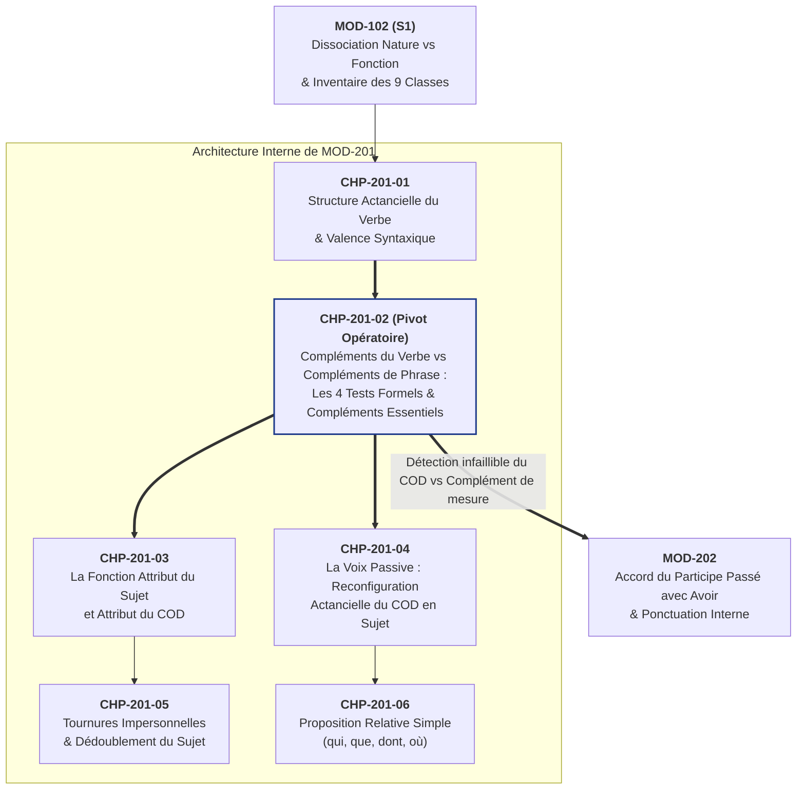

# Chapitre 2 — Cartographie des Compléments du Verbe vs Compléments de Phrase : Les Quatre Tests Formels et les Compléments Essentiels

> **Identifiant du chapitre** : `CHP-201-02`  
> **Module de rattachement** : [`MOD-201` — Syntaxe Fonctionnelle de la Phrase Simple, Voix Passive, Tournures Impersonnelles et Relative Simple](file:///f:/Formation/world-class-french/03-curriculum/year-1/semester-2/mod-201-syntaxe-fonctionnelle-phrase-simple.md)  
> **Semestre** : Année 1 — Semestre 2 (S2)  
> **Volume horaire canonique** : 5 à 6 heures d'apprentissage autonome délibéré et d'ateliers d'application (Phase 1 Étude : 1 h 30 | Phase 2 Pratique : 1 h 30 | Phase 3 Correction : 1 h 00 | Phase 4 Évaluation : 1 h 00)  
> **Statut** : [STATUT : VALIDÉ]  
> **Compétences associées** : [`FR-SYNTAX-001`](file:///f:/Formation/world-class-french/02-competency-framework/competency-framework.md#fr-syntax-001-analyse-fonctionnelle-et-délimitation-de-la-phrase-simple) (L3), [`FR-ORTHO-003`](file:///f:/Formation/world-class-french/02-competency-framework/competency-framework.md#fr-ortho-003-accord-rigoureux-du-participe-passé-avec-lauxiliaire-avoir) (Préparation L2/L3), [`FR-INT-001`](file:///f:/Formation/world-class-french/02-competency-framework/competency-framework.md#fr-int-001-rédiger-un-texte-long-cohérent-en-maîtrisant-accords-et-ponctuation) (L2)  
> **Sources scientifiques de référence** : `SRC-NORM-03` (Ministère de l'Éducation nationale, *Terminologie grammaticale*, 2020, p. 28-34), `SRC-GRAM-02` (Riegel, Pellat, Rioul, *Grammaire méthodique du français*, 2016, chap. 7-8), `SRC-GRAM-01` (Grevisse & Goosse, *Le Bon Usage*, 2016, § 230-240)

---

## 1. Titre et Place dans le Cursus

### 1.1 Intitulé Officiel
**Chapitre 2 : Cartographie des Compléments du Verbe vs Compléments de Phrase : Les Quatre Tests Formels et les Compléments Essentiels** (`CHP-201-02`).

### 1.2 Insertion Architecturale dans le Cursus
Après avoir posé au Chapitre 1 (`CHP-201-01`) la théorie de la valence verbale et la distinction entre verbes avalents, monovalents, bivalents et trivalents, ce deuxième chapitre du module [`MOD-201`](file:///f:/Formation/world-class-french/03-curriculum/year-1/semester-2/mod-201-syntaxe-fonctionnelle-phrase-simple.md) fournit l'outillage expérimental permettant de tracer la frontière syntaxique majeure de la phrase simple : l'opposition entre les **compléments du verbe** (constituants internes au groupe verbal, sélectionnés par la valence du verbe) et les **compléments de phrase** (constituants périphériques ou circonstanciels, extérieurs au groupe verbal) [Réf. `SRC-NORM-03`, p. 28-34 ; `SRC-GRAM-02`, chap. 7-8].



- **En amont immédiat (`CHP-201-01`)** : La valence verbale a montré que le verbe ouvre un nombre déterminé de places d'actants. Le présent chapitre démontre comment identifier matériellement, dans l'énoncé, quels syntagmes saturent ces places d'actants (les compléments du verbe) et quels syntagmes ne font qu'ajouter un cadre accessoire à la proposition entière (les compléments de phrase).
- **Au sein de `MOD-201`** : Ce chapitre conditionne directement l'étude de l'attribut du sujet et du COD (`CHP-201-03`), de la transformation passive (`CHP-201-04` — où seul le COD véritable devient sujet passif, à l'exclusion des compléments essentiels de mesure ou de prix) et des pronoms relatifs *que, dont, où* (`CHP-201-06`).
- **En aval stratégique ([`MOD-202`](file:///f:/Formation/world-class-french/03-curriculum/year-1/semester-2/mod-202-participe-passe-avoir-ponctuation-interne.md))** : Il résout en amont le piège classique de l'accord du participe passé conjugué avec *avoir*. Seul l'apprenant capable de distinguer par les tests formels un véritable COD (*« les caisses qu'il a pesées »*) d'un complément essentiel de mesure (*« les quatre-vingts kilos qu'il a pesé »*) ou de durée (*« les trois heures qu'il a marché »*) peut maîtriser la règle d'accord de `MOD-202` sans jamais recourir à l'approximation [Réf. `SRC-GRAM-01`, § 949 — À VÉRIFIER].

---

## 2. Objectifs Mesurables

Au terme des 5 à 6 heures d'étude et d'entraînement délibéré de ce chapitre, l'apprenant sera capable, au palier **L3 (Autonomie)** de la compétence [`FR-SYNTAX-001`](file:///f:/Formation/world-class-french/02-competency-framework/competency-framework.md#fr-syntax-001-analyse-fonctionnelle-et-délimitation-de-la-phrase-simple), de :

1. **Administrer le protocole des quatre tests syntaxiques formels** (effacement, déplacement, pronominalisation clitique, clivage par *C'est... que*) sur tout syntagme postverbal ou périphérique afin d'établir rigoureusement son statut de complément du verbe ou de complément de phrase [Réf. `SRC-NORM-03`, p. 28-34].
2. **Distinguer et caractériser les sous-classes de compléments du verbe** : identifier sans erreur le Complément d'Objet Direct (COD), le Complément d'Objet Indirect (COI) et le Complément d'Objet Second (COS) à l'aide de leur construction (directe vs prépositionnelle) et de leur paradigme de pronominalisation (*le/la/les* vs *lui/leur/en/y*) [Réf. `SRC-GRAM-02`, chap. 8].
3. **Neutraliser le piège des compléments essentiels de lieu, de mesure, de durée et de prix** : démontrer pourquoi des syntagmes comme *à Dakar* (*habiter à Dakar*), *quatre-vingts kilos* (*peser quatre-vingts kilos*) ou *cinquante euros* (*coûter cinquante euros*) sont des compléments du verbe et non des compléments circonstanciels ni des COD ordinaires [Réf. `SRC-NORM-03`, p. 29 ; `SRC-GRAM-02`, chap. 8].
4. **Dresser la cartographie fonctionnelle intégrale d'un texte soutenu** et produire un écrit normé sous contrainte syntaxique en justifiant la fonction de chaque constituant par une preuve formelle vérifiable.

---

## 3. Prérequis et Test de Préparation (Auto-Diagnostic)

### 3.1 Prérequis Cognitifs et Techniques
- Maîtriser la dissociation entre nature (classe grammaticale) et fonction syntaxique ([`CHP-102-01`](file:///f:/Formation/world-class-french/03-curriculum/year-1/semester-1/mod-102/chp-102-01-nature-vs-fonction.md)).
- Reconnaître instantanément un Syntagme Nominal (SN), un Syntagme Prépositionnel (SP) et un Adverbe (`MOD-102`).
- Comprendre la notion de valence verbale et de structure actancielle étudiée au chapitre précédent (`CHP-201-01`).

### 3.2 Test de Préparation à 5 Questions
Avant d'entamer l'étude théorique, évaluez vos réflexes analytiques sur les cinq questions suivantes :

1. Dans les deux phrases : *(a) « Paul travaille à Cotonou »* et *(b) « Paul réside à Cotonou »*, le groupe prépositionnel *à Cotonou* exerce-t-il la même fonction syntaxique ? Pourquoi ?
2. Par quel pronom personnel conjoint peut-on remplacer le groupe souligné dans : *« Le directeur répond [aux candidats] »* ? Quelle est alors la fonction de ce groupe ?
3. Dans la phrase *« Cette valise pèse trente kilos »*, peut-on mettre la phrase à la voix passive (*« *Trente kilos sont pesés par cette valise »*) ? Que révèle ce blocage sur la fonction de *trente kilos* ?
4. Dans la phrase *« Le magistrat accorde une remise de peine au prévenu »*, pourquoi qualifie-t-on le groupe *au prévenu* de Complément d'Objet Second (COS) plutôt que de simple COI ?
5. Le groupe nominal *Ce matin*, dans *« Ce matin, le navire quitte le port »*, n'est introduit par aucune préposition. Est-il pour autant un COD ? Quel test le prouve ?

---

#### Corrigé Détaillé de l'Auto-Diagnostic

<details>
<summary><b>Consulter le corrigé raisonné des 5 questions de préparation</b></summary>

1. **Comparaison de *à Cotonou* dans (a) et (b)** :
   - **Non**, la fonction diffère radicalement.
   - Dans *(a) « Paul travaille à Cotonou »*, on peut supprimer le groupe (*« Paul travaille »*) et le déplacer facilement en tête de phrase (*« À Cotonou, Paul travaille »*). C'est un **complément de phrase (complément circonstanciel de lieu)**.
   - Dans *(b) « Paul réside à Cotonou »*, la suppression rend la phrase agrammaticale (*« *Paul réside »*) et le déplacement en tête sans reprise est impossible (*« *À Cotonou, Paul réside »*). C'est un **complément essentiel de lieu** (complément du verbe *résider*).
2. **Pronominalisation de *[aux candidats]*** :
   - On le remplace par le pronom personnel conjoint ***leur*** : *« Le directeur leur répond »*.
   - Introduit par la préposition *à* (*à + les = aux*) et régi par le verbe transitif indirect *répondre*, ce syntagme prépositionnel exerce la fonction de **Complément d'Objet Indirect (COI)**.
3. **Le blocage passif de *« Cette valise pèse trente kilos »*** :
   - La transformation passive est totalement agrammaticale.
   - Ce blocage prouve que *trente kilos*, bien que construit sans préposition après le verbe *peser* (pris ici dans son sens d'état pondéral), n'est **pas un COD**, mais un **complément essentiel de mesure (de poids)** du verbe.
4. **Statut du Complément d'Objet Second (COS)** :
   - On l'appelle **COS** parce qu'il s'agit d'un complément d'objet indirect régi par un verbe trivalent (*accorder [quelque chose] [à quelqu'un]*) qui possède déjà, au sein du même groupe verbal, un Complément d'Objet Direct (*une remise de peine*).
5. **Statut de *Ce matin*** :
   - Ce n'est nullement un COD. Bien que de nature nominale (Syntagme Nominal sans préposition), il est **librement déplaçable** (*« Le navire quitte le port ce matin »*) et **effaçable** (*« Le navire quitte le port »*). Il exerce la fonction de **complément de phrase (complément circonstanciel de temps)**.

</details>

---

## 4. Situation de Départ ou Problème Concret : Le Mirage du Sens et la Faillite des Questions Scolaires

### 4.1 L'Illusion des Questions *« Où ? Quand ? Comment ? Quoi ? »*
Pendant des décennies, une vulgate scolaire simplificatrice a enseigné aux élèves à identifier les fonctions grammaticales au moyen de petites questions intuitives posées après le verbe :
- *Qui ?* ou *Quoi ?* $\rightarrow$ COD ;
- *À qui ? À quoi ? De qui ? De quoi ?* $\rightarrow$ COI ;
- *Où ?* $\rightarrow$ Complément circonstanciel de lieu ;
- *Quand ?* $\rightarrow$ Complément circonstanciel de temps ;
- *Combien ?* $\rightarrow$ Complément circonstanciel de prix ou de poids.

Or, dès que l'on quitte les phrases artificielles des manuels élémentaires pour analyser la langue réelle, administrative, juridique ou littéraire, ce système de devinettes sémantiques s'effondre et conduit à deux catastrophes analytiques et orthographiques.

### 4.2 Première Catastrophe : Le Contresens Structurel sur le Lieu
Observez ces deux phrases :
1. *« Le consul rédige son rapport à Genève. »*
2. *« Le consul se rend à Genève. »*

L'apprenant guidé par le mirage du sens pose dans les deux cas la question : *« Le consul rédige où ? Le consul se rend où ? — À Genève ! Donc "à Genève" est complément circonstanciel de lieu dans les deux phrases. »*

Cette analyse est grammaticalement fausse. Dans la phrase (1), *à Genève* indique simplement le décor extérieur où se déroule l'action de rédiger : on peut l'ôter (*« Le consul rédige son rapport »*) ou le placer en ouverture (*« À Genève, le consul rédige son rapport »*). C'est un authentique **complément de phrase**.  
En revanche, dans la phrase (2), le verbe pronominal *se rendre* exige impérativement une destination locative pour exister syntaxiquement. Si vous supprimez *à Genève*, l'énoncé *« *Le consul se rend »* change brutalement de sens (il signifierait *capituler devant l'ennemi* !) ou devient agrammatical. Le syntagme *à Genève* fait corps avec le verbe : c'est un **complément du verbe (complément essentiel de lieu)** [Réf. `SRC-NORM-03`, p. 29].

### 4.3 Seconde Catastrophe : L'Accord Désastreux du Participe Passé
Plus grave encore pour la maîtrise de l'écrit : la question *« Quoi ? »* pousse le scripteur non averti à confondre un complément essentiel de mesure ou de prix avec un COD.
Considérez les deux énoncés suivants :
- *(A) « Les deux valises que le douanier a contrôlées... »*
- *(B) « Les trente kilos que cette valise a pesé... »*

Si l'étudiant pose mécaniquement la question : *« La valise a pesé quoi ? — Trente kilos ! Donc "que" est COD placé avant le verbe, j'accorde : *pesés ! »*, il commet un solécisme caractérisé. En réalité, une valise ne « pèse » pas trente kilos comme un boucher pèse une viande sur une balance : *trente kilos* mesure une propriété intrinsèque et non un objet subissant une action. Faute d'avoir appris à distinguer par des tests syntaxiques formels un **COD véritable** d'un **complément essentiel de mesure**, le scripteur échoue aux épreuves d'orthographe grammaticale de haut niveau [Réf. `SRC-GRAM-01`, § 949 — À VÉRIFIER].

---

## 5. Explication Intuitive : L'Analogie de l'Organe Vital et du Vêtement Amovible

Pour visualiser immédiatement la différence d'architecture entre un **complément du verbe** et un **complément de phrase**, représentons-nous la proposition grammaticale comme un **organisme vivant habillé pour sortir**.

```text
╔═════════════════════════════════════════════════════════════════════════════╗
║                     LA PROPOSITION COMME ORGANISME VIVANT                   ║
╠══════════════════════════════════════╦══════════════════════════════════════╣
║      1. LE COMPLÉMENT DU VERBE       ║      2. LE COMPLÉMENT DE PHRASE      ║
║           (L'ORGANE VITAL)           ║       (LE VÊTEMENT / LE MANTEAU)     ║
╠══════════════════════════════════════╬══════════════════════════════════════╣
║ • Logé à l'intérieur du corps (GV).  ║ • Posé par-dessus l'organisme (P).   ║
║ • Sélectionné par l'anatomie propre  ║ • Indépendant de l'anatomie interne  ║
║   du verbe (sa valence).             ║   du verbe.                          ║
║ • Non amovible : ôter le cœur ou le  ║ • Amovible à volonté : ôter son      ║
║   foie détruit l'organisme ou le     ║   manteau ou son chapeau laisse la   ║
║   mutile gravement.                  ║   personne parfaitement vivante.     ║
║ • Place fixe : on ne déplace pas un  ║ • Mobile : on peut porter son sac    ║
║   organe interne sur l'épaule.       ║   à gauche, à droite ou devant soi.  ║
╚══════════════════════════════════════╩══════════════════════════════════════╝
```

- **Le complément du verbe est un organe interne** : le verbe *donner* a besoin d'un objet donné et d'un destinataire comme un organisme a besoin de ses poumons ; le verbe *habiter* a besoin d'un lieu de résidence. Ces compléments sont soudés au noyau verbal au sein du **Groupe Verbal (GV)**.
- **Le complément de phrase est un vêtement ou un décor** : dans *« Hier soir, malgré la pluie, le médecin a examiné le blessé dans sa clinique »*, les groupes *Hier soir*, *malgré la pluie* et *dans sa clinique* habillent la scène. Vous pouvez les retirer un par un ou les changer d'emplacement : le cœur organique de la phrase (*« le médecin a examiné le blessé »*) demeure intact et pleinement fonctionnel.

---

## 6. Définitions Précises et Terminologie Officielle

Conformément à la nomenclature grammaticale de référence (`SRC-NORM-03`, p. 28-34) et à la syntaxe universitaire (`SRC-GRAM-02`, chap. 7-8), dix concepts fondamentaux doivent être définis avec rigueur :

1. **Complément du verbe (ou complément essentiel)** :
   - *Exemple d'ancrage* : *« L'architecte vérifie **[les plans du bâtiment]**. »*
   - *Définition* : Constituant interne au Groupe Verbal ($\text{GV}$), sélectionné par la valence du verbe recteur. Il complète le sens du verbe et présente, en règle générale, la double propriété d'être **non supprimable** (ou difficilement supprimable sans altération sémantique) et **non déplaçable** en tête de phrase sans dislocation pronominale [Réf. `SRC-NORM-03`, p. 28].

2. **Complément de phrase (ou complément circonstanciel — CC)** :
   - *Exemple d'ancrage* : *« **[Chaque automne]**, les grues cendrées traversent la région **[à haute altitude]**. »*
   - *Définition* : Constituant périphérique de la phrase ($\text{P}$), extérieur au Groupe Verbal et non régi par la valence du verbe. Il précise le cadre spatio-temporel, logique ou modal de l'ensemble de la proposition et se caractérise formellement par sa **facultativité** (effaçable) et sa **mobilité** (déplaçable en tête, à l'intérieur ou en fin de phrase) [Réf. `SRC-NORM-03`, p. 32 ; `SRC-GRAM-02`, chap. 7].

3. **Complément d'Objet Direct (COD)** :
   - *Exemple d'ancrage* : *« Les magistrats rédigent **[leur arrêt]**. »*
   - *Définition* : Complément du verbe de construction **directe** (relié au verbe transitif direct sans préposition intermédiaire), pronominalisable par les pronoms personnels conjoints *le, la, les* (ou *en* si le déterminant est partitif ou indéfini) et susceptible de devenir le sujet grammatical lors de la transformation passive [Réf. `SRC-NORM-03`, p. 28 ; `SRC-GRAM-01`, § 230].

4. **Complément d'Objet Indirect (COI)** :
   - *Exemple d'ancrage* : *« Le témoin se souvient **[de cet incident]**. »*
   - *Définition* : Complément du verbe de construction **indirecte**, relié au verbe transitif indirect par une préposition régie (le plus souvent *à* ou *de*, parfois *sur, contre, en*), pronominalisable par les pronoms conjoints *lui, leur, en, y* ou par une préposition suivie d'un pronom tonique (*à lui, de cela, sur elle*) [Réf. `SRC-NORM-03`, p. 29 ; `SRC-GRAM-01`, § 235].

5. **Complément d'Objet Second (COS)** :
   - *Exemple d'ancrage* : *« La fondation octroie [une bourse d'études] **[aux lauréats du concours]**. »*
   - *Définition* : Dénomination spécifique attribuée au complément d'objet indirect lorsqu'il coexiste, au sein du même Groupe Verbal régi par un verbe trivalent (ditransitif), avec un Complément d'Objet Direct [Réf. `SRC-NORM-03`, p. 30 ; `SRC-GRAM-02`, chap. 8].

6. **Complément essentiel de lieu, de mesure, de durée ou de prix** :
   - *Exemple d'ancrage* : *« Ce diplomate réside **[à Genève]** »* ; *« Ce colis pèse **[dix kilos]** »*.
   - *Définition* : Complément du verbe exprimant une notion spatiale, pondérale, temporelle ou monétaire, mais qui, contrairement aux compléments circonstanciels, est exigé par la valence du verbe (*aller, habiter, provenir, peser, coûter, valoir, mesurer, durer*). Il n'est ni librement déplaçable en tête de phrase, ni supprimable sans mutiler la proposition, et rejette la passivisation [Réf. `SRC-NORM-03`, p. 29 ; `SRC-GRAM-02`, chap. 8].

7. **Test de l'effacement (ou suppression)** :
   - *Définition* : Manipulation syntaxique consistant à retirer un syntagme de l'énoncé pour vérifier si la phrase résiduelle demeure grammaticale et conserve le sens constant du verbe recteur.

8. **Test du déplacement (ou permutation / mobilité)** :
   - *Définition* : Manipulation consistant à permuter la position d'un syntagme (notamment en le plaçant en tête de phrase, avant le sujet, sans reprise par un pronom clitique) afin d'évaluer son degré d'autonomie vis-à-vis du Groupe Verbal.

9. **Test de pronominalisation clitique** :
   - *Définition* : Substitution d'un syntagme par un pronom personnel conjoint préverbal (*le, la, les, lui, leur, en, y*), qui s'amalgame au verbe et révèle la fonction exacte d'actant du syntagme remplacé.

10. **Test du clivage (ou extraction par *C'est... que*)** :
    - *Définition* : Encadrement d'un syntagme par le dispositif extractif *C'est [X] que...*, permettant de prouver l'unité cohésive d'un constituant syntaxique autonome au sein de la proposition [Réf. `SRC-GRAM-02`, chap. 7].

---

## 7. Règles et Mécanismes Fondamentaux

### 7.1 Les Compléments du Verbe : Constituants Internes du Groupe Verbal (GV)

Les compléments du verbe se subdivisent en quatre sous-ensembles formels selon leur mode de liaison avec le verbe et leurs propriétés de commutation.

#### A. Le Complément d'Objet Direct (COD)
Le COD complète un verbe transitif direct. Il obéit à trois critères définitoires convergents :
1. **Liaison directe sans préposition** : Le syntagme succède immédiatement au verbe dans l'ordre canonique ($\text{Sujet} + \text{Verbe} + \text{COD}$).  
   *Ex. : « L'archiviste consulte **les registres anciens**. »*  
   *(Remarque : dans « Il souhaite **de continuer** » ou « Il mange **des fruits** », le mot « de/des » est un marqueur d'infinitif ou un article partitif/indéfini, non une préposition régissant un COI).*
2. **Pronominalisation clitique spécifique** :
   - Par ***le, la, les*** lorsque le SN est défini, démonstratif ou possessif : *« L'archiviste **les** consulte. »*
   - Par ***en*** lorsque le SN est introduit par un déterminant indéfini, partitif ou numéral : *« Il rédige **des rapports** $\rightarrow$ Il **en** rédige »* ; *« Il rédige **trois rapports** $\rightarrow$ Il **en** rédige trois »*.
   - Par ***le*** neutre invariable lorsque le COD est une proposition subordonnée ou un infinitif : *« J'espère **qu'il réussira** $\rightarrow$ Je **l'**espère »*.
3. **Conversion en sujet à la voix passive** : Le COD de la phrase active devient le sujet grammatical de la phrase passive correspondante :  
   *« **Les registres anciens** sont consultés par l'archiviste. »*

#### B. Le Complément d'Objet Indirect (COI)
Le COI complète un verbe transitif indirect (*obéir à, douter de, nuire à, renoncer à, compter sur, voter contre*). Ses trois propriétés formelles sont :
1. **Médiation d'une préposition régie** : La préposition n'est pas choisie librement par le locuteur pour exprimer un rapport spatial ; elle est imposée en bloc par le lexique du verbe (on dit *douter **de***, *contribuer **à***, *tablé **sur***) [Réf. `SRC-GRAM-02`, chap. 8].
2. **Pronominalisation clitique ou tonique selon la préposition et le trait [± animé]** :
   - Préposition ***à*** + référent **[+ humain / animé]** $\rightarrow$ pronom conjoint datif ***lui / leur*** (ou *à lui / à eux* avec certains verbes comme *penser à, songer à, tenir à*) :  
     *« Cet avocat succède **à son confrère** $\rightarrow$ Cet avocat **lui** succède. »*
   - Préposition ***à*** + référent **[− animé]** $\rightarrow$ pronom adverbial conjoint ***y*** :  
     *« Le conseil renonce **à ce projet** $\rightarrow$ Le conseil **y** renonce. »*
   - Préposition ***de*** + référent **[− animé]** $\rightarrow$ pronom adverbial conjoint ***en*** :  
     *« L'assemblée débat **de cette réforme** $\rightarrow$ L'assemblée **en** débat. »*
   - Préposition ***de*** + référent **[+ humain]** $\rightarrow$ préposition *de* + pronom tonique (ou *en* dans la langue courante) :  
     *« Nous parlons **de cet auteur** $\rightarrow$ Nous parlons **de lui** (ou : Nous **en** parlons). »*
   - Autres prépositions régies (***sur, contre, après***) $\rightarrow$ maintien de la préposition suivie du pronom tonique :  
     *« Nous comptons **sur nos alliés** $\rightarrow$ Nous comptons **sur eux**. »*
3. **Rejet de la passivisation canonique** : Un COI ne peut jamais devenir le sujet d'une phrase passive en français standard (*« *Son confrère est succédé par cet avocat »* est un solécisme grave, à la seule exception historique figée des verbes *obéir / désobéir* et *pardonner*).

#### C. Le Complément d'Objet Second (COS)
Lorsqu'un verbe trivalent (ditransitif) régit simultanément un COD et un COI au sein du même Groupe Verbal, le COI prend le nom de **Complément d'Objet Second (COS)** [Réf. `SRC-NORM-03`, p. 30] :
- Construction en ***à*** (verbes de don, d'attribution, de parole : *donner, offrir, prêter, remettre, annoncer, enseigner, confier qqch à qqn*) :  
  *« Le doyen remet **[le diplôme]** (COD) **[au lauréat]** (COS). »*  
  $\rightarrow$ Double pronominalisation conjointe : *« Le doyen **le lui** remet. »*
- Construction en ***de*** (verbes de privation, d'éloignement, d'accusation ou d'information : *priver, débarrasser, avertir, accuser, soupçonner, entourer qqn de qqch*) :  
  *« La cour a lavé **[l'accusé]** (COD) **[de tout soupçon]** (COS). »*  
  $\rightarrow$ Double pronominalisation conjointe : *« La cour **l'en** a lavé. »*

#### D. Le Piège Cardinal : Les Compléments Essentiels de Lieu, de Mesure, de Durée et de Prix
Certains syntagmes expriment sémantiquement un lieu, une direction, un poids, une somme d'argent ou une durée, mais se comportent syntaxiquement comme des **compléments du verbe** [Réf. `SRC-NORM-03`, p. 29 ; `SRC-GRAM-02`, chap. 8] :
1. **Compléments essentiels de lieu** (avec *habiter, résider, demeurer, vivre, aller, se rendre, venir, provenir, partir pour, sortir de*) :
   - *« Les délégués se rendent **[à Abuja]**. »*
   - *Preuve par l'effacement* : *« *Les délégués se rendent »* est impossible (ou change le sens du verbe).
   - *Preuve par le déplacement* : *« *À Abuja, les délégués se rendent »* est agrammatical en prose standard.
   - *Pronominalisation* : Par ***y*** (lieu où l'on est / où l'on va : *« Ils **s'y** rendent »*) ou ***en*** (lieu d'où l'on vient : *« Ils reviennent **de Lomé** $\rightarrow$ Ils **en** reviennent »*).
2. **Compléments essentiels de mesure, de poids, de durée et de prix** (avec *peser, coûter, valoir, mesurer, durer, vivre*) :
   - *« Ce sac de cacao pèse **[quatre-vingts kilos]**. »*
   - *« Cette réparation coûte **[cinquante euros]**. »*
   - *« L'audience a duré **[quatre heures]**. »*
   - Bien que construits directement sans préposition, ces syntagmes **ne sont pas des COD** :
     - Ils **refusent la passivisation** (*« *Quatre-vingts kilos sont pesés par ce sac »*, *« *Cinquante euros sont coûtés par cette réparation »*).
     - Ils **refusent la pronominalisation par *le, la, les*** en emploi défini (*« *Ce sac les pèse »* est agrammatical ; on répond à la question *Combien ?* et non *Quoi ?*).
     - Ils ne sont **pas librement déplaçables en tête** pour les compléments de poids, de prix et de mesure (*« *Quatre-vingts kilos, ce sac de cacao pèse »* est exclu sans dislocation).

---

### 7.2 Les Compléments de Phrase : Circonstanciels Périphériques Détachables

À l'opposé des compléments du verbe, les **compléments de phrase** (appelés **compléments circonstanciels** dans la terminologie scolaire officielle lorsqu'ils remplissent les critères formels ci-dessous [Réf. `SRC-NORM-03`, p. 32]) ne dépendent pas de la valence du verbe : ils portent sur la relation prédicative tout entière ($\text{Sujet} + \text{GV}$).

Ils doivent impérativement satisfaire à **deux propriétés syntaxiques cumulatives** :
1. **La facultativité (effacement libre)** : Leur suppression laisse une phrase grammaticalement complète et ne modifie en rien le sens lexical du verbe :  
   *« **[Depuis l'aube]**, les pêcheurs réparent leurs filets **[sur la plage]** **[avec patience]**. »*  
   $\rightarrow$ Après effacement : *« Les pêcheurs réparent leurs filets. »* (La phrase demeure parfaite et le verbe *réparer* garde exactement le même sens).
2. **La mobilité (déplacement libre dans la phrase)** : Ils peuvent occuper la position initiale (tête de phrase, détachée par une virgule), la position médiane (en incise entre le sujet et le verbe ou après le verbe) ou la position finale, sans nécessiter aucune reprise pronominale :
   - *Position initiale* : *« **Sur la plage**, les pêcheurs réparent leurs filets. »*
   - *Position finale* : *« Les pêcheurs réparent leurs filets **sur la plage**. »*
   - *Position médiane* : *« Les pêcheurs, **sur la plage**, réparent leurs filets. »*

---

### 7.3 Le Laboratoire Expérimental à 4 Tests Formels Infaillibles

Pour trancher scientifiquement le statut de n'importe quel syntagme, l'analyste soumet l'énoncé à une batterie de **quatre manipulations formelles** :

| N° | Nom du Test | Manipulation Opératoire | Résultat pour un Complément du Verbe | Résultat pour un Complément de Phrase |
| :---: | :--- | :--- | :--- | :--- |
| **1** | **Test de l'effacement** | Supprimer le syntagme `[X]` de la phrase. | Phrase **agrammaticale** (`*`), ou **altération du sens lexical** du verbe (sauf emploi absolu). | Phrase **parfaitement grammaticale** ; le sens du verbe reste invariant. |
| **2** | **Test du déplacement** | Antéposer `[X]` en tête de phrase (*« [X], Sujet + Verbe... »*) sans pronom de reprise. | Déplacement **impossible ou très contraint** sans dislocation (*« *Son rapport, il rédige »*). | Déplacement **fluide et naturel** (*« Dès l'aube, il rédige son rapport »*). |
| **3** | **Test de pronominalisation clitique** | Remplacer `[X]` par un pronom conjoint préverbal (*le, la, les, lui, leur, en, y*). | **Positif** pour COD (*le/la/les*), COI/COS (*lui/leur/en/y*) et C. essentiel de lieu (*y/en*). **Négatif** pour C. essentiel de mesure/prix. | **Négatif** pour *le/la/les/lui/leur* (seuls certains CC de lieu acceptent *y/en* ou l'adverbe *là*). |
| **4** | **Test du clivage (*C'est... que*)** | Encadrer `[X]` par la tournure extractive *« C'est [X] que... »*. | **Positif** : prouve que `[X]` est un constituant autonome (et non un simple complément de nom enchâssé). | **Positif** : s'applique aussi bien aux CC qu'aux compléments du verbe. |

> [!IMPORTANT]
> **Règle d'interprétation croisée des 4 tests** :
> Le test 4 (clivage par *C'est... que*) permet d'isoler les frontières d'un syntagme autonome, mais **ne suffit pas à lui seul** à distinguer un complément du verbe d'un complément de phrase, car les deux l'acceptent (*« C'est son rapport qu'il rédige »* / *« C'est à l'aube qu'il rédige son rapport »*). Ce sont les **tests 1 (effacement)**, **2 (déplacement)** et **3 (pronominalisation)** combinés qui tracent la frontière décisive [Réf. `SRC-GRAM-02`, chap. 7].

---

## 8. Raisonnement Détaillé : Pourquoi la Grammaire Moderne Distingue Complément du Verbe et Complément de Phrase

### 8.1 La Faillite de l'Analyse Traditionnelle « à Plat »
La grammaire scolaire du XIXe et du premier XXe siècle analysait la phrase de manière linéaire et horizontale (« à plat »), comme si tous les compléments se rattachaient directement au verbe sur le même plan, en les classant uniquement d'après leur **signification psychologique** (temps, lieu, manière, cause, but, objet).

Or, cette approche se heurte à une contradiction insurmontable dès que l'on examine le fonctionnement réel de la syntaxe française. Pourquoi peut-on dire :
- *« À Cotonou, les négociations progressent rapidement. »* (grammatical)
Mais ne peut-on **pas** dire :
- *« *À Cotonou, ce magistrat habite. »* (agrammatical en prose standard) ?

Si *à Cotonou* avait la même fonction dans les deux phrases sous prétexte qu'il désigne une ville du Bénin, il devrait obéir aux mêmes lois de placement. Le fait qu'il soit mobile dans la première phrase et verrouillé derrière le verbe dans la seconde prouve que **sa position hiérarchique dans l'architecture de la phrase n'est pas la même**.

### 8.2 L'Organisation Hiérarchique en Couches Syntagmatiques
La linguistique structurale et générative (confirmée par la *Grammaire méthodique du français* [`SRC-GRAM-02`, chap. 6-7] et la *Terminologie grammaticale* [`SRC-NORM-03`, p. 22]) démontre que la phrase ($\text{P}$) est structurée en **couches hiérarchiques emboîtées** :

```text
                    ┌────────────────── Phrase (P) ──────────────────┐
                    │                                                │
       ┌────────────┼────────────┐                                   │
       ▼                         ▼                                   ▼
Syntagme Nominal (SN)    Groupe Verbal (GV)               Complément de Phrase (SP/Adv)
   [Fonction : Sujet]    [Noyau Prédicatif]               [Fonction : Circonstanciel]
   "Le magistrat"                │                        "depuis trois ans"
                      ┌──────────┴──────────┐             (Mobile sous P, effaçable)
                      ▼                     ▼
                 Verbe (V)        Complément du Verbe (SN/SP)
                 "réside"         [Fonction : C. essentiel de lieu]
                                  "à Cotonou"
                                  (Enfermé dans le GV, non mobile)
```

1. **La couche interne : le Groupe Verbal ($\text{GV}$)** :
   Le verbe et ses compléments essentiels (COD, COI, COS, complément essentiel de lieu ou de mesure) forment une **unité syntagmatique fermée et solidaire**. Le complément du verbe est dominé directement par le nœud $\text{GV}$ : il ne peut pas s'évader du Groupe Verbal pour aller se placer devant le sujet sans briser la phrase (sauf dislocation orale avec reprise : *« Cet ouvrage, je l'ai lu »*).
2. **La couche externe : la Phrase ($\text{P}$)** :
   Le complément de phrase (circonstanciel) n'est pas enfermé dans le $\text{GV}$ : il est rattaché directement au nœud supérieur $\text{P}$. Parce qu'il domine ou encadre le couple $[\text{SN}_{\text{sujet}} + \text{GV}]$, il peut graviter librement autour de lui (en tête, au milieu ou à la fin) et être retiré sans entamer l'intégrité interne du Groupe Verbal.

---

## 9. Exemples Corrects Commentés : Dissection Comparative par les 4 Tests

Examinons trois paires de phrases contrastées en leur appliquant intégralement le protocole expérimental des quatre tests formels.

### 9.1 Paire Contrastée A : Complément d'Objet Direct (COD) vs Complément de Phrase Nominal de Temps
Soit les deux phrases :
- **Phrase A1** : *« Le conservateur restaure **[ce manuscrit précieux]**. »*
- **Phrase A2** : *« Le conservateur travaille **[ce matin]**. »*

*Observation initiale* : Dans les deux cas, le groupe entre crochets est un **Syntagme Nominal (SN)** construit directement après le verbe sans préposition. Appliquons les 4 tests :
1. **Test 1 (Effacement)** :
   - En A1 : *« Le conservateur restaure »* est incomplet (le verbe *restaurer* attend un objet restauré).
   - En A2 : *« Le conservateur travaille »* est parfaitement complet et autonome.
2. **Test 2 (Déplacement en tête sans reprise)** :
   - En A1 : *« *Ce manuscrit précieux, le conservateur restaure »* est agrammatical.
   - En A2 : *« **Ce matin**, le conservateur travaille »* est irréprochable.
3. **Test 3 (Pronominalisation clitique)** :
   - En A1 : *« Le conservateur **le** restaure »* (pronominalisation directe par *le*).
   - En A2 : *« *Le conservateur le travaille »* (impossible pour remplacer *ce matin*).
4. **Test 4 (Clivage et Passivisation)** :
   - En A1 : Passif valide (*« Ce manuscrit précieux est restauré par le conservateur »*).
   - En A2 : Passif impossible (*« *Ce matin est travaillé par le conservateur »*).

*Verdict* : *ce manuscrit précieux* est **COD du verbe *restaure***, tandis que *ce matin* est **complément de phrase (CC de temps)**.

---

### 9.2 Paire Contrastée B : Complément Essentiel de Lieu vs Complément de Phrase (CC de Lieu)
Soit les deux phrases :
- **Phrase B1** : *« Cette cargaison provient **[du port autonome de Cotonou]**. »*
- **Phrase B2** : *« Les dockers déchargent les conteneurs **[au port autonome de Cotonou]**. »*

1. **Test 1 (Effacement)** :
   - En B1 : *« *Cette cargaison provient »* est strictement agrammatical. Le verbe *provenir* exige son complément d'origine.
   - En B2 : *« Les dockers déchargent les conteneurs »* est parfaitement grammatical.
2. **Test 2 (Déplacement en tête)** :
   - En B1 : *« *Du port autonome de Cotonou, cette cargaison provient »* est rejeté en syntaxe standard.
   - En B2 : *« **Au port autonome de Cotonou**, les dockers déchargent les conteneurs »* est parfaitement fluide.
3. **Test 3 (Pronominalisation)** :
   - En B1 : *« Cette cargaison **en** provient »* (pronominalisation obligatoire de l'origine par *en*).
   - En B2 : Suppression pure possible sans pronom.
4. **Test 4 (Clivage par *C'est... que*)** :
   - En B1 : *« C'est du port autonome de Cotonou que provient cette cargaison. »*
   - En B2 : *« C'est au port autonome de Cotonou que les dockers déchargent les conteneurs. »*

*Verdict* : *du port autonome de Cotonou* en B1 est un **complément du verbe (complément essentiel de lieu)** régi par *provenir*, alors que *au port autonome de Cotonou* en B2 est un **complément de phrase (CC de lieu)**.

---

### 9.3 Paire Contrastée C : Construction Ditransitive (COD + COS) vs COD contenant un Complément du Nom
Soit les deux phrases :
- **Phrase C1** : *« L'ambassadeur remet **[une lettre officielle]** **[au chef de l'État]**. »*
- **Phrase C2** : *« L'ambassadeur salue **[le courage exemplaire du chef de l'État]**. »*

1. **Test du clivage séparé (*C'est... que*)** :
   - En C1 : On peut cliver séparément *une lettre officielle* (*« C'est une lettre officielle que l'ambassadeur remet au chef de l'État »*) ET *au chef de l'État* (*« C'est au chef de l'État que l'ambassadeur remet une lettre officielle »*). Cela prouve qu'il existe **deux constituants distincts** sous le Groupe Verbal.
   - En C2 : Peut-on cliver isolément *le courage exemplaire* en laissant *du chef de l'État* derrière ? *« *C'est le courage exemplaire que l'ambassadeur salue du chef de l'État »* est agrammatical. Tout le bloc *le courage exemplaire du chef de l'État* forme **un seul constituant unique**.
2. **Test de pronominalisation clitique** :
   - En C1 : *une lettre officielle* $\rightarrow$ *la* ; *au chef de l'État* $\rightarrow$ *lui*. Résultat : *« L'ambassadeur **la lui** remet. »*
   - En C2 : Tout le bloc se pronominalise par un seul *le* : *« L'ambassadeur **le** salue. »*

*Verdict* : En C1, *au chef de l'État* est **COS du verbe *remet***. En C2, *du chef de l'État* n'est pas un complément du verbe *salue*, mais un **complément du nom *courage***, enchâssé à l'intérieur du COD [Réf. `SRC-GRAM-02`, chap. 7].

---

## 10. Contre-Exemples et Erreurs Fréquentes : Clinique des 6 Confusions Majeures

Voici les six erreurs récurrentes observées dans les copies universitaires et les concours lors de l'identification des compléments, accompagnées de leur réfutation formelle :

### Erreur n° 1 : Qualifier de « Complément Circonstanciel de Lieu » tout syntagme indiquant un lieu
- **Analyse fautive** : Dans *« Mes grands-parents habitent à Porto-Novo »* ou *« Le train va à Parakou »*, classer *à Porto-Novo* et *à Parakou* comme compléments circonstanciels de lieu.
- **Diagnostic cognitif** : Confusion entre la catégorie sémantique (l'idée spatiale de lieu) et la fonction syntaxique (la position dans la structure de la phrase).
- **Réfutation et correction** : Appliquez l'effacement (*« *Le train va »*) et le déplacement (*« *À Parakou, le train va »*). Le rejet prouve que ces groupes appartiennent au Groupe Verbal : ce sont des **compléments essentiels de lieu** (compléments du verbe) [Réf. `SRC-NORM-03`, p. 29].

### Erreur n° 2 : Confondre le COD et le Complément Essentiel de Mesure, de Poids ou de Prix
- **Analyse fautive** : Analyser *quatre-vingts kilos* dans *« Cet athlète pèse quatre-vingts kilos »* ou *cinquante mille francs* dans *« Ce livre coûte cinquante mille francs »* comme des COD sous prétexte qu'ils répondent à une question sans préposition après le verbe.
- **Diagnostic cognitif** : Assimilation abusive de toute construction directe ($\text{V} + \text{SN}$) à la transitivité directe.
- **Réfutation et correction** : Testez la mise au passif (*« *Quatre-vingts kilos sont pesés par cet athlète »*) et la pronominalisation définie (*« *Il les pèse »*). L'échec des deux tests démontre qu'il s'agit de **compléments essentiels de mesure/prix** et non de COD. Conséquence orthographique majeure : au passé composé, le participe passé reste **invariable** (*« Les quatre-vingts kilos qu'il a pesé »*) [Réf. `SRC-GRAM-01`, § 949 — À VÉRIFIER].

### Erreur n° 3 : Croire que le COI désigne toujours un être animé ou ne commence que par *à* et *de*
- **Analyse fautive** : Refuser l'étiquette de COI à *à ses engagements* dans *« Il manque à ses engagements »* ou à *sur votre discrétion* dans *« Je compte sur votre discrétion »*.
- **Diagnostic cognitif** : Restriction indue du COI au seul datif d'attribution humain (*donner à Paul*).
- **Réfutation et correction** : Tout syntagme prépositionnel régi par la valence du verbe est un COI, que son noyau soit animé ou inanimé, et que la préposition imposée soit *à, de, sur, contre* ou *en*. *À ses engagements* se pronominalise par *y* (*« Il y manque »*) : c'est un **COI** [Réf. `SRC-NORM-03`, p. 29].

### Erreur n° 4 : Confondre un Complément du Nom enchâssé dans le COD avec un COS du verbe
- **Analyse fautive** : Dans *« Le greffier vérifie la signature du président »*, analyser *du président* comme COI ou COS du verbe *vérifie*.
- **Diagnostic cognitif** : Lecture linéaire aveugle à l'emboîtement des syntagmes.
- **Réfutation et correction** : Le verbe *vérifier* est bivalent (*vérifier quelque chose*), non trivalent. Si l'on pronominalise le COD *la signature du président*, l'ensemble disparaît sous le pronom unique *la* (*« Le greffier la vérifie »*, et non *« *Le greffier la lui/en vérifie »*). Le groupe *du président* dépend exclusivement du nom *signature* : c'est un **complément du nom**.

### Erreur n° 5 : Prendre un Complément de Phrase de forme nominale directe pour un COD
- **Analyse fautive** : Dans *« Les ouvriers ont travaillé toute la nuit »* ou *« Le courrier arrivera lundi prochain »*, étiqueter *toute la nuit* ou *lundi prochain* comme COD parce qu'aucune préposition ne les introduit.
- **Diagnostic cognitif** : Oubli qu'un Syntagme Nominal peut exercer une fonction circonstancielle sans préposition.
- **Réfutation et correction** : Appliquez les tests de mobilité et d'effacement : *« **Toute la nuit**, les ouvriers ont travaillé »* / *« **Lundi prochain**, le courrier arrivera »*. Ces syntagmes sont mobiles, effaçables et non passivables : ce sont des **compléments de phrase (CC de temps)** [Réf. `SRC-GRAM-02`, chap. 7].

### Erreur n° 6 : Utiliser le seul test de clivage (*C'est... que*) pour prouver qu'un groupe est Circonstanciel
- **Analyse fautive** : Affirmer que *à son père* dans *« Il ressemble à son père »* est un complément circonstanciel parce qu'on peut dire *« C'est à son père qu'il ressemble »*.
- **Diagnostic cognitif** : Méconnaissance de la portée du test de clivage.
- **Réfutation et correction** : Le clivage par *C'est... que* extrait aussi bien les COD, les COI et les compléments essentiels que les compléments de phrase. Pour prouver le statut de COI de *à son père*, il faut tester l'effacement (*« *Il ressemble »* est agrammatical) et la pronominalisation datif (*« Il **lui** ressemble »*).

---

## 11. Cas Particuliers et Limites Théoriques

### 11.1 Les Compléments d'Objet Internes (Construction Étymologique ou Pléonastique)
Certains verbes ordinairement **intransitifs** (monovalents), tels que *vivre, dormir, pleurer, mourir, rire, rêver*, peuvent exceptionnellement recevoir un complément direct dont le noyau nominal reprend la racine étymologique ou le sémantisme même du verbe [Réf. `SRC-GRAM-01`, § 232 ; `SRC-GRAM-02`, chap. 8] :
- *« Vivre **une vie paisible**. »*
- *« Dormir **son dernier sommeil**. »*
- *« Pleurer **des larmes de sang**. »*

Ce constituant est appelé **complément d'objet interne**.  
*Limite syntaxique remarquable* : Bien qu'il se rattache directement au verbe sans préposition comme un COD, le complément d'objet interne **rejette généralement la transformation passive** (*« *Une vie paisible a été vécue par lui »* est inusité ou très forcé) et exige presque toujours une expansion qualificative (on ne dit pas *« *Il vit une vie »* ni *« *Il dort un sommeil »*, mais *« Il vit sa vie »*, *« Il dort un sommeil de plomb »*).

### 11.2 Les Verbes Transitifs Employés Absolument (Construction Absolue)
De nombreux verbes transitifs directs (bivalents par nature), comme *lire, écrire, manger, boire, chanter, labourer, mordre, voir*, peuvent être employés en discours **sans que leur COD soit exprimé** [Réf. `SRC-GRAM-02`, chap. 8] :
- *« Chut ! Le professeur **lit**. »*
- *« Prenez garde, ce chien **mord**. »*
- *« Cet homme **boit** depuis des années. »*

On parle alors d'**emploi absolu d'un verbe transitif**.  
*Attention méthodologique* : Le fait qu'on puisse supprimer le COD dans *« Le professeur lit [un roman] »* pour obtenir *« Le professeur lit »* ne signifie nullement que *un roman* serait un complément de phrase ! En emploi absolu, le procès verbal se replie sur la capacité générale, l'habitude ou l'activité en tant que telle (et parfois se spécialise sémantiquement : *boire* absolument = consommer de l'alcool avec excès). Dès que *un roman* est présent, il échoue au test de déplacement en tête (*« *Un roman, le professeur lit »*) et réussit les tests de pronominalisation (*« Il le lit »*) et de passivisation (*« Un roman est lu par le professeur »*), ce qui prouve sans ambiguïté son statut de **COD**.

### 11.3 Les Verbes Polysémiques à Double Régime (Transitif vs Mesure)
Un même verbe graphique peut régir tantôt un véritable **COD**, tantôt un **complément essentiel de mesure ou de durée**, selon son acception contextuelle :

| Verbe | Emploi Transitif Direct (avec COD véritable) | Emploi Intransitif à Complément Essentiel de Mesure / Durée |
| :--- | :--- | :--- |
| **Peser** | *Le marchand pèse **le sac de mil**.*<br/>($\rightarrow$ Action d'évaluer le poids ; passivable : *Le sac est pesé*). | *Ce sac de mil pèse **cent kilos**.*<br/>($\rightarrow$ État pondéral ; non passivable). |
| **Courir** | *L'athlète court **le cent mètres** / court **un grand danger**.*<br/>($\rightarrow$ Épreuve ou risque affronté ; passivable). | *Nous avons couru **vingt minutes**.*<br/>($\rightarrow$ Durée de l'effort ; équivaut à *pendant vingt minutes*). |
| **Vivre** | *Nous avons vécu **des événements tragiques**.*<br/>($\rightarrow$ Expérience traversée ; COD). | *Cet aïeul a vécu **quatre-vingt-dix ans**.*<br/>($\rightarrow$ Durée de l'existence ; C. essentiel de mesure). |

---

## 12. Approfondissement Adapté au Niveau (Palier L3 Autonomie)

### 12.1 Rection Forte vs Rection Faible et Continuum des Compléments
Si l'opposition binaire entre **complément du verbe** et **complément de phrase** résout 95 % des énoncés avec une netteté tranchée, la syntaxe universitaire (`SRC-GRAM-02`, chap. 7-8 ; `SRC-GRAM-03`) observe qu'il existe une zone intermédiaire entre l'actant fortement régi et le circonstant libre :
1. **Zone de rection maximale (Actants nucléaires)** : Le COD et le COI/COS. Le verbe impose à la fois leur présence et la préposition exacte qui les introduit (*nuire à*, *douter de*).
2. **Zone de solidarité interne au GV (Adjoints du verbe / Circonstants de GV)** : Certains compléments de manière ou d'instrument, comme *avec courtoisie* dans *« Il traite ses subordonnés avec courtoisie »* ou *à voix basse* dans *« Ils parlent à voix basse »*, sont effaçables, mais se déplacent beaucoup plus difficilement en tête de phrase que les compléments de temps ou de cadre spatial (*« ?À voix basse, ils parlent »*). Ils modifient le verbe à l'intérieur du $\text{GV}$.
3. **Zone de périphérie propositionnelle (Compléments de phrase purs)** : Les compléments de temps, de lieu scénique, de cause (*puisque, à cause de*), de concession (*malgré*) qui cadrent l'événement global et jouissent d'une mobilité maximale.

### 12.2 Représentation Formelle : Syntagme Prépositionnel sous GV vs sous P
En grammaire syntagmatique, l'ambiguïté de surface d'une phrase comportant deux syntagmes prépositionnels se dissipe dès que l'on trace l'arbre de dépendance. Soit l'énoncé :
> *« En janvier, la cour statue sur ce litige. »*

- Le syntagme prépositionnel *En janvier* est dominé directement par le nœud **Phrase ($\text{P}$)** : $\text{SP} \subset \text{P}$ (Complément de phrase).
- Le syntagme prépositionnel *sur ce litige* est dominé directement par le nœud **Groupe Verbal ($\text{GV}$)** et gouverné par la tête verbale *statue* (*statuer sur qqch*) : $\text{SP} \subset \text{GV}$ (Complément du verbe — COI).

---

## 13. Comparaisons Différentielles : Tableaux Synoptiques d'Arbitrage

### 13.1 Tableau Synoptique 1 : Complément du Verbe vs Complément de Phrase

| Critère Syntaxique | Complément du Verbe (Essentiel) | Complément de Phrase (Circonstanciel) |
| :--- | :--- | :--- |
| **Rattachement hiérarchique** | Constituant interne du **Groupe Verbal ($\text{GV}$)**. | Constituant périphérique de la **Phrase ($\text{P}$)**. |
| **Lien avec la valence verbale** | Sélectionné et régi par le verbe (actant). | Non sélectionné par le verbe (circonstant libre). |
| **Test 1 : Effacement** | **Impossible** ou altère le sens du verbe (hors emploi absolu). | **Toujours possible** sans altérer la grammaticalité ni le sens verbal. |
| **Test 2 : Déplacement en tête** | **Bloqué** sans reprise pronominale (dislocation). | **Libre et fluide** (initiale, médiane, finale). |
| **Test 3 : Pronominalisation** | **Oui** pour COD (*le, la, les*), COI/COS (*lui, leur, en, y*) et lieu (*y, en*). | **Non** (ne se pronominalise jamais par *le, la, les, lui, leur*). |
| **Sous-catégories principales** | COD, COI, COS, Compléments essentiels de lieu, mesure, durée, prix. | CC de temps, de lieu scénique, de cause, de but, de concession, de manière. |

### 13.2 Tableau Synoptique 2 : Complément Essentiel de Lieu vs Complément Circonstanciel de Lieu

| Paramètre de Contrôle | Complément Essentiel de Lieu (C. du verbe) | Complément Circonstanciel de Lieu (C. de phrase) |
| :--- | :--- | :--- |
| **Exemple type** | *« L'ambassadeur réside **[à Genève]**. »* | *« L'ambassadeur signe le traité **[à Genève]**. »* |
| **Verbes recteurs typiques** | Verbes de localisation ou de mouvement : *être, habiter, résider, demeurer, aller, se rendre, venir, provenir, partir*. | Tout verbe d'action ou d'activité non locatif : *travailler, lire, signer, négocier, construire, déjeuner*. |
| **Test de suppression** | *« *L'ambassadeur réside. »* $\rightarrow$ **Agrammatical**. | *« L'ambassadeur signe le traité. »* $\rightarrow$ **Grammatical**. |
| **Test d'antéposition directe** | *« *À Genève, l'ambassadeur réside. »* $\rightarrow$ **Rejeté**. | *« À Genève, l'ambassadeur signe le traité. »* $\rightarrow$ **Valide**. |
| **Rôle sémantico-syntaxique** | Indispensable à la saturation du prédicat locatif. | Situe le cadre géographique extérieur où se déroule la scène. |

### 13.3 Tableau Synoptique 3 : COI (Complément du Verbe) vs Complément du Nom (Expansion du Nom)

| Paramètre de Contrôle | Complément d'Objet Indirect (COI / COS) | Complément du Nom (CDN) |
| :--- | :--- | :--- |
| **Exemple type** | *« Le juge parle **[du témoin]**. »* | *« Le juge écoute [la déposition **[du témoin]**]. »* |
| **Tête régissante** | Dépend d'un **Verbe** (*parler*). | Dépend d'un **Nom** (*déposition*) au sein d'un SN. |
| **Niveau syntagmatique** | Constituant immédiat du **Groupe Verbal ($\text{GV}$)**. | Constituant interne enchâssé dans un **Syntagme Nominal ($\text{SN}$)**. |
| **Test de pronominalisation** | Se pronominalise indépendamment auprès du verbe : *« Le juge **en** parle / parle **de lui** »*. | Disparaît avec le nom noyau lorsqu'on pronominalise le SN entier : *« Le juge **l'**écoute »* (*l'* = *la déposition du témoin*). |
| **Test de clivage (*C'est... que*)** | Clivable isolément : *« C'est **du témoin** que le juge parle. »* | Non clivable isolément : *« *C'est du témoin que le juge écoute la déposition. »* |

---

## 14. Exercices Progressifs d'Application Délibérée

### 14.1 Niveau 1 : Application Guidée des 4 Tests sur Phrases Simples (10 items)

#### Consigne
Pour chacun des dix syntagmes mis entre crochets `[...]` ci-dessous :
1. Appliquez explicitement le **test de l'effacement**, le **test du déplacement en tête** et, s'il y a lieu, le **test de pronominalisation clitique**.
2. Concluez en nommant sa **fonction syntaxique exacte** (COD, COI, COS, Complément essentiel de lieu/mesure, ou Complément de phrase circonstanciel).

1. Les ingénieurs contrôlent `[la résistance du béton]`.
2. `[Dès le lever du soleil]`, la caravane traverse la plaine aride.
3. Ce jeune médecin succédera `[au professeur titulaire]`.
4. La délégation ministérielle se rend `[à Yamoussoukro]`.
5. Les artisans sculptent l'ébène `[avec une précision remarquable]`.
6. Le trésorier remet les pièces comptables `[au commissaire aux comptes]`.
7. Cette poutre métallique mesure `[douze mètres]`.
8. Tous les citoyens aspirent `[à la justice sociale]`.
9. Le conseil d'administration se réunira `[mardi prochain]`.
10. Les enquêteurs doutent `[de la véracité de ce témoignage]`.

---

#### Corrigé Détaillé et Justifié du Niveau 1

<details>
<summary><b>Consulter le corrigé exhaustif des 10 items du Niveau 1</b></summary>

1. **`[la résistance du béton]`** :
   - *Tests* : Non effaçable sans incomplétude ; non déplaçable en tête (*« *La résistance du béton, les ingénieurs contrôlent »*) ; pronominalisable par *la* (*« Les ingénieurs **la** contrôlent »*) ; passivable.
   - *Fonction* : **Complément d'Objet Direct (COD)** du verbe *contrôlent*.
2. **`[Dès le lever du soleil]`** :
   - *Tests* : Effaçable (*« La caravane traverse la plaine aride »*) ; déplaçable en fin de phrase (*« La caravane traverse la plaine aride dès le lever du soleil »*) ; non pronominalisable.
   - *Fonction* : **Complément de phrase (Complément circonstanciel de temps)**.
3. **`[au professeur titulaire]`** :
   - *Tests* : Non effaçable ; non déplaçable en tête sans dislocation ; pronominalisable par le clitique datif *lui* (*« Ce jeune médecin **lui** succédera »*).
   - *Fonction* : **Complément d'Objet Indirect (COI)** du verbe *succédera*.
4. **`[à Yamoussoukro]`** :
   - *Tests* : Non effaçable (*« *La délégation ministérielle se rend »* change le sens du verbe) ; non déplaçable en tête (*« *À Yamoussoukro, la délégation se rend »*) ; pronominalisable par *y* (*« Elle **s'y** rend »*).
   - *Fonction* : **Complément du verbe — Complément essentiel de lieu** de *se rend*.
5. **`[avec une précision remarquable]`** :
   - *Tests* : Effaçable (*« Les artisans sculptent l'ébène »*) ; déplaçable en tête (*« Avec une précision remarquable, les artisans sculptent l'ébène »*).
   - *Fonction* : **Complément de phrase (Complément circonstanciel de manière)**.
6. **`[au commissaire aux comptes]`** :
   - *Tests* : Coexiste dans le Groupe Verbal avec le COD *les pièces comptables* auprès du verbe trivalent *remettre* ; pronominalisable par *lui* (*« Le trésorier **les lui** remet »*).
   - *Fonction* : **Complément d'Objet Second (COS)** du verbe *remet*.
7. **`[douze mètres]`** :
   - *Tests* : Non effaçable (*« *Cette poutre métallique mesure »* est agrammatical dans ce sens) ; non passivable (*« *Douze mètres sont mesurés par cette poutre »*).
   - *Fonction* : **Complément du verbe — Complément essentiel de mesure** de *mesure*.
8. **`[à la justice sociale]`** :
   - *Tests* : Non effaçable (*« *Tous les citoyens aspirent »* change le sens en *inspirer de l'air*) ; pronominalisable par *y* (*« Tous les citoyens **y** aspirent »*).
   - *Fonction* : **Complément d'Objet Indirect (COI)** du verbe *aspirent*.
9. **`[mardi prochain]`** :
   - *Tests* : Syntagme nominal sans préposition, mais librement effaçable (*« Le conseil se réunira »*) et déplaçable en tête (*« Mardi prochain, le conseil d'administration se réunira »*).
   - *Fonction* : **Complément de phrase (Complément circonstanciel de temps)**.
10. **`[de la véracité de ce témoignage]`** :
    - *Tests* : Régi par la préposition *de* imposée par *douter* ; pronominalisable par *en* (*« Les enquêteurs **en** doutent »*).
    - *Fonction* : **Complément d'Objet Indirect (COI)** du verbe *doutent*.

</details>

---

### 14.2 Niveau 2 : Discrimination de Compléments Essentiels Pièges et Paires Minimales Syntaxiques (8 paires)

#### Consigne
Dans chacune des huit paires suivantes, un même syntagme (ou deux syntagmes de structure semblable) apparaît dans deux environnements syntaxiques distincts *(a)* et *(b)*. Identifiez la fonction exacte du groupe entre crochets dans *(a)* puis dans *(b)*, et justifiez la différence par le test pertinent.

1. **Paire 1 (*à Dakar*)** :
   - *(a)* Les diplomates négocient un accord commercial `[à Dakar]`.
   - *(b)* Les diplomates résident `[à Dakar]`.
2. **Paire 2 (*cinquante kilos*)** :
   - *(a)* Le planteur pèse `[cinquante kilos de café]` sur la bascule.
   - *(b)* Ce sac de jute pèse `[cinquante kilos]`.
3. **Paire 3 (*trois heures*)** :
   - *(a)* L'examen écrit a duré `[trois heures]`.
   - *(b)* L'étudiant a relu ses notes `[pendant trois heures]`.
4. **Paire 4 (*du directeur*)** :
   - *(a)* Les employés parlent `[du directeur]`.
   - *(b)* Les employés saluent la décision `[du directeur]`.
5. **Paire 5 (*cette nuit*)** :
   - *(a)* Les sentinelles ont surveillé le campement `[cette nuit]`.
   - *(b)* Les voyageurs redoutaient `[cette nuit glaciale]`.
6. **Paire 6 (*à son successeur*)** :
   - *(a)* Le gouverneur transmet les dossiers `[à son successeur]`.
   - *(b)* Le gouverneur songe `[à son successeur]`.
7. **Paire 7 (*de Cotonou*)** :
   - *(a)* Ce navire marchand vient `[de Cotonou]`.
   - *(b)* Le port `[de Cotonou]` accueille de grands cargos.
8. **Paire 8 (*cent mille francs*)** :
   - *(a)* Cet ordinateur d'occasion vaut `[cent mille francs]`.
   - *(b)* Le comptable a déboursé `[cent mille francs]` pour cet achat.

---

#### Corrigé Détaillé et Justifié du Niveau 2

<details>
<summary><b>Consulter le corrigé exhaustif des 8 paires du Niveau 2</b></summary>

1. **Paire 1 (*à Dakar*)** :
   - *(a)* **Complément de phrase (CC de lieu)** : effaçable (*« Les diplomates négocient un accord commercial »*) et déplaçable en tête (*« À Dakar, les diplomates négocient... »*).
   - *(b)* **Complément essentiel de lieu** : non effaçable (*« *Les diplomates résident »*) et non déplaçable en tête sans rupture.
2. **Paire 2 (*cinquante kilos*)** :
   - *(a)* **COD** du verbe transitif *pèse* (action de peser un objet) : passivable (*« Cinquante kilos de café sont pesés par le planteur »*).
   - *(b)* **Complément essentiel de mesure (de poids)** du verbe d'état pondéral *pèse* : non passivable (*« *Cinquante kilos sont pesés par ce sac »*).
3. **Paire 3 (*trois heures*)** :
   - *(a)* **Complément essentiel de durée (mesure)** du verbe *a duré* : non effaçable (*« *L'examen écrit a duré »* est agrammatical).
   - *(b)* **Complément de phrase (CC de temps)** : effaçable (*« L'étudiant a relu ses notes »*) et déplaçable en tête (*« Pendant trois heures, l'étudiant a relu ses notes »*).
4. **Paire 4 (*du directeur*)** :
   - *(a)* **COI** du verbe *parlent* : clivable (*« C'est du directeur que les employés parlent »*) et pronominalisable (*« Ils parlent de lui / Ils en parlent »*).
   - *(b)* **Complément du nom** *décision* (enchâssé dans le COD *la décision du directeur*) : non clivable isolément et absorbé dans la pronominalisation du COD (*« Les employés la saluent »*).
5. **Paire 5 (*cette nuit*)** :
   - *(a)* **Complément de phrase (CC de temps)** : déplaçable en tête (*« Cette nuit, les sentinelles ont surveillé le campement »*) et effaçable.
   - *(b)* **COD** du verbe *redoutaient* : pronominalisable par *la* (*« Les voyageurs la redoutaient »*) et passivable.
6. **Paire 6 (*à son successeur*)** :
   - *(a)* **COS** du verbe ditransitif *transmet* (accompagne le COD *les dossiers* ; *« Il les lui transmet »*).
   - *(b)* **COI** du verbe transitif indirect monovalent/bivalent *songe* (aucun COD dans le Groupe Verbal ; *« Il songe à lui »*).
7. **Paire 7 (*de Cotonou*)** :
   - *(a)* **Complément essentiel de lieu (origine)** du verbe *vient* : pronominalisable par *en* (*« Ce navire en vient »*), non effaçable.
   - *(b)* **Complément du nom** *port* au sein du SN sujet *Le port de Cotonou*.
8. **Paire 8 (*cent mille francs*)** :
   - *(a)* **Complément essentiel de prix** du verbe *vaut* : non passivable (*« *Cent mille francs sont valus par cet ordinateur »*).
   - *(b)* **COD** du verbe transitif direct *a déboursé* (action de verser une somme) : passivable (*« Cent mille francs ont été déboursés par le comptable »*).

</details>

---

### 14.3 Niveau 3 : Analyse Fonctionnelle Complète d'un Texte Soutenu Calibré (50 mots)

#### Corpus d'Étude (exactement 50 mots graphiques)
> *« Depuis trois semaines, les magistrats intègres examinent chaque pièce du dossier dans la grande salle. Cette enquête complexe concerne plusieurs marchands influents. Le procureur transmet ses conclusions écrites au président du tribunal. Les coffres saisis pèsent presque quatre tonnes. Toute la ville attend ce jugement historique avec une vive impatience. »*

#### Consigne
Dressez la cartographie fonctionnelle intégrale des **cinq phrases** de ce texte de 50 mots en identifiant pour chaque proposition :
1. Le **Sujet** et le **Verbe recteur** ;
2. Tous les **Compléments du verbe** (COD, COI, COS, Complément essentiel de mesure), en précisant les éventuels **Compléments du nom** enchâssés ;
3. Tous les **Compléments de phrase** (Circonstanciels), avec leur justification formelle par les tests.

---

#### Corrigé Détaillé et Justifié du Niveau 3

<details>
<summary><b>Consulter la cartographie fonctionnelle exhaustive du texte de 50 mots</b></summary>

#### Phrase 1 : *« Depuis trois semaines, les magistrats intègres examinent chaque pièce du dossier dans la grande salle. »* (15 mots)
- **`[Depuis trois semaines]`** : Syntagme prépositionnel — **Complément de phrase (CC de temps)**.  
  *Preuve* : Effaçable et déplaçable en fin de phrase (*« ... dans la grande salle depuis trois semaines »*).
- **`[les magistrats intègres]`** : Syntagme nominal — **Sujet** du verbe *examinent*.
- **`[examinent]`** : Verbe transitif direct (bivalent) — **Pivot verbal**.
- **`[chaque pièce du dossier]`** : Syntagme nominal — **COD** du verbe *examinent*.  
  *Preuve* : Pronominalisable par *la* (*« Ils l'examinent »*), passivable (*« Chaque pièce du dossier est examinée... »*).  
  *(Analyse interne : `[du dossier]` est **Complément du nom** « pièce », enchâssé dans le COD).*
- **`[dans la grande salle]`** : Syntagme prépositionnel — **Complément de phrase (CC de lieu)**.  
  *Preuve* : Effaçable et déplaçable en tête (*« Dans la grande salle, les magistrats intègres examinent... »*).

#### Phrase 2 : *« Cette enquête complexe concerne plusieurs marchands influents. »* (7 mots)
- **`[Cette enquête complexe]`** : Syntagme nominal — **Sujet** du verbe *concerne*.
- **`[concerne]`** : Verbe transitif direct (bivalent) — **Pivot verbal**.
- **`[plusieurs marchands influents]`** : Syntagme nominal — **COD** du verbe *concerne*.  
  *Preuve* : Pronominalisable par *les* (*« Cette enquête les concerne »*), non effaçable (*« *Cette enquête complexe concerne »*).

#### Phrase 3 : *« Le procureur transmet ses conclusions écrites au président du tribunal. »* (10 mots)
- **`[Le procureur]`** : Syntagme nominal — **Sujet** du verbe *transmet*.
- **`[transmet]`** : Verbe ditransitif (trivalent) — **Pivot verbal**.
- **`[ses conclusions écrites]`** : Syntagme nominal — **COD** du verbe *transmet* (pronominalisable par *les*).
- **`[au président du tribunal]`** : Syntagme prépositionnel — **COS** du verbe *transmet* (pronominalisable par *lui* : *« Le procureur les lui transmet »*).  
  *(Analyse interne : `[du tribunal]` est **Complément du nom** « président », enchâssé dans le COS).*

#### Phrase 4 : *« Les coffres saisis pèsent presque quatre tonnes. »* (7 mots)
- **`[Les coffres saisis]`** : Syntagme nominal — **Sujet** du verbe *pèsent*.
- **`[pèsent]`** : Verbe d'état pondéral — **Pivot verbal**.
- **`[presque quatre tonnes]`** : Syntagme nominal — **Complément du verbe (Complément essentiel de mesure / poids)** de *pèsent*.  
  *Preuve* : Non effaçable (*« *Les coffres saisis pèsent »*), non déplaçable en tête, et **non passivable** (*« *Presque quatre tonnes sont pesées par les coffres saisis »*), ce qui exclut la fonction COD.

#### Phrase 5 : *« Toute la ville attend ce jugement historique avec une vive impatience. »* (11 mots)
- **`[Toute la ville]`** : Syntagme nominal — **Sujet** du verbe *attend*.
- **`[attend]`** : Verbe transitif direct (bivalent) — **Pivot verbal**.
- **`[ce jugement historique]`** : Syntagme nominal — **COD** du verbe *attend* (pronominalisable par *l'* : *« Toute la ville l'attend »* ; passivable).
- **`[avec une vive impatience]`** : Syntagme prépositionnel — **Complément de phrase (CC de manière)**.  
  *Preuve* : Effaçable (*« Toute la ville attend ce jugement historique »*) et déplaçable en tête (*« Avec une vive impatience, toute la ville attend ce jugement historique »*).

</details>

---

## 15. Activité de Correction Raisonnée : Audit d'une Copie Contenant 6 Erreurs d'Étiquetage

### Énoncé Soumis à l'Étudiant
Un candidat aux concours administratifs devait analyser les constituants de l'énoncé suivant :
> *« Le mois dernier, le directeur de l'institut a envoyé un avertissement sévère aux retardataires qui habitaient à Ouidah, car leur absence prolongée avait coûté cent mille francs. »*

Voici les **six affirmations fautives** relevées dans sa copie. Rédigez pour chacune le diagnostic de l'erreur et la rectification scientifique appuyée sur les tests formels :

1. **Affirmation 1 de la copie** : *« "Le mois dernier" est un syntagme nominal sans préposition placé au début, donc sa fonction est Sujet ou COD antéposé. »*
2. **Affirmation 2 de la copie** : *« "de l'institut" est introduit par la préposition "de", donc sa fonction est COI du verbe "a envoyé". »*
3. **Affirmation 3 de la copie** : *« "aux retardataires" répond à la question "Où / Vers qui ?", c'est un complément circonstanciel de destination. »*
4. **Affirmation 4 de la copie** : *« "à Ouidah" indique une ville du Bénin, sa fonction est donc complément circonstanciel de lieu du verbe "habitaient". »*
5. **Affirmation 5 de la copie** : *« "cent mille francs" répond à la question "avait coûté quoi ?", sa fonction est COD du verbe "avait coûté". »*
6. **Affirmation 6 de la copie** : *« "un avertissement sévère" peut être encadré par "C'est... que", ce qui prouve que c'est un complément de phrase facultatif. »*

---

### Apparat Critique et Rectification Raisonnée

<details>
<summary><b>Consulter la correction raisonnée des 6 erreurs de la copie</b></summary>

1. **Rectification de l'Affirmation 1 (*Le mois dernier*)** :
   - *Faille* : Confusion entre la nature (Syntagme Nominal sans préposition) et la fonction.
   - *Preuve formelle* : *Le mois dernier* n'accorde pas le verbe *a envoyé* (le sujet est *le directeur de l'institut*) et ne se pronominalise pas par *le*. Il est effaçable et déplaçable en fin de proposition (*« ... a envoyé un avertissement sévère le mois dernier »*).
   - *Fonction exacte* : **Complément de phrase (Complément circonstanciel de temps)**.

2. **Rectification de l'Affirmation 2 (*de l'institut*)** :
   - *Faille* : Non-respect de l'emboîtement des syntagmes. Le candidat rattache au verbe un groupe qui dépend d'un nom.
   - *Preuve formelle* : Lorsqu'on pronominalise le sujet *le directeur de l'institut* par *il*, le groupe *de l'institut* disparaît avec le nom noyau *directeur* (*« Il a envoyé... »*).
   - *Fonction exacte* : **Complément du nom** *directeur* (expansion interne au SN sujet).

3. **Rectification de l'Affirmation 3 (*aux retardataires*)** :
   - *Faille* : Recours à une question sémantique vague (*Vers qui ?*) au lieu des tests syntaxiques.
   - *Preuve formelle* : Le groupe est régi par le verbe trivalent *envoyer* (*envoyer [qqch] [à qqn]*) et se pronominalise par le clitique datif ***leur*** (*« Le directeur **leur** a envoyé un avertissement sévère »*).
   - *Fonction exacte* : **Complément d'Objet Second (COS)** du verbe *a envoyé*.

4. **Rectification de l'Affirmation 4 (*à Ouidah*)** :
   - *Faille* : Étiquetage sémantique naïf confondant l'idée géographique de lieu et la fonction circonstancielle.
   - *Preuve formelle* : Le verbe *habiter* exige dans cet emploi un complément locatif. Ce groupe ne peut pas être déplacé en tête de la subordonnée relative et se pronominalise par ***y*** (*« ... qui **y** habitaient »*).
   - *Fonction exacte* : **Complément du verbe — Complément essentiel de lieu** de *habitaient*.

5. **Rectification de l'Affirmation 5 (*cent mille francs*)** :
   - *Faille* : Utilisation de la question trompeuse *« Quoi ? »* après le verbe de prix *coûter*.
   - *Preuve formelle* : Le groupe répond en réalité à la question *« Combien ? »* et refuse catégoriquement la transformation passive (*« *Cent mille francs avaient été coûtés par leur absence »*).
   - *Fonction exacte* : **Complément du verbe — Complément essentiel de prix (mesure)** de *avait coûté*.

6. **Rectification de l'Affirmation 6 (*un avertissement sévère*)** :
   - *Faille* : Mauvaise interprétation du test de clivage par *C'est... que* (qui fonctionne aussi sur les compléments du verbe).
   - *Preuve formelle* : *Un avertissement sévère* n'est pas déplaçable en tête (*« *Un avertissement sévère, le directeur a envoyé »*), se pronominalise par *en* (*« Il en a envoyé un »*) ou *le* (s'il est défini), et devient sujet au passif (*« Un avertissement sévère a été envoyé... »*).
   - *Fonction exacte* : **Complément d'Objet Direct (COD)** du verbe *a envoyé*.

</details>

---

## 16. Mise en Pratique dans une Production Réelle : Rapport Calibré de 60 Mots sous Contrainte

### 16.1 Cahier des Charges de la Production
Rédigez un rapport d'inspection administrative et technique d'un registre soutenu, comptant **exactement 60 mots graphiques** (sans apostrophes ni traits d'union afin de garantir un décompte univoque mot pour mot), qui intègre exactement :
- **2 Compléments d'Objet Directs (COD)** ;
- **1 Complément d'Objet Indirect (COI)** ;
- **1 Complément essentiel de mesure (poids)** ;
- **2 Compléments de phrase (Circonstanciels)**.

Accompagnez votre production d'un **tableau de justification formelle** prouvant le statut de chacun de ces six compléments par les tests du laboratoire.

---

### 16.2 Production Modèle Étalonnée (exactement 60 mots graphiques)

> *« Durant cette mission officielle, nos ingénieurs principaux vérifient la solidité des nouveaux ponts métalliques. La commission indépendante procède au contrôle minutieux des registres financiers avec une rigueur constante. Le grand transformateur central du barrage hydroélectrique régional pèse cinquante tonnes. Les deux ministères compétents valideront la publication officielle du bilan général des grands travaux routiers et ferroviaires de notre province méridionale. »*

*Vérification arithmétique du décompte* :
- Phrase 1 : *Durant (1) cette (2) mission (3) officielle, (4) nos (5) ingénieurs (6) principaux (7) vérifient (8) la (9) solidité (10) des (11) nouveaux (12) ponts (13) métalliques (14).* $\rightarrow$ **14 mots**.
- Phrase 2 : *La (15) commission (16) indépendante (17) procède (18) au (19) contrôle (20) minutieux (21) des (22) registres (23) financiers (24) avec (25) une (26) rigueur (27) constante (28).* $\rightarrow$ **14 mots** (cumul : 28).
- Phrase 3 : *Le (29) grand (30) transformateur (31) central (32) du (33) barrage (34) hydroélectrique (35) régional (36) pèse (37) cinquante (38) tonnes (39).* $\rightarrow$ **11 mots** (cumul : 39).
- Phrase 4 : *Les (40) deux (41) ministères (42) compétents (43) valideront (44) la (45) publication (46) officielle (47) du (48) bilan (49) général (50) des (51) grands (52) travaux (53) routiers (54) et (55) ferroviaires (56) de (57) notre (58) province (59) méridionale (60).* $\rightarrow$ **21 mots** (cumul : **60 mots exactement**).

---

### 16.3 Tableau de Justification par les Quatre Tests Formels

| N° | Syntagme Extrait du Rapport | Fonction Cible | Test 1 : Effacement | Test 2 : Déplacement | Test 3 : Pronominalisation & Passif |
| :---: | :--- | :--- | :--- | :--- | :--- |
| **1** | *Durant cette mission officielle* (Phrase 1) | **Complément de phrase n° 1** (CC de temps) | **Effaçable** : *« Nos ingénieurs principaux vérifient la solidité... »* est complet. | **Mobile** : déplaçable en fin de phrase sans reprise. | Non pronominalisable par un clitique d'objet. |
| **2** | *la solidité des nouveaux ponts métalliques* (Phrase 1) | **COD n° 1** (de *vérifient*) | **Non effaçable** sans tronquer l'énoncé. | **Non mobile** en tête sans dislocation. | Pronominalisable par ***la*** (*« Ils la vérifient »*) ; passivable (*« La solidité... est vérifiée »*). |
| **3** | *au contrôle minutieux des registres financiers* (Phrase 2) | **COI n° 1** (de *procède*) | **Non effaçable** : *« *La commission procède »* est incomplet. | **Non mobile** en tête sans dislocation. | Introduit par *à* régi par *procéder à* ; pronominalisable par ***y*** (*« La commission y procède »*). |
| **4** | *avec une rigueur constante* (Phrase 2) | **Complément de phrase n° 2** (CC de manière) | **Effaçable** : la phrase reste grammaticale. | **Mobile** : *« Avec une rigueur constante, la commission procède... »*. | Non pronominalisable par un clitique verbal. |
| **5** | *cinquante tonnes* (Phrase 3) | **Complément essentiel de mesure** (de *pèse*) | **Non effaçable** : *« *Le grand transformateur pèse »* est agrammatical. | **Non mobile** en tête (*« *Cinquante tonnes, le transformateur pèse »*). | **Rejette le passif** (*« *Cinquante tonnes sont pesées... »*) et le pronom défini *les*. |
| **6** | *la publication officielle du bilan [...] méridionale* (Phrase 4) | **COD n° 2** (de *valideront*) | **Non effaçable** : exigé par la valence de *valideront*. | **Non mobile** en tête sans reprise clitique. | Pronominalisable par ***la*** (*« Les ministères la valideront »*) ; passivable. |

---

## 17. Résumé Structuré : L'Arbre de Décision Infaillible en 4 Étapes

Pour déterminer sans hésitation la fonction de tout syntagme qui n'est ni le sujet ni un attribut dans une proposition, appliquez séquentiellement cet algorithme en **quatre étapes** :

```text
═══════════════════════════════════════════════════════════════════════════════════════
          ARBRE DE DÉCISION EN 4 ÉTAPES : IDENTIFIER LA FONCTION D'UN COMPLÉMENT
═══════════════════════════════════════════════════════════════════════════════════════

ÉTAPE 1 : VÉRIFIER L'AUTONOMIE SYNTAGMATIQUE (TEST DU CLIVAGE "C'EST... QUE")
│  Le syntagme [X] peut-il être extrait seul par "C'est [X] que..." ?
├── NON ──> [X] est enfermé dans un autre syntagme nominal ──> COMPLÉMENT DU NOM (CDN)
└── OUI ──> [X] est un constituant autonome de la proposition. Passer à l'Étape 2.
     │
ÉTAPE 2 : TESTER L'EFFACEMENT ET LE DÉPLACEMENT LIBRE EN TÊTE DE PHRASE
│  Peut-on supprimer [X] ET le déplacer en tête de phrase sans reprise pronominale
│  et sans altérer le sens du verbe ?
├── OUI aux deux ──> Constituant périphérique sous P ──> COMPLÉMENT DE PHRASE (CC)
└── NON          ──> Constituant interne au Groupe Verbal (GV) ──> COMPLÉMENT DU VERBE.
                     Passer à l'Étape 3.
     │
ÉTAPE 3 : EXAMINER LA CONSTRUCTION (DIRECTE VS PRÉPOSITIONNELLE)
│  Comment le complément du verbe [X] est-il relié au verbe recteur ?
├── Par une PRÉPOSITION régie (à, de, sur...) ──> Passer à l'Étape 4A.
└── SANS préposition (construction directe)    ──> Passer à l'Étape 4B.
     │
ÉTAPE 4 : DISCRIMINATION FINALE PAR PRONOMINALISATION ET PASSIVISATION
│
├── 4A (Construction prépositionnelle) :
│   ├── Exprime un lieu exigé par un verbe locatif (habiter, aller, venir),
│   │   pronominalisable par y/en (spatial) ──> COMPLÉMENT ESSENTIEL DE LIEU
│   ├── Pronominalisable par lui/leur/en/y/prép.+tonique (sans COD conjoint) ──> COI
│   └── Pronominalisable par lui/leur/en/y en présence d'un COD dans le GV   ──> COS
│
└── 4B (Construction directe sans préposition) :
    ├── Pronominalisable par le/la/les ET transformable en sujet passif      ──> COD
    └── Exprime un poids, un prix ou une durée (peser, coûter, valoir, durer)
        et REJETTE la transformation passive ──> COMPLÉMENT ESSENTIEL DE MESURE / PRIX
═══════════════════════════════════════════════════════════════════════════════════════
```

---

## 18. Questions de Rappel Actif (Active Recall)

Répondez de mémoire et par écrit aux six questions suivantes avant de déplier les corrigés :

1. Quels sont les quatre tests syntaxiques formels du laboratoire et pourquoi le test du clivage par *C'est... que* ne suffit-il pas, à lui seul, à prouver qu'un groupe est un complément circonstanciel ?
2. Comment prouve-t-on formellement que *à Genève*, dans *« Ce diplomate réside à Genève »*, est un complément du verbe et non un complément de phrase ?
3. Quelle différence syntaxique fondamentale distingue un Complément d'Objet Indirect (COI) d'un Complément d'Objet Second (COS) ? Donnez un exemple de double pronominalisation.
4. Par quels tests formels distingue-t-on un véritable COD d'un complément essentiel de mesure ou de prix (ex. *peser quatre-vingts kilos*, *coûter cinquante euros*) ?
5. Comment démontrer qu'un groupe prépositionnel en *de* placé après un COD (ex. *« Il examine le dossier du candidat »*) est un complément du nom et non un COS du verbe ?
6. Qu'appelle-t-on un « complément d'objet interne » et quelle est sa particularité vis-à-vis de la voix passive ?

---

### Réponses Repliables d'Active Recall

<details>
<summary><b>Question 1 : Les 4 tests formels et la limite du clivage</b></summary>

- Les 4 tests sont : **1. L'effacement (suppression)**, **2. Le déplacement (mobilité en tête)**, **3. La pronominalisation clitique**, **4. Le clivage par *C'est... que*** (complétés par la passivisation pour le COD).
- Le clivage par *C'est... que* ne suffit pas à identifier un complément de phrase car il s'applique tout aussi bien aux compléments du verbe (COD : *« C'est ce livre que je lis »* ; COI : *« C'est à lui que je parle »*). Il sert uniquement à prouver qu'un syntagme est un constituant autonome (et non un complément de nom enchâssé).

</details>

<details>
<summary><b>Question 2 : Preuve du statut de complément essentiel de lieu (*résider à Genève*)</b></summary>

- **Test de l'effacement** : *« *Ce diplomate réside »* est agrammatical. Le verbe *résider* exige un actant locatif.
- **Test du déplacement** : *« *À Genève, ce diplomate réside »* est rejeté en prose standard sans dislocation.
- **Test de pronominalisation** : Le groupe se pronominalise par le clitique locatif *y* (*« Ce diplomate y réside »*). C'est donc un **complément essentiel de lieu** interne au Groupe Verbal.

</details>

<details>
<summary><b>Question 3 : Distinction COI vs COS et double pronominalisation</b></summary>

- Le **COI** complète un verbe transitif indirect qui n'a pas de COD dans le même Groupe Verbal (*« Il obéit à la loi »*).
- Le **COS** est un COI régi par un verbe trivalent (ditransitif) qui possède déjà un COD dans le même Groupe Verbal (*« Il remet [la clé] (COD) [au gardien] (COS) »*).
- *Double pronominalisation* : *« Il **la lui** remet. »*

</details>

<details>
<summary><b>Question 4 : Distinction COD vs Complément essentiel de mesure/prix</b></summary>

- Un véritable **COD** accepte la **transformation passive** (*« Le sac est pesé par le marchand »*) et la pronominalisation définie par *le, la, les* (*« Il le pèse »*).
- Un **complément essentiel de mesure ou de prix** (*peser quatre-vingts kilos*, *coûter cinquante euros*) répond à la question *Combien ?*, **rejette catégoriquement la passivisation** (*« *Quatre-vingts kilos sont pesés par cet homme »*) et n'entraîne jamais l'accord du participe passé avec *avoir*.

</details>

<details>
<summary><b>Question 5 : Distinction Complément du nom vs COS</b></summary>

- Si l'on pronominalise le COD *le dossier du candidat* par *le*, le groupe *du candidat* disparaît simultanément (*« Il l'examine »*), ce qui prouve qu'il est **enchâssé à l'intérieur du SN COD** comme **complément du nom** *dossier*.
- De plus, il échoue au test d'extraction isolée : *« *C'est du candidat qu'il examine le dossier »* est agrammatical en français standard.

</details>

<details>
<summary><b>Question 6 : Le complément d'objet interne</b></summary>

- C'est un syntagme nominal direct construit après un verbe ordinairement intransitif, dont le nom noyau partage la racine ou le sème du verbe (*vivre une vie paisible, dormir son dernier sommeil, pleurer des larmes de sang*).
- Bien que de construction directe, il ne désigne pas un patient extérieur affecté par l'action et **rejette la transformation passive**.

</details>

---

## 19. Mini-Évaluation Sommative Notée sur 20 Points

> **Durée** : 30 minutes sans document.  
> **Barème** : 20 points.  
> **Seuil de validation (Palier L3 Autonomie)** : **14/20 minimum**. Toute note strictement inférieure à 14/20 est éliminatoire et impose la reprise complète des exercices de discrimination syntaxique avant d'aborder le Chapitre 3.

---

### Sujet de l'Épreuve Sommative

#### Partie 1 : Questions de Démonstration Syntaxique (6 points)
1. Soit les deux phrases : *(1) « L'avocat étudie le dossier à Porto-Novo »* et *(2) « L'avocat habite à Porto-Novo »*. Démontrez à l'aide de trois tests formels pourquoi *à Porto-Novo* n'exerce pas la même fonction dans (1) et dans (2) (3 points).
2. Soit les deux phrases : *(1) « Le boucher a pesé ces deux gigots »* et *(2) « Ces deux gigots ont pesé quatre kilos »*. Expliquez la différence de fonction entre *ces deux gigots* en (1) et *quatre kilos* en (2) en utilisant le test de passivisation (3 points).

#### Partie 2 : Pronominalisation Clitique et Identification Fonctionnelle (6 points)
Pour chacune des trois phrases suivantes, réécrivez la phrase en pronominalisant le(s) syntagme(s) souligné(s) entre crochets, puis nommez la fonction exacte de chaque syntagme :
1. Le rapporteur soumet `[le projet de loi]` `[aux députés de la commission]`. (2 points)
2. Les membres du jury se souviennent `[de cette plaidoirie mémorable]`. (2 points)
3. La délégation officielle provient `[de la capitale économique]`. (2 points)

#### Partie 3 : Analyse Fonctionnelle sur Corpus Littéraire et Administratif (8 points)
Analysez intégralement la fonction syntaxique des huit syntagmes numérotés dans l'extrait suivant (1 point par syntagme correctement identifié et justifié d'une ligne) :
> *« **(1) Dès l'ouverture de la séance**, le président de la cour a accordé **(2) la parole** **(3) au procureur général**. Ce magistrat chevronné a évoqué **(4) les pièces comptables** **(5) de la société** **(6) pendant deux heures**. **(7) Cette procédure complexe** a coûté **(8) plusieurs millions de francs**. »*

---

### Corrigé Détaillé et Barème de Notation

<details>
<summary><b>Consulter le corrigé officiel et le barème de la mini-évaluation</b></summary>

#### Partie 1 (6 points)
1. **Comparaison de *à Porto-Novo*** (3 pts : 1 pt par test correctement appliqué + conclusion) :
   - *Test d'effacement* : *« L'avocat étudie le dossier »* est grammatical en (1), mais *« *L'avocat habite »* est agrammatical en (2).
   - *Test de déplacement* : *« À Porto-Novo, l'avocat étudie le dossier »* est valide en (1), mais *« *À Porto-Novo, l'avocat habite »* est rejeté en (2).
   - *Conclusion* : En (1), *à Porto-Novo* est **Complément de phrase (CC de lieu)** ; en (2), c'est un **Complément du verbe (Complément essentiel de lieu)**.
2. **Comparaison de *ces deux gigots* et *quatre kilos*** (3 pts) :
   - En (1), *ces deux gigots* accepte la transformation passive (*« Ces deux gigots ont été pesés par le boucher »*) et se pronominalise par *les* : c'est un **COD** (1,5 pt).
   - En (2), *quatre kilos* rejette formellement le passif (*« *Quatre kilos ont été pesés par ces deux gigots »*) : c'est un **Complément essentiel de mesure (poids)** du verbe d'état pondéral *peser* (1,5 pt).

#### Partie 2 (6 points)
1. *« Le rapporteur **le leur** soumet. »* (1 pt)  
   - `[le projet de loi]` = **COD** de *soumet* (0,5 pt) ; `[aux députés de la commission]` = **COS** de *soumet* (0,5 pt).
2. *« Les membres du jury **s'en** souviennent. »* (1 pt)  
   - `[de cette plaidoirie mémorable]` = **COI** du verbe pronominal *se souviennent* (1 pt).
3. *« La délégation officielle **en** provient. »* (1 pt)  
   - `[de la capitale économique]` = **Complément essentiel de lieu (origine)** du verbe *provient* (1 pt).

#### Partie 3 (8 points — 1 point par item : 0,5 pt pour l'étiquette exacte + 0,5 pt pour la justification)
1. ***(1) Dès l'ouverture de la séance*** : **Complément de phrase (CC de temps)** — effaçable et déplaçable en fin de phrase.
2. ***(2) la parole*** : **COD** du verbe *a accordé* — construction directe, pronominalisable par *la*.
3. ***(3) au procureur général*** : **COS** du verbe ditransitif *a accordé* — introduit par *à*, pronominalisable par *lui* en présence du COD *la parole*.
4. ***(4) les pièces comptables*** : **COD** du verbe *a évoqué* — pronominalisable par *les*, passivable.
5. ***(5) de la société*** : **Complément du nom** *pièces* — enchâssé dans le SN COD *les pièces comptables de la société*.
6. ***(6) pendant deux heures*** : **Complément de phrase (CC de temps / durée)** — effaçable et déplaçable en tête (*« Pendant deux heures, ce magistrat a évoqué... »*).
7. ***(7) Cette procédure complexe*** : **Sujet** du verbe *a coûté* — donneur d'accord au singulier, encadrable par *C'est... qui*.
8. ***(8) plusieurs millions de francs*** : **Complément du verbe (Complément essentiel de prix)** de *a coûté* — non effaçable et non passivable.

</details>

---

## 20. Critères Observables de Maîtrise (Indicateurs L3 Autonomie pour `FR-SYNTAX-001`)

La validation du présent chapitre au palier **L3 (Autonomie)** de la compétence [`FR-SYNTAX-001`](file:///f:/Formation/world-class-french/02-competency-framework/competency-framework.md#fr-syntax-001-analyse-fonctionnelle-et-délimitation-de-la-phrase-simple) repose sur quatre indicateurs comportementaux vérifiables :

| Code Indicateur | Comportement Observable Attendu | Preuve Opératoire Exigée | Seuil de Validation |
| :---: | :--- | :--- | :---: |
| **IND-201-02A** | **Abandon total des devinettes sémantiques** | L'apprenant justifie systématiquement la fonction d'un complément par l'application combinée des tests d'effacement, de déplacement et de pronominalisation, sans jamais invoquer la seule question *Où ? Quand ? Comment ?*. | 100 % des justifications fondées sur un test formel |
| **IND-201-02B** | **Discrimination infaillible C. essentiel de lieu vs CC de lieu** | Devant un syntagme locatif (*à Cotonou, à Genève, de Dakar*), l'apprenant détermine sans erreur s'il est régi par la valence verbale ou s'il constitue un circonstant périphérique. | Zéro confusion à l'évaluation sommative |
| **IND-201-02C** | **Sécurisation de la frontière COD vs C. essentiel de mesure/prix** | L'apprenant distingue un COD passivable d'un complément de poids, de durée ou de prix non passivable (*peser, coûter, valoir, durer*), préparant sans faille l'accord du participe passé de `MOD-202`. | 100 % de réussite sur les paires contrastées |
| **IND-201-02D** | **Distinction hiérarchique COS vs Complément du nom** | L'apprenant utilise la pronominalisation globale et le clivage pour ne jamais confondre un groupe prépositionnel rattaché au verbe (COI/COS) avec un groupe prépositionnel enchâssé dans un nom (CDN). | Score $\ge 14/20$ à l'épreuve sommative |

---

## 21. Sources et Lectures Complémentaires

Les analyses, règles et terminologies exposées dans ce chapitre s'appuient exclusivement sur les ouvrages de référence inscrits au registre [`07-resources/source-registry.md`](file:///f:/Formation/world-class-french/07-resources/source-registry.md) :

1. **`SRC-NORM-03` — Ministère de l'Éducation nationale (2020)**. *Terminologie grammaticale*. Paris : Réseau Canopé.
   - *Pages de référence* : **p. 28-34** (*Les fonctions dans le groupe verbal : les compléments du verbe [COD, COI, COS, compléments essentiels de lieu, de poids, de mesure, de prix]* ; *Les fonctions dans la phrase : les compléments circonstanciels*).
   - *Apport* : Fixe les critères formels officiels d'effacement, de déplacement et de pronominalisation opposant les compléments du verbe aux compléments circonstanciels.
2. **`SRC-GRAM-02` — Riegel, Martin, Pellat, Jean-Christophe & Rioul, René (2016)**. *Grammaire méthodique du français*. Paris : PUF, coll. « Quadrige ».
   - *Chapitres de référence* : **Chapitre 7** (*La structure de la phrase simple : constituants immédiats, groupe verbal et circonstants*) et **Chapitre 8** (*Le groupe verbal : constructions transitives directes, indirectes, bitransitives et compléments essentiels*).
   - *Apport* : Démontre l'organisation hiérarchique en couches syntagmatiques ($\text{GV}$ vs $\text{P}$) et la théorie des tests distributionnels.
3. **`SRC-GRAM-01` — Grevisse, Maurice & Goosse, André (2016)**. *Le Bon Usage* (16e éd.). Bruxelles : De Boeck Supérieur.
   - *Paragraphes de référence* : **§ 230-240** (*Le complément d'objet direct, le complément d'objet indirect, les compléments d'objet internes et les compléments adverbiaux essentiels de mesure, de poids, de prix et de lieu*).
   - *Apport* : Analyse détaillée des cas limites (compléments d'objet internes, emplois absolus des verbes transitifs) et de leurs conséquences sur la passivisation et l'accord du participe passé.

---

## Annexe : Classification Pédagogique et Traçabilité du Contenu

Conformément à la gouvernance du cursus **World-Class French** ([`00-governance/chapter-writing-guidelines.md`](file:///f:/Formation/world-class-french/00-governance/chapter-writing-guidelines.md)), chaque notion de ce chapitre est classée selon son statut didactique :

| Étiquette Normative | Notions et Contenus Concernés | Justification Didactique et Renvoi Précis |
| :--- | :--- | :--- |
| **CORE-NOW** | • Distinction cardinale Compléments du verbe ($\subset \text{GV}$) vs Compléments de phrase ($\subset \text{P}$).<br/>• Caractérisation formelle du COD, du COI et du COS.<br/>• Les compléments essentiels de lieu, de mesure, de durée et de prix.<br/>• Le protocole expérimental des 4 tests formels (effacement, déplacement, pronominalisation clitique, clivage par *C'est... que*).<br/>• Distinction COI/COS vs Complément du nom enchâssé. | Cœur opérationnel de `CHP-201-02`. Indispensable pour valider le palier L3 de `FR-SYNTAX-001` et préparer l'accord du participe passé dans `MOD-202`. |
| **INTRODUCTION-NOW** | • Les compléments d'objet internes (*vivre une vie paisible*).<br/>• L'emploi absolu des verbes transitifs (*le chien mord*).<br/>• La distinction entre rection forte, solidarité interne au GV et périphérie propositionnelle. | Sensibilise l'apprenant aux cas limites rencontrés dans les textes littéraires sans alourdir l'algorithme de décision principal. |
| **DEFER** | • La fonction **Attribut du sujet** et **Attribut du COD** (et le test de discrimination COD vs Attribut du sujet par le pronom neutre *le*). | **Reporté à `CHP-201-03`** (*La Fonction Attribut du Sujet et Attribut du COD*). |
| **DEFER** | • Le mécanisme complet de la **Voix passive**, le choix des prépositions *par* vs *de* pour le complément d'agent et la valeur discursive du passif tronqué. | **Reporté à `CHP-201-04`** (*La Voix Passive : Reconfiguration Actancielle et Portée Discursive*). |
| **DEFER** | • Le fonctionnement des pronoms relatifs simples (*qui, que, dont, où*) et leur fonction interne dans la subordonnée relative. | **Reporté à `CHP-201-06`** (*La Proposition Relative Simple Introductive*). |
| **DEFER** | • La règle complète d'accord du participe passé employé avec *avoir* lorsque le COD ou le complément essentiel de mesure est antéposé (*les efforts que cela a coûtés* vs *les cent francs que cela a coûté*). | **Reporté à [`MOD-202`](file:///f:/Formation/world-class-french/03-curriculum/year-1/semester-2/mod-202-participe-passe-avoir-ponctuation-interne.md)**. |
| **MOVE** | • L'étude des propositions subordonnées circonstancielles (temporelles, causales, consécutives, concessives, hypothétiques). | **Déplacé vers l'Année 2 — Semestre 3 (`MOD-302`)**, ce chapitre-ci se limitant strictement aux constituants de la phrase simple. |
| **OPTIONAL-ADVANCED** | • Formalisation générative X-barre opposant les compléments frères de $V^0$ (sous $V'$) aux adjoints frères de $V'$ (sous $VP$) et aux spécifieurs de $CP/IP$. | Réservé aux étudiants de linguistique théorique ou candidats à l'Agrégation. |
| **REMOVE** | • Taxinomie scolaire inflationniste de 25 sous-espèces sémantiques de compléments circonstanciels (CC d'accompagnement, de matière, de point de vue, de prix...) sans critère syntaxique formel. | Banni conformément à `SRC-NORM-03` pour éradiquer l'étiquetage sémantique naïf au profit de la syntaxe fonctionnelle. |
