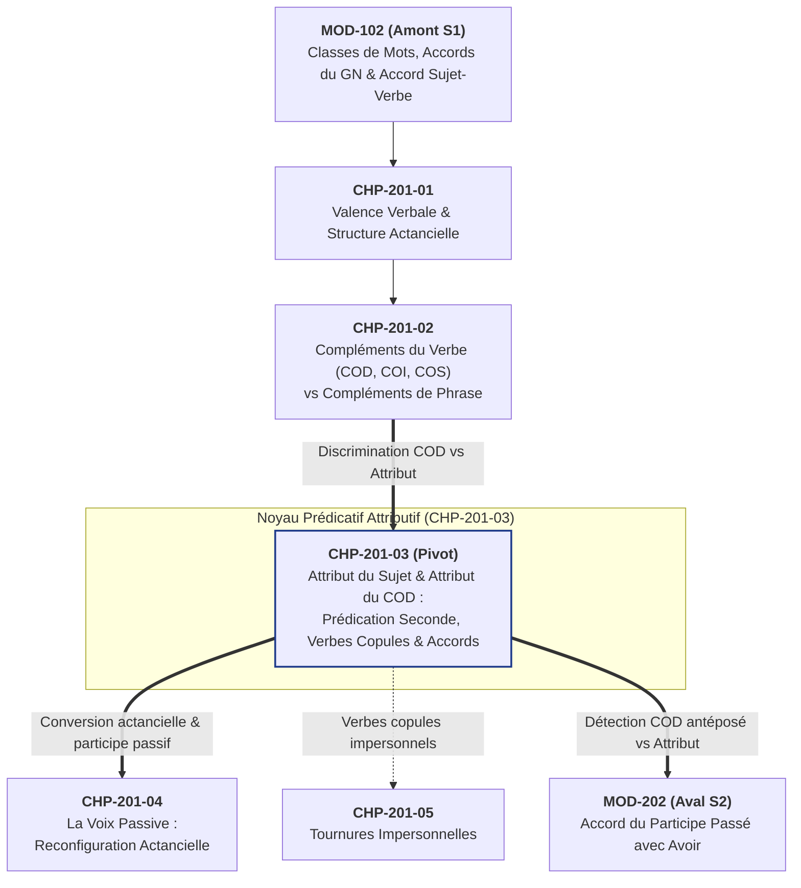

# Chapitre 3 — La Fonction Attribut du Sujet et Attribut du COD : Prédication Seconde, Verbes Copules et Mécanique des Accords

> **Identifiant du chapitre** : `CHP-201-03`  
> **Module de rattachement** : [`MOD-201` — Syntaxe Fonctionnelle de la Phrase Simple, Voix Passive, Tournures Impersonnelles et Relative Simple](file:///f:/Formation/world-class-french/03-curriculum/year-1/semester-2/mod-201-syntaxe-fonctionnelle-phrase-simple.md)  
> **Semestre** : Année 1 — Semestre 2 (S2)  
> **Volume horaire canonique** : 5 à 6 heures d'apprentissage autonome délibéré et d'ateliers d'application (Phase 1 Étude : 1 h 30 | Phase 2 Pratique : 1 h 30 | Phase 3 Correction : 1 h 00 | Phase 4 Évaluation : 1 h 00)  
> **Statut** : [STATUT : VALIDÉ]  
> **Compétences associées** : [`FR-SYNTAX-001`](file:///f:/Formation/world-class-french/02-competency-framework/competency-framework.md#fr-syntax-001-analyse-fonctionnelle-et-délimitation-de-la-phrase-simple) (L3 Autonomie), [`FR-ORTHO-002`](file:///f:/Formation/world-class-french/02-competency-framework/competency-framework.md#fr-ortho-002-mécanique-infaillible-de-laccord-sujet-verbe) (L3 Autonomie)  
> **Sources scientifiques de référence** : `SRC-NORM-03` (Ministère de l'Éducation nationale, *Terminologie grammaticale*, 2020, p. 30), `SRC-GRAM-02` (Riegel, Pellat, Rioul, *Grammaire méthodique du français*, 2016, chap. 8), `SRC-GRAM-01` (Grevisse & Goosse, *Le Bon Usage*, 16e éd., 2016, § 246-255)

---

## 1. Titre et Place dans le Cursus

### 1.1 Intitulé Officiel
**Chapitre 3 : La Fonction Attribut du Sujet et Attribut du COD : Prédication Seconde, Verbes Copules et Mécanique des Accords** (`CHP-201-03`).

### 1.2 Insertion Architecturale dans le Cursus
Après avoir établi au Chapitre 1 (`CHP-201-01`) la théorie de la valence verbale et opéré au Chapitre 2 (`CHP-201-02`) le partage distributionnel entre les compléments du verbe (COD, COI, COS, compléments essentiels de lieu ou de mesure) et les compléments circonstanciels de phrase, ce troisième chapitre examine une relation syntaxique singulière : **la construction attributive** [Réf. `SRC-NORM-03`, p. 30 ; `SRC-GRAM-02`, chap. 8].

Contrairement au complément d'objet direct, qui désigne une entité extérieure vers laquelle se dirige le procès verbal, l'**attribut** inscrit une propriété qualifiante, classificatoire ou identifiante directement sur un terme support (le sujet ou le COD) par la médiation obligatoire d'un verbe recteur.



- **En amont** : Ce chapitre mobilise directement l'identification des classes grammaticales et la morphologie flexionnelle acquises en [`MOD-102`](file:///f:/Formation/world-class-french/03-curriculum/year-1/semester-1/mod-102-classes-mots-accords-fondamentaux.md), ainsi que les tests formels de pronominalisation et d'effacement étudiés dans `CHP-201-02` ([`MOD-201`](file:///f:/Formation/world-class-french/03-curriculum/year-1/semester-2/mod-201-syntaxe-fonctionnelle-phrase-simple.md#6-plan-détaillé-des-chapitres)).
- **Articulation interne avec `CHP-201-02` et `CHP-201-04`** : Il résout la confusion classique entre le syntagme nominal COD et le syntagme nominal attribut du sujet (*« Pierre cherche un avocat »* vs *« Pierre devient un avocat »*), et prépare l'étude de la voix passive (`CHP-201-04`), où l'attribut du COD d'une phrase active devient attribut du sujet passif (*« La cour l'a déclaré innocent »* $\rightarrow$ *« Il a été déclaré innocent par la cour »*).
- **Projection vers [`MOD-202`](file:///f:/Formation/world-class-french/03-curriculum/year-1/semester-2/mod-202-participe-passe-avoir-ponctuation-interne.md)** : La maîtrise de l'accord du participe passé employé avec *avoir* exige de ne jamais confondre un verbe copule ou intransitif avec un verbe transitif, et de distinguer, dans des séquences comme *« Je les ai crus sincères »*, l'accord du participe passé (*crus*) et l'accord de l'attribut du COD (*sincères*).

---

## 2. Objectifs Mesurables

Au terme de ce chapitre, l'apprenant doit être capable de manifester au **palier L3 (Autonomie)** les quatre compétences opérationnelles suivantes :

1. **Identifier et catégoriser les constituants attributifs** ([`FR-SYNTAX-001`](file:///f:/Formation/world-class-french/02-competency-framework/competency-framework.md#fr-syntax-001-analyse-fonctionnelle-et-délimitation-de-la-phrase-simple)) : délimiter sans erreur l'attribut du sujet et l'attribut du COD dans un énoncé simple ou complexe, préciser sa classe grammaticale (adjectif, syntagme nominal, pronom, infinitif, subordonnée) et désigner son terme support donneur de traits [Réf. `SRC-NORM-03`, p. 30].
2. **Administrer les tests formels de discrimination syntaxique** ([`FR-SYNTAX-001`](file:///f:/Formation/world-class-french/02-competency-framework/competency-framework.md#fr-syntax-001-analyse-fonctionnelle-et-délimitation-de-la-phrase-simple)) : départager formellement l'attribut du sujet du COD par les tests de passivisation (impossible pour l'attribut) et de pronominalisation clitique par le neutre invariable *le*, et départager l'attribut du COD de l'adjectif épithète par les tests de suppression, d'antéposition clitique du COD et de reformulation complétive [Réf. `SRC-GRAM-02`, chap. 8].
3. **Appliquer sans faille la chaîne d'accord des attributs** ([`FR-ORTHO-002`](file:///f:/Formation/world-class-french/02-competency-framework/competency-framework.md#fr-ortho-002-mécanique-infaillible-de-laccord-sujet-verbe)) : accorder rigoureusement en genre et en nombre l'adjectif ou le nom attribut avec son syntagme support (sujet ou COD), y compris lorsque le COD est un pronom personnel clitique antéposé (*le, la, les, nous, vous*) ou un pronom relatif (*que*) [Réf. `SRC-GRAM-01`, § 247, § 254].
4. **Déconstruire la prédication seconde et rédiger sous contrainte** ([`FR-SYNTAX-001`](file:///f:/Formation/world-class-french/02-competency-framework/competency-framework.md#fr-syntax-001-analyse-fonctionnelle-et-délimitation-de-la-phrase-simple), [`FR-ORTHO-002`](file:///f:/Formation/world-class-french/02-competency-framework/competency-framework.md#fr-ortho-002-mécanique-infaillible-de-laccord-sujet-verbe)) : expliciter le mécanisme de condensation propositionnelle opéré par les verbes de jugement, de déclaration, de transformation et de perception, rectifier un document juridique entaché de solécismes d'accord, et produire un écrit professionnel normé exploitant les deux types d'attributs.

---

## 3. Prérequis et Test de Préparation

### 3.1 Prérequis Exigibles
- Identification certaine des classes grammaticales variables (nom, adjectif, pronom, verbe) et invariables (préposition, adverbe) ([`MOD-102`](file:///f:/Formation/world-class-french/03-curriculum/year-1/semester-1/mod-102-classes-mots-accords-fondamentaux.md)).
- Maîtrise des flexions de genre et de nombre de l'adjectif qualificatif ([`CHP-102-04`](file:///f:/Formation/world-class-french/03-curriculum/year-1/semester-1/mod-102/chp-102-04-accords-syntagme-nominal.md)).
- Maîtrise de l'identification du Complément d'Objet Direct (COD) par la pronominalisation et la passivisation (`CHP-201-02`).

### 3.2 Test Diagnostique de Préparation (5 Questions)
Répondez mentalement ou par écrit aux cinq questions suivantes avant d'étudier le cours, puis confrontez vos réponses au corrigé repliable.

1. Dans la phrase *« Cet étudiant deviendra un brillant ingénieur »*, le syntagme *un brillant ingénieur* est-il Complément d'Objet Direct (COD) ou Attribut du sujet ? Justifiez par un test de transformation.
2. Si l'on répond à la question *« Ces candidates sont-elles prêtes ? »* en pronominalisant l'adjectif *prêtes*, doit-on dire : *« Oui, elles les sont »* ou *« Oui, elles le sont »* ? Pourquoi ?
3. Comparez : (a) *« Le magistrat lit un dossier complexe »* et (b) *« Le magistrat juge ce dossier complexe »*. Dans quelle phrase l'adjectif *complexe* peut-il être supprimé sans altérer la grammaticalité ni le sens du verbe ?
4. Dans l'énoncé *« Ses arguments, la commission les a estimés convaincants »*, quel mot impose le masculin pluriel à l'adjectif *convaincants* ?
5. Comment faut-il accorder l'adjectif entre parenthèses dans *« Ces clauses contractuelles, le notaire les a rendues (caduc) »* ?

---

#### Corrigé Détaillé du Test de Préparation

<details>
<summary><b>Consulter le corrigé raisonné de l'auto-diagnostic</b></summary>

1. **Statut de *un brillant ingénieur*** :
   - Il s'agit d'un **attribut du sujet** *Cet étudiant*, introduit par le verbe copule d'évolution *deviendra*.
   - *Preuve par le test du passif* : La passivisation est rigoureusement impossible (*« *Un brillant ingénieur sera devenu par cet étudiant »* est agrammatical). *Cet étudiant* et *un brillant ingénieur* désignent un seul et même référent dans le monde réel (coréférence).
2. **Pronominalisation de l'attribut *prêtes*** :
   - La seule forme grammaticale en français standard est : **« Oui, elles le sont »** [Réf. `SRC-GRAM-01`, § 660].
   - Le pronom clitique qui représente une propriété attributive est le pronom personnel **neutre invariable *le*** (qui équivaut à *cela*), et non le pronom féminin ou pluriel (*la, les*) réservé à la reprise d'un COD nominal déterminé.
3. **Comparaison entre (a) *lit un dossier complexe* et (b) *juge ce dossier complexe*** :
   - Dans (a), *complexe* est **épithète liée** du nom *dossier*. On peut le supprimer : *« Le magistrat lit un dossier »* conserve exactement le même sens verbal.
   - Dans (b), *complexe* est **attribut du COD** *ce dossier*. Si on le supprime (*« Le magistrat juge ce dossier »*), le verbe *juger* change radicalement d'acception (passant d'une estimation intellectuelle à l'acte juridictionnel de rendre une sentence sur une affaire). De plus, si l'on pronominalise le COD *ce dossier*, l'adjectif de (a) disparaît avec le nom (*« Il le lit »*), tandis que l'attribut de (b) reste obligatoirement maintenu après le verbe (*« Il le juge complexe »*).
4. **Donneur d'accord de *convaincants*** :
   - C'est le pronom personnel COD antéposé ***les*** (représentant *Ses arguments*, masculin pluriel) qui transmet ses traits de genre et de nombre à son attribut *convaincants*.
5. **Accord dans *« les a rendues (caduc) »*** :
   - Il faut écrire ***caduques*** (féminin pluriel). L'adjectif est attribut du COD *les* (qui reprend *Ces clauses contractuelles*, féminin pluriel).

</details>

---

## 4. Situation de Départ ou Problème Concret

### 4.1 La Faillite de la Question Scolaire « Qui ? » ou « Quoi ? »
Dans la pratique scolaire courante, de nombreux apprenants cherchent à identifier le Complément d'Objet Direct (COD) en posant mécaniquement la question *« Sujet + Verbe + Qui / Quoi ? »*. Appliquée sans discernement syntaxique, cette recette empirique conduit à un contresens majeur dès que le verbe de la phrase est un verbe d'état (copule) :

> Soit la phrase : *« Pierre semble un bon élève. »*  
> Raisonnement erroné : *« Pierre semble qui ? — Un bon élève. Donc "un bon élève" est COD du verbe sembler. »*

Cette erreur d'étiquetage n'est pas une simple imprécision terminologique : elle entraîne trois conséquences directes sur la maîtrise écrite et orale de la langue :

1. **Solécismes de pronominalisation** : Croyant manipuler un COD féminin ou pluriel, le scripteur qui veut éviter une répétition dans *« Marie est-elle directrice ? »* produit le barbarisme syntaxique *« *Oui, elle la est »*, ou pour *« Ses frères semblent fatigués »* écrit *« *Ils les semblent »*, au lieu du neutre canonique *« Oui, elle l'est / Ils le semblent »* [Réf. `SRC-NORM-03`, p. 30].
2. **Confusion à la voix passive et aux temps composés** : En prenant le verbe attributif pour un verbe transitif direct, l'apprenant tente des passivisations impossibles ou applique à contretemps les règles d'accord du participe passé avec *avoir* (`MOD-202`).
3. **Rupture d'accord sur l'attribut du COD éloigné** : Lorsque l'attribut porte sur un COD antéposé sous forme de pronom clitique, le scripteur perd de vue le lien prédicatif qui unit le pronom objet à l'adjectif postposé. Il écrit alors dans un rapport administratif :
   > *« Concernant les pièces justificatives que vous nous avez transmises, la direction les a trouvé **incomplet** et les a déclaré **irrecevable**. »* (au lieu de : *« les a trouvées **incomplètes** et les a déclarées **irrecevables** »*).

Ce chapitre vise à éradiquer définitivement ces défaillances en substituant aux questions intuitives des **critères formels vérifiables**.

---

## 5. Explication Intuitive : L'Analogie du Pont d'Égalité et du Prisme Optique

Pour saisir immédiatement la différence de nature entre la relation transitive (COD) et la relation attributive (Attribut), représentons-nous la dynamique physique des entités mises en scène par le verbe.

### 5.1 La Flèche d'Impact (Relation Transitive : $A \longrightarrow B$)
Dans une phrase transitive comme *« Le sculpteur taille le marbre »*, il existe **deux entités distinctes** dans l'univers du discours : d'un côté l'artisan ($A$), de l'autre le bloc de pierre ($B$), avec $A \neq B$. Le verbe *taille* agit comme un vecteur d'énergie qui part de $A$ pour transformer ou atteindre $B$.

```text
MODÈLE TRANSITIF (2 entités distinctes : A ≠ B)
┌──────────────────┐         Verbe d'action         ┌──────────────────┐
│   Le sculpteur   │ ───────── (taille) ──────────► │    le marbre     │
│    (Entité A)    │       Transfert d'action       │    (Entité B)    │
└──────────────────┘                                └──────────────────┘
       Sujet                                                COD
```

### 5.2 Le Miroir ou Pont d'Égalité (Relation Attributive du Sujet : $A = A'$)
Dans une phrase à attribut du sujet comme *« Le sculpteur demeure silencieux »* ou *« Le sculpteur devient un maître »*, combien y a-t-il d'êtres dans la pièce ? **Un seul ($A$).** Le mot *silencieux* ou le groupe *un maître* ne désigne pas une seconde personne que le sculpteur toucherait ou regarderait : c'est une **propriété** ou une **identité** reflétée sur le sculpteur lui-même à travers le prisme du verbe (*demeure*, *devient*). Le verbe fonctionne ici comme le **signe mathématique égal ($=$)** :

```text
MODÈLE ATTRIBUTIF DU SUJET (1 seule entité : A = A')
┌──────────────────┐          Verbe copule          ┌──────────────────┐
│   Le sculpteur   │ ◄════════ (demeure) ═════════► │    silencieux    │
│ (Support A : m.s)│         Pont d'égalité         │ (Propriété A':ms)│
└──────────────────┘                                └──────────────────┘
   Sujet donneur ───────── Accord (masc. sing.) ────────► Attribut
```

### 5.3 La Double Lentille (Relation Attributive du COD : $A \longrightarrow [B = B']$)
Que se passe-t-il maintenant dans *« Le critique juge cette statue sublime »* ?
Ici, le sujet *Le critique* ($A$) porte un regard sur un objet extérieur *cette statue* ($B$). Il y a bien une relation transitive entre $A$ et $B$. Mais le verbe *juge* ne s'arrête pas là : il projette simultanément une étiquette qualificative ($B'$) sur l'objet $B$. À travers le regard du critique, une équation s'établit entre le COD et son attribut : **cette statue ($B$) = sublime ($B'$)**.

```text
MODÈLE ATTRIBUTIF DU COD (Prédication seconde : B = B')
┌─────────────┐    Verbe recteur    ╔═══════════════════════════════════════════╗
│ Le critique │ ──── (juge) ──────► ║  ┌──────────────┐     ┌────────────────┐  ║
│ (Sujet : A) │                     ║  │ cette statue │ ◄═► │    sublime     │  ║
└─────────────┘                     ║  │ (COD : f.s.) │  =  │ (Attribut: f.s)│  ║
                                    ║  └──────────────┘     └────────────────┘  ║
                                    ║      Support B ── Accord ──► Propriété B' ║
                                    ╚═══════════════════════════════════════════╝
```

Parce que le verbe établit une équation d'identité ou de qualification entre le support et l'attribut, **l'attribut doit obligatoirement épouser le genre et le nombre de son support**.

---

## 6. Définitions Précises et Terminologie

Avant d'étudier chacune des définitions formelles ci-dessous, observons les deux énoncés d'ancrage suivants :
- Énoncé 1 : *« Les délibérations du jury demeurent **secrètes**. »*
- Énoncé 2 : *« Le président de la cour a déclaré l'audience **ouverte**. »*

Dans l'énoncé 1, l'adjectif *secrètes* qualifie le sujet *Les délibérations du jury* par l'intermédiaire du verbe *demeurent*. Dans l'énoncé 2, l'adjectif *ouverte* qualifie le COD *l'audience* par l'intermédiaire du verbe *a déclaré*.

1. **Attribut (terme générique)** : Fonction syntaxique essentielle assurée par un constituant (adjectif, nom, pronom, infinitif, subordonnée) qui exprime une caractéristique, un état, une qualité ou une identité attribués à un syntagme support (le sujet ou le COD) par l'intermédiaire obligatoire d'un verbe introducteur [Réf. `SRC-NORM-03`, p. 30 ; `SRC-GRAM-01`, § 246].
2. **Attribut du sujet** : Constituant du groupe verbal qui exprime une propriété ou une catégorisation rapportée au **sujet** de la proposition par le truchement d'un verbe copule ou d'un verbe intransitif occasionnellement attributif. Il fait corps avec le verbe pour former le prédicat et ne peut être supprimé [Réf. `SRC-NORM-03`, p. 30].
3. **Attribut du COD (ou attribut de l'objet)** : Constituant du groupe verbal qui exprime une propriété, un état ou un statut rapportés au **complément d'objet direct (COD)** par l'intermédiaire d'un verbe transitif recteur (jugement, déclaration, transformation, perception) [Réf. `SRC-NORM-03`, p. 30 ; `SRC-GRAM-02`, chap. 8].
4. **Verbe copule (ou verbe attributif)** : Verbe servant de lien syntaxique (du latin *copula*, « lien, attache ») entre le sujet et son attribut. Le verbe copule par excellence est *être*, suivi des verbes d'état ou de devenir (*paraître, sembler, devenir, demeurer, rester*) qui ajoutent à la liaison prédicative une nuance aspectuelle (durée, changement d'état) ou modale (apparence) [Réf. `SRC-GRAM-02`, chap. 8].
5. **Prédicat verbal vs Prédicat nominal (ou attributif)** :
   - Dans un **prédicat verbal** (*« L'avocat plaide »*), le verbe possède un contenu lexical plein et suffit à prédiquer une action sur le sujet.
   - Dans un **prédicat nominal ou attributif** (*« L'avocat est éloquent »*), le véritable noyau sémantique de l'information est porté par l'attribut (*éloquent*), tandis que la copule (*est*) porte les marques grammaticales de mode, de temps et de personne [Réf. `SRC-GRAM-02`, chap. 8].
6. **Prédication seconde** : Relation prédicative (association d'un terme support et d'un terme apport) qui ne constitue pas l'axe principal de la phrase autour du verbe conjugué (prédication première), mais qui vient se greffer en sous-main à l'intérieur de la proposition sans verbe conjugué propre. L'ensemble formé par le COD et l'attribut du COD dans *« Je crois [cet homme sincère] »* constitue l'exemple canonique de prédication seconde [Réf. `SRC-GRAM-02`, chap. 8].
7. **Verbes de jugement, de déclaration et de transformation** : Classes lexico-syntaxiques de verbes transitifs directs bivalents ou trivalents aptes à régir une prédication seconde sur leur COD (*juger, estimer, croire, trouver* ; *nommer, élire, proclamer, déclarer* ; *rendre, faire*) [Réf. `SRC-GRAM-01`, § 253].

---

## 7. Règles ou Mécanismes Fondamentaux

### 7.1 Définition Linguistique de l'Attribut : La Médiation Verbale Obligatoire
En grammaire française, une qualité peut être rattachée à un nom selon deux grandes voies syntaxiques [Réf. `SRC-NORM-03`, p. 30] :
- **La voie directe (intrasyntagmatique)** : L'adjectif est placé directement à côté du nom au sein du syntagme nominal, sans l'aide d'aucun verbe (*« Une décision **juste** »*, *« **Juste**, cette décision apaise les esprits »*). C'est la fonction **épithète** (liée ou détachée).
- **La voie médiate (verbale)** : La qualité est rattachée au syntagme nominal support **par l'intermédiaire obligatoire d'un verbe** (*« Cette décision est **juste** »*, *« Nous estimons cette décision **juste** »*). C'est la fonction **attribut**.

Ainsi, il n'existe pas d'attribut sans verbe recteur (explicite ou sous-entendu par ellipse dans les phrases averbales exclamatives comme *« Délicieux, ce repas ! »*). L'attribut appartient toujours au **groupe verbal (GV)**, alors même qu'il qualifie sémantiquement et morphologiquement un groupe nominal.

---

### 7.2 L'Attribut du Sujet : Copules, Natures, Accord et Tests Discriminants

#### A. Les Verbes Introducteurs d'Attribut du Sujet
On distingue trois strates de verbes aptes à introduire un attribut du sujet [Réf. `SRC-GRAM-02`, chap. 8 ; `SRC-GRAM-01`, § 249-250] :

1. **La copule pure** : *être*, qui établit la relation d'attribution à l'état pur.
2. **Les verbes essentiellement copules (verbes d'état et de modalité)** :
   - Apparence / modalité épistémique : *paraître, sembler, avoir l'air, passer pour* ;
   - Changement d'état (aspect inchoatif) : *devenir, se faire* (*« Il se fait vieux »*), *tomber* (*« tomber malade »*), *virer* ;
   - Continuité d'état (aspect duratif) : *demeurer, rester*.
3. **Les verbes occasionnellement attributifs** :
   - Des verbes intransitifs de mouvement ou d'existence (*naître, vivre, mourir, partir, revenir, rentrer, sortir, arriver*) ou des verbes pronominaux/passifs (*s'appeler, se nommer, être élu, être jugé*) peuvent recevoir un adjectif qui qualifie le sujet au moment du procès :
     *« Les négociateurs sont revenus **épuisés**. »* / *« Cet écrivain a vécu **libre** et est mort **pauvre**. »*

#### B. Les Cinq Natures Grammaticales de l'Attribut du Sujet
La fonction *attribut du sujet* peut être exercée par cinq classes ou structures différentes [Réf. `SRC-NORM-03`, p. 30] :

| Nature de l'attribut du sujet | Exemple canonique | Analyse succincte |
| :--- | :--- | :--- |
| **1. Adjectif qualificatif (ou GAdj)** | *Cette jurisprudence demeure **constante**.* | Adjectif féminin singulier, tête de syntagme adjectival. |
| **2. Nom ou Syntagme Nominal (SN)** | *Cotonou est **la capitale économique du Bénin**.* | Syntagme nominal identifiant ou catégorisant le sujet. |
| **3. Pronom** | *Vos conclusions sont **les nôtres**.* / *Qui est-**ce** ?* | Pronom possessif, démonstratif, personnel ou interrogatif. |
| **4. Verbe à l'infinitif (ou GInf)** | *Traduire, c'est **trahir un peu**.* / *Son rêve est **de plaider**.* | Infinitif direct ou introduit par l'indice prépositionnel *de*. |
| **5. Proposition subordonnée** | *L'essentiel est **que justice soit rendue**.* | Subordonnée complétive conjonctive (ou relative substantive). |

#### C. Règle d'Or de l'Accord de l'Attribut du Sujet
- **Adjectif ou participe attribut** : Il s'accorde impérativement en **genre et en nombre** avec le noyau du sujet (ou avec l'ensemble des sujets coordonnés) :  
  *« La rigueur et la clarté sont **indispensables** (fém. plur.). »*  
  *« L'éloquence et le courage demeurent **précieux** (masc. plur., primauté grammaticale du masculin). »*
- **Nom attribut** : Lorsqu'il désigne une personne ou une fonction variant en genre, il s'accorde en genre et en nombre avec le sujet (*« Ces femmes sont devenues **avocates** »*). S'il s'agit d'un nom abstrait ou à genre fixe, il conserve son genre propre (*« Cette militante est **un modèle** de probité »*).

#### D. Les Deux Tests Formels de Discrimination : Attribut du Sujet vs COD
Lorsqu'un syntagme nominal suit le verbe (*« Paul cherche un médecin »* vs *« Paul devient un médecin »*), deux tests linguistiques formels permettent de trancher sans aucune ambiguïté [Réf. `SRC-GRAM-02`, chap. 8] :

1. **Test n° 1 : La Transformation Passive (Critère d'élimination)**  
   - Tout COD d'un verbe transitif d'action peut, en principe, devenir le sujet de la phrase à la voix passive :  
     *« Paul cherche un médecin »* $\longrightarrow$ *« Un médecin est cherché par Paul. »* (Grammatical $\rightarrow$ *un médecin* est **COD**).
   - Aucun attribut du sujet ne peut jamais devenir sujet d'un passif :  
     *« Paul devient un médecin »* $\longrightarrow$ *« *Un médecin est devenu par Paul. »* (Absurde et agrammatical $\rightarrow$ *un médecin* est **Attribut du sujet**).
     *« Pierre semble un bon élève »* $\longrightarrow$ *« *Un bon élève est semblé par Pierre. »* (Agrammatical $\rightarrow$ **Attribut du sujet**).

2. **Test n° 2 : La Pronominalisation Clitique par le Neutre Invariable *le***  
   - Un syntagme nominal **COD** déterminé se pronominalise par un pronom personnel qui **varie en genre et en nombre** (*le, la, les*) :  
     *« Paul salue la directrice »* $\longrightarrow$ *« Paul **la** salue. »*  
     *« Paul salue les directrices »* $\longrightarrow$ *« Paul **les** salue. »*
   - Un **attribut du sujet** (adjectif ou nom sans déterminant défini spécifique) se pronominalise exclusivement par le pronom personnel **neutre invariable *le*** (équivalant à *cela*), quels que soient le genre et le nombre du sujet [Réf. `SRC-GRAM-01`, § 660] :  
     *« Elle est avocate ? — Oui, elle **l'**est »* (et jamais *« *elle la est »*).  
     *« Ces mesures sont urgentes ? — Oui, elles **le** sont »* (et jamais *« *elles les sont »*).

---

### 7.3 L'Attribut du COD : Verbes Recteurs, Accord et Tests Discriminants

#### A. Les Quatre Classes de Verbes Recteurs d'Attribut du COD
L'attribut du COD n'apparaît qu'avec des verbes transitifs directs capables d'asserter une propriété ou un changement d'état sur leur objet [Réf. `SRC-GRAM-02`, chap. 8 ; `SRC-GRAM-01`, § 253] :

1. **Verbes de jugement, d'appréciation et d'opinion** : *juger, estimer, croire, trouver, penser, savoir, considérer (comme), tenir (pour), regarder (comme), vouloir*.  
   *Ex.* : *« La cour estime cette requête **recevable**. »*
2. **Verbes de déclaration, d'appellation et de désignation institutionnelle** : *déclarer, proclamer, nommer, élire, désigner, appeler, baptiser, sacrer, couronner, instituer, traiter (de), qualifier (de)*.  
   *Ex.* : *« Le décret présidentiel a nommé ce magistrat **procureur général**. »*
3. **Verbes de transformation et de causation** : *rendre, faire*.  
   *Ex.* : *« Cette clause léonine rend le contrat **nul**. »*
4. **Verbes de perception et de possession/maintien d'état** : *voir, sentir, entendre, laisser, garder, avoir*.  
   *Ex.* : *« Le greffier a laissé la porte **entrouverte**. »* / *« Elle a les mains **liées**. »*

#### B. Règle d'Accord de l'Attribut du COD
L'adjectif (ou le nom de personne variable) attribut du COD **s'accorde impérativement en genre et en nombre avec le COD support**, quelle que soit la position de ce COD dans la phrase :
- **COD postposé (après le verbe)** :  
  *« Je trouve ces mesures [COD : fém. plur.] **inacceptables** [Attr. COD : fém. plur.]. »*
- **COD antéposé (pronom personnel clitique ou pronom relatif *que*)** :  
  *« Ces mesures, je **les** [COD : fém. plur.] trouve **inacceptables** [Attr. COD : fém. plur.]. »*  
  *« Voici les réformes **que** [COD : fém. plur.] l'assemblée a rendues **obligatoires** [Attr. COD : fém. plur.]. »*

#### C. Les Trois Tests Formels de Discrimination : Attribut du COD vs Adjectif Épithète
Lorsqu'un adjectif suit immédiatement un nom COD (*« Paul lit un livre passionnant »* vs *« Paul trouve ce livre passionnant »*), comment prouver scientifiquement s'il est **épithète liée** du nom ou **attribut du COD** [Réf. `SRC-NORM-03`, p. 30 ; `SRC-GRAM-02`, chap. 8] ?

1. **Test n° 1 : Le Test de Suppression (Effacement)**  
   - **Épithète liée** : L'adjectif est une simple expansion facultative interne au syntagme nominal. Sa suppression laisse la phrase grammaticale et conserve intact le sens du verbe :  
     *« Paul a acheté une voiture **neuve** »* $\longrightarrow$ *« Paul a acheté une voiture. »* (Sens du verbe *acheter* strictement inchangé $\rightarrow$ *neuve* est **épithète liée**).
   - **Attribut du COD** : Sa suppression rend la phrase agrammaticale ou modifie radicalement le sens du verbe recteur :  
     *« La cour a déclaré l'accusé **coupable** »* $\longrightarrow$ *« *La cour a déclaré l'accusé. »* (Incomplet / changement total de sens $\rightarrow$ *coupable* est **attribut du COD**).  
     *« Ce témoignage rend l'affaire **limpide** »* $\longrightarrow$ *« *Ce témoignage rend l'affaire. »* (Altération sémantique complète de *rendre* $\rightarrow$ *limpide* est **attribut du COD**).

2. **Test n° 2 : La Pronominalisation Clitique du COD (Dissociation des Constituants)**  
   - Si l'adjectif est **épithète liée**, il fait partie intégrante du syntagme nominal COD. Lorsqu'on remplace le COD par le pronom *le, la, les*, l'adjectif **disparaît avec le nom** ; il ne peut pas rester seul après le verbe :  
     *« Paul lit [un livre passionnant] »* $\longrightarrow$ *« Paul **le** lit »* (et jamais *« *Paul le lit passionnant »*).
   - Si l'adjectif est **attribut du COD**, il constitue un constituant autonome du groupe verbal distinct du COD. Lorsqu'on pronominalise le COD, l'adjectif **demeure obligatoirement après le verbe** :  
     *« Paul trouve [ce livre] [passionnant] »* $\longrightarrow$ *« Paul **le** trouve **passionnant**. »*

3. **Test n° 3 : La Mobilité Interne avant le Nom ou l'Insertion d'une Subordonnée**  
   - Avec un attribut du COD régi par un verbe de jugement, on peut souvent paraphraser la séquence *[COD + Attribut]* par une proposition subordonnée complétive en *que... être* :  
     *« Paul trouve ce livre passionnant »* $\Longleftrightarrow$ *« Paul trouve **que ce livre est passionnant**. »*  
     Cette paraphrase est impossible pour une épithète liée : *« Paul lit un livre passionnant »* $\neq$ *« *Paul lit que ce livre est passionnant. »*

---

## 8. Raisonnement Détaillé : Pourquoi la Langue Distingue Prédication Première et Prédication Seconde ?

Pourquoi la grammaire du français ne se contente-t-elle pas d'exprimer chaque jugement par une proposition subordonnée complète dotée de son propre verbe conjugué ? Pourquoi dire *« Je juge cette mesure salutaire »* plutôt que *« Je juge que cette mesure est salutaire »* ?

La réponse réside dans une loi fondamentale de l'évolution linguistique et de la stylistique : **le principe d'économie syntaxique et de densification informative** [Réf. `SRC-GRAM-02`, chap. 8].

### 8.1 De la Subordination Analytique à la Condensation Synthétique
Considérons la pensée complexe suivante : un locuteur ($Je$) émet une évaluation intellectuelle ($croire$) à propos d'un fait qui associe un être ($cet\ avocat$) et une qualité ($intègre$).

1. **Étape analytique lourde (Deux propositions conjuguées)** :  
   $$\text{P}_1\text{ [Je crois]} + \text{Subordonnant [que]} + \text{P}_2\text{ [cet avocat est intègre]}$$  
   Ici, la langue déploie deux appareils verbaux complets : le verbe régissant *crois* (prédication première) et la copule *est* introduite par la conjonction *que*. Or, la copule *est* est sémantiquement vide : elle ne sert qu'à porter le présent de l'indicatif, qui est déjà exprimé par le verbe principal *crois*.

2. **Étape synthétique condensée (Une seule phrase simple à prédication seconde)** :  
   $$\text{P}\text{ [Je crois } \underbrace{\text{cet avocat}}_{\text{COD support}} \quad \underbrace{\text{intègre}}_{\text{Attribut apport}}\text{]}$$  
   En supprimant la conjonction *que* et la copule redondante *est*, la langue réalise une **économie structurelle remarquable** :
   - Le sujet de la subordonnée (*cet avocat*) est promu au rang de **COD** du verbe principal (d'où sa pronominalisation par *le* : *« Je le crois intègre »*).
   - L'attribut du sujet de la subordonnée (*intègre*) devient **attribut du COD** au sein de la proposition unique.

### 8.2 Le Concept de « Prédication Seconde »
C'est ce mécanisme d'intégration qui justifie le terme scientifique de **prédication seconde** :
- La **prédication première** unit le sujet principal au groupe verbal conjugué (*Le tribunal + a déclaré...*). Sans elle, il n'y a pas de phrase.
- La **prédication seconde** établit, à l'intérieur même du groupe verbal, un **second foyer prédicatif condensé** (*l'accusé $\leftarrow$ innocent*), dépourvu de flexion verbale personnelle, mais conservant intacte la relation logique sujet-prédicat et sa conséquence morphologique directe : **l'accord obligatoire en genre et en nombre entre le support et l'apport**.

---

## 9. Exemples Corrects Commentés

Observons le fonctionnement de la chaîne d'attribution et des transferts morphologiques à travers quatre énoncés modèles de complexité croissante.

### Exemple 1 : Attribut du Sujet avec Verbe Copule d'État
> *« Malgré la virulence des débats parlementaires, les deux rapporteurs de la commission demeurent **sereins**. »*

- **Analyse fonctionnelle** :
  - *Malgré la virulence des débats parlementaires* : Syntagme prépositionnel, complément circonstanciel de concession (mobile et supprimable).
  - *les deux rapporteurs de la commission* : Syntagme nominal sujet (noyau : *rapporteurs*, masculin pluriel).
  - *demeurent* : Verbe copule aspectuel (continuité d'état), 3e personne du pluriel.
  - *sereins* : Adjectif qualificatif, **attribut du sujet** *les deux rapporteurs de la commission*.
- **Mécanique de l'accord** :
  $$\text{Noyau sujet : } \textbf{rapporteurs}\text{ (masc. plur.)} \xrightarrow{\text{via la copule }\textit{demeurent}} \text{Attribut : } \textbf{sereins}\text{ (masc. plur.)}$$
- **Vérification formelle** : Pronominalisation par le neutre invariable *le* : *« Ils **le** demeurent »*.

### Exemple 2 : Attribut du Sujet avec Verbe Intransitif Occasionnellement Attributif
> *« Après trois heures de plaidoirie à Cotonou, l'avocate de la défense est sortie **victorieuse** du prétoire. »*

- **Analyse fonctionnelle** :
  - *l'avocate de la défense* : Syntagme nominal sujet (noyau : *avocate*, féminin singulier).
  - *est sortie* : Verbe intransitif de mouvement employé comme support d'attribution (conjugué avec l'auxiliaire *être* au passé composé).
  - *victorieuse* : Adjectif qualificatif, **attribut du sujet** *l'avocate de la défense*. Il exprime l'état du sujet simultanément au procès de *sortir*.
- **Mécanique de l'accord** :
  $$\text{Noyau sujet : } \textbf{avocate}\text{ (fém. sing.)} \Longrightarrow \begin{cases} \text{Participe passé conjugué avec }\textit{être}\text{ : } \textbf{sortie}\text{ (fém. sing.)} \\ \text{Adjectif attribut du sujet : } \textbf{victorieuse}\text{ (fém. sing.)} \end{cases}$$

### Exemple 3 : Attribut du COD avec Syntagme Nominal Postposé
> *« La Cour constitutionnelle a déclaré **nulles et non avenues** les dispositions litigieuses de l'arrêté ministériel. »*

- **Analyse fonctionnelle** :
  - *La Cour constitutionnelle* : Syntagme nominal sujet (féminin singulier).
  - *a déclaré* : Verbe transitif direct de déclaration (passé composé, 3e pers. sing.).
  - *les dispositions litigieuses de l'arrêté ministériel* : Syntagme nominal **COD** (noyau : *dispositions*, féminin pluriel). Noter ici l'inversion stylistique : le COD long est placé après l'attribut pour respecter la cadence majeure (ordre lourd en fin de phrase).
  - *nulles et non avenues* : Syntagme adjectival coordonné, **attribut du COD** *les dispositions litigieuses...*
- **Mécanique de l'accord** :
  $$\text{Noyau COD : } \textbf{dispositions}\text{ (fém. plur.)} \xrightarrow{\text{antéposition stylistique de l'attribut}} \textbf{nulles et non avenues}\text{ (fém. plur.)}$$
  *(Note : le participe passé "a déclaré" reste invariable car le COD "les dispositions..." est placé après le verbe).*

### Exemple 4 : Attribut du COD avec Pronom Personnel Clitique Antéposé
> *« Ces clauses léonines, les magistrats **les** ont jugées **contraires** à l'ordre public. »*

- **Analyse fonctionnelle** :
  - *Ces clauses léonines* : Syntagme nominal détaché en tête de phrase par dislocation emphatique (reprise anaphorique par *les*).
  - *les magistrats* : Syntagme nominal sujet (masculin pluriel).
  - *les* : Pronom personnel conjoint (3e pers. plur., représente *Ces clauses léonines*, féminin pluriel), **COD** antéposé du verbe *ont jugées*.
  - *contraires à l'ordre public* : Syntagme adjectival (noyau : *contraires* + complément de l'adjectif *à l'ordre public*), **attribut du COD** *les*.
- **Mécanique du double accord** :
  $$\text{Antécédent : }\textbf{clauses}\text{ (fém. plur.)} \longrightarrow \text{Pronom COD }\textbf{les}\text{ (fém. plur.)} \Longrightarrow \begin{cases} \text{Participe passé (COD antéposé) : }\textbf{jugées}\text{ (fém. plur.)} \\ \text{Adjectif attribut du COD : }\textbf{contraires}\text{ (plur.)} \end{cases}$$

---

## 10. Contre-Exemples et Erreurs Fréquentes

L'observation clinique des copies d'examen et des écrits professionnels met en évidence six erreurs récurrentes dans l'analyse et l'accord des constructions attributives :

### Erreur n° 1 : L'Étiquetage Fautif d'un Attribut du Sujet comme COD
- **Forme ou analyse fautive** : Dans *« Cet artisan devient un maître respecté »*, analyser *un maître respecté* comme COD de *devient* en posant la question *« devient qui ? »*.
- **Diagnostic de la faille cognitive** : Assimilation abusive de tout syntagme nominal postverbal non prépositionnel à un COD, sans vérification de la nature copulative du verbe.
- **Réfutation et correction formelle** : Le verbe *devenir* est une copule d'évolution ; il n'exerce aucune action sur un patient extérieur. Le test du passif échoue (*« *Un maître respecté est devenu par cet artisan »*). *Un maître respecté* est **attribut du sujet** *Cet artisan* [Réf. `SRC-NORM-03`, p. 30].

### Erreur n° 2 : La Pronominalisation de l'Attribut par un Pronom Accordé (*la, les*)
- **Forme fautive** : *« Êtes-vous les responsables du projet ? — *Oui, nous les sommes. »* ou *« Est-elle avocate ? — *Oui, elle la est. »*
- **Diagnostic de la faille cognitive** : Confusion entre l'attribut qualificatif (propriété sans autonomie référentielle) et l'attribut identificatoire défini, conduisant à accorder le pronom clitique.
- **Réfutation et correction formelle** : Dès lors que l'attribut exprime une qualité ou un statut non déterminé (*avocate, fatigués, prêts*), il se pronominalise par le **pronom personnel neutre invariable *le*** : *« Oui, elle **l'**est »*, *« Oui, nous **le** sommes »* [Réf. `SRC-GRAM-01`, § 660]. *(Nota : Dans la langue soutenue, lorsque le SN attribut est précédé d'un article défini à valeur d'identification stricte, l'accord du pronom reste admis mais rare : « Êtes-vous la directrice ? — Oui, je la suis » ou couramment « Oui, je le suis »).*

### Erreur n° 3 : L'Omission de l'Accord de l'Attribut du COD Postposé
- **Forme fautive** : *« La commission a déclaré les candidatures **irrecevable**. »*
- **Diagnostic de la faille cognitive** : Le scripteur fige l'adjectif au masculin singulier comme s'il formait une locution verbale invariable avec *déclarer* (*déclarer irrecevable*), oubliant qu'il qualifie le COD.
- **Réfutation et correction formelle** : *Irrecevable* est un adjectif attribut du COD *les candidatures* (féminin pluriel). Il reçoit obligatoirement ses traits morphologiques : *« La commission a déclaré les candidatures **irrecevables**. »*

### Erreur n° 4 : Le Défaut d'Accord de l'Attribut d'un COD Clitique Antéposé
- **Forme fautive** : *« Ces propositions, nous les avons jugées **excessif**. »* (ou inversement : *« nous les avons *jugé excessives »*).
- **Diagnostic de la faille cognitive** : L'éloignement linéaire entre le nom référent (*Ces propositions*), le pronom clitique (*les*) et l'adjectif final (*excessif*) brise la mémoire de travail du scripteur.
- **Réfutation et correction formelle** : Le pronom *les* est féminin pluriel ; il commande à la fois l'accord du participe passé (*jugées*, car le COD précède *avoir*) et l'accord de son attribut (*excessives*) : *« Ces propositions, nous les avons **jugées excessives**. »*

### Erreur n° 5 : La Confusion entre Attribut du COD et Adjectif Épithète Liée
- **Analyse fautive** : Dans *« Le témoin a vu une voiture suspecte »*, analyser *suspecte* comme attribut du COD *une voiture*.
- **Diagnostic de la faille cognitive** : Croire que tout adjectif qui suit un COD après un verbe de perception (*voir*) est automatiquement attribut du COD.
- **Réfutation et correction formelle** : Appliquons le test de pronominalisation du COD : *« Le témoin **l'**a vue »* (et non *« *Le témoin l'a vue suspecte »*). L'adjectif *suspecte* disparaît dans le pronom *l'* car il fait partie du syntagme nominal *[une voiture suspecte]* : il est **épithète liée** de *voiture*. À l'inverse, dans *« On a vu cette femme **heureuse** »* $\rightarrow$ *« On **l'**a vue **heureuse** »*, *heureuse* reste après le verbe : il est **attribut du COD**.

### Erreur n° 6 : L'Accord Mal Maîtrisé après la Locution Copulative « Avoir l'air »
- **Forme fautive** : *« Ces mangues ont l'air **savoureux**. »*
- **Diagnostic de la faille cognitive** : Le scripteur accorde mécaniquement l'adjectif au masculin singulier avec le nom *air*, alors qu'une chose inanimée (*des mangues*) ne possède pas de physionomie ou de mine (*un air*), mais *semble* simplement savoureuse.
- **Réfutation et correction formelle** : Lorsque le sujet désigne une chose ou une abstraction, *avoir l'air* fonctionne comme une locution verbale copule figée synonyme de *sembler* : l'adjectif est **attribut du sujet** et s'accorde obligatoirement avec le sujet : *« Ces mangues ont l'air **savoureuses** »* [Réf. `SRC-GRAM-01`, § 249]. *(Pour un sujet désignant une personne, l'accord se fait librement avec le sujet ou avec "air" selon la nuance : « Elle a l'air sérieuse / sérieux »).*

---

## 11. Cas Particuliers et Limites

### 11.1 L'Attribut Introduit par une Préposition ou Conjonction (*Attribut Indirect*)
Bien que la construction prototypique de l'attribut soit directe, certains verbes copules ou verbes recteurs d'attribut du COD imposent une **préposition vide (ou un subordonnant translatif)** devant l'attribut [Réf. `SRC-GRAM-02`, chap. 8 ; `SRC-GRAM-01`, § 248, § 253] :

1. **Pour l'attribut du sujet** :
   - *Passer pour* : *« Cet érudit passe **pour un sage**. »*
   - *Servir de* : *« Cette grange leur servait **d'abri**. »*
   - *Être tenu pour / considéré comme* : *« Ces manuscrits sont tenus **pour authentiques** / considérés **comme perdus**. »*
   - *Traiter de* (au passif) : *« Il a été traité **d'imposteur**. »*
2. **Pour l'attribut du COD** :
   - *Tenir pour* : *« Nous tenons cette clause **pour nulle**. »*
   - *Considérer comme / regarder comme* : *« La cour considère ces preuves **comme décisives**. »*
   - *Prendre pour* : *« Ne prenez pas nos silences **pour des aveux**. »*
   - *Qualifier de / traiter de* : *« L'opposition qualifie cette réforme **d'injuste**. »*

> [!IMPORTANT]
> **Règle d'accord malgré la préposition ou *comme*** : La présence de *pour*, *de* ou *comme* n'empêche nullement la transmission des traits morphologiques ! L'adjectif attribut s'accorde rigoureusement avec son support : *« Ces mesures, on les considère comme **caduques** »* ; *« Elle s'est vu traiter **d'imprudente** »*.

### 11.2 L'Accord avec le Pronom Démonstratif Neutre *Ce* (*C'est / Ce sont*)
Lorsque le sujet est le pronom démonstratif neutre *ce* :
1. **Si l'attribut est un adjectif** : Le pronom *ce* étant neutre singulier, le verbe et l'adjectif attribut se mettent invariablement au **masculin singulier**, même si *ce* renvoie à un pluriel ou à un féminin mentionné auparavant :  
   *« Les guerres civiles ? C'est **affreux** et cela demeure **destructeur**. »* [Réf. `SRC-GRAM-01`, § 247].
2. **Si l'attribut est un nom ou un pronom de 3e personne du pluriel** : Dans la langue écrite soutenue, le verbe *être* s'accorde par attraction au pluriel avec le nom ou pronom attribut (**« Ce sont... »**), tandis que la langue familière ou orale conserve souvent *« C'est... »* :  
   *« **Ce sont** nos meilleurs ambassadeurs. »* / *« **Ce sont** elles qui décident. »* [Réf. `SRC-GRAM-01`, § 932].
3. **Si l'attribut est un pronom de 1re ou 2e personne du pluriel (*nous, vous*)** : Le verbe reste obligatoirement au singulier :  
   *« **C'est nous** qui avons rédigé le mémoire »* (et jamais *« *Ce sont nous »*).

### 11.3 Le Cas de la Tournure *« Avoir l'air »* : Synthèse Normative
- **Sujet non animé (chose, idée)** $\rightarrow$ Accord obligatoire avec le sujet : *« Cette eau a l'air **pure** »* (et non *pur*).
- **Sujet animé (personne) suivi d'un adjectif qui ne peut qualifier que l'air** $\rightarrow$ Accord avec *air* : *« Elle a l'air **bon enfant** »*, *« Elle a l'air **faux** »* (si l'on parle de l'expression de son visage).
- **Sujet animé dans le cas général** $\rightarrow$ Accord libre avec le sujet (recommandé en français moderne : *« Elle a l'air **contente** »*) ou avec le nom *air* (*« Elle a l'air **content** »*) [Réf. `SRC-GRAM-01`, § 249].

---

## 12. Approfondissement Adapté au Niveau (Palier L3 Autonomie)

### 12.1 Typologie de la Prédication Seconde (Riegel, Pellat, Rioul & Claude Muller)
Dans la linguistique française contemporaine (notamment chez Martin Riegel [`SRC-GRAM-02`, chap. 8] et Claude Muller), l'attribut du COD est replacé au sein d'un continuum plus vaste appelé **les prédications secondes**. Une prédication seconde se définit par trois propriétés formelles :
1. Elle instaure un rapport sémantique de type **Thème (support) / Propos (prédicat)** entre deux constituants ;
2. Elle est dépourvue de verbe conjugué à un mode personnel (ce n'est donc pas une proposition subordonnée canonique) ;
3. Elle est syntaxiquement dépendante d'une prédication première (le verbe conjugué de la phrase).

On distingue ainsi quatre sous-types majeurs de prédications secondes :
- **Type 1 : L'attribut du COD intégré (essentiel)** : Sélectionné par la valence du verbe recteur et non supprimable (*« Le juge déclare [l'accusé coupable] »*).
- **Type 2 : L'attribut du COD adjoint (ou facultatif / résultatif)** : Ajouté à un verbe transitif ordinaire pour décrire l'état du COD au moment de l'action, et supprimable sans dénaturer le sens du verbe :  
  *« À Cotonou, certains amateurs boivent [leur café **brûlant**]. »* / *« Le boulanger vend [son pain **chaud**]. »*  
  Ici, on peut supprimer *brûlant* (*« Ils boivent leur café »*), mais *brûlant* n'est pourtant pas une simple épithète liée ! En effet, si l'on pronominalise le COD, l'adjectif reste après le verbe : *« Ils **le** boivent **brûlant** »* (alors qu'avec une épithète liée, on dirait simplement *« Ils le boivent »*).
- **Type 3 : L'épithète détachée (apposition)** : Prédication seconde périphérique, séparée par une pause et une virgule (*« **Calme et résolue**, l'avocate reprit la parole »*).
- **Type 4 : La construction absolue** : Syntagme binaire autonome en fonction circonstancielle (*« **La séance levée**, les députés quittèrent l'hémicycle »*).

### 12.2 Les « Petites Propositions » (*Small Clauses*) en Syntaxe Générative
Dans le cadre de la grammaire générative (modèle Principes et Paramètres), la séquence formée par le COD et son attribut est analysée comme un constituant unique appelé **Petite Proposition (*Small Clause*, notée $\text{SC}$)** :

$$\text{Le tribunal juge } [_{\text{SC}} \text{ [}_{\text{SN}}\text{ cette requête]} \quad \text{[}_{\text{SAdj}}\text{ recevable]} ]$$

Cette formalisation explique élégamment pourquoi le verbe *juger* ne sélectionne pas sémantiquement un objet physique (le tribunal ne « juge » pas la requête en elle-même comme on mange un fruit), mais sélectionne **l'état de choses propositionnel** que représente l'attribution de la recevabilité à la requête. Cependant, comme la petite proposition ne possède pas de verbe conjugué capable d'assigner le cas sujet (nominatif) à *cette requête*, c'est le verbe recteur *juge* qui lui assigne par « marquage exceptionnel de cas » (*Exceptional Case Marking* — ECM) le cas **accusatif (COD)**, ce qui explique sa pronominalisation par *la* (*« Le tribunal **la** juge recevable »*).

---

## 13. Comparaisons Différentielles (Tableaux Synoptiques)

### 13.1 Tableau Différentiel 1 : Attribut du Sujet vs Complément d'Objet Direct (COD)

| Critère discriminant | Attribut du Sujet | Complément d'Objet Direct (COD) |
| :--- | :--- | :--- |
| **Relation référentielle** | **Identité ou coréférence ($A = A'$)** : désigne la même entité que le sujet ou lui assigne une qualité. | **Altérité ($A \neq B$)** : désigne une entité distincte du sujet (sauf verbe réfléchi) sur laquelle porte l'action. |
| **Type de verbe recteur** | Verbe copule (*être, sembler, devenir, rester...*) ou intransitif d'état. | Verbe transitif direct d'action, de perception ou de sentiment (*bâtir, lire, aimer...*). |
| **Nature grammaticale possible** | Adjectif (très fréquent), Nom/SN, Pronom, Infinitif, Subordonnée. | Nom/SN, Pronom, Infinitif, Subordonnée (**jamais un adjectif seul**). |
| **Test de la voix passive** | **Rigoureusement impossible** (*« *Un médecin est devenu par Paul »*). | **Possible** (sauf rares verbes comme *avoir*) (*« Le livre est lu par Paul »*). |
| **Pronominalisation clitique** | Par le pronom **neutre invariable *le*** (*« Elle l'est »*, *« Ils le semblent »*) ou *en* (*« Il en est un »*). | Par un pronom **variable en genre et nombre** : *le, la, les* (*« Il la lit »*, *« Il les voit »*). |
| **Règle d'accord morphologique** | S'accorde en genre et en nombre avec le **sujet**. | Ne s'accorde jamais avec le sujet ; donne son accord au participe passé si antéposé à *avoir*. |

---

### 13.2 Tableau Différentiel 2 : Attribut du COD vs Adjectif Épithète Liée

| Critère discriminant | Attribut du COD | Adjectif Épithète Liée |
| :--- | :--- | :--- |
| **Exemple de référence** | *« Il juge ce projet **ambitieux**. »* | *« Il présente un projet **ambitieux**. »* |
| **Appartenance syntagmatique** | Constituant du **Groupe Verbal (GV)**, extérieur au SN COD : $V + [\text{SN}_{\text{COD}}] + [\text{SAdj}_{\text{Attr}}]$. | Constituant interne du **Syntagme Nominal (SN)** COD : $V + [\text{Dét} + \text{Nom} + \text{Adj}_{\text{Épith}}]$. |
| **Test de pronominalisation du COD** | L'adjectif **reste maintenu** après le verbe : *« Il **le** juge **ambitieux**. »* | L'adjectif **disparaît** dans le pronom *le* : *« Il **le** présente »* ($\neq$ *« *Il le présente ambitieux »*). |
| **Test de suppression (Effacement)** | **Impossible** ou altère radicalement le sens du verbe (*« *Il juge ce projet »* change le sens). | **Toujours possible** sans modifier le sens du verbe (*« Il présente un projet »*). |
| **Paraphrase par complétive** | Souvent possible : *« Il juge **que ce projet est ambitieux**. »* | Impossible : *« *Il présente que ce projet est ambitieux. »* |
| **Transformation passive** | Devient **attribut du sujet passif** : *« Ce projet est jugé **ambitieux**. »* | Reste **épithète liée** à l'intérieur du sujet passif : *« Un projet **ambitieux** est présenté. »* |

---

### 13.3 Tableau Différentiel 3 : Attribut du Sujet vs Attribut du COD

| Critère de comparaison | Attribut du Sujet | Attribut du COD |
| :--- | :--- | :--- |
| **Terme support (donneur d'accord)** | Le **Sujet** de la proposition. | Le **Complément d'Objet Direct (COD)** du verbe. |
| **Niveau de prédication** | **Prédication première** (noyau prédicatif de la proposition). | **Prédication seconde** greffée sous la rection d'un verbe transitif. |
| **Verbes introducteurs** | Copules (*être, paraître, sembler, devenir, demeurer, rester, avoir l'air*). | Verbes transitifs de jugement (*croire, juger*), déclaration (*nommer, déclarer*), transformation (*rendre*). |
| **Conversion passive** | La phrase ne peut pas être mise au passif. | À la voix passive, l'attribut du COD devient **attribut du sujet passif**. |

---

## 14. Exercices Progressifs (3 Niveaux)

### 14.1 Niveau 1 : Reconnaissance et Discrimination (Guidé)

#### Consigne
Dans chacune des six phrases suivantes, identifiez le constituant en gras : indiquez s'il est **Attribut du sujet**, **Attribut du COD**, **COD** ou **Épithète liée**, et précisez le terme support qui gouverne son accord.

1. Les conclusions de l'expert comptable paraissent **irréfutables**.
2. Le conseil d'administration a nommé madame Kérékou **présidente du comité d'audit**.
3. Les archéologues ont découvert **une amphore intacte** dans les ruines.
4. La sécheresse prolongée a rendu les terres agricoles **arides**.
5. Ce jeune romancier béninois deviendra **une figure majeure de la littérature**.
6. Les magistrats ont écouté **une plaidoirie émouvante** pendant deux heures.

---

#### Corrigé Détaillé et Justifié du Niveau 1

<details>
<summary><b>Consulter le corrigé raisonné du Niveau 1</b></summary>

1. ***irréfutables*** : **Attribut du sujet** *Les conclusions de l'expert comptable* (noyau : *conclusions*, féminin pluriel). Introduit par le verbe copule *paraissent*. Pronominalisable par le neutre *le* (*« Elles le paraissent »*).
2. ***présidente du comité d'audit*** : **Attribut du COD** *madame Kérékou* (féminin singulier). Introduit par le verbe de nomination *a nommé*. Si l'on pronominalise le COD : *« Le conseil l'a nommée présidente... »*.
3. ***une amphore intacte*** : **Complément d'Objet Direct (COD)** du verbe transitif d'action *ont découvert*. Au sein de ce syntagme nominal, l'adjectif *intacte* est **épithète liée** du nom *amphore* (il disparaît à la pronominalisation : *« Ils l'ont découverte »*).
4. ***arides*** : **Attribut du COD** *les terres agricoles* (noyau : *terres*, féminin pluriel). Introduit par le verbe de transformation *a rendu*. Non supprimable (*« *La sécheresse a rendu les terres agricoles »* est incomplet).
5. ***une figure majeure de la littérature*** : **Attribut du sujet** *Ce jeune romancier béninois*. Introduit par le verbe copule *deviendra*. Passif impossible.
6. ***une plaidoirie émouvante*** : **COD** du verbe de perception *ont écouté*. L'adjectif *émouvante* est **épithète liée** du nom *plaidoirie* (supprimable sans altérer le sens de *ont écouté* ; disparaît lors de la pronominalisation : *« Ils l'ont écoutée »*).

</details>

---

### 14.2 Niveau 2 : Administration des Tests Formels et Pronominalisation (Semi-Autonome)

#### Consigne
Appliquez les tests linguistiques demandés sur les cinq énoncés suivants et justifiez rigoureusement les accords produits :

1. **Test de pronominalisation de l'attribut du sujet** : Répondez affirmativement aux deux questions suivantes en remplaçant l'attribut en gras par le pronom clitique qui convient :  
   a) *Ces infirmières sont-elles **compétentes** ?*  
   b) *Ces artisans demeurent-ils **des travailleurs indépendants** ?*
2. **Test de discrimination Attribut du COD vs Épithète liée** : Soit les deux phrases :  
   (A) *L'architecte a construit une passerelle métallique.*  
   (B) *L'architecte juge cette passerelle dangereuse.*  
   Remplacez dans (A) et dans (B) le groupe nominal *une/cette passerelle* par le pronom personnel COD *la*. Qu'observez-vous sur le comportement des adjectifs *métallique* et *dangereuse* ? Tirez-en la conclusion fonctionnelle.
3. **Transformation de complétive en prédication seconde (Attribut du COD)** : Condensez les deux phrases complexes suivantes en phrases simples comportant un COD pronominalisé (*le, la, les*) et un attribut du COD correctement accordé :  
   a) *Le procureur estime que ces preuves matérielles sont insuffisantes.*  
   b) *Les électeurs croyaient que leurs représentants étaient incorruptibles.*
4. **Arbitrage d'accord avec *avoir l'air*** : Accordez les adjectifs entre parenthèses et justifiez la règle appliquée :  
   a) *Ces clauses pénales ont l'air (excessif).*  
   b) *Les deux plaignantes avaient l'air (inquiet).*
5. **Accord avec *c'est / ce sont* et préposition introductrice** : Accordez les adjectifs entre parenthèses :  
   *Ces vieilles ordonnances royales, on les a longtemps tenues pour (sacré), mais aujourd'hui c'est (désuet).*

---

#### Corrigé Détaillé et Justifié du Niveau 2

<details>
<summary><b>Consulter le corrigé raisonné du Niveau 2</b></summary>

1. **Pronominalisation de l'attribut du sujet** :
   - a) *« Oui, elles **le** sont. »* (Le pronom neutre invariable *le* reprend la propriété adjectivale *compétentes* ; *« *elles les sont »* est un solécisme).
   - b) *« Oui, ils **le** demeurent. »* (Même règle pour un syntagme nominal indéfini à valeur qualificative).
2. **Discrimination par pronominalisation du COD** :
   - En (A) : *« L'architecte **l'**a construite. »* L'adjectif *métallique* ne peut pas être maintenu après le verbe (*« *L'architecte l'a construite métallique »* est impossible). Il faisait partie du SN COD : il est donc **épithète liée**.
   - En (B) : *« L'architecte **la** juge **dangereuse**. »* L'adjectif *dangereuse* demeure obligatoirement après le verbe et ne peut être supprimé (*« *L'architecte la juge »* change le sens). Il constitue un constituant autonome du GV : il est **attribut du COD**.
3. **Condensation en prédication seconde** :
   - a) *« Ces preuves matérielles, le procureur **les** estime **insuffisantes** »* (ou *« Le procureur les estime insuffisantes »*). *Insuffisantes* s'accorde au féminin pluriel avec le COD *les* (*preuves*).
   - b) *« Leurs représentants, les électeurs **les** croyaient **incorruptibles**. »* *Incorruptibles* s'accorde au masculin pluriel avec le COD *les* (*représentants*).
4. **Arbitrage avec *avoir l'air*** :
   - a) *« Ces clauses pénales ont l'air **excessives**. »* Le sujet *Ces clauses pénales* désignant une abstraction non animée, *avoir l'air* équivaut strictement à *sembler* : l'accord avec le sujet féminin pluriel est **obligatoire**.
   - b) *« Les deux plaignantes avaient l'air **inquiètes** (ou **inquiet**). »* Le sujet désignant des personnes animées, l'accord se fait préférentiellement avec le sujet (*inquiètes*, fém. plur.), mais l'accord avec le nom *air* (*inquiet*, masc. sing.) demeure admis.
5. **Accord avec *tenir pour* et *c'est*** :
   - *« Ces vieilles ordonnances royales, on les a longtemps tenues pour **sacrées**, mais aujourd'hui c'est **désuet**. »*
   - *Justification* : *sacrées* est attribut du COD *les* (féminin pluriel, représentant *ordonnances*) introduit par la préposition *pour*. En revanche, *désuet* est attribut du pronom démonstratif **neutre singulier *c'*** (*ce*) : il reste impérativement au masculin singulier.

</details>

---

### 14.3 Niveau 3 : Analyse Syntaxique et Résolution d'Accords sur Corpus Littéraire (Autonome)

#### Corpus Calibré (Exactement 50 mots)
Le texte suivant compte **exactement 50 mots** :

> *« Le vieux magistrat restait impassible devant les murmures de la foule. Pourtant, les jurés trouvèrent les accusations excessives. La cour déclara la séance suspendue, laissant les avocats stupéfaits et les journalistes curieux. Chacun paraissait silencieux face au verdict sévère que le président avait rendu public avant le coucher du soleil. »*

#### Consigne
1. Relevez dans ce texte de 50 mots **tous les attributs du sujet** et **tous les attributs du COD**.
2. Pour chacun d'eux, dressez un bilan complet comprenant : le terme attribut, sa fonction exacte, le verbe recteur, le terme support donneur d'accord (avec son genre et son nombre), et la justification formelle par les tests syntaxiques.
3. Expliquez pourquoi l'adjectif *sévère* (dans *au verdict sévère*) n'est **pas** un attribut.

---

#### Corrigé Exhaustif et Justifié du Niveau 3

<details>
<summary><b>Consulter le corrigé intégral du Niveau 3</b></summary>

#### 1 & 2. Tableau Analytique des Constituants Attributifs du Corpus (7 Attributs)

| N° | Terme relevé | Fonction syntaxique | Verbe recteur | Terme support (Donneur de traits) | Justification formelle (Tests appliqués) |
| :---: | :--- | :--- | :--- | :--- | :--- |
| **1** | ***impassible*** | **Attribut du sujet** | *restait* (copule de durée) | *Le vieux magistrat* (masc. sing.) | Pronominalisable par le neutre *le* (*« Il le restait »*) ; non supprimable. |
| **2** | ***excessives*** | **Attribut du COD** | *trouvèrent* (verbe de jugement) | *les accusations* (COD, fém. plur.) | Maintenu après pronominalisation du COD (*« Les jurés les trouvèrent excessives »*) ; paraphrase *« qu'elles étaient excessives »*. |
| **3** | ***suspendue*** | **Attribut du COD** | *déclara* (verbe de déclaration) | *la séance* (COD, fém. sing.) | Non supprimable (*« *La cour déclara la séance »* change le sens) ; maintenu avec pronom (*« La cour la déclara suspendue »*). |
| **4** | ***stupéfaits*** | **Attribut du COD** | *laissant* (participe présent recteur) | *les avocats* (COD, masc. plur.) | Maintenu après pronominalisation du COD (*« les laissant stupéfaits »*) ; exprime l'état résultatif de l'objet. |
| **5** | ***curieux*** | **Attribut du COD** | *laissant* (participe présent coordonné) | *les journalistes* (COD, masc. plur.) | Coordonné au premier groupe COD + Attribut : *laissant [les journalistes] [curieux]* (*« les laissant curieux »*). |
| **6** | ***silencieux*** | **Attribut du sujet** | *paraissait* (copule d'apparence) | *Chacun* (pronom indéfini sujet, masc. sing.) | Pronominalisable par le neutre *le* (*« Chacun le paraissait »*). |
| **7** | ***public*** | **Attribut du COD** | *avait rendu* (verbe de transformation) | *que* (pronom relatif COD, ayant pour antécédent *verdict*, masc. sing.) | Non supprimable (*« *avait rendu »* dénature le sens). Le COD étant le relatif *que* (masc. sing.), l'adjectif *public* prend le masculin singulier. |

#### 3. Statut de l'adjectif *sévère* (et de *vieux*)
Dans le syntagme prépositionnel *face au verdict sévère*, l'adjectif ***sévère*** est rattaché directement au nom *verdict* **sans la médiation d'aucun verbe**. Il peut être supprimé sans altérer la structure de la phrase (*« face au verdict que le président avait rendu public »*). Il exerce donc la fonction d'**épithète liée** du nom *verdict* (tout comme *vieux* est épithète liée de *magistrat*).

</details>

---

## 15. Activité de Correction Raisonnée

### Contexte de l'Épreuve d'Expertise
Vous êtes réviseur juridique auprès d'une cour d'appel. Un greffier stagiaire vous soumet le projet de compte rendu d'audience ci-dessous, accompagné de ses notes d'analyse grammaticale. Le texte et les notes contiennent **six erreurs caractérisées** (fautes d'accord d'attributs ou erreurs d'analyse syntaxique).

> **Extrait du projet fautif et des notes du stagiaire** :  
> *« (1) Les explications de la société défenderesse ont l'air **confus**. (2) À la question de savoir si les cautions bancaires sont valides, l'expert répond : "Oui, elles **les** sont." (3) Toutefois, le tribunal a déclaré les clauses d'exclusion **abusive**. (4) Quant aux indemnités réclamées, les juges les ont estimées **excessif**. (5) Dans la phrase "Le plaignant demeure un commerçant honnête", le groupe "un commerçant honnête" est **COD** du verbe demeure. (6) Enfin, dans "La banque a signé des contrats avantageux", l'adjectif "avantageux" est **attribut du COD** des contrats. »*

---

### Apparat Critique Réfutatif et Redressement Normatif

#### Faute n° 1 : *« Les explications [...] ont l'air confus. »*
- **Diagnostic de la faille** : Accord fautif de l'adjectif au masculin singulier avec le substantif *air*, alors que le sujet *Les explications* est un nom inanimé abstrait.
- **Réfutation scientifique** : Une abstraction (*des explications*) n'ayant pas de physionomie physique, la locution *avoir l'air* fonctionne comme une copule pure synonyme de *sembler* [Réf. `SRC-GRAM-01`, § 249]. L'adjectif est attribut du sujet *Les explications* (féminin pluriel).
- **Correction normée** : *« Les explications de la société défenderesse ont l'air **confuses**. »*

#### Faute n° 2 : *« "Oui, elles les sont." »*
- **Diagnostic de la faille** : Pronominalisation de l'adjectif attribut *valides* par le pronom personnel pluriel *les* au lieu du pronom neutre.
- **Réfutation scientifique** : Un adjectif attribut du sujet ne réfère pas à des individus mais à une propriété abstraite. Il se pronominalise obligatoirement par le pronom clitique **neutre invariable *le*** [Réf. `SRC-GRAM-01`, § 660].
- **Correction normée** : *« "Oui, elles **le** sont." »*

#### Faute n° 3 : *« ... a déclaré les clauses d'exclusion abusive. »*
- **Diagnostic de la faille** : Omission de la marque du pluriel sur l'adjectif attribut du COD *les clauses d'exclusion* (attraction erronée par le complément du nom singulier *d'exclusion*).
- **Réfutation scientifique** : Le noyau du syntagme nominal COD est *clauses* (féminin pluriel). L'adjectif *abusive*, attribut de ce COD via le verbe déclaratif *a déclaré*, doit recevoir le féminin pluriel.
- **Correction normée** : *« Toutefois, le tribunal a déclaré les clauses d'exclusion **abusives**. »*

#### Faute n° 4 : *« Quant aux indemnités réclamées, les juges les ont estimées excessif. »*
- **Diagnostic de la faille** : Rupture de la chaîne d'accord entre le pronom personnel COD antéposé *les* (féminin pluriel, reprenant *indemnités*) et son adjectif attribut postposé.
- **Réfutation scientifique** : Le pronom clitique *les* (fém. plur.) gouverne simultanément l'accord du participe passé (*estimées*) et l'accord de l'attribut du COD (*excessives*).
- **Correction normée** : *« Quant aux indemnités réclamées, les juges les ont estimées **excessives**. »*

#### Faute n° 5 : Qualifier *« un commerçant honnête »* de COD après *demeure*
- **Diagnostic de la faille** : Confusion entre verbe transitif et verbe copule d'état (*demeurer*).
- **Réfutation scientifique** : Le verbe *demeurer* au sens de « rester » est un verbe copule. Le test de passivisation est impossible (*« *Un commerçant honnête est demeuré par le plaignant »*). Il y a coréférence stricte entre *Le plaignant* et *un commerçant honnête*.
- **Correction normée** : Le syntagme nominal *un commerçant honnête* a pour fonction **attribut du sujet** *Le plaignant*.

#### Faute n° 6 : Qualifier *« avantageux »* d'attribut du COD dans *« a signé des contrats avantageux »*
- **Diagnostic de la faille** : Confusion entre l'expansion interne d'un syntagme nominal COD (épithète liée) et l'attribut du COD régi par le verbe.
- **Réfutation scientifique** : Appliquons le test de suppression : *« La banque a signé des contrats »* est parfaitement grammatical et le verbe *signer* conserve exactement le même sens. Appliquons la pronominalisation : *« La banque en a signé / les a signés »* (l'adjectif disparaît avec le nom).
- **Correction normée** : L'adjectif *avantageux* est **épithète liée** du nom *contrats* (au sein du SN COD *des contrats avantageux*).

---

## 16. Mise en Pratique Réelle : Production Rédactionnelle Calibrée

### 16.1 Consigne de Rédaction sous Contrainte
Rédigez le compte rendu exécutif d'une délibération municipale en **exactement 60 mots** (sans apostrophe ni trait d'union afin que le décompte typographique et lexical soit strictement identique à 60 mots). Votre texte devra intégrer et accorder sans faute :
- Au moins **deux attributs du sujet** construits avec des verbes copules variés (autres que *être*) ;
- Au moins **deux attributs du COD** (dont un syntagme nominal et deux ou trois adjectifs) régis par des verbes de jugement, de nomination ou de transformation.

---

### 16.2 Production Modèle Calibrée (Exactement 60 mots)

> *« Le conseil municipal juge cette décision salutaire pour notre commune. Les élus restent confiants malgré les difficultés économiques persistantes. Le maire a nommé Awa directrice générale des services financiers. Par ailleurs, les citoyens ont trouvé ces nouvelles mesures particulièrement équitables. Notre commission demeure vigilante pour consolider ces acquis et rendre la gestion publique plus transparente devant tous les habitants réunis. »*

*(Vérification arithmétique du calibre : 10 + 9 + 10 + 11 + 20 = **60 mots exacts**).*

---

### 16.3 Tableau d'Auto-Audit Morphosyntaxique de la Production

| N° | Attribut produit dans le texte | Fonction syntaxique exacte | Verbe recteur mobilisé | Terme support (Donneur d'accord) | Justification de l'accord et des tests |
| :---: | :--- | :--- | :--- | :--- | :--- |
| **1** | ***salutaire*** | **Attribut du COD** | *juge* (verbe de jugement) | *cette décision* (COD, fém. sing.) | Adjectif épicène au féminin singulier ; maintenu si pronominalisé (*« Il la juge salutaire »*). |
| **2** | ***confiants*** | **Attribut du sujet** | *restent* (copule de continuité) | *Les élus* (Sujet, masc. plur.) | Adjectif accordé au masculin pluriel avec *Les élus* ; pronominalisable par *le* (*« Ils le restent »*). |
| **3** | ***directrice générale des services financiers*** | **Attribut du COD** | *a nommé* (verbe de nomination) | *Awa* (Nom propre COD, fém. sing.) | Syntagme nominal sans déterminant initial accordé au féminin singulier (*directrice générale*) avec *Awa*. |
| **4** | ***particulièrement équitables*** | **Attribut du COD** | *ont trouvé* (verbe d'appréciation) | *ces nouvelles mesures* (COD, fém. plur.) | Syntagme adjectival accordé au féminin pluriel avec le noyau COD *mesures* (*« Ils les ont trouvées équitables »*). |
| **5** | ***vigilante*** | **Attribut du sujet** | *demeure* (copule de durée) | *Notre commission* (Sujet, fém. sing.) | Adjectif accordé au féminin singulier avec *commission* (*« Elle le demeure »*). |
| **6** | ***plus transparente*** | **Attribut du COD** | *rendre* (infinitif de transformation) | *la gestion publique* (COD, fém. sing.) | Syntagme adjectival au comparatif, accordé au féminin singulier avec le noyau COD *gestion* (*« la rendre plus transparente »*). |

*(Note : Dans ce même texte, les adjectifs "municipal", "économiques", "persistantes", "financiers", "nouvelles", "publique" et "réunis" sont des **épithètes liées** à l'intérieur de leurs syntagmes nominaux respectifs).*

---

## 17. Résumé Structuré

### 17.1 Tableau Synoptique Récapitulatif des Deux Fonctions Attributives

| Paramètre d'analyse | Attribut du Sujet | Attribut du COD |
| :--- | :--- | :--- |
| **Définition fonctionnelle** | Propriété ou identité assignée au **sujet** via un verbe copule ou d'état. | Propriété ou statut assigné au **COD** via un verbe transitif recteur. |
| **Verbes introducteurs types** | *être, paraître, sembler, devenir, demeurer, rester, avoir l'air, passer pour* + intransitifs d'état (*mourir, revenir...*). | • Jugement : *juger, estimer, croire, trouver, tenir pour*<br/>• Déclaration : *nommer, élire, déclarer, proclamer*<br/>• Transformation : *rendre, faire*<br/>• Perception/État : *voir, laisser, garder*. |
| **Natures grammaticales admises** | 1. Adjectif / GAdj<br/>2. Nom / SN<br/>3. Pronom<br/>4. Infinitif (*de + inf.*)<br/>5. Subordonnée conjonctive ou relative. | 1. Adjectif / GAdj (ou participe)<br/>2. Nom / SN (souvent sans déterminant : *nommer président*)<br/>*(Infinitif et subordonnée relèvent d'autres constructions).* |
| **Tests formels d'identification** | • **Passif impossible**.<br/>• **Non supprimable**.<br/>• **Pronominalisation par le neutre invariable *le*** (*« Elle l'est »*). | • **Non supprimable** sans changer le sens du verbe.<br/>• **Maintenu après le verbe** lorsque le COD est pronominalisé par *le, la, les* (*« Il la juge utile »*).<br/>• Devient **attribut du sujet** au passif. |
| **Règle d'accord** | Accord strict en **genre et nombre avec le Sujet**. | Accord strict en **genre et nombre avec le COD** (qu'il soit placé avant ou après le verbe). |

---

### 17.2 Arbre de Décision Algorithmique : Identifier et Accorder un Attribut

```text
UN CONSTITUANT (ADJECTIF OU NOM) SUIT UN VERBE : QUELLE EST SA FONCTION ?
│
├── 1. Le verbe est-il un verbe copule / d'état (être, sembler, devenir, rester, avoir l'air...)
│      et le constituant qualifie-t-il ou identifie-t-il le SUJET (A = A') ?
│      ├── OUI ──► FONCTION : ATTRIBUT DU SUJET
│      │           • Test : Passif impossible ; pronominalisation par le neutre "le".
│      │           • Accord : Genre et nombre du SUJET.
│      │
│      └── NON ──► Le verbe est transitif direct (A agit sur ou juge B). Passer à l'étape 2.
│
└── 2. Le constituant est-il un adjectif (ou nom de titre) accompagnant un COD ?
       │
       ├── Appliquer le TEST DE PRONOMINALISATION DU COD (remplacer le nom COD par le/la/les) :
       │
       ├── A) L'adjectif DISPARAÎT avec le nom dans le pronom ("Il lit un livre neuf" -> "Il le lit")
       │      et peut être supprimé sans changer le sens du verbe :
       │      └──► FONCTION : ÉPITHÈTE LIÉE du nom COD (interne au SN).
       │
       └── B) L'adjectif RESTE OBLIGATOIREMENT APRÈS LE VERBE ("Il juge ce livre neuf" -> "Il le juge neuf")
              et sa suppression altère le sens du verbe :
              └──► FONCTION : ATTRIBUT DU COD (Prédication seconde)
                   • Accord : Genre et nombre du COD (attention au pronom COD antéposé "les/la" !).
```

---

## 18. Questions de Rappel Actif (*Active Recall*)

Répondez à ces six questions de synthèse sans consulter le cours, puis vérifiez votre précision conceptuelle à l'aide des corrigés repliables.

1. Quelle est la différence syntaxique fondamentale entre un adjectif **épithète** et un adjectif **attribut** ?
2. Citez sept verbes (ou locutions verbales) copules introduisant canoniquement un attribut du sujet, et indiquez les cinq natures grammaticales que peut revêtir cet attribut.
3. Quels sont les deux tests linguistiques formels qui permettent de prouver que dans *« Ce candidat paraît un homme intègre »*, le syntagme *un homme intègre* n'est pas un COD ?
4. Citez les quatre grandes classes sémantiques de verbes transitifs recteurs d'un attribut du COD, avec deux exemples de verbes pour chacune.
5. Comment prouver par deux manipulations syntaxiques que l'adjectif *solide* est épithète liée dans *« Il a bâti un mur solide »*, mais attribut du COD dans *« Il estime ce mur solide »* ?
6. Expliquez la règle d'accord de l'adjectif dans la tournure *« avoir l'air + adjectif »* selon que le sujet est animé ou non animé, ainsi que la règle d'accord de l'adjectif dans *« C'est + adjectif »*.

---

### Réponses Repliables d'Active Recall

<details>
<summary><b>Question 1 : Différence entre Épithète et Attribut</b></summary>

- L'**épithète** (liée ou détachée) se rattache directement au nom support **sans l'intermédiaire d'un verbe** ; elle est un constituant interne (ou périphérique) du syntagme nominal et peut être supprimée sans détruire la phrase.
- L'**attribut** (du sujet ou du COD) se rattache à son support nominal **par la médiation obligatoire d'un verbe** (copule ou verbe recteur transitif) ; il appartient au groupe verbal et ne peut généralement pas être supprimé.

</details>

<details>
<summary><b>Question 2 : Les 7 verbes copules et les 5 natures de l'attribut du sujet</b></summary>

- **Verbes copules** : *être, paraître, sembler, devenir, demeurer, rester, avoir l'air, passer pour*.
- **5 natures possibles** :
  1. Adjectif qualificatif (ou syntagme adjectival) ;
  2. Nom ou Syntagme Nominal ;
  3. Pronom (possessif, démonstratif, personnel) ;
  4. Verbe à l'infinitif (seul ou précédé de *de*) ;
  5. Proposition subordonnée (complétive en *que* ou relative substantive).

</details>

<details>
<summary><b>Question 3 : Les deux tests discriminants Attribut du sujet vs COD</b></summary>

1. **Test de la passivisation** : Impossible avec un attribut du sujet (*« *Un homme intègre est paru par ce candidat »* est agrammatical).
2. **Test de pronominalisation clitique** : L'attribut se pronominalise par le pronom **neutre invariable *le*** (*« Ce candidat **le** paraît »*), tandis qu'un COD se pronominalise par un pronom accordé en genre et nombre (*le, la, les*).

</details>

<details>
<summary><b>Question 4 : Les 4 classes de verbes recteurs d'attribut du COD</b></summary>

1. **Verbes de jugement et d'opinion** : *juger, estimer, croire, trouver, tenir pour, considérer comme*.
2. **Verbes de déclaration et de nomination** : *déclarer, proclamer, nommer, élire, appeler, qualifier de*.
3. **Verbes de transformation** : *rendre, faire*.
4. **Verbes de perception et de maintien d'état** : *voir, sentir, laisser, garder*.

</details>

<details>
<summary><b>Question 5 : Les deux manipulations discriminant Attribut du COD et Épithète liée</b></summary>

1. **Pronominalisation du nom COD par *le*** :
   - Épithète liée : l'adjectif disparaît dans le pronom (*« Il **l'**a bâti »* et non *« *Il l'a bâti solide »*).
   - Attribut du COD : l'adjectif reste obligatoirement après le verbe (*« Il **l'**estime **solide** »*).
2. **Suppression de l'adjectif** :
   - Épithète liée : supprimable sans altérer le sens du verbe (*« Il a bâti un mur »*).
   - Attribut du COD : non supprimable sans changer le sens de *estimer* (*« Il estime ce mur »* signifierait évaluer son prix en argent, non juger de sa solidité).

</details>

<details>
<summary><b>Question 6 : Règles d'accord avec « avoir l'air » et « C'est »</b></summary>

- **Avec *avoir l'air*** :
  - Si le sujet désigne une **chose ou abstraction (non animé)** : accord **obligatoire avec le sujet** (*« Ces raisons ont l'air sérieuses »*).
  - Si le sujet désigne une **personne (animé)** : accord libre avec le sujet (recommandé : *« Elle a l'air sérieuse »*) ou avec le nom *air* (*« Elle a l'air sérieux »*).
- **Avec *C'est + adjectif*** : Le pronom démonstratif *ce* étant neutre singulier, l'adjectif attribut reste invariablement au **masculin singulier**, même s'il reprend un nom féminin ou pluriel (*« Ces décisions ? C'est définitif »*).

</details>

---

## 19. Mini-Évaluation Sommative

> **Durée** : 30 minutes sans document.  
> **Barème** : Sur **20 points**.  
> **Seuil de validation (Palier L3 Autonomie)** : Note minimale exigée $\ge 14/20$.  
> **Pénalité spécifique** : Toute faute d'accord en genre ou en nombre sur un attribut du sujet ou du COD dans les réponses entraîne le retrait de 1 point.

---

### Sujet de l'Évaluation

#### Partie I : Rigueur Théorique et Conceptuelle (4 points)
1. Expliquez ce qu'on appelle en syntaxe une **prédication seconde** à propos de l'attribut du COD, et montrez son avantage stylistique par rapport à une proposition subordonnée complétive (2 points).
2. Pourquoi la pronominalisation de l'attribut dans *« Ces avocates sont brillantes »* donne-t-elle obligatoirement *« Elles le sont »* et non *« *Elles les sont »* ? (2 points).

#### Partie II : Tests Formels de Discrimination (6 points)
Démontrez à l'aide de **deux tests formels explicites** la différence de fonction des mots en gras dans chacune des paires suivantes :
1. Paire A : (1) *Ce magistrat restera **un modèle d'intégrité**.* vs (2) *Ce magistrat saluera **un modèle d'intégrité**.* (3 points).
2. Paire B : (1) *Le rapporteur a rédigé une synthèse **limpide**.* vs (2) *Le rapporteur a rendu sa synthèse **limpide**.* (3 points).

#### Partie III : Analyse Fonctionnelle sur Corpus (6 points)
Soit l'énoncé suivant :  
*« Bien que la conjoncture économique paraisse incertaine, les investisseurs que le gouvernement a conviés jugent nos infrastructures portuaires fiables et tiennent la réforme fiscale pour acquise. »*  
Indiquez dans un tableau la **nature grammaticale**, la **fonction syntaxique exacte** et le **terme support donneur d'accord** des trois éléments suivants :
1. *incertaine* (2 points) ;
2. *fiables* (2 points) ;
3. *pour acquise* (2 points).

#### Partie IV : Résolution d'Accords en Contexte Complexe (4 points)
Réécrivez les quatre phrases suivantes en accordant correctement les mots entre parenthèses et en justifiant d'une phrase chaque accord :
1. *Ces requêtes administratives, le greffe les a (déclarer) (forclos).* (1 point)
2. *Les deux témoins sont (repartir) (bouleversé) après la confrontation.* (1 point)
3. *Ces nouvelles directives ministérielles ont l'air (cohérent), mais en pratique c'est (inapplicable).* (1 point)
4. *Quelles que soient les difficultés que cette crise a (rendre) (inévitable), nos équipes demeureront (mobilisé).* (1 point)

---

### Corrigé Détaillé et Barème de Notation

<details>
<summary><b>Consulter le corrigé intégral et le barème de la Mini-Évaluation</b></summary>

#### Partie I (4 points)
1. **La prédication seconde (2 pts)** :
   - *Définition* : Relation prédicative (associant un support nominal COD et un apport qualificatif attribut) dépourvue de verbe conjugué autonome et enchâssée sous la dépendance d'un verbe recteur principal (1 pt).
   - *Avantage stylistique* : Elle permet de condenser en une seule proposition compacte (*« Je juge cette mesure juste »*) ce qui exigerait autrement une subordonnée complétive plus lourde (*« Je juge que cette mesure est juste »*), en économisant la conjonction *que* et la copule *être* (1 pt).
2. **Le pronom neutre *le* (2 pts)** :
   - L'adjectif *brillantes* n'est pas un syntagme nominal désignant des personnes distinctes, mais une propriété abstraite attribuée au sujet (1 pt).
   - En français standard, une propriété prédicative se pronominalise par le pronom personnel **neutre invariable *le*** (équivalant à *cela*), insensible au féminin et au pluriel du sujet (1 pt).

#### Partie II (6 points)
1. **Paire A : Attribut du sujet vs COD (3 pts)** :
   - En (1), *un modèle d'intégrité* est **attribut du sujet** *Ce magistrat* (verbe copule *restera*) ; en (2), il est **COD** du verbe transitif d'action *saluera* (1 pt).
   - *Test 1 (Passivisation)* : Impossible en (1) (*« *Un modèle d'intégrité sera resté par ce magistrat »*), possible en (2) (*« Un modèle d'intégrité sera salué par ce magistrat »*) (1 pt).
   - *Test 2 (Identité référentielle / Pronominalisation)* : En (1), coréférence stricte ($A = A'$) et pronominalisation neutre (*« Il le restera »*) ; en (2), deux personnes distinctes ($A \neq B$) (1 pt).
2. **Paire B : Épithète liée vs Attribut du COD (3 pts)** :
   - En (1), *limpide* est **épithète liée** du nom *synthèse* ; en (2), *limpide* est **attribut du COD** *sa synthèse* (1 pt).
   - *Test 1 (Pronominalisation du COD par la)* : En (1), l'adjectif disparaît dans le pronom (*« Il l'a rédigée »*) ; en (2), l'adjectif demeure obligatoirement après le verbe (*« Il l'a rendue limpide »*) (1 pt).
   - *Test 2 (Suppression)* : En (1), *limpide* est supprimable sans altérer le sens de *a rédigé* (*« Il a rédigé une synthèse »*) ; en (2), sa suppression détruit le sens de transformation de *a rendu* (*« *Il a rendu sa synthèse »* signifierait restituer un document) (1 pt).

#### Partie III (6 points)
1. ***incertaine* (2 pts)** :
   - Nature : Adjectif qualificatif (0,5 pt).
   - Fonction : **Attribut du sujet** *la conjoncture économique* (introduit par la copule *paraisse*) (1 pt).
   - Support donneur : *conjoncture* (féminin singulier) (0,5 pt).
2. ***fiables* (2 pts)** :
   - Nature : Adjectif qualificatif (0,5 pt).
   - Fonction : **Attribut du COD** *nos infrastructures portuaires* (introduit par le verbe de jugement *jugent*) (1 pt).
   - Support donneur : *infrastructures* (féminin pluriel) (0,5 pt).
3. ***pour acquise* (2 pts)** :
   - Nature : Adjectif qualificatif (ou participe passé employé adjectivement) introduit par la préposition *pour* (0,5 pt).
   - Fonction : **Attribut indirect du COD** *la réforme fiscale* (régi par la locution verbale de jugement *tiennent pour*) (1 pt).
   - Support donneur : *réforme* (féminin singulier) (0,5 pt).

#### Partie IV (4 points)
1. *« Ces requêtes administratives, le greffe les a **déclarées forcloses**. »* (1 pt : *déclarées* s'accorde avec le COD antéposé *les* [fém. plur.], et *forcloses* est attribut de ce même COD *les*).
2. *« Les deux témoins sont **repartis bouleversés** après la confrontation. »* (1 pt : accord au masculin pluriel avec le sujet *Les deux témoins*, tant pour le participe conjugué avec *être* que pour l'attribut du sujet *bouleversés*).
3. *« Ces nouvelles directives ministérielles ont l'air **cohérentes**, mais en pratique c'est **inapplicable**. »* (1 pt : *cohérentes* s'accorde obligatoirement avec le sujet non animé *directives* [fém. plur.], tandis que *inapplicable* s'accorde au masculin singulier avec le pronom démonstratif neutre *c'*).
4. *« Quelles que soient les difficultés que cette crise a **rendues inévitables**, nos équipes demeureront **mobilisées**. »* (1 pt : *rendues* et l'attribut du COD *inévitables* s'accordent au féminin pluriel avec le relatif COD antéposé *que* [antécédent : *difficultés*], et *mobilisées* est attribut du sujet *nos équipes* [fém. plur.]).

</details>

---

## 20. Critères Observables de Maîtrise (Indicateurs L3 Autonomie)

La validation du chapitre `CHP-201-03` au palier **L3 (Autonomie)** repose sur la vérification objective des quatre indicateurs suivants :

| Identifiant | Compétence Cible | Comportement Observable Attendu | Seuil Quantitatif de Réussite |
| :---: | :---: | :--- | :---: |
| **IND-201-03A** | [`FR-SYNTAX-001`](file:///f:/Formation/world-class-french/02-competency-framework/competency-framework.md#fr-syntax-001-analyse-fonctionnelle-et-délimitation-de-la-phrase-simple) | Discriminer sans aucune confusion l'attribut du sujet et le COD après des verbes variés en appliquant le test du passif et la pronominalisation par *le*. | **100 % de réussite** sur 10 phrases contrastives. |
| **IND-201-03B** | [`FR-SYNTAX-001`](file:///f:/Formation/world-class-french/02-competency-framework/competency-framework.md#fr-syntax-001-analyse-fonctionnelle-et-délimitation-de-la-phrase-simple) | Départager l'attribut du COD et l'adjectif épithète liée par le test de pronominalisation du COD et le test d'effacement. | **100 % de réussite** sur 10 paires minimales syntaxiques. |
| **IND-201-03C** | [`FR-ORTHO-002`](file:///f:/Formation/world-class-french/02-competency-framework/competency-framework.md#fr-ortho-002-mécanique-infaillible-de-laccord-sujet-verbe) | Accorder sans faute l'attribut du sujet (y compris après *avoir l'air* et verbes intransitifs d'état) et l'attribut du COD (y compris avec pronom COD antéposé *la, les, que*). | **Zéro erreur d'accord** dans les exercices et la production de 60 mots. |
| **IND-201-03D** | [`FR-SYNTAX-001`](file:///f:/Formation/world-class-french/02-competency-framework/competency-framework.md#fr-syntax-001-analyse-fonctionnelle-et-délimitation-de-la-phrase-simple) | Obtenir une note supérieure ou égale au seuil d'autonomie lors de la mini-évaluation sommative chronométrée. | **Note $\ge 14/20$** (sans confusion nature/fonction). |

---

## 21. Sources et Lectures Complémentaires

Conformément à la règle d'intégrité bibliographique du cursus ([`07-resources/source-registry.md`](file:///f:/Formation/world-class-french/07-resources/source-registry.md)), l'ensemble des définitions, tests distributionnels et arbitrages normatifs de ce chapitre s'appuie exclusivement sur les sources de référence suivantes :

1. **`SRC-NORM-03` — Ministère de l'Éducation nationale (2020)**. *Terminologie grammaticale*. Paris : Réseau Canopé.  
   - *Référence précise* : Deuxième partie, « Les fonctions syntaxiques », section relative à **l'attribut du sujet et l'attribut du COD** (p. 30).  
   - *Apport* : Fixe la nomenclature officielle distinguant l'attribut du sujet, l'attribut du COD et l'épithète, et consigne les tests formels de pronominalisation et de non-suppression.
2. **`SRC-GRAM-02` — Riegel, Martin, Pellat, Jean-Christophe & Rioul, René (2016/2021)**. *Grammaire méthodique du français*. Paris : Presses Universitaires de France (PUF), coll. « Quadrige ».  
   - *Référence précise* : **Chapitre 8 : « La syntaxe du groupe verbal : les constructions attributives »** (section sur l'attribut du sujet, les verbes copules, l'attribut de l'objet et la prédication seconde).  
   - *Apport* : Expose avec rigueur la théorie du prédicat nominal face au prédicat verbal, les tests distributionnels de commutation clitique par le neutre *le*, et la modélisation de la prédication seconde (propositions réduites).
3. **`SRC-GRAM-01` — Grevisse, Maurice & Goosse, André (2016)**. *Le Bon Usage : Grammaire française* (16e édition). Bruxelles : De Boeck Supérieur.  
   - *Référence précise* : **§ 246 à § 255** (« L'attribut du sujet » et « L'attribut du complément d'objet direct »), ainsi que **§ 660** (pronominalisation de l'attribut par le neutre *le*) et **§ 932** (accord de *c'est / ce sont*).  
   - *Apport* : Référence exhaustive sur la liste des verbes occasionnellement attributifs, les attributs indirects introduits par *de, pour, en, comme*, et la règle d'accord après *avoir l'air* (§ 249).

---

## Annexe : Classification Pédagogique et Traçabilité du Contenu

| Catégorie Pédagogique | Contenus et Notions Concernés | Justification Didactique et Renvois dans le Cursus |
| :--- | :--- | :--- |
| **`CORE-NOW`** | • Définition de l'attribut comme prédication médiatisée par un verbe.<br/>• Attribut du sujet : verbes copules (*être, paraître, sembler, devenir, demeurer, rester, avoir l'air*), 5 natures, accord avec le sujet.<br/>• Tests formels Attribut du sujet vs COD (passif impossible, pronom neutre *le*).<br/>• Attribut du COD : 4 classes de verbes recteurs, accord avec le COD (postposé ou antéposé).<br/>• Tests formels Attribut du COD vs Épithète liée (pronominalisation du COD, effacement). | Cœur opérationnel du chapitre `CHP-201-03` indispensable pour valider la compétence `FR-SYNTAX-001` au palier L3 et préparer l'accord du participe passé dans `MOD-202`. |
| **`INTRODUCTION-NOW`** | • Concept de **prédication seconde** et économie syntaxique face à la subordonnée complétive.<br/>• Attributs indirects introduits par *pour, de, comme* (*passer pour, tenir pour, considérer comme*).<br/>• Accord avec *avoir l'air* (animé vs non animé) et avec *ce* (*c'est*). | Indispensable dès le Semestre 2 pour analyser des textes authentiques soutenus (juridiques et littéraires) sans être dérouté par les prépositions translatives. |
| **`DEFER`** | • Transformation complète à la voix passive et conversion de l'attribut du COD en attribut du sujet passif.<br/>• Constructions impersonnelles des verbes copules (*Il est nécessaire que...*, *Il semble que...*).<br/>• Règle générale et cas avancés de l'accord du participe passé employé avec *avoir* (notamment *se faire / se laisser + infinitif* et verbes d'opinion suivis d'un infinitif : *« les mesures que j'ai pensé devoir prendre »*). | • Voix passive : **Reporté à `CHP-201-04`**.<br/>• Tournures impersonnelles : **Reporté à `CHP-201-05`**.<br/>• Accord complet du participe passé avec *avoir* : **Reporté au module [`MOD-202`](file:///f:/Formation/world-class-french/03-curriculum/year-1/semester-2/mod-202-participe-passe-avoir-ponctuation-interne.md)**. |
| **`MOVE`** | *Aucun déplacement requis.* | L'architecture séquentielle validée place idéalement les attributs entre les compléments d'objet (`CHP-201-02`) et la voix passive (`CHP-201-04`). |
| **`OPTIONAL-ADVANCED`** | • Modélisation des petites propositions (*Small Clauses* — $\text{SC}$) et du marquage exceptionnel de cas (*ECM*) en grammaire générative.<br/>• Distinction fine entre attribut du COD intégré et attribut du COD adjoint (*boire son café chaud*). | Ouverture universitaire pour les apprenants visant l'excellence théorique (C2 / concours de l'enseignement), sans alourdir l'évaluation sommative standard. |
| **`REMOVE`** | • Polémiques terminologiques anciennes opposant « complément prédicatif », « adjectif attributif » et « apposition circonstancielle ». | Écarté au profit de la terminologie unifiée et claire du Ministère de l'Éducation nationale (`SRC-NORM-03`) et de la *Grammaire méthodique du français* (`SRC-GRAM-02`). |
