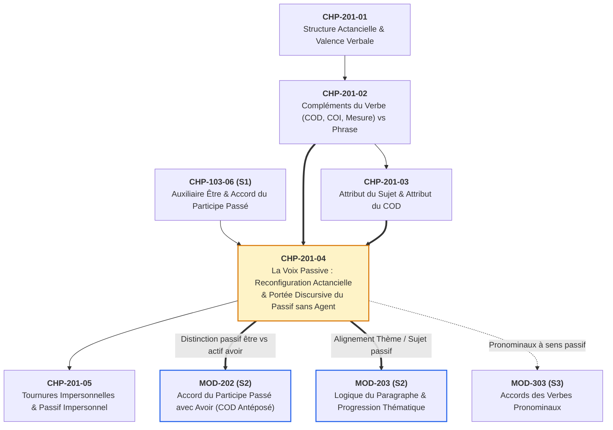
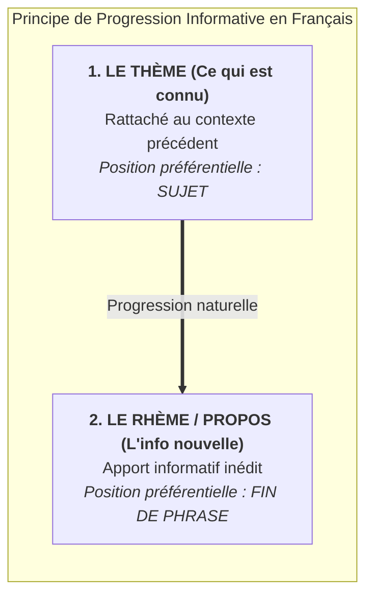

# Chapitre 4 — La Voix Passive : Reconfiguration Actancielle, Auxiliaire Être et Portée Discursive du Passif sans Agent

> **Identifiant du chapitre** : `CHP-201-04`  
> **Module de rattachement** : [`MOD-201` — Syntaxe Fonctionnelle de la Phrase Simple, Voix Passive, Tournures Impersonnelles et Relative Simple](file:///f:/Formation/world-class-french/03-curriculum/year-1/semester-2/mod-201-syntaxe-fonctionnelle-phrase-simple.md)  
> **Semestre** : Année 1 — Semestre 2 (S2)  
> **Volume horaire estimé** : 5 à 6 heures d'apprentissage autonome délibéré et d'ateliers d'application (Phase 1 Étude : 1 h 30 | Phase 2 Pratique : 1 h 30 | Phase 3 Correction : 1 h 00 | Phase 4 Évaluation : 1 h 00)  
> **Statut** : [STATUT : VALIDÉ]  
> **Compétences associées** : [`FR-SYNTAX-001`](file:///f:/Formation/world-class-french/02-competency-framework/competency-framework.md#fr-syntax-001-analyse-fonctionnelle-et-délimitation-de-la-phrase-simple) (L3 Autonomie), [`FR-STYLE-001`](file:///f:/Formation/world-class-french/02-competency-framework/competency-framework.md#fr-style-001-maîtrise-des-figures-de-rhétorique-et-commentaire-stylistique) (L3 Autonomie), [`FR-ORTHO-002`](file:///f:/Formation/world-class-french/02-competency-framework/competency-framework.md#fr-ortho-002-mécanique-infaillible-de-laccord-sujet-verbe) (L3 Autonomie)  
> **Sources scientifiques de référence** : `SRC-GRAM-01` (Grevisse & Goosse, 2016, § 828-835), `SRC-GRAM-02` (Riegel et al., 2016, chap. 9), `SRC-NORM-03` (Ministère de l'Éducation nationale, 2020)

---

## 1. Titre et Place dans le Cursus

### 1.1 Intitulé Officiel
**Chapitre 4 : La Voix Passive : Reconfiguration Actancielle, Auxiliaire Être et Portée Discursive du Passif sans Agent** (`CHP-201-04`).

### 1.2 Insertion Architecturale dans le Cursus
Ce quatrième chapitre du module [`MOD-201`](file:///f:/Formation/world-class-french/03-curriculum/year-1/semester-2/mod-201-syntaxe-fonctionnelle-phrase-simple.md) opère la jonction entre l'analyse structurale de la phrase simple et la stratégie discursive de l'énoncé. Après avoir établi la théorie de la valence verbale (`CHP-201-01`), dressé la cartographie rigoureuse des compléments du verbe face aux compléments de phrase (`CHP-201-02`) et fixé le fonctionnement copulatif de la fonction attribut (`CHP-201-03`), ce cours étudie la **diathèse passive** comme une opération à double face : une permutation syntaxique des actants gouvernée par la transitivité directe et un choix énonciatif d'orientation du point de vue.



- **En amont** : Ce chapitre mobilise trois acquis fondamentaux :
  - L'accord systématique du participe passé employé avec l'auxiliaire *être*, stabilisé au Semestre 1 dans [`CHP-103-06`](file:///f:/Formation/world-class-french/03-curriculum/year-1/semester-1/mod-103/chp-103-06-passe-compose-accord-participe-s1.md) ;
  - L'identification formelle du Complément d'Objet Direct (COD) et sa distinction stricte d'avec le COI et les compléments essentiels de mesure, de poids, de durée ou de prix (`CHP-201-02`) ;
  - Le mécanisme de l'attribution copulative via le verbe *être* (`CHP-201-03`).
- **En aval** : Ce chapitre prépare directement :
  - `CHP-201-05` (*Les tournures impersonnelles*), notamment pour comprendre le passif impersonnel (*« Il a été procédé à un contrôle »*) ;
  - [`MOD-202`](file:///f:/Formation/world-class-french/03-curriculum/year-1/semester-2/mod-202-participe-passe-avoir-ponctuation-interne.md) (*Accord du participe passé avec avoir*), où l'apprenant ne devra jamais confondre un passé composé actif (*« Les juges ont entendu les témoins »*) et un présent ou passé composé passif (*« Les témoins sont entendus / ont été entendus »*) ;
  - [`MOD-203`](file:///f:/Formation/world-class-french/03-curriculum/year-1/semester-2/mod-203-logique-paragraphe-cohesion-textuelle.md) (*Logique du paragraphe et cohésion textuelle*), où la voix passive constitue l'outil privilégié de la **progression thématique** (maintien d'un thème constant ou enchaînement linéaire du rhème au thème).

---

## 2. Objectifs Mesurables

Au terme de l'étude autonome et des ateliers d'application de ce chapitre, l'apprenant doit être capable de :

1. **Exécuter sans erreur la conversion active $\leftrightarrow$ passive** à tous les temps simples et composés de l'indicatif, en recombinant les actants (promotion du COD actif au rang de sujet passif, rétrogradation du sujet actif en complément d'agent), en conjuguant le semi-auxiliaire *être* au temps exact du verbe actif et en accordant le participe passé avec le nouveau sujet ([`FR-SYNTAX-001`](file:///f:/Formation/world-class-french/02-competency-framework/competency-framework.md#fr-syntax-001-analyse-fonctionnelle-et-délimitation-de-la-phrase-simple), [`FR-ORTHO-002`](file:///f:/Formation/world-class-french/02-competency-framework/competency-framework.md#fr-ortho-002-mécanique-infaillible-de-laccord-sujet-verbe)) [Réf. `SRC-GRAM-02`, chap. 9].
2. **Sélectionner la préposition adéquate (*par* vs *de*)** devant le complément d'agent selon le sémantisme du verbe et l'aspect du procès (opération matérielle ponctuelle vs sentiment durable ou description statique) ([`FR-SYNTAX-001`](file:///f:/Formation/world-class-french/02-competency-framework/competency-framework.md#fr-syntax-001-analyse-fonctionnelle-et-délimitation-de-la-phrase-simple)) [Réf. `SRC-GRAM-01`, § 830].
3. **Identifier et justifier les blocages formels de la passivisation** en écartant tout passif personnel sur les verbes intransitifs, les verbes transitifs indirects (avec examen raisonné du cas d'*obéir*) et les compléments essentiels de mesure, de prix ou de poids ([`FR-SYNTAX-001`](file:///f:/Formation/world-class-french/02-competency-framework/competency-framework.md#fr-syntax-001-analyse-fonctionnelle-et-délimitation-de-la-phrase-simple)) [Réf. `SRC-GRAM-02`, chap. 9].
4. **Analyser et exploiter en production écrite la portée discursive du passif sans agent** (passif tronqué) pour assurer la thématisation du patient, l'objectivité scientifique ou la neutralité institutionnelle dans la presse et l'administration ([`FR-STYLE-001`](file:///f:/Formation/world-class-french/02-competency-framework/competency-framework.md#fr-style-001-maîtrise-des-figures-de-rhétorique-et-commentaire-stylistique)) [Réf. `SRC-NORM-03`, p. 40].

---

## 3. Prérequis et Test de Préparation (Auto-Diagnostic)

### 3.1 Prérequis Cognitifs
- Maîtrise de la distinction entre verbe transitif direct (construisant un COD sans préposition, pronominalisable par *le, la, les*) et verbe transitif indirect (construisant un COI via *à* ou *de*, pronominalisable par *lui, leur, en, y*) (`CHP-201-01` et `CHP-201-02`).
- Maîtrise de la conjugaison du verbe *être* aux temps simples (*est, était, fut, sera*) et aux temps composés (*a été, avait été, aura été*) ([`MOD-103`](file:///f:/Formation/world-class-french/03-curriculum/year-1/semester-1/mod-103-systeme-verbal-indicatif.md)).
- Règle d'accord du participe passé employé avec l'auxiliaire *être* ([`CHP-103-06`](file:///f:/Formation/world-class-french/03-curriculum/year-1/semester-1/mod-103/chp-103-06-passe-compose-accord-participe-s1.md)).

### 3.2 Auto-Diagnostic Immédiat
Résolvez par écrit ces cinq questions diagnostiques avant d'étudier le cours :

1. Dans la phrase *« Les magistrats examinent la requête »*, quelle est la fonction syntaxique de *la requête* et par quel pronom clitique peut-on la remplacer ?
2. Conjuguez le verbe *être* à la 3e personne du pluriel (*elles*) aux quatre temps suivants de l'indicatif : présent, imparfait, passé simple, passé composé.
3. Convertissez à la voix passive la phrase suivante : *« L'assemblée a ratifié les nouveaux traités. »*
4. Parmi ces trois phrases actives, laquelle admet une mise au passif canonique : a) *« Ce colis pèse dix kilos »* ; b) *« Le directeur succède à son fondateur »* ; c) *« La tempête renverse les barques »* ?
5. Quelle préposition (*par* ou *de*) convient le mieux dans la phrase : *« Ce professeur émérite est respecté [...] tous ses pairs »* ?

---

<details>
<summary><b>Corrigé de l'Auto-Diagnostic</b> (Cliquer pour dérouler)</summary>

1. Le syntagme nominal *la requête* occupe la fonction de **Complément d'Objet Direct (COD)** du verbe *examinent*. Il se pronominalise par le clitique direct **la** (*« Les magistrats l'examinent »*).
2. Présent : **elles sont** | Imparfait : **elles étaient** | Passé simple : **elles furent** | Passé composé : **elles ont été**.
3. **« Les nouveaux traités ont été ratifiés par l'assemblée. »** (Le verbe actif *a ratifié* étant au passé composé, l'auxiliaire *être* se conjugue au passé composé : *ont été*, suivi du participe *ratifiés* accordé au masculin pluriel avec le nouveau sujet *Les nouveaux traités*).
4. Seule la phrase **c)** (*« Les barques sont renversées par la tempête »*) admet la passivisation. Dans *a)*, *dix kilos* est un complément essentiel de mesure et non un COD ; dans *b)*, *succéder à* est un verbe transitif indirect régissant un COI.
5. La préposition **de** (*« respecté de tous ses pairs »*) : les verbes exprimant un sentiment durable ou une attitude morale (*aimer, respecter, estimer, craindre*) introduisent classiquement leur complément d'agent par *de*.

</details>

---

## 4. Situation de Départ ou Problème Concret : Les Trois Impasses du Passif Scolaire

### 4.1 L'Illusion du Jeu Mécanique
Dans la pratique scolaire traditionnelle, la voix passive est souvent réduite à un automatisme formel consistant à croiser deux syntagmes autour du verbe : *« Le chat mange la souris $\rightarrow$ La souris est mangée par le chat »*. Cette approche mécanique engendre trois impasses majeures chez les rédacteurs universitaires et professionnels.

### 4.2 Les Passifs Agrammaticaux sur Verbes Intransitifs ou Indirects
Convaincus que n'importe quel complément postposé au verbe peut devenir le sujet d'une phrase passive, de nombreux scripteurs produisent dans leurs rapports administratifs ou juridiques des constructions contraires à la syntaxe française :

> 1. *\*« Toutes les questions des commissaires **ont été répondues** avec précision. »*  
> 2. *\*« Les instructions ministérielles **n'ont pas été obéies** par les services déconcentrés. »*  
> 3. *\*« Les deux candidats **ont été téléphonés** hier par le secrétariat. »*  
> 4. *\*« Quarante tonnes de cacao **sont pesées** par ce camion-remorque. »*

Pourquoi ces quatre phrases heurtent-elles immédiatement la norme grammaticale ? Parce que les verbes *répondre à*, *obéir à* et *téléphoner à* sont des **verbes transitifs indirects** (construisant un COI avec la préposition *à*), tandis que *peser* (au sens statique d'avoir tel poids) régit un **complément essentiel de mesure**. Aucun d'eux ne possède de COD véritable susceptible d'être promu au rang de sujet passif.

### 4.3 La Cécité face aux Enjeux Discursifs du Passif
À l'inverse, lorsqu'ils lisent dans un communiqué officiel ou un quotidien d'information :
> *« Les subventions agricoles ont été réduites de vingt pour cent. Des erreurs d'évaluation ont été commises lors de l'instruction du dossier. »*

les scripteurs non avertis n'y voient qu'une variante stylistique arbitraire. Ils ne perçoivent pas que le choix du **passif sans agent** constitue ici un acte rhétorique et pragmatique calculé : placer le citoyen devant le fait accompli tout en effaçant de la scène syntaxique l'autorité politique qui a décidé la baisse des subventions ou commis l'erreur. Comprendre la voix passive, c'est à la fois maîtriser le filtre syntaxique de la transitivité et décoder la mise en scène de la responsabilité dans le discours.

---

## 5. Explication Intuitive : L'Objectif de la Caméra Cinématographique

Pour saisir l'essence de la voix passive sans la confondre avec un simple artifice grammatical, imaginez un réalisateur filmant une scène de tribunal ou de rue avec une caméra.

```text
┌───────────────────────────────────────────────────────────────────────────┐
│              L'ANALOGIE DE LA CAMÉRA : CHANGER D'ANGLE DE VUE             │
├───────────────────────────────────────────────────────────────────────────┤
│                                                                           │
│  RÉALITÉ OBJECTIVE DU FAIT (Inchangée) :                                  │
│  [ AGENT : La foudre ] ───────(Action : frapper)──────> [ PATIENT : L'arbre ]
│                                                                           │
│  ───────────────────────────────────────────────────────────────────────  │
│                                                                           │
│  PLAN N° 1 : VOIX ACTIVE (Caméra braquée sur l'Agent)                     │
│  🎥 ──> « La foudre a frappé le grand baobab. »                            │
│         • Centre d'intérêt (Thème / Sujet) : La foudre (ce qu'elle fait). │
│                                                                           │
│  PLAN N° 2 : VOIX PASSIVE AVEC AGENT (Caméra braquée sur le Patient)      │
│  🎥 ──> « Le grand baobab a été frappé par la foudre. »                    │
│         • Centre d'intérêt (Thème / Sujet) : Le baobab (ce qu'il subit).  │
│                                                                           │
│  PLAN N° 3 : VOIX PASSIVE SANS AGENT (Plan serré sur le Patient seul)     │
│  🎥 ──> « Le grand baobab a été frappé. »                                  │
│         • L'agent sort du cadre (hors-champ) : seul le résultat compte.   │
└───────────────────────────────────────────────────────────────────────────┘
```

1. **La réalité extralinguistique reste strictement identique** : dans les trois plans, c'est toujours la foudre qui exerce l'action physique (elle est l'**agent**) et c'est toujours le baobab qui subit l'impact (il est le **patient**).
2. **La perspective informative bascule** :
   - Si votre texte parle d'un orage tropical, vous braquez la caméra sur la foudre : *« La foudre [Sujet] a frappé le grand baobab »* (Voix active).
   - Si votre texte raconte l'histoire séculaire de l'arbre sacré du village, vous gardez la caméra braquée sur l'arbre : *« Le grand baobab [Sujet] a été frappé par la foudre »* (Voix passive).
   - Si vous découvrez l'arbre fendu au matin sans savoir ce qui a causé le dégât, ou si seule la destruction de l'arbre importe, vous cadrez uniquement le patient en laissant l'auteur de l'action hors-champ : *« Le grand baobab [Sujet] a été abattu »* (Passif sans agent).

La voix passive est donc le mécanisme grammatical qui permet de **promouvoir le patient au premier plan de la phrase (la position de sujet)** sans altérer les rôles réels de l'événement.

---

## 6. Définitions Précises et Terminologie

Conformément à la nomenclature officielle (`SRC-NORM-03`, p. 40) et aux traités de syntaxe universitaire (`SRC-GRAM-01`, § 828 ; `SRC-GRAM-02`, chap. 9), les termes techniques suivants doivent être définis avec rigueur :

### 6.1 Diathèse (ou Voix)
- **Exemples d'ancrage** : *« Le chirurgien opère le malade »* (voix active) vs *« Le malade est opéré par le chirurgien »* (voix passive).
- **Définition formelle** : Catégorie grammaticale associée au verbe qui définit le rapport entre les rôles sémantiques des participants au procès (agent, patient) et leurs fonctions syntaxiques dans la proposition (sujet, objet, complément prépositionnel) [Réf. `SRC-GRAM-02`, chap. 9].

### 6.2 Voix Passive
- **Exemples d'ancrage** : *« La charte est signée par les délégués »* ; *« Les ponts ont été reconstruits »*.
- **Définition formelle** : Construction syntaxique et morphologique de la phrase dans laquelle le terme qui subit ou reçoit le procès (le patient, COD de la phrase active correspondante) occupe la fonction de **sujet grammatical**, tandis que le verbe prend une forme analytique composée de l'auxiliaire *être* et du participe passé [Réf. `SRC-NORM-03`, p. 40].

### 6.3 Agent vs Patient (Rôles Sémantiques)
- **Exemples d'ancrage** : Dans *« L'orfèvre cisèle le bracelet »* comme dans *« Le bracelet est ciselé par l'orfèvre »*, *l'orfèvre* demeure l'agent et *le bracelet* demeure le patient.
- **Définition formelle** :
  - **Agent** : Rôle sémantique (ou actanciel) de l'entité animée ou de la force causale qui initie, contrôle ou accompli le procès verbal.
  - **Patient** : Rôle sémantique de l'entité qui subit l'action, en est affectée ou en constitue l'objet résultant.  
  *(Principe cardinal : les rôles sémantiques d'agent et de patient restent constants lors de la conversion active/passive ; seules leurs fonctions grammaticales permutent).*

### 6.4 Complément d'Agent
- **Exemples d'ancrage** : *« Ce décret a été promulgué **par le chef de l'État** »* ; *« Ce magistrat est estimé **de tous ses confrères** »*.
- **Définition formelle** : Groupe prépositionnel introduit par la préposition *par* ou *de* dans une phrase passive, qui désigne l'agent du procès et correspond au sujet de la phrase active homologue [Réf. `SRC-GRAM-01`, § 830 ; `SRC-NORM-03`, p. 40].

### 6.5 Passif avec Agent (Passif Complet) vs Passif sans Agent (Passif Tronqué)
- **Exemples d'ancrage** : *« Le scrutin a été validé par la Cour constitutionnelle »* (passif avec agent) vs *« Le scrutin a été validé hier soir »* (passif sans agent).
- **Définition formelle** :
  - **Passif avec agent (ou passif long)** : Phrase passive explicite comportant un complément d'agent exprimé.
  - **Passif sans agent (passif court ou passif tronqué)** : Phrase passive grammaticalement complète et autonome dans laquelle le complément d'agent n'est pas exprimé, soit parce qu'il est inconnu ou évident, soit par choix stylistique d'effacement de l'acteur [Réf. `SRC-GRAM-02`, chap. 9].

### 6.6 Thématisation
- **Exemples d'ancrage** : *« Ce manuscrit ancien [Thème], il a été restauré par les archivistes de Porto-Novo [Propos/Rhème]. »*
- **Définition formelle** : Opération discursive consistant à placer un constituant en position initiale de phrase (généralement la position de sujet) afin d'en faire le **thème** de l'énoncé, c'est-à-dire le point de départ connu sur lequel porte l'information nouvelle (le **rhème** ou propos).

### 6.7 Accord du Participe Passif
- **Exemples d'ancrage** : *« Les conventions internationales sont **ratifiées** »* ; *« Ces mesures avaient été **adoptées** »*.
- **Définition formelle** : Règle morphosyntaxique absolue selon laquelle le participe passé du verbe conjugué à la voix passive reçoit systématiquement les marques de genre et de nombre du **sujet passif**, par l'intermédiaire de l'auxiliaire *être* [Réf. `SRC-GRAM-01`, § 941].

---

## 7. Règles et Mécanismes Fondamentaux

### 7.1 La Mécanique Formelle de la Conversion Passive

La transformation d'une phrase active canonique en phrase passive repose sur une quadruple opération algébrique simultanée [Réf. `SRC-GRAM-02`, chap. 9] :

```text
═══════════════════════════════════════════════════════════════════════════════
                 SCHÉMA DE LA RECONFIGURATION ACTANCIELLE PASSIVE
═══════════════════════════════════════════════════════════════════════════════
  PHRASE ACTIVE  :   [ GN₁ : Sujet ]   +   [ Verbe Actif (Temps T) ]   +   [ GN₂ : COD ]
                            │                         │                         │
                            │      ┌──────────────────┼─────────────────────────┘
                            │      │                  ▼
                            │      │       [ ÊTRE (Temps T) + PP ]
                            ▼      ▼                  +                    ┌───────────┐
  PHRASE PASSIVE :   [ GN₂ : Sujet Passif ] ──(Accord Genre/Nombre)──> [ PP ] + [ par/de + GN₁ ]
═══════════════════════════════════════════════════════════════════════════════
```

1. **Promotion de l'objet** : Le Complément d'Objet Direct ($\text{GN}_2$) de la phrase active devient le **sujet grammatical** de la phrase passive et gouverne désormais l'accord du verbe.
2. **Auxiliarisation temporelle stricte** : Le verbe actif est remplacé par une forme analytique où le semi-auxiliaire **être** est conjugué **exactement au même mode et au même temps** que le verbe actif initial, suivi du participe passé du verbe lexical :
   $$\text{Verbe passif au temps } T = \text{Auxiliaire \textit{être} au temps } T + \text{Participe passé}$$
3. **Accord systématique du participe passé** : Conjugué sous la rection de *être*, le participe passé s'accorde en genre et en nombre avec le nouveau sujet passif (dans les temps composés du passif comme *ont été adoptées*, le participe *été* reste invariable tandis que le participe lexical *adoptées* s'accorde avec le sujet).
4. **Rétrogradation du sujet initial** : Le sujet de la phrase active ($\text{GN}_1$) est transféré en périphérie du groupe verbal sous la forme d'un **complément d'agent** introduit par la préposition *par* ou *de* (ou s'efface si le sujet actif était le pronom indéfini *on*).

#### Tableau Synoptique de Concordance Temporelle (Actif $\leftrightarrow$ Passif)

| Temps / Mode | Phrase Active (*Les juges...*) | Auxiliaire *Être* au Temps $T$ | Phrase Passive (*La sentence... / Les sentences...*) |
| :--- | :--- | :---: | :--- |
| **Présent de l'indicatif** | *Les juges **rendent** la sentence.* | *est / sont* | *La sentence **est rendue** par les juges.* |
| **Imparfait** | *Les juges **rendaient** la sentence.* | *était / étaient* | *La sentence **était rendue** par les juges.* |
| **Passé simple** | *Les juges **rendirent** les sentences.* | *fut / furent* | *Les sentences **furent rendues** par les juges.* |
| **Futur simple** | *Les juges **rendront** les sentences.* | *sera / seront* | *Les sentences **seront rendues** par les juges.* |
| **Passé composé** | *Les juges **ont rendu** la sentence.* | *a été / ont été* | *La sentence **a été rendue** par les juges.* |
| **Plus-que-parfait** | *Les juges **avaient rendu** les sentences.* | *avait été / avaient été* | *Les sentences **avaient été rendues** par les juges.* |
| **Futur antérieur** | *Les juges **auront rendu** la sentence.* | *aura été / auront été* | *La sentence **aura été rendue** par les juges.* |
| **Conditionnel présent** | *Les juges **rendraient** la sentence.* | *serait / seraient* | *La sentence **serait rendue** par les juges.* |
| **Subjonctif présent** | *(Il faut que) les juges **rendent** la sentence.* | *(qu'elle) soit / soient* | *(Il faut que) la sentence **soit rendue** par les juges.* |

> [!CAUTION]
> **Le piège du décalage temporel** : Lors de la conversion d'un présent actif (*« Le comité examine le projet »*), l'erreur classique consiste à produire un passé composé passif (*\*« Le projet a été examiné »*). Si le verbe actif est au présent (*examine*), l'auxiliaire *être* doit impérativement être au présent : *« Le projet **est examiné** »*.

---

### 7.2 L'Alternance Prépositionnelle du Complément d'Agent (*Par* vs *De*)

Le complément d'agent n'est pas uniformément introduit par *par*. Le français soutenu opère une répartition sémantique et aspectuelle précise entre les prépositions **par** et **de** [Réf. `SRC-GRAM-01`, § 830 ; `SRC-GRAM-02`, chap. 9] :

#### 1. L'Emploi de *PAR* : L'Action Matérielle, Dynamique ou Ponctuelle
La préposition **par** est le marqueur standard de l'agentivité en français contemporain. Elle s'impose chaque fois que le verbe exprime une opération concrète, volontaire, matérielle ou envisagée dans son accomplissement dynamique :
- *« La ville de Ouidah fut visitée **par** l'explorateur au siècle dernier. »*
- *« Le barrage hydroélectrique a été inauguré **par** le ministre de l'Énergie. »*
- *« Les amendements budgétaires ont été rédigés **par** la commission des finances. »*

#### 2. L'Emploi de *DE* : Les Sentiments, Opérations Intellectuelles et Descriptions Statiques
Héritière de l'ancien français (où *de* était la préposition usuelle du passif jusqu'au XVIIe siècle), la préposition **de** demeure de règle ou d'élection stylistique dans deux domaines précis :
1. **Les verbes de sentiment, de jugement moral ou d'état psychologique/cognitif** (*aimer, adorer, haïr, respecter, estimer, craindre, redouter, admirer, apprécier, connaître, ignorer, oublier*) lorsque le procès est envisagé comme une disposition durable :
   - *« Ce doyen intègre est respecté **de** ses collègues et craint **des** fraudeurs. »*
   - *« Cet axiome géométrique est connu **de** tous les candidats. »*
   - *« Il vécut longtemps oublié **des** siens. »*
2. **Les verbes d'état résultant, de disposition spatiale ou d'accompagnement statique** (*entourer, border, couvrir, orner, tapisser, garnir, précéder, suivre, accompagner*), particulièrement lorsque l'agent est inanimé ou indéfini :
   - *« La lagune de Porto-Novo est bordée **de** palétuviers. »*
   - *« Le cortège présidentiel était précédé **de** motards et suivi **d'**une foule nombreuse. »*
   - *« Le toit du palais royal était couvert **de** chaume. »*

#### 3. Les Cas de Double Construction (*Par* vs *De*)
Avec un même verbe, le choix entre *par* et *de* traduit une opposition entre l'action ponctuelle volontaire (*par*) et l'état durable ou le sens figuré (*de*) :
- *« L'accusé a été surpris **par** le gardien en pleine nuit »* (action matérielle concrète : pris sur le fait) vs *« Nous avons été surpris **de** sa réaction brutale »* (sentiment d'étonnement).
- *« L'ambassadeur est accompagné **par** deux gardes du corps »* (action physique d'escorter) vs *« Sa requête était accompagnée **de** pièces justificatives »* (corrélation abstraite).

---

### 7.3 Les Restrictions et Blocages Formels de la Passivisation

La transformation passive constitue le test discriminant majeur de la transitivité directe en linguistique française [Réf. `SRC-GRAM-02`, chap. 8-9].

> [!IMPORTANT]
> **Loi fondamentale de passivisation** :  
> En français standard, **seuls les verbes transitifs directs** (admettant un véritable Complément d'Objet Direct) peuvent canoniquement subir la passivisation personnelle.

Il en résulte quatre blocages formels que tout rédacteur rigoureux doit maîtriser :

#### 1. Impossibilité Absolue sur les Verbes Intransitifs
Les verbes monovalents dépourvus de complément d'objet (*dormir, courir, nager, voyager, naître, mourir, tomber, pâlir*) ne possèdent aucun second actant susceptible de devenir sujet passif.

#### 2. Impossibilité sur les Verbes Transitifs Indirects (Régissant un COI)
Les verbes qui construisent leur complément par l'intermédiaire d'une préposition (*parler à, succéder à, nuire à, appartenir à, ressembler à, téléphoner à, répondre à, douter de, se souvenir de, profiter de*) bloquent la passivisation personnelle :
- Actif : *« Ce député succède au doyen de l'assemblée. »*  
  Passif : *\*« Le doyen de l'assemblée est succédé par ce député »* (**Agrammatical**).
- Actif : *« Le directeur a répondu aux réclamations. »*  
  Passif : *\*« Les réclamations ont été répondues par le directeur »* (**Agrammatical** ; on doit écrire : *« Le directeur a répondu aux réclamations »* ou recourir au passif impersonnel : *« Il a été répondu aux réclamations »*).

#### 3. Examen Critique de l'Exception Historique d'*Obéir* (*Désobéir, Pardonner*)
En français classique (XVIe-XVIIe siècles), les verbes *obéir*, *désobéir* et *pardonner* conservaient des traces d'une construction transitive directe héritée de l'ancien français. La langue a figé quelques tournures passives lorsque le sujet passif est une **personne** (*« Un chef qui sait se faire craindre est toujours **obéi** »* ; *« Vous êtes **pardonné** »*) [Réf. `SRC-GRAM-01`, § 829].  
Cependant, en français contemporain soigné, lorsque le complément désigne une **chose** (*un ordre, une loi, un règlement*) suivie d'un complément d'agent, la passivisation est rejetée comme une incorrection syntaxique :
- Proscrire : *\*« Les lois de la République doivent être obéies par tous les citoyens. »*
- Écrire : *« Tous les citoyens doivent **obéir aux** lois de la République »* ou *« Les lois de la République doivent être **respectées / observées** par tous les citoyens. »*

#### 4. Impossibilité sur les Compléments Essentiels de Mesure, Poids, Durée, Prix et sur *Avoir*
Certains verbes sont suivis d'un syntagme nominal sans préposition qui ressemble superficiellement à un COD, mais qui exprime une mesure, un poids, une durée ou un prix (*peser, coûter, valoir, mesurer, durer, vivre*) (`CHP-201-02`). Le test de la passivisation prouve formellement que ces groupes ne sont pas des COD :
- Actif : *« Cette malle métallique pèse trente kilos. »*  
  Passif : *\*« Trente kilos ont été pesés par cette malle métallique »* (**Agrammatical** — en revanche, si *peser* est employé comme verbe d'action transitif direct : *« Le douanier a pesé cette malle »* $\rightarrow$ *« Cette malle a été pesée par le douanier »*, le passif est parfaitement valide !).
- Actif : *« Ce terrain agricole vaut dix millions de francs. »*  
  Passif : *\*« Dix millions de francs sont valus par ce terrain »* (**Agrammatical**).
- De même, le verbe d'état *avoir* (au sens de posséder) et les expressions figées sans déterminant référentiel (*avoir peur, prendre froid, perdre patience*) refusent le passif (*\*« Deux enfants sont eus par ce couple »* est impossible ; seul *avoir* au sens dynamique de « tromper » dans le registre familier admet *« J'ai été eu »*).

---

### 7.4 Stylistique, Rhétorique et Pragmatique du Passif sans Agent

L'analyse des corpus authentiques (presse écrite, textes législatifs, rapports administratifs, articles scientifiques) révèle une donnée statistique majeure : **plus de 75 % des phrases passives produites en français réel ne comportent aucun complément d'agent** [Réf. `SRC-GRAM-01`, § 828 ; `SRC-GRAM-02`, chap. 9].

Loin d'être une phrase incomplète ou mutilée, le **passif sans agent** (ou passif tronqué) constitue la raison d'être fonctionnelle de la diathèse passive. Il répond à trois motivations pragmatiques distinctes :

#### 1. L'Agent est Inconnu, Anonyme ou Indéterminé
Lorsque l'auteur de l'action est ignoré au moment de l'énonciation ou désigne une collectivité indistincte (que la voix active traduirait par le pronom indéfini *on*), le passif sans agent permet d'énoncer le fait avec sobriété sans recourir à un sujet postiche :
- *« La succursale bancaire a été dévalisée durant la nuit. »* (On ignore l'identité des malfaiteurs).
- *« Deux statues rituelles ont été découvertes lors des fouilles d'Allada. »*

#### 2. L'Agent est Évident, Générique ou dépourvu d'Intérêt Informatif
Lorsque le sens même du verbe implique nécessairement une catégorie unique d'agents institutionnels ou professionnels (*arrêter $\rightarrow$ la police*, *condamner $\rightarrow$ le tribunal*, *élire $\rightarrow$ les électeurs*, *opérer $\rightarrow$ le chirurgien*), mentionner le complément d'agent créerait une redondance lourde (pléonasme pragmatique) :
- *« Le prévenu a été condamné à cinq ans de prison ferme »* (ajouter *« par les juges du tribunal »* est superflu).
- *« Le projet de loi de finances a été adopté en première lecture »* (ajouter *« par les députés »* est inutile).

#### 3. Volonté Délibérée de Dissimulation, de Neutralité ou de Déresponsabilisation
Dans le discours politique, diplomatique, administratif ou scientifique, l'effacement de l'agent est une stratégie rhétorique puissante :
- **Objectivité scientifique** : Dans un mémoire ou un protocole de laboratoire, l'effacement du chercheur met en valeur la reproductibilité universelle de l'expérience : *« Les échantillons ont été chauffés à cent degrés puis filtrés. »*
- **Neutralité administrative et autorité de la loi** : L'institution s'efface derrière la règle impersonnelle : *« Tout dossier incomplet sera rejeté sans examen. »*
- **Camouflage et déresponsabilisation politique** : En supprimant la mention de l'agent, le locuteur présente une décision impopulaire ou une faute grave comme un événement fatal, détaché de tout décideur identifiable :
  - Actif assumé : *« Notre direction a commis des erreurs de gestion et a licencié cent employés. »*
  - Passif de déresponsabilisation : *« Des erreurs ont été commises et cent postes ont dû être supprimés. »*

---

## 8. Raisonnement Détaillé : Pourquoi la Langue Dispose-t-elle de la Voix Passive ?

Un esprit logique pourrait poser la question suivante : *« Puisque la phrase active "L'architecte a conçu ce pont" et la phrase passive "Ce pont a été conçu par l'architecte" décrivent exactement le même événement dans le monde réel (elles ont les mêmes conditions de vérité), pourquoi la langue française s'encombre-t-elle d'une seconde construction plus longue ? »*

La réponse réside dans l'**organisation communicative et la dynamique informative du discours** [Réf. `SRC-GRAM-02`, chap. 9].



### 8.1 L'Alignement du Thème et du Sujet Grammatical
Dans la communication humaine, l'esprit progresse naturellement **du connu vers l'inconnu** :
1. On pose d'abord le **thème** (l'entité déjà mentionnée dans la phrase précédente, présente dans la mémoire immédiate du lecteur) ;
2. On énonce ensuite le **rhème** (ou propos : l'information nouvelle qu'on apporte à propos de ce thème).

Or, en français, l'ordre syntaxique rigide ($\text{Sujet} + \text{Verbe} + \text{Complément}$) assigne spontanément la position initiale au **sujet grammatical**. Tant que l'agent de l'action est le thème connu, la voix active suffit. Mais dès que l'entité déjà connue du lecteur est le **patient** (celui qui subit l'action) et que l'information nouvelle est l'**agent**, la voix active briserait le flux de lecture en plaçant l'inconnu au début et le connu à la fin.

### 8.2 Maintien de la Continuité Textuelle (Préparation de `MOD-203`)
Observez l'enchaînement de ces deux phrases dans un récit historique :

- **Enchaînement maladroit (tout à la voix active)** :  
  *« Le roi Béhanzin opposa une résistance farouche aux troupes coloniales. [Thème = Béhanzin]. Un navire militaire déporta **le souverain vaincu** en Martinique en 1894. »*  
  $\rightarrow$ Rupture brutale du fil conducteur : la seconde phrase commence par un élément inconnu (*Un navire militaire*) et rejette le personnage central (*le souverain*) en position d'objet.

- **Enchaînement fluide grâce à la voix passive (progression à thème constant)** :  
  *« **Le roi Béhanzin** [Thème 1] opposa une résistance farouche aux troupes coloniales. Vaincu en 1894, **il** [Thème 1 maintenu en sujet passif] **fut déporté** en Martinique par l'administration militaire [Rhème]. »*  
  $\rightarrow$ La voix passive permet de conserver le personnage principal en position de sujet d'une phrase à l'autre, assurant une cohésion textuelle irréprochable.

---

## 9. Exemples Corrects Commentés

Voici l'analyse syntaxique, morphologique et discursive complète de cinq énoncés modèles illustrant les différents visages de la voix passive :

### Exemple 1 : Conversion Passive Complète au Passé Simple (Agent Dynamique en *Par*)
> **Actif** : *« Les archéologues béninois découvrirent deux vestiges royaux sur le plateau d'Abomey. »*  
> **Passif** : *« Deux vestiges royaux furent découverts sur le plateau d'Abomey par les archéologues béninois. »*

- **Analyse de la reconfiguration actancielle** :
  - Le COD actif (*deux vestiges royaux*, masculin pluriel) est promu en tête d'énoncé comme **sujet passif**.
  - Le verbe actif *découvrirent* (passé simple de l'indicatif, P6) est converti au passé simple passif : auxiliaire *être* au passé simple (*furent*) + participe passé *découverts* (consonne latente *-t* révélée par le féminin *découverte*, suivi de la marque de pluriel *-s* imposée par *vestiges*).
  - Le sujet actif (*Les archéologues béninois*) devient complément d'agent introduit par **par** (opération matérielle et ponctuelle de fouille).
  - Le complément de phrase circonstanciel de lieu (*sur le plateau d'Abomey*) conserve son autonomie syntaxique.

### Exemple 2 : Conversion Passive au Plus-que-Parfait (Temps Composé)
> **Actif** : *« La commission électorale avait publié les listes définitives avant le scrutin. »*  
> **Passif** : *« Les listes définitives avaient été publiées par la commission électorale avant le scrutin. »*

- **Analyse morphosyntaxique** :
  - Le verbe actif *avait publié* est au plus-que-parfait de l'indicatif (auxiliaire *avoir* à l'imparfait + participe passé).
  - À la voix passive, l'auxiliaire *être* doit donc lui-même se conjuguer au plus-que-parfait : **avaient été** (au pluriel, gouverné par le nouveau sujet *Les listes définitives*).
  - Le participe *été* demeure invariable (le verbe *être* se conjuguant avec *avoir* et n'ayant jamais de COD), tandis que le participe lexical **publiées** reçoit le féminin pluriel (*-es*) du sujet passif *Les listes définitives*.

### Exemple 3 : Passif de Sentiment et de Description Statique (Complément d'Agent en *De*)
> *« Ce vieux sage du village était entouré d'enfants attentifs et respecté de toute la communauté. »*

- **Analyse de la préposition d'agent** :
  - Deux participes passifs coordonnés dépendent de l'auxiliaire *était* : *entouré* et *respecté*.
  - Le premier (*entouré d'enfants*) exprime une disposition spatiale statique (un cadre descriptif) $\rightarrow$ préposition **de** (*d'*).
  - Le second (*respecté de toute la communauté*) exprime un sentiment moral durable et non un acte ponctuel $\rightarrow$ préposition **de**.

### Exemple 4 : Conversion d'une Phrase Active à Sujet Indéfini *On* en Passif sans Agent
> **Actif** : *« On a intégralement restauré la façade de la cathédrale de Porto-Novo. »*  
> **Passif** : *« La façade de la cathédrale de Porto-Novo a été intégralement restaurée. »*

- **Analyse syntaxique et stylistique** :
  - Lorsque le sujet de la phrase active est le pronom indéfini *on* (désignant un agent collectif ou non spécifié), la conversion passive entraîne l'**effacement pur et simple de l'agent** (on n'écrit jamais *\*« par on »*).
  - L'adverbe de manière *intégralement* se place harmonieusement entre l'auxiliaire composé (*a été*) et le participe passé accordé au féminin singulier (*restaurée*).

### Exemple 5 : Continuité Thématique par Enchaînement Actif $\rightarrow$ Passif
> *« Le dramaturge Jean Pliya publia la pièce "Kondo le Requin" en 1966. Dès sa parution, cette œuvre historique fut couronnée par le Grand Prix littéraire d'Afrique noire. »*

- **Analyse de la progression discursive** :
  - Dans la première phrase (active), le rhème (l'information nouvelle placée en fin de phrase) est *la pièce "Kondo le Requin"*.
  - Dans la seconde phrase, ce rhème est repris comme **thème** initial sous la forme du syntagme nominal anaphorique *cette œuvre historique*.
  - Pour permettre à *cette œuvre historique* d'occuper la fonction de sujet tout en recevant l'action d'être primée, l'auteur recourt à la voix passive (*fut couronnée par le Grand Prix...*). C'est le modèle canonique de la **progression thématique linéaire**.

---

## 10. Contre-Exemples et Erreurs Fréquentes

Voici l'analyse clinique de six erreurs récurrentes observées dans les copies universitaires et les écrits professionnels lors du maniement de la voix passive :

### Erreur n° 1 : La Passivisation Illicite d'un Verbe Transitif Indirect ou Intransitif
- **Énoncé fautif** : *\*« Les doléances des syndicats ont été répondues par le ministre, mais ses consignes n'ont pas été obéies. »*
- **Diagnostic linguistique** : Le scripteur traite les verbes *répondre à* et *obéir à* comme s'ils étaient transitifs directs. Or, on répond *à quelque chose* (COI) et on obéit *à quelque chose* (COI). L'absence de COD interdit la promotion du complément en sujet passif personnel.
- **Forme corrigée** : *« Le ministre **a répondu aux** doléances des syndicats, mais ses consignes n'ont pas été **respectées** (ou : **suivies**). »*
- **Règle salvatrice** : Avant de passiver un verbe, vérifiez toujours qu'il se construit sans préposition à l'actif (*respecter une consigne* $\rightarrow$ passivable ; *obéir à une consigne* $\rightarrow$ non passivable en français contemporain).

---

### Erreur n° 2 : La Confusion entre Temps Composé Actif et Temps Simple Passif
- **Énoncé fautif** : *\*« Lorsque les délégués ont arrivé, les portes ont fermées par le service de sécurité. »*
- **Diagnostic linguistique** : Télescopage morphologique entre l'auxiliaire *avoir* des temps composés actifs et l'auxiliaire *être* de la voix passive. *Ont fermé* est le passé composé actif ; il ne peut jamais recevoir un complément d'agent en *par*.
- **Forme corrigée** : *« Lorsque les délégués **sont arrivés**, les portes **ont été fermées** (ou : **étaient fermées**) par le service de sécurité. »*
- **Règle salvatrice** : Une forme verbale passive contient **toujours** l'auxiliaire *être* (aux temps composés du passif, *avoir été* + participe passé).

---

### Erreur n° 3 : Le Décalage Temporel de l'Auxiliaire *Être* lors de la Conversion
- **Énoncé fautif** : Conversion de *« La cour suprême vérifie la régularité des procès-verbaux »* en *\*« La régularité des procès-verbaux a été vérifiée par la cour suprême. »*
- **Diagnostic linguistique** : L'apprenant associe mentalement le participe passé (*vérifiée*) à l'idée du passé, et conjugue indûment l'auxiliaire *être* au passé composé (*a été*) alors que le verbe initial (*vérifie*) est au **présent de l'indicatif**.
- **Forme corrigée** : *« La régularité des procès-verbaux **est vérifiée** par la cour suprême. »*
- **Règle salvatrice** : Le temps du verbe passif est exclusivement porté par l'auxiliaire *être*. Présent actif (*vérifie*) = Présent passif (*est vérifiée*) ; Passé composé actif (*a vérifié*) = Passé composé passif (*a été vérifiée*).

---

### Erreur n° 4 : La Confusion Prépositionnelle entre *Par* et *De*
- **Énoncé fautif** : *\*« Le jardin botanique est entouré par des grilles en fer forgé et son fondateur reste connu par tous les botanistes. »*
- **Diagnostic linguistique** : Emploi mécanique de la préposition *par* devant des compléments qui n'expriment aucune action dynamique ponctuelle, mais une disposition spatiale statique (*entouré*) et un état cognitif durable (*connu*).
- **Forme corrigée** : *« Le jardin botanique est entouré **de** grilles en fer forgé et son fondateur reste connu **de** tous les botanistes. »*
- **Règle salvatrice** : Avec les verbes descriptifs d'encadrement spatial (*entouré, bordé, couvert, orné*) et les verbes de connaissance ou de sentiment durable (*connu, aimé, respecté, craint*), privilégiez systématiquement la préposition **de**.

---

### Erreur n° 5 : L'Omission de l'Accord du Participe Passé dans les Temps Composés Passifs
- **Énoncé fautif** : *\*« Toutes les candidatures féminines ont été examiné avec soin et ont été retenu par le jury. »*
- **Diagnostic linguistique** : Voyant l'auxiliaire *ont* (*avoir*) en tête du groupe verbal *ont été examiné*, le scripteur bloque à tort l'accord avec le sujet *Toutes les candidatures féminines*, oubliant que *ont été* est l'auxiliaire *être* conjugué au passé composé !
- **Forme corrigée** : *« Toutes les candidatures féminines ont été **examinées** avec soin et ont été **retenues** par le jury. »*
- **Règle salvatrice** : Dans la séquence `[avoir + été + participe passé]`, *été* reste invariable, mais le participe passé lexical qui suit est sous la rection directe de *être* : il s'accorde **toujours** en genre et en nombre avec le sujet passif.

---

### Erreur n° 6 : L'Abus Stylistique du Passif Lourd avec Agent Pronominal
- **Énoncé fautif** : *\*« Votre réclamation a bien été reçue par nous et une réponse vous sera envoyée par moi dès demain. »*
- **Diagnostic linguistique** : En français soigné, lorsque l'agent est le locuteur lui-même ou l'interlocuteur (pronoms personnels de 1re ou 2e personne *moi, toi, nous, vous*), l'emploi du passif avec complément d'agent (*par moi, par nous*) produit une lourdeur administrative artificielle (sauf effet d'insistance contrastive : *« C'est par moi seul que ce texte a été rédigé »*).
- **Forme corrigée** : *« **Nous avons** bien **reçu** votre réclamation et **je vous enverrai** une réponse dès demain. »*
- **Règle salvatrice** : Lorsque l'agent est connu, déterminé et correspond aux personnes du dialogue (*je, nous, vous*), préférez la franchise et la vigueur de la voix active.

---

## 11. Cas Particuliers et Limites de la Règle Générale

Au-delà du passif morphologique canonique (*être + participe passé*), le système verbal français dispose de trois structures voisines ou complémentaires permettant d'exprimer une perspective passive [Réf. `SRC-GRAM-01`, § 832-835 ; `SRC-GRAM-02`, chap. 9] :

### 11.1 La Tournure Pronominale à Sens Passif (Le Passif Pronominal)
Lorsque le sujet grammatical est un nom **inanimé** incapable d'accomplir l'action sur lui-même, la construction pronominale (`se` + verbe actif) équivaut à un passif sans agent exprimant une propriété générale, une habitude ou une prescription :
- *« Ce plat traditionnel **se prépare** avec de l'huile de palme rouge »* (= est préparé).
- *« La vengeance **se mange** froide »* (= est mangée).
- *« Ces tissus de coton **se vendent** très bien sur le marché international »* (= sont vendus).

> [!NOTE]
> **Règle d'anticipation pour `MOD-303`** : Dans le passif pronominal aux temps composés, le participe passé s'accorde systématiquement en genre et en nombre avec le sujet patient : *« Ces maisons **se sont vendues** rapidement »* (= ont été vendues).

### 11.2 Le Passif Impersonnel (Passivisation des Verbes Intransitifs ou Indirects)
Bien que les verbes intransitifs et transitifs indirects refusent le passif personnel (*\*« La question a été répondue »*), le français juridique, parlementaire et administratif autorise leur passivisation sous une **forme impersonnelle** gouvernée par le pronom neutre invariable **il** (`CHP-201-05`) [Réf. `SRC-GRAM-01`, § 829] :
- Actif : *« L'assemblée a procédé au dépouillement des bulletins. »* (*procéder à* = transitif indirect)  
  $\rightarrow$ Passif impersonnel : *« **Il a été procédé** au dépouillement des bulletins. »*
- Actif : *« Le greffe répondra à toutes les convocations. »* (*répondre à* = transitif indirect)  
  $\rightarrow$ Passif impersonnel : *« **Il sera répondu** à toutes les convocations. »*
- Dans cette construction, le verbe et le participe passé restent **invariables au masculin singulier**, car leur unique sujet syntaxique est le pronom impersonnel *il*.

### 11.3 Passif d'Action vs Passif d'État (et Périphrases Passives en *Se faire / Se voir*)
Lorsqu'un verbe perfectif (exprimant une action qui atteint un terme, comme *fermer, construire, briser, signer*) est employé au présent ou à l'imparfait avec *être* sans complément d'agent, une ambiguïté aspectuelle apparaît entre l'**action en cours** et l'**état résultant** (où le participe fonctionne comme un simple adjectif attribut) :
- **Passif d'état résultant** : *« À vingt heures, les grilles du ministère **sont fermées** »* (l'action a eu lieu auparavant ; on décrit l'état actuel des grilles : elles sont closes).
- **Passif d'action dynamique** : *« Chaque soir à vingt heures, les grilles du ministère **sont fermées par le gardien** »* (l'action s'accomplit à ce moment-là).

Pour lever cette ambiguïté ou pour passiver l'objet indirect (COS) d'un verbe ditransitif (qui ne peut jamais devenir le sujet d'un passif en *être* : *\*« Paul a été donné un livre »*), le français utilise les périphrases semi-auxiliaires **se voir + infinitif** ou **se faire + infinitif** :
- Actif ditransitif : *« Le jury a attribué une bourse d'excellence à cette étudiante. »*
- Passif périphrastique promouvant le bénéficiaire (COS) : *« Cette étudiante **s'est vu attribuer** une bourse d'excellence par le jury. »*

---

## 12. Approfondissement Adapté au Niveau : Théorie de la Diathèse et Contraintes Aspectuelles

### 12.1 La Théorie Linguistique de la Diathèse (Benveniste et Lazard)
Dans ses *Problèmes de linguistique générale*, Émile Benveniste, prolongé par les travaux typologiques de Gilbert Lazard sur l'actance, montre que la diathèse ne modifie pas la valence sémantique du verbe (le procès implique toujours le même nombre de participants conceptuels), mais opère un **réaménagement de la hiérarchie syntaxique des actants** [Réf. `SRC-GRAM-02`, chap. 9] :

1. **La rétrogradation de l'Actant 1 (Démotion de l'Agent)** : L'opération première du passif n'est pas tant de mettre le patient en valeur que d'**évincer l'agent du centre prédicatif**. En perdant sa fonction de sujet, l'agent devient un circonstant périphérique facultatif (ou disparaît dans plus de 75 % des cas).
2. **La promotion de l'Actant 2 (Promotion du Patient)** : Comme la syntaxe du français exige qu'un verbe conjugué dispose d'un sujet grammatical donneur d'accord, la place laissée vacante par l'agent est occupée par l'actant immédiatement inférieur dans la hiérarchie de transitivité : le COD (Patient).

### 12.2 La Contrainte Aspectuelle du Passif Français
Pourquoi la phrase *« Le musée est bâti »* est-elle interprétée spontanément comme un état achevé (= le bâtiment existe déjà) et non comme une action en cours (= on est en train de le bâtir), alors que *« Ce roman est admiré »* exprime un procès actuel ?

La grammaire formelle (`SRC-GRAM-02`, chap. 9) explique ce phénomène par le **mode d'action (Aktionsart)** du verbe lexical :
- **Verbes imperfectifs (non bornés : *aimer, admirer, surveiller, gouverner, accompagner*)** : Le procès n'ayant pas de terme intrinsèque, son participe passé combiné avec *être* au présent exprime une **simultanéité pure** avec l'actif : *« La foule l'acclame »* $\iff$ *« Il est acclamé par la foule »*.
- **Verbes perfectifs ou téliques (bornés : *bâtir, ouvrir, tuer, peindre, signer, fermer*)** : Le procès vise un terme final au-delà duquel l'action cesse et laisse place à un résultat. Sans complément d'agent ni adverbe d'habitude, `être (présent) + participe passé` exprime l'**aspect accompli de l'état résultant** (*« Le contrat est signé »* = il a été signé et porte désormais les signatures). Pour exprimer l'action en cours au présent, le français doit ajouter un complément d'agent, un circonstant d'itération (*« Chaque matin, le courrier est signé par la directrice »*) ou la périphrase *être en train d'être signé*.

---

## 13. Comparaisons Différentielles

### 13.1 Tableau Synoptique : Passif avec Agent vs Passif sans Agent (Passif Tronqué)

| Critère d'Analyse | Passif avec Agent (Passif Complet) | Passif sans Agent (Passif Tronqué) |
| :--- | :--- | :--- |
| **Structure syntaxique** | $\text{GN}_{\text{sujet passif}} + \text{être} + \text{PP} + \text{par/de } \text{GN}_{\text{agent}}$ | $\text{GN}_{\text{sujet passif}} + \text{être} + \text{PP} \ (+\ \text{CC éventuel})$ |
| **Fréquence dans les textes réels** | Minoritaire ($\approx 20\text{ à } 25\,\%$ des passifs écrits). | Largement majoritaire ($\ge 75\,\%$ des passifs écrits). |
| **Distribution informative** | Le patient est le **thème** (connu) ; l'agent constitue le **rhème** (l'information nouvelle mise en relief en fin de phrase). | Le patient est le **thème** ; le **rhème** est le procès verbal lui-même et son résultat accompli. |
| **Équivalent actif usuel** | Phrase active à sujet nominal déterminé (*« L'architecte a rénové le musée »*). | Phrase active à sujet pronominal indéfini **on** (*« On a rénové le musée »*). |
| **Visée rhétorique et pragmatique** | Souligner l'identité de l'auteur de l'acte ou maintenir la continuité thématique entre deux phrases. | Taire un agent inconnu/évident, instaurer une neutralité scientifique ou diluer la responsabilité politique. |
| **Exemple canonique** | *« Ce théorème fut démontré **par Euclide**. »* | *« Les crédits de fonctionnement **ont été suspendus**. »* |

---

### 13.2 Tableau Différentiel : Préposition *PAR* vs Préposition *DE* devant le Complément d'Agent

| Paramètre Linguistique | Préposition *PAR* | Préposition *DE* |
| :--- | :--- | :--- |
| **Sémantisme du verbe** | Action matérielle, concrète, physique, volontaire ou opération ponctuelle. | Sentiment, attitude morale, activité intellectuelle ou localisation descriptive. |
| **Aspect du procès** | Aspect dynamique, événementiel, envisagé dans son accomplissement. | Aspect statique, duratif, permanent ou état résultant. |
| **Degré d'autonomie de l'agent** | Agent pleinement actif et individualisé (souvent animé déterminé). | Agent moins actif, siège d'un état affectif ou décor inanimé souvent sans article. |
| **Verbes types** | *Bâtir, rédiger, arrêter, voter, détruire, convoquer, examiner, saisir.* | *Aimer, respecter, craindre, estimer, connaître, ignorer, entourer, border, couvrir, suivre.* |
| **Exemples contrastés** | *« L'assemblée a été **convoquée par** le doyen. »*<br/>*« Il a été **surpris par** la patrouille. »* | *« Le doyen est **estimé de** toute l'assemblée. »*<br/>*« Nous sommes **surpris de** votre silence. »* |

---

### 13.3 Tableau Différentiel : Passif Morphologique (*Être + PP*) vs Passif Pronominal (*Se + Verbe*)

| Critère de Comparaison | Passif Morphologique Canonique | Tournure Pronominale Passive |
| :--- | :--- | :--- |
| **Marqueur formel** | Auxiliaire *être* + Participe passé accordé. | Pronom clitique réfléchi *se* + Verbe conjugué à la voix active (P3 ou P6). |
| **Nature du sujet patient** | Animé ou inanimé (*« Le témoin est entendu »*, *« La loi est votée »*). | **Presque exclusivement inanimé** (*« Ce fruit se consomme mûr »* ; avec un animé, *se* serait lu comme réfléchi ou réciproque). |
| **Présence d'un complément d'agent** | **Possible et régulière** (*par / de*). | **Généralement exclue** en français moderne (tour essentiellement sans agent). |
| **Valeur aspectuelle dominante** | Événement particulier daté ou état résultant (*« Ce pont a été construit en 2020 »*). | Vérité générale, propriété intrinsèque, norme technique ou habitude (*« Ce mot s'écrit avec deux consonnes »*). |

---

## 14. Exercices Progressifs

### 14.1 Niveau 1 : Conversions Actives $\leftrightarrow$ Passives Directes, Respect des Temps et Accords

**Consigne** : Convertissez les sept phrases actives suivantes à la voix passive (items 1 à 7) et les trois phrases passives à la voix active (items 8 à 10). Veillez scrupuleusement à conserver le temps exact du verbe initial et à accorder le participe passé avec le sujet passif :

1. *La Cour constitutionnelle proclame les résultats définitifs du scrutin.*
2. *Les artisans fondeurs d'Abomey ont réalisé ces deux bas-reliefs historiques.*
3. *Une violente averse tropicale inondait les artères basses de la ville.*
4. *Le gouvernement soumettra trois projets de réforme au Parlement.*
5. *Les archivistes nationaux avaient restauré toutes les chartes anciennes.*
6. *En 1960, les représentants élus signèrent l'acte officiel d'indépendance.*
7. *On vérifiera minutieusement l'authenticité de chaque diplôme universitaire.*
8. *Les nouvelles digues de protection ont été édifiées par une entreprise locale.* (Convertir à l'actif)
9. *Les candidats admissibles seront convoqués dès lundi prochain.* (Convertir à l'actif avec le pronom sujet adéquat)
10. *Cette décision arbitrale était contestée par les deux parties adverses.* (Convertir à l'actif)

---

<details>
<summary><b>Corrigé Détaillé du Niveau 1</b> (Cliquer pour dérouler)</summary>

1. **« Les résultats définitifs du scrutin sont proclamés par la Cour constitutionnelle. »**  
   *(Présent actif "proclame" $\rightarrow$ Présent passif "sont proclamés" ; accord masculin pluriel avec "Les résultats définitifs").*
2. **« Ces deux bas-reliefs historiques ont été réalisés par les artisans fondeurs d'Abomey. »**  
   *(Passé composé actif "ont réalisé" $\rightarrow$ Passé composé passif "ont été réalisés" ; accord masculin pluriel avec "Ces deux bas-reliefs").*
3. **« Les artères basses de la ville étaient inondées par une violente averse tropicale. »**  
   *(Imparfait actif "inondait" $\rightarrow$ Imparfait passif "étaient inondées" ; accord féminin pluriel avec "Les artères basses").*
4. **« Trois projets de réforme seront soumis au Parlement par le gouvernement. »**  
   *(Futur simple actif "soumettra" $\rightarrow$ Futur simple passif "seront soumis" ; le COS "au Parlement" reste intact ; participe "soumis" avec consonne latente -s au masculin pluriel).*
5. **« Toutes les chartes anciennes avaient été restaurées par les archivistes nationaux. »**  
   *(Plus-que-parfait actif "avaient restauré" $\rightarrow$ Plus-que-parfait passif "avaient été restaurées" ; accord féminin pluriel avec "Toutes les chartes anciennes").*
6. **« En 1960, l'acte officiel d'indépendance fut signé par les représentants élus. »**  
   *(Passé simple actif "signèrent" $\rightarrow$ Passé simple passif "fut signé" ; accord masculin singulier avec "l'acte officiel").*
7. **« L'authenticité de chaque diplôme universitaire sera minutieusement vérifiée. »**  
   *(Futur simple actif "vérifiera" avec sujet indéfini "On" $\rightarrow$ Futur simple passif sans agent "sera vérifiée" ; accord féminin singulier avec le noyau "L'authenticité").*
8. **« Une entreprise locale a édifié les nouvelles digues de protection. »**  
   *(Passé composé passif "ont été édifiées" $\rightarrow$ Passé composé actif "a édifié" ; le participe avec l'auxiliaire avoir et COD postposé redevient invariable au masculin singulier).*
9. **« On convoquera les candidats admissibles dès lundi prochain. »**  
   *(Futur simple passif sans agent "seront convoqués" $\rightarrow$ Futur simple actif avec restitution du sujet pronominal indéfini "On convoquera").*
10. **« Les deux parties adverses contestaient cette décision arbitrale. »**  
    *(Imparfait passif "était contestée" $\rightarrow$ Imparfait actif "contestaient" accordé à la 3e personne du pluriel avec "Les deux parties adverses").*

</details>

---

### 14.2 Niveau 2 : Traque des Blocages de Transitivité et Arbitrage Prépositionnel (*Par* vs *De*)

**Consigne** :
- **Partie A (Items 1 à 5)** : Pour chacune des phrases actives suivantes, indiquez si la conversion passive personnelle est **possible** ou **bloquée**. Si elle est possible, rédigez-la ; si elle est bloquée, justifiez formellement pourquoi à l'aide de la valence verbale.
  1. *Le nouveau directeur général a succédé à l'ancien fondateur en janvier.*
  2. *Le chimiste a pesé les deux échantillons de minerai sur la balance de précision.*
  3. *Ces deux sacs d'arachides pèsent exactement cent kilogrammes.*
  4. *Les parlementaires ont longuement débattu de la réforme constitutionnelle.*
  5. *La cour d'appel a annulé les trois jugements rendus en première instance.*
- **Partie B (Items 6 à 10)** : Complétez chaque phrase passive par la préposition **par** ou **de (d')** et justifiez votre choix.
  6. *Le vieux magistrat était profondément respecté [...] l'ensemble du barreau.*
  7. *L'avenue principale de la capitale est bordée [...] grands flamboyants rouges.*
  8. *Ces deux arbres centenaires ont été déracinés [...] la tornade d'hier soir.*
  9. *La convention de financement a été paraphée [...] les deux ministres plénipotentiaires.*
  10. *Cette disposition législative demeure malheureusement ignorée [...] nombreux justiciables.*

---

<details>
<summary><b>Corrigé Détaillé du Niveau 2</b> (Cliquer pour dérouler)</summary>

#### Partie A : Crible de Transitivité et Blocages
1. **Passivisation bloquée** : Le verbe *succéder à* est un **verbe transitif indirect** régissant un COI (*à l'ancien fondateur* $\rightarrow$ *lui a succédé*). En l'absence de COD, aucune conversion passive n'est grammaticale (*\*« L'ancien fondateur a été succédé »* est un barbarisme syntaxique).
2. **Passivisation possible** : Ici, *peser* est employé comme un **verbe d'action transitif direct** (*peser quelque chose* $\rightarrow$ COD : *les deux échantillons*).  
   $\rightarrow$ **« Les deux échantillons de minerai ont été pesés par le chimiste sur la balance de précision. »**
3. **Passivisation bloquée** : Ici, *peser* est un verbe d'état mesurant une propriété pondérale ; *exactement cent kilogrammes* n'est pas un COD mais un **complément essentiel de mesure** (pronominalisation par *les* impossible : *\*« Ces sacs les pèsent »*). La phrase passive *\*« Cent kilogrammes sont pesés par ces deux sacs »* est agrammaticale.
4. **Passivisation bloquée** : Dans la construction *débattre de quelque chose*, le verbe est **transitif indirect** et régit un COI introduit par *de*. Il ne peut engendrer un passif personnel (en revanche, l'emploi transitif direct *débattre une question* admettrait *« La question a été débattue »*).
5. **Passivisation possible** : Le verbe *annuler* est **transitif direct** et régit le COD *les trois jugements rendus en première instance*.  
   $\rightarrow$ **« Les trois jugements rendus en première instance ont été annulés par la cour d'appel. »**

#### Partie B : Arbitrage Prépositionnel (*Par* vs *De*)
6. **de** (*respecté de l'ensemble du barreau*) : Verbe de sentiment et d'estime morale durable $\rightarrow$ préposition *de*.
7. **de** (*bordée de grands flamboyants rouges*) : Verbe descriptif d'état spatial statique avec complément inanimé non déterminé $\rightarrow$ préposition *de*.
8. **par** (*déracinés par la tornade*) : Action physique matérielle, violente et ponctuelle exercée par une force causale $\rightarrow$ préposition *par*.
9. **par** (*paraphée par les deux ministres*) : Acte juridique volontaire et ponctuel accompli par des agents animés déterminés $\rightarrow$ préposition *par*.
10. **de** (*ignorée de nombreux justiciables*) : Verbe d'état cognitif durable (*connaître / ignorer*) $\rightarrow$ préposition *de*.

</details>

---

### 14.3 Niveau 3 : Analyse Discursive et Pragmatique du Passif dans une Dépêche de Presse Calibrée (50 Mots)

**Corpus d'étude (strictement 50 mots typographiques)** :
> *Hier soir trois conteneurs suspects ont été saisis sur le quai maritime de Cotonou. Une enquête judiciaire a été ouverte ce matin par le procureur spécial. Les caisses illicites avaient été dissimulées sous des sacs de maïs. Selon nos sources deux complices ont été conduits devant la brigade douanière compétente.*

*(Vérification arithmétique du corpus de 50 mots : 1: Hier | 2: soir | 3: trois | 4: conteneurs | 5: suspects | 6: ont | 7: été | 8: saisis | 9: sur | 10: le | 11: quai | 12: maritime | 13: de | 14: Cotonou. | 15: Une | 16: enquête | 17: judiciaire | 18: a | 19: été | 20: ouverte | 21: ce | 22: matin | 23: par | 24: le | 25: procureur | 26: spécial. | 27: Les | 28: caisses | 29: illicites | 30: avaient | 31: été | 32: dissimulées | 33: sous | 34: des | 35: sacs | 36: de | 37: maïs. | 38: Selon | 39: nos | 40: sources | 41: deux | 42: complices | 43: ont | 44: été | 45: conduits | 46: devant | 47: la | 48: brigade | 49: douanière | 50: compétente.)*

**Consigne** :
1. Relevez les **quatre formes verbales passives** de cette dépêche en précisant leur temps de conjugaison et la justification de l'accord de chaque participe passé.
2. Expliquez précisément pourquoi **trois de ces quatre passifs sont dépourvus de complément d'agent** (distinguez la motivation propre à chacun), tandis que la deuxième phrase conserve un complément d'agent explicite.

---

<details>
<summary><b>Corrigé Détaillé du Niveau 3</b> (Cliquer pour dérouler)</summary>

#### 1. Relevé Morphosyntaxique des Quatre Formes Passives
1. **« ont été saisis »** (Phrase 1) : Passé composé passif du verbe *saisir*. Le participe *saisis* (consonne latente absente au singulier *saisi*, ajout du *-s* de pluriel) s'accorde au masculin pluriel avec le sujet passif *trois conteneurs suspects*.
2. **« a été ouverte »** (Phrase 2) : Passé composé passif du verbe *ouvrir*. Le participe *ouverte* (consonne latente *-t* + marque du féminin *-e*) s'accorde au féminin singulier avec le sujet passif *Une enquête judiciaire*.
3. **« avaient été dissimulées »** (Phrase 3) : Plus-que-parfait passif du verbe *dissimuler* (marquant l'antériorité de la fraude par rapport à la saisie). Le participe *dissimulées* (*-ées*) s'accorde au féminin pluriel avec le sujet passif *Les caisses illicites*.
4. **« ont été conduits »** (Phrase 4) : Passé composé passif du verbe *conduire*. Le participe *conduits* (consonne latente *-t* révélée par *conduite* + *-s* de pluriel) s'accorde au masculin pluriel avec le sujet passif *deux complices*.

#### 2. Analyse Pragmatique et Discursive de la Présence ou de l'Absence d'Agent
- **Phrase 1 (*ont été saisis*) et Phrase 4 (*ont été conduits*) — Passifs sans agent par évidence institutionnelle** : Sur un quai maritime et devant une brigade douanière, les opérations de saisie et d'escorte relèvent par définition des agents des douanes ou de la police portuaire. Mentionner *« par les douaniers »* alourdirait la dépêche sans apporter d'information nouvelle. De plus, l'intérêt journalistique se concentre sur l'objet du délit (*trois conteneurs suspects*) et sur le sort des suspects (*deux complices*).
- **Phrase 3 (*avaient été dissimulées*) — Passif sans agent par ignorance ou indétermination de l'auteur** : Au stade initial de l'enquête, l'identité exacte des trafiquants ayant chargé le conteneur en amont demeure inconnue. Le passif tronqué permet de décrire l'état matériel de la cargaison frauduleuse tout en maintenant la continuité thématique avec *trois conteneurs suspects* $\rightarrow$ *Les caisses illicites*.
- **Phrase 2 (*a été ouverte ... par le procureur spécial*) — Passif avec agent à valeur informative (Rhème juridique)** : Contrairement à une simple opération de police, la qualification de l'autorité judiciaire saisie (*le procureur spécial*, par exemple celui de la CRIET au Bénin, par opposition à un procureur ordinaire) constitue une **information nouvelle décisive** qui révèle la gravité pénale de l'affaire. Le complément d'agent est donc exprimé et placé en fin de phrase en position de focus informatif (rhème).

</details>

---

## 15. Activité de Correction Raisonnée

### 15.1 Énoncé de l'Épreuve : Note de Service Administrative Défectueuse
La note de service suivante, rédigée à la suite d'une inspection ministérielle, comporte **exactement six erreurs de passivisation, d'accord passif ou de construction prépositionnelle**.  
Identifiez chaque segment fautif, diagnostiquez la nature exacte de la défaillance linguistique et proposez une rédaction conforme à la norme académique.

```text
NOTE DE SERVICE — INSPECTION GENERALE DES SERVICES PUBLICS
==========================================================
1. Lors de la visite inopinee d'hier, toutes les reclamations des usagers
   ont ete repondues sur-le-champ par le chef d'agence.
2. Toutefois, il apparait que les directives de securite incendie n'ont pas
   ete obeies dans les archives centrales.
3. En outre, trois caisses metalliques qui ont ete pesees quatre-vingts kilos
   chacune encombraient le couloir d'evacuation.
4. Les portes coupe-feu du batiment principal ont fermees a cle sans motif
   valable.
5. Les rapports d'audit anterieurs avaient ete redige avec negligence mais
   ce constat restait ignore par tous les chefs de bureau.
6. En consequence, un avertissement formel a ete adresse par moi a la
   direction technique ce matin.
```

---

### 15.2 Corrigé Raisonné et Grille d'Audit Critique

| N° | Segment Fautif Relevé | Diagnostic Linguistique de l'Erreur | Correction Normative de Référence |
| :---: | :--- | :--- | :--- |
| **1** | *toutes les réclamations [...] ont été répondues* | **Passivisation illicite d'un verbe transitif indirect** : *Répondre à quelque chose* régit un COI et non un COD. Le complément ne peut pas devenir le sujet d'un passif personnel. | **« Le chef d'agence a répondu sur-le-champ à toutes les réclamations des usagers »** *(ou : « Il a été répondu sur-le-champ à toutes les réclamations... »)*. |
| **2** | *les directives [...] n'ont pas été obéies* | **Passivisation abusive de *obéir à* sur un sujet inanimé** : En français soigné contemporain, *obéir à* (transitif indirect) rejette le passif personnel lorsque le sujet désigne une chose (*directives*). | **« ...les directives de sécurité incendie n'ont pas été respectées (ou : observées / suivies) dans les archives centrales. »** |
| **3** | *qui ont été pesées quatre-vingts kilos chacune* | **Confusion entre verbe d'action transitif et complément essentiel de mesure** : L'indication du poids (*quatre-vingts kilos*) est un complément de mesure du verbe d'état *peser* à la voix active, incompatible avec la voix passive. | **« ...trois caisses métalliques qui pesaient quatre-vingts kilos chacune encombraient le couloir... »** |
| **4** | *Les portes coupe-feu [...] ont fermées à clé* | **Omission de l'auxiliaire passif *été* (confusion actif/passif)** : *Les portes* sont le patient et non l'agent. Sans *été*, *ont fermées* est un barbarisme mêlant l'auxiliaire actif *avoir* et l'accord passif. | **« Les portes coupe-feu du bâtiment principal avaient été fermées (ou : étaient fermées) à clé sans motif valable. »** |
| **5** | *avaient été rédigé [...] restait ignoré par tous* | **Double faute : oubli de l'accord du participe passif et préposition d'agent impropre** : 1) *rédigés* doit s'accorder au masculin pluriel avec *Les rapports* ; 2) le verbe d'état cognitif *ignorer* construit son agent durable avec **de** (*ignoré de tous*). | **« Les rapports d'audit antérieurs avaient été rédigés avec négligence, mais ce constat restait ignoré de tous les chefs de bureau. »** |
| **6** | *un avertissement formel a été adressé par moi* | **Lourdeur stylistique du complément d'agent pronominal de 1re personne** : L'emploi de *par moi* sans intention d'opposition contrastive alourdit inutilement la phrase administrative. | **« En conséquence, j'ai adressé ce matin un avertissement formel à la direction technique. »** |

---

## 16. Mise en Pratique dans une Production Réelle

### 16.1 Consigne de Production Sous Contrainte
Vous êtes le porte-parole d'une société publique de distribution d'électricité. Rédigez un communiqué officiel de gestion de crise de **strictement 60 mots typographiques** (sans apostrophe ni trait d'union pour garantir une segmentation lexicale nette) respectant les contraintes suivantes :
1. Exploiter à dessein **trois formes verbales passives sans agent** (passifs tronqués) conjuguées à des temps pertinents (passé composé et futur simple) afin de présenter l'incident et sa résolution avec une neutralité objective ;
2. Accorder sans aucune erreur chaque participe passé passif avec son sujet grammatical ;
3. Justifier dans une brève note stylistique la valeur pragmatique de chacun des trois passifs sans agent employés.

---

### 16.2 Texte Modèle du Communiqué de Crise (60 Mots)

> *Ce matin une baisse inhabituelle de tension électrique a été enregistrée sur le réseau régional de Parakou. Dès huit heures toutes les installations sensibles ont été sécurisées selon les protocoles techniques en vigueur. Des générateurs mobiles de secours seront déployés avant midi dans les centres hospitaliers. La continuité intégrale du service public demeure garantie pour tous les usagers du département.*

---

### 16.3 Justification Stylistique et Décompte Exhaustif

#### 1. Analyse Syntaxique et Pragmatique des Trois Passifs sans Agent
1. **« a été enregistrée »** (Passé composé passif — Sujet féminin singulier : *une baisse inhabituelle de tension électrique*) :  
   *Portée discursive* : Le passif sans agent permet de thématiser immédiatement l'incident technique tout en adoptant le ton neutre du constat scientifique. L'agent (les capteurs ou les ingénieurs de la salle de contrôle) est évident et secondaire ; par ailleurs, la tournure évite d'attribuer l'origine de la panne à une défaillance humaine interne.
2. **« ont été sécurisées »** (Passé composé passif — Sujet féminin pluriel : *toutes les installations sensibles*) :  
   *Portée discursive* : Le focus informatif est placé sur la protection effective des infrastructures critiques et le respect de la norme (*selon les protocoles techniques*), rassurant le public sur la maîtrise immédiate de la situation sans s'attarder sur l'identité des équipes d'intervention.
3. **« seront déployés »** (Futur simple passif — Sujet masculin pluriel : *Des générateurs mobiles de secours*) :  
   *Portée discursive* : La promotion du matériel de secours en position de sujet grammatical met en valeur la solution concrète apportée aux hôpitaux avant même de mentionner le lieu et l'échéance.

*(Remarque complémentaire : dans la dernière phrase, « demeure garantie » illustre l'emploi copulatif d'état résultant avec le verbe attributif « demeurer », parachevant l'effet de stabilité institutionnelle).*

#### 2. Décompte Typographique Mot par Mot (1 à 60)
1: *Ce* | 2: *matin* | 3: *une* | 4: *baisse* | 5: *inhabituelle* | 6: *de* | 7: *tension* | 8: *électrique* | 9: *a* | 10: *été* | 11: *enregistrée* | 12: *sur* | 13: *le* | 14: *réseau* | 15: *régional* | 16: *de* | 17: *Parakou.* | 18: *Dès* | 19: *huit* | 20: *heures* | 21: *toutes* | 22: *les* | 23: *installations* | 24: *sensibles* | 25: *ont* | 26: *été* | 27: *sécurisées* | 28: *selon* | 29: *les* | 30: *protocoles* | 31: *techniques* | 32: *en* | 33: *vigueur.* | 34: *Des* | 35: *générateurs* | 36: *mobiles* | 37: *de* | 38: *secours* | 39: *seront* | 40: *déployés* | 41: *avant* | 42: *midi* | 43: *dans* | 44: *les* | 45: *centres* | 46: *hospitaliers.* | 47: *La* | 48: *continuité* | 49: *intégrale* | 50: *du* | 51: *service* | 52: *public* | 53: *demeure* | 54: *garantie* | 55: *pour* | 56: *tous* | 57: *les* | 58: *usagers* | 59: *du* | 60: *département.*

**Total certifié** : **60 mots typographiques**.

---

## 17. Résumé Structuré : Algorithme et Synthèse de la Voix Passive

### 17.1 Arbre de Décision de la Passivisation Normée

```mermaid
flowchart TD
    START["<b>PHRASE ACTIVE À CONVERTIR</b><br/>Analyser le verbe et ses compléments"] --> Q1{"Le verbe possède-t-il un<br/>COD véritable ?"}
    
    Q1 -->|NON : Intransitif, COI ou Mesure| BLOCK["<b>PASSIF PERSONNEL IMPOSSIBLE</b><br/>• Intransitif : <i>dormir, tomber</i><br/>• Transitif indirect (COI) : <i>succéder à, répondre à, obéir à</i><br/>• Complément de mesure : <i>peser 50 kg, coûter 100 F</i><br/><i>(Seul recours administratif : Passif impersonnel « Il a été répondu à... »)</i>"]
    
    Q1 -->|OUI : Transitif direct| CONV["<b>RECONFIGURATION ACTANCIELLE</b><br/>1. COD actif ──> Sujet passif donneur d'accord<br/>2. Verbe ──> ÊTRE (au même temps T) + Participe Passé accordé"]
    
    CONV --> Q2{"Quel est le statut discursif<br/>de l'agent (ancien sujet) ?"}
    
    Q2 -->|Inconnu, évident, 'on', ou tu à dessein| TRONQ["<b>PASSIF SANS AGENT (Tronqué : > 75 %)</b><br/>Effacement du complément d'agent<br/><i>Ex. : « La loi a été promulguée. »</i>"]
    
    Q2 -->|Exprimé et informatif (Rhème)| PREP{"Nature sémantique du verbe ?"}
    
    PREP -->|Action matérielle, dynamique, ponctuelle| PAR["<b>COMPLÉMENT D'AGENT EN « PAR »</b><br/><i>Ex. : « Le pont a été bâti par l'ingénieur. »</i>"]
    PREP -->|Sentiment durable, cognition ou cadre statique| DE["<b>COMPLÉMENT D'AGENT EN « DE »</b><br/><i>Ex. : « Il est respecté de tous / entouré d'arbres. »</i>"]

    classDef highlight fill:#fef3c7,stroke:#d97706,stroke-width:2px;
    classDef block fill:#fee2e2,stroke:#dc2626,stroke-width:2px;
    class START,CONV,TRONQ highlight;
    class BLOCK block;
```

---

### 17.2 Fiche Mémo Synoptique

| Pilier du Cours | Règle Opératoire Infaillible | Exemple de Référence |
| :--- | :--- | :--- |
| **1. Condition de validité** | Seul un verbe **transitif direct** (avec COD) accepte le passif personnel. | *Examiner un dossier* $\rightarrow$ *Le dossier est examiné* (vs *\*La question est répondue*). |
| **2. Formule verbale** | $\text{Verbe passif (Temps } T) = \text{Être (Temps } T) + \text{Participe passé}$. | *Ils **avaient signé*** (PQP) $\rightarrow$ *Elles **avaient été signées*** (PQP passif). |
| **3. Loi d'accord** | Le participe passif s'accorde **toujours** en genre et en nombre avec le sujet passif (*été* reste invariable). | *« Ces résolutions ont été **adoptées** à l'unanimité. »* |
| **4. Choix *Par* / *De*** | **Par** = opération matérielle ponctuelle ; **De** = sentiment durable, connaissance ou description statique. | *« Arrêté **par** la garde, il était craint **de** ses voisins. »* |
| **5. Fonction discursive** | Le passif aligne le **patient** avec le **thème** (sujet) et permet d'effacer l'agent (passif tronqué). | *« Des mesures d'urgence **ont été prises** ce matin. »* |

---

## 18. Questions de Rappel Actif (Active Recall)

Testez votre rétention à long terme en répondant par écrit à ces six questions sans consulter le cours, puis vérifiez vos réponses :

1. **Question 1** : Quelle est la condition syntaxique sine qua non pour qu'un verbe actif puisse être converti à la voix passive personnelle ? Pourquoi la phrase *« Ce camion pèse vingt tonnes »* ne peut-elle pas être mise au passif alors que *vingt tonnes* est construit sans préposition ?
2. **Question 2** : Comment forme-t-on le verbe passif correspondant à un verbe actif conjugué à un temps composé (passé composé, plus-que-parfait, futur antérieur), et lequel des deux participes passés s'accorde avec le sujet ?
3. **Question 3** : Dans quels contextes sémantiques précis le complément d'agent est-il introduit par la préposition **de** plutôt que par la préposition **par** ? Citez quatre verbes types pour illustrer votre réponse.
4. **Question 4** : Quel est le statut normatif en français contemporain de la phrase *« Les lois doivent être obéies par tous »*, et comment s'explique historiquement la survivance d'expressions comme *« Vous voulez être obéi »* ?
5. **Question 5** : Quelles sont les **trois motivations pragmatiques et discursives** qui expliquent pourquoi plus de 75 % des passifs employés dans la presse et l'administration sont des passifs sans agent (passifs tronqués) ?
6. **Question 6** : Comment la voix passive sert-elle la **progression thématique** d'une phrase à l'autre au sein d'un paragraphe ?

---

<details>
<summary><b>Réponses aux Questions de Rappel Actif</b> (Cliquer pour dérouler)</summary>

1. **Réponse 1** : La condition sine qua non est la **transitivité directe** : le verbe doit régir un véritable Complément d'Objet Direct (COD) désignant le patient du procès. Dans *« Ce camion pèse vingt tonnes »*, le syntagme *vingt tonnes* n'est pas un COD mais un **complément essentiel de mesure** (il répond à la question *combien ?* et non *quoi ?*, et ne peut pas être pronominalisé par *les*). Il ne peut donc jamais devenir sujet passif.
2. **Réponse 2** : On conjugue l'auxiliaire *être* au temps composé correspondant (passé composé : *a été / ont été* ; plus-que-parfait : *avait été / avaient été* ; futur antérieur : *aura été / auront été*) et on le fait suivre du participe passé du verbe lexical. Dans cette séquence, le participe **été** demeure strictement **invariable**, tandis que le **participe passé du verbe lexical** s'accorde en genre et en nombre avec le sujet passif (*« Les requêtes avaient été examinées »*).
3. **Réponse 3** : La préposition **de** s'emploie :
   - Avec les **verbes de sentiment, d'estime morale ou de connaissance durable** (*aimer, respecter, estimer, craindre, redouter, connaître, ignorer, oublier*) ;
   - Avec les **verbes descriptifs de disposition spatiale ou d'accompagnement statique** (*entourer, border, couvrir, orner, précéder, suivre*).
4. **Réponse 4** : En français contemporain soigné, *« Les lois doivent être obéies »* est rejeté comme une incorrection car *obéir à* est un verbe transitif indirect régissant un COI. Historiquement, en ancien français et jusqu'à l'âge classique, *obéir* admettait la construction directe ; la langue moderne n'en a conservé l'usage passif figé que lorsque le sujet est une **personne** (*« Ce général sait se faire craindre : il est obéi »*) et non une chose inanimée.
5. **Réponse 5** : Les trois motivations majeures du passif sans agent sont :
   1. **L'ignorance ou l'indétermination de l'agent** (*« Le musée a été cambriolé »*) ;
   2. **L'évidence ou l'absence d'intérêt informatif de l'agent** (*« Le coupable a été condamné »* [par les juges]) ;
   3. **La stratégie délibérée de neutralité, d'objectivité scientifique ou de déresponsabilisation politique** (*« Des erreurs ont été commises »*, permettant d'énoncer le fait tout en dissimulant le responsable).
6. **Réponse 6** : En français, le lecteur attend que la phrase commence par le **thème** (l'élément déjà connu, mentionné dans la phrase précédente) et se termine par le **rhème** (l'information nouvelle). Lorsque l'élément connu subit l'action de la phrase suivante, la voix passive permet de le maintenir en position de **sujet grammatical initial**, évitant ainsi une rupture du fil conducteur.

</details>

---

## 19. Mini-Évaluation Sommative

Cette épreuve chronométrée de **30 minutes sans document** est notée sur **20 points**.  
Conformément aux exigences du référentiel d'évaluation ([`assessment-rubrics.md`](file:///f:/Formation/world-class-french/02-competency-framework/assessment-rubrics.md)) :
- **Pénalité orthographique et syntaxique** : Tout passif formé sur un verbe intransitif/indirect ou toute faute d'accord du participe passif entraîne le retrait de la totalité des points de l'item concerné.
- **Seuil minimal de validation L3 (Autonomie)** : **14 / 20**.

---

### 19.1 Sujet de l'Épreuve

#### Partie I : Conversions Actives $\leftrightarrow$ Passives et Morphologie Temporelle (6 points)
Convertissez à la voix passive (ou à la voix active pour l'item 4) les quatre phrases suivantes en respectant strictement le temps verbal et les accords (1,5 pt par phrase) :
1. *La Cour suprême examinera toutes les requêtes électorales dès demain.*
2. *Les deux ministres avaient signé les conventions bilatérales à Cotonou.*
3. *On a découvert trois manuscrits anciens dans la bibliothèque municipale.*
4. *Ces tapisseries royales furent tissées par les maîtres artisans d'Abomey.*

#### Partie II : Arbitrage de Passivisation et Choix Prépositionnel (6 points)
1. Parmi les trois phrases suivantes, indiquez lesquelles sont **agrammaticales**, expliquez pourquoi et proposez une formulation correcte (4 pts) :
   - a) *« Les consignes de sécurité ont été scrupuleusement obéies par les techniciens. »*
   - b) *« Deux cents kilogrammes ont été pesés par cette caisse de minerai. »*
   - c) *« Cette caisse de minerai a été pesée par l'inspecteur des douanes. »*
2. Complétez par **par** ou **de** en justifiant brièvement (2 pts) :
   - a) *« Ce poète classique reste admiré [...] toutes les générations d'étudiants. »*
   - b) *« Le décret d'application a été abrogé [...] le nouveau parlement. »*

#### Partie III : Analyse Discursive et Réécriture Stratégique (8 points)
1. **Analyse (4 pts)** : Comparez ces deux énoncés extraits de deux journaux différents :
   - *Journal A* : *« La direction de l'usine a rejeté des déchets toxiques dans la lagune. »*
   - *Journal B* : *« Des déchets toxiques ont été déversés dans la lagune. »*  
   Analysez la transformation syntaxique opérée dans le *Journal B* et expliquez son impact rhétorique et pragmatique sur la perception de la responsabilité.
2. **Réécriture pour la continuité thématique (4 pts)** : Réécrivez la seconde phrase du passage suivant à la voix passive afin d'assurer une progression thématique fluide centrée sur le sujet de la première phrase :  
   *« La nouvelle charte de l'environnement protège les forêts classées du Nord. Les députés ont adopté cette charte fondamentale à l'unanimité hier soir. »*

---

### 19.2 Corrigé Détaillé et Barème de Notation

#### Partie I : Conversions Actives $\leftrightarrow$ Passives (6 points)
1. **« Toutes les requêtes électorales seront examinées par la Cour suprême dès demain. »** (1,5 pt : futur simple passif *seront examinées*, accord féminin pluriel *-ées*).
2. **« Les conventions bilatérales avaient été signées par les deux ministres à Cotonou. »** (1,5 pt : plus-que-parfait passif *avaient été signées*, *été* invariable et *signées* au féminin pluriel).
3. **« Trois manuscrits anciens ont été découverts dans la bibliothèque municipale. »** (1,5 pt : passé composé passif sans agent *ont été découverts*, effacement de *On*, accord masculin pluriel avec consonne latente *-ts*).
4. **« Les maîtres artisans d'Abomey tissèrent ces tapisseries royales. »** (1,5 pt : conversion du passé simple passif *furent tissées* en passé simple actif *tissèrent*).

#### Partie II : Arbitrage de Passivisation et Choix Prépositionnel (6 points)
1. **Diagnostic de grammaticalité (4 pts)** :
   - **Phrase a) : Agrammaticale (1,5 pt)**. *Obéir à* est un verbe transitif indirect (COI) ; employé avec un sujet inanimé (*les consignes*), il rejette le passif personnel en français soigné. Correction : *« Les techniciens ont scrupuleusement obéi aux consignes »* ou *« Les consignes ont été scrupuleusement respectées par les techniciens »*.
   - **Phrase b) : Agrammaticale (1,5 pt)**. Dans *cette caisse pèse deux cents kilogrammes*, l'indication pondérale est un **complément essentiel de mesure** et non un COD ; la passivisation est impossible. Correction : *« Cette caisse de minerai pesait (ou : a pesé) deux cents kilogrammes »*.
   - **Phrase c) : Parfaitement grammaticale (1 pt)**. Ici, *peser* est un verbe d'action transitif direct (*peser quelque chose* sur une balance) ; son COD *cette caisse* devient régulièrement le sujet passif.
2. **Choix prépositionnel (2 pts)** :
   - a) **de** (*admiré de toutes les générations*) (1 pt) : verbe de sentiment et d'appréciation intellectuelle durable.
   - b) **par** (*abrogé par le nouveau parlement*) (1 pt) : acte juridique ponctuel et dynamique.

#### Partie III : Analyse Discursive et Réécriture Stratégique (8 points)
1. **Analyse comparative (4 pts)** :
   - *Mécanisme syntaxique (2 pts)* : Le *Journal A* emploie la voix active, plaçant l'agent responsable (*La direction de l'usine*) en position initiale de sujet. Le *Journal B* recourt au **passif sans agent (passif tronqué)**, promouvant le patient (*Des déchets toxiques*) en position de sujet et supprimant le complément d'agent (ainsi que en substituant *déversés* à *rejeté*).
   - *Effet rhétorique et pragmatique (2 pts)* : En effaçant l'agent de la structure syntaxique, le *Journal B* occulte l'auteur de la pollution et présente le déversement comme un phénomène anonyme ou accidentel, produisant un effet de **déresponsabilisation** de la direction de l'usine.
2. **Réécriture pour la progression thématique (4 pts)** :
   - **« La nouvelle charte de l'environnement protège les forêts classées du Nord. Cette charte fondamentale (ou : Elle) a été adoptée à l'unanimité par les députés hier soir. »**  
   *(2 pts pour le maintien de "Cette charte / Elle" en sujet initial assurant la progression à thème constant ; 2 pts pour la forme passive exacte au passé composé "a été adoptée par les députés").*

---

### 19.3 Grille d'Étalonnage et Décision Pédagogique
- **18 à 20 / 20** : Maîtrise supérieure (syntaxe actancielle et stylistique du passif parfaitement intégrées).
- **14 à 17,5 / 20** : **Palier L3 (Autonomie) validé**. Accès autorisé au chapitre `CHP-201-05`.
- **Moins de 14 / 20** : **Seuil non atteint**. Reprise obligatoire des rubriques 7.1, 7.3 et des exercices de niveau 1 et 2 avant nouvelle passation.

---

## 20. Critères Observables de Maîtrise (Indicateurs L3 Autonomie)

La validation du chapitre `CHP-201-04` au palier **L3 (Autonomie)** pour les compétences [`FR-SYNTAX-001`](file:///f:/Formation/world-class-french/02-competency-framework/competency-framework.md#fr-syntax-001-analyse-fonctionnelle-et-délimitation-de-la-phrase-simple), [`FR-STYLE-001`](file:///f:/Formation/world-class-french/02-competency-framework/competency-framework.md#fr-style-001-maîtrise-des-figures-de-rhétorique-et-commentaire-stylistique) et [`FR-ORTHO-002`](file:///f:/Formation/world-class-french/02-competency-framework/competency-framework.md#fr-ortho-002-mécanique-infaillible-de-laccord-sujet-verbe) repose sur les quatre indicateurs vérifiables suivants :

| Code Indicateur | Comportement Observable | Indicateur de Réussite Mesurable | Seuil de Tolérance |
| :---: | :--- | :--- | :---: |
| **IND-01** | **Conversion temporelle et accord passif exacts** | Conversion active $\leftrightarrow$ passive sans décalage temporel de l'auxiliaire *être* et avec accord exact du participe passé sur 10 phrases simples et composées. | $100\,\%$ d'exactitude sur l'accord du participe |
| **IND-02** | **Filtrage strict de la transitivité directe** | Rejet immédiat et justifié de toute passivisation personnelle sur les verbes intransitifs, transitifs indirects (*répondre à, succéder à, obéir à*) et les compléments de mesure (*peser, coûter*). | Zéro passif agrammatical produit |
| **IND-03** | **Sélection raisonnée de *par* vs *de*** | Emploi approprié de *par* (action ponctuelle) et de *de* (sentiment durable, cognition, cadre statique) devant le complément d'agent. | $\ge 90\,\%$ de réussite sur 10 items |
| **IND-04** | **Exploitation discursive du passif sans agent** | Identification de la visée pragmatique d'un passif tronqué en lecture critique et production d'un texte institutionnel utilisant le passif pour assurer la continuité thématique. | Réussite complète de l'atelier de production (Rubrique 16) |

---

## 21. Sources et Lectures Complémentaires

L'ensemble des règles syntaxiques, des distinctions prépositionnelles et des analyses discursives exposées dans ce chapitre s'appuie exclusivement sur les ouvrages de référence homologués dans [`07-resources/source-registry.md`](file:///f:/Formation/world-class-french/07-resources/source-registry.md) :

1. **Grevisse, Maurice & Goosse, André (2016)**. *Le Bon Usage* (16e éd.). Bruxelles : De Boeck Supérieur [Réf. `SRC-GRAM-01`].  
   - **§ 828 à § 835** : *La voix passive : définition, formation avec l'auxiliaire être, fréquence et valeurs du passif sans complément d'agent (§ 828), limites de la passivisation et cas historique de obéir/pardonner (§ 829), choix des prépositions par et de devant le complément d'agent (§ 830), passif pronominal et périphrases passives (§ 832-835)*.  
   - **§ 941** : *Accord du participe passé dans la conjugaison passive*.
2. **Riegel, Martin, Pellat, Jean-Christophe & Rioul, René (2016)**. *Grammaire méthodique du français*. Paris : PUF, coll. « Quadrige » [Réf. `SRC-GRAM-02`].  
   - **Chapitre 9** : *La voix passive : approche formelle de la permutation actancielle, contraintes lexicales et aspectuelles (verbes perfectifs vs imperfectifs, passif d'action vs passif d'état), fonctions discursives et progression thématique*.
3. **Ministère de l'Éducation nationale (2020)**. *Terminologie grammaticale*. Paris : Réseau Canopé [Réf. `SRC-NORM-03`].  
   - **Section *Formes de phrases : la forme passive*** (p. 40) : *Nomenclature officielle de la phrase passive, du complément d'agent et de la mobilité informative des constituants*.

---

## Annexe Pédagogique : Classification et Traçabilité du Contenu

Conformément à la gouvernance du cursus **World-Class French**, le tableau ci-dessous ventile les notions abordées ou croisées dans ce chapitre selon les six étiquettes normatives de traçabilité :

| Étiquette Didactique | Notion / Contenu Concerné | Justification Pédagogique & Destination |
| :--- | :--- | :--- |
| **CORE-NOW** | • Mécanique formelle de la conversion active $\leftrightarrow$ passive (temps simples et composés).<br/>• Accord systématique du participe passé passif avec le sujet (et invariabilité de *été*).<br/>• Alternance prépositionnelle *par* vs *de* devant le complément d'agent.<br/>• Loi de restriction aux verbes transitifs directs (blocage sur COI, intransitifs et compléments de mesure).<br/>• Les trois fonctions discursives et pragmatiques du passif sans agent (passif tronqué). | Compétences cardinales du module [`MOD-201`](file:///f:/Formation/world-class-french/03-curriculum/year-1/semester-2/mod-201-syntaxe-fonctionnelle-phrase-simple.md), indispensables pour éradiquer les passifs barbares (*\*la question a été répondue*) et maîtriser le style institutionnel. |
| **INTRODUCTION-NOW** | • Le passif pronominal (*se + verbe* à sujet inanimé : *ce livre se lit vite*).<br/>• Le passif impersonnel (*il a été procédé à...*) et la distinction entre passif d'action et passif d'état.<br/>• Rôle du passif dans l'alignement du thème et du sujet grammatical. | Fournit une vue systémique complète des moyens d'expression du passif et prépare directement les chapitres suivants. |
| **DEFER** | • Analyse approfondie des tournures impersonnelles et accord du verbe avec le pronom neutre *il*. | **Reporté au chapitre suivant `CHP-201-05`** (*Les tournures impersonnelles et dédoublement du sujet*). |
| **DEFER** | • Systématisation des trois types de progressions thématiques (à thème constant, linéaire, à thèmes dérivés) à l'échelle du paragraphe argumentatif. | **Reporté à [`MOD-203`](file:///f:/Formation/world-class-french/03-curriculum/year-1/semester-2/mod-203-logique-paragraphe-cohesion-textuelle.md)** (*Logique du paragraphe et cohésion textuelle en S2*). |
| **DEFER** | • Règles d'accord complètes du participe passé des verbes pronominaux à sens passif et des périphrases en *se voir / se faire + infinitif*. | **Reporté à [`MOD-303`](file:///f:/Formation/world-class-french/03-curriculum/year-2/semester-3/mod-303-accords-verbes-pronominaux.md)** (*Accords des verbes pronominaux en S3*) et [`MOD-401`](file:///f:/Formation/world-class-french/03-curriculum/year-2/semester-4/mod-401-pragmatique-accords-limites-rectifications-1990.md). |
| **MOVE** | • L'accord du participe passé des verbes actifs conjugués avec l'auxiliaire *avoir* lorsque le COD est antéposé (*« Les requêtes que la cour a examinées »*). | **Affecté exclusivement à [`MOD-202`](file:///f:/Formation/world-class-french/03-curriculum/year-1/semester-2/mod-202-participe-passe-avoir-ponctuation-interne.md)** pour éviter toute interférence cognitive entre le passif (auxiliaire *être*) et l'actif à COD antéposé (auxiliaire *avoir*). |
| **OPTIONAL-ADVANCED** | • Théorie typologique de la diathèse (Benveniste, Lazard : démotion de l'agent vs promotion du patient).<br/>• Interaction entre le mode d'action lexical du verbe (perfectif/télique vs imperfectif) et l'aspect du passif au présent. | Approfondissement théorique destiné aux apprenants visant l'excellence universitaire et les concours d'enseignement. |
| **REMOVE** | • Étude de la voix médio-passive du grec ancien ou des verbes déponents latins (*sequor, nascor*).<br/>• Formalisme transformationnel génératif chomskyen complexe (mouvement NP et théorie du Cas). | Écarté car non directement opératoire pour la maîtrise écrite et stylistique du français contemporain. |
