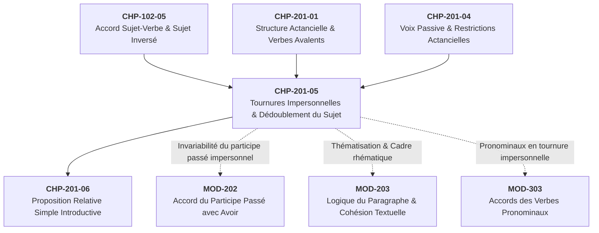

# Chapitre 5 — Les Tournures Impersonnelles et le Dédoublement du Sujet : Sujet Apparent vs Sujet Réel, Accord Singulier et Passif Impersonnel

> **Identifiant du chapitre** : `CHP-201-05`  
> **Module de rattachement** : [`MOD-201` — Syntaxe Fonctionnelle de la Phrase Simple, Voix Passive, Tournures Impersonnelles et Relative Simple](file:///f:/Formation/world-class-french/03-curriculum/year-1/semester-2/mod-201-syntaxe-fonctionnelle-phrase-simple.md)  
> **Semestre** : Année 1 — Semestre 2 (S2)  
> **Volume horaire estimé** : 5 à 6 heures d'apprentissage autonome délibéré et d'ateliers d'application (Phase 1 Étude : 1 h 30 | Phase 2 Pratique : 1 h 30 | Phase 3 Correction : 1 h 00 | Phase 4 Évaluation : 1 h 00)  
> **Statut** : [STATUT : VALIDÉ]  
> **Compétences associées** : [`FR-SYNTAX-001`](file:///f:/Formation/world-class-french/02-competency-framework/competency-framework.md#fr-syntax-001-analyse-fonctionnelle-et-délimitation-de-la-phrase-simple) (L3 Autonomie), [`FR-ORTHO-002`](file:///f:/Formation/world-class-french/02-competency-framework/competency-framework.md#fr-ortho-002-mécanique-infaillible-de-laccord-sujet-verbe) (L3 Autonomie)  
> **Sources scientifiques de référence** : `SRC-GRAM-01` (Grevisse & Goosse, 2016, § 441 & § 798), `SRC-GRAM-02` (Riegel et al., 2016, chap. 8), `SRC-NORM-03` (Ministère de l'Éducation nationale, 2020, p. 24)

---

## 1. Titre et Place dans le Cursus

### 1.1 Intitulé Officiel
**Chapitre 5 : Les Tournures Impersonnelles et le Dédoublement du Sujet : Sujet Apparent vs Sujet Réel, Accord Singulier et Passif Impersonnel** (`CHP-201-05`).

### 1.2 Insertion Architecturale dans le Cursus
Au sein du module [`MOD-201`](file:///f:/Formation/world-class-french/03-curriculum/year-1/semester-2/mod-201-syntaxe-fonctionnelle-phrase-simple.md), ce cinquième chapitre opère la synthèse entre la théorie de la valence verbale (`CHP-201-01`), les mécanismes d'accord sujet-verbe étudiés au premier semestre ([`CHP-102-05`](file:///f:/Formation/world-class-french/03-curriculum/year-1/semester-1/mod-102/chp-102-05-accord-sujet-verbe-fondamental.md)) et la reconfiguration actancielle de la voix passive (`CHP-201-04`). Il résout l'un des paradoxes majeurs de la syntaxe française : la dissociation entre la position syntaxique du sujet donneur d'accord et l'argument sémantique postposé au verbe.



- **En amont** :
  - Ce chapitre prolonge directement l'étude des **verbes avalents** (à valence zéro) introduite dans `CHP-201-01` en montrant comment ce moule syntaxique s'étend, par dérivation, aux verbes monovalents et transitifs ;
  - Il s'articule avec `CHP-201-04` (*La voix passive*) en fournissant la clé du **passif impersonnel** (*« Il a été procédé à un contrôle »*), seule voie grammaticale permettant de passiver un verbe transitif indirect ou intransitif ;
  - Il approfondit la distinction posée en [`CHP-102-05`](file:///f:/Formation/world-class-french/03-curriculum/year-1/semester-1/mod-102/chp-102-05-accord-sujet-verbe-fondamental.md) entre la phrase personnelle à sujet inversé (*« Au loin s'élevaient des fumées »*) et la construction impersonnelle à sujet dédoublé (*« Il s'élevait des fumées »*).
- **En aval** :
  - Il prépare immédiatement [`MOD-202`](file:///f:/Formation/world-class-french/03-curriculum/year-1/semester-2/mod-202-participe-passe-avoir-ponctuation-interne.md) pour la règle d'invariabilité absolue du participe passé des verbes impersonnels (*« Les sommes qu'il a fallu »*, *« Les orages qu'il y a eu »*) ;
  - Il alimente [`MOD-203`](file:///f:/Formation/world-class-french/03-curriculum/year-1/semester-2/mod-203-logique-paragraphe-cohesion-textuelle.md) en dotant le rédacteur d'un outil de mise en relief rhématique pour introduire des référents nouveaux dans le discours administratif, juridique et académique ;
  - Il fonde l'arbitrage des verbes pronominaux employés impersonnellement dans [`MOD-303`](file:///f:/Formation/world-class-french/03-curriculum/year-2/semester-3/mod-303-accords-verbes-pronominaux.md) (*« Il s'est vendu mille exemplaires »*).

---

## 2. Objectifs Mesurables

Au terme des 5 à 6 heures d'étude et de pratique délibérée de ce chapitre, l'apprenant doit être capable de :

1. **Discriminer formellement** un verbe impersonnel strict (intrinsèque, avalent par nature : *pleuvoir, falloir, s'agir de*) d'une tournure impersonnelle dérivée (construction accidentelle d'un verbe personnel : *il reste trois places, il convient de partir*) en appliquant le test de commutation personnelle et de restitution canonique [Réf. `SRC-GRAM-02`, chap. 8] (`FR-SYNTAX-001`, palier L3).
2. **Analyser le dédoublement fonctionnel du sujet** dans tout énoncé impersonnel en étiquetant distinctement le **sujet grammatical apparent** (le clitique neutre invariable *il*) et le **sujet réel** ou séquence postposée (syntagme nominal, infinitif prépositionnel ou proposition subordonnée complétive) [Réf. `SRC-NORM-03`, p. 24] (`FR-SYNTAX-001`, palier L3).
3. **Maintenir sans défaillance l'accord verbal au singulier** (ainsi que le masculin singulier invariable du participe passé avec *être* ou *avoir*) dans les tournures impersonnelles suivies d'une séquence nominale plurielle, en neutralisant à 100 % la faute d'attraction du sujet réel [Réf. `SRC-GRAM-01`, § 441 & § 798] (`FR-ORTHO-002`, palier L3).
4. **Construire et analyser le passif impersonnel** des verbes intransitifs ou transitifs indirects (*« Il a été répondu à toutes les questions »*, *« Il sera statué sur ce litige »*) tout en éradiquant les passifs personnels aberrants sur les verbes sans complément d'objet direct (`FR-SYNTAX-001`, palier L3).

---

## 3. Prérequis et Test de Préparation (Auto-Diagnostic)

### 3.1 Prérequis Exigibles
- Maîtrise de la notion de valence verbale et des verbes avalents (`CHP-201-01`).
- Maîtrise de l'accord sujet-verbe en présence d'un sujet inversé ([`CHP-102-05`](file:///f:/Formation/world-class-french/03-curriculum/year-1/semester-1/mod-102/chp-102-05-accord-sujet-verbe-fondamental.md)).
- Compréhension des conditions de passivisation canonique et du blocage sur les verbes transitifs indirects (`CHP-201-04`).

### 3.2 Auto-Diagnostic à 5 Questions
Répondez sans consulter de ressources aux cinq questions suivantes avant d'ouvrir le corrigé repliable :

1. Dans la phrase : *« Il (reste / restent) encore quatre dossiers urgents à parapher »*, quelle est la seule graphie correcte et quel mot commande cet accord ?
2. Dans la phrase : *« Il (s'est produit / se sont produits) de graves incidents à la frontière »*, comment s'écrit le groupe verbal au passé composé ?
3. Le verbe *falloir* dans *« Il faut des preuves tangibles »* peut-il être réécrit sous la forme personnelle *« Des preuves tangibles fallait »* ? Pourquoi ?
4. Pourquoi la phrase *« *Une trêve a été convenue par les deux parties »* est-elle condamnée par la norme syntaxique, et comment la formuler correctement au passif impersonnel ?
5. Quelle est la différence d'accord et de structure entre :  
   a) *« Dans la plaine s'élevaient d'épaisses fumées »* ;  
   b) *« Dans la plaine, il s'élevait d'épaisses fumées »* ?

<details>
<summary><b>Afficher le corrigé détaillé de l'auto-diagnostic</b></summary>

1. **« reste » (commandé par *Il*)** : Dans une tournure impersonnelle, le verbe s'accorde exclusivement avec le sujet grammatical apparent *Il* (3e personne du singulier). Le syntagme postposé *quatre dossiers urgents* est le sujet réel (ou séquence), qui n'exerce aucun pouvoir d'accord sur le verbe [Réf. `SRC-GRAM-01`, § 441].
2. **« s'est produit »** : Le sujet grammatical est le pronom impersonnel *Il* (masculin singulier). L'auxiliaire *être* reste à la 3e personne du singulier (*est*) et le participe passé *produit* demeure strictement invariable au masculin singulier. Écrire *« *Il se sont produits »* constitue un solécisme sévère.
3. **Non, c'est impossible** : *Falloir* est un **verbe impersonnel strict** (ou par nature). Il est défectif et ne possède dans son paradigme que la 3e personne du singulier régie par le clitique neutre *il* [Réf. `SRC-GRAM-02`, chap. 8].
4. Dans l'acception « tomber d'accord sur quelque chose », *convenir* se construit transitivement de manière indirecte (*convenir d'une trêve*, conjugué avec l'auxiliaire *être* : *nous sommes convenus d'une trêve*). N'ayant pas de COD, il refuse le passif personnel, mais admet le **passif impersonnel** : *« Il a été convenu d'une trêve entre les deux parties »* [Réf. `SRC-GRAM-01`, § 798].
5. Dans la phrase **a)**, il n'y a pas de pronom *il* : c'est une phrase personnelle à **sujet inversé** où *d'épaisses fumées* est le sujet syntaxique unique et commande le pluriel (*s'élevaient*). Dans la phrase **b)**, la présence du pronom neutre *il* instaure une **tournure impersonnelle** : *il* occupe la fonction de sujet grammatical donneur d'accord et impose le singulier (*s'élevait*).

</details>

---

## 4. Situation de Départ ou Problème Concret

### 4.1 Le Piège Classique de l'Attraction d'Accord au Pluriel
Dans les rapports d'audit, les mémoires universitaires, les actes notariés et la presse écrite, deux fautes d'orthographe grammaticale reviennent avec une fréquence préoccupante :

> *« Il **restent** trois places disponibles pour la session de rattrapage. »* (Fautif)  
> *« Il **se sont produits** des incidents regrettables lors du scrutin. »* (Fautif)

Pourquoi des scripteurs par ailleurs attentifs commettent-ils ces solécismes ? Parce qu'ils sont victimes d'un **conflit cognitif entre le sens et la syntaxe formelle**. Sur le plan sémantique, ce sont bien les « trois places » qui restent et les « incidents » qui se produisent. Habitué à la règle scolaire élémentaire qui identifie le sujet par la question *« Qu'est-ce qui reste ? »*, le rédacteur perçoit l'idée de pluralité, oublie la présence du pronom neutre *il* en tête de proposition, et accorde le verbe au pluriel par **attraction sémantique du sujet réel**.

Or, à l'oral, pour les verbes du 1er groupe, la graphie correcte `<Il reste>` `/il ʁɛst/` et la graphie fautive `<*Il restent>` `/il ʁɛst/` sont strictement homophones devant consonne. La faute passe inaperçue à l'oreille mais saute immédiatement aux yeux du correcteur averti, car elle crée une contradiction morphologique frontale entre le pronom singulier `<Il>` (sans `<s>`) et la désinence verbale plurielle `<-ent>`. Plus grave encore, avec les verbes du 3e groupe ou les temps composés, cette confusion gagne la langue parlée elle-même (*« *Il viennent des clients »*, *« *Il se sont passés des choses »*).

### 4.2 La Confusion entre Pronom Impersonnel Vide et Pronom Anaphorique
Une seconde difficulté surgit dans l'enchaînement des phrases d'un texte argumentatif. Considérons cet énoncé maladroit :

> *« Le comité a examiné le projet de décret. **Il** est apparu trois failles juridiques majeures et **il** a donc rejeté le texte. »*

Dans la deuxième phrase, le premier *il* (*« Il est apparu trois failles »*) est un **pronom impersonnel non référentiel** (vide de tout antécédent), tandis que le second *il* (*« il a donc rejeté »*) est un **pronom personnel anaphorique** qui prétend reprendre *Le comité*. Aligner par coordination deux pronoms *il* de statuts syntaxiques et référentiels incompatibles brise la cohésion textuelle et plonge le lecteur dans l'équivoque. Maîtriser les tournures impersonnelles exige donc de comprendre avec précision la mécanique du dédoublement du sujet.

---

## 5. Explication Intuitive : L'Analogie du Mannequin de Vitrine ou du Porte-Manteau

Pour visualiser instantanément le fonctionnement d'une tournure impersonnelle, mobilisons l'analogie architecturale du **mannequin de vitrine** (ou du **porte-manteau grammatical**).

La grammaire française obéit à une loi d'urbanisme stricte : dans toute proposition déclarative canonique, **le fauteuil placé immédiatement à gauche du verbe conjugué ne peut jamais rester vide**. Le verbe français a besoin d'un appui morphologique antéposé qui lui dicte sa personne et son nombre.

Que se passe-t-il lorsque le locuteur souhaite énoncer un phénomène météorologique sans auteur (*pleuvoir*) ou lorsqu'il décide, pour ménager un effet d'annonce, de rejeter l'acteur véritable derrière le verbe (*« ... trois voyageurs arrivent »* $\rightarrow$ *« ... arrive trois voyageurs »*) ? Le fauteuil préverbal se retrouve vacant.

```text
═════════════════════════════════════════════════════════════════════════════════════════
                 MÉCANIQUE DU PORTE-MANTEAU SYNTAXIQUE (DÉDOUBLEMENT)
═════════════════════════════════════════════════════════════════════════════════════════

  [ FAUTEUIL PRÉVERBAL ] ──────► [ PIVOT VERBAL ] ──────► [ CONTENU SÉMANTIQUE POSTPOSÉ ]
           │                            │                                │
         « IL »                     « RESTE »                  « trois places libres »
           │                            │                                │
   • Mannequin de vitrine       • Reçoit ses traits              • Acteur logique (Sujet réel)
   • Pronom postiche / vide       UNIQUEMENT du mannequin        • Porte toute l'information
   • 3e pers. du singulier      • Toujours au SINGULIER          • Déconnecté de l'accord verbal
═════════════════════════════════════════════════════════════════════════════════════════
```

Pour satisfaire la loi de la façade syntaxique, la langue française installe sur ce fauteuil préverbal un **mannequin de cire** : le pronom neutre invariable **« il »**.
1. **Dans un verbe impersonnel pur (*Il pleut*)** : Le mannequin *il* occupe la vitrine, mais il n'y a personne derrière le rideau. Aucun acteur réel n'existe.
2. **Dans une tournure impersonnelle dérivée (*Il arrive trois navires*)** : Le mannequin *il* garde la place officielle devant le verbe et lui impose sa livrée invariable de **3e personne du singulier**. Les véritables passagers (*trois navires*) entrent par la porte arrière, après le verbe. Bien qu'ils portent tout le poids du sens, ils ont cédé leur fauteuil de commandement au mannequin *il* : ils ont perdu tout droit de faire accorder le verbe.

---

## 6. Définitions Précises et Terminologie

Avant d'énoncer les règles opératoires, fixons avec rigueur les sept concepts cardinaux de la syntaxe de l'impersonnel [Réf. `SRC-GRAM-01`, § 798 ; `SRC-GRAM-02`, chap. 8 ; `SRC-NORM-03`, p. 24].

### 6.1 Clitique Impersonnel (ou Pronom Sujet Postiche / Expletif)
- *Exemple d'ancrage* : ***Il** neige sur les sommets ; **il** convient de patienter.*
- **Définition** : Pronom conjoint de 3e personne du singulier (*il*), totalement dépourvu de fonction référentielle ou anaphorique (il ne désigne aucun être, aucune chose et ne reprend aucun antécédent). En linguistique formelle, on le qualifie d'élément **explétif** ou **postiche** : son unique rôle est d'occuper la position syntaxique de sujet et de fournir au verbe les traits par défaut de 3e personne du singulier.

### 6.2 Valence Zéro (Verbe Avalent)
- *Exemple d'ancrage* : *Il **pleut** ; il **vente** ; il **bruine**.*
- **Définition** : Propriété actancielle d'un verbe qui ne sélectionne aucun participant sémantique (aucun actant, ni agent ni patient) pour constituer un prédicat complet. Le procès est présenté comme un événement global autonome [Réf. `SRC-GRAM-02`, chap. 8].

### 6.3 Verbe Impersonnel Strict (ou Intrinsèque / Par Nature)
- *Exemple d'ancrage* : *Il **faut** travailler ; il **s'agit** d'un malentendu ; il **grêle**.*
- **Définition** : Verbe (ou locution verbale) qui ne peut s'employer qu'à la 3e personne du singulier avec le sujet impersonnel *il*. Ces verbes sont morphologiquement **défectifs** en personne : ils refusent toute conjugaison aux 1re et 2e personnes ainsi qu'à la 3e personne du pluriel (au sens propre) [Réf. `SRC-GRAM-01`, § 798].

### 6.4 Tournure Impersonnelle Dérivée (ou Accidentelle / Par Construction)
- *Exemple d'ancrage* : *Il **manque** deux feuillets au registre* (dérivé de : *Deux feuillets manquent au registre*).
- **Définition** : Construction syntaxique dans laquelle un verbe ordinairement personnel (possédant les six personnes de la conjugaison) est employé conjoncturellement à la 3e personne du singulier avec le clitique neutre *il*, tandis que son sujet canonique est déplacé après le verbe.

### 6.5 Sujet Grammatical (ou Sujet Apparent)
- *Exemple d'ancrage* : ***Il** survient des complications imprévues.*
- **Définition** : Dans une construction impersonnelle à sujet dédoublé, fonction syntaxique assumée par le pronom neutre *il* placé avant le verbe (ou inversé après le verbe dans l'interrogation : *« Survient-**il** des complications ? »*). Le sujet grammatical détient le monopole des opérations formelles : il occupe la position sujet, inverse sa place à l'interrogatif et gouverne seul l'accord du verbe [Réf. `SRC-NORM-03`, p. 24].

### 6.6 Sujet Réel (ou Sujet Logique / Séquence de l'Impersonnel)
- *Exemple d'ancrage* : *Il survient **des complications imprévues** ; il importe **que vous soyez présent**.*
- **Définition** : Constituant postposé au verbe impersonnel (syntagme nominal, infinitif prépositionnel ou subordonnée complétive) qui représente l'argument sémantique du prédicat et qui occuperait la fonction de sujet dans la tournure personnelle correspondante (*« Des complications imprévues surviennent »*). Les grammaires universitaires contemporaines l'appellent également **séquence du verbe impersonnel** pour souligner qu'il a perdu les propriétés syntaxiques du sujet au profit d'un comportement proche des compléments du verbe [Réf. `SRC-GRAM-02`, chap. 8].

### 6.7 Passif Impersonnel
- *Exemple d'ancrage* : *Il **a été procédé** à l'audition des témoins ; il **sera statué** sur cette requête.*
- **Définition** : Construction combinant la morphologie de la voix passive (*être* + participe passé invariable au masculin singulier) et la syntaxe de la tournure impersonnelle (sujet apparent *il*). Elle permet de passiver et de désagentiver des verbes intransitifs, transitifs indirects ou suivis d'une complétive/infinitive qui n'admettent pas la passivisation personnelle canonique [Réf. `SRC-GRAM-01`, § 798].

---

## 7. Règles ou Mécanismes Fondamentaux

### 7.1 Les Deux Grandes Familles de Verbes Impersonnels

L'analyse syntaxique distingue rigoureusement les verbes qui sont impersonnels par leur essence lexicale de ceux qui le deviennent par une transformation syntaxique [Réf. `SRC-GRAM-01`, § 798 ; `SRC-GRAM-02`, chap. 8].

#### A. Les verbes impersonnels stricts (ou par nature / intrinsèques)
Ces verbes n'existent dans le lexique qu'à la 3e personne du singulier sous la rection du pronom *il*. Il est rigoureusement impossible de leur attribuer un sujet personnel (*« *je pleus, *tu faut, *nous bruinons »* sont des barbarismes). Ils se répartissent en deux sous-classes :
1. **Les verbes météorologiques (avalents purs)** : *pleuvoir, neiger, grêler, geler, dégeler, bruiner, venter, tonner, brumer*. Au sens propre, ils ont une valence zéro et se suffisent à eux-mêmes (*« Il pleut »*, *« Il a gelé cette nuit »*).
   - *Remarque sur la recatégorisation figurée ou par extension* : Lorsqu'ils sont employés avec une séquence postposée exprimant une abondance métaphorique (*« Il pleut des cordes »*, *« Il pleuvait des obus »*), ils restent impersonnels et singuliers. S'ils reçoivent un sujet pluriel antéposé au sens figuré (*« Les critiques pleuvaient sur son ouvrage »*), ils cessent d'être impersonnels et deviennent des verbes personnels figurés.
2. **Les verbes et locutions modaux ou existentiels défectifs (avalents à séquence obligatoire)** :
   - **Le verbe *falloir*** : Impersonnel strict exprimant la nécessité ou le manque, suivi d'un syntagme nominal (*« Il faut du courage »*), d'un infinitif (*« Il faut agir »*) ou d'une subordonnée complétive au subjonctif (*« Il faut que la loi soit appliquée »*).
   - **La locution pronominale *s'agir de*** : Exclusivement impersonnelle (*« Il s'agit d'une réforme majeure »*, *« Il s'agit de réussir »*). Elle ne admet jamais de sujet personnel (*« *Ce livre s'agit de l'histoire du Bénin »* est un solécisme grave).
   - **La locution existentielle *y avoir* (*il y a*)** : Formée du clitique *il*, de l'adverbe pronominal figé *y* et du verbe *avoir* à la 3e personne du singulier (*« Il y a trois solutions »*, *« Il y avait foule »*).

#### B. Les verbes impersonnels dérivés (ou par accident / par construction)
Presque toutes les classes de verbes personnels (intransitifs, pronominaux, passifs) peuvent entrer occasionnellement dans un moule impersonnel dès lors que leur sujet nominal est indéfini ou lourd (proposition complétive/infinitive) et qu'il est postposé au verbe :
- **Verbes d'existence, de survenance, de reste ou de manque** : *arriver, advenir, survenir, se produire, se passer, résulter, rester, manquer, subsister, exister, régner, courir, souffler, tomber* (*« Il arrive que l'on se trompe »*, *« Il manque trois pages au manuscrit »*, *« Il reste du pain »*, *« Il tombe des cordes »*, *« Il règne une chaleur accablante »*).
- **Verbes d'appréciation modale ou d'obligation** : *convenir, importer, valoir mieux, suffire, appartenir, incomber, paraître, sembler* (*« Il convient de vérifier les sources »*, *« Il importe que chacun réponde »*, *« Il suffit d'un mot »*).

---

### 7.2 Le Mécanisme du Dédoublement du Sujet

Dans toute tournure impersonnelle comportant une séquence postposée (comme *« Il reste trois places »* ou *« Il convient de partir »*), les propriétés habituellement réunies sur un seul groupe sujet se scindent en deux pôles distincts [Réf. `SRC-NORM-03`, p. 24] :

```text
┌────────────────────────────────────────────────────────────────────────────────────────┐
│               DÉDOUBLEMENT DES PROPRIÉTÉS DU SUJET DANS L'IMPERSONNEL                  │
├───────────────────────────────────────────┬────────────────────────────────────────────┤
│      1. SUJET GRAMMATICAL APPARENT        │      2. SUJET RÉEL (SÉQUENCE POSTPOSÉE)    │
│                 (« Il »)                  │        (« trois erreurs », « de partir »)  │
├───────────────────────────────────────────┼────────────────────────────────────────────┤
│ • Occupe la position préverbale S-V       │ • Occupe une position postverbale V-S      │
│ • S'inverse à l'interrogatif (Reste-t-il) │ • Porte la charge sémantique et lexicale   │
│ • Impose la 3e pers. du singulier au V    │ • Se pronominalise par « en » ou « le »    │
│ • Vide de toute référence sémantique      │ • N'exerce AUCUN accord sur le verbe       │
└───────────────────────────────────────────┴────────────────────────────────────────────┘
```

La **séquence postposée (sujet réel)** peut revêtir trois natures grammaticales principales :
1. **Un syntagme nominal (le plus souvent indéfini ou quantifié)** : *« Il est arrivé **deux ambassadeurs étrangers**. »* (Pronominalisable par le pronom adverbial *en* : *« Il **en** est arrivé deux »*).
2. **Un syntagme infinitif (pur ou prépositionnel en *de*)** : *« Il convient **de respecter scrupuleusement le barème**. »* / *« Il vaut mieux **se taire**. »* (Pronominalisable par le neutre *le* : *« Il **le** convient »* / *« Il **le** faut »*).
3. **Une proposition subordonnée complétive conjonctive en *que* (ou interrogative indirecte)** : *« Il est indispensable **que les pièces justificatives soient jointes au dossier**. »* / *« Il importe peu **qu'il accepte ou qu'il refuse**. »*

---

### 7.3 La Règle d'Or de l'Accord Verbal : Primauté Absolue du Sujet Grammatical Singulier

La règle d'accord des tournures impersonnelles ne souffre aucune exception en français normé [Réf. `SRC-GRAM-01`, § 441 & § 798] :

> **RÈGLE D'OR** : Dans toute construction impersonnelle, le verbe (ainsi que son participe passé conjugué avec *être* ou avec *avoir*) s'accorde **exclusivement et invariablement à la 3e personne du singulier (masculin singulier)** avec le sujet grammatical apparent **« il »**, quels que soient le genre et le nombre du sujet réel postposé.

#### Conséquences orthographiques impératives :
1. **Aux temps simples (présent, imparfait, futur, passé simple, subjonctif)** : Le verbe prend toujours la désinence de 3e personne du singulier (`-e`, `-t`, `-d`, `-a`).
   - Correct : *« Il **reste** [singulier] trois erreurs [pluriel] dans ce tableau. »*
   - Fautif : *« *Il **restent** trois erreurs... »*
   - Correct : *« Il **survient** [singulier] parfois des crises inattendues [pluriel]. »*
   - Fautif : *« *Il **surviennent** parfois des crises... »*
2. **Aux temps composés avec l'auxiliaire *être* (verbes intransitifs ou pronominaux en tournure impersonnelle)** : L'auxiliaire reste au singulier (*est, était, sera*) et le participe passé demeure **invariable au masculin singulier**, car il s'accorde avec le pronom neutre *il*.
   - Correct : *« Il **est arrivé** [masc. sg.] trois déléguées [fém. pl.]. »*
   - Fautif : *« *Il **sont arrivées** trois déléguées. »*
   - Correct : *« Il **s'est produit** [masc. sg.] de graves émeutes [fém. pl.]. »*
   - Fautif : *« *Il **se sont produites** de graves émeutes. »*
3. **Aux temps composés avec l'auxiliaire *avoir* (notamment *falloir, y avoir, faire, pleuvoir*)** : Le participe passé d'un verbe impersonnel est **toujours invariable**, même lorsqu'un pronom relatif *que* le précède, car un verbe impersonnel n'a jamais de véritable COD (la séquence antéposée reste le sujet réel) [Réf. `SRC-GRAM-01`, § 942].
   - Correct : *« Les efforts qu'il a **fallu** déployer. »* (Et non *« *qu'il a fallus »*).
   - Correct : *« Les fortes chaleurs qu'il a **fait** au mois d'août. »* (Et non *« *qu'il a faites »*).
   - Correct : *« Les inondations qu'il y a **eu** cette année. »* (Et non *« *qu'il y a eues »*).

---

### 7.4 La Passivisation Impersonnelle

Comme l'a établi le chapitre précédent (`CHP-201-04`), la passivisation personnelle canonique exige que le verbe actif soit **transitif direct** (pourvu d'un COD capable de devenir le sujet du verbe passif). Dès lors, comment la langue française procède-t-elle lorsqu'elle veut mettre au passif un verbe **transitif indirect** (*procéder à, convenir de, répondre à, remédier à, statuer sur*) ou un verbe dont l'objet est une proposition entière, afin d'effacer l'agent ?

Elle recourt au **passif impersonnel** [Réf. `SRC-GRAM-01`, § 798 ; `SRC-GRAM-02`, chap. 8] :
1. Le sujet grammatical est occupé par le clitique neutre invariable **« il »** ;
2. Le verbe est conjugué à la voix passive (**auxiliaire *être* à la 3e personne du singulier + participe passé invariable au masculin singulier**) ;
3. Le complément prépositionnel (COI), l'infinitif ou la complétive reste maintenu après le verbe sans changer de préposition :
   - Actif indéfini : *« On a procédé au vote à bulletin secret. »*  
     $\rightarrow$ Passif personnel impossible : *« *Le vote a été procédé. »*  
     $\rightarrow$ **Passif impersonnel normé** : *« **Il a été procédé** au vote à bulletin secret. »*
   - Actif indéfini : *« On a convenu d'une trêve immédiate. »*  
     $\rightarrow$ **Passif impersonnel normé** : *« **Il a été convenu** d'une trêve immédiate. »*
   - Actif indéfini : *« On interdit de fumer dans l'enceinte ministérielle. »*  
     $\rightarrow$ **Passif impersonnel normé** : *« **Il est interdit** de fumer dans l'enceinte ministérielle. »*
   - Verbe transitif direct à objet indéfini postposé : *« **Il a été découvert** deux statues antiques lors des fouilles. »* (Ici aussi, le participe passé *découvert* reste invariable au masculin singulier, accordé avec *il*).

---

## 8. Raisonnement Détaillé : Pourquoi le Français Exige-t-il un Sujet Apparent ?

Pour comprendre en profondeur la raison d'être du pronom impersonnel *il*, il faut replacer le français dans l'histoire évolutive des langues romanes et dans la typologie syntaxique universelle [Réf. `SRC-GRAM-01`, § 798 ; `SRC-GRAM-02`, chap. 8].

### 8.1 Du Latin aux Langues Romanes : Le Paramètre du Sujet Nul (*Pro-Drop*)
En latin classique, comme aujourd'hui encore en espagnol, en italien ou en portugais, les terminaisons verbales sont suffisamment distinctes à l'oral pour indiquer à elles seules la personne et le nombre. Ces langues sont dites **à sujet nul** (ou langues *pro-drop*, de l'anglais *pronoun-dropping*) : elles n'expriment aucun pronom devant un verbe météorologique ou impersonnel :
- Latin : ***Pluit*** (« Il pleut », un seul mot sans pronom) ;
- Italien : ***Piove*** (« Il pleut ») / ***Basta*** (« Il suffit ») ;
- Espagnol : ***Llueve*** (« Il pleut ») / ***Hace frío*** (« Il fait froid »).

En ancien français (IXe–XIIe siècle), la langue possédait encore des désinences verbales sonores distinctes et une syntaxe à verbe second (dite syntaxe *V2*) : le pronom *il* n'était pas obligatoire dès lors qu'un autre mot occupait la première place de la phrase (d'où les vestiges figés : *« Mieux vaut tard que jamais »*, *« Peu importe »*, *« Reste à savoir »*).

### 8.2 L'Érosion Phonétique du Français et l'Obligation du Clitique Préverbal
Au cours du moyen français (XIVe–XVIe siècle), l'amuïssement progressif des consonnes et voyelles finales a rendu homophones quatre personnes sur six dans la conjugaison régulière : `<chante, chantes, chante, chantent>` se prononcent toutes `/ʃɑ̃t/`. Dès lors, le verbe français ne pouvait plus signaler sa personne par sa seule terminaison orale.

Le français est ainsi devenu l'une des rares langues romanes **à sujet obligatoire non *pro-drop*** : tout verbe conjugué à un mode personnel (hors impératif) exige la présence d'un syntagme ou d'un clitique sujet dans la position préverbale. Même lorsqu'un verbe est avalent (*pleuvoir*) ou lorsque son sujet sémantique est rejeté après lui pour des raisons de structure informative (mettre en fin de phrase l'information nouvelle ou lourde, conformément au principe du **poids croissant des constituants**), la syntaxe française oblige à saturer la position préverbale par l'indice morphologique neutre `<il>`. C'est cette nécessité purement structurale — et non sémantique — qui explique pourquoi `<il>` détient la rection grammaticale du verbe.

---

## 9. Exemples Corrects Commentés

Décortiquons cinq phrases modèles couvrant l'ensemble du spectre des tournures impersonnelles, avec double étiquetage systématique (**Sujet grammatical apparent** vs **Sujet réel / Séquence**).

### 9.1 Exemple n° 1 : Verbe Impersonnel Strict à Séquence Nominale Plurielle
> *« Il faut des preuves irréfragables pour condamner un accusé. »*

- **Verbe recteur** : *faut* (verbe impersonnel strict *falloir*, indicatif présent, 3e personne du singulier).
- **Sujet grammatical apparent** : `<Il>` `/il/` (pronom personnel conjoint neutre, 3e personne du singulier, donneur d'accord exclusif).
- **Sujet réel (séquence postposée)** : *des preuves irréfragables* (syntagme nominal féminin pluriel).
- **Vérification syntaxique** : Pronominalisation de la séquence par le clitique adverbial *en* : *« Il **en** faut pour condamner un accusé. »* Le pluriel de *preuves* n'exerce aucune influence sur *faut*.

### 9.2 Exemple n° 2 : Tournure Impersonnelle Dérivée au Temps Simple
> *« Il subsiste, dans les annexes du traité, trois contradictions majeures. »*

- **Verbe recteur** : *subsiste* (verbe intransitif *subsister* employé en tournure impersonnelle dérivée, indicatif présent, 3e personne du singulier `/syb.zist/`).
- **Sujet grammatical apparent** : `<Il>` (clitique neutre invariable, 3e pers. sg.).
- **Incise circonstancielle** : *dans les annexes du traité* (complément de phrase locatif mobile).
- **Sujet réel (séquence postposée)** : *trois contradictions majeures* (syntagme nominal féminin pluriel).
- **Restitution personnelle correspondante** : *« Trois contradictions majeures **subsistent** dans les annexes du traité. »* Dès que le pronom *Il* est présent, le singulier *subsiste* est impératif.

### 9.3 Exemple n° 3 : Tournure Impersonnelle Pronominale au Passé Composé
> *« Il s'est vendu cinq mille exemplaires de cet ouvrage dès la première semaine. »*

- **Verbe recteur** : *s'est vendu* (verbe pronominal à valeur passive employé en construction impersonnelle, passé composé, 3e pers. du singulier).
- **Sujet grammatical apparent** : `<Il>` (neutre masculin singulier).
- **Sujet réel (séquence postposée)** : *cinq mille exemplaires de cet ouvrage* (syntagme nominal masculin pluriel).
- **Justification de l'invariabilité du participe passé** : Dans la tournure personnelle (*« Cinq mille exemplaires se sont vendus »*), le participe s'accorde avec le sujet pluriel. Mais dans la tournure impersonnelle, le sujet grammatical est `<Il>` (masculin singulier) : l'auxiliaire est au singulier (`<est>`) et le participe passé `<vendu>` reste strictement invariable [Réf. `SRC-GRAM-01`, § 798].

### 9.4 Exemple n° 4 : Passif Impersonnel d'un Verbe Transitif Indirect
> *« Il sera statué demain sur la recevabilité des candidatures déposées. »*

- **Verbe recteur** : *sera statué* (verbe transitif indirect *statuer sur* conjugué au passif impersonnel, futur simple de l'indicatif, 3e pers. du singulier).
- **Sujet grammatical apparent** : `<Il>` (neutre masculin singulier).
- **Séquence prépositionnelle (COI maintenu)** : *sur la recevabilité des candidatures déposées* (syntagme prépositionnel introduit par *sur*).
- **Portée discursive** : Cette construction permet d'annoncer l'acte juridictionnel avec une neutralité institutionnelle totale, sans mentionner les juges (effacement de l'agent), tout en respectant l'intransitivité directe du verbe *statuer*.

### 9.5 Exemple n° 5 : Tournure Impersonnelle à Séquence Complétive
> *« Il importe que chaque citoyen connaisse ses droits fondamentaux. »*

- **Verbe recteur** : *importe* (verbe *importer* en construction impersonnelle, indicatif présent, 3e pers. du singulier).
- **Sujet grammatical apparent** : `<Il>` (neutre singulier, pronom d'anticipation cataphorique).
- **Sujet réel (séquence postposée)** : *que chaque citoyen connaisse ses droits fondamentaux* (proposition subordonnée complétive conjonctive, mode subjonctif imposé par le sémantisme d'appréciation/nécessité du verbe régissant *importer*).

---

## 10. Contre-Exemples et Erreurs Fréquentes

Voici six erreurs récurrentes observées dans les copies de concours et les écrits professionnels, accompagnées de leur diagnostic linguistique et de leur correction formelle.

### Erreur n° 1 : Accord du verbe au pluriel par attraction du sujet réel
- **Forme fautive** : *« *Il **manquent** deux signatures au bas du procès-verbal. »* / *« *Il **existent** plusieurs hypothèses. »*
- **Diagnostic cognitif** : Le scripteur accorde le verbe avec la séquence nominale plurielle postposée (*deux signatures*, *plusieurs hypothèses*) en oubliant que la place du sujet syntaxique est déjà saturée par le clitique singulier `<Il>`.
- **Forme normée** : *« Il **manque** deux signatures au bas du procès-verbal. »* / *« Il **existe** plusieurs hypothèses. »* [Réf. `SRC-GRAM-01`, § 441].

### Erreur n° 2 : Accord pluriel fautif des temps composés (*« *Il se sont produits »*)
- **Forme fautive** : *« *Il **se sont produits** des événements dramatiques. »* / *« *Il **sont arrivées** trois lettres recommandées. »*
- **Diagnostic cognitif** : Contamination croisée entre la tournure personnelle (*« Des événements se sont produits »*) et la tournure impersonnelle (*« Il s'est produit des événements »*).
- **Forme normée** : *« Il **s'est produit** des événements dramatiques. »* / *« Il **est arrivé** trois lettres recommandées. »* L'auxiliaire et le participe passé restent invariablement au masculin singulier [Réf. `SRC-NORM-03`, p. 24].

### Erreur n° 3 : Barbarisme syntaxique sur *s'agir de* (*« *Il s'agit que »* ou sujet personnel)
- **Forme fautive** : *« *Ce chapitre **s'agit de** la syntaxe. »* / *« *Il **s'agit que** vous veniez à l'heure. »*
- **Diagnostic cognitif** : Double méprise sur la valence de *s'agir* : d'une part, l'employer avec un sujet personnel comme synonyme de *traiter de* ; d'autre part, le construire avec une complétive en *que* par analogie avec *il faut que*.
- **Forme normée** : *« Dans ce chapitre, **il s'agit de** la syntaxe »* (ou *« Ce chapitre **traite de** la syntaxe »*) ; *« **Il s'agit de** venir à l'heure »* (ou *« **Il importe que** vous veniez à l'heure »*). *Il s'agit* est un impersonnel strict qui exige toujours la préposition **de** suivie d'un nom ou d'un infinitif [Réf. `SRC-GRAM-01`, § 798].

### Erreur n° 4 : Pléonasme vicieux et contresens sur *il s'avère*
- **Forme fautive** : *« *Il **s'avère vrai** que ce document est falsifié. »* / *« *Cette hypothèse **s'est avérée fausse**. »*
- **Diagnostic cognitif** : Oubli de l'étymologie de *s'avérer* (du latin *verus*, « vrai » : « se révéler vrai »). Dire *s'avérer vrai* est une tautologie pléonastique ; dire *s'avérer faux* est une contradiction dans les termes (oxymore involontaire).
- **Forme normée** : *« **Il s'avère que** ce document est falsifié »* (ou *« Cette hypothèse **s'est révélée fausse** »*).

### Erreur n° 5 : Passif personnel aberrant sur le verbe *convenir*
- **Forme fautive** : *« *Cette date **a été convenue** par les deux ministres. »* / *« *Les mesures **convenues** hier. »*
- **Diagnostic cognitif** : Confusion entre *convenir à quelqu'un* (« plaire, être approprié », conjugué avec *avoir*) et *convenir de quelque chose* (« décider d'un commun accord », transitif indirect en *de*, conjugué avec *être* en langue soutenue). N'ayant pas de COD, *convenir* rejette le passif personnel.
- **Forme normée** : *« **Il a été convenu de** cette date par les deux ministres »* (passif impersonnel irréprochable) ou *« Les deux ministres **sont convenus de** cette date »* [Réf. `SRC-GRAM-01`, § 798].

### Erreur n° 6 : Accord fautif du participe passé d'un impersonnel avec *que* (*« *qu'il a fallus »*)
- **Forme fautive** : *« *Les trois heures **qu'il a fallues** pour rédiger cet acte. »* / *« *Les tempêtes **qu'il y a eues**. »*
- **Diagnostic cognitif** : Application mécanique de la règle du COD antéposé (*que*). Or, dans une tournure impersonnelle, le pronom relatif *que* ne représente pas un COD, mais le **sujet réel (séquence)** du verbe impersonnel.
- **Forme normée** : *« Les trois heures **qu'il a fallu**... »* / *« Les tempêtes **qu'il y a eu**... »* Le participe passé d'un verbe impersonnel est invariable sans exception [Réf. `SRC-GRAM-01`, § 942].

---

## 11. Cas Particuliers et Limites

### 11.1 L'Invariabilité de *« il y a »* et la Séquence Plurielle
La locution existentielle ***il y a*** (*il y avait, il y aura, il y a eu, il peut y avoir*) demeure invariablement au singulier, quel que soit le nombre du syntagme nominal qui la suit :
- *« **Il y a** cent députés dans l'hémicycle. »*
- *« **Il peut y avoir** des retards imprévus. »* (Et jamais *« *Il peuvent y avoir »*, car l'auxiliaire modal *pouvoir* hérite du sujet impersonnel singulier *il* de l'infinitif *y avoir*).
- Lorsque *il y a* introduit une indication temporelle (*« Il y a dix ans »*), la locution se fige au point de fonctionner comme une préposition temporelle équivalant à *depuis* ou *avant*.

### 11.2 L'Opposition *« Il est »* (Impersonnel) vs *« C'est / Ce sont »* (Présentatif)
Il ne faut jamais confondre la règle d'accord de la tournure impersonnelle en **« il est »** avec celle du présentatif démonstratif **« c'est / ce sont »** [Réf. `SRC-GRAM-01`, § 441 & § 798] :
1. **Avec *« Il est »* (style soutenu ou littéraire, équivalent de *il y a*)** : Le verbe *être* reste **toujours au singulier**, même devant un nom pluriel :
   - *« **Il est** des moments où le silence s'impose. »* (Et jamais *« *Il sont des moments »*).
   - *« **Il est** trois heures. »* (Et jamais *« *Il sont trois heures »*).
2. **Avec le présentatif *« C'est / Ce sont »*** : Le pronom démonstratif neutre *ce* admet l'attraction du nom ou du pronom de 3e personne du pluriel qui suit le verbe *être*. Dans le registre soutenu, l'accord au pluriel (**« ce sont »**) est de rigueur devant un syntagme nominal pluriel ou le pronom *eux / elles* :
   - *« **Ce sont** des moments décisifs. »* / *« **Ce sont** eux qui dirigent. »*
   - En revanche, devant les pronoms de 1re et 2e personnes du pluriel (*nous, vous*), le verbe reste au singulier : *« **C'est** nous qui décidons »*, *« **C'est** vous que l'on attend »*.

### 11.3 Les Locutions Impersonnelles Sans *« il »* (Archéologie Syntaxique)
Dans un nombre restreint de tournures proverbiales, juridiques ou littéraires héritées de l'ancien et du moyen français (époque où le pronom sujet *il* était facultatif lorsque la première position de la phrase était occupée par un adverbe ou un complément), le clitique *il* est omis [Réf. `SRC-GRAM-01`, § 798] :
- *« **Mieux vaut** tard que jamais. »* (= Il vaut mieux...)
- *« **Peu importe** que vous soyez d'accord ou non. »* / *« **Qu'importe** le flacon... »* (= Il importe peu...)
- *« **Reste** à examiner le troisième chef d'accusation. »* (= Il reste à examiner...)
- *« **Force est** de constater que les délais sont dépassés. »* (= Il est force de...)
- *« **Toujours est-il** que le contrat a été signé. »*

> [!WARNING]
> **Attention à l'accord de *« Peu importe / Peu importent »*** :
> - Si *importer* est suivi d'un infinitif ou d'une subordonnée en *que*, il est impersonnel et reste au singulier : *« Peu **importe** qu'ils protestent. »*
> - Si *peu importe* est suivi d'un **groupe nominal pluriel**, deux analyses coexistent dans l'usage académique : soit on le traite comme un impersonnel elliptique au singulier (*« Peu **importe** les obstacles »*), soit — ce qui est préféré en langue surveillée — on traite le groupe nominal comme un sujet inversé commandant le pluriel : *« Peu **importent** les obstacles »* [Réf. `SRC-GRAM-01`, § 798].

---

## 12. Approfondissement Adapté au Niveau : Inaccusativité et Théorie du Gouvernement

Pourquoi certains verbes intransitifs acceptent-ils aisément la tournure impersonnelle (*« Il arrive trois trains »*, *« Il tombe des feuilles »*, *« Il naît des conflits »*), tandis que d'autres verbes intransitifs la rejettent catégoriquement (*« *Il téléphone trois clients »*, *« *Il travaille beaucoup d'ouvriers »*, *« *Il tousse deux malades »*) ?

La réponse a été formulée par la grammaire générative (Chomsky) et par l'**hypothèse de l'inaccusativité** de David Perlmutter (1978), exposée dans les grammaires universitaires de référence [Réf. `SRC-GRAM-02`, chap. 8].

### 12.1 Verbes Inergatifs (Argument Externe) vs Verbes Inaccusatifs (Argument Interne)
Les verbes traditionnellement regroupés sous l'étiquette d'« intransitifs » se divisent en réalité en deux classes syntaxiques profondes :

1. **Les verbes inergatifs (*dormir, travailler, téléphoner, rire, marcher*)** :
   - Leur sujet désigne un **Agent actif** qui contrôle volontairement le procès.
   - Dans la structure profonde de la phrase, cet actant est généré d'emblée en position d'**argument externe** (sujet profond extérieur au syntagme verbal $SV$).
   - Se conjuguent toujours avec l'auxiliaire **avoir**.
   - **Conséquence** : Comme la position sujet préverbale est déjà leur lieu de naissance naturel, ils résistent fortement à la postposition impersonnelle (*« *Il a téléphoné trois clients »* est rejeté en prose standard).
2. **Les verbes inaccusatifs (*arriver, entrer, naître, mourir, tomber, rester, survenir, apparaître*)** :
   - Leur sujet ne désigne pas un agent volontaire, mais un **Patient ou un Thème** qui subit un changement d'état ou de localisation.
   - Dans la structure profonde, cet actant n'est pas généré en position sujet, mais **à l'intérieur du syntagme verbal ($SV$), exactement dans la position d'un complément d'objet interne** :
     $$\text{Structure profonde : } [\text{Position Sujet Vide } e] + [\text{SV } \text{Verbe}_{\text{inaccusatif}} + \text{SN}_{\text{Thème interne}}]$$
   - Se conjuguent majoritairement avec l'auxiliaire **être** aux temps composés.

### 12.2 La Dérivation de l'Impersonnel Expliquée par l'Arbre Syntaxique
À partir de cette structure profonde inaccusative $[e] + [\text{arrive } \text{trois trains}]$, la syntaxe française dispose exactement de deux options pour remplir la position sujet vide $[e]$ :
- **Option 1 (Tournure personnelle)** : Le syntagme interne *trois trains* se déplace vers la gauche pour occuper la position sujet vide $\rightarrow$ *« **Trois trains** arrivent. »*
- **Option 2 (Tournure impersonnelle)** : Le syntagme interne *trois trains* **reste sur place dans le groupe verbal** (position d'argument interne postverbal, pronominalisable par *en* comme un objet indéfini : *« Il **en** arrive trois »*), et la position sujet vide est remplie par l'insertion du clitique explétif **« il »** $\rightarrow$ *« **Il** arrive trois trains. »*

Cette démonstration formelle éclaire simultanément trois faits linguistiques : pourquoi la séquence postposée se pronominalise par *en* (comme un COD partitif), pourquoi seuls les verbes à argument interne (inaccusatifs et passifs) produisent naturellement des impersonnels dérivés, et pourquoi le verbe s'accorde uniquement avec *il* qui occupe la position structurale de gouvernement ($Spec, IP$).

---

## 13. Comparaisons Différentielles

### 13.1 Tableau 1 : Verbe Impersonnel Strict vs Tournure Impersonnelle Dérivée

| Critère de discrimination | Verbe Impersonnel Strict (Par Nature) | Tournure Impersonnelle Dérivée (Par Accident) |
| :--- | :--- | :--- |
| **Définition** | Verbe défectif n'existant qu'à la 3e pers. du singulier avec *il*. | Verbe personnel conjugué temporairement dans le moule impersonnel. |
| **Conjugaison aux 1re/2e pers.** | **Impossible** (*\*je faux, \*tu pleus, \*nous s'agissons*). | **Possible** en emploi personnel (*je reste, tu arrives, nous convenons*). |
| **Présence d'un sujet réel** | Absente (*Il neige*) ou obligatoire non-sujet (*Il faut du temps*). | Toujours présente (syntagme nominal, infinitif ou complétive postposée). |
| **Test de retournement personnel** | **Échoue** : *« Il faut deux jours »* $\nrightarrow$ *« \*Deux jours faut »*. | **Réussit** : *« Il reste deux jours »* $\rightarrow$ *« Deux jours restent »*. |
| **Exemples canoniques** | *pleuvoir, neiger, grêler, falloir, s'agir de, y avoir*. | *il arrive, il reste, il manque, il survient, il convient, il a été procédé*. |

---

### 13.2 Tableau 2 : Sujet Grammatical Apparent vs Sujet Réel (Séquence Postposée)

| Propriété linguistique | Sujet Grammatical Apparent (*« Il »*) | Sujet Réel / Séquence Postposée |
| :--- | :--- | :--- |
| **Position topologique** | Préverbale (ou postposée par trait d'union à l'interrogatif : *Faut-il ?*). | Postverbale (placée à droite du verbe recteur). |
| **Contenu sémantique** | **Nul** (explétif vide, non référentiel, non anaphorique). | **Plein** (porte l'information nominale ou propositionnelle nouvelle). |
| **Pouvoir d'accord sur le verbe** | **Absolu (100 %)** : impose la 3e personne du singulier. | **Nul (0 %)** : ne transmet ni genre, ni nombre, ni personne au verbe. |
| **Nature grammaticale** | Exclusivement le pronom clitique neutre *il* (parfois *ce / cela*). | Syntagme nominal indéfini, infinitif, ou subordonnée complétive. |
| **Pronominalisation** | Ne se remplace par rien (il est déjà l'indice minimal). | Se pronominalise par **en** (SN indéfini) ou par **le** (infinitif/complétive). |

---

### 13.3 Tableau 3 : Phrase Personnelle (Canonique ou Inversée) vs Construction Impersonnelle

| Configuration | Phrase Personnelle Canonique | Phrase Personnelle à Sujet Inversé | Construction Impersonnelle Dérivée |
| :--- | :--- | :--- | :--- |
| **Énoncé modèle** | *De graves émeutes **ont éclaté** dans la province.* | *Dans la province **ont éclaté** de graves émeutes.* | *Dans la province, **il a éclaté** de graves émeutes.* |
| **Présence du clitique *il*** | Non | Non | **Oui** (*il* explétif obligatoire) |
| **Donneur d'accord** | *De graves émeutes* (3e pers. pl.) | *de graves émeutes* (3e pers. pl.) | **il** (3e pers. du singulier) |
| **Accord du verbe** | Pluriel (**ont éclaté**) | Pluriel (**ont éclaté**) | Singulier (**a éclaté**) |
| **Effet discursif** | Thème connu placé en tête (progression standard). | Effet de suspens littéraire ou d'équilibre rythmique. | Focalisation rhématique pure sur l'existence de l'événement. |

---

## 14. Exercices Progressifs

### 14.1 Niveau 1 : Transformation de Phrases Personnelles en Tournures Impersonnelles (Guidé)

#### Consigne
Transformez chacune des six phrases personnelles suivantes en une **tournure impersonnelle** (dérivée ou passive impersonnelle). Veillez scrupuleusement à l'accord du verbe et du participe passé au singulier.

1. *Trois erreurs de calcul subsistent dans le bilan comptable de l'exercice.*
2. *Des pluies diluviennes sont tombées sur le littoral atlantique.*
3. *Plusieurs incidents diplomatiques se sont produits au cours de la conférence.*
4. *Vérifier l'authenticité de chaque pièce justificative convient avant toute signature.*
5. *On a répondu favorablement à toutes les doléances des syndicats.* (Utiliser le passif impersonnel).
6. *Une grande inquiétude régnait parmi les candidats rassemblés devant la grille.*

<details>
<summary><b>Afficher le corrigé détaillé du Niveau 1</b></summary>

1. ***« Il subsiste trois erreurs de calcul dans le bilan comptable de l'exercice. »***  
   - *Justification* : Le sujet nominal pluriel *Trois erreurs de calcul* devient la séquence postposée (sujet réel). Le pronom *Il* prend la fonction de sujet grammatical apparent et impose le singulier *subsiste*.
2. ***« Il est tombé des pluies diluviennes sur le littoral atlantique. »***  
   - *Justification* : L'auxiliaire *être* passe au singulier (*est*) et le participe passé *tombé* perd ses marques de féminin pluriel pour s'accorder au masculin singulier avec *Il*.
3. ***« Il s'est produit plusieurs incidents diplomatiques au cours de la conférence. »***  
   - *Justification* : Le verbe pronominal *se produire* en tournure impersonnelle se conjugue à la 3e personne du singulier (*s'est*) et son participe passé (*produit*) demeure invariable au masculin singulier.
4. ***« Il convient de vérifier l'authenticité de chaque pièce justificative avant toute signature. »***  
   - *Justification* : L'infinitif sujet initial (*Vérifier...*) est rejeté en séquence postposée introduite par l'indice prépositionnel *de* après le verbe impersonnel *il convient*.
5. ***« Il a été répondu favorablement à toutes les doléances des syndicats. »***  
   - *Justification* : Le verbe *répondre à* étant transitif indirect, il ne peut subir qu'une passivisation impersonnelle (*Il a été répondu*, masculin singulier invariable) en conservant intacte sa préposition *à*.
6. ***« Il régnait une grande inquiétude parmi les candidats rassemblés devant la grille. »***  
   - *Justification* : Impersonnel dérivé à l'imparfait de l'indicatif (*régnait*, 3e pers. sg.), suivi du sujet réel *une grande inquiétude*.

</details>

---

### 14.2 Niveau 2 : Traque et Correction des Fautes d'Accord du Verbe Impersonnel (Semi-Autonome)

#### Consigne
Parmi les huit phrases suivantes, identifiez celles qui comportent une erreur d'accord ou de syntaxe impersonnelle, rectifiez-les et justifiez formellement votre arbitrage. Si une phrase est déjà correcte, indiquez *« Phrase conforme »* et justifiez pourquoi.

1. *Il manquent encore cinq signatures pour valider la pétition municipale.*
2. *Il s'est vendu plus de dix mille billets en moins de deux heures.*
3. *Les sommes colossales qu'il a fallues pour restaurer ce palais royal dépassent le budget.*
4. *Au détour du sentier surgirent trois cavaliers vêtus de noir.*
5. *Il ont été découverts plusieurs manuscrits anciens dans la crypte.*
6. *Il peut y avoir des divergences d'interprétation entre les deux chambres.*
7. *Cette clause litigieuse a été convenue par les avocats des deux parties.*
8. *Il se sont glissées deux coquilles typographiques à la quatrième page du rapport.*

<details>
<summary><b>Afficher le corrigé détaillé du Niveau 2</b></summary>

1. **FAUTIF** $\rightarrow$ Correction : ***« Il manque encore cinq signatures... »***  
   - *Justification* : Attraction fautive par la séquence plurielle *cinq signatures*. Le seul donneur d'accord est le sujet grammatical apparent *Il* (3e pers. du singulier).
2. **PHRASE CONFORME** : ***« Il s'est vendu plus de dix mille billets... »***  
   - *Justification* : L'auxiliaire *est* et le participe passé *vendu* sont correctement maintenus au masculin singulier sous la rection du pronom impersonnel *Il*.
3. **FAUTIF** $\rightarrow$ Correction : ***« Les sommes colossales qu'il a fallu... »***  
   - *Justification* : Le participe passé des verbes impersonnels (*fallu, eu, fait, plu*) est invariable sans exception, car le relatif *qu'* représente le sujet réel et non un COD [Réf. `SRC-GRAM-01`, § 942].
4. **PHRASE CONFORME** : ***« Au détour du sentier surgirent trois cavaliers vêtus de noir. »***  
   - *Justification* : Il ne s'agit pas d'une tournure impersonnelle (absence du pronom *il*), mais d'une phrase personnelle à **sujet inversé** (*trois cavaliers*), qui commande légitimement la 3e personne du pluriel (*surgirent*).
5. **FAUTIF** $\rightarrow$ Correction : ***« Il a été découvert plusieurs manuscrits anciens dans la crypte. »***  
   - *Justification* : Dans un passif impersonnel introduit par *Il*, l'auxiliaire (*a été*) et le participe passé (*découvert*) restent invariables au masculin singulier.
6. **PHRASE CONFORME** : ***« Il peut y avoir des divergences d'interprétation... »***  
   - *Justification* : Le semi-auxiliaire modal *pouvoir* s'accorde avec le sujet impersonnel singulier *Il* (*peut*) et non avec la séquence plurielle *des divergences*.
7. **FAUTIF** $\rightarrow$ Correction : ***« Il a été convenu de cette clause litigieuse par les avocats des deux parties »*** (ou *« Les avocats sont convenus de cette clause litigieuse »*).  
   - *Justification* : Au sens d'« établir par accord mutuel », *convenir* est transitif indirect (*convenir de*) et n'admet que le passif impersonnel en *Il a été convenu de...* [Réf. `SRC-GRAM-01`, § 798].
8. **FAUTIF** $\rightarrow$ Correction : ***« Il s'est glissé deux coquilles typographiques à la quatrième page du rapport. »***  
   - *Justification* : Le sujet apparent *Il* commande le masculin singulier de l'auxiliaire (*s'est*) et l'invariabilité du participe passé (*glissé*), malgré le féminin pluriel de la séquence *deux coquilles*.

</details>

---

### 14.3 Niveau 3 : Analyse Syntaxique de Constructions Impersonnelles Denses dans un Texte Juridique de 50 Mots (Autonome)

#### Texte Support Calibré (Exactement 50 mots)
> *« Durant cette session extraordinaire, il a été procédé au recomptage intégral des suffrages exprimés dans chaque circonscription électorale. Il subsiste néanmoins dans deux bureaux de vote des irrégularités formelles qui vicient la sincérité du scrutin. En conséquence, il appartient au haut conseil constitutionnel de statuer souverainement sur ces recours contentieux. »*

*(Vérification arithmétique du corpus : 18 + 17 + 15 = **50 mots typographiques exacts**).*

#### Consigne
1. Relevez les **trois tournures impersonnelles** présentes dans cet extrait de décision juridictionnelle.
2. Pour chacune d'elles, dressez la fiche d'analyse complète précisant :
   - Le verbe recteur, son infinitif, sa voix (active ou passive) et le type d'impersonnel (strict, dérivé intransitif ou passif impersonnel) ;
   - Le sujet grammatical apparent ;
   - Le sujet réel (ou la séquence postposée), en précisant sa nature grammaticale exacte et ses bornes ;
   - La justification morphosyntaxique de l'accord du verbe (et celui du verbe de la subordonnée relative à la deuxième phrase).

<details>
<summary><b>Afficher le corrigé détaillé du Niveau 3</b></summary>

#### 1. Première tournure impersonnelle : *« il a été procédé au recomptage intégral des suffrages exprimés dans chaque circonscription électorale »*
- **Verbe recteur** : *a été procédé* (infinitif : *procéder à*, verbe transitif indirect).
- **Type et voix** : **Passif impersonnel** au passé composé de l'indicatif (3e personne du singulier).
- **Sujet grammatical apparent** : *il* (clitique neutre explétif, masculin singulier).
- **Séquence postposée (COI maintenu)** : *au recomptage intégral des suffrages exprimés dans chaque circonscription électorale* (syntagme prépositionnel introduit par la préposition contractée *au* = *à le*).
- **Justification de l'accord** : Le verbe *procéder à* n'ayant pas de COD, la passivisation s'opère impersonnellement sous la rection de *il* : l'auxiliaire *a été* et le participe *procédé* demeurent invariables au masculin singulier.

#### 2. Deuxième tournure impersonnelle : *« Il subsiste néanmoins dans deux bureaux de vote des irrégularités formelles qui vicient la sincérité du scrutin »*
- **Verbe recteur** : *subsiste* (infinitif : *subsister*, verbe intransitif inaccusatif).
- **Type et voix** : **Tournure impersonnelle dérivée** à la voix active, indicatif présent (3e personne du singulier).
- **Sujet grammatical apparent** : *Il* (clitique neutre explétif, 3e pers. du singulier).
- **Sujet réel (séquence postposée)** : *des irrégularités formelles qui vicient la sincérité du scrutin* (syntagme nominal féminin pluriel, expansé par la proposition subordonnée relative déterminative *qui vicient la sincérité du scrutin*).
- **Justification du double accord contrasté** :
  1. Le verbe principal **subsiste** est au **singulier** car son unique sujet syntaxique est le pronom apparent *Il* (malgré le pluriel de *deux bureaux* et de *des irrégularités*).
  2. En revanche, à l'intérieur de la subordonnée relative, le verbe **vicient** est à la **3e personne du pluriel** (`-ent`), car son sujet propre est le pronom relatif *qui*, lequel hérite des traits de son antécédent pluriel *des irrégularités formelles* [Réf. `SRC-GRAM-01`, § 441].

#### 3. Troisième tournure impersonnelle : *« il appartient au haut conseil constitutionnel de statuer souverainement sur ces recours contentieux »*
- **Verbe recteur** : *appartient* (infinitif : *appartenir*, employé avec la construction *appartenir à quelqu'un de faire quelque chose*).
- **Type et voix** : **Tournure impersonnelle dérivée** à la voix active, indicatif présent (3e personne du singulier).
- **Sujet grammatical apparent** : *il* (clitique neutre explétif, 3e pers. du singulier).
- **Complément d'objet indirect (COI)** : *au haut conseil constitutionnel* (syntagme prépositionnel).
- **Sujet réel (séquence postposée)** : *de statuer souverainement sur ces recours contentieux* (syntagme infinitif prépositionnel introduit par l'indice *de*).
- **Justification de l'accord** : Le verbe *appartient* s'accorde à la 3e personne du singulier (`-t`) avec le sujet grammatical apparent *il* qui annonce cataphoriquement la séquence infinitive.

</details>

---

## 15. Activité de Correction Raisonnée

### 15.1 Corpus d'Expertise : Rapport d'Inspection Administrative
Le rapport d'inspection ci-dessous contient exactement **six solécismes d'impersonnels** (fautes d'accord par attraction, barbarismes de construction ou passifs aberrants). Repérez chaque segment fautif, expliquez la faille cognitive du rédacteur et produisez la correction normée.

> *Monsieur l'Inspecteur général,*  
> *Lors de notre mission de vérification à la recette principale, il **se sont révélées** plusieurs anomalies comptables préoccupantes. Tout d'abord, il **manquent** trois bordereaux de versement dans les archives du premier trimestre. En outre, les sommes exactes qu'il a **fallues** débourser pour l'entretien des locaux ne figurent sur aucun grand livre. Sur le plan procédural, il **s'agit que** le régisseur rétablisse immédiatement la conformité des écritures. Pour apurer ce passif, un échéancier strict **a été convenu** par les deux directions techniques. Enfin, il **ont été constatés** des retards répétés dans la clôture quotidienne des caisses.*

---

### 15.2 Grille d'Audit et de Redressement Normatif (6 Solécismes)

| N° | Segment fautif relevé | Diagnostic de la faille linguistique | Correction normée et règle de référence |
| :---: | :--- | :--- | :--- |
| **1** | *« il se sont révélées plusieurs anomalies »* | Accord fautif de l'auxiliaire et du participe passé avec la séquence féminine plurielle *plusieurs anomalies*. | **« il s'est révélé plusieurs anomalies »** : Le verbe impersonnel pronominal s'accorde exclusivement au masculin singulier avec *il* [Réf. `SRC-GRAM-01`, § 798]. |
| **2** | *« il manquent trois bordereaux »* | Faute d'attraction de proximité par le sujet réel pluriel *trois bordereaux*. | **« il manque trois bordereaux »** : Rection singulière impérative du sujet grammatical apparent *il* [Réf. `SRC-GRAM-01`, § 441]. |
| **3** | *« les sommes exactes qu'il a fallues débourser »* | Accord erroné du participe passé *fallu* avec le relatif *qu'* représentant *les sommes*. | **« les sommes exactes qu'il a fallu débourser »** : Le participe passé des verbes impersonnels est invariable sans exception [Réf. `SRC-GRAM-01`, § 942]. |
| **4** | *« il s'agit que le régisseur rétablisse »* | Barbarisme syntaxique : construction de la locution *il s'agit* avec une subordonnée conjonctive en *que*. | **« il importe que le régisseur rétablisse »** (ou *« il s'agit pour le régisseur de rétablir »*) : *Il s'agit* exige impérativement la préposition *de* + nom ou infinitif. |
| **5** | *« un échéancier strict a été convenu par... »* | Passif personnel aberrant sur *convenir de* (verbe transitif indirect dépourvu de COD). | **« il a été convenu d'un échéancier strict par... »** : Emploi obligatoire du passif impersonnel conservant la préposition *de* [Réf. `SRC-GRAM-01`, § 798]. |
| **6** | *« il ont été constatés des retards répétés »* | Accord pluriel fautif du passif impersonnel avec la séquence postposée *des retards répétés*. | **« il a été constaté des retards répétés »** : Dans le passif impersonnel, l'auxiliaire (*a été*) et le participe (*constaté*) restent au masculin singulier. |

---

### 15.3 Texte Intégral Rectifié et Certifié
> *Monsieur l'Inspecteur général,*  
> *Lors de notre mission de vérification à la recette principale, il **s'est révélé** plusieurs anomalies comptables préoccupantes. Tout d'abord, il **manque** trois bordereaux de versement dans les archives du premier trimestre. En outre, les sommes exactes qu'il a **fallu** débourser pour l'entretien des locaux ne figurent sur aucun grand livre. Sur le plan procédural, il **importe que** le régisseur rétablisse immédiatement la conformité des écritures. Pour apurer ce passif, **il a été convenu d'**un échéancier strict par les deux directions techniques. Enfin, il **a été constaté** des retards répétés dans la clôture quotidienne des caisses.*

---

## 16. Mise en Pratique dans une Production Réelle

### 16.1 Cahier des Charges de la Production
Rédigez une **note administrative officielle de 60 mots exacts** (aucune apostrophe ni trait d'union ambigu, de sorte que le décompte par espace et le décompte typographique coïncident à 60 unités) dressant le bilan d'un contrôle d'archives municipales. Votre note doit intégrer :
1. **Un passif impersonnel** sur un verbe transitif indirect (au passé composé) ;
2. **Une première tournure impersonnelle dérivée** suivie d'un sujet réel nominal au pluriel ;
3. **Une seconde tournure impersonnelle dérivée** suivie d'une séquence infinitive en *de* ;
4. **Zéro faute d'accord** verbal ou participial.

---

### 16.2 Production Modèle Étalonnée (Exactement 60 Mots)

> *Suite au contrôle annuel des archives municipales de Cotonou, il a été procédé au récolement méthodique des registres fonciers. Il manque toutefois quatre dossiers cadastraux indispensables pour clôturer définitivement cette procédure réglementaire. Par ailleurs, il convient de transmettre sans aucun délai ces observations écrites au secrétariat général. Chaque conservateur appliquera strictement ces directives pour garantir une traçabilité administrative pleinement fiable.*

---

### 16.3 Vérification Arithmétique et Syntaxique du Livrable

#### A. Audit des contraintes syntaxiques :
1. **Passif impersonnel** : *« **il a été procédé** au récolement méthodique des registres fonciers »* (verbe transitif indirect *procéder à* ; sujet apparent *il* ; auxiliaire et participe au masculin singulier ; COI maintenu *au récolement...*).
2. **Impersonnel dérivé n° 1 (séquence nominale plurielle)** : *« **Il manque** toutefois quatre dossiers cadastraux indispensables... »* (sujet apparent *Il* commandant le singulier *manque* ; sujet réel pluriel *quatre dossiers cadastraux indispensables*).
3. **Impersonnel dérivé n° 2 (séquence infinitive)** : *« **il convient** de transmettre sans aucun délai ces observations écrites au secrétariat général »* (sujet apparent *il* ; sujet réel infinitif *de transmettre...*).

#### B. Décompte typographique certifié mot par mot (1 à 60) :
1: *Suite* | 2: *au* | 3: *contrôle* | 4: *annuel* | 5: *des* | 6: *archives* | 7: *municipales* | 8: *de* | 9: *Cotonou,* | 10: *il* | 11: *a* | 12: *été* | 13: *procédé* | 14: *au* | 15: *récolement* | 16: *méthodique* | 17: *des* | 18: *registres* | 19: *fonciers.* | 20: *Il* | 21: *manque* | 22: *toutefois* | 23: *quatre* | 24: *dossiers* | 25: *cadastraux* | 26: *indispensables* | 27: *pour* | 28: *clôturer* | 29: *définitivement* | 30: *cette* | 31: *procédure* | 32: *réglementaire.* | 33: *Par* | 34: *ailleurs,* | 35: *il* | 36: *convient* | 37: *de* | 38: *transmettre* | 39: *sans* | 40: *aucun* | 41: *délai* | 42: *ces* | 43: *observations* | 44: *écrites* | 45: *au* | 46: *secrétariat* | 47: *général.* | 48: *Chaque* | 49: *conservateur* | 50: *appliquera* | 51: *strictement* | 52: *ces* | 53: *directives* | 54: *pour* | 55: *garantir* | 56: *une* | 57: *traçabilité* | 58: *administrative* | 59: *pleinement* | 60: *fiable.*

**Total arithmétique vérifié** : **60 mots exacts**.

---

## 17. Résumé Structuré : L'Aide-Mémoire de la Tournure Impersonnelle

```text
╔═════════════════════════════════════════════════════════════════════════════════════════╗
║                   AIDE-MÉMOIRE SYNOPTIQUE : LA TOURNURE IMPERSONNELLE                   ║
╠═════════════════════════════════════════════════════════════════════════════════════════╣
║  1. CLASSIFICATION DES VERBES IMPERSONNELS                                              ║
║     • Impersonnels STRICTS (par nature, défectifs) :                                    ║
║       - Météorologiques (valence 0) : Il pleut, il neige, il gèle, il grêle.            ║
║       - Modaux / Existentiels : Il faut, il s'agit de (+ nom/inf.), il y a.             ║
║     • Impersonnels DÉRIVÉS (verbes personnels en construction impersonnelle) :          ║
║       - Actifs / Pronominaux : Il reste trois pages, il s'est produit des émeutes.      ║
║       - Passifs impersonnels : Il a été procédé au vote, il a été convenu d'un délai.   ║
╠═════════════════════════════════════════════════════════════════════════════════════════╣
║  2. SCHÉMA D'ANALYSE DU DÉDOUBLEMENT DU SUJET                                           ║
║     [ IL ] (Sujet grammatical apparent : clitique neutre, vide de sens, 3e pers. sg.)   ║
║       │                                                                                 ║
║       └──► Gouverne à 100 % le [ VERBE ] (Toujours à la 3e pers. du singulier)          ║
║                                   │                                                     ║
║                                   └──► Suivi de la [ SÉQUENCE / SUJET RÉEL ]            ║
║                                        (SN postposé, Infinitif ou Complétive en que)    ║
╠═════════════════════════════════════════════════════════════════════════════════════════╣
║  3. TROIS LOIS D'ACCORD INVIOLABLES                                                     ║
║     • LOI 1 : Le verbe impersonnel reste TOUJOURS au singulier (Il arrive des trains).  ║
║     • LOI 2 : Avec l'auxiliaire être, le participe passé reste au masculin singulier    ║
║               (Il est survenu des crises ; Il s'est vendu mille billets).               ║
║     • LOI 3 : Avec l'auxiliaire avoir, le participe passé est TOUJOURS invariable,      ║
║               même précédé de « que » (Les heures qu'il a fallu ; Les orages qu'il y a  ║
║               eu ; Les chaleurs qu'il a fait).                                          ║
╚═════════════════════════════════════════════════════════════════════════════════════════╝
```

---

## 18. Questions de Rappel Actif (*Active Recall*)

Testez votre rétention à long terme en répondant à ces six questions sans regarder le cours :

1. **Question 1** : Quel test formel permet de prouver que le verbe *falloir* dans *« Il faut deux témoins »* est un impersonnel strict, tandis que *manquer* dans *« Il manque deux témoins »* est un impersonnel dérivé ?
2. **Question 2** : Comment appelle-t-on respectivement le pronom *il* et le syntagme *trois erreurs* dans la phrase *« Il subsiste trois erreurs »*, et lequel des deux gouverne l'accord du verbe ?
3. **Question 3** : Pourquoi la phrase *« *Les efforts qu'il a fallus fournir »* est-elle fautive alors que le pronom relatif *qu'* (représentant *efforts*, masculin pluriel) est placé avant l'auxiliaire *avoir* ?
4. **Question 4** : Quelle est la condition syntaxique qui oblige à recourir au passif impersonnel (*« Il a été répondu à votre courrier »*) plutôt qu'au passif personnel ?
5. **Question 5** : Pourquoi le français moderne exige-t-il le pronom *il* devant *pleut* (*« Il pleut »*) alors que l'italien dit *« Piove »* et l'espagnol *« Llueve »* sans pronom ?
6. **Question 6** : Quelles sont les deux seules constructions grammaticales admises après la locution impersonnelle *« il s'agit »*, et quelle construction subordonnée lui est formellement interdite ?

<details>
<summary><b>Afficher les réponses aux questions de rappel actif</b></summary>

1. **Réponse 1** : C'est le **test de retournement en phrase personnelle** (antéposition de la séquence en position sujet). *« Deux témoins manquent »* est parfaitement grammatical (impersonnel dérivé), tandis que *« *Deux témoins faut / *Deux témoins fallent »* est un barbarisme absolu (impersonnel strict défectif) [Réf. `SRC-GRAM-02`, chap. 8].
2. **Réponse 2** : Le pronom *il* est le **sujet grammatical (ou sujet apparent)** ; le syntagme *trois erreurs* est le **sujet réel (ou séquence postposée)**. C'est exclusivement le sujet grammatical apparent *il* qui gouverne l'accord du verbe à la 3e personne du singulier [Réf. `SRC-NORM-03`, p. 24].
3. **Réponse 3** : Parce qu'un verbe impersonnel n'a jamais de Complément d'Objet Direct (COD). Le pronom relatif *qu'* ne remplit pas la fonction de COD, mais celle de **sujet réel (séquence)** du verbe impersonnel *falloir*. Par conséquent, le participe passé d'un verbe impersonnel reste toujours invariable (*« qu'il a fallu »*) [Réf. `SRC-GRAM-01`, § 942].
4. **Réponse 4** : C'est l'**absence de transitivité directe** (absence de COD). Un verbe intransitif ou transitif indirect (*répondre à*, *procéder à*, *convenir de*, *statuer sur*) n'ayant pas d'objet direct susceptible de devenir sujet passif, seule la passivisation impersonnelle sous la rection de *il* est grammaticale [Réf. `SRC-GRAM-01`, § 798].
5. **Réponse 5** : En raison de l'usure phonétique des désinences verbales françaises au cours du moyen français, le français a perdu le paramètre du sujet nul (*pro-drop*) conservé par l'italien et l'espagnol. En français moderne, la position préverbale doit obligatoirement être saturée par un sujet ou un clitique explétif (*il*) qui porte les marques audibles de la personne grammaticale.
6. **Réponse 6** : *Il s'agit* exige obligatoirement la préposition **de** suivie soit d'un **syntagme nominal / pronominal** (*« Il s'agit d'un décret »*), soit d'un **infinitif** (*« Il s'agit de vérifier »*). Il est formellement interdit de le faire suivre d'une subordonnée complétive en *que* (*« *Il s'agit que vous veniez »*).

</details>

---

## 19. Mini-Évaluation Sommative Notée sur 20 Points

- **Durée** : 30 minutes sans document.
- **Barème pénal strict** : Conformément aux exigences du référentiel [`FR-ORTHO-002`](file:///f:/Formation/world-class-french/02-competency-framework/competency-framework.md#fr-ortho-002-mécanique-infaillible-de-laccord-sujet-verbe) et de [`assessment-rubrics.md`](file:///f:/Formation/world-class-french/02-competency-framework/assessment-rubrics.md), **tout accord fautif au pluriel d'un verbe impersonnel ou de son participe passé entraîne une pénalité forfaitaire de -4 points**.
- **Seuil de validation L3** : **14 / 20** (note éliminatoire $< 14/20$).

---

### Sujet de l'Épreuve Sommative

#### Partie 1 : Discrimination et Analyse du Dédoublement (6 points)
Pour chacune des trois phrases suivantes (2 pts par phrase) :
a) Indiquez s'il s'agit d'un impersonnel strict, d'un impersonnel dérivé actif/pronominal ou d'un passif impersonnel ;
b) Délimitez précisément le sujet grammatical apparent et le sujet réel (ou séquence).
1. *Il a été remédié sans retard aux dysfonctionnements du réseau électrique.*
2. *Il s'est écoulé trois décennies depuis la promulgation de cette constitution.*
3. *Il faut que les pièces comptables soient certifiées par un commissaire aux comptes.*

#### Partie 2 : Accord Verbal et Participial sous Haute Tension (8 points)
Conjuguez les verbes entre parenthèses au temps indiqué en respectant scrupuleusement les règles d'accord (2 pts par phrase ; pénalité de -4 pts sur la note globale par accord pluriel fautif sur un impersonnel) :
1. *Il (survenir, passé composé) de violentes averses tropicales qui ont inondé la chaussée.*
2. *Quelles sont les démarches administratives qu'il vous (falloir, passé composé) accomplir ?*
3. *Au sommet de la colline (se dresser, imparfait) deux tours de guet en pierre de taille.*
4. *Il (se vendre, passé composé) plus de quatre cents parcelles lors de cette adjudication.*

#### Partie 3 : Redressement Syntaxique et Justification Normative (6 points)
Chacun des trois énoncés suivants comporte un solécisme. Réécrivez la phrase correctement et justifiez votre correction par la règle grammaticale exacte (2 pts par item) :
1. *« Une nouvelle grille tarifaire a été convenue hier par les partenaires sociaux. »*
2. *« Il s'agit que chaque candidat présente une pièce d'identité en cours de validité. »*
3. *« Il peuvent y avoir plusieurs solutions équivalentes à cette équation. »*

<details>
<summary><b>Afficher le corrigé détaillé et le barème de la mini-évaluation</b></summary>

#### Corrigé de la Partie 1 (6 points)
1. **Phrase 1 (2 pts)** :
   - a) **Passif impersonnel** du verbe transitif indirect *remédier à* (1 pt).
   - b) Sujet grammatical apparent : *Il* ; séquence prépositionnelle (COI maintenu) : *aux dysfonctionnements du réseau électrique* (1 pt).
2. **Phrase 2 (2 pts)** :
   - a) **Tournure impersonnelle dérivée** (verbe pronominal *s'écouler* employé impersonnellement) (1 pt).
   - b) Sujet grammatical apparent : *Il* ; sujet réel (séquence nominale) : *trois décennies* (1 pt).
3. **Phrase 3 (2 pts)** :
   - a) **Verbe impersonnel strict** (*falloir*) (1 pt).
   - b) Sujet grammatical apparent : *Il* ; sujet réel (séquence complétive) : *que les pièces comptables soient certifiées par un commissaire aux comptes* (1 pt).

#### Corrigé de la Partie 2 (8 points)
1. ***« Il est survenu »*** (2 pts) : Sujet grammatical apparent *Il* $\rightarrow$ auxiliaire *être* au singulier et participe passé *survenu* invariable au masculin singulier (malgré le féminin pluriel *de violentes averses*).
2. ***« qu'il vous a fallu »*** (2 pts) : Invariabilité absolue du participe passé *fallu* d'un verbe impersonnel [Réf. `SRC-GRAM-01`, § 942].
3. ***« se dressaient »*** (2 pts) : Piège de contraste ! Il n'y a pas de pronom *il* : c'est une phrase personnelle à **sujet inversé** (*deux tours de guet*), qui commande le pluriel *se dressaient*.
4. ***« Il s'est vendu »*** (2 pts) : Tournure impersonnelle pronominale $\rightarrow$ accord exclusif au masculin singulier avec *Il*.

#### Corrigé de la Partie 3 (6 points)
1. **Correction** : ***« Il a été convenu hier d'une nouvelle grille tarifaire par les partenaires sociaux »*** (ou *« Les partenaires sociaux sont convenus hier d'une nouvelle grille tarifaire »*) (1 pt).  
   - *Justification* : *Convenir de* (« décider ensemble ») est un verbe transitif indirect sans COD ; il rejette le passif personnel et exige le passif impersonnel en *Il a été convenu de...* (1 pt).
2. **Correction** : ***« Il importe / Il faut que chaque candidat présente... »*** ou ***« Il s'agit pour chaque candidat de présenter... »*** (1 pt).  
   - *Justification* : La locution impersonnelle *il s'agit* se construit exclusivement avec la préposition *de* (+ nom ou infinitif) et rejette toute subordonnée complétive en *que* (1 pt).
3. **Correction** : ***« Il peut y avoir plusieurs solutions équivalentes à cette équation. »*** (1 pt).  
   - *Justification* : Le semi-auxiliaire *pouvoir* reçoit son accord du sujet grammatical apparent *Il* de la locution impersonnelle *y avoir* (3e pers. du singulier : *peut*), et non de la séquence plurielle *plusieurs solutions* (1 pt).

</details>

---

## 20. Critères Observables de Maîtrise (Indicateurs L3 Autonomie)

La validation de ce chapitre au palier **L3 (Autonomie)** repose sur quatre indicateurs objectifs directement vérifiables :

| Code Indicateur | Compétence Cible | Comportement Observable Attendu | Seuil Quantitatif de Réussite |
| :---: | :---: | :--- | :---: |
| **IND-201-05-A** | [`FR-SYNTAX-001`](file:///f:/Formation/world-class-french/02-competency-framework/competency-framework.md#fr-syntax-001-analyse-fonctionnelle-et-délimitation-de-la-phrase-simple) | **Discrimination Impersonnel Strict vs Dérivé** : Classer sans erreur un corpus de verbes impersonnels en justifiant par le test de retournement personnel. | $100\,\%$ sur 10 énoncés |
| **IND-201-05-B** | [`FR-SYNTAX-001`](file:///f:/Formation/world-class-french/02-competency-framework/competency-framework.md#fr-syntax-001-analyse-fonctionnelle-et-délimitation-de-la-phrase-simple) | **Double Étiquetage Sujet Apparent / Sujet Réel** : Délimiter exactement le clitique *il* et les bornes de la séquence postposée (SN, infinitif, complétive). | $\ge 90\,\%$ de délimitations exactes |
| **IND-201-05-C** | [`FR-ORTHO-002`](file:///f:/Formation/world-class-french/02-competency-framework/competency-framework.md#fr-ortho-002-mécanique-infaillible-de-laccord-sujet-verbe) | **Immunité à l'Attraction de la Séquence Plurielle** : Maintenir le singulier du verbe et l'invariabilité du participe passé devant toute séquence plurielle postposée ou antéposée par *que*. | **Zéro faute** ($100\,\%$ d'exactitude) |
| **IND-201-05-D** | [`FR-SYNTAX-001`](file:///f:/Formation/world-class-french/02-competency-framework/competency-framework.md#fr-syntax-001-analyse-fonctionnelle-et-délimitation-de-la-phrase-simple) | **Maniement du Passif Impersonnel** : Passiver un verbe transitif indirect (*procéder à, convenir de, statuer sur*) par la tournure *Il est / a été + participe masculin singulier + préposition*. | $100\,\%$ de formes grammaticales |

---

## 21. Sources et Lectures Complémentaires

Conformément à la règle d'intégrité bibliographique du registre [`07-resources/source-registry.md`](file:///f:/Formation/world-class-french/07-resources/source-registry.md), ce chapitre s'appuie exclusivement sur les références vérifiées suivantes :

1. **[`SRC-GRAM-01`] Grevisse, Maurice & Goosse, André (2016)**. *Le Bon Usage* (16e éd.). Bruxelles : De Boeck Supérieur.
   - **§ 441** : *Accord du verbe : cas des verbes impersonnels et du présentatif « c'est / ce sont »* (primauté absolue du sujet grammatical *il* sur la séquence plurielle).
   - **§ 798** : *Les verbes impersonnels : verbes essentiellement impersonnels, constructions impersonnelles occasionnelles, passif impersonnel et omission du pronom « il »*.
   - **§ 942** : *Invariabilité absolue du participe passé des verbes impersonnels*.
2. **[`SRC-GRAM-02`] Riegel, Martin, Pellat, Jean-Christophe & Rioul, René (2016)**. *Grammaire méthodique du français*. Paris : PUF, coll. « Quadrige ».
   - **Chapitre 8** : *La syntaxe du groupe verbal et les constructions impersonnelles* (distinction entre impersonnels purs et dérivés, statut syntaxique de la séquence postposée, passif impersonnel et hypothèse de l'inaccusativité).
3. **[`SRC-NORM-03`] Ministère de l'Éducation nationale (2020)**. *Terminologie grammaticale*. Paris : Réseau Canopé.
   - **Page 24** : *La forme impersonnelle : distinction entre sujet grammatical apparent (« il ») et sujet réel (séquence postposée)*.

---

## Annexe : Classification Pédagogique et Traçabilité du Contenu

| Étiquette | Notion / Contenu Concerné | Justification Didactique & Destination |
| :--- | :--- | :--- |
| **CORE-NOW** | • Distinction verbes impersonnels stricts vs tournures impersonnelles dérivées.<br/>• Dédoublement du sujet : sujet grammatical apparent (*il*) vs sujet réel (séquence postposée).<br/>• Règle d'or de l'accord verbal au singulier et invariabilité du participe passé impersonnel.<br/>• Construction et emploi du passif impersonnel (*Il a été procédé à..., Il a été convenu de...*).<br/>• Distinction entre tournure impersonnelle (*Il arrive des trains*) et sujet inversé (*Là-bas arrivent des trains*). | Compétences fondamentales de niveau L3 exigibles dès `MOD-201` pour sécuriser les accords complexes et la rédaction administrative ou juridique. |
| **INTRODUCTION-NOW** | • Pronominalisation de la séquence nominale par *en* et de la séquence infinitive/complétive par *le*.<br/>• Contraste d'accord entre *« Il est des moments »* (singulier fixe) et *« Ce sont des moments »* (pluriel).<br/>• Locutions figées à ellipse de *il* (*mieux vaut, peu importe, force est de*). | Fournit les tests syntaxiques opératoires et prépare l'analyse des présentatifs et de la mise en relief. |
| **DEFER** | • Règle générale et cas particuliers d'accord du participe passé conjugué avec l'auxiliaire *avoir* (COD antéposé vs compléments de mesure/prix). | **Reporté à [`MOD-202`](file:///f:/Formation/world-class-french/03-curriculum/year-1/semester-2/mod-202-participe-passe-avoir-ponctuation-interne.md)** (*Accord du participe passé avec avoir*). |
| **DEFER** | • Exploitation discursive des tournures impersonnelles dans la progression thématique et le cadrage rhématique du paragraphe. | **Reporté à [`MOD-203`](file:///f:/Formation/world-class-french/03-curriculum/year-1/semester-2/mod-203-logique-paragraphe-cohesion-textuelle.md)** (*Logique du paragraphe et cohésion textuelle*). |
| **DEFER** | • Analyse exhaustive des propositions subordonnées complétives en *que* et de la concordance des modes après verbes impersonnels d'opinion ou de certitude. | **Reporté à [`MOD-301`](file:///f:/Formation/world-class-french/03-curriculum/year-2/semester-3/mod-301-architecture-subordination-completives.md)** (*Architecture de la subordination et complétives*). |
| **DEFER** | • Arbitrage complet de l'accord des verbes pronominaux (réfléchis, réciproques, passifs, essentiellement pronominaux) hors tournure impersonnelle. | **Reporté à [`MOD-303`](file:///f:/Formation/world-class-french/03-curriculum/year-2/semester-3/mod-303-accords-verbes-pronominaux.md)** (*Accords des verbes pronominaux*). |
| **MOVE** | • Aucun déplacement requis : l'articulation entre `CHP-201-04` (voix passive) et `CHP-201-05` (impersonnels et passif impersonnel) suit l'ordre architectural optimal. | Conforme au plan validé de `MOD-201`. |
| **OPTIONAL-ADVANCED** | • Modélisation générative de l'inaccusativité (Perlmutter) : argument externe (verbes inergatifs) vs argument interne (verbes inaccusatifs) et position $Spec, IP$. | Approfondissement théorique destiné aux étudiants de lettres et candidats aux concours supérieurs. |
| **REMOVE** | • Spéculations sur les tournures impersonnelles en moyen français non conservées dans l'usage moderne.<br/>• Jargon génératif minimaliste non nécessaire à la compréhension du dédoublement du sujet. | Écarté pour préserver la clarté didactique et l'efficacité opérationnelle du chapitre. |
