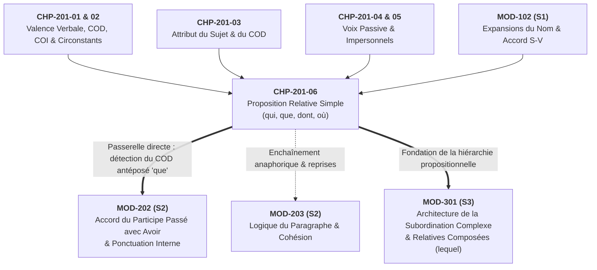

# Chapitre 6 — La Proposition Relative Simple Introductive : Les Quatre Pronoms Invariables, Double Statut et Ponctuation Sémantique

> **Identifiant du chapitre** : `CHP-201-06`  
> **Module de rattachement** : [`MOD-201` — Syntaxe Fonctionnelle de la Phrase Simple, Voix Passive, Tournures Impersonnelles et Relative Simple](file:///f:/Formation/world-class-french/03-curriculum/year-1/semester-2/mod-201-syntaxe-fonctionnelle-phrase-simple.md)  
> **Semestre** : Année 1 — Semestre 2 (S2)  
> **Volume horaire estimé** : 5 à 6 heures d'apprentissage autonome délibéré et d'ateliers d'application (Phase 1 Étude : 1 h 30 | Phase 2 Pratique : 1 h 30 | Phase 3 Correction : 1 h 00 | Phase 4 Évaluation : 1 h 00)  
> **Statut** : [STATUT : VALIDÉ]  
> **Compétences associées** : [`FR-SYNTAX-002`](file:///f:/Formation/world-class-french/02-competency-framework/competency-framework.md#fr-syntax-002-architecture-de-la-subordination-complexe) (L2 Application guidée), [`FR-SYNTAX-001`](file:///f:/Formation/world-class-french/02-competency-framework/competency-framework.md#fr-syntax-001-analyse-fonctionnelle-et-délimitation-de-la-phrase-simple) (L3 Autonomie), [`FR-ORTHO-002`](file:///f:/Formation/world-class-french/02-competency-framework/competency-framework.md#fr-ortho-002-mécanique-infaillible-de-laccord-sujet-verbe) (L3 Autonomie)  
> **Sources scientifiques de référence** : `SRC-GRAM-01` (Grevisse & Goosse, 2016, § 690-715 & § 1083-1088), `SRC-GRAM-02` (Riegel et al., 2016, chap. 19), `SRC-NORM-03` (Ministère de l'Éducation nationale, 2020, p. 48-50), `SRC-TYPO-01` (Imprimerie nationale, 2002, p. 142)

---

## 1. Titre et Place dans le Cursus

### 1.1 Intitulé Officiel
**Chapitre 6 : La Proposition Relative Simple Introductive : Les Quatre Pronoms Invariables, Double Statut et Ponctuation Sémantique** (`CHP-201-06`).

### 1.2 Insertion Architecturale dans le Cursus
Ce sixième et dernier chapitre parachève l'édifice syntaxique du module [`MOD-201`](file:///f:/Formation/world-class-french/03-curriculum/year-1/semester-2/mod-201-syntaxe-fonctionnelle-phrase-simple.md). Après l'étude de la valence verbale (`CHP-201-01`), de la frontière entre compléments du verbe et compléments de phrase (`CHP-201-02`), de la fonction attribut (`CHP-201-03`), de la diathèse passive (`CHP-201-04`) et des constructions impersonnelles (`CHP-201-05`), l'apprenant franchit ici le seuil stratégique qui sépare la phrase simple de la phrase complexe : **l'enchâssement d'une proposition subordonnée relative au sein d'un syntagme nominal**.



- **En amont** : Ce chapitre mobilise directement l'outillage fonctionnel acquis dans les cinq premiers chapitres de `MOD-201`. En effet, pour choisir entre *qui*, *que*, *dont* et *où*, le scripteur doit analyser instantanément la valence du verbe de la proposition subordonnée (distinguer un sujet d'un COD, d'un COI en *de* ou d'un complément locatif). Il réactive également la notion d'expansion du groupe nominal et la mécanique d'accord sujet-verbe étudiées dans `MOD-102`.
- **En clôture de `MOD-201` et en passerelle immédiate vers l'aval** :
  - **Vers [`MOD-202`](file:///f:/Formation/world-class-french/03-curriculum/year-1/semester-2/mod-202-participe-passe-avoir-ponctuation-interne.md) (Prérequis bloquant `DEP-ORT-02`)** : Plus de 60 % des accords du participe passé employé avec l'auxiliaire *avoir* dans la prose soutenue et les concours administratifs dépendent de l'identification du pronom relatif *que* comme **COD antéposé** (*« Les mesures que le gouvernement a prises »*). Sans la maîtrise du double statut du pronom relatif acquise ici, le module `MOD-202` demeure impénétrable.
  - **Vers [`MOD-203`](file:///f:/Formation/world-class-french/03-curriculum/year-1/semester-2/mod-203-logique-paragraphe-cohesion-textuelle.md)** : La subordonnée relative permet de condenser deux phrases indépendantes en un seul syntagme dense et articulé, évitant le style haché.
  - **Vers [`MOD-301`](file:///f:/Formation/world-class-french/03-curriculum/year-2/semester-3/mod-301-architecture-subordination-completives.md)** : Ce chapitre pose les fondations du concept de subordination avant l'étude exhaustive des complétives, des interrogatives indirectes et des pronoms relatifs composés (*lequel, auquel, duquel*) au Semestre 3.

---

## 2. Objectifs Mesurables

Au terme des 5 à 6 heures d'étude délibérée et d'application de ce chapitre, l'apprenant est capable de :

1. **Délimiter les frontières exactes d'une proposition subordonnée relative** au sein d'une phrase complexe, identifier sans ambiguïté son **antécédent** (nom ou pronom de la proposition principale) et qualifier sa fonction externe de **complément de l'antécédent** ([`FR-SYNTAX-002`](file:///f:/Formation/world-class-french/02-competency-framework/competency-framework.md#fr-syntax-002-architecture-de-la-subordination-complexe), palier L2).
2. **Déterminer la fonction syntaxique interne exacte** assumée par chacun des quatre pronoms relatifs simples invariables (*qui, que, dont, où*) à l'intérieur de la subordonnée (sujet, COD, COI en *de*, complément du nom, complément de l'adjectif, complément essentiel ou circonstanciel de lieu/temps), en appliquant la méthode de décomposition en deux propositions indépendantes ([`FR-SYNTAX-001`](file:///f:/Formation/world-class-french/02-competency-framework/competency-framework.md#fr-syntax-001-analyse-fonctionnelle-et-délimitation-de-la-phrase-simple), palier L3 ; [`FR-SYNTAX-002`](file:///f:/Formation/world-class-french/02-competency-framework/competency-framework.md#fr-syntax-002-architecture-de-la-subordination-complexe), palier L2).
3. **Accorder sans défaillance le verbe de la subordonnée relative introduite par *qui*** en genre, en nombre et surtout en **personne grammaticale** avec son antécédent, y compris dans les structures clivées à antécédent pronominal de 1re ou de 2e personne (*« C'est moi qui suis »*, *« C'est vous qui avez parlé »*) ([`FR-ORTHO-002`](file:///f:/Formation/world-class-french/02-competency-framework/competency-framework.md#fr-ortho-002-mécanique-infaillible-de-laccord-sujet-verbe), palier L3).
4. **Arbitrer la ponctuation sémantique de la subordonnée relative** en distinguant la **relative déterminative (restrictive)** — qui exclut formellement toute virgule — de la **relative explicative (appositive)** — qui exige l'encadrement par des virgules — et en explicitant l'impact logique de ce choix sur les conditions de vérité de l'énoncé ([`FR-SYNTAX-002`](file:///f:/Formation/world-class-french/02-competency-framework/competency-framework.md#fr-syntax-002-architecture-de-la-subordination-complexe), palier L2).

---

## 3. Prérequis et Test de Préparation

### 3.1 Prérequis Exigibles
- **Distinction Nature vs Fonction (`MOD-102`)** : Ne jamais confondre la classe grammaticale d'un mot (*pronom relatif*, *proposition subordonnée*) avec son rôle syntaxique dans la phrase (*sujet*, *COD*, *complément du nom*).
- **Analyse de la valence verbale (`CHP-201-01` et `CHP-201-02`)** : Savoir reconnaître si un verbe se construit directement sans préposition (transitif direct : *connaître quelqu'un*) ou par l'intermédiaire de la préposition *de* (transitif indirect : *parler de, se souvenir de, avoir besoin de*).
- **Expansions du syntagme nominal (`CHP-102-04`)** : Comprendre comment un nom noyau peut être précisé par un adjectif épithète ou un syntagme prépositionnel complément du nom.

### 3.2 Test de Préparation (Auto-Diagnostic à 5 Questions)
Répondez sans aide aux cinq questions suivantes avant de consulter le corrigé repliable :

1. **Question 1 (Rection verbale)** : Le verbe *se souvenir* et la locution verbale *avoir besoin* sont-ils transitifs directs ou transitifs indirects ? Quelle préposition exigent-ils devant un complément nominal ?
2. **Question 2 (Discrimination fonctionnelle)** : Dans la phrase simple *« Cet auteur publie un roman »*, quelle est la fonction de *Cet auteur* ? Dans *« J'admire cet auteur »*, quelle est la fonction de *cet auteur* ?
3. **Question 3 (Synthèse relative)** : Reliez les deux phrases suivantes en une seule phrase complexe à l'aide du pronom relatif approprié : *« Le greffier examine le procès-verbal. Vous avez besoin de ce procès-verbal. »*
4. **Question 4 (Accord de personne)** : Conjuguez le verbe *être* au présent de l'indicatif dans la phrase : *« C'est moi qui (être) chargé de rédiger le rapport final. »*
5. **Question 5 (Logique de la ponctuation)** : Comparez : *(a) « Les députés qui ont refusé le budget ont quitté l'hémicycle »* et *(b) « Les députés, qui ont refusé le budget, ont quitté l'hémicycle »*. Dans laquelle de ces deux phrases reste-t-il encore des députés assis dans l'hémicycle ?

<details>
<summary><strong>Corrigé et barème de l'auto-diagnostic (cliquer pour dérouler)</strong></summary>

1. **Réponse 1** : Ils sont **transitifs indirects** et exigent impérativement la préposition **de** (*se souvenir de quelque chose*, *avoir besoin de quelque chose*). C'est cette préposition *de* qui commandera l'emploi exclusif du pronom relatif **dont** (et jamais *que*).
2. **Réponse 2** : Dans la première phrase, *Cet auteur* occupe la fonction **sujet** du verbe *publie*. Dans la seconde phrase, *cet auteur* occupe la fonction **complément d'objet direct (COD)** du verbe *admire*. Bien qu'il s'agisse du même groupe nominal, sa fonction change radicalement selon sa relation avec le verbe.
3. **Réponse 3** : *« Le greffier examine le procès-verbal **dont** vous avez besoin. »* Le pronom *dont* remplace le syntagme prépositionnel *de ce procès-verbal* (COI de *avez besoin*). Écrire *« *que vous avez besoin »* constitue un solécisme grave.
4. **Réponse 4** : *« C'est moi qui **suis** chargé... »* Le pronom relatif *qui* a pour antécédent le pronom tonique de 1re personne du singulier *moi* ; il transmet donc la 1re personne du singulier au verbe subordonné (*suis* et non *\*est*).
5. **Réponse 5** : Dans la **phrase (a)** (sans virgules). La relative *qui ont refusé le budget* y est **déterminative (restrictive)** : seuls les députés ayant refusé le budget sont sortis ; ceux qui l'ont voté sont restés. Dans la phrase (b) (avec virgules), la relative est **explicative** : la totalité des députés a refusé le budget et la totalité des députés a quitté la salle.

> **Diagnostic** : Si vous avez obtenu moins de 4/5, portez une attention particulière aux sections 7.2, 7.3 et 7.5 ci-dessous.
</details>

---

## 4. Situation de Départ ou Problème Concret

### 4.1 Le Piège de la Confusion Fonctionnelle et les Solécismes Rédhibitoires
Dans les écrits professionnels, juridiques ou universitaires, peu d'erreurs discréditent aussi brutalement leur auteur que le mauvais choix ou le mauvais accord d'un pronom relatif. Observons ces quatre énoncés fautifs relevés dans des courriers administratifs et des copies de concours :

> ❌ *« Je vous transmets en pièce jointe le dossier **que** vous avez besoin pour l'audience. »*  
> ❌ *« La directrice générale **dont** j'ai rencontré hier à Cotonou a validé le projet. »*  
> ❌ *« C'est nous qui **ont** assumé la responsabilité financière de l'opération. »*  
> ❌ *« Les candidats, **qui** n'ont pas fourni leur diplôme original, seront éliminés du concours. »*

Pourquoi des locuteurs par ailleurs instruits commettent-ils de telles fautes ?
1. **L'illusion de l'antécédent** : Dans la première phrase, le scripteur voit que *le dossier* est le COD du verbe principal (*Je vous transmets le dossier*). Par inertie mentale, il utilise le pronom COD *que* pour introduire la suite, sans voir que dans la seconde proposition (*vous avez besoin **de** ce dossier*), le mot *dossier* n'est plus COD mais complément indirect introduit par **de** !
2. **L'hypercorrection aveugle** : Inversement, dans la deuxième phrase, le scripteur croit que le pronom *dont* est simplement une variante « plus élégante » ou « plus soutenue » de *que*. Il écrit *« la directrice *dont j'ai rencontré »* alors que le verbe *rencontrer* est transitif direct (*rencontrer quelqu'un* $\rightarrow$ *que*).
3. **La virgule anarchique** : Dans la quatrième phrase, le rédacteur du règlement d'examen a encadré la subordonnée relative de virgules par simple réflexe respiratoire. Ce faisant, il a écrit juridiquement que **tous les candidats sans exception** ont omis de fournir leur diplôme et que **tous les candidats** sont éliminés !

Ce chapitre a pour objectif de remplacer ces approximations coûteuses par une mécanique d'analyse infaillible.

---

## 5. Explication Intuitive : L'Agrafeuse Articulée et la Prise Gigogne

Pour comprendre la nature profonde du pronom relatif sans s'égarer dans l'abstraction, imaginons une **prise électrique gigogne à double face** (ou une **charnière articulée** reliant deux wagons) :

```text
   PROPOSITION PRINCIPALE (Wagon 1)                 PROPOSITION SUBORDONNÉE RELATIVE (Wagon 2)
┌─────────────────────────────────────┐          ┌──────────────────────────────────────────────┐
│  Je consulte [le registre officiel] │ ◄══════► │ [dont]  le greffier  vérifie  les  pages.    │
└─────────────────────────┬───────────┘          └───┬──────────────────────────────────────┬───┘
                          │                          │                                      │
                   ANTÉCÉDENT NOMINAL         PRONOM RELATIF                         COMPLÉMENT DU NOM
                 (Fonction dans Wagon 1 :    • Face externe : s'agrafe à            (Fonction dans Wagon 2 :
                  COD de "consulte")           "le registre officiel"                "dont" = "de ce registre",
                                             • Face interne : joue un rôle           complète "les pages")
                                               propre dans le Wagon 2
```

1. **Du côté gauche (vers la proposition principale)**, le pronom relatif fonctionne comme une **agrafe anaphorique** : il vient se fixer sur un nom ou un pronom qui le précède (l'**antécédent**). Il absorbe l'identité sémantique ainsi que le genre, le nombre et la personne de cet antécédent.
2. **Du côté droit (à l'intérieur de la proposition subordonnée)**, le pronom relatif n'est pas un simple mot de liaison inerte (contrairement à une conjonction pure) : il est un **citoyen actif de la subordonnée**. Il y exerce un métier grammatical précis — tantôt **sujet** (*qui*), tantôt **COD** (*que*), tantôt **complément en *de*** (*dont*), tantôt **complément de lieu ou de temps** (*où*).

> [!IMPORTANT]
> **Loi cardinale d'indépendance des fonctions** : Le choix du pronom relatif (*qui, que, dont, où*) ne dépend **JAMAIS** de la fonction de l'antécédent dans la proposition principale ; il dépend **EXCLUSIVEMENT** de la fonction que le pronom occupe lui-même à l'intérieur de la proposition subordonnée.

---

## 6. Définitions Précises et Terminologie

Observons d'abord cet énoncé modèle :
> *« L'architecte béninois **[qui a conçu ce monument]** dirige l'équipe **[que vous avez recrutée]**. »*

1. **Proposition subordonnée relative** : Proposition non autonome introduite par un pronom relatif (*qui, que, dont, où, lequel...*), qui dépend syntaxiquement d'un nom ou d'un pronom appelé son *antécédent* [Réf. `SRC-NORM-03`, p. 48].
2. **Antécédent** (du latin *antecedens*, « qui marche devant ») : Nom, groupe nominal ou pronom situé dans la proposition régissante (principale ou autre subordonnée), que le pronom relatif représente et dont la subordonnée relative constitue une expansion (ex. *L'architecte béninois* est l'antécédent de *qui* ; *l'équipe* est l'antécédent de *que*) [Réf. `SRC-GRAM-01`, § 690].
3. **Pronom relatif simple invariable** : Sous-classe des pronoms relatifs comprenant quatre formes morphologiquement simples et dépourvues de flexion de genre et de nombre : **qui**, **que** (élidé en **qu'** devant voyelle ou *h* muet), **dont** et **où** (par opposition aux pronoms relatifs composés variables *lequel, laquelle, lesquels, lesquelles* étudiés en `MOD-301`) [Réf. `SRC-GRAM-02`, chap. 19].
4. **Double statut syntaxique du pronom relatif** : Propriété linguistique fondamentale en vertu de laquelle le pronom relatif cumule :
   - un **rôle démarcatif et anaphorique** (subordonner la proposition tout en reprenant l'antécédent) ;
   - une **fonction syntaxique interne** au sein de la proposition qu'il introduit [Réf. `SRC-GRAM-02`, chap. 19, § 1.2].
5. **Fonction externe vs Fonction interne** :
   - **Fonction externe (celle de la proposition subordonnée tout entière)** : La subordonnée relative adjectivale occupe la fonction d'**expansion du nom** (appelée précisément **complément de l'antécédent** ou *épithète/apposition* selon la terminologie scolaire et universitaire) [Réf. `SRC-NORM-03`, p. 48].
   - **Fonction interne (celle du pronom relatif seul)** : Fonction occupée par le pronom relatif par rapport au verbe, au nom ou à l'adjectif de la subordonnée (ex. *qui* est sujet de *a conçu* ; *que* est COD de *avez recrutée*).
6. **Relative déterminative (ou restrictive)** vs **Relative explicative (ou appositive)** :
   - **Déterminative** : Subordonnée relative indispensable à l'identification du référent de l'antécédent, dont elle restreint l'extension logique ; elle fait corps avec le nom sans pause ni virgule.
   - **Explicative** : Subordonnée relative périphérique qui ajoute un commentaire ou une explication non indispensable à l'identification de l'antécédent ; elle est détachée par des virgules [Réf. `SRC-GRAM-01`, § 1084 ; `SRC-NORM-03`, p. 50].

---

## 7. Règles ou Mécanismes Fondamentaux

### 7.1 Architecture Générale de la Subordonnée Relative
Dans la hiérarchie du syntagme nominal (`SN`), la proposition subordonnée relative joue exactement le même rôle fonctionnel qu'un **adjectif qualificatif** ou qu'un **complément du nom prépositionnel** [Réf. `SRC-GRAM-02`, chap. 19].

Observons cette équivalence structurale parfaite autour du nom noyau *décision* :
- Avec adjectif épithète : *« Une décision **irrévocable**. »*
- Avec complément du nom : *« Une décision **sans appel**. »*
- Avec subordonnée relative : *« Une décision **sur laquelle nul ne peut revenir** / **qui ne souffre aucun recours**. »*

C'est pourquoi la grammaire traditionnelle qualifie la subordonnée relative avec antécédent de **relative adjectivale**. Sa fonction globale (externe) dans la phrase matrice se formule toujours ainsi : **complément de l'antécédent $[X]$** (intégrée au syntagme nominal dont $[X]$ est le noyau).

---

### 7.2 Le Double Statut Linguistique du Pronom Relatif
Pour analyser ou rédiger correctement une proposition relative, il faut dissocier méthodiquement les deux faces du pronom relatif [Réf. `SRC-GRAM-01`, § 690] :

1. **Statut 1 — Rôle externe (Subordonnant et Récepteur de traits)** :
   - Le pronom relatif est la **frontière initiale** de la subordonnée (sauf lorsqu'il est précédé d'une préposition comme *à qui, pour qui, d'où*).
   - Bien que sa graphie soit invariable (*qui, que, dont, où* s'écrivent toujours de la même façon), il **hérite invisiblement des trois traits morphosyntaxiques de son antécédent** :
     $$\text{Antécédent } [\text{Genre} + \text{Nombre} + \text{Personne}] \xrightarrow{\text{Transfert anaphorique}} \text{Pronom relatif}$$
   - Ce transfert invisible gouverne deux accords majeurs en français :
     - L'accord du verbe de la subordonnée lorsque le pronom est **qui** (sujet) ;
     - L'accord du participe passé de la subordonnée lorsque le pronom est **que** (COD antéposé, étudié en `MOD-202`).

2. **Statut 2 — Rôle interne (Actant ou Circonstant de la subordonnée)** :
   - À l'intérieur de la subordonnée, le pronom relatif occupe la place syntaxique laissée vacante par la non-répétition du nom antécédent.
   - **Méthode infaillible de la décomposition (Test de restitution)** : Pour trouver la fonction interne du pronom relatif, remplacez le pronom par son antécédent (accompagné de la préposition éventuelle) et lisez la subordonnée comme une phrase indépendante autonome :
     - *« Le traité **[que le parlement ratifie]**... »* $\rightarrow$ Phrase restituée : *« Le parlement ratifie **[ce traité]**. »* $\rightarrow$ Dans cette phrase, *ce traité* est **COD** de *ratifie*. Donc **que** est **COD** de *ratifie*.

---

### 7.3 Inventaire et Rection des Quatre Pronoms Relatifs Simples Invariables

#### 1. Le pronom *QUI* : Fonction interne de SUJET (et compléments prépositionnels humains)
- **Emploi fondamental (sans préposition)** : Placé directement en tête de la relative, **qui** assume invariablement la fonction de **sujet du verbe de la subordonnée** [Réf. `SRC-GRAM-01`, § 693]. Il s'emploie pour tout antécédent, qu'il soit humain, animal ou inanimé (*l'homme qui parle, le fleuve qui déborde, la loi qui s'applique*).
- **Règle d'or de l'accord verbal avec *qui*** : Le verbe dont le sujet est *qui* se conjugue obligatoirement à la **même personne** et au **même nombre** que l'antécédent [Réf. `SRC-GRAM-01`, § 441] :
  - Antécédent de 1re personne du singulier (*moi*) : *« C'est **moi** qui **suis** venu »* (et jamais *\*qui est venu*).
  - Antécédent de 2e personne du singulier (*toi*) : *« C'est **toi** qui **as** raison »* (et jamais *\*qui a raison*).
  - Antécédent de 1re personne du pluriel (*nous*) : *« C'est **nous** qui **avons** signé ce décret »* (et jamais *\*qui ont signé*).
  - Antécédent de 2e personne du pluriel (*vous*) : *« C'est **vous** qui **avez** parlé »* (et jamais *\*qui a parlé*).
- **Emploi secondaire après préposition (*à qui, de qui, pour qui, avec qui, chez qui*)** : Lorsqu'il est précédé d'une préposition, *qui* ne peut représenter qu'un antécédent **animé humain** (ou personnifié) et occupe alors la fonction de **COI**, **COS** ou **complément circonstanciel** (*« L'avocat **à qui** j'ai confié ma défense »* $\rightarrow$ COS de *ai confié*).

#### 2. Le pronom *QUE* (*QU'*) : Fonction interne de COMPLÉMENT D'OBJET DIRECT (COD)
- **Emploi fondamental** : **Que** assume la fonction de **complément d'objet direct (COD)** du verbe de la subordonnée, tant pour les personnes que pour les choses [Réf. `SRC-GRAM-01`, § 695] :
  - *« Les preuves **que** le procureur expose sont accablantes. »* ($\rightarrow$ *Le procureur expose [ces preuves]* : COD de *expose*).
- **Attention à l'inversion du sujet dans la relative en *que*** : En français soutenu, le sujet de la relative introduite par *que* est très souvent inversé après le verbe :
  - *« La réforme **que** proposent **les ministres**... »*
  - Ne confondez jamais le COD (*que* = *la réforme*) et le sujet postposé (*les ministres* qui gouverne le pluriel *proposent*) !
- **Enjeu crucial pour `MOD-202`** : Puisque le pronom relatif *que* est toujours placé en tête de la subordonnée, **il précède systématiquement le verbe de cette subordonnée**. Dès lors, si ce verbe est conjugué à un temps composé avec l'auxiliaire *avoir*, son participe passé s'accordera obligatoirement en genre et en nombre avec l'antécédent de *que*.

#### 3. Le pronom *DONT* : Fonction interne de COMPLÉMENT EN « DE »
Le pronom **dont** est un pronom synthétique qui équivaut toujours à **[de + l'antécédent]** [Réf. `SRC-GRAM-01`, § 704]. Il s'emploie pour les personnes comme pour les choses et peut exercer **trois fonctions internes principales** selon l'élément dont il dépend dans la subordonnée :

| Élément régissant dans la subordonnée | Construction de base avec *de* | Exemple avec le pronom *dont* | Fonction syntaxique interne exacte de *dont* |
| :--- | :--- | :--- | :--- |
| **1. Un verbe transitif indirect en *de*** | *parler de, douter de, se souvenir de, avoir besoin de, dépendre de* | *« Le projet **dont** nous discutons est ambitieux. »*<br/>($\leftarrow$ *Nous discutons **de ce projet***) | **Complément d'objet indirect (COI)** du verbe *discutons*. |
| **2. Un nom (syntagme nominal)** | *le titre de ce livre, l'auteur de ce poème, les résultats de cette enquête* | *« Voici un ouvrage **dont** je connais l'auteur. »*<br/>($\leftarrow$ *Je connais l'auteur **de cet ouvrage***) | **Complément du nom** *l'auteur* (attention : *l'auteur* est COD de *connais*, mais *dont* complète le nom *auteur* !). |
| **3. Un adjectif qualificatif** | *fier de, digne de, responsable de, satisfait de, conscient de* | *« C'est un succès **dont** toute l'équipe est fière. »*<br/>($\leftarrow$ *Toute l'équipe est fière **de ce succès***) | **Complément de l'adjectif** *fière*. |

#### 4. Le pronom *OÙ* : Fonction interne de COMPLÉMENT DE LIEU OU DE TEMPS
Contrairement à l'adverbe interrogatif homonyme (*Où vas-tu ?*), le mot **où** précédé d'un antécédent est un authentique **pronom relatif** [Réf. `SRC-GRAM-01`, § 708 ; `SRC-NORM-03`, p. 49]. Il ne représente jamais un être animé et assume deux valeurs :
- **Complément (essentiel ou circonstanciel) de lieu** :
  - *« Le village **où** il réside est situé près du fleuve Mono. »* (*où* = *dans ce village*, complément essentiel de lieu du verbe *réside*).
  - *« La salle **où** s'est tenue la conférence était comble. »* (*où* = *dans cette salle*, complément circonstanciel de lieu de *s'est tenue*).
  - Il peut être précédé des prépositions de mouvement **de** (**d'où** = origine spatiale ou conclusion logique) et **par** (**par où** = passage) : *« La ville **d'où** il arrive »*, *« Le sentier **par où** nous sommes passés »*.
- **Complément circonstanciel de temps** (lorsque l'antécédent est un nom temporel : *le jour, l'heure, le moment, l'année, l'époque, la saison, l'instant*) :
  - *« Rappelez-vous le matin **où** l'accord fut signé. »* (*où* = *pendant ce matin*, complément circonstanciel de temps de *fut signé*). Dans la langue soutenue, on écrit toujours *« le jour **où** »* ou *« au moment **où** »* (et l'on évite le tour relâché *« *le jour que »*).

---

### 7.4 La Distinction Sémantique et Logique Cardinale : Déterminative vs Explicative
Toute proposition relative adjectivale relève nécessairement de l'un des deux régimes logiques suivants [Réf. `SRC-GRAM-02`, chap. 19, § 2 ; `SRC-NORM-03`, p. 50] :

1. **La relative déterminative (ou restrictive)** :
   - **Fonction sémantique** : Elle restreint l'extension du nom antécédent pour délimiter une **sous-catégorie spécifique**, seule concernée par le verbe principal.
   - **Test de suppression** : Si on la supprime, la phrase change radicalement de sens, devient fausse ou perd toute pertinence informative.
   - *Exemple* : *« Les citoyens **qui détiennent une carte d'électeur** peuvent voter. »* (Seul le sous-ensemble des citoyens munis d'une carte peut voter ; sans la relative, *« Les citoyens peuvent voter »* inclurait même les personnes non inscrites).

2. **La relative explicative (ou appositive / non restrictive)** :
   - **Fonction sémantique** : Elle s'applique à un antécédent **déjà pleinement identifié** dans son intégralité (nom propre, groupe nominal pris dans sa totalité). Elle n'opère aucun tri : elle ajoute en incise une caractéristique globale ou une justification causale.
   - **Test de suppression** : Elle peut être effacée sans modifier l'identité ni le périmètre du groupe désigné par l'antécédent.
   - *Exemple* : *« Les citoyens, **qui sont tous égaux devant la loi**, doivent respecter la Constitution. »* (Ici, la qualité d'être égaux devant la loi appartient à **tous** les citoyens sans exception, et **tous** doivent respecter la Constitution).

---

### 7.5 La Règle d'Or de la Ponctuation Typographique (`SRC-TYPO-01`)
La différence logique entre relative déterminative et relative explicative se traduit à l'écrit par une règle de ponctuation stricte, codifiée par le *Lexique des règles typographiques en usage à l'Imprimerie nationale* [Réf. `SRC-TYPO-01`, p. 142] et *Le Bon Usage* [Réf. `SRC-GRAM-01`, § 1084] :

> [!IMPORTANT]
> **Règle d'Or de la Ponctuation Sémantique des Relatives** :
> 1. **Relative déterminative (restrictive)** $\Longrightarrow$ **ZÉRO VIRGULE** (ni avant le pronom relatif, ni après la relative, sauf si la fin de la relative coïncide avec une frontière syntaxique majeure de la phrase).  
>    $\checkmark$ *« Les élèves **qui ont réussi** recevront un prix. »* (Seuls les lauréats reçoivent un prix).
> 2. **Relative explicative (appositive)** $\Longrightarrow$ **ENCADREMENT OBLIGATOIRE PAR DES VIRGULES** (une virgule ouvrante avant le pronom relatif et une virgule fermante à la fin de la relative, ou le point final de la phrase).  
>    $\checkmark$ *« Les élèves**, qui ont tous réussi,** recevront un prix. »* (Tous les élèves ont réussi et tous reçoivent un prix).

---

## 8. Raisonnement Détaillé : Pourquoi la Virgule est un Opérateur Logique

### 8.1 De la *Logique de Port-Royal* à la Théorie des Ensembles
Pourquoi une simple virgule possède-t-elle le pouvoir de modifier la vérité juridique ou scientifique d'une phrase ? Ce phénomène a été théorisé dès 1662 par Antoine Arnauld et Pierre Nicole dans *La Logique ou l'Art de penser* (*Logique de Port-Royal*, I, chap. 6 et II, chap. 6) à travers la distinction entre la **compréhension** (l'ensemble des propriétés d'une idée) et l'**extension** (l'ensemble des individus auxquels cette idée s'applique) [Réf. `SRC-GRAM-02`, chap. 19].

En sémantique formelle contemporaine, on modélise cette opposition par la théorie des ensembles. Soit $E$ l'ensemble des individus désignés par le nom antécédent (*les élèves*), $P$ la propriété exprimée par la relative (*avoir réussi*), et $Q$ le prédicat de la proposition principale (*recevoir un prix*) :

```text
  CAS 1 : RELATIVE DÉTERMINATIVE (SANS VIRGULE)         CAS 2 : RELATIVE EXPLICATIVE (ENTRE VIRGULES)
  "Les élèves qui ont réussi recevront un prix."        "Les élèves, qui ont réussi, recevront un prix."

         Ensemble E (Tous les élèves)                            Ensemble E = Ensemble P
        ┌─────────────────────────────┐                        ┌─────────────────────────┐
        │   Élèves ayant              │                        │   TOUS les élèves       │
        │   échoué (E \ P)            │                        │   ont réussi (E ⊆ P)    │
        │         ┌───────────────────┼──────┐                 │                         │
        │         │ SOUS-ENSEMBLE     │      │                 │   ──► TOUS reçoivent    │
        │         │   (E ∩ P)         │      │                 │       un prix (E ⊆ Q)   │
        │         │ Élèves ayant      │      │                 └─────────────────────────┘
        │         │ réussi ──► PRIX   │      │
        └─────────┴───────────────────┴──────┘
                  Ensemble P (Avoir réussi)
```

1. **Sans virgule (soudure graphique et prosodique)** : La relative opère une **intersection ensembliste** ($E \cap P$). L'assertion principale ne porte plus sur l'ensemble initial $E$, mais uniquement sur le sous-ensemble restreint $E \cap P$. Il est donc logiquement présupposé qu'il existe (ou peut exister) des éléments de $E$ qui ne vérifient pas $P$ ($E \setminus P \neq \emptyset$).
2. **Avec virgules (détachement parenthétique)** : Les virgules isolent la relative dans un second acte d'énonciation autonome. Le locuteur affirme deux propositions conjointes portant sur la totalité de l'ensemble $E$ : d'une part $E \subseteq P$ (*tous les élèves ont réussi*), et d'autre part $E \subseteq Q$ (*tous les élèves recevront un prix*).

Conséquence pratique : on ne peut **jamais** souder une relative déterminative sans virgule derrière un **nom propre individuel** (*« *Cotonou qui est la métropole économique du Bénin... »*) ou derrière un **pronom personnel** (*« *Lui qui est si prudent a commis une erreur »* hors clivage ou valeur générique particulière), car un individu unique déjà identifié ne saurait être « divisé en sous-catégories ». On doit écrire avec virgules : *« Cotonou, qui est la métropole économique du Bénin, possède un port en eau profonde. »*

---

### 8.2 Pourquoi *dont* exclut formellement l'adjectif possessif
Un second mécanisme logique explique pourquoi l'énoncé *« *L'entreprise dont je connais son directeur »* est un barbarisme syntaxique.
Dans la phrase de base : *« Je connais **le** directeur **de cette entreprise** »*, la possession (ou l'appartenance) est marquée par le groupe prépositionnel *de cette entreprise*, tandis que le nom *directeur* est précédé de l'article défini **le**.
Lorsque ce groupe prépositionnel est remplacé par le pronom relatif **dont** (*dont* = *de cette entreprise*), le nom complété conserve obligatoirement son **article défini** (*le, la, les*) :
- $\checkmark$ *« L'entreprise **dont** je connais **le** directeur. »*
Insérer un déterminant possessif (*son, sa, ses*) reviendrait à exprimer deux fois de suite le même possesseur (*« *de laquelle entreprise je connais son directeur »*), violant le principe d'économie et de non-redondance actancielle du français standard [Réf. `SRC-GRAM-01`, § 705].

---

## 9. Exemples Corrects Commentés

Étudions en détail cinq phrases modèles issues de registres soutenus (littérature classique, prose contemporaine et discours institutionnel ouest-africain), en appliquant systématiquement la **double analyse fonctionnelle (externe et interne)**.

### Exemple 1 : Relative en *qui* avec antécédent pronominal et accord de personne
> *« C'est vous, citoyens de la République, **[qui forgerez par votre labeur la prospérité de demain]**. »*

- **Délimitation** :
  - Proposition principale : *« C'est vous, citoyens de la République »* (*citoyens de la République* est mis en apposition à *vous*).
  - Proposition subordonnée relative : *« [qui forgerez par votre labeur la prospérité de demain] »*.
- **Antécédent** : Le pronom personnel disjoint de 2e personne du pluriel **vous**.
- **Analyse du pronom relatif *qui*** :
  - *Rôle externe* : Subordonne la relative à l'antécédent *vous* et hérite de ses traits morphologiques (2e personne du pluriel).
  - *Fonction interne* : **Sujet** du verbe *forgerez*, qui prend impérativement la terminaison *-ez* de la 2e personne du pluriel.

### Exemple 2 : Relative en *que* avec inversion du sujet interne
> *« Les manuscrits anciens **[que conserve la bibliothèque universitaire d'Abomey-Calavi]** constituent un patrimoine inestimable. »*

- **Délimitation** :
  - Proposition principale : *« Les manuscrits anciens [...] constituent un patrimoine inestimable. »*
  - Proposition subordonnée relative enchâssée : *« [que conserve la bibliothèque universitaire d'Abomey-Calavi] »*.
- **Antécédent** : Le syntagme nominal *Les manuscrits anciens* (noyau : *manuscrits*, masculin pluriel).
- **Fonction externe de la relative** : Complément de l'antécédent *manuscrits* (relative **déterminative** : elle identifie précisément de quels manuscrits il s'agit $\rightarrow$ **aucune virgule**).
- **Fonction interne de *que*** :
  - Restitution : *« La bibliothèque universitaire d'Abomey-Calavi conserve [ces manuscrits anciens]. »*
  - *Que* est **complément d'objet direct (COD)** du verbe *conserve*. Le groupe *la bibliothèque universitaire d'Abomey-Calavi* est le **sujet inversé** (singulier) du verbe *conserve*.

### Exemple 3 : Relative en *dont* complément du nom sujet vs complément du nom COD
> *« Cet écrivain sénégalais, **[dont l'œuvre rayonne dans toute la francophonie]** et **[dont les critiques saluent la rigueur stylistique]**, recevra le grand prix de l'Académie. »*

- **Délimitation et ponctuation** : Deux propositions subordonnées relatives coordonnées par *et*, toutes deux **explicatives** (l'antécédent *Cet écrivain sénégalais* est déjà déterminé par le démonstratif déictique). L'ensemble du bloc relatif est donc **encadré par deux virgules**.
- **Analyse de la relative 1** (*dont l'œuvre rayonne dans toute la francophonie*) :
  - Restitution : *« L'œuvre **[de cet écrivain]** rayonne... »*
  - Fonction interne de *dont* : **Complément du nom** *l'œuvre* (lequel nom *l'œuvre* est sujet du verbe *rayonne*).
- **Analyse de la relative 2** (*dont les critiques saluent la rigueur stylistique*) :
  - Restitution : *« Les critiques saluent la rigueur stylistique **[de cet écrivain]**. »*
  - Fonction interne de *dont* : **Complément du nom** *la rigueur* (lequel groupe *la rigueur stylistique* est COD du verbe *saluent*, placé après ce verbe).

### Exemple 4 : Relative en *dont* complément de l'adjectif
> *« La probité intellectuelle est une vertu cardinale **[dont nul magistrat ne saurait être dépourvu]**. »*

- **Antécédent** : *une vertu cardinale*.
- **Fonction externe** : Complément de l'antécédent *vertu* (relative déterminative $\rightarrow$ zéro virgule).
- **Fonction interne de *dont*** :
  - Restitution : *« Nul magistrat ne saurait être dépourvu **[de cette vertu cardinale]**. »*
  - *Dont* dépend de l'adjectif attribut *dépourvu* (construit avec la préposition *de* : *être dépourvu de quelque chose*). Sa fonction interne est **complément de l'adjectif** *dépourvu* [Réf. `SRC-GRAM-01`, § 705].

### Exemple 5 : Relative en *où* à valeur temporelle classique (Jean Racine)
> *« Ariane, ma sœur, de quel amour blessée, / Vous mourûtes aux bords **[où vous fûtes laissée]** ! »* (Racine, *Phèdre*, I, 3).

- **Antécédent** : *aux bords* (nom masculin pluriel désignant le rivage de l'île de Naxos).
- **Fonction externe** : Complément de l'antécédent *bords* (déterminative identifiant le rivage fatal $\rightarrow$ zéro virgule).
- **Fonction interne de *où*** : Complément circonstanciel de lieu du verbe passif *fûtes laissée* (*vous fûtes laissée [sur ces bords]*).

---

## 10. Contre-Exemples et Erreurs Fréquentes

Voici l'analyse clinique des **6 erreurs récurrentes** observées dans les écrits académiques et professionnels, suivies de leur réfutation syntaxique formelle.

### Erreur n° 1 : La confusion *que / dont* par méconnaissance de la rection en *de*
- **Formes fautives** : ❌ *« Le matériel **que** nous avons besoin »* ; ❌ *« L'erreur **que** je me suis aperçu »* ; ❌ *« Le candidat **dont** le jury a félicité »*.
- **Diagnostic linguistique** : Dans les deux premiers cas, le scripteur oublie que *avoir besoin de* et *s'apercevoir de* régissent un COI introduit par **de**. Dans le troisième cas, il commet une hypercorrection en employant *dont* avec le verbe *féliciter*, qui est transitif direct (*féliciter quelqu'un*).
- **Formes normées** : $\checkmark$ *« Le matériel **dont** nous avons besoin »* ; $\checkmark$ *« L'erreur **dont** je me suis aperçu »* ; $\checkmark$ *« Le candidat **que** le jury a félicité »* [Réf. `SRC-GRAM-01`, § 704].

### Erreur n° 2 : Le décumul populaire et la redondance pronominale ou possessive
- **Formes fautives** : ❌ *« L'homme **que** je **lui** ai parlé »* ; ❌ *« La collègue **dont** je te parle **d'elle** »* ; ❌ *« La société **dont** j'examine **son** bilan »*.
- **Diagnostic linguistique** : En français oral relâché, le locuteur réduit le pronom relatif à un simple ligateur invariable (*que* ou *dont*) et répète la fonction à l'intérieur de la subordonnée par un pronom personnel (*lui*, *d'elle*) ou un possessif (*son*). Ce **décumul du relatif** est un solécisme sévère à l'écrit.
- **Formes normées** : $\checkmark$ *« L'homme **à qui** j'ai parlé »* ; $\checkmark$ *« La collègue **dont** je te parle »* ; $\checkmark$ *« La société **dont** j'examine **le** bilan »* [Réf. `SRC-GRAM-01`, § 691, § 705].

### Erreur n° 3 : L'accord à la 3e personne après *c'est moi / toi / nous / vous qui*
- **Formes fautives** : ❌ *« C'est moi qui **a** rédigé la note »* ; ❌ *« C'est nous qui **sont** arrivés les premiers »* ; ❌ *« C'est vous qui **dira** la vérité »*.
- **Diagnostic linguistique** : Le scripteur traite le pronom *qui* comme un pronom indéfini de 3e personne, rompant le transfert anaphorique des traits de personne depuis l'antécédent.
- **Formes normées** : $\checkmark$ *« C'est moi qui **ai** rédigé la note »* ; $\checkmark$ *« C'est nous qui **sommes** arrivés les premiers »* ; $\checkmark$ *« C'est vous qui **direz** la vérité »* [Réf. `SRC-GRAM-01`, § 441].

### Erreur n° 4 : Le télescopage syntaxique *« que je pense qui »*
- **Forme fautive** : ❌ *« Voici l'expert **que** je pense **qui** résoudra ce litige. »*
- **Diagnostic linguistique** : En voulant enchâsser une relative dans une complétive régie par un verbe d'opinion (*je pense que...*), le scripteur juxtapose illicitement deux pronoms relatifs (*que... qui*) pour un seul antécédent.
- **Formes normées (deux solutions élégantes)** :
  1. **Mise en incise du verbe d'opinion** : $\checkmark$ *« Voici l'expert **qui, je pense,** résoudra ce litige. »*
  2. **Relativisation en *dont* + complétive** : $\checkmark$ *« Voici l'expert **dont** je pense **qu'il** résoudra ce litige. »* [Réf. `SRC-GRAM-01`, § 710].

### Erreur n° 5 : La virgule parasite devant une relative déterminative
- **Forme fautive** : ❌ *« Les étudiants, **qui** auront obtenu une moyenne inférieure à dix, devront repasser l'épreuve. »* (alors que seule une partie des étudiants a moins de dix).
- **Diagnostic linguistique** : Ponctuation rythmique erronée qui transforme une restriction conditionnelle en une assertion universelle frappant la totalité des étudiants.
- **Forme normée** : $\checkmark$ *« Les étudiants **qui** auront obtenu une moyenne inférieure à dix devront repasser l'épreuve. »* [Réf. `SRC-TYPO-01`, p. 142].

### Erreur n° 6 : La confusion *dont / d'où* après un antécédent spatial ou abstrait
- **Formes fautives** : ❌ *« La maison **dont** il est sorti en courant »* ; ❌ *« L'illustre dynastie **d'où** descend ce prince »*.
- **Diagnostic linguistique** : Selon la norme académique classique, **d'où** marque l'extraction spatiale concrète (sortir d'un lieu physique) ou la conséquence logique (*d'où il résulte que*), tandis que **dont** est réservé à l'origine généalogique ou à la filiation (*la famille dont il est issu, dont il descend*).
- **Formes normées** : $\checkmark$ *« La maison **d'où** il est sorti en courant »* ; $\checkmark$ *« L'illustre dynastie **dont** descend ce prince »* [Réf. `SRC-GRAM-01`, § 706, § 709].

---

## 11. Cas Particuliers et Limites

### 11.1 Les Relatives Substantives (Sans Antécédent) et les Pronoms Démonstratifs Supports
Toutes les propositions relatives n'ont pas nécessairement un nom antécédent exprimé [Réf. `SRC-GRAM-02`, chap. 19, § 1.3 ; `SRC-NORM-03`, p. 49] :
1. **La relative substantive (ou périphrastique) sans antécédent** : Dans les proverbes, les maximes juridiques ou après certaines prépositions, le pronom *qui* signifie directement « toute personne qui / quiconque » :
   - *« **[Qui dort]** dîne. »* $\rightarrow$ La proposition relative *Qui dort* n'est pas complément d'un antécédent : elle occupe **à elle seule la fonction de sujet** du verbe principal *dîne* !
   - *« La parole est accordée **[à qui la demande]**. »* $\rightarrow$ La relative occupe la fonction de COI du verbe passif *est accordée*.
2. **L'appui sur un pronom démonstratif neutre ou variable (*celui qui, ce qui, ce que, ce dont*)** :
   - En dehors des tournures figées ci-dessus, le français moderne n'admet plus qu'une relative sans antécédent occupe librement les fonctions de sujet ou d'objet. Il recourt alors aux pronoms démonstratifs supports **celui / celle / ceux / celles** (pour les animés ou les noms déjà mentionnés) et **ce** (neutre inanimé) :
     - *« **Ce qui** m'inquiète, c'est **ce dont** vous avez parlé. »*
     - Attention à l'analyse : ici, l'antécédent de *qui* et de *dont* est le pronom démonstratif neutre **ce**. La relative *qui m'inquiète* est complément de l'antécédent *Ce*, et c'est l'ensemble du syntagme *[Ce qui m'inquiète]* qui est disloqué.

---

### 11.2 Le Pronom *dont* Complément d'Agent et le Pronom *que* Attribut ou Complément de Mesure
Deux emplois soutenus méritent une vigilance particulière pour éviter les contresens d'analyse :
1. **Le pronom *dont* complément d'agent à la voix passive** :
   - Comme nous l'avons étudié au chapitre 4 (`CHP-201-04`), certains verbes passifs de sentiment, de connaissance ou d'accompagnement introduisent leur complément d'agent par la préposition **de** (*être aimé de, être connu de, être estimé de, être entouré de*).
   - Lorsqu'on relativise ce complément d'agent, la préposition *de* impose le pronom **dont** :
     - *« C'est un professeur **[dont tous les étudiants sont respectés]** »* ou *« Un maître **[dont il était fort estimé]**. »* ($\leftarrow$ *Il était fort estimé **de ce maître*** $\rightarrow$ *dont* est **complément d'agent** de *était estimé*) [Réf. `SRC-GRAM-01`, § 704].
2. **Le pronom *que* Attribut du sujet ou Complément essentiel de mesure** :
   - Le pronom *que* n'est pas toujours COD ! Il peut aussi représenter :
     - Un **attribut du sujet** après un verbe copule : *« L'homme intègre **[qu'il est toujours resté]** refuse ce compromis. »* ($\leftarrow$ *Il est toujours resté [un homme intègre]* : **attribut du sujet** *il*).
     - Un **complément essentiel de prix, de poids ou de durée** : *« Les vingt kilos **[que pèse ce colis]**... »*, *« Les trois heures **[qu'a duré l'audience]**... »*.
   - **Alerte stratégique pour `MOD-202`** : Dans ces deux cas précis, puisque *que* **n'est pas COD** mais attribut ou complément de mesure, le participe passé conjugué avec *avoir* restera **strictement invariable** (*« Les trois heures que cette séance a **duré** »*) !

---

### 11.3 Interdiction de *dont* lorsque le nom complété est précédé d'une préposition
Il existe une limite syntaxique absolue à l'emploi de *dont* comme complément du nom :
- Si le nom complété par *[de + antécédent]* est lui-même introduit par une **préposition** (*à, dans, sur, par, avec, pour, contre*), **l'emploi de *dont* est strictement impossible** [Réf. `SRC-GRAM-01`, § 705 ; `SRC-GRAM-02`, chap. 19].
- Pourquoi ? Parce que *dont* doit obligatoirement rester en tête de la subordonnée et ne peut pas entraîner avec lui un groupe prépositionnel.
- Exemple : *« Nous avons visité ce château. Le roi résidait **dans l'aile gauche de ce château**. »*
  - ❌ Impossible d'écrire : *« *Le château **dont** le roi résidait **dans l'aile gauche**. »*
  - $\checkmark$ Il faut recourir au pronom relatif composé **duquel** (ou **de qui** pour un humain), placé **après** le groupe prépositionnel : *« Le château **dans l'aile gauche duquel** le roi résidait. »* (Cette construction sera approfondie dans `MOD-301`).

---

## 12. Approfondissement Adapté au Niveau

### 12.1 Dispositif d'Extraction Clivé (*C'est... qui / que*) vs Relative Prédicative
En syntaxe formelle (Martin Riegel et al., `SRC-GRAM-02`, chap. 19, § 4), il convient de distinguer deux constructions visuellement identiques mais fonctionnellement distinctes :
1. **La vraie subordonnée relative sur antécédent nominal ou pronominal** :
   - *« C'est l'avocat **[qui a plaidé hier]**. »* (en réponse à la question : *« Qui est cet homme ? »*).
   - Ici, *C'est l'avocat* identifie une personne, et la relative déterminative *qui a plaidé hier* restreint le nom *avocat*.
2. **La phrase clivée à dispositif d'extraction focalisante (*C'est... qui / C'est... que*)** :
   - *« **C'est** l'avocat **qui** a plaidé hier. »* (extraction emphatique de la phrase simple *L'avocat a plaidé hier*, signifiant : *C'est l'avocat, et non le procureur, qui a plaidé hier*).
   - Dans ce dispositif focalisant, *C'est... qui / que* fonctionne comme un **encadrement gallicisme** servant à mettre en relief (focaliser) un constituant de la phrase simple. La grammaire scolaire et les jurys de concours analysent néanmoins *qui / que* dans ces tournures comme des pronoms relatifs ayant pour antécédent le terme focalisé (*l'avocat*), ce qui justifie pleinement l'accord en personne (*C'est moi qui plaide*).

---

### 12.2 Modélisation Générative : Le Mouvement *Qu-* (*Wh-Movement*) et la Trace Syntaxique
Comment la linguistique théorique contemporaine explique-t-elle élégamment le double statut du pronom relatif ? Par l'opération de **déplacement syntagmatique** appelée **mouvement *Qu-*** (*Wh-movement* en grammaire générative chomskyenne) :

```text
                       SN (Syntagme Nominal Complexe)
                 ┌─────────────────┴─────────────────┐
             SN (Antécédent)                 CP (Proposition Relative)
         "le traité commercial"         ┌────────────┴────────────┐
                                  Spec, CP (Pronom)          TP (Noyau de la Relative)
                                     "que_i"             ┌────────┴─────────┐
                                                    SN (Sujet)          SV (Groupe Verbal)
                                                  "le ministre"      ┌──────┴───────┐
                                                                  V (signe)      Trace (t_i)
                                                                                     ▲
                                     └───────── Mouvement Qu- (Déplacement) ─────────┘
```

1. **En structure profonde (départ)** : Le pronom relatif *que* prend naissance **à droite du verbe** *signe*, exactement à la position canonique d'un complément d'objet direct ($SV \to V + SN_{\text{COD}}$). C'est à cet endroit natal qu'il reçoit du verbe sa fonction de **COD**.
2. **En structure de surface (arrivée)** : Pour jouer son rôle d'agrafeuse avec l'antécédent *le traité commercial*, le pronom *que* se déplace jusqu'à la tête de la proposition subordonnée (position $\text{Spec, CP}$), en laissant derrière lui une **trace invisible** ($t_i$) co-indexée avec lui.
3. Ce modèle explique pourquoi aucun autre COD ne peut venir occuper la position $t_i$ (ce qui bloque immédiatement la faute de redondance *« *le traité que le ministre le signe »*).

---

## 13. Comparaisons Différentielles

### 13.1 Relative Déterminative (Restrictive) vs Relative Explicative (Appositive)

| Critère d'opposition | Relative Déterminative (Restrictive) | Relative Explicative (Appositive) |
| :--- | :--- | :--- |
| **Portée logique sur l'antécédent** | **Restreint l'extension** de l'antécédent à un sous-ensemble spécifique ($E \cap P$). | **Ne restreint pas l'extension** : porte sur la totalité du référent déjà identifié ($E \subseteq P$). |
| **Test d'effacement** | **Non supprimable** sans fausser la vérité de l'énoncé ou le rendre absurde. | **Supprimable** sans altérer l'identité du référent ni la vérité du verbe principal. |
| **Compatibilité avec un nom propre ou un pronom personnel** | **Incompatible** en emploi standard (un individu unique ne se divise pas en sous-classes). | **Obligatoire** derrière un nom propre individuel (*Cotonou, qui...*) ou un pronom libre. |
| **Prosodie à l'oral** | Enchaînement mélodique continu sans pause respiratoire après l'antécédent. | Décrochement intonatif (parenthèse prosodique plus basse) encadré de deux pauses. |
| **Ponctuation typographique (`SRC-TYPO-01`)** | **ZÉRO VIRGULE** devant le pronom relatif. | **ENCADREMENT OBLIGATOIRE PAR DES VIRGULES**. |
| **Exemple contrastif** | *« Les dossiers **qui sont incomplets** seront rejetés. »* (Seuls les dossiers incomplets sont rejetés). | *« Les dossiers**, qui sont incomplets,** seront rejetés. »* (Tous les dossiers sont incomplets et tous sont rejetés). |

---

### 13.2 Pronom Relatif *QUE* vs Pronom Relatif *QUI* vs Conjonction de Subordination *QUE*

| Mot grammatical | Nature exacte | Élément placé immédiatement avant | Fonction dans la subordonnée | Exemple discriminatoire |
| :---: | :--- | :--- | :--- | :--- |
| **QUI** | **Pronom relatif** | Un **nom** ou un **pronom** (l'antécédent). | **Sujet** du verbe subordonné (sans préposition). | *« La loi **[qui protège les citoyens]** est juste. »* (*qui* = sujet de *protège*). |
| **QUE** *(1)* | **Pronom relatif** | Un **nom** ou un **pronom** (l'antécédent). | **COD** (ou attribut) du verbe subordonné. | *« La loi **[que le parlement vote]** est juste. »* (*que* = COD de *vote* ; antécédent = *la loi*). |
| **QUE** *(2)* | **Conjonction de subordination** (outil pur, `MOD-301`) | Un **verbe** (*penser, dire, vouloir, falloir*) — **aucun nom antécédent**. | **Aucune fonction syntaxique** (simple ligateur conjonctif). | *« Je pense **[que le parlement votera cette loi]**. »* (*que* suit le verbe *pense*, ne remplace aucun nom et n'a aucune fonction dans la subordonnée). |

---

### 13.3 *DONT* vs *D'OÙ* vs *DUQUEL*

| Pronom relatif | Origine & Condition d'emploi | Fonction interne type | Exemple canonique |
| :---: | :--- | :--- | :--- |
| **DONT** | Antécédent animé ou inanimé. Le terme régissant est un verbe en *de*, un adjectif en *de*, ou un **nom direct** (sujet, COD, attribut) non précédé de préposition. | COI en *de*, Complément du nom, Complément de l'adjectif, Complément d'agent. | *« L'accord **dont** nous célébrons la signature. »* (*la signature* est COD direct de *célébrons*). |
| **D'OÙ** | Antécédent inanimé désignant un **lieu concret** (extraction physique) ou un principe/fait (conséquence logique). | Complément essentiel ou circonstanciel de lieu (provenance) ou de conséquence. | *« Le port **d'où** appareillent les navires marchands. »* (provenance spatiale concrète). |
| **DUQUEL** *(de laquelle, desquels)* | Obligatoire lorsque le nom complété est **précédé d'une préposition** (*à côté de, au sein de, sur la table de, grâce à*). | Complément du nom inclus dans un groupe prépositionnel. | *« L'institution **au sein de laquelle** il exerce ses fonctions. »* (et jamais *\*au sein dont*). |

---

## 14. Exercices Progressifs

### 14.1 Niveau 1 : Sélection du Pronom Relatif par Décomposition (Guidé)

#### Consigne
Complétez chacune des six phrases suivantes par le pronom relatif simple invariable qui convient (**qui**, **que / qu'**, **dont** ou **où**). Pour chaque phrase, écrivez d'abord entre parenthèses la proposition subordonnée restituée sous forme de phrase simple afin de prouver votre choix.

1. *La réforme agraire .......... le gouvernement a engagée l'an dernier favorise les petits producteurs.*
2. *Voici le procès-verbal d'audience .......... le greffier en chef a certifié l'authenticité.*
3. *L'époque troublée .......... vécurent ces philosophes vit naître les principes du droit constitutionnel.*
4. *Les magistrats intègres .......... siègent à la Cour suprême garantissent l'impartialité des arrêts.*
5. *C'est une clause contractuelle impérative .......... dépend la validité juridique de notre transaction.*
6. *Le laboratoire scientifique .......... ce chercheur béninois a dirigé les travaux publie une découverte majeure.*

<details>
<summary><strong>Corrigé détaillé et justifié du Niveau 1 (cliquer pour dérouler)</strong></summary>

1. **que** :
   - *Restitution* : *Le gouvernement a engagé **[cette réforme agraire]** l'an dernier.*
   - *Justification* : Le groupe nominal remplacé est **COD** du verbe transitif direct *a engagée* $\rightarrow$ pronom relatif **que** (entraînant l'accord du participe passé *engagée* au féminin singulier).
2. **dont** :
   - *Restitution* : *Le greffier en chef a certifié l'authenticité **[de ce procès-verbal d'audience]**.*
   - *Justification* : Le groupe prépositionnel en *de* complète le nom COD *l'authenticité* $\rightarrow$ pronom relatif **dont** (complément du nom *authenticité*).
3. **où** :
   - *Restitution* : *Ces philosophes vécurent **[à cette époque troublée]**.*
   - *Justification* : L'antécédent *L'époque troublée* est un nom temporel et le pronom occupe la fonction de **complément circonstanciel de temps** de *vécurent* $\rightarrow$ pronom relatif **où**.
4. **qui** :
   - *Restitution* : ***[Ces magistrats intègres]** siègent à la Cour suprême.*
   - *Justification* : Le pronom occupe la fonction de **sujet** du verbe *siègent* $\rightarrow$ pronom relatif **qui**.
5. **dont** :
   - *Restitution* : *La validité juridique de notre transaction dépend **[de cette clause contractuelle impérative]**.*
   - *Justification* : Le verbe *dépendre* est transitif indirect et régit la préposition **de** (*dépendre de quelque chose*). Le pronom est **COI** de *dépend* (avec sujet inversé *la validité juridique*) $\rightarrow$ pronom relatif **dont**.
6. **dont** :
   - *Restitution* : *Ce chercheur béninois a dirigé les travaux **[de ce laboratoire scientifique]**.*
   - *Justification* : Le verbe *a dirigé* a déjà son propre COD (*les travaux*). Le pronom relatif représente *de ce laboratoire scientifique*, qui est **complément du nom** *travaux* $\rightarrow$ pronom relatif **dont** (piège classique où l'apprenant inattentif mettrait *\*que*).
</details>

---

### 14.2 Niveau 2 : Analyse Fonctionnelle Interne et Accords de Personne (Semi-Autonome)

#### Consigne
Dans chacune des six phrases suivantes :
1. Conjuguez au **présent de l'indicatif** le verbe entre parenthèses dans la proposition subordonnée relative ;
2. Indiquez l'**antécédent exact** du pronom relatif en gras ;
3. Précisez la **fonction syntaxique interne exacte** de ce pronom relatif au sein de la subordonnée.

1. *C'est vous, chers collègues, **qui** (détenir) les clés de la réussite de ce programme académique.*
2. *Les arguments juridiques **qu'** (avancer) la partie adverse ne résistent pas à l'examen des pièces.*
3. *Ce n'est ni lui ni moi **qui** (être) responsables de ce retard administratif.*
4. *La ville historique de Ouidah, **où** (se dérouler) chaque année des cérémonies commémoratives solennelles, attire de nombreux historiens.*
5. *Les engagements internationaux **dont** cet État (s'acquitter) avec loyauté renforcent son crédit diplomatique.*
6. *C'est toi seul **qui** (pouvoir) réconcilier les deux délégations avant la clôture du sommet.*

<details>
<summary><strong>Corrigé détaillé et justifié du Niveau 2 (cliquer pour dérouler)</strong></summary>

1. **détenez** :
   - *Antécédent* : **vous** (pronom personnel de 2e personne du pluriel ; *chers collègues* est en apostrophe).
   - *Fonction interne de « qui »* : **Sujet** du verbe *détenez*, qui s'accorde obligatoirement à la 2e personne du pluriel.
2. **avance** :
   - *Antécédent* : **Les arguments juridiques** (masculin pluriel).
   - *Fonction interne de « qu' »* : **Complément d'objet direct (COD)** du verbe *avance*. Attention : le sujet du verbe *avance* est le groupe inversé singulier *la partie adverse* $\rightarrow$ d'où la terminaison singulière *avance* (et non *\*avancent*) !
3. **sommes** :
   - *Antécédent* : **ni lui ni moi** (coordination de la 3e personne *lui* et de la 1re personne *moi* : la 1re personne l'emporte sur la 3e, soit 1re personne du pluriel *nous* [Réf. `SRC-GRAM-01`, § 434, § 441]).
   - *Fonction interne de « qui »* : **Sujet** du verbe *sommes*.
4. **se déroulent** :
   - *Antécédent* : **La ville historique de Ouidah**.
   - *Fonction interne de « où »* : **Complément circonstanciel de lieu** du verbe *se déroulent* (qui s'accorde au pluriel avec son sujet inversé *des cérémonies commémoratives solennelles*).
5. **s'acquitte** :
   - *Antécédent* : **Les engagements internationaux**.
   - *Fonction interne de « dont »* : **Complément d'objet indirect (COI)** du verbe pronominal transitif indirect *s'acquitter* (*s'acquitter de quelque chose*). Le sujet de *s'acquitte* est le singulier *cet État*.
6. **peux** :
   - *Antécédent* : **toi** (pronom personnel de 2e personne du singulier).
   - *Fonction interne de « qui »* : **Sujet** du verbe *peux* (2e personne du singulier).
</details>

---

### 14.3 Niveau 3 : Ponctuation Sémantique et Analyse dans un Texte Calibré de 50 Mots (Autonome)

#### Consigne
Le texte ci-dessous (calibré à **50 mots exacts**) a été intégralement dépouillé de ses virgules internes. Il comporte **cinq propositions subordonnées relatives**.
1. Réécrivez le texte en **rétablissant uniquement les virgules obligatoires** (autour des relatives explicatives) et en **maintenant sans aucune virgule** les relatives déterminatives.
2. Pour chacune des cinq relatives, justifiez son statut logique (*déterminative restrictive* vs *explicative appositive*) ainsi que la fonction interne du pronom relatif.

#### Texte Support Brut (50 Mots Exacts)
> *Notre vénérable doyen qui présidait jadis ce tribunal souverain rédige maintenant ses mémoires historiques. Les archives secrètes que vous consultez contiennent les traités originaux dont dépend notre frontière maritime. Cotonou où siègent plusieurs grandes institutions régionales accueille depuis hier tous les diplomates africains qui négocient enfin cette paix maritime durable.*

##### Vérification Arithmétique du Corpus (50 Mots)
1: *Notre* | 2: *vénérable* | 3: *doyen* | 4: *qui* | 5: *présidait* | 6: *jadis* | 7: *ce* | 8: *tribunal* | 9: *souverain* | 10: *rédige* | 11: *maintenant* | 12: *ses* | 13: *mémoires* | 14: *historiques.* | 15: *Les* | 16: *archives* | 17: *secrètes* | 18: *que* | 19: *vous* | 20: *consultez* | 21: *contiennent* | 22: *les* | 23: *traités* | 24: *originaux* | 25: *dont* | 26: *dépend* | 27: *notre* | 28: *frontière* | 29: *maritime.* | 30: *Cotonou* | 31: *où* | 32: *siègent* | 33: *plusieurs* | 34: *grandes* | 35: *institutions* | 36: *régionales* | 37: *accueille* | 38: *depuis* | 39: *hier* | 40: *tous* | 41: *les* | 42: *diplomates* | 43: *africains* | 44: *qui* | 45: *négocient* | 46: *enfin* | 47: *cette* | 48: *paix* | 49: *maritime* | 50: *durable.*

<details>
<summary><strong>Corrigé exhaustif et commentaire logique du Niveau 3 (cliquer pour dérouler)</strong></summary>

#### 1. Texte Restitué avec Ponctuation Normée (`SRC-TYPO-01`)
> *Notre vénérable doyen**,** qui présidait jadis ce tribunal souverain**,** rédige maintenant ses mémoires historiques. Les archives secrètes que vous consultez contiennent les traités originaux dont dépend notre frontière maritime. Cotonou**,** où siègent plusieurs grandes institutions régionales**,** accueille depuis hier tous les diplomates africains qui négocient enfin cette paix maritime durable.*

#### 2. Justification Logique et Syntaxique des Cinq Relatives

| N° | Subordonnée relative | Antécédent | Statut logique & Ponctuation | Fonction interne du pronom |
| :---: | :--- | :--- | :--- | :--- |
| **1** | *«, qui présidait jadis ce tribunal souverain, »* | *Notre vénérable doyen* | **Explicative (appositive)** : Le groupe nominal *Notre vénérable doyen* désigne un individu unique déjà pleinement identifié par le déterminant possessif. La relative apporte un rappel biographique supprimable $\rightarrow$ **encadrement par deux virgules**. | **qui** : Sujet du verbe *présidait*. |
| **2** | *« que vous consultez »* | *Les archives secrètes* | **Déterminative (restrictive)** : Il existe de nombreuses archives secrètes ; la relative restreint le propos à celles que l'interlocuteur consulte actuellement $\rightarrow$ **zéro virgule**. | **que** : COD du verbe *consultez*. |
| **3** | *« dont dépend notre frontière maritime »* | *les traités originaux* | **Déterminative (restrictive)** : Indispensable pour spécifier de quels traités originaux il s'agit $\rightarrow$ **zéro virgule**. | **dont** : COI du verbe *dépend* (*dépendre de ces traités*). |
| **4** | *«, où siègent plusieurs grandes institutions régionales, »* | *Cotonou* | **Explicative (appositive)** : L'antécédent est un **nom propre géographique** à référent unique. Une relative apposée à un nom propre individuel est nécessairement explicative $\rightarrow$ **encadrement par deux virgules**. | **où** : Complément essentiel/circonstanciel de lieu du verbe *siègent*. |
| **5** | *« qui négocient enfin cette paix maritime durable »* | *tous les diplomates africains* | **Déterminative (restrictive)** : Cotonou n'accueille pas la totalité des diplomates du continent africain, mais précisément le sous-ensemble de ceux qui négocient cette paix maritime $\rightarrow$ **zéro virgule**. | **qui** : Sujet du verbe *négocient*. |

</details>

---

## 15. Activité de Correction Raisonnée

### 15.1 Corpus d'Expertise : Lettre Officielle d'Audit Juridique
La lettre administrative ci-dessous, rédigée par un collaborateur débutant, renferme exactement **six solécismes relatifs et fautes de ponctuation sémantique**. Votre mission consiste à les repérer, à qualifier la nature scientifique de chaque anomalie et à réécrire le texte selon la norme académique.

> *Monsieur le Secrétaire général,*  
>  
> *Conformément aux instructions que vous nous avez transmises, mon équipe et moi-même avons examiné les dossiers d'appel d'offres **que** la commission ministérielle avait besoin pour statuer. L'entreprise de travaux publics **dont** nous avons contrôlé **sa** comptabilité hier présente toutes les garanties de solvabilité requises.*  
>  
> *Toutefois, les soumissionnaires, **qui** n'ont pas déposé leur caution bancaire avant l'échéance légale, verront leur candidature déclarée irrecevable. C'est vous et moi qui **devront** parapher le procès-verbal d'adjudication définitif. L'expert financier **que** je pense **qui** sera désigné par le ministère arrivera demain matin de Lomé, la ville **dont** il est parti à l'aube.*

---

### 15.2 Apparat Critique de Réfutation et de Redressement (6 Anomalies)

| N° | Segment fautif relevé | Diagnostic linguistique de la faute | Redressement normé et règle de référence |
| :---: | :--- | :--- | :--- |
| **1** | *« les dossiers d'appel d'offres **que** la commission ministérielle avait besoin »* | **Confusion *que / dont* (rection verbale)** : La locution verbale *avoir besoin* se construit avec la préposition **de** (*avoir besoin de ces dossiers*). Le pronom COD *que* est un solécisme. | **dont la commission ministérielle avait besoin** : Emploi obligatoire de *dont* (COI en *de*) [Réf. `SRC-GRAM-01`, § 704]. |
| **2** | *« L'entreprise [...] **dont** nous avons contrôlé **sa** comptabilité »* | **Redondance possessive fautive (décumul)** : Le pronom relatif *dont* exprime déjà l'appartenance (*la comptabilité de cette entreprise*). L'adjectif possessif *sa* fait double emploi. | **dont nous avons contrôlé la comptabilité** : Remplacement du possessif *sa* par l'article défini **la** [Réf. `SRC-GRAM-01`, § 705]. |
| **3** | *« les soumissionnaires**, qui** n'ont pas déposé leur caution [...], verront... »* | **Contresens par ponctuation d'une relative déterminative** : Encadrer cette relative de virgules signifie que *tous* les soumissionnaires sont en infraction et que *tous* sont éliminés, alors que le paragraphe précédent vient de valider une entreprise conforme ! | **les soumissionnaires qui n'ont pas déposé leur caution bancaire avant l'échéance légale verront...** : Suppression impérative des deux virgules (relative déterminative restrictive) [Réf. `SRC-TYPO-01`, p. 142]. |
| **4** | *« C'est vous et moi qui **devront** parapher »* | **Violation du transfert de personne avec *qui*** : L'antécédent *vous et moi* coordonne la 2e et la 1re personne, ce qui équivaut à la **1re personne du pluriel (*nous*)**. La 3e personne *\*devront* est fautive. | **C'est vous et moi qui devrons parapher** : Accord du verbe de la relative à la 1re personne du pluriel (*devrons*) [Réf. `SRC-GRAM-01`, § 434, § 441]. |
| **5** | *« L'expert financier **que** je pense **qui** sera désigné »* | **Télescopage de pronoms relatifs (*que... qui*)** : Juxtaposition archaïque ou populaire de deux subordonnants relatifs pour un seul antécédent. | **L'expert financier qui, je pense, sera désigné** (ou *dont je pense qu'il sera désigné*) [Réf. `SRC-GRAM-01`, § 710]. |
| **6** | *« la ville **dont** il est parti à l'aube »* | **Confusion *dont / d'où* sur un lieu concret** : Avec un verbe de mouvement marquant la sortie ou l'éloignement physique d'un lieu (*partir de, sortir de, venir de*), la norme exige **d'où** et non *dont*. | **la ville d'où il est parti à l'aube** : Emploi de *d'où* pour l'origine spatiale concrète [Réf. `SRC-GRAM-01`, § 709]. |

---

### 15.3 Texte Intégral Assaini et Conforme
> *Monsieur le Secrétaire général,*  
>  
> *Conformément aux instructions que vous nous avez transmises, mon équipe et moi-même avons examiné les dossiers d'appel d'offres **dont** la commission ministérielle avait besoin pour statuer. L'entreprise de travaux publics **dont** nous avons contrôlé **la** comptabilité hier présente toutes les garanties de solvabilité requises.*  
>  
> *Toutefois, les soumissionnaires **qui** n'ont pas déposé leur caution bancaire avant l'échéance légale verront leur candidature déclarée irrecevable. C'est vous et moi qui **devrons** parapher le procès-verbal d'adjudication définitif. L'expert financier **qui, je pense,** sera désigné par le ministère arrivera demain matin de Lomé, la ville **d'où** il est parti à l'aube.*

---

## 16. Mise en Pratique dans une Production Réelle

### 16.1 Cahier des Charges de la Production
Rédigez un paragraphe descriptif et patrimonial de **60 mots exacts** consacré à un site historique d'Afrique de l'Ouest, en respectant simultanément les cinq contraintes suivantes :
1. Employer à bon escient chacun des quatre pronoms relatifs simples invariables : **qui**, **que**, **dont** et **où** ;
2. Insérer au moins **une proposition relative explicative** dûment encadrée par deux virgules ;
3. Insérer au moins **trois propositions relatives déterminatives** dépourvues de virgule ;
4. Respecter rigoureusement les accords sujets-verbes (y compris en cas de sujet inversé dans une relative) ;
5. Dresser le **tableau d'analyse syntaxique double** (externe et interne) de toutes les propositions relatives produites.

---

### 16.2 Production Modèle Étalonnée (60 Mots Exacts)

> *Le palais royal que restaurent nos artisans domine ce vaste plateau latéritique où soufflent les vents secs. Ces murailles séculaires, qui témoignent encore du génie architectural ancien, protègent les sanctuaires sacrés dont chaque lignage vénère la mémoire. Les visiteurs attentifs qui parcourent ces cours silencieuses admirent les fresques historiques que conserve jalousement ce musée national depuis soixante longues années paisibles.*

#### Décompte Typographique Certifié Mot par Mot (1 à 60)
1: *Le* | 2: *palais* | 3: *royal* | 4: *que* | 5: *restaurent* | 6: *nos* | 7: *artisans* | 8: *domine* | 9: *ce* | 10: *vaste* | 11: *plateau* | 12: *latéritique* | 13: *où* | 14: *soufflent* | 15: *les* | 16: *vents* | 17: *secs.* | 18: *Ces* | 19: *murailles* | 20: *séculaires,* | 21: *qui* | 22: *témoignent* | 23: *encore* | 24: *du* | 25: *génie* | 26: *architectural* | 27: *ancien,* | 28: *protègent* | 29: *les* | 30: *sanctuaires* | 31: *sacrés* | 32: *dont* | 33: *chaque* | 34: *lignage* | 35: *vénère* | 36: *la* | 37: *mémoire.* | 38: *Les* | 39: *visiteurs* | 40: *attentifs* | 41: *qui* | 42: *parcourent* | 43: *ces* | 44: *cours* | 45: *silencieuses* | 46: *admirent* | 47: *les* | 48: *fresques* | 49: *historiques* | 50: *que* | 51: *conserve* | 52: *jalousement* | 53: *ce* | 54: *musée* | 55: *national* | 56: *depuis* | 57: *soixante* | 58: *longues* | 59: *années* | 60: *paisibles.*

**Total arithmétique vérifié** : **60 mots exacts** (aucune élision ni trait d'union susceptible de faire varier le décompte).

---

### 16.3 Tableau d'Analyse Syntaxique Externe et Interne de la Production

| N° | Proposition subordonnée relative | Antécédent | Fonction externe & Type logique | Pronom relatif | Fonction syntaxique interne & Accord |
| :---: | :--- | :--- | :--- | :---: | :--- |
| **1** | *« [que restaurent nos artisans] »* | *Le palais royal* | Complément de l'antécédent *palais* (Déterminative $\rightarrow$ zéro virgule). | **que** | **COD** du verbe *restaurent* (accordé au pluriel avec son sujet inversé *nos artisans*). |
| **2** | *« [où soufflent les vents secs] »* | *ce vaste plateau latéritique* | Complément de l'antécédent *plateau* (Déterminative $\rightarrow$ zéro virgule). | **où** | **Complément circonstanciel de lieu** du verbe *soufflent* (sujet inversé : *les vents secs*). |
| **3** | *« [, qui témoignent encore du génie architectural ancien,] »* | *Ces murailles séculaires* | Complément de l'antécédent *murailles* (**Explicative** sur démonstratif anaphorique $\rightarrow$ **2 virgules**). | **qui** | **Sujet** du verbe *témoignent* (3e pers. du pluriel transmise par *murailles*). |
| **4** | *« [dont chaque lignage vénère la mémoire] »* | *les sanctuaires sacrés* | Complément de l'antécédent *sanctuaires* (Déterminative $\rightarrow$ zéro virgule). | **dont** | **Complément du nom** *la mémoire* (*vénère la mémoire [de ces sanctuaires]*). |
| **5** | *« [qui parcourent ces cours silencieuses] »* | *Les visiteurs attentifs* | Complément de l'antécédent *visiteurs* (Déterminative $\rightarrow$ zéro virgule). | **qui** | **Sujet** du verbe *parcourent* (3e pers. du pluriel transmise par *visiteurs*). |
| **6** | *« [que conserve jalousement ce musée national depuis soixante longues années paisibles] »* | *les fresques historiques* | Complément de l'antécédent *fresques* (Déterminative $\rightarrow$ zéro virgule). | **que** | **COD** du verbe *conserve* (accordé au singulier avec son sujet inversé *ce musée national*). |

---

## 17. Résumé Structuré

### 17.1 Tableau Synoptique Général des Quatre Pronoms Relatifs Simples Invariables

| Pronom Relatif | Nature de l'Antécédent | Fonction Syntaxique Interne dans la Subordonnée | Test de Décomposition (Restitution) | Vigilance Orthographique & Syntaxique Majeure |
| :---: | :--- | :--- | :--- | :--- |
| **QUI** | Animé (humain/animal) ou Inanimé (sans préposition).<br/>*(Humain uniquement après préposition : à qui, pour qui)*. | • Sans préposition : **Sujet** du verbe subordonné.<br/>• Avec préposition : **COI, COS ou CC**. | ***[L'antécédent]** + Verbe subordonné...* | **Accord du verbe en personne et en nombre** avec l'antécédent (*C'est moi qui **suis***, *C'est vous qui **avez***). |
| **QUE / QU'** | Animé ou Inanimé. | • **Complément d'objet direct (COD)** du verbe subordonné.<br/>• *(Cas rares : Attribut du sujet ou Complément de mesure/durée)*. | *Sujet subordonné + Verbe + **[l'antécédent]** (sans préposition).* | 1. Attention au **sujet inversé** après le verbe (*les lois que **vote** le Sénat*).<br/>2. **COD antéposé** commandant l'accord du participe passé avec *avoir* (`MOD-202`). |
| **DONT** | Animé ou Inanimé.<br/>*(Équivaut toujours à **de + antécédent**)*. | 1. **COI** d'un verbe en *de* (*parler de, avoir besoin de*).<br/>2. **Complément d'un nom** non prépositionnel.<br/>3. **Complément d'un adjectif** en *de* (*fier de*).<br/>4. **Complément d'agent** en *de*. | *... Verbe / Nom / Adjectif + **de [l'antécédent]**.* | 1. **Interdit tout possessif** (*son, sa, ses*) devant le nom complété (*dont je connais **le** père*).<br/>2. Impossible si le nom complété est précédé d'une préposition ($\rightarrow$ *duquel*). |
| **OÙ**<br/>*(d'où, par où)* | **Inanimé uniquement** (nom de lieu géographique/spatial ou nom d'époque/temps). | **Complément essentiel ou circonstanciel de lieu ou de temps**. | *... Verbe + **dans / à / pendant [l'antécédent]**.* | Employer **d'où** pour l'extraction spatiale concrète (*la salle d'où il sort*) et **dont** pour la filiation généalogique (*la famille dont il descend*). |

---

### 17.2 Algorithme Décisionnel de Sélection et de Ponctuation

```mermaid
flowchart TD
    A["<b>ÉTAPE 1 : ANALYSE INTERNE (CHOIX DU PRONOM)</b><br/>Isoler la subordonnée et y réinsérer l'antécédent.<br/>Quelle est la fonction de l'antécédent dans cette seconde proposition ?"]
    A -->|Sujet du verbe| B["Choisir <b>QUI</b><br/>Accorder le verbe en personne et nombre avec l'antécédent"]
    A -->|COD direct sans préposition| C["Choisir <b>QUE (QU')</b><br/>Repérer le vrai sujet (souvent inversé) et préparer l'accord du PP (MOD-202)"]
    A -->|Complément introduit par 'DE'<br/>(COI, Compl. du nom, Compl. de l'adj.)| D["Choisir <b>DONT</b><br/>Supprimer tout adjectif possessif devant le nom complété"]
    A -->|Complément de LIEU ou de TEMPS<br/>(dans, à, pendant + inanimé)| E["Choisir <b>OÙ (D'OÙ, PAR OÙ)</b>"]
    B & C & D & E --> F["<b>ÉTAPE 2 : ANALYSE LOGIQUE (PONCTUATION SÉMANTIQUE)</b><br/>La relative restreint-elle l'antécédent à un sous-groupe indispensable au sens ?"]
    F -->|OUI : Relative Déterminative / Restrictive| G["<b>ZÉRO VIRGULE</b><br/>Soudure directe à l'antécédent"]
    F -->|NON : Relative Explicative / Appositive<br/>(Info accessoire ou antécédent déjà unique)| H["<b>ENCADRER DE VIRGULES</b><br/>Isoler la relative comme une parenthèse logique"]
```

---

## 18. Questions de Rappel Actif (*Active Recall*)

Testez votre maîtrise théorique et pratique en répondant sans notes aux six questions suivantes avant de dérouler les réponses :

1. **Question 1** : Qu'appelle-t-on le « double statut syntaxique » du pronom relatif, et comment se répartissent la fonction externe et la fonction interne dans l'analyse d'une proposition subordonnée relative ?
2. **Question 2** : Quelles sont les trois grandes fonctions syntaxiques internes que peut exercer le pronom relatif *dont* ? Donnez un exemple court pour chacune d'elles.
3. **Question 3** : Pourquoi la phrase *« L'institution dont je travaille dans les locaux »* est-elle agrammaticale en français, et comment doit-on la formuler correctement ?
4. **Question 4** : Expliquez précisément la différence de sens logique et de conditions de vérité entre : *(1) « Les ministres qui ont démissionné ont publié un communiqué »* et *(2) « Les ministres, qui ont démissionné, ont publié un communiqué »*.
5. **Question 5** : Comment distingue-t-on formellement le pronom relatif *que* de la conjonction de subordination *que* ? Pourquoi cette distinction sera-t-elle vitale dans le module `MOD-202` ?
6. **Question 6** : Quelle est la règle normative permettant de choisir entre *dont* et *d'où* après un antécédent comme *la maison* ou *la lignée* ?

<details>
<summary><strong>Réponses détaillées aux questions de rappel actif (cliquer pour dérouler)</strong></summary>

1. **Réponse 1** : Le double statut désigne le fait que le pronom relatif est simultanément un **outil de subordination anaphorique** (qui relie la subordonnée à un antécédent de la principale dont il hérite le genre, le nombre et la personne) et un **constituant fonctionnel actif** à l'intérieur de la subordonnée. La **fonction externe** est celle de la subordonnée relative tout entière (complément de l'antécédent au sein du groupe nominal), tandis que la **fonction interne** est celle qu'exerce le pronom relatif seul vis-à-vis du verbe, du nom ou de l'adjectif de la subordonnée (sujet, COD, COI, etc.).
2. **Réponse 2** : Le pronom *dont* (= *de + antécédent*) peut être :
   - **Complément d'objet indirect (COI) du verbe subordonné** : *« Le livre **dont** je parle »* (*parler de ce livre*) ;
   - **Complément du nom** : *« Le livre **dont** j'admire le style »* (*le style de ce livre*) ;
   - **Complément de l'adjectif** : *« Le livre **dont** l'auteur est fier »* (*fier de ce livre*). (Il peut aussi être complément d'agent passif : *un homme dont il est respecté*).
3. **Réponse 3** : Elle est agrammaticale parce que le pronom *dont* ne peut jamais être complément d'un nom qui est lui-même **précédé d'une préposition** (*dans les locaux de cette institution*). Il faut alors utiliser le pronom relatif composé **duquel / de laquelle** placé après le groupe prépositionnel : *« L'institution **dans les locaux de laquelle** je travaille. »* [Réf. `SRC-GRAM-01`, § 705].
4. **Réponse 4** :
   - Dans *(1)* (sans virgules), la relative est **déterminative (restrictive)** : seule une fraction des ministres a démissionné, et seule cette fraction démissionnaire a publié un communiqué (les autres ministres sont toujours en poste).
   - Dans *(2)* (avec virgules), la relative est **explicative (appositive)** : la totalité des ministres du gouvernement a démissionné, et la totalité a publié un communiqué [Réf. `SRC-GRAM-02`, chap. 19 ; `SRC-TYPO-01`, p. 142].
5. **Réponse 5** : Le **pronom relatif *que*** a toujours un **antécédent** (nom ou pronom) placé devant lui et occupe une fonction syntaxique interne (généralement **COD**) dans la subordonnée (*La lettre **que** j'écris*). La **conjonction de subordination *que*** suit directement un verbe (*Je sais **que** tu écris*), ne remplace aucun nom et n'exerce aucune fonction dans la subordonnée. Dans `MOD-202`, seul le pronom relatif *que* COD antéposé déclenchera l'accord du participe passé avec *avoir*, tandis que la conjonction *que* ne déclenche jamais d'accord.
6. **Réponse 6** : On emploie **d'où** pour marquer l'origine ou l'extraction spatiale concrète à partir d'un lieu physique (*« La maison **d'où** il sort »*), ainsi que la déduction logique (*« Le principe **d'où** découle cette loi »*). On emploie **dont** pour marquer l'origine familiale, dynastique ou généalogique (*« La noble lignée **dont** il descend »*) [Réf. `SRC-GRAM-01`, § 706, § 709].
</details>

---

## 19. Mini-Évaluation Sommative Notée sur 20 Points

- **Durée** : 30 minutes (sans aucun document).
- **Seuil de validation** : **14 / 20** (toute note inférieure à 14/20 impose une reprise complète des exercices des Niveaux 1 à 3 avant l'accès au module `MOD-202`).
- **Barème pénal** : Toute faute d'accord sujet-verbe sur une relative en *qui* ou dans une relative à sujet inversé entraîne le retrait de la totalité des points de la question concernée.

---

### Sujet de l'Épreuve Sommative

#### Partie I : Sélection du Pronom Relatif et Justification Interne (6 points — 1,5 pt par item)
Complétez chaque phrase par **qui**, **que (qu')**, **dont** ou **où**, puis indiquez avec précision la **fonction syntaxique interne** assumée par ce pronom dans la subordonnée :
1. *Les crédits budgétaires .......... dispose notre ministère suffiront à financer la rénovation des écoles.*
2. *La jurisprudence constante .......... invoquent les avocats de la défense date du siècle dernier.*
3. *L'instant solennel .......... le président de la Cour prononça le verdict resta gravé dans toutes les mémoires.*
4. *C'est une réforme fiscale ambitieuse .......... les économistes redoutent les effets inflationnistes.*

#### Partie II : Accords Verbaux sous Tension dans la Relative (6 points — 1,5 pt par item)
Conjuguez les verbes entre parenthèses au **présent de l'indicatif** et justifiez brièvement le donneur d'accord :
1. *C'est vous, Mesdames et Messieurs les Jurés, qui (décider) aujourd'hui du sort de l'accusé.*
2. *Les garanties diplomatiques qu'(exiger) le chef de la délégation béninoise sont parfaitement légitimes.*
3. *Ce n'est pas moi qui (avoir) divulgué la teneur de nos délibérations secrètes.*
4. *Toi et ton associé êtes les seuls qui (pouvoir) débloquer ce compte séquestre.*

#### Partie III : Arbitrage de Ponctuation Sémantique et Correction (8 points)
1. **Arbitrage logique et typographique (4 points)** :  
   Soit la phrase : *« Les articles de ce traité [qui portent atteinte à la souveraineté nationale] doivent être abrogés. »*  
   Le législateur souhaite abroger **uniquement** les articles litigieux (et conserver le reste du traité).  
   - a) Devez-vous encadrer la proposition relative de virgules ? (1 pt)  
   - b) Nommez la nature sémantique de cette relative et expliquez quelle catastrophe juridique produirait le choix de ponctuation inverse (3 pts).
2. **Redressement de solécismes (4 points — 1 pt par phrase corrigée et justifiée)** :  
   Corrigez les quatre phrases fautives suivantes et nommez la règle enfreinte :  
   - a) *« Voici le formulaire administratif que vous avez besoin pour votre inscription. »*  
   - b) *« Le candidat dont nous avons examiné son curriculum vitae maîtrise trois langues. »*  
   - c) *« La grande bibliothèque d'où ce savant est le fondateur abrite dix mille ouvrages. »*  
   - d) *« La personne que je pense qui dirigera ce département possède une solide expérience. »*

<details>
<summary><strong>Corrigé détaillé et barème de la mini-évaluation sommative (cliquer pour dérouler)</strong></summary>

#### Partie I : Sélection du Pronom Relatif et Justification Interne (6 points)
1. **dont** (0,75 pt) — *Fonction interne* : **Complément d'objet indirect (COI)** du verbe transitif indirect *dispose* (*Notre ministère dispose **de ces crédits budgétaires*** ; sujet inversé *notre ministère*) (0,75 pt).
2. **qu'** (0,75 pt) — *Fonction interne* : **Complément d'objet direct (COD)** du verbe transitif direct *invoquent* (*Les avocats de la défense invoquent **cette jurisprudence constante*** ; sujet inversé *les avocats*) (0,75 pt).
3. **où** (0,75 pt) — *Fonction interne* : **Complément circonstanciel de temps** du verbe *prononça* (antécédent temporel *L'instant solennel*) (0,75 pt).
4. **dont** (0,75 pt) — *Fonction interne* : **Complément du nom** *les effets* (*Les économistes redoutent les effets inflationnistes **de cette réforme fiscale*** ; *les effets inflationnistes* est COD de *redoutent*, et *dont* complète le nom *effets*) (0,75 pt).

#### Partie II : Accords Verbaux sous Tension dans la Relative (6 points)
1. **décidez** (1,5 pt) : Le pronom relatif sujet *qui* reprend l'antécédent **vous** (2e personne du pluriel) et impose la désinence *-ez* [Réf. `SRC-GRAM-01`, § 441].
2. **exige** (1,5 pt) : Le pronom *qu'* est COD ; le sujet véritable du verbe est le groupe postposé (inversé) **le chef de la délégation béninoise** (noyau singulier : *chef*, 3e personne du singulier).
3. **ai** (1,5 pt) : Le pronom relatif sujet *qui* reprend l'antécédent **moi** (1re personne du singulier) $\rightarrow$ *ai divulgué*.
4. **pouvez** (ou **puissiez**) (1,5 pt) : Le groupe sujet principal *Toi et ton associé* (2e + 3e pers. = 2e pers. du pluriel *vous*) commande l'attribut *les seuls* et se transmet par syllepse régulière de personne au relatif *qui* $\rightarrow$ 2e personne du pluriel **pouvez** (la 3e personne du pluriel *peuvent / puissent* par accord strict avec l'attribut *les seuls* est également admise par Grevisse § 442, mais *pouvez* démontre la maîtrise de la hiérarchie des personnes).

#### Partie III : Arbitrage de Ponctuation Sémantique et Correction (8 points)
1. **Arbitrage logique et typographique (4 points)** :
   - a) **Non, il ne faut mettre AUCUNE virgule** : *« Les articles de ce traité qui portent atteinte à la souveraineté nationale doivent être abrogés. »* (1 pt).
   - b) Il s'agit d'une **relative déterminative (ou restrictive)** (1 pt). Elle opère une restriction ensembliste indispensable pour ne cibler que le sous-ensemble des articles contraires à la souveraineté (1 pt). Si l'on encadrait la relative de virgules, elle deviendrait **explicative**, ce qui affirmerait que **tous les articles du traité sans exception** portent atteinte à la souveraineté et que **la totalité du traité** doit être abrogée (1 pt).
2. **Redressement de solécismes (4 points)** :
   - a) $\checkmark$ *« Voici le formulaire administratif **dont** vous avez besoin pour votre inscription. »* (Rection indirecte en *de* de *avoir besoin de* $\rightarrow$ COI *dont*) (1 pt).
   - b) $\checkmark$ *« Le candidat **dont** nous avons examiné **le** curriculum vitae maîtrise trois langues. »* (Suppression du possessif redondant *\*son* incompatible avec *dont*) (1 pt).
   - c) $\checkmark$ *« La grande bibliothèque **dont** ce savant est le fondateur abrite dix mille ouvrages. »* (*Dont* est ici complément du nom attribut *le fondateur* [*le fondateur de cette bibliothèque*] ; il n'y a aucun mouvement spatial d'extraction justifiant *\*d'où*) (1 pt).
   - d) $\checkmark$ *« La personne **qui, je pense,** dirigera ce département... »* (ou *« **dont** je pense **qu'elle** dirigera... »*) (Éradication du télescopage *\*que je pense qui*) (1 pt).

</details>

---

## 20. Critères Observables de Maîtrise

La validation de ce chapitre de clôture du module `MOD-201` atteste l'acquisition du palier **L2 (Application guidée)** pour la compétence [`FR-SYNTAX-002`](file:///f:/Formation/world-class-french/02-competency-framework/competency-framework.md#fr-syntax-002-architecture-de-la-subordination-complexe) et consolide le palier **L3 (Autonomie)** pour [`FR-SYNTAX-001`](file:///f:/Formation/world-class-french/02-competency-framework/competency-framework.md#fr-syntax-001-analyse-fonctionnelle-et-délimitation-de-la-phrase-simple) et [`FR-ORTHO-002`](file:///f:/Formation/world-class-french/02-competency-framework/competency-framework.md#fr-ortho-002-mécanique-infaillible-de-laccord-sujet-verbe), selon les quatre indicateurs mesurables suivants :

| Code Indicateur | Compétence & Palier Cible | Comportement Observable Attendu | Seuil Quantitatif de Validation |
| :---: | :---: | :--- | :---: |
| **IND-01** | `FR-SYNTAX-002` (**L2**) | **Délimitation et rattachement de la relative** : L'apprenant isole entre crochets toute subordonnée relative simple, identifie son antécédent exact (y compris à distance) et nomme sa fonction externe de complément de l'antécédent. | $100\,\%$ de réussite sur 10 phrases complexes |
| **IND-02** | `FR-SYNTAX-001` (**L3**) & `FR-SYNTAX-002` (**L2**) | **Discrimination fonctionnelle interne (*qui, que, dont, où*)** : L'apprenant détermine sans erreur la fonction interne du pronom relatif (notamment la distinction entre *que* COD et *dont* COI / complément du nom) et proscrit tout décumul pronominal ou possessif. | $\ge 90\,\%$ de réussite (zéro confusion *que / dont*) |
| **IND-03** | `FR-ORTHO-002` (**L3**) | **Accord de personne avec *qui* et sujet inversé après *que*** : L'apprenant accorde infailliblement le verbe subordonné avec la personne de l'antécédent de *qui* (*moi qui suis, nous qui sommes, vous qui êtes*) et avec le sujet postposé dans les relatives en *que / où / dont*. | **Zéro erreur d'accord verbal** ($100\,\%$ exigé au palier L3) |
| **IND-04** | `FR-SYNTAX-002` (**L2**) | **Ponctuation sémantique (Déterminative vs Explicative)** : L'apprenant justifie la présence ou l'absence de virgules autour de la relative en expliquant la restriction ou la non-restriction de l'extension de l'antécédent. | $\ge 85\,\%$ d'arbitrages typographiques et logiques exacts |

---

## 21. Sources et Lectures Complémentaires

Conformément à la règle d'intégrité bibliographique du cursus **World-Class French** ([`07-resources/source-registry.md`](file:///f:/Formation/world-class-french/07-resources/source-registry.md)), l'ensemble des règles normatives, analyses syntaxiques et conventions typographiques de ce chapitre repose exclusivement sur les quatre sources de référence suivantes :

1. **[`SRC-GRAM-01`] Grevisse, Maurice & Goosse, André (2016)**. *Le Bon Usage : Grammaire française* (16e éd.). Bruxelles : De Boeck Supérieur.
   - **§ 441-442** : Accord en personne et en nombre du verbe ayant pour sujet le pronom relatif *qui* (notamment après un antécédent pronominal ou un attribut).
   - **§ 690-715** : Étude morphosyntaxique exhaustive des pronoms relatifs simples (*qui, que, quoi, dont, où*), de leurs emplois internes, de la concurrence *dont / d'où* et des télescopages syntaxiques.
   - **§ 1083-1088** : La proposition relative adjectivale et substantive ; distinction entre relatives déterminatives (restrictives) et explicatives (appositives).
2. **[`SRC-GRAM-02`] Riegel, Martin, Pellat, Jean-Christophe & Rioul, René (2016/2021)**. *Grammaire méthodique du français*. Paris : Presses Universitaires de France (PUF), coll. « Quadrige ».
   - **Chapitre 19 (*Les propositions subordonnées relatives*)** : Analyse formelle du double rôle du pronom relatif (conjonctif/anaphorique et fonctionnel), structure interne de la relative, relatives sans antécédent, phrases clivées et sémantique de l'opposition déterminative/explicative.
3. **[`SRC-NORM-03`] Ministère de l'Éducation nationale (2020)**. *Terminologie grammaticale*. Paris : Réseau Canopé / Éduscol.
   - **Pages 48 à 50 (*Les propositions subordonnées relatives*)** : Nomenclature officielle distinguant les relatives adjectives (compléments de l'antécédent, restrictives vs appositives) et les relatives substantives (sans antécédent), ainsi que le statut de pronom relatif de *où* et *dont*.
4. **[`SRC-TYPO-01`] Imprimerie nationale (2002/2014)**. *Lexique des règles typographiques en usage à l'Imprimerie nationale*. Paris : Imprimerie nationale.
   - **Article « Ponctuation — Virgule » (p. 142)** : Règle canonique d'emploi de la virgule pour encadrer les propositions relatives explicatives en incise et interdiction formelle de séparer par une virgule l'antécédent d'une relative déterminative.

---

## Annexe : Classification Pédagogique et Traçabilité du Contenu

Conformément à la gouvernance du cursus ([`00-governance/chapter-writing-guidelines.md`](file:///f:/Formation/world-class-french/00-governance/chapter-writing-guidelines.md)), le tableau ci-dessous récapitule la répartition didactique des notions relatives à la subordination relative :

| Étiquette | Notion / Contenu grammatical | Justification didactique & Destination précise |
| :---: | :--- | :--- |
| **CORE-NOW** | • Double statut syntaxique du pronom relatif (rôle externe vs fonction interne).<br/>• Les 4 pronoms relatifs simples invariables : *qui* (sujet), *que* (COD), *dont* (complément en *de* : COI, complément du nom, complément de l'adjectif), *où* (lieu et temps).<br/>• Accord en personne et en nombre du verbe avec l'antécédent de *qui* (*C'est moi qui suis, vous qui avez*).<br/>• Distinction sémantique et typographique entre relative déterminative (zéro virgule) et relative explicative (entre virgules).<br/>• Éradication du décumul possessif avec *dont* (*dont je connais le directeur*). | Cœur opérationnel du chapitre `CHP-201-06`, indispensable pour clore `MOD-201` et fournir le prérequis immédiat de détection du COD antéposé *que* dans [`MOD-202`](file:///f:/Formation/world-class-french/03-curriculum/year-1/semester-2/mod-202-participe-passe-avoir-ponctuation-interne.md). |
| **INTRODUCTION-NOW** | • Emploi de *qui* après préposition pour les antécédents humains (*à qui, pour qui*).<br/>• Relatives substantives figées sans antécédent (*Qui dort dîne*) et pronoms supports (*celui qui, ce que, ce dont*).<br/>• Distinction entre *que* COD et *que* attribut ou complément de mesure.<br/>• Aperçu contrastif de l'impossibilité de *dont* derrière un groupe prépositionnel (*duquel*). | Posé pour éviter les angles morts analytiques dans les textes authentiques et préparer la frontière COD vs complément de mesure de `MOD-202`. |
| **DEFER** | • Règle complète d'accord du participe passé employé avec *avoir* lorsque le pronom relatif *que* est COD antéposé, et cas d'invariabilité avec *dont / où / que* complément de mesure ou suivi d'un infinitif. | **Reporté à [`MOD-202`](file:///f:/Formation/world-class-french/03-curriculum/year-1/semester-2/mod-202-participe-passe-avoir-ponctuation-interne.md)** (*Accord du participe passé avec avoir et ponctuation interne*). |
| **DEFER** | • Système complet des pronoms relatifs composés variables (*lequel, laquelle, lesquels, auquel, duquel*), du pronom neutre *quoi*, de *quiconque*, et des propositions subordonnées complétives et interrogatives indirectes. | **Reporté à [`MOD-301`](file:///f:/Formation/world-class-french/03-curriculum/year-2/semester-3/mod-301-architecture-subordination-completives.md)** (*Architecture de la subordination et propositions complétives*). |
| **DEFER** | • Emploi modal du subjonctif dans les propositions relatives (après un superlatif *le seul qui puisse*, un antécédent indéfini ou une visée hypothétique *je cherche un collaborateur qui sache*). | **Reporté à [`MOD-302`](file:///f:/Formation/world-class-french/03-curriculum/year-2/semester-3/mod-302-circonstancielles-systeme-modal-concordance.md)** (*Subordonnées circonstancielles, système modal et concordance des temps*). |
| **MOVE** | • L'exploitation des propositions relatives pour assurer la progression thématique (thème linéaire vs thème constant) entre phrases d'un paragraphe. | **Rattaché à [`MOD-203`](file:///f:/Formation/world-class-french/03-curriculum/year-1/semester-2/mod-203-logique-paragraphe-cohesion-textuelle.md)** (*Logique du paragraphe et cohésion textuelle*). |
| **OPTIONAL-ADVANCED** | • Modélisation générative du mouvement *Qu-* (*Wh-movement*), position $\text{Spec, CP}$ et théorie des traces ($t_i$).<br/>• Analyse historique de la restriction extensionnelle dans la *Logique de Port-Royal* (1662). | Approfondissement théorique destiné aux apprenants visant les concours universitaires d'enseignement et de recherche (CAPES, Agrégation). |
| **REMOVE** | • Les relatives archaïques du moyen français et du XVIIe siècle où *qui* sans préposition représentait un inanimé après préposition ou où *dont* marquait le lieu concret physique. | Écarté au Semestre 2 pour ne pas brouiller la norme prescriptive contemporaine (sera abordé sous l'angle diachronique en [`MOD-601`](file:///f:/Formation/world-class-french/03-curriculum/year-3/semester-6/mod-601-diachronie-histoire-langue-francaise.md)). |
