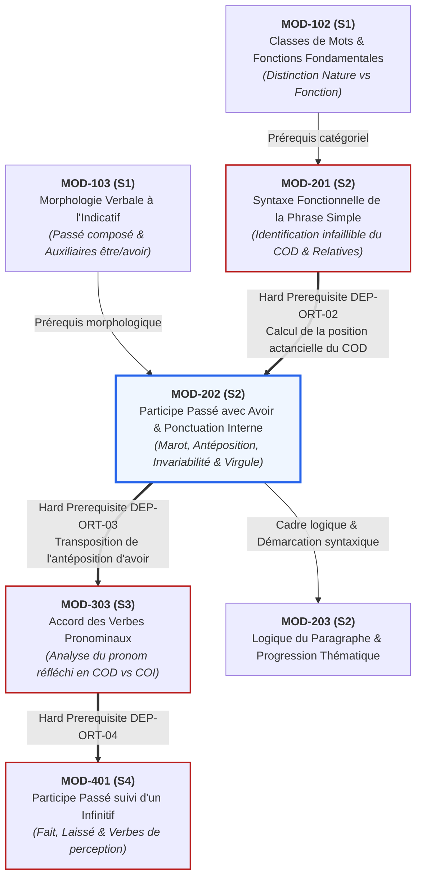

# Fiche Pédagogique Opérationnelle — Module MOD-202

> **Identifiant** : `MOD-202`  
> **Titre** : *Accord du Participe Passé avec l'Auxiliaire Avoir et Ponctuation Interne/Logique*  
> **Semestre** : Année 1 — Semestre 2 (S2)  
> **Domaines mobilisés** : DOM-02 (Orthographe grammaticale), DOM-03 (Grammaire et analyse syntaxique), DOM-04 (Conjugaison et syntaxe du verbe)  
> **Volume horaire estimé** : 17 heures (Étude théorique : 4 h 30 | Pratique délibérée : 6 h 30 | Correction raisonnée : 3 h 30 | Révision active : 2 h 30)  
> **Statut** : [STATUT : VALIDÉ]  
> **Alignement** : [`academic-structure.md`](file:///f:/Formation/world-class-french/01-architecture/academic-structure.md), [`dependency-graph.md` (DEP-ORT-02)](file:///f:/Formation/world-class-french/01-architecture/dependency-graph.md#22-axe-orthographe-grammaticale--accords-du-canonique-aux-cas-limites), [`competency-framework.md` (FR-ORTHO-003)](file:///f:/Formation/world-class-french/02-competency-framework/competency-framework.md#fr-ortho-003-accord-rigoureux-du-participe-passé-avec-lauxiliaire-avoir), [`syllabus.md` (S2)](file:///f:/Formation/world-class-french/03-curriculum/year-1/semester-2/syllabus.md#module-mod-202--accord-du-participe-passé-avec-avoir-et-ponctuation-interne), [`source-registry.md`](file:///f:/Formation/world-class-french/07-resources/source-registry.md)

---

## 1. Présentation et Intérêt du Module

Le module `MOD-202` constitue le pivot normatif et analytique le plus déterminant de la première année d'études. En français écrit, l'accord du participe passé conjugué avec l'auxiliaire *avoir* et le maniement de la ponctuation interne (virgule, point-virgule, deux-points) représentent les deux pierres de touche incontestées qui distinguent le rédacteur approximatif du scripteur rigoureux et autonome.

L'accord du participe passé avec *avoir* n'est pas une singularité fortuite : il obéit à une logique cognitive et positionnelle formulée au XVIe siècle par Clément Marot et théorisée par la linguistique moderne sous l'angle de la structure actancielle et de la linéarité du traitement de l'information [Réf. SRC-GRAM-01, § 948 ; SRC-GRAM-02, chap. 17]. Apprendre à accorder le participe passé, c'est apprendre à calculer la position syntaxique exacte du Complément d'Objet Direct (COD) avant l'émission de la forme verbale.

Concomitamment, la ponctuation interne est trop souvent reléguée à une prétendue « respiration orale ». Ce contresens est la source des erreurs les plus dommageables à l'écrit universitaire et professionnel : virgules parasites entre le sujet et le verbe ou entre le verbe et son objet direct, ou à l'inverse omission des virgules de détachement requises pour isoler les compléments circonstanciels et les appositions. En rétablissant la ponctuation interne comme un balisage logique et syntaxique rigoureux [Réf. SRC-TYPO-01, p. 147 ; SRC-GRAM-02, chap. 4], ce module donne à l'apprenant les outils nécessaires pour architecturer des phrases denses, limpides et irréprochables.

---

## 2. Place dans le Cursus

- **Position séquentielle** : Semaines 5 à 7 du Semestre 2 (S2), culminant dans l'évaluation sommative de mi-parcours de la Semaine 7.
- **Rôle architectural** : Verrou de sécurité orthographique et syntaxique du Cycle 1.
- **Relations amont/aval** :
  - *En amont* :
    - `MOD-102` (classes de mots, distinction capitale nature vs fonction, accord sujet-verbe canonique) ;
    - `MOD-103` (morphologie des temps de l'indicatif, formation canonique des participes passés et distinction *être* vs *avoir*) ;
    - `MOD-201` (analyse fonctionnelle de la phrase simple, identification formelle du COD par les tests d'effacement, de déplacement et de pronominalisation, et initiation à la proposition relative simple).
  - *En aval* :
    - Lien de dépendance bloquante directe (*Hard Prerequisite*, [`dependency-graph.md`, DEP-ORT-02](file:///f:/Formation/world-class-french/01-architecture/dependency-graph.md#22-axe-orthographe-grammaticale--accords-du-canonique-aux-cas-limites)) :
      - `MOD-303` (Semestre 3 : accord du participe passé des verbes pronominaux — où la distinction entre pronom réfléchi COD et COI applique directement la règle de l'objet antéposé d'*avoir*) ;
      - `MOD-401` (Semestre 4 : participe passé suivi d'un infinitif, verbes de perception et verbes *faire / laisser*).
    - Prérequis stylistique pour `MOD-203` (cohésion textuelle et logique du paragraphe) et `MOD-301` / `MOD-302` (architecture de la subordination complexe).

---

## 3. Prérequis et Diagnostic

### 3.1 Prérequis Stricts
1. Identification infaillible de la fonction COD dans la phrase simple (`MOD-201`, compétence `FR-SYNTAX-001`), distinguée du sujet, de l'attribut du sujet, du COI et des compléments circonstanciels.
2. Maîtrise des formes morphologiques des participes passés réguliers et irréguliers des trois groupes verbaux (`MOD-103`).
3. Reconnaissance des pronoms personnels conjoints compléments (*le, la, les, nous, vous, lui, leur*) et des pronoms relatifs simples (*qui, que, dont, où*).

### 3.2 Protocole Diagnostique d'Entrée (Semaine 5, 30 minutes)
Le diagnostic comprend deux volets obligatoires :
- **Volet A — Diagnostic actanciel et positionnel (10 phrases)** : L'apprenant doit surligner le COD s'il existe, indiquer sa position relative par rapport au verbe (antéposé ou postposé) et justifier si un accord du participe passé est requis.
- **Volet B — Diagnostic de ponctuation démarcative (5 phrases brutes)** : L'apprenant analyse un paragraphe dépourvu de ponctuation interne et doit justifier l'emplacement obligatoire des virgules en explicitant la règle syntaxique (détachement, apposition, coordination).
- **Seuil d'alerte** : Tout score inférieur à 8/10 sur le repérage du COD déclenche immédiatement un sas de réactivation express de 2 heures sur l'identification des fonctions syntaxiques de `MOD-201`.

---

## 4. Objectifs Pédagogiques Mesurables

Au terme des 17 heures du module `MOD-202`, l'apprenant doit être capable de :
1. **Classifier** instantanément la nature syntaxique de tout COD antéposé (pronom personnel conjoint, pronom relatif *que*, syntagme interrogatif ou exclamatif) dans un énoncé complexe au passé composé ou plus-que-parfait [Réf. SRC-GRAM-02, chap. 17].
2. **Appliquer** avec une exactitude de 100 % la règle d'accord en genre et en nombre du participe passé employé avec *avoir* dès lors que le COD est antéposé.
3. **Justifier** formellement par écrit l'invariabilité du participe passé dans les quatre cas canoniques d'invariabilité : absence de COD, COD postposé, neutralisation par le pronom adverbial *en*, et compléments circonstanciels de mesure/prix/durée avec les verbes intransitifs [Réf. SRC-GRAM-01, § 950-954].
4. **Disposer** les signes de ponctuation interne (virgules) selon les impératifs de la syntaxe logique (isolation des circonstanciels initiaux, mise en apposition, énumération) et proscrire absolument les virgules fautives brisant la chaîne sujet-verbe ou verbe-complément essentiel [Réf. SRC-TYPO-01, p. 147-151].
5. **Articuler** des énoncés denses au moyen des deux-points (relations de cause, conséquence, explication ou citation) et du point-virgule (balancement de propositions coordonnées ou propositions indépendantes liées).

---

## 5. Compétences Visées et Niveaux de Maîtrise Attendus

| Identifiant | Intitulé de la Compétence | Palier d'Entrée | Palier Visé MOD-202 | Preuve Observable Spécifique |
| :--- | :--- | :---: | :---: | :--- |
| [`FR-ORTHO-003`](file:///f:/Formation/world-class-french/02-competency-framework/competency-framework.md#fr-ortho-003-accord-rigoureux-du-participe-passé-avec-lauxiliaire-avoir) | **Accord rigoureux du participe passé avec l'auxiliaire avoir** | L1 / L2 | **L3 (Autonomie)** | Résolution sans faute de 20 cas complexes comportant des antépositions variées de COD et des cas limites d'invariabilité. |
| [`FR-SYNTAX-001`](file:///f:/Formation/world-class-french/02-competency-framework/competency-framework.md#fr-syntax-001-analyse-fonctionnelle-et-délimitation-de-la-phrase-simple) | **Analyse fonctionnelle et délimitation de la phrase simple** | L2 | **L3 (Autonomie)** | Discrimination infaillible entre COD antéposé, complément de mesure/prix et pronom adverbial partitif *en*. |
| [`FR-INT-001`](file:///f:/Formation/world-class-french/02-competency-framework/competency-framework.md#fr-int-001-rédaction-dun-texte-long-cohérent-avec-maîtrise-des-accords-et-de-la-ponctuation) | **Balisage logique et ponctuation interne de l'énoncé** | L2 | **L3 (Autonomie)** | Zéro virgule fautive entre sujet et verbe ou verbe et objet sur un texte de 300 mots ponctué avec rigueur. |

### Définition Observable du Palier L3 (Autonomie) pour `FR-ORTHO-003` :
L'apprenant applique la règle de manière délibérée et systématique sans recourir au « sentiment de la langue » ou à l'intuition auditive. Face à n'importe quelle phrase complexe, il applique mécaniquement l'algorithme :
1. Repérage du verbe composé avec l'auxiliaire *avoir*.
2. Questionnement actanciel formel : *Le verbe a-t-il un complément d'objet direct ?*
3. Analyse positionnelle : *Ce COD est-il placé avant ou après le participe passé ?*
4. Détermination des traits : *Si le COD précède, quels sont son genre et son nombre exacts ?*
5. Transfert morphologique sur le participe passé.

---

## 6. Plan Détaillé des Chapitres

```text
ARCHITECTURE PÉDAGOGIQUE DU MODULE MOD-202 (17 HEURES)
├── CHAPITRE 1 : FONDEMENT HISTORIQUE ET PRINCIPE COGNITIF DE CLÉMENT MAROT
│   ├── 1.1 L'épigramme de 1538 et l'ordonnancement de la langue française
│   ├── 1.2 Le principe psycholinguistique de la disponibilité de l'objet
│   └── 1.3 L'algorithme binaire de décision syntaxique
├── CHAPITRE 2 : TYPOLOGIE EXHAUSTIVE DES COD ANTÉPOSÉS
│   ├── 2.1 Les pronoms personnels conjoints d'objet direct (le, la, les, nous, vous, me, te)
│   ├── 2.2 Le pronom relatif « que » et la remontée à l'antécédent nominal
│   ├── 2.3 Les syntagmes interrogatifs et exclamatifs (quel, quels, quelle, quelles ; combien de)
│   └── 2.4 Synthèse matricielle des configurations d'antéposition
├── CHAPITRE 3 : LES CAS CANONIQUES D'INVARIABILITÉ AVEC L'AUXILIAIRE AVOIR
│   ├── 3.1 L'absence structurelle de COD : verbes intransitifs conjugués avec avoir
│   ├── 3.2 Le COD postposé : la règle d'invariabilité par défaut
│   ├── 3.3 La neutralisation par le pronom adverbial « en »
│   └── 3.4 Les verbes de mesure, durée, prix et poids : complément circonstanciel vs COD figuré
├── CHAPITRE 4 : PONCTUATION INTERNE I — LES RÈGLES DE LA VIRGULE DÉMARCATIVE
│   ├── 4.1 Réfutation du mythe respiratoire : la virgule comme opérateur syntaxique
│   ├── 4.2 Les détachements licites : compléments circonstanciels en tête de phrase et incises
│   ├── 4.3 La mise en apposition et les constructions détachées (adjectifs, participes)
│   ├── 4.4 La coordination et la juxtaposition : règles avec et sans conjonction
│   ├── 4.5 Les interdits absolus : proscription de la virgule sujet-verbe et verbe-objet
│   └── 4.6 L'incidence sémantique : relative déterminative (restrictive) vs relative explicative
└── CHAPITRE 5 : PONCTUATION INTERNE II — LES DEUX-POINTS ET LE POINT-VIRGULE
    ├── 5.1 Les deux-points (:) : causalité implicite, déduction, énumération et citation
    ├── 5.2 Le point-virgule (;) : articulation de propositions indépendantes et balancement stylistique
    └── 5.3 Normes typographiques officielles : espacements insécables et règles d'édition
```

---

## 7. Concepts Fondamentaux et Notions Avancées

### 7.1 Concepts Fondamentaux
- **Antéposition du COD** : Situation syntaxique dans laquelle le constituant assumant la fonction de complément d'objet direct se trouve linéairement placé à gauche du verbe recteur dans la chaîne énonciative [Réf. SRC-GRAM-02, chap. 17]. En français, cette configuration ne se rencontre jamais avec un groupe nominal ordinaire à la forme affirmative (*« *Les lettres j'ai écrites »* est agrammatical en français standard non disloqué) ; elle requiert obligatoirement une pronominalisation clitique (*les*), une relativation (*que*) ou une extraction interrogative/exclamative (*quelles lettres*).
- **Principe de Clément Marot (1538)** : Formulé dans l'épigramme célèbre adressée aux dames et gens de lettres :
  > *« Enfans, oiez une leçon / De nostre langue gallicane... / Nostre langue a ceste façon, / Que le roy l'a bien ordonnée : / Si le substantif va devant, / Volontiers le participe suit. / Mais si le participe va devant, / Le participe ne s'ensuit. »*  
  Sur le plan psycholinguistique, lorsque le scripteur produit le participe passé, si l'objet a déjà été prononcé ou pensé sous forme d'un pronom ou d'un antécédent, l'esprit en connaît le genre et le nombre : le participe fonctionne alors comme un adjectif s'accordant avec son support. Si l'objet n'a pas encore été produit (COD postposé), le verbe reste à sa forme neutre non accordée.
- **Opérateur de démarcation syntaxique (la virgule)** : Signe typographique dont la fonction première n'est pas phonétique ou prosodique, mais structurale : isoler les constituants extra-propositionnels (détachés, thématisés ou incidents) et délimiter les membres coordonnés ou juxtaposés [Réf. SRC-TYPO-01, p. 147].

### 7.2 Notions Avancées
- **Statut linguistique du pronom adverbial *en*** :
  Issu du latin *inde* (« de là »), *en* est un pronom à valeur génitive, ablative ou partitive. Dans la grammaire descriptive et normative classique, *en* n'exprime ni genre ni nombre intrinsèques et ne représente pas un objet direct déterminé, mais une quantité indéterminée ou une fraction (*Des pommes, j'en ai mangé* = j'ai mangé de cela). L'Académie française et l'usage savant maintiennent fermement la règle d'**invariabilité du participe passé précédé de *en*** [Réf. SRC-GRAM-01, § 954 ; SRC-LEX-02].  
  *Distinction avancée* : Si *en* est accompagné d'un adverbe ou d'un syntagme de quantité placé après le verbe (*J'en ai cueilli trois*), le participe demeure invariable. L'accord archaïque ou littéraire très rare (*« Des fleurs, j'en ai cueillies »*) est considéré comme vieilli ou fautif dans l'usage normé contemporain.
- **La dichotomie des verbes dits de mesure (*coûter, valoir, peser, mesurer, durer, vivre, courir, marcher*)** :
  Ces verbes présentent une double valence syntaxique fondamentale qu'il convient de ne jamais confondre [Réf. SRC-GRAM-01, § 952] :
  1. *Emploi intransitif avec complément circonstanciel de mesure / prix / durée* : Le syntagme nominal répond à la question *combien ?* ou *combien de temps ?* et n'est pas un COD (il ne peut être passivé ni pronominalisé par *les*). Le participe passé est **invariable**.
     - *Les trois mille euros que cette formation a **coûté**.* (Le stage n'a pas « acheté » les euros : complément de prix).
     - *Les cent kilomètres que nous avons **couru**.* (Complément de distance).
     - *Les quatre-vingts ans qu'il a **vécu**.* (Complément de durée).
  2. *Emploi transitif direct au sens figuré* : Le verbe admet un véritable COD au sens d'occasionner, susciter, éprouver ou évaluer. L'accord est alors **obligatoire**.
     - *Les peines et les tracas que cette entreprise m'a **coûtés**.* (Cette affaire a occasionné des peines $\rightarrow$ COD antéposé *que* mis pour *peines*).
     - *Les périls et les dangers qu'il a **courus**.* (Il a affronté des périls $\rightarrow$ COD antéposé).
     - *La charge et les arguments que le juge a **pesés**.* (Le juge a soupesé intellectuellement les arguments $\rightarrow$ COD antéposé).
- **Incidence sémantique de la virgule sur les relatives (Restrictive vs Appositive)** :
  La présence ou l'absence de virgules autour d'une proposition subordonnée relative introduite par *que* change radicalement la portée logique de l'énoncé [Réf. SRC-GRAM-02, chap. 20] :
  - *Relative déterminative (restrictive)* : Pas de virgule. La relative restreint l'extension du nom antécédent (*Les dossiers que le comité a rejetés feront l'objet d'un recours* $\rightarrow$ seuls les dossiers rejetés sont concernés).
  - *Relative explicative (appositive)* : Entre virgules. La relative apporte une prédication seconde s'appliquant à la totalité de l'antécédent (*Les dossiers, que le comité a rejetés, feront l'objet d'un recours* $\rightarrow$ tous les dossiers sont rejetés et font l'objet d'un recours).

---

## 8. Erreurs et Confusions Fréquentes

| Forme fautive | Analyse de la faille cognitive / linguistique | Règle normative et forme correcte | Source de référence |
| :--- | :--- | :--- | :--- |
| *« Elles ont **mangées** des pommes. »* | **Biais d'analogie avec l'auxiliaire être.** L'apprenant accorde par défaut le verbe avec son sujet sans analyser l'auxiliaire ni la position du complément. | L'auxiliaire *avoir* n'accorde jamais le participe avec le sujet. Le COD (*des pommes*) étant postposé, le participe reste invariable : *« Elles ont **mangé** des pommes. »* | [SRC-GRAM-01, § 948] |
| *« Les directives qu'il a **donné** sont claires. »* | **Omission d'accord sur le relatif antéposé.** L'apprenant ne remonte pas du pronom relatif *que* à son antécédent nominal pluriel. | Le pronom relatif *que* est COD antéposé et a pour antécédent *directives* (fém. plur.) : *« Les directives qu'il a **données** sont claires. »* | [SRC-GRAM-02, chap. 17] |
| *« Des erreurs, nous en avons **commises** plusieurs. »* | **Accord fautif provoqué par le pronom adverbial en.** L'apprenant assimile à tort *en* à un pronom personnel défini pluriel (*les*). | Le pronom *en* neutralise l'accord du participe passé dans l'usage normatif standard : *« Des erreurs, nous en avons **commis** plusieurs. »* | [SRC-GRAM-01, § 954] |
| *« Les deux heures qu'elle a **dormies**. »* | **Confusion entre complément de durée et COD.** L'apprenant applique mécaniquement une question « quoi ? » déformée (*elle a dormi quoi ? deux heures*). | Le verbe *dormir* est intransitif par nature. *Deux heures* est un complément circonstanciel de durée : *« Les deux heures qu'elle a **dormi**. »* | [SRC-GRAM-01, § 950] |
| *« Le président de séance, a ouvert la séance. »* | **Rupture prosodique erronée (virgule de souffle).** L'apprenant insère une virgule pour marquer une pause à l'oral après un syntagme sujet long. | **Interdiction formelle** de séparer par une virgule le groupe sujet et le groupe verbal recteur : *« Le président de séance a ouvert la séance. »* | [SRC-TYPO-01, p. 148] |
| *« Le ministre a déclaré, que les réformes avançaient. »* | **Virgule fautive entre verbe recteur et proposition complétive.** Rupture illicite du lien de rection directe verbe-objet. | On ne sépare jamais par une virgule le verbe de son complément d'objet direct (ou de sa proposition complétive) : *« Le ministre a déclaré que les réformes avançaient. »* | [SRC-GRAM-02, chap. 4] |

---

## 9. Exemples Progressifs

### 9.1 Niveau Simple (Canonique)
- *COD postposé (invariable)* : *Nous avons rédigé les conclusions hier soir.*
- *COD antéposé par pronom personnel conjoint direct* : *Ces conclusions, nous les avons rédigé**es** hier soir.* (*les* = COD antéposé féminin pluriel).
- *COD antéposé par pronom relatif simple* : *La convention que le conseil a signé**e** entrera en vigueur lundi.* (*que* = COD antéposé féminin singulier).
- *Virgule de détachement circonstanciel initial* : *Dès l'aube, les troupes se mirent en marche.*

### 9.2 Niveau Intermédiaire (Perturbateurs et Nuances)
- *Syntagme interrogatif / exclamatif* :
  - *Quels arguments avez-vous retenu**s** ?* (*quels arguments* = masculin pluriel).
  - *Combien de lettres as-tu reçu**es** aujourd'hui ?* (*combien de lettres* = féminin pluriel).
- *Neutralisation par le pronom en* :
  - *Des manuscrits anciens, les archivistes en ont retrouvé des centaines.* (Invariable malgré le pluriel d'antécédent).
- *Pronom personnel conjoint ambigu (nous / vous)* :
  - *Elle nous a contacté**s**.* (Accord avec *nous* si *nous* est COD masculin pluriel ; *contacté**es*** si le groupe désigné est féminin).
  - *Elle nous a téléphoné.* (Invariable : *téléphoner* se construit avec un COI, *nous* = *à nous*).
- *Virgule d'apposition et relatives explicatives* :
  - *Les ministres, épuisés par les négociations, ont ajourné la séance.*
  - *Ce rapport, que nous avons minutieusement relu, sera publié demain.*

### 9.3 Niveau Complexe (Verbes de Mesure, Polysémie et Enchâssements)
- *Verbe de mesure : intransitif vs figuré transitif direct* :
  - *Les trois mille francs que cette toile a coûté.* (Mesure de prix $\rightarrow$ invariable).
  - *Les reproches que son imprudence lui a coûté**s**.* (Sens figuré : causer, susciter $\rightarrow$ accord masculin pluriel).
  - *Les dix minutes que la sonnerie a duré.* (Durée $\rightarrow$ invariable).
  - *Les périls que les explorateurs ont couru**s**.* (Transitif direct : braver les périls $\rightarrow$ accord masculin pluriel).
- *Double pronom et pronom COI intercalé* :
  - *Ces documents confidentiels, le directeur me les a transmis.* (*les* = COD masculin pluriel ; *me* = COI $\rightarrow$ accord sur *les*).
- *Ponctuation logique complexe (deux-points et point-virgule)* :
  - *La décision prise par l'assemblée était inévitable : le trésor public était entièrement tari ; les créanciers refusaient tout nouveau délai.* (Deux-points marquant la causalité explicative ; point-virgule balançant deux propositions indépendantes coordonnées sémantiquement).

---

## 10. Activités d'Observation et de Découverte

### Atelier 1 : « La ligne temporelle de Clément Marot » (45 min)
- **Dispositif** : L'enseignant projette 10 phrases mot par mot de gauche à droite sur un écran dynamique.
- **Tâche** : L'apprenant doit lever la main au moment exact où son esprit dispose de l'information lui permettant de décider s'il y aura un accord ou non.
- **Objectif didactique** : Vivre concrètement la linéarité cognitive de la langue :
  - Dans *« J'ai reçu... »*, au moment où le participe est émis, l'objet n'est pas encore connu $\rightarrow$ invariabilité immédiate.
  - Dans *« La lettre que j'ai... »*, l'objet féminin est déjà identifié $\rightarrow$ le participe qui va suivre recevra obligatoirement la marque *-e*.

### Atelier 2 : « Le laboratoire des balances : Poids, Prix et Mesures » (1 h)
- **Dispositif** : Corpus de 15 phrases contenant les verbes *coûter, peser, mesurer, valoir, courir*.
- **Tâche** : Pour chaque phrase, l'apprenant doit pratiquer le test de commutation passive :
  - *« Ce livre a coûté vingt euros »* $\rightarrow$ *« *Vingt euros ont été coûtés par ce livre »* est impossible $\rightarrow$ complément de mesure, invariabilité.
  - *« Ce projet a coûté des larmes »* $\rightarrow$ *« Des larmes ont été coûtées par ce projet »* (acceptable au sens de suscitées) $\rightarrow$ vrai COD, accord de la relative antéposée.

### Atelier 3 : « Le scalpel de la virgule : Rétablir le droit syntaxique » (45 min)
- **Dispositif** : Analyse comparative de 6 phrases juridiques célèbres dont le sens juridique s'inverse ou dont la légalité s'annule par le déplacement d'une virgule :
  1. *« Les prisonniers, qui ont collaboré, seront libérés. »* (Tous les prisonniers sont libérés car tous ont collaboré).
  2. *« Les prisonniers qui ont collaboré seront libérés. »* (Seuls les prisonniers ayant collaboré seront libérés).
- **Tâche** : Rédiger la paraphrase juridique de chaque énoncé et formaliser la règle d'interdiction de la virgule entre le nom sujet et son verbe.

---

## 11. Exercices Progressifs

### 11.1 Niveau 1 : Discrimination Directe et Accords Canoniques (2 heures)
- **Exercice 1.1 (Reconnaissance du COD)** : Dans 15 phrases, identifier le COD, indiquer sa classe grammaticale exacte et préciser s'il est antéposé ou postposé.
- **Exercice 1.2 (Accord canonique sous avoir)** : Accorder le participe passé entre parenthèses dans 20 phrases comportant exclusivement des pronoms personnels conjoints directs (*le, la, les*) ou le pronom relatif *que*.
- **Exercice 1.3 (Détachement circonstanciel et virgule)** : Réécrire 10 phrases simples en plaçant le complément circonstanciel en tête et en insérant la virgule de démarcation requise.

### 11.2 Niveau 2 : Manipulations Syntaxiques et Pièges de l'Invariabilité (2 h 30)
- **Exercice 2.1 (Neutralisation par le pronom en)** : Résoudre l'accord du participe passé dans 12 phrases contenant le pronom *en*, en explicitant dans chaque cas pourquoi l'invariabilité s'impose.
- **Exercice 2.2 (Interrogatifs et exclamatifs)** : Compléter 10 énoncés introduits par *quel(le)(s)* ou *combien de* en accordant les participes passés avec les syntagmes nominaux extraits.
- **Exercice 2.3 (Chasse aux virgules illicites)** : Dans un corpus de 15 phrases altérées par des scripteurs négligents, biffer toutes les virgules séparant fautivement un sujet d'un verbe ou un verbe d'un complément d'objet direct.

### 11.3 Niveau 3 : Arbitrage de Haute Précision et Textes d'Auteurs (2 heures)
- **Exercice 3.1 (Verbes de mesure et polysémie)** : Justifier l'accord ou l'invariabilité du participe passé dans 15 phrases mettant en œuvre les verbes *coûter, peser, mesurer, valoir, durer, courir, vivre*.
- **Exercice 3.2 (Ponctuation logique de la période)** : Ponctuer un texte continu de 200 mots sans aucune ponctuation interne en employant judicieusement 8 virgules, 2 points-virgules et 1 deux-points, puis justifier par écrit le rôle logique de chaque signe employé.

---

## 12. Ateliers de Correction et de Révision

### Protocole d'Autocorrection Systématique en Trois Passes
Lors de toute production écrite ou résolution de dictée, l'apprenant applique obligatoirement l'algorithme des trois cribles :

```text
ALGORITHME DE VÉRIFICATION EN TROIS PASSES
├── PASSE 1 : CRIBLE DU VERBE AUXILIÉ PAR AVOIR
│   ├── Repérer chaque participe passé précédé de l'auxiliaire avoir.
│   ├── Vérifier formellement : le participe s'accorde-t-il avec le sujet ?
│   │   └── SI OUI -> CORRIGER IMMÉDIATEMENT (Faute éliminatoire majeure).
│   └── Poser la question actancielle : Avoir + participe + QUI / QUOI ?
│       ├── Réponse à droite du verbe (postposée) -> Invariable.
│       └── Réponse à gauche du verbe (antéposée) -> Passer au Crible 2.
├── PASSE 2 : CRIBLE DU COD ANTÉPOSÉ ET DE SES EXCLUSIONS
│   ├── Le complément antéposé est-il « en » ? -> INVARIABLE.
│   ├── Le verbe est-il un verbe de mesure pris au sens propre ? -> INVARIABLE.
│   └── Le complément est-il un véritable COD (pronom personnel, que, quel) ?
│       └── -> IDENTIFIER genre/nombre de l'antécédent et ACCORDER.
└── PASSE 3 : CRIBLE DE LA VIRGULE SYNTAXIQUE
    ├── Inspecter chaque frontière entre le groupe sujet et son verbe :
    │   └── Y a-t-il une virgule isolée non appositive ? -> SUPPRIMER.
    ├── Inspecter chaque frontière entre le verbe et son COD / complétive :
    │   └── Y a-t-il une virgule ? -> SUPPRIMER.
    └── Vérifier la présence des virgules obligatoires après les CC en tête de phrase.
```

---

## 13. Production Intégratrice

### Nature de la Production
**Résolution et justification morphosyntaxique exhaustive d'un corpus d'arbitrage de 25 phrases pièges.**

### Consigne Opérationnelle
L'apprenant reçoit un corpus de 25 phrases non accordées mettant en scène toutes les configurations d'antéposition de COD, d'invariabilité avec avoir et de ponctuation interne. Pour chaque phrase, il doit :
1. Rétablir l'orthographe exacte du participe passé entre parenthèses.
2. Établir la fiche de justification syntaxique selon la grille normée en 4 colonnes :
   - *Nature et fonction du terme référent* ;
   - *Position par rapport au participe passé* ;
   - *Genre et nombre du donneur d'accord* ;
   - *Règle de grammaire officielle mobilisée avec référence académique*.
3. Rétablir ou valider la ponctuation interne de la phrase en justifiant l'emploi ou l'absence de virgule.

### Corpus Officiel des 25 Phrases Pièges :
1. *Ces propositions, le comité ne les a pas (retenu) lors du vote.*
2. *Les lettres que nous avons (écrit) ne sont jamais (parvenu) à destination.*
3. *Combien de difficultés avez-vous (rencontré) dans cette démarche ?*
4. *Quelles magnifiques récompenses ils ont (reçu) pour leur bravoure !*
5. *Des romans d'aventures, ma sœur en a (lu) plus d'une cinquantaine cet été.*
6. *Les trois heures que nous avons (marché) nous ont totalement (épuisé).*
7. *Les sommes considérables que ce litige judiciaire lui a (coûté).*
8. *Les efforts immenses et les peines que cette victoire lui a (coûté).*
9. *Les dix kilos que ce paquet a (pesé) ont empêché son expédition par avion.*
10. *Les lourdes responsabilités qu'elle a (pesé) avant de se prononcer.*
11. *Les cinquante années qu'a (duré) le règne de ce monarque éclairé.*
12. *Ils ont (dormi) d'un sommeil profond durant toute la traversée.*
13. *Ces jeunes femmes, nous les avons (croisé) hier au carrefour.*
14. *Ces jeunes femmes, nous leur avons (parlé) pendant plus d'une heure.*
15. *La foule que nous avons (aperçu) scandait des slogans pacifiques.*
16. *Des félicitations officielles, ils en ont (reçu) de toutes les institutions.*
17. *Les tempêtes et les orages qu'il a (fait) durant cette funeste semaine.*
18. *Quelle décision le directoire a-t-il (pris) concernant notre département ?*
19. *Les deux kilomètres que les relayeurs ont (couru) sous une pluie battante.*
20. *Les dangers effroyables que ces marins courageux ont (couru).*
21. *La confiance et l'estime que vous m'avez (témoigné) m'honorent profondément.*
22. *Elle a (oublié) les clés que son frère lui avait pourtant (confié).*
23. *Des erreurs typographiques, le prote en a (relevé) moins que prévu.*
24. *Les explications précises qu'elle nous a (fourni) ont levé tous nos doutes.*
25. *Ces deux traités de paix, les puissances belligérantes les ont (ratifié).*

---

## 14. Évaluation et Barème

L'évaluation sommative de fin de module `MOD-202` est notée sur **20 points** et applique le barème pénal officiel du cursus ([`assessment-rubrics.md`](file:///f:/Formation/world-class-french/02-competency-framework/assessment-rubrics.md)) :

| Épreuve sommatrice | Contenu et modalités | Barème et pénalités | Seuil éliminatoire |
| :--- | :--- | :--- | :---: |
| **Partie 1 : Dictée de contrôle ciblée (10 points)** | Dictée sans document de 120 mots intégrant 8 participes passés avec avoir et 4 cas de ponctuation interne obligatoire. | • **-4,0 pts par accord de participe passé fautif** (accord par défaut avec le sujet ou omission d'accord sur COD antéposé).<br/>• **-2,0 pts par virgule fautive** entre sujet et verbe ou verbe et objet.<br/>• **-1,0 pt par omission d'une virgule** de détachement obligatoire. | $< 7/10$ |
| **Partie 2 : Justification syntaxique écrite (6 points)** | Analyse rédigée de 6 participes passés complexes extraits d'un texte d'auteur (identification du COD, position, traits, règle). | • **1 pt par analyse complète et exacte** (-0,5 pt si la terminaison est correcte mais la justification syntaxique défaillante). | $< 4/6$ |
| **Partie 3 : Épreuve de ponctuation logique (4 points)** | Ponctuation interne d'un texte continu de 150 mots comportant des détachements, des compléments d'objet et des propositions coordonnées. | • **-1,0 pt par contresens de ponctuation** ou insertion d'une virgule prohibée. | $< 3/4$ |

### Règle d'Attribution et Seuil Éliminatoire :
- **Note minimale de validation du module** : **14/20 (70 %)**.
- Toute copie présentant **deux erreurs d'accord de participe passé** sur la Partie 1 perd 8 points, entraînant automatiquement une note $\le 12/20$ et le déclenchement immédiat du sas de remédiation en laboratoire d'orthographe (2 semaines de réentraînement intensif avant épreuve de rattrapage).

---

## 15. Critères de Maîtrise

Le module `MOD-202` est certifié au palier **L3 (Autonomie)** lorsque l'apprenant :
- Réussit avec un taux d'exactitude de **100 %** l'accord du participe passé avec *avoir* en présence d'un pronom personnel conjoint direct (*le, la, les*) ou d'un pronom relatif *que* ;
- Ne commet **aucun accord fautif avec le sujet** sous l'auxiliaire *avoir* ;
- Maintient avec constance l'invariabilité du participe en présence du pronom *en* et avec les verbes intransitifs de mesure ;
- Distingue sans ambiguïté les emplois transitifs figurés des verbes de mesure (*coûter, courir, peser*) de leurs emplois intransitifs réguliers ;
- N'insère **aucune virgule fautive** entre le sujet et le verbe ou entre le verbe et son complément d'objet direct ;
- Utilise la virgule pour isoler systématiquement les compléments circonstanciels placés en tête de proposition et les syntagmes en apposition.

---

## 16. Révisions Espacées Recommandées

Afin de garantir l'ancrage mnésique durable et d'éviter l'érosion des réflexes syntaxiques, le protocole de rappel actif suivant est programmé :
- **J+3 après la fin du module** : Test flash de rappel (10 minutes) : 5 phrases d'antéposition rapide avec pronoms conjoints et relatif *que*.
- **J+7** : Test de discrimination (15 minutes) : 10 phrases confrontant le pronom *en* et les verbes de mesure (*coûter, peser*).
- **J+21** : Laboratoire de ponctuation (15 minutes) : Détection de virgules fautives dans 10 phrases complexes.
- **J+45 (Semestre 2, Semaine 13)** : Réactivation majeure intégrée dans la révision cumulative générale préparant la Porte 2.
- **Semestre 3 (S3)** : Réinvestissement structural quotidien lors de l'étude des verbes pronominaux (`MOD-303`).

---

## 17. Sources de Référence Vérifiées

Toutes les prescriptions linguistiques et typographiques de ce document s'appuient exclusivement sur les autorités suivantes :

1. **Grevisse, Maurice & Goosse, André (2016)**. *Le Bon Usage* (16e éd.). Bruxelles : De Boeck Supérieur.  
   $\rightarrow$ Ouvrage de référence majeur pour l'accord du participe passé avec l'auxiliaire *avoir* (§ 948-965), la règle de Clément Marot (§ 948), le statut du pronom *en* (§ 954), l'analyse des verbes de mesure, durée, prix et poids (§ 952) et les compléments d'objet direct antéposés (§ 949) [Réf. `SRC-GRAM-01`].
2. **Riegel, Martin, Pellat, Jean-Christophe & Rioul, René (2016/2021)**. *Grammaire méthodique du français*. Paris : PUF, coll. « Quadrige ».  
   $\rightarrow$ Ouvrage de référence pour la morphosyntaxe du participe passé (chap. 17), l'analyse actancielle du verbe (chap. 6), la délimitation de la phrase et les fonctions de la ponctuation interne (chap. 4) et la syntaxe de la proposition relative déterminative vs explicative (chap. 20) [Réf. `SRC-GRAM-02`].
3. **Imprimerie nationale (2002/2014)**. *Lexique des règles typographiques en usage à l'Imprimerie nationale*. Paris : Imprimerie nationale.  
   $\rightarrow$ Norme officielle pour l'emploi de la virgule, du point-virgule et des deux-points (s.v. « Ponctuation », p. 147-151), ainsi que les règles d'espacement typographique (espaces insécables) [Réf. `SRC-TYPO-01`].
4. **Ministère de l'Éducation nationale (2020)**. *Terminologie grammaticale*. Paris : Réseau Canopé.  
   $\rightarrow$ Nomenclature officielle pour les fonctions syntaxiques (complément d'objet direct, complément circonstanciel détachable, complément de phrase vs complément de verbe) [Réf. `SRC-NORM-03`].
5. **Grevisse, Maurice (2009)**. *Le Petit Grevisse : Grammaire française* (32e éd.). Bruxelles : De Boeck Supérieur.  
   $\rightarrow$ Synthèse pratique des règles d'accord du participe passé et exercices d'application directe (§ 272-277) [Réf. `SRC-GRAM-05`].

---

## 18. Liens avec les Modules Précédents et Suivants


