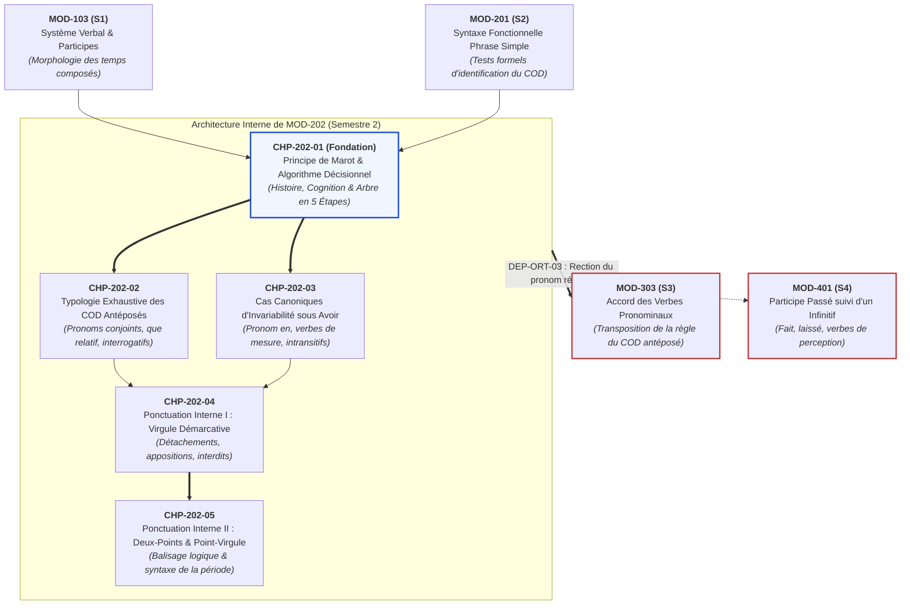
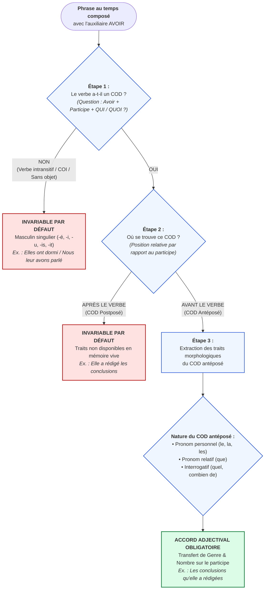

# Chapitre 1 — Fondement Historique et Principe Cognitif de Clément Marot : De l'Épigramme de 1538 à l'Algorithme Décisionnel Moderne

> **Identifiant du chapitre** : `CHP-202-01`  
> **Module de rattachement** : [`MOD-202` — Accord du Participe Passé avec l'Auxiliaire Avoir et Ponctuation Interne/Logique](file:///f:/Formation/world-class-french/03-curriculum/year-1/semester-2/mod-202-participe-passe-avoir-ponctuation-interne.md)  
> **Semestre** : Année 1 — Semestre 2 (S2)  
> **Volume horaire canonique** : 5 à 6 heures d'apprentissage autonome délibéré et d'ateliers d'application (Phase 1 Étude : 1 h 30 | Phase 2 Pratique : 1 h 30 | Phase 3 Correction : 1 h 00 | Phase 4 Évaluation : 1 h 00)  
> **Statut** : [STATUT : VALIDÉ]  
> **Compétences associées** : [`FR-ORTHO-003`](file:///f:/Formation/world-class-french/02-competency-framework/competency-framework.md#fr-ortho-003-accord-rigoureux-du-participe-passé-avec-lauxiliaire-avoir) (L3), [`FR-SYNTAX-001`](file:///f:/Formation/world-class-french/02-competency-framework/competency-framework.md#fr-syntax-001-analyse-fonctionnelle-et-délimitation-de-la-phrase-simple) (L3), [`FR-VERB-001`](file:///f:/Formation/world-class-french/02-competency-framework/competency-framework.md#fr-verb-001-maîtrise-des-valeurs-aspectuo-temporelles-de-lindicatif) (L2/L3)  
> **Sources scientifiques de référence** : `SRC-GRAM-01` (Grevisse & Goosse, *Le Bon Usage*, 16e éd., § 948-949), `SRC-GRAM-02` (Riegel, Pellat, Rioul, *Grammaire méthodique du français*, chap. 17), `SRC-NORM-03` (Ministère de l'Éducation nationale, *Terminologie grammaticale*, 2020), `SRC-GRAM-05` (Grevisse, *Le Petit Grevisse*, 32e éd., § 272-273)

---

## 1. Titre et Place dans le Cursus

### 1.1 Intitulé Officiel
**Chapitre 1 : Fondement Historique et Principe Cognitif de Clément Marot : De l'Épigramme de 1538 à l'Algorithme Décisionnel Moderne** (`CHP-202-01`).

### 1.2 Insertion Architecturale dans le Cursus
Le présent chapitre inaugure le module [`MOD-202`](file:///f:/Formation/world-class-french/03-curriculum/year-1/semester-2/mod-202-participe-passe-avoir-ponctuation-interne.md), pierre angulaire de l'orthographe grammaticale et de la morphosyntaxe en première année d'études universitaires. 

Au Semestre 1, l'apprenant a maîtrisé la morphologie régulière et irrégulière des participes passés dans [`MOD-103`](file:///f:/Formation/world-class-french/03-curriculum/year-1/semester-1/mod-103-systeme-verbal-indicatif.md) et la distinction capitale entre nature et fonction dans [`MOD-102`](file:///f:/Formation/world-class-french/03-curriculum/year-1/semester-1/mod-102-classes-mots-accords-fondamentaux.md). Au début du Semestre 2, [`MOD-201`](file:///f:/Formation/world-class-french/03-curriculum/year-1/semester-2/mod-201-syntaxe-fonctionnelle-phrase-simple.md) a établi les critères rigoureux de délimitation du Complément d'Objet Direct (COD) par les tests d'effacement, de déplacement, de pronominalisation et de clivage. 

Le chapitre `CHP-202-01` réinvestit immédiatement ces acquis fonctionnels pour résoudre l'un des problèmes les plus célèbres de la langue française : l'accord du participe passé employé avec l'auxiliaire *avoir*. Loin d'être une bizarrerie arbitraire ou un caprice académique, cette règle repose sur une découverte psycholinguistique séculaire formulée dès 1538 par le poète Clément Marot et théorisée aujourd'hui sous la forme d'un algorithme syntaxique binaire infaillible [Réf. `SRC-GRAM-01`, § 948 ; `SRC-GRAM-02`, chap. 17].



- **En amont** : Ce chapitre s'appuie sur la reconnaissance des formes du participe passé (`MOD-103`) et sur la compétence formelle d'identification du COD (`MOD-201`, `FR-SYNTAX-001`).
- **Au sein du module [`MOD-202`](file:///f:/Formation/world-class-french/03-curriculum/year-1/semester-2/mod-202-participe-passe-avoir-ponctuation-interne.md)** : Il établit le socle conceptuel et procédural commun à tout le traitement du participe passé : les configurations d'antéposition du COD (`CHP-202-02`) et les situations d'invariabilité absolue (`CHP-202-03`).
- **En aval dans le cursus** : L'acquisition du réflexe algorithmique constitue le verrou de sécurité (*Hard Prerequisite*) indispensable pour aborder l'accord des verbes pronominaux au Semestre 3 ([`MOD-303`](file:///f:/Formation/world-class-french/03-curriculum/year-2/semester-3/mod-303-accords-verbes-pronominaux.md)) et les cas limites des participes suivis d'un infinitif au Semestre 4 ([`MOD-401`](file:///f:/Formation/world-class-french/03-curriculum/year-2/semester-4/mod-401-pragmatique-accords-limites-rectifications-1990.md)).

---

## 2. Objectifs Mesurables

Au terme des 5 à 6 heures d'étude théorique et d'ateliers d'application délibérée de ce chapitre, l'apprenant sera capable de :

1. **Expliciter le fondement historique et le principe psycholinguistique de Clément Marot (1538)** en démontrant comment le traitement cognitif linéaire de gauche à droite et la disponibilité des traits morphologiques en mémoire de travail commandent l'accord adjectival du participe passé [Réf. `SRC-GRAM-01`, § 948 ; `SRC-GRAM-02`, chap. 17]. (`FR-ORTHO-003` — Palier L3).
2. **Dérouler de manière autonome l'algorithme syntaxique binaire en 5 étapes** face à tout énoncé au passé composé ou plus-que-parfait construit avec l'auxiliaire *avoir*, afin de déterminer avec un taux d'exactitude de 100 % s'il y a lieu d'accorder le participe passé ou de maintenir sa forme par défaut [Réf. `SRC-NORM-03`, p. 28 ; `SRC-GRAM-05`, § 272]. (`FR-ORTHO-003`, `FR-SYNTAX-001` — Palier L3).
3. **Justifier formellement la valeur de forme neutre par défaut du participe passé invariable** (au masculin singulier) en reliant l'absence d'accord au phénomène de coalescence verbale de la périphrase latine *habere* + participe accompli [Réf. `SRC-GRAM-01`, § 948]. (`FR-ORTHO-003` — Palier L3).
4. **Diagnostiquer, réfuter scientifiquement et rectifier les six pathologies d'accord récurrentes** sous l'auxiliaire *avoir* (accord illicite avec le sujet, accord anticipé sur COD postposé, omission d'accord sur COD antéposé, confusion d'auxiliaires, mauvaise délimitation du COD, illusion phonétique), en substituant l'analyse morphosyntaxique explicite au prétendu sentiment intuitif de la langue. (`FR-ORTHO-003` — Palier L3).

---

## 3. Prérequis et Test de Préparation (Auto-Diagnostic)

### 3.1 Prérequis Cognitifs Indispensables
Avant d'aborder ce chapitre, l'apprenant doit maîtriser :
- La distinction entre l'auxiliaire *être* et l'auxiliaire *avoir* dans les temps composés ([`MOD-103`](file:///f:/Formation/world-class-french/03-curriculum/year-1/semester-1/mod-103-systeme-verbal-indicatif.md)) ;
- L'identification de la fonction Complément d'Objet Direct (COD) au moyen des critères de rection verbale directe et de pronominalisation clitique (*le, la, les*) ([`MOD-201`](file:///f:/Formation/world-class-french/03-curriculum/year-1/semester-2/mod-201-syntaxe-fonctionnelle-phrase-simple.md)) ;
- La distinction stricte entre le sujet du verbe (donneur d'accord verbal) et le complément d'objet ([`MOD-102`](file:///f:/Formation/world-class-french/03-curriculum/year-1/semester-1/mod-102-classes-mots-accords-fondamentaux.md)).

### 3.2 Auto-Diagnostic Préparatoire Immédiat (5 Questions)
Résolvez par écrit les cinq questions suivantes sans consulter de documentation extérieure, puis vérifiez vos réponses à l'aide du corrigé repliable.

1. Dans la phrase *« Les directrices ont convoqué les délégués syndicaux »*, quel est le terme qui donne son accord au verbe auxiliaire *ont*, et pourquoi le participe passé *convoqué* ne prend-il pas de marque féminine plurielle ?
2. Quelle question formelle permet d'isoler l'objet direct du verbe dans l'énoncé *« La convention que notre entreprise a signée hier entrera en vigueur lundi »* ? Où se trouve cet objet par rapport au participe *signée* ?
3. Pourquoi la phrase *« *Elles ont parties tôt »* est-elle doublement impossible en français standard ?
4. Dans la phrase *« Le magistrat leur a accordé une audience »*, quelle est la fonction syntaxique exacte du pronom personnel *leur* ? Ce pronom peut-il commander l'accord du participe passé ?
5. À l'oral, entend-on une différence de prononciation entre *mangé*, *mangée*, *mangés* et *mangées* ? Quelle conséquence majeure cette homophonie auditive emporte-t-elle pour l'apprentissage de l'orthographe écrite ?

---

#### Corrigé Détaillé de l'Auto-Diagnostic

<details>
<summary><b>Consulter le corrigé raisonné des 5 questions de préparation</b></summary>

1. **Donneur d'accord du verbe vs statut du participe** :
   - Le terme qui donne son accord à l'auxiliaire *ont* est le groupe sujet *Les directrices* (féminin pluriel, 3e personne du pluriel).
   - Le participe passé *convoqué* ne s'accorde pas avec ce sujet parce qu'il est conjugué avec l'auxiliaire *avoir*. Son COD (*les délégués syndicaux*) étant placé **après** le verbe (postposé), le participe passé conserve sa forme neutre par défaut au masculin singulier [Réf. `SRC-GRAM-01`, § 948].
2. **Identification et position du COD relatif** :
   - L'interrogation formelle est : *L'entreprise a signé quoi ?* Réponse : *la convention*, représentée syntaxiquement par le pronom relatif *que*.
   - Ce pronom relatif *que* (dont l'antécédent est *La convention*, féminin singulier) est situé **à gauche** du verbe, c'est-à-dire **antéposé** par rapport au participe passé *signée*, ce qui déclenche l'accord au féminin singulier [Réf. `SRC-GRAM-02`, chap. 17].
3. **Double anomalie de *Elles ont parties*** :
   - D'une part, le verbe *partir* est un verbe intransitif de mouvement qui se conjugue obligatoirement avec l'auxiliaire *être* aux temps composés (*Elles sont parties*).
   - D'autre part, même si un scripteur employait l'auxiliaire *avoir*, ce dernier n'accorde jamais le participe passé avec son sujet : la terminaison féminine plurielle *-ies* sous *avoir* sans COD antéposé est une aberration morphosyntaxique totale [Réf. `SRC-GRAM-05`, § 272].
4. **Fonction du pronom conjoint *leur*** :
   - Le pronom *leur* est ici un Complément d'Objet Indirect (COI) : *accorder une audience à qui ? $\rightarrow$ à eux / à elles*.
   - Un COI n'est pas un COD. Ne gouvernant aucune relation d'objet direct, il ne peut en aucun cas provoquer l'accord du participe passé sous *avoir* [Réf. `SRC-NORM-03`, p. 28].
5. **Homophonie auditive et nécessité du contrôle visuel** :
   - En français standard contemporain, *mangé*, *mangée*, *mangés* et *mangées* se prononcent rigoureusement de la même façon : `/mɑ̃.ʒe/`.
   - L'oreille ne perçoit aucune distinction morphologique. En conséquence, l'accord du participe passé à l'écrit ne peut jamais reposer sur le sentiment auditif ou l'intuition sonore : il exige une procédure d'analyse formelle, visuelle et syntaxique abstraite.

</details>

---

## 4. Situation de Départ ou Problème Concret

L'accord du participe passé employé avec l'auxiliaire *avoir* constitue l'une des sources de crispation et d'échec les plus universellement partagées dans l'enseignement du français. Considéré par de nombreux apprenants comme une brimade académique arbitraire, un vestige byzantin ou une énigme inaccessible, il donne lieu, même dans des écrits professionnels hautement qualifiés (mémoires universitaires, rapports d'expertise juridique, courriers ministériels), à des fautes pénalisantes :
- *« Les requêtes que le tribunal a **rejeté**... »* (omission fautive d'accord) ;
- *« Elles ont **décidées** de reporter la séance... »* (accord fautif avec le sujet sous *avoir*) ;
- *« La directrice a **remise** les diplômes aux lauréats... »* (accord anticipé sur un objet qui n'a pas encore été énoncé).

Ces erreurs ne résultent pas d'un manque d'intelligence de la part du scripteur, mais de deux illusions cognitives tenaces :
1. **L'illusion du sentiment intuitif de la langue** : Le scripteur s'en remet à ce qui lui « paraît naturel » à la lecture intérieure. Or, à l'oral, plus de 85 % des participes passés du français appartiennent au premier groupe (*aimer*, *trouver*, *décider*) ou se terminent par une voyelle (*fini*, *voulu*) dont les marques de flexion écrite (*-e*, *-s*, *-es*) sont acoustiquement inaudibles. Le système auditif est incapable de guider la main.
2. **La confusion de l'auxiliaire** : Habitué depuis l'enfance à accorder le participe passé avec le sujet lorsque l'auxiliaire est *être* (*Elles sont arrivées*), le cerveau transfère inconsciemment ce mécanisme automatique à l'auxiliaire *avoir* (*Elles ont *mangées*).

Pour éliminer définitivement cette insécurité orthographique, il faut comprendre le fonctionnement réel de la règle : il ne s'agit pas d'un ensemble de caprices isolés, mais d'un programme de calcul séquentiel fondé sur la chronologie d'apparition des mots dans la phrase.

---

## 5. Explication Intuitive : La Chaîne de Montage et la Mémoire Vive

Pour saisir la logique interne de la règle de Marot, représentons-nous la phrase en train de s'écrire comme une **chaîne de montage industrielle** ou comme un programme informatique traitant des données de gauche à droite.

Imaginons un opérateur chargé de fabriquer des étiquettes sur une ligne de production :
- Le verbe auxiliaire *avoir* est le moteur de la machine.
- Le participe passé est l'étiquette en cours de gravure.
- L'objet direct (le COD) est le produit physique qui circule sur le tapis roulant.

Deux scénarios se présentent :

```text
SCÉNARIO A : L'OBJET DIRECT EST PLACÉ APRÈS LE PARTICIPE (COD POSTPOSÉ)
Tapis roulant :  [Sujet : Paul] ---> [Auxiliaire : a] ---> [Participe : ETIQUETTE ?] ---> [Objet : trois lettres]
                                                                  |
                                                                  v
Au moment où la machine grave l'étiquette du participe, elle IGNORE encore totalement
ce qui va arriver plus tard sur le tapis roulant. Elle ne sait pas si l'objet sera féminin,
masculin, singulier ou pluriel. Par mesure d'économie et de standardisation d'usine,
la machine applique son modèle neutre par défaut : le masculin singulier.
Résultat : "Paul a ÉCRIT trois lettres."
L'étiquette est gravée, collée et scellée. La machine ne revient jamais en arrière.

SCÉNARIO B : L'OBJET DIRECT EST PLACÉ AVANT LE PARTICIPE (COD ANTÉPOSÉ)
Tapis roulant :  [Objet : Les lettres] ---> [Pronom relatif : que] ---> [Sujet : Paul] ---> [Auxiliaire : a] ---> [Participe : ETIQUETTE ?]
                                                                                                                   |
                                                                                                                   v
Au moment où la machine aborde la gravure du participe, l'objet a DÉJÀ été réceptionné
et chargé en mémoire vive. La machine CONNAÎT ses caractéristiques exactes : "lettres"
est un nom féminin pluriel. L'opérateur peut donc immédiatement teinter l'étiquette
aux couleurs de l'objet avant de la fixer.
Résultat : "Les lettres que Paul a ÉCRITES."
```

Ce principe est universel : **le participe passé conjugué avec *avoir* ne peut refléter la morphologie de son objet que si les traits de cet objet sont déjà connus et disponibles dans la mémoire de travail au moment précis où le participe est gravé dans la phrase**. S'ils ne sont pas disponibles, la langue refuse l'accord rétroactif et applique la forme standard invariable [Réf. `SRC-GRAM-02`, chap. 17].

---

## 6. Définitions Précises et Terminologie

Afin de raisonner sans équivoque, fixons la nomenclature linguistique officielle [Réf. `SRC-NORM-03` ; `SRC-GRAM-01`] :

- **Participe passé** : Forme nominale et adjectivale du verbe exprimant l'aspect accompli d'un procès. Il combine des propriétés verbales (capacité de régir des compléments d'objet) et des propriétés adjectivales (aptitude à recevoir les marques flexionnelles de genre et de nombre).
- **Verbe auxiliaire *avoir*** : Morphème grammatical verbal qui perd son sens plein de possession pour devenir un simple opérateur de temps, servant à construire les formes composées et surcomposées de la voix active.
- **Complément d'Objet Direct (COD)** : Actant syntaxique essentiel du verbe transitif direct, relié au verbe sans l'intermédiaire d'une préposition, non effaçable, non déplaçable dans la proposition de base, et pronominalisable par les clitiques directs accusatifs *le*, *la*, *les*.
- **Antéposition vs Postposition** :
  - *Antéposition* : Disposition linéaire selon laquelle un constituant syntaxique est placé **à gauche** (en amont) du verbe recteur dans la chaîne énonciative (*La pomme qu'il a mangée*).
  - *Postposition* : Disposition linéaire selon laquelle un constituant est placé **à droite** (en aval) du verbe recteur (*Il a mangé la pomme*).
- **Disponibilité cognitive du constituant** : État psycholinguistique d'une unité linguistique dont les traits sémantiques et flexionnels sont actifs et immédiatement accessibles dans la mémoire de travail du locuteur au moment de la planification morphologique d'un mot subséquent.
- **Traits morphologiques de genre et de nombre** : Propriétés grammaticales associées aux catégories nominales, comprenant en français l'opposition de genre (masculin / féminin) et l'opposition de nombre (singulier / pluriel).
- **Accord adjectival vs Accord verbal** :
  - *Accord verbal* : Mécanisme syntaxique universel par lequel le verbe s'accorde en personne et en nombre avec son sujet grammatical (*Ils chantent*).
  - *Accord adjectival* : Mécanisme morphosyntaxique par lequel une unité adjectivale (ou un participe assimilé à un adjectif) adopte le genre et le nombre du nom ou pronom dont il constitue la qualification ou la prédication seconde (*Des lettres écrites*).
- **Algorithme syntaxique binaire** : Suite finie, univoque et hiérarchisée de tests syntaxiques formels comportant à chaque étape une issue binaire (Oui / Non), garantissant sans ambiguïté la sélection de la forme orthographique correcte.

---

## 7. Règles ou Mécanismes Fondamentaux

### 7.1 L'Épigramme de 1538 de Clément Marot : Contexte et Texte Intégral
Au début du XVIe siècle, la monarchie de François Ier prépare la grande unification administrative de la France, qui culminera en 1539 avec l'ordonnance de Villers-Cotterêts imposant le français comme langue officielle de la justice et de l'État. Dans ce contexte d'affirmation nationale, les poètes et lettrés cherchent à donner à la langue française des règles aussi nobles et régulières que celles du latin et de l'italien.

Le poète de cour Clément Marot (1496-1544), grand admirateur des lettres italiennes, observe la solution théorisée par Pietro Bembo dans ses *Prose della volgar lingua* (1525) à partir de la langue de Pétrarque et Boccace. En italien, le participe passé s'accorde fréquemment avec l'objet qui précède. En 1538, Marot adresse aux gens de lettres une épigramme fameuse destinée à vulgariser cette règle pour la langue française [Réf. `SRC-GRAM-01`, § 948] :

> *Enfans, oiez une leçon*  
> *De nostre langue gallicane :*  
> *Nostre langue a ceste façon,*  
> *Que le roy l'a bien ordonnée :*  
> *Si le substantif va devant,*  
> *Volontiers le participe suit.*  
> *Mais si le participe va devant,*  
> *Le participe ne s'ensuit.*  

#### Analyse Philologique et Didactique Vers par Vers
1. **« Enfans, oiez une leçon / De nostre langue gallicane »** : Marot s'adresse aux clercs et apprenants sur un ton professoral bienveillant. La « langue gallicane » (le français) s'émancipe de la tutelle du latin et réclame sa propre grammaire formelle.
2. **« Nostre langue a ceste façon, / Que le roy l'a bien ordonnée »** : Marot donne l'exemple au cœur même de son poème ! Dans la proposition relative *« Que le roy l'a bien ordonnée »*, le pronom élidé *l'* représente *nostre langue* (féminin singulier) et précède le verbe *a ordonnée*. Marot accorde donc immédiatement le participe au féminin singulier (*ordonnée* avec un *-e* final).
3. **« Si le substantif va devant, / Volontiers le participe suit »** : Si le mot désignant l'objet (« le substantif » ou son représentant pronominal) est prononcé avant le verbe, le participe passé s'aligne volontiers sur son genre et son nombre.
4. **« Mais si le participe va devant, / Le participe ne s'ensuit »** : Si le verbe et son participe sont prononcés avant que l'objet n'apparaisse, le participe refuse l'accord (« ne s'ensuit pas ») et conserve sa désinence neutre non fléchie.

### 7.2 Le Principe Psycholinguistique de la Disponibilité de l'Objet
La psycholinguistique cognitive moderne valide l'observation empirique de Marot. La parole et l'écriture s'exécutent de façon strictement linéaire dans le temps : le cerveau assemble les constituants syntaxiques de gauche à droite au fur et à mesure de l'émission.

1. **Activation des traits en mémoire de travail** : Lorsque l'objet direct précède le verbe (*« Ces lettres que j'ai... »*), le scripteur a déjà encodé mentalement le référent *lettres*. Les traits morphologiques `[féminin]` et `[pluriel]` sont saturés et présents dans la mémoire immédiate. Quand survient le participe passé, le système de production écrite applique l'accord par simple continuité adjectivale.
2. **Coût cognitif du rétro-calcul** : Lorsque le participe précède l'objet (*« J'ai écrit des lettres »*), le scripteur produit la forme verbale au moment où il formule l'action, sans avoir nécessairement fixé la structure exacte du groupe nominal qui va suivre (il pourrait dire *des lettres*, *un mot*, *trois messages* ou *quelque chose*). Exiger un accord préalable avec un terme non encore prononcé obligerait l'esprit à anticiper la forme morphologique exacte de l'objet, ou imposerait une correction rétroactive constante à l'écrit. La langue évite cette surcharge par le maintien de la forme neutre par défaut [Réf. `SRC-GRAM-02`, chap. 17].

### 7.3 L'Algorithme Binaire de Décision Syntaxique en 5 Étapes Infaillibles
Face à n'importe quelle phrase comportant un participe passé, l'apprenant ne doit jamais s'en remettre à son intuition. Il doit dérouler systématiquement le protocole en 5 étapes suivant :

```text
========================================================================================
           ALGORITHME DÉCISIONNEL BINAIRE EN 5 ÉTAPES (CURSUS WCF)
========================================================================================

  [ÉTAPE 1 : VÉRIFICATION DE L'AUXILIAIRE]
  Le participe passé est-il employé avec l'auxiliaire AVOIR ?
      |
      +---> NON : (Auxiliaire Être ou sans auxiliaire) -> Appliquer la règle du sujet/adjectif.
      |
      +---> OUI : [PASSER À L'ÉTAPE 2]

  [ÉTAPE 2 : RECHERCHE ACTANCIELLE DU COD]
  Le verbe possède-t-il un Complément d'Objet Direct (COD) dans la proposition ?
  (Test formel : Poser la question structurale "Sujet + auxiliaire + participe + QUI / QUOI ?")
      |
      +---> NON : (Verbe intransitif, verbe à COI seul ou sans complément)
      |           ===> DÉCISION : PARTICIPE PASSÉ INVARIABLE (Forme neutre par défaut).
      |
      +---> OUI : [PASSER À L'ÉTAPE 3]

  [ÉTAPE 3 : ANALYSE POSITIONNELLE DU COD]
  Ce Complément d'Objet Direct est-il placé AVANT (à gauche) ou APRÈS (à droite) le participe ?
      |
      +---> APRÈS (Postposé) :
      |           ===> DÉCISION : PARTICIPE PASSÉ INVARIABLE (Forme neutre par défaut).
      |
      +---> AVANT (Antéposé) :
      |           [PASSER À L'ÉTAPE 4]

  [ÉTAPE 4 : EXTRACTION DES TRAITS DU COD ANTÉPOSÉ]
  Quelle est la nature du COD antéposé et quels sont ses traits morphologiques exacts ?
  - Pronom personnel conjoint direct (le, la, les, nous, vous, me, te) ?
  - Pronom relatif "que" (remonter formellement à son antécédent nominal) ?
  - Syntagme interrogatif ou exclamatif (quel, quelle, quels, quelles, combien de) ?
  Déterminer le GENRE [Masculin / Féminin] et le NOMBRE [Singulier / Pluriel].
      |
      +---> [PASSER À L'ÉTAPE 5]

  [ÉTAPE 5 : RÉALISATION DE L'ACCORD MORPHOLOGIQUE]
  Ajouter à la base du participe passé la désinence correspondant aux traits du COD antéposé :
  - Masculin singulier : désinence de base par défaut (-é, -i, -u, -is, -it)
  - Féminin singulier  : ajouter -e  (-ée, -ie, -ue, -ise, -ite)
  - Masculin pluriel   : ajouter -s  (-és, -is, -us, -is, -its)
  - Féminin pluriel    : ajouter -es (-ées, -ies, -ues, -ises, -ites)
========================================================================================
```

### 7.4 La Forme Neutre par Défaut du Participe Passé
Lorsque l'algorithme aboutit à l'invariabilité (absence de COD ou COD postposé), le participe passé ne reste pas « sans terminaison » : il adopte la **forme non marquée du masculin singulier** (-é pour le 1er groupe ; -i pour le 2e groupe ; -u, -is ou -it pour le 3e groupe).

Dans le système grammatical français, le masculin singulier fonctionne structurellement comme le représentant du genre non marqué ou « neutre » (comme dans *Il pleut*, *C'est beau*). Le participe passé invariable n'est donc pas une anomalie : c'est la forme standard du verbe dans son rôle d'opérateur d'action accomplie non personnalisé par un support nominal antéposé [Réf. `SRC-GRAM-01`, § 948].

---

## 8. Raisonnement Détaillé : Pourquoi le Français n'Accorde-t-il pas avec le Sujet sous Avoir ?

La question fondamentale que pose tout étudiant est la suivante : *Pourquoi la langue française accorde-t-elle le participe passé avec le sujet sous l'auxiliaire être (« Elles sont parties »), mais refuse-t-elle catégoriquement d'accorder avec le sujet sous l'auxiliaire avoir (« Elles ont mangé ») ?*

La réponse est historique, diachronique et structurale [Réf. `SRC-GRAM-01`, § 948 ; `SRC-GRAM-02`, chap. 17].

### 8.1 L'Héritage de la Périphrase Latine Transitive
En latin classique, les temps composés n'existaient pas sous leur forme moderne. Pour exprimer l'achèvement d'une action, le latin utilisait le parfait synthétique (*scripsi* = *j'ai écrit*).

Dans le latin populaire tardif (bas-latin), une périphrase s'est développée pour souligner la possession d'un objet se trouvant dans un état accompli :
$$\text{Latin tardif : } \textit{Habeo litteras scriptas}$$
Dans cette structure originelle :
- *Habeo* était un verbe plein signifiant « je possède / je tiens en mon pouvoir » ;
- *Litteras* (les lettres, fém. plur.) était le complément d'objet direct de *habeo* à l'accusatif ;
- *Scriptas* (écrites, fém. plur.) était un **adjectif participe épithète ou attribut de l'objet**, accordé tout naturellement au féminin pluriel avec le nom qu'il qualifiait.
Le sens littéral était : *« Je détiens des lettres déjà écrites »*. Le participe qualifiait l'objet possédé, et non le sujet qui possède !

### 8.2 La Coalescence Verbale et la Perte de la Qualification Adjectivale
Au fil des siècles du passage du bas-latin à l'ancien français :
1. Le verbe *avoir* s'est vidé de sa sémantique concrète de possession pour devenir un simple auxiliaire grammatical.
2. L'ordre des mots s'est figé selon le schéma Sujet – Verbe – Objet (S-V-O).
3. Le bloc *avoir + participe* s'est soudé en une seule unité prédicative complexe (*j'ai écrit*).

Lorsque l'objet se trouve reporté après le verbe (*« J'ai écrit les lettres »*), le locuteur n'éprouve plus du tout le participe passé comme un adjectif qualifiant *les lettres*, mais comme le second élément indissociable du verbe conjugué. La périphrase s'est grammaticalisée : l'accord avec l'objet disparaît.

En revanche, lorsque l'objet direct précède le verbe (*« Les lettres que j'ai écrites »*), la configuration syntaxique reproduit fidèlement la structure du latin tardif où l'objet est posé en premier et qualifié par le participe qui lui succède. Le lien d'attribution adjectivale s'est maintenu intact.

C'est pourquoi le participe passé sous *avoir* ne s'accorde **jamais avec le sujet** : son essence historique et syntaxique le lie exclusivement à l'**objet direct**.

---

## 9. Exemples Corrects Commentés

Examinons quatre phrases modèles extraites du patrimoine littéraire et de la rédaction académique, en appliquant rigoureusement les 5 étapes de l'algorithme décisionnel.

### Exemple 1 : Voltaire, *Correspondance*
> *« Les bontés que vous m'avez témoignées ont adouci mon exil. »*

- **Étape 1 (Auxiliaire)** : *avez témoignées* est construit avec l'auxiliaire *avoir*.
- **Étape 2 (Recherche du COD)** : *Vous avez témoigné quoi ?* $\rightarrow$ *Les bontés*, représentées dans la proposition subordonnée relative par le pronom relatif *que*. Le verbe possède donc un COD.
- **Étape 3 (Position du COD)** : Le pronom relatif *que* est placé **à gauche** du verbe (antéposé).
- **Étape 4 (Traits du COD)** : L'antécédent de *que* est *Les bontés*, nom féminin pluriel. Traits : `[Féminin, Pluriel]`.
- **Étape 5 (Réalisation)** : On ajoute la désinence féminine plurielle `-es` au radical du participe passé : *témoigné* $+$ `-es` $=$ **témoignées**.
- *Remarque sur le second verbe* : *ont adouci* est aussi sous *avoir*. *Ont adouci quoi ?* $\rightarrow$ *mon exil*. Le COD est placé **après** le verbe (postposé) $\rightarrow$ invariabilité par défaut (**adouci**).

### Exemple 2 : Ahmadou Kourouma, *Les Soleils des Indépendances* (1968)
> *« Toutes les humiliations qu'il avait subies ne purent entamer sa dignité. »*

- **Étape 1 (Auxiliaire)** : *avait subies* est au plus-que-parfait sous l'auxiliaire *avoir*.
- **Étape 2 (Recherche du COD)** : *Il avait subi quoi ?* $\rightarrow$ *Toutes les humiliations*, représentées par le pronom relatif *que*.
- **Étape 3 (Position du COD)** : Le pronom *que* est placé **avant** le verbe (antéposé).
- **Étape 4 (Traits du COD)** : L'antécédent *humiliations* est féminin pluriel. Traits : `[Féminin, Pluriel]`.
- **Étape 5 (Réalisation)** : Le participe passé du 2e groupe *subi* reçoit la marque `-es` : *subi* $+$ `-es` $=$ **subies**.

### Exemple 3 : Amadou Hampâté Bâ, *Amkoullel, l'enfant peul* (1991)
> *« Les anciens ont transmis oralement ces récits aux générations nouvelles. »*

- **Étape 1 (Auxiliaire)** : *ont transmis* est conjugué avec l'auxiliaire *avoir*.
- **Étape 2 (Recherche du COD)** : *Les anciens ont transmis quoi ?* $\rightarrow$ *ces récits*. Le verbe possède un COD.
- **Étape 3 (Position du COD)** : Le syntagme nominal *ces récits* est placé **après** le verbe (postposé).
- **Étape 4 & 5 (Décision)** : Le COD étant postposé, l'algorithme s'arrête à l'Étape 3 : le participe passé demeure **invariable** dans sa forme neutre par défaut au masculin singulier (**transmis**, terminé par un *-s* étymologique invariable).

### Exemple 4 : Modèle Administratif et Institutionnel Contemporain
> *« Cette décision majeure, le directoire l'a prise à l'unanimité des membres. »*

- **Étape 1 (Auxiliaire)** : *a prise* est formé avec l'auxiliaire *avoir*.
- **Étape 2 (Recherche du COD)** : *Le directoire a pris quoi ?* $\rightarrow$ *l'* (pronom personnel conjoint accusatif reprenant la décision thématisée). Le verbe possède un COD.
- **Étape 3 (Position du COD)** : Le pronom *l'* est placé immédiatement **avant** l'auxiliaire (antéposé).
- **Étape 4 (Traits du COD)** : Le pronom *l'* renvoie au syntagme nominal *Cette décision majeure*, qui est féminin singulier. Traits : `[Féminin, Singulier]`.
- **Étape 5 (Réalisation)** : Le participe passé de *prendre* présente un radical au masculin en *-is* (*pris*). La marque du féminin s'exprime par l'adjonction du `-e` : *pris* $+$ `-e` $=$ **prise** (avec réactivation de la consonne finale sonore `/pʁiz/`).

---

## 10. Contre-Exemples et Erreurs Fréquentes

L'observation des copies universitaires et des écrits professionnels met en évidence une typologie clinique de six erreurs récurrentes qu'il convient de proscrire formellement :

### Erreur n° 1 : L'accord fautif avec le sujet sous l'auxiliaire avoir
- **Forme fautive** : *« *Elles ont **décidées** de former un recours administratif. »*
- **Analyse de la faille cognitive** : L'apprenant applique aveuglément l'accord de l'auxiliaire *être*. Voyant le sujet féminin pluriel *Elles*, il injecte les marques `-es` sur le participe passé.
- **Réfutation par l'algorithme** : Étape 1 : Auxiliaire *avoir*. Étape 2 : *Elles ont décidé quoi ?* $\rightarrow$ *de former un recours* (proposition infinitive introduite par une préposition, non assimilable à un COD nominal fléchi) ou emploi intransitif. Aucun COD antéposé.
- **Forme correcte** : *« Elles ont **décidé** de former un recours administratif. »* [Réf. `SRC-GRAM-01`, § 948].

### Erreur n° 2 : L'accord anticipé avec le COD postposé
- **Forme fautive** : *« *Le président a **signée** la convention hier après-midi. »*
- **Analyse de la faille cognitive** : Le scripteur « voit » mentalement le mot *convention* qui arrive quelques secondes plus tard sous sa plume, et accorde rétroactivement le participe passé en anticipant sur l'objet.
- **Réfutation par l'algorithme** : Étape 3 : Le COD *la convention* est placé **après** le verbe. Au moment de l'écriture du participe, l'objet n'est pas disponible pour l'accord adjectival. L'invariabilité est absolue.
- **Forme correcte** : *« Le président a **signé** la convention hier après-midi. »* [Réf. `SRC-GRAM-05`, § 272].

### Erreur n° 3 : L'omission d'accord sur le COD antéposé
- **Forme fautive** : *« *Les pièces justificatives que le candidat a **fourni** sont incomplètes. »*
- **Analyse de la faille cognitive** : Le scripteur considère le participe passé *fourni* isolément sans analyser la structure de la proposition relative qui le gouverne. L'absence de marque sonore à l'oral favorise l'oubli visuel.
- **Réfutation par l'algorithme** : Étape 2 : *Le candidat a fourni quoi ?* $\rightarrow$ *que*, dont l'antécédent est *Les pièces justificatives* (féminin pluriel). Étape 3 : *que* est antéposé. Étape 5 : accord obligatoire au féminin pluriel.
- **Forme correcte** : *« Les pièces justificatives que le candidat a **fournies** sont incomplètes. »* [Réf. `SRC-GRAM-02`, chap. 17].

### Erreur n° 4 : La confusion entre l'auxiliaire être et l'auxiliaire avoir
- **Forme fautive** : *« *Les délégations étrangères sont **défilé** devant la tribune officielle. »* ou *« *Les réfugiés ont **arrivés** hier. »*
- **Analyse de la faille cognitive** : Mauvaise sélection de l'auxiliaire régulier des verbes intransitifs de mouvement (*défiler* se conjugue avec *avoir* ; *arriver* se conjugue obligatoirement avec *être*).
- **Réfutation formelle** : *Défiler* sélectionne l'auxiliaire *avoir* : *Les délégations ont défilé* (invariable, pas de COD). *Arriver* sélectionne l'auxiliaire *être* : *Les réfugiés sont arrivés* (accord obligatoire avec le sujet masculin pluriel).
- **Forme correcte** : *« Les délégations ont **défilé**... »* / *« Les réfugiés sont **arrivés**... »* [Réf. `SRC-GRAM-01`, § 812].

### Erreur n° 5 : La recherche du COD au mauvais endroit (confusion entre COD et COI)
- **Forme fautive** : *« *Ces collaborateurs dévoués, le directeur leur a **remerciés** chaleureusement. »*
- **Analyse de la faille cognitive** : Le scripteur sait qu'un pronom antéposé peut commander l'accord, mais il confond la rection directe et indirecte du verbe.
- **Réfutation formelle** : *Remercier* est transitif direct (*remercier quelqu'un* $\rightarrow$ *le directoire les a remerciés*). Si le scripteur écrit *leur*, il commet un solécisme de pronom. Inversement, avec un verbe transitif indirect tel que *téléphoner* (*téléphoner à quelqu'un*), le pronom *leur* est COI : *« Il leur a **téléphoné** »* (participe rigoureusement invariable).
- **Forme correcte** : *« Le directeur les a **remerciés** »* (COD antéposé *les*) vs *« Le directeur leur a **parlé** »* (COI antéposé *leur* $\rightarrow$ invariable).

### Erreur n° 6 : L'application trompeuse du sentiment auditif oral
- **Forme fautive** : *« *La faute que tu as **fait** est impardonnable. »*
- **Analyse de la faille cognitive** : Dans la langue orale familière et relâchée, l'amuïssement de la consonne finale féminine du participe *fait* (/fɛ/) au lieu de *faite* (/fɛt/) conduit le scripteur à écrire ce qu'il a l'habitude d'entendre spontanément.
- **Réfutation formelle** : Le verbe *faire* possède un participe féminin dont la consonne latente est un /t/ parfaitement audible en français standard soigné : *faite* `/fɛt/`. Le COD *que* mis pour *La faute* (féminin singulier) étant antéposé, la forme écrite et orale surveillée exige la marque féminine.
- **Forme correcte** : *« La faute que tu as **faite** est impardonnable. »* [Réf. `SRC-GRAM-05`, § 273].

---

## 11. Cas Particuliers et Limites de Validité

Dans le cadre strict du Chapitre 1 (`CHP-202-01`), il convient de délimiter rigoureusement le périmètre de la règle de Marot et de signaler les configurations complexes qui font l'objet d'un report pédagogique méthodologique (*DEFER*) :

1. **Le cas du pronom adverbial partitif *en*** :
   Dans un énoncé tel que *« Des erreurs, nous en avons relevé »*, le pronom *en* (issu du latin *inde*) est placé avant le verbe. Toutefois, n'exprimant ni genre ni nombre déterminés, il neutralise l'accord dans l'usage académique et normatif standard [Réf. `SRC-GRAM-01`, § 954]. Cette règle spécifique est annoncée et traitée en détail au **Chapitre 3 (`CHP-202-03`)** de ce même module.
2. **Les verbes pronominaux (*se laver, se parler, se succéder*)** :
   Dans les temps composés des verbes pronominaux (*Elle s'est lavée* vs *Elle s'est lavé les mains* vs *Ils se sont téléphoné*), l'auxiliaire de surface est *être*, mais le mécanisme d'accord profond dépend directement de la nature COD ou COI du pronom réfléchi. Cette transposition avancée de la règle du COD antéposé est entièrement réservée au **Module [`MOD-303`](file:///f:/Formation/world-class-french/03-curriculum/year-2/semester-3/mod-303-accords-verbes-pronominaux.md)** au Semestre 3 (*DEFER*).
3. **Le participe passé suivi d'un verbe à l'infinitif** :
   Dans des énoncés tels que *« Les musiciens que j'ai entendus jouer »* vs *« La symphonie que j'ai entendu jouer »*, ou avec le participe du verbe *faire* (*« Les maisons qu'il a fait abattre »*), l'accord dépend de l'attribution actancielle du rôle de sujet à l'infinitif. Ces cas limites feront l'objet d'un enseignement dédié au Semestre 4 dans le **Module [`MOD-401`](file:///f:/Formation/world-class-french/03-curriculum/year-2/semester-4/mod-401-pragmatique-accords-limites-rectifications-1990.md)** (*DEFER*).

---

## 12. Approfondissement Adapté au Niveau : La Théorie Générative de l'Accord (Kayne, 1989)

Pour les apprenants désireux de comprendre la modélisation formelle du principe de Marot en linguistique théorique contemporaine, la grammaire générative fournit une démonstration élégante à travers les travaux de **Richard Kayne** (*Facets of Romance Past Participle Agreement*, 1989).

Dans la théorie des principes et des paramètres :
1. La structure de la proposition comporte des projections fonctionnelles hiérarchisées au-dessus du Syntagme Verbal ($VP$). Parmi celles-ci figure la projection de l'accord d'objet : **$AgrOP$** (*Object Agreement Phrase*).
2. Lorsque l'objet direct demeure à sa place de base après le verbe (position *in situ* dans le $VP$), il ne traverse pas la position de spécificateur de l'accord d'objet ($[Spec, AgrOP]$). La tête fonctionnelle ne reçoit pas les traits $\phi$ (genre et nombre) de l'objet direct : le participe passé ne peut manifester aucun accord et demeure sous sa valeur morphologique non marquée par défaut.
3. En revanche, lorsque l'objet direct subit un déplacement syntaxique vers la périphérie gauche de la phrase (mouvement de cliticisation pour un pronom comme *les*, mouvement d'extraction relative pour *que*, ou mouvement d'opérateur interrogatif pour *quel*), il fait obligatoirement escale par la position intermédiaire $[Spec, AgrOP]$.
4. Lors de ce passage dans $[Spec, AgrOP]$, une relation locale de configuration Spécificateur-Tête (*Spec-Head Agreement*) s'établit entre l'objet déplacé et le participe passé : les traits formels de genre et de nombre sont recopiés sur le participe passé.

```text
       AgrOP
      /     \
   Spec      AgrO'
  [COD_i]   /     \
          AgrO     VP
           |      /  \
       Participe V    t_i (trace du COD déplacé)
```

Cette modélisation générative démontre que la règle de Clément Marot n'est pas un artefact conventionnel : elle formalise la réalité d'un **mouvement syntaxique visible dans la morphologie de surface**.

---

## 13. Comparaisons Différentielles

### 13.1 Tableau Différentiel : Auxiliaire Être vs Auxiliaire Avoir

| Critère syntaxique | Participe Passé avec l'Auxiliaire ÊTRE | Participe Passé avec l'Auxiliaire AVOIR |
| :--- | :--- | :--- |
| **Donneur d'accord** | Le **Sujet grammatical** de la proposition. | Le **Complément d'Objet Direct (COD)** uniquement. |
| **Règle générale** | Accord systématique en genre et en nombre avec le sujet. | Invariable par défaut, **sauf** si le COD précède le verbe. |
| **Influence de la position du sujet** | Indifférente : le sujet donne toujours l'accord, qu'il soit antéposé ou inversé. | Aucune influence : le sujet ne donne jamais ses traits au participe passé sous *avoir*. |
| **Influence de la position du COD** | Sans objet (les verbes conjugués avec *être* sont intransitifs ou à la voix passive). | Déterminante : accord si COD antéposé ; invariabilité si COD postposé. |
| **Exemple modèle** | *« **Elles** sont **venues** hier. »* | *« **Elles** ont **vu** [COD postposé] **ces femmes** »* / *« **Ces femmes** qu'**elles** ont **vues** [COD antéposé]. »* |
| **Faute typique à proscrire** | Omettre l'accord avec le sujet (*« *Elles sont venu »*). | Accorder le participe avec le sujet (*« *Elles ont venues »* / *« *Elles ont mangées »*). |

### 13.2 Tableau Différentiel : Position du Complément d'Objet Direct sous Avoir

| Configuration syntaxique | Position du constituant objet | Disponibilité cognitive des traits | Décision morphologique | Exemple illustratif commenté |
| :--- | :--- | :--- | :---: | :--- |
| **COD Postposé** | À droite du verbe (après le participe). | Nulle au moment de la production du participe. | **Invariable** (Forme neutre par défaut). | *« Nous avons **rédigé** nos mémoires. »* (*nos mémoires* suit le verbe). |
| **Absence de COD** | Aucun actant direct sélectionné par le verbe. | Inexistante. | **Invariable** (Forme neutre par défaut). | *« Les témoins ont **hésité** durant l'audience. »* (*hésiter* est intransitif). |
| **COD Antéposé (Pronom relatif)** | À gauche du verbe (pronom relatif *que* en tête de relative). | Maximale (antécédent déjà connu et fixé en mémoire). | **Accord obligatoire** en genre et en nombre. | *« Les propositions que le jury a **retenues** sont excellentes. »* (*que* = fém. plur.). |
| **COD Antéposé (Pronom conjoint)** | À gauche du verbe (immédiatement devant l'auxiliaire). | Maximale (clitique *le, la, les, nous, vous* déjà exprimé). | **Accord obligatoire** en genre et en nombre. | *« Ces directives, nous les avons **appliquées** sans délai. »* (*les* = fém. plur.). |
| **COD Antéposé (Syntagme interrogatif)** | À gauche du verbe (en tête de proposition interrogative). | Maximale (syntagme nominal *quel(le)s* déjà formulé). | **Accord obligatoire** en genre et en nombre. | *« Quelles solutions avez-vous **envisagées** ? »* (*quelles solutions* = fém. plur.). |

---

## 14. Exercices Progressifs

### 14.1 Niveau 1 : Application Guidée de l'Algorithme (10 Phrases Simples)
Pour chacune des 10 phrases suivantes, déroulez les 5 étapes de l'algorithme décisionnel pour choisir entre la forme invariable et la forme accordée du participe passé proposé entre parenthèses.

1. *Les magistrats ont (prononcé / prononcée / prononcés) leur verdict.*
2. *La notification administrative que vous avez (reçu / reçue / reçus) est officielle.*
3. *Ces excellentes nouvelles, nous les avons (appris / apprise / apprises) hier soir.*
4. *Les scientifiques ont (développé / développée / développés) un nouveau vaccin.*
5. *Quelle stratégie militaire avez-vous (adopté / adoptée / adoptées) durant le conflit ?*
6. *Les pluies torrentielles ont (dévasté / dévastée / dévastées) les cultures côtières.*
7. *Les leçons d'histoire que ce vieillard nous a (raconté / racontée / racontées) sont émouvantes.*
8. *Le gouvernement a (publié / publiée / publiés) ces ordonnances au Journal officiel.*
9. *Combien de conventions bilatérales ces ministres ont-ils (signé / signée / signées) ?*
10. *Cette prestigieuse récompense, la jeune chercheuse l'a (mérité / méritée / mérités).*

---

#### Corrigé Détaillé et Justifié — Niveau 1

<details>
<summary><b>Consulter le corrigé raisonné du Niveau 1 (10 phrases)</b></summary>

1. **ont prononcé** : Auxiliaire *avoir*. COD : *leur verdict*. Position : postposé (après le participe) $\rightarrow$ Invariable au masculin singulier.
2. **avez reçue** : Auxiliaire *avoir*. COD : *que* (antécédent : *La notification administrative*, fém. sing.). Position : antéposé $\rightarrow$ Accord au féminin singulier (+ *-e*).
3. **avons apprises** : Auxiliaire *avoir*. COD : *les* (renvoie à *Ces excellentes nouvelles*, fém. plur.). Position : antéposé $\rightarrow$ Accord au féminin pluriel (*appris* + *-es* $=$ *apprises*).
4. **ont développé** : Auxiliaire *avoir*. COD : *un nouveau vaccin*. Position : postposé $\rightarrow$ Invariable au masculin singulier.
5. **avez adoptée** : Auxiliaire *avoir*. COD : syntagme interrogatif *Quelle stratégie militaire* (fém. sing.). Position : antéposé $\rightarrow$ Accord au féminin singulier (+ *-e*).
6. **ont dévasté** : Auxiliaire *avoir*. COD : *les cultures côtières*. Position : postposé $\rightarrow$ Invariable au masculin singulier.
7. **a racontées** : Auxiliaire *avoir*. COD : *que* (antécédent : *Les leçons d'histoire*, fém. plur.). Position : antéposé $\rightarrow$ Accord au féminin pluriel (+ *-es*).
8. **a publié** : Auxiliaire *avoir*. COD : *ces ordonnances*. Position : postposé $\rightarrow$ Invariable au masculin singulier.
9. **ont-ils signées** : Auxiliaire *avoir*. COD : syntagme interrogatif *Combien de conventions bilatérales* (fém. plur.). Position : antéposé $\rightarrow$ Accord au féminin pluriel (+ *-es*).
10. **l'a méritée** : Auxiliaire *avoir*. COD : pronom élidé *l'* (renvoie à *Cette prestigieuse récompense*, fém. sing.). Position : antéposé $\rightarrow$ Accord au féminin singulier (+ *-e*).

</details>

---

### 14.2 Niveau 2 : Discrimination de Phrases Pièges (8 Cas d'Arbitrage)
Analysez les 8 phrases suivantes comportant des perturbateurs syntaxiques (compléments de verbe non directs, inversions, pronoms ambigus). Rétablissez l'orthographe exacte du participe passé mis entre parenthèses à l'infinitif et justifiez formellement votre arbitrage.

1. *Elles ont (agir) avec la plus grande diligence lors des négociations diplomatiques.*
2. *Les lettres de créance que le nouvel ambassadeur a (remettre) au chef de l'État sont enregistrées.*
3. *Ces vénérables dignitaires, la population leur a (témoigner) un profond respect.*
4. *Quels dossiers administratifs la commission consultative a-t-elle (examiner) ce matin ?*
5. *Les tempêtes violentes ont (succéder) à une longue période de canicule.*
6. *La confiance mutuelle que ces deux partenaires ont (bâtir) au fil des décennies demeure inébranlable.*
7. *Les directeurs ont (féliciter) chaleureusement les équipes d'audit.*
8. *Ces courageuses secouristes, les villageois rescapés les ont (acclamer) à leur arrivée.*

---

#### Corrigé Détaillé et Justifié — Niveau 2

<details>
<summary><b>Consulter le corrigé raisonné du Niveau 2 (8 phrases pièges)</b></summary>

1. **agi** : Auxiliaire *avoir*. *Agir* est un verbe intransitif (il n'admet aucun COD : *avec la plus grande diligence* est un complément circonstanciel de manière). Absence de COD $\rightarrow$ Invariable au masculin singulier (*agi*). (Piège : sujet *Elles* féminin pluriel).
2. **remises** : Auxiliaire *avoir*. COD : pronom relatif *que* dont l'antécédent est *Les lettres de créance* (féminin pluriel). Position : antéposé. Radical du participe : *remis* $\rightarrow$ Accord au féminin pluriel (*remis* + *-es* $=$ *remises*).
3. **témoigné** : Auxiliaire *avoir*. Le pronom antéposé *leur* est un Complément d'Objet Indirect (COI : *témoigner du respect à qui ? $\rightarrow$ à eux*). Le véritable COD est *un profond respect*, placé **après** le verbe. Le COD étant postposé, le participe reste invariable (*témoigné*).
4. **examinés** : Auxiliaire *avoir*. COD : syntagme interrogatif antéposé *Quels dossiers administratifs* (masculin pluriel). Position : antéposé $\rightarrow$ Accord au masculin pluriel (*examiné* + *-s* $=$ *examinés*).
5. **succédé** : Auxiliaire *avoir*. Le verbe *succéder* est transitif indirect (*succéder à quelque chose*). Le groupe *à une longue période* est un COI. Le verbe n'admet aucun COD $\rightarrow$ Invariable au masculin singulier (*succédé*).
6. **bâtie** : Auxiliaire *avoir*. COD : pronom relatif *que* ayant pour antécédent *La confiance mutuelle* (féminin singulier). Position : antéposé $\rightarrow$ Accord au féminin singulier (*bâti* + *-e* $=$ *bâtie*).
7. **félicité** : Auxiliaire *avoir*. COD : *les équipes d'audit* (féminin pluriel). Position : postposé (placé après le verbe) $\rightarrow$ Invariable au masculin singulier (*félicité*).
8. **acclamées** : Auxiliaire *avoir*. COD : pronom personnel conjoint accusatif *les* placé immédiatement devant l'auxiliaire. Antécédent : *Ces courageuses secouristes* (féminin pluriel). Position : antéposé $\rightarrow$ Accord au féminin pluriel (*acclamé* + *-es* $=$ *acclamées*).

</details>

---

### 14.3 Niveau 3 : Analyse Syntaxique Complète d'un Texte d'Idées (Texte de 50 Mots)
Le texte philosophique suivant compte **exactement 50 mots**. Relevez l'ensemble des formes verbales composées conjuguées avec l'auxiliaire *avoir*, appliquez l'algorithme décisionnel complet à chacune d'elles et justifiez l'accord ou l'invariabilité de chaque participe passé.

> *« La rigueur intellectuelle exige une discipline constante dans chaque analyse. Les théories que la science a produites éclairent notre jugement critique. Toutefois, les savants ont refusé les dogmes stériles pour préserver la vérité. Cette démarche rationnelle consolide les fondations que les chercheurs ont patiemment bâties pour guider la pensée humaine. »*

#### Décompte Orthographique Vérifié du Texte de 50 Mots :
1. *La* (1) 2. *rigueur* (2) 3. *intellectuelle* (3) 4. *exige* (4) 5. *une* (5) 6. *discipline* (6) 7. *constante* (7) 8. *dans* (8) 9. *chaque* (9) 10. *analyse* (10). 11. *Les* (11) 12. *théories* (12) 13. *que* (13) 14. *la* (14) 15. *science* (15) 16. *a* (16) 17. *produites* (17) 18. *éclairent* (18) 19. *notre* (19) 20. *jugement* (20) 21. *critique* (21). 22. *Toutefois* (22), 23. *les* (23) 24. *savants* (24) 25. *ont* (25) 26. *refusé* (26) 27. *les* (27) 28. *dogmes* (28) 29. *stériles* (29) 30. *pour* (30) 31. *préserver* (31) 32. *la* (32) 33. *vérité* (33). 34. *Cette* (34) 35. *démarche* (35) 36. *rationnelle* (36) 37. *consolide* (37) 38. *les* (38) 39. *fondations* (39) 40. *que* (40) 41. *les* (41) 42. *chercheurs* (42) 43. *ont* (43) 44. *patiemment* (44) 45. *bâties* (45) 46. *pour* (46) 47. *guider* (47) 48. *la* (48) 49. *pensée* (49) 50. *humaine* (50).

---

#### Corrigé Détaillé et Justifié — Niveau 3

<details>
<summary><b>Consulter l'analyse syntaxique intégrale du texte de 50 mots</b></summary>

Le texte comprend trois formes composées avec l'auxiliaire *avoir* :

1. **« a produites »** (mot 17) :
   - *Étape 1 (Auxiliaire)* : Verbe *produire* au passé composé sous l'auxiliaire *avoir*.
   - *Étape 2 (Recherche du COD)* : *La science a produit quoi ?* $\rightarrow$ Le pronom relatif *que* (mot 13), dont l'antécédent est le syntagme nominal *Les théories* (mot 12).
   - *Étape 3 (Position)* : Le pronom relatif *que* est placé **à gauche** du verbe (antéposé).
   - *Étape 4 (Traits)* : *Théories* est un nom féminin pluriel. Traits : `[Féminin, Pluriel]`.
   - *Étape 5 (Réalisation)* : Radical du participe passé : *produit*. Accord au féminin pluriel par adjonction de `-es` $\rightarrow$ **produites** (`/pʁɔ.dɥit/`).
2. **« ont refusé »** (mot 26) :
   - *Étape 1 (Auxiliaire)* : Verbe *refuser* au passé composé sous l'auxiliaire *avoir*.
   - *Étape 2 (Recherche du COD)* : *Les savants ont refusé quoi ?* $\rightarrow$ Le syntagme nominal *les dogmes stériles* (mots 27-29).
   - *Étape 3 (Position)* : Le syntagme nominal COD est placé **à droite** du participe (postposé).
   - *Étape 4 & 5 (Décision)* : Le COD étant postposé, l'objet n'est pas disponible pour l'accord adjectival. Le participe passé demeure dans sa forme neutre par défaut au masculin singulier $\rightarrow$ **refusé** (`/ʁə.fy.ze/`).
3. **« ont patiemment bâties »** (mot 45) :
   - *Étape 1 (Auxiliaire)* : Verbe *bâtir* au passé composé sous l'auxiliaire *avoir* (avec adverbe intercalé *patiemment*).
   - *Étape 2 (Recherche du COD)* : *Les chercheurs ont bâti quoi ?* $\rightarrow$ Le pronom relatif *que* (mot 40), dont l'antécédent est *les fondations* (mot 39).
   - *Étape 3 (Position)* : Le pronom relatif *que* est placé **à gauche** du verbe (antéposé).
   - *Étape 4 (Traits)* : *Fondations* est un nom féminin pluriel. Traits : `[Féminin, Pluriel]`.
   - *Étape 5 (Réalisation)* : Radical du participe passé du 2e groupe : *bâti*. Accord au féminin pluriel par adjonction de `-es` $\rightarrow$ **bâties** (`/bɑ.ti/`).

</details>

---

## 15. Activité de Correction Raisonnée

Le texte argumentatif ci-dessous a été rédigé par un rédacteur négligent. Il comporte **exactement huit fautes d'accord de participe passé** sous l'auxiliaire *avoir*. 

Identifiez chacune des huit fautes, rétablissez la forme correcte et justifiez la correction par l'application méthodique des étapes de l'algorithme.

### Texte à Corriger (Comportant 8 Fautes)
> *« La commission d'enquête parlementaire a achevée [Faute 1] ses auditions hier soir. Les personnalités publiques que les députés ont entendu [Faute 2] ont apportées [Faute 3] des témoignages précieux. Ces déclarations sous serment, les greffiers les ont fidèlement transcrit [Faute 4] dans le registre officiel. Cependant, les réticences que certains témoins ont manifesté [Faute 5] ont surprises [Faute 6] les observateurs judiciaires. Les conclusions claires que la rapporteure a rédigé [Faute 7] éclaireront les décisions que le gouvernement a déjà pris [Faute 8] pour réformer cette institution. »*

---

#### Corrigé et Justification Formelle des 8 Fautes

| N° | Forme Fautive | Forme Rectifiée | Étape Déterminante | Justification Morphosyntaxique Complète |
| :---: | :--- | :--- | :---: | :--- |
| **1** | *a achevée* | **a achevé** | Étape 3 (Position) | Le COD (*ses auditions*) est placé **après** le verbe (postposé). Le participe passé sous *avoir* ne s'accorde jamais avec un COD postposé : forme neutre par défaut au masculin singulier. |
| **2** | *ont entendu* | **ont entendues** | Étape 4 & 5 (Accord) | Le COD est le pronom relatif *que* dont l'antécédent est *Les personnalités publiques* (fém. plur.). Le COD étant **antéposé**, l'accord au féminin pluriel est obligatoire : *entendu* $+$ `-es` $=$ *entendues*. |
| **3** | *ont apportées* | **ont apporté** | Étape 3 (Position) | Le COD (*des témoignages précieux*) est placé **après** le verbe (postposé). Le participe passé sous *avoir* ne s'accorde jamais avec son sujet (*Les personnalités*). Invariabilité obligatoire : *apporté*. |
| **4** | *ont transcrit* | **ont transcrites** | Étape 4 & 5 (Accord) | Le COD est le pronom personnel conjoint *les* antéposé, reprenant *Ces déclarations sous serment* (fém. plur.). Le radical au masculin se terminant en *-it*, l'accord féminin pluriel donne *transcrit* $+$ `-es` $=$ *transcrites*. |
| **5** | *ont manifesté* | **ont manifestées** | Étape 4 & 5 (Accord) | Le COD est le pronom relatif *que* dont l'antécédent est *les réticences* (fém. plur.). Le COD étant **antéposé**, l'accord au féminin pluriel est obligatoire : *manifesté* $+$ `-es` $=$ *manifestées*. |
| **6** | *ont surprises* | **ont surpris** | Étape 3 (Position) | Le COD (*les observateurs judiciaires*) est placé **après** le verbe. Le participe ne s'accorde pas avec son sujet (*les réticences*). Il doit demeurer au masculin singulier non fléchi : *surpris*. |
| **7** | *a rédigé* | **a rédigées** | Étape 4 & 5 (Accord) | Le COD est le pronom relatif *que* ayant pour antécédent *Les conclusions claires* (fém. plur.). Le COD étant **antéposé**, l'accord au féminin pluriel s'impose : *rédigé* $+$ `-es` $=$ *rédigées*. |
| **8** | *a pris* | **a prises** | Étape 4 & 5 (Accord) | Le COD est le pronom relatif *que* renvoyant à *les décisions* (fém. plur.). Le COD étant **antéposé**, le radical masculin *pris* reçoit la désinence féminine plurielle : *pris* $+$ `-es` $=$ *prises*. |

---

## 16. Mise en Pratique dans une Production Réelle

### Consigne Opérationnelle
Rédigez un compte rendu professionnel de mission comportant **exactement 60 mots**, intégrant sans aucune faute **quatre formes verbales composées avec l'auxiliaire avoir** réparties obligatoirement selon la parité suivante :
- **Deux participes passés accordés** avec un COD antéposé (un pronom personnel conjoint et un pronom relatif *que*) ;
- **Deux participes passés invariables** suivis d'un COD postposé.

Établissez ensuite la table de vérification actancielle en 5 étapes pour attester la conformité de chaque forme.

---

### Modèle Canonique de Production Réelle (Texte de 60 Mots Exacts)
> *« Ce matin, la commission a achevé les travaux prévus sur le terrain. Les données techniques que nos experts ont recueillies confirment les premières hypothèses. En outre, notre équipe a transmis le rapport financier aux autorités préfectorales. Les recommandations prioritaires que les auditeurs ont formulées permettront désormais une gestion rigoureuse et transparente de toutes les ressources publiques allouées à cette région. »*

#### Décompte Exhaustif Mot par Mot (1 à 60) :
1. *Ce* (1) 2. *matin* (2) 3. *la* (3) 4. *commission* (4) 5. *a* (5) 6. *achevé* (6) 7. *les* (7) 8. *travaux* (8) 9. *prévus* (9) 10. *sur* (10) 11. *le* (11) 12. *terrain* (12). 13. *Les* (13) 14. *données* (14) 15. *techniques* (15) 16. *que* (16) 17. *nos* (17) 18. *experts* (18) 19. *ont* (19) 20. *recueillies* (20) 21. *confirment* (21) 22. *les* (22) 23. *premières* (23) 24. *hypothèses* (24). 25. *En* (25) 26. *outre* (26) 27. *notre* (27) 28. *équipe* (28) 29. *a* (29) 30. *transmis* (30) 31. *le* (31) 32. *rapport* (32) 33. *financier* (33) 34. *aux* (34) 35. *autorités* (35) 36. *préfectorales* (36). 37. *Les* (37) 38. *recommandations* (38) 39. *prioritaires* (39) 40. *que* (40) 41. *les* (41) 42. *auditeurs* (42) 43. *ont* (43) 44. *formulées* (44) 45. *permettront* (45) 46. *désormais* (46) 47. *une* (47) 48. *gestion* (48) 49. *rigoureuse* (49) 50. *et* (50) 51. *transparente* (51) 52. *de* (52) 53. *toutes* (53) 54. *les* (54) 55. *ressources* (55) 56. *publiques* (56) 57. *allouées* (57) 58. *à* (58) 59. *cette* (59) 60. *région* (60).

---

### Table de Vérification Actancielle de la Production

| Forme verbale produite | Étape 1 : Auxiliaire | Étape 2 : Actant COD identifié | Étape 3 : Position du COD | Étape 4 : Traits morphologiques | Étape 5 : Forme finale validée |
| :--- | :---: | :--- | :---: | :---: | :---: |
| **a achevé** (mots 5-6) | *avoir* | *les travaux prévus sur le terrain* | **Postposé** (après le verbe) | Non interrogés (invariabilité d'usine) | **achevé** (Invariable par défaut) |
| **ont recueillies** (mots 19-20) | *avoir* | Pronom relatif *que* (antécédent : *Les données techniques*) | **Antéposé** (avant le verbe) | `[Féminin, Pluriel]` | **recueillies** (Accord obligatoire) |
| **a transmis** (mots 29-30) | *avoir* | *le rapport financier* | **Postposé** (après le verbe) | Non interrogés (invariabilité d'usine) | **transmis** (Invariable par défaut) |
| **ont formulées** (mots 43-44) | *avoir* | Pronom relatif *que* (antécédent : *Les recommandations prioritaires*) | **Antéposé** (avant le verbe) | `[Féminin, Pluriel]` | **formulées** (Accord obligatoire) |

---

## 17. Résumé Structuré : L'Organigramme Décisionnel de Marot

Le schéma synoptique ci-dessous synthétise l'ensemble de la procédure logique à mémoriser pour résoudre n'importe quel accord de participe passé sous *avoir*.



---

## 18. Questions de Rappel Actif (*Active Recall*)

Afin de consolider les mécanismes acquis sans recourir à des indices, répondez aux six questions de rétention suivantes avant de dévoiler les solutions :

1. En quelle année Clément Marot a-t-il composé son épigramme sur le participe passé, et de quel pays provenait la règle dont il s'est inspiré ?
2. Pourquoi dit-on que le masculin singulier du participe passé invariable est une « forme neutre par défaut » et non une absence d'accord ?
3. Quelle est la différence fondamentale entre l'accord d'un verbe conjugué avec son sujet et l'accord d'un participe passé conjugué avec *avoir* ?
4. Décrivez l'analogie de la mémoire vive : pourquoi un COD postposé ne permet-il pas d'accorder le participe passé ?
5. Dans la phrase *« Les heures difficiles qu'ils ont traversé... »*, quelle est la faute commise et quelle étape de l'algorithme a été violée ?
6. Comment la théorie générative de Richard Kayne (1989) modélise-t-elle l'accord du participe passé dans la structure arborescente ?

---

#### Réponses Détaillées aux Questions de Rappel Actif

<details>
<summary><b>Consulter les réponses de rappel actif</b></summary>

1. **Date et origine historique de la règle** :
   - Clément Marot a composé son épigramme en **1538**, à la cour de François Ier.
   - La règle a été importée d'**Italie**, où elle avait été théorisée par Pietro Bembo (*Prose della volgar lingua*, 1525) à partir de la langue poétique de Pétrarque et Boccace [Réf. `SRC-GRAM-01`, § 948].
2. **Valeur de la forme neutre par défaut** :
   - Le français ne possédant pas de morphème spécifique de genre neutre distinct, le masculin singulier assume la fonction de forme non marquée (neutre). Lorsque le participe passé n'est pas qualifié par un objet antéposé, il adopte cette désinence canonique standard d'action accomplie.
3. **Accord sujet-verbe vs accord du participe avec avoir** :
   - L'accord sujet-verbe est un accord personnel et verbal obligatoire : le verbe s'accorde en personne et en nombre avec son sujet grammatical (*Ils chantent*).
   - L'accord du participe passé sous *avoir* est un accord adjectival actanciel : il ne dépend jamais du sujet, mais uniquement du Complément d'Objet Direct s'il est antéposé (*Les chansons qu'ils ont chantées*).
4. **Analogie de la mémoire vive** :
   - Dans le déroulement linéaire de la phrase de gauche à droite, si le COD vient après le verbe, les traits de genre et de nombre de l'objet ne sont pas encore chargés en mémoire de travail au moment où le scripteur grave la désinence du participe. La machine applique donc l'étiquette standard neutre, sans possibilité de retour rétroactif.
5. **Analyse de la faute sur *traversé*** :
   - La faute est une omission d'accord : il fallait écrire *traversées*.
   - Le scripteur a violé l'Étape 3 et l'Étape 5 : le COD *que* (antécédent : *Les heures difficiles*, fém. plur.) est antéposé. L'accord au féminin pluriel est obligatoire.
6. **Modèle génératif de Kayne (1989)** :
   - Kayne introduit la projection fonctionnelle $AgrOP$ (*Object Agreement Phrase*). Le participe passé n'accorde ses traits que si l'objet direct quitte le syntagme verbal ($VP$) et transite par la position de spécificateur $[Spec, AgrOP]$ lors d'un déplacement syntaxique vers la gauche. Si l'objet reste *in situ* à droite, il ne passe pas par $[Spec, AgrOP]$ et le participe demeure invariable.

</details>

---

## 19. Mini-Évaluation Sommative (Notée sur 20 Points)

> **Durée** : 30 minutes sans document.  
> **Barème pénal officiel** : 20 points.  
> **Pénalité majeure d'élimination** : **-4,0 points par faute d'accord de participe passé** (accord avec le sujet sous avoir ou omission d'accord sur COD antéposé).  
> **Seuil de validation (Palier L3 Autonomie)** : Note minimale exigée $\ge \mathbf{14/20}$. Deux erreurs d'accord de participe passé entraînent le retrait de 8 points ($\le 12/20$) et imposent un sas de remédiation obligatoire.

---

### Sujet de l'Épreuve Sommative

#### Partie I — Démonstration Théorique et Historique (4 points)
1. Énoncez les quatre derniers vers de l'épigramme de 1538 de Clément Marot et expliquez en deux phrases la règle syntaxique qu'ils formulent (2 points).
2. Pourquoi est-il grammaticalement absurde d'écrire *« Elles ont parties »* ou *« Elles ont mangées »* ? Justifiez la réponse en vous appuyant sur l'histoire de la périphrase latine *habeo litteras scriptas* (2 points).

#### Partie II — Résolution et Arbitrage de 6 Participes Passés (12 points)
Rétablissez l'orthographe exacte des participes passés entre parenthèses dans les six phrases suivantes, et rédigez pour chaque phrase la justification formelle complète en précisant l'auxiliaire, le COD s'il existe, sa position et ses traits morphologiques (2 points par phrase : 1 pt pour la forme exacte, 1 pt pour la justification) :

1. *« Les conclusions que le rapporteur a (présenter) ont convaincu l'assemblée. »*
2. *« Les auditeurs ont (écouter) attentivement les témoins durant toute la séance. »*
3. *« Cette jeune magistrate, les membres du conseil supérieur l'ont (nommer) à l'unanimité. »*
4. *« Les directeurs d'administration centrale ont (adresser) des félicitations officielles aux lauréates. »*
5. *« Quelles mesures conservatoires le préfet a-t-il (adopter) face à l'inondation ? »*
6. *« Ces éminents juristes, le garde des Sceaux leur a (confier) la rédaction du projet de loi. »*

#### Partie III — Dictée de Contrôle Syntaxique et Détection Critique (4 points)
Corrigez les deux énoncés suivants rédigés par un stagiaire, en biffant la forme fautive et en explicitant la règle violée (2 points par phrase) :
1. *« Les deux conventions que l'État a signé hier entreront en vigueur le mois prochain. »*
2. *« Les présidentes d'université ont signées un communiqué conjoint très ferme. »*

---

### Corrigé Détaillé et Barème de l'Évaluation Sommative

<details>
<summary><b>Consulter le corrigé intégral et le barème point par point (20 points)</b></summary>

#### Partie I — Théorie et Histoire (4 points)
1. **Vers de Marot et règle (2 pts)** :
   - *Citation exacte* (1 pt) : *« Si le substantif va devant, / Volontiers le participe suit. / Mais si le participe va devant, / Le participe ne s'ensuit. »*
   - *Explication* (1 pt) : Si l'objet direct précède le verbe, le participe s'accorde avec lui en genre et en nombre ; si l'objet direct suit le verbe (ou est absent), le participe passé demeure invariable.
2. **Absurdité de l'accord avec le sujet sous avoir (2 pts)** :
   - *Démonstration* : L'auxiliaire *avoir* hérite du latin *habeo litteras scriptas* où le participe n'était que l'adjectif qualificatif de l'objet direct *litteras*, et non du sujet *habeo* (1 pt). En conséquence, le participe sous *avoir* ne possède aucun lien syntaxique avec le sujet grammatical : l'accorder avec le sujet constitue un contresens morphosyntaxique absolu (1 pt).

#### Partie II — Résolution et Arbitrage (12 points : 2 pts par phrase)
1. **présentées** (2 pts : 1 pt forme, 1 pt justification) : Auxiliaire *avoir*. COD : *que* (antécédent : *Les conclusions*, fém. plur.). Position : antéposé $\rightarrow$ Accord féminin pluriel (*présentées*).
2. **écouté** (2 pts) : Auxiliaire *avoir*. COD : *les témoins*. Position : postposé (placé après le participe) $\rightarrow$ Invariable au masculin singulier (*écouté*).
3. **nommée** (2 pts) : Auxiliaire *avoir*. COD : pronom personnel conjoint *l'* (antécédent : *Cette jeune magistrate*, fém. sing.). Position : antéposé $\rightarrow$ Accord féminin singulier (*nommée*).
4. **adressé** (2 pts) : Auxiliaire *avoir*. COD : *des félicitations officielles*. Position : postposé $\rightarrow$ Invariable au masculin singulier (*adressé*).
5. **adoptées** (2 pts) : Auxiliaire *avoir*. COD : syntagme interrogatif antéposé *Quelles mesures conservatoires* (fém. plur.) $\rightarrow$ Accord féminin pluriel (*adoptées*).
6. **confié** (2 pts) : Auxiliaire *avoir*. Le pronom antéposé *leur* est COI (*confier à qui ? $\rightarrow$ à eux*). Le COD est *la rédaction du projet de loi*, placé après le verbe (postposé) $\rightarrow$ Invariable au masculin singulier (*confié*).

#### Partie III — Détection et Correction (4 points : 2 pts par phrase)
1. *a signé* $\rightarrow$ **a signées** (2 pts) : Omission d'accord sur COD antéposé. Le pronom relatif *que* a pour antécédent *Les deux conventions* (fém. plur.). Accord obligatoire au féminin pluriel.
2. *ont signées* $\rightarrow$ **ont signé** (2 pts) : Accord fautif avec le sujet sous l'auxiliaire *avoir*. Le COD *un communiqué conjoint* étant postposé, le participe doit rester rigoureusement invariable au masculin singulier.

</details>

---

## 20. Critères Observables de Maîtrise (Indicateurs du Palier L3 Autonomie)

La certification du chapitre `CHP-202-01` au palier **L3 (Autonomie opérationnelle)** pour la compétence [`FR-ORTHO-003`](file:///f:/Formation/world-class-french/02-competency-framework/competency-framework.md#fr-ortho-003-accord-rigoureux-du-participe-passé-avec-lauxiliaire-avoir) (en synergie avec [`FR-SYNTAX-001`](file:///f:/Formation/world-class-french/02-competency-framework/competency-framework.md#fr-syntax-001-analyse-fonctionnelle-et-délimitation-de-la-phrase-simple)) repose sur les quatre indicateurs mesurables suivants :

| Code Indicateur | Capacité Observable Spécifique | Preuve Mesurable Exigée | Seuil de Validation L3 |
| :---: | :--- | :--- | :---: |
| **`IND-01`** | **Déroulement complet de l'algorithme** | Expliciter par écrit les 5 étapes de calcul syntaxique sur n'importe quel énoncé complexe sous *avoir*. | **100 % d'exactitude** sur les 5 étapes |
| **`IND-02`** | **Éradication de l'accord avec le sujet sous avoir** | Ne commettre aucun accord intempestif avec le sujet grammatical lorsque l'auxiliaire est *avoir* (*Elles ont *mangées*). | **Zéro faute** tolérée (faute éliminatoire) |
| **`IND-03`** | **Discrimination positionnelle du COD** | Distinguer sans faille la postposition (invariabilité d'usine) et l'antéposition (accord obligatoire) du COD. | Note **$\ge 9/10$** sur les tests de discrimination |
| **`IND-04`** | **Réussite à l'évaluation sommative** | Obtenir la note minimale requise en appliquant le barème pénal à -4 pts par accord erroné. | Note **$\ge 14/20$** ($70\text{ \%}$) |

---

## 21. Sources et Lectures Complémentaires

Les développements historiques, les règles normatives et les analyses syntaxiques du présent chapitre s'appuient exclusivement sur les autorités scientifiques suivantes, répertoriées dans le registre bibliographique [`07-resources/source-registry.md`](file:///f:/Formation/world-class-french/07-resources/source-registry.md) :

1. **`SRC-GRAM-01` — Grevisse, Maurice & Goosse, André (2016)**. *Le Bon Usage : Grammaire française* (16e édition). Bruxelles : De Boeck Supérieur.
   - *Chapitre IV : L'accord — L'accord du participe passé* (§ 948 : « Historique de la règle du participe passé avec avoir, épigramme de Clément Marot et doctrine classique » ; § 949 : « Le participe passé avec avoir s'accordant avec le complément d'objet direct qui le précède »).
2. **`SRC-GRAM-02` — Riegel, Martin, Pellat, Jean-Christophe & Rioul, René (2016/2021)**. *Grammaire méthodique du français*. Paris : Presses Universitaires de France (PUF), coll. « Quadrige ».
   - *Chapitre 17* : « Les formes non personnelles du verbe : le participe passé et ses accords » (analyse distributionnelle de la complémentation verbale et traitement psycholinguistique de l'antéposition).
3. **`SRC-NORM-03` — Ministère de l'Éducation nationale (2020)**. *Terminologie grammaticale*. Paris : Réseau Canopé / Éduscol.
   - *Première partie, Chapitre 2* : « Les fonctions syntaxiques » (pp. 20-30 : définition officielle du complément d'objet direct, rection verbale et distinction entre compléments essentiels du verbe et compléments de phrase).
4. **`SRC-GRAM-05` — Grevisse, Maurice (2009)**. *Le Petit Grevisse : Grammaire française* (32e édition). Bruxelles : De Boeck Supérieur.
   - *Chapitre VII : Les accords* (§ 272 : « Participe passé conjugué avec avoir » ; § 273 : « Tableau des terminaisons et pièges usuels de l'accord »).

---

## Annexe Pédagogique : Classification et Traçabilité du Contenu

Conformément au guide de rédaction académique ([`00-governance/chapter-writing-guidelines.md`](file:///f:/Formation/world-class-french/00-governance/chapter-writing-guidelines.md)), la matrice ci-dessous consigne le statut didactique de chaque notion afin de préserver l'équilibre cognitif du cursus et de tracer les liaisons avec les chapitres subséquents :

| Étiquette | Notion / Contenu Concerné | Justification Didactique & Destination |
| :--- | :--- | :--- |
| **`CORE-NOW`** | • Principe historique et cognitif de Clément Marot (1538).<br/>• Algorithme binaire de décision syntaxique en 5 étapes.<br/>• Forme neutre par défaut du participe passé invariable (masculin singulier).<br/>• Réfutation de l'accord avec le sujet sous *avoir* (héritage de *habeo litteras scriptas*).<br/>• Typologie clinique des 6 erreurs récurrentes. | **Socle fondamental de `CHP-202-01`**. Doit être automatisé dès la première semaine du module `MOD-202`. |
| **`INTRODUCTION-NOW`** | • Notion de disponibilité des traits morphologiques en mémoire de travail.<br/>• Opposition binaire antéposition vs postposition du COD.<br/>• Typologie préliminaire des donneurs d'accord antéposés (pronom relatif *que*, clitiques *le/la/les*, interrogatifs). | Introduit pour fonder l'algorithme et préparer l'inventaire systématique du Chapitre 2. |
| **`DEFER`** | • Typologie exhaustive et manipulations complexes de tous les types de COD antéposés (doubles pronoms, inversions complexes, relatives enchâssées). | **Reporté au Chapitre 2 (`CHP-202-02`)** de [`MOD-202`](file:///f:/Formation/world-class-french/03-curriculum/year-1/semester-2/mod-202-participe-passe-avoir-ponctuation-interne.md#6-plan-détaillé-des-chapitres). |
| **`DEFER`** | • Les cas canoniques d'invariabilité absolue sous *avoir* : neutralisation par le pronom adverbial *en*, verbes de mesure, prix, poids et durée (*coûter, peser, valoir, durer, courir*). | **Reporté au Chapitre 3 (`CHP-202-03`)** de [`MOD-202`](file:///f:/Formation/world-class-french/03-curriculum/year-1/semester-2/mod-202-participe-passe-avoir-ponctuation-interne.md#6-plan-détaillé-des-chapitres). |
| **`DEFER`** | • Les règles de la virgule démarcative et les interdits de rupture sujet-verbe / verbe-objet. | **Reporté au Chapitre 4 (`CHP-202-04`)** de [`MOD-202`](file:///f:/Formation/world-class-french/03-curriculum/year-1/semester-2/mod-202-participe-passe-avoir-ponctuation-interne.md#6-plan-détaillé-des-chapitres). |
| **`DEFER`** | • L'emploi logique des deux-points et du point-virgule dans la phrase complexe. | **Reporté au Chapitre 5 (`CHP-202-05`)** de [`MOD-202`](file:///f:/Formation/world-class-french/03-curriculum/year-1/semester-2/mod-202-participe-passe-avoir-ponctuation-interne.md#6-plan-détaillé-des-chapitres). |
| **`DEFER`** | • L'accord du participe passé des verbes pronominaux (distinction réfléchi COD vs COI). | **Reporté au Module [`MOD-303`](file:///f:/Formation/world-class-french/03-curriculum/year-2/semester-3/mod-303-accords-verbes-pronominaux.md)** au Semestre 3 (*Hard Prerequisite DEP-ORT-03*). |
| **`DEFER`** | • Le participe passé suivi d'un infinitif (*faire*, *laisser*, verbes de perception). | **Reporté au Module [`MOD-401`](file:///f:/Formation/world-class-french/03-curriculum/year-2/semester-4/mod-401-pragmatique-accords-limites-rectifications-1990.md)** au Semestre 4 (*Hard Prerequisite DEP-ORT-04*). |
| **`MOVE`** | • Les tests formels d'identification du COD (effacement, déplacement, pronominalisation) ont été stabilisés dans [`MOD-201`](file:///f:/Formation/world-class-french/03-curriculum/year-1/semester-2/mod-201-syntaxe-fonctionnelle-phrase-simple.md) et sont ici réinvestis sans réécriture complète. | Traité en S2 amont pour servir de base opératoire à `MOD-202`. |
| **`OPTIONAL-ADVANCED`** | • Théorie générative de l'accord du participe : la projection fonctionnelle $AgrOP$ (*Object Agreement Phrase*) et le mouvement $Spec-Head$ de Richard Kayne (1989). | Destiné aux étudiants préparant les concours d'enseignement supérieur (CAPES, Agrégation) ou un cursus de linguistique formelle. |
| **`REMOVE`** | • Les méthodes mnémotechniques orales déformantes (« le verbe chante la chanson de ce qui est avant ») et les devinettes scolaires intuitives sans analyse actancielle formelle. | Proscrites définitivement pour garantir la scientificité et la robustesse du raisonnement grammatical. |
