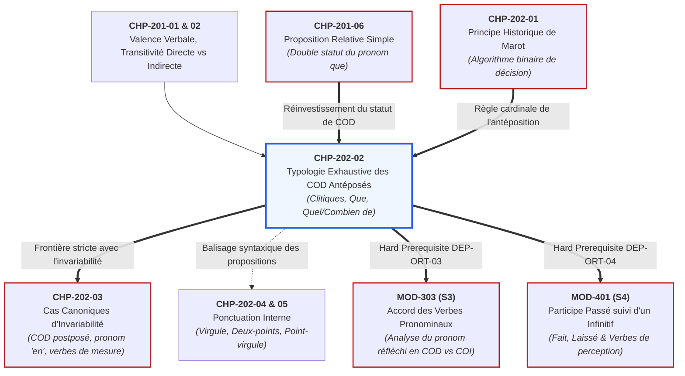

# Chapitre 2 — Typologie Exhaustive des Compléments d'Objet Direct Antéposés : Pronoms Conjoints, Relatif Que et Syntagmes Interrogatifs/Exclamatifs

> **Identifiant du chapitre** : `CHP-202-02`  
> **Module de rattachement** : [`MOD-202` — Accord du Participe Passé avec l'Auxiliaire Avoir et Ponctuation Interne/Logique](file:///f:/Formation/world-class-french/03-curriculum/year-1/semester-2/mod-202-participe-passe-avoir-ponctuation-interne.md)  
> **Semestre** : Année 1 — Semestre 2 (S2)  
> **Volume horaire estimé** : 5 à 6 heures d'apprentissage autonome délibéré et d'ateliers d'application (Phase 1 Étude : 1 h 30 | Phase 2 Pratique : 1 h 30 | Phase 3 Correction : 1 h 00 | Phase 4 Évaluation : 1 h 00)  
> **Statut** : [STATUT : VALIDÉ]  
> **Compétences associées** : [`FR-ORTHO-003`](file:///f:/Formation/world-class-french/02-competency-framework/competency-framework.md#fr-ortho-003-accord-rigoureux-du-participe-passé-avec-lauxiliaire-avoir) (L3 Autonomie), [`FR-SYNTAX-001`](file:///f:/Formation/world-class-french/02-competency-framework/competency-framework.md#fr-syntax-001-analyse-fonctionnelle-et-délimitation-de-la-phrase-simple) (L3 Autonomie)  
> **Sources scientifiques de référence** : `SRC-GRAM-01` (Grevisse & Goosse, 2016, § 949), `SRC-GRAM-02` (Riegel et al., 2016/2021, chap. 17), `SRC-NORM-03` (Ministère de l'Éducation nationale, 2020, p. 18-20 & p. 48-50), `SRC-GRAM-05` (Grevisse, 2009, § 273)

---

## 1. Titre et Place dans le Cursus

### 1.1 Intitulé Officiel
**Chapitre 2 : Typologie Exhaustive des Compléments d'Objet Direct Antéposés : Pronoms Conjoints, Relatif Que et Syntagmes Interrogatifs/Exclamatifs** (`CHP-202-02`).

### 1.2 Insertion Architecturale dans le Cursus
Le présent chapitre constitue le cœur opérationnel du module [`MOD-202`](file:///f:/Formation/world-class-french/03-curriculum/year-1/semester-2/mod-202-participe-passe-avoir-ponctuation-interne.md). Tandis que le Chapitre 1 a établi le principe psycholinguistique et historique de Clément Marot (« l'objet connu avant le verbe commande l'accord »), le Chapitre 2 répond à la question pratique décisive : **sous quelles formes concrètes un complément d'objet direct peut-il se trouver placé avant le verbe en français ?**

En français moderne non relâché, le groupe nominal direct ne peut pas précéder librement le verbe à la forme affirmative (*« *Les dossiers j'ai transmis »* est exclu du français standard écrit). Dès lors, l'antéposition du COD s'effectue exclusivement par trois voies morphosyntaxiques spécialisées :
1. Les pronoms personnels conjoints clitiques (*me, te, le, la, nous, vous, les*) ;
2. Le pronom relatif simple *que* (ou *qu'*), ancré à un antécédent nominal ou pronominal ;
3. Les syntagmes interrogatifs et exclamatifs extraits en tête de proposition (*quel(le)(s) + nom*, *combien de + nom*).



- **En amont** : Ce chapitre mobilise directement les acquis de la syntaxe fonctionnelle de `MOD-201` :
  - La rection verbale et les tests formels de transitivité directe vs indirecte (`CHP-201-01` et `CHP-201-02`) ;
  - Le double statut syntaxique du pronom relatif simple *que* (`CHP-201-06`), qui cumule le rôle de subordonnant anaphorique et la fonction de COD interne ;
  - L'algorithme décisionnel de Clément Marot explicité en `CHP-202-01`.
- **En aval** :
  - **Vers `CHP-202-03`** : La maîtrise de l'antéposition du véritable COD permet de neutraliser les faux COD qui imposent l'invariabilité (le pronom adverbial partitif *en*, les compléments de mesure, de durée, de poids et de prix).
  - **Vers [`MOD-303`](file:///f:/Formation/world-class-french/03-curriculum/year-2/semester-3/mod-303-accords-verbes-pronominaux.md) (Semestre 3, prérequis bloquant `DEP-ORT-03`)** : La règle d'accord du participe des verbes pronominaux réciproques et réfléchis (*Elle s'est lavée* vs *Elle s'est lavé les mains* vs *Elles se sont téléphoné*) constitue une application directe de l'analyse du pronom conjoint en COD antéposé vs COI.
  - **Vers [`MOD-401`](file:///f:/Formation/world-class-french/03-curriculum/year-2/semester-4/mod-401-pragmatique-accords-limites-rectifications-1990.md) (Semestre 4, prérequis bloquant `DEP-ORT-04`)** : L'analyse du sujet sémantique de l'infinitif dans les structures avec verbes de perception (*Les musiciens que j'ai entendus jouer*).

---

## 2. Objectifs Mesurables

Au terme des 5 à 6 heures d'apprentissage autonome et d'entraînement délibéré de ce chapitre, l'apprenant doit être capable de :

1. **Classifier instantanément la nature syntaxique de tout COD antéposé** parmi les trois configurations canoniques de la langue française (pronom personnel conjoint clitique, pronom relatif simple *que*, syntagme interrogatif ou exclamatif extrait) au sein d'une période complexe ([`FR-SYNTAX-001`](file:///f:/Formation/world-class-french/02-competency-framework/competency-framework.md#fr-syntax-001-analyse-fonctionnelle-et-délimitation-de-la-phrase-simple), palier L3).
2. **Discriminer avec 100 % d'exactitude les pronoms conjoints COD des pronoms conjoints COI**, en appliquant le test de substitution prépositionnelle pour les pronoms syncrétiques ambigus (*me, te, nous, vous*) et en bloquant systématiquement tout accord illicite sur les formes strictement indirectes *lui* et *leur* ([`FR-ORTHO-003`](file:///f:/Formation/world-class-french/02-competency-framework/competency-framework.md#fr-ortho-003-accord-rigoureux-du-participe-passé-avec-lauxiliaire-avoir), palier L3).
3. **Identifier le donneur d'accord exact dans les structures relatives denses**, en remontant de manière infaillible du pronom relatif *que* vers son nom noyau antécédent, en neutralisant les syntagmes prépositionnels compléments du nom intercalés ([`FR-ORTHO-003`](file:///f:/Formation/world-class-french/02-competency-framework/competency-framework.md#fr-ortho-003-accord-rigoureux-du-participe-passé-avec-lauxiliaire-avoir), palier L3).
4. **Calculer et transférer sans faute les traits de genre et de nombre** du syntagme interrogatif ou exclamatif antéposé (*quel[le][s] + nom*, *combien de + nom*) sur le participe passé conjugué avec *avoir* ([`FR-ORTHO-003`](file:///f:/Formation/world-class-french/02-competency-framework/competency-framework.md#fr-ortho-003-accord-rigoureux-du-participe-passé-avec-lauxiliaire-avoir), palier L3).

---

## 3. Prérequis et Test de Préparation

### 3.1 Prérequis Exigibles
- **Principe de Clément Marot (`CHP-202-01`)** : Savoir que l'auxiliaire *avoir* ne provoque jamais l'accord du participe passé avec son sujet, mais exclusivement avec son complément d'objet direct placé avant lui.
- **Transitivité verbale directe vs indirecte (`CHP-201-01`)** : Reconnaître si un verbe sélectionne un complément direct sans préposition (*consulter quelqu'un*) ou un complément indirect prépositionnel (*téléphoner à quelqu'un*).
- **Double statut du pronom relatif (`CHP-201-06`)** : Savoir que *que* n'est pas une simple conjonction de liaison inerte, mais qu'il remplace son antécédent nominal et exerce une fonction propre à l'intérieur de la subordonnée.

### 3.2 Test de Préparation (Auto-Diagnostic à 5 Questions)
Résolvez les cinq questions suivantes sans consulter de document avant d'ouvrir le corrigé repliable :

1. **Question 1 (Rection des pronoms conjoints)** : Dans les phrases *(a) « Elle nous a consultés »* et *(b) « Elle nous a téléphoné »*, quelle est la fonction exacte du pronom *nous* dans chaque énoncé ? Justifiez l'accord ou l'invariabilité du participe.
2. **Question 2 (Pronom de 3e personne)** : Le pronom conjoint *leur* peut-il exercer la fonction de complément d'objet direct ? Peut-il déclencher l'accord d'un participe passé conjugué avec *avoir* ?
3. **Question 3 (Remontée à l'antécédent)** : Dans la phrase *« Les décisions du conseil d'administration que le président a ratifiées sont exécutoires »*, quel terme est le donneur d'accord du participe *ratifiées* ? Expliquez pourquoi *conseil d'administration* ne transmet pas ses traits.
4. **Question 4 (Déterminants interrogatifs)** : Dans *« Quelles démarches administratives avez-vous entreprises ? »*, quel constituant syntaxique constitue le complément d'objet direct du verbe *avez entreprises* ?
5. **Question 5 (Conjonction complétive vs Relatif)** : Dans l'énoncé *« La convention qu'il a souhaité que nous signions »*, le participe *souhaité* doit-il s'accorder avec *la convention* ? Pourquoi ?

<details>
<summary><strong>Consulter le corrigé de l'auto-diagnostic (cliquer pour dérouler)</strong></summary>

1. **Réponse 1** : Dans *(a)*, *nous* est **COD** (*consulter quelqu'un* $\to$ transitif direct). Étant placé avant le verbe, il impose l'accord du participe au pluriel (*consultés* ou *consultées* selon le genre du groupe représenté). Dans *(b)*, *nous* est **COI** (*téléphoner à quelqu'un* $\to$ transitif indirect). Il n'y a aucun COD antéposé $\to$ le participe demeure strictement **invariable** (*téléphoné*).
2. **Réponse 2** : **Non, absolument jamais.** Le pronom conjoint de 3e personne pluriel *leur* est exclusivement un pronom d'objet indirect (*donner à eux / à elles*). Il ne peut en aucun cas être COD et ne provoque jamais l'accord du participe passé.
3. **Réponse 3** : Le donneur d'accord est le nom noyau **décisions** (féminin pluriel). Le syntagme *du conseil d'administration* est un complément du nom intercalé. Sémantiquement et syntaxiquement, le président ratifie des décisions et non un conseil (*ratifier les décisions*). Le pronom relatif *que* hérite donc des traits féminin pluriel.
4. **Réponse 4** : C'est le syntagme nominal interrogatif extrait tout entier : **Quelles démarches administratives** (féminin pluriel), placé en tête de phrase.
5. **Réponse 5** : **Non, le participe reste invariable (*souhaité*).** Le verbe *a souhaité* n'a pas pour COD *la convention*, mais la proposition complétive tout entière *que nous signions* (*Il a souhaité [que nous signions la convention]*). L'objet du verbe *souhaiter* est une proposition abstraite neutre, ce qui neutralise tout accord.

> **Diagnostic** : Si vous obtenez moins de 4/5 à ce test, étudiez attentivement les sections 7.1, 7.2 et 8 ci-dessous.
</details>

---

## 4. Situation de Départ ou Problème Concret

### 4.1 Le Scripteur face aux Incarnations Multiples du COD Antéposé
Dans les concours universitaires, les examens d'État et la rédaction juridique, l'accord du participe passé avec l'auxiliaire *avoir* concentre une proportion anormalement élevée de sanctions pénales. Selon les rapports de jurys, **plus de 60 % des fautes de participe passé résultent d'une mauvaise gestion de l'antéposition du COD**, et tout particulièrement de la remontée anaphorique sur le pronom relatif *que*.

Observons ces quatre phrases authentiques relevées dans des courriers administratifs et des copies de concours :

> ❌ *« Nous leur avons **averties** de la tenue prochaine des assises. »*  
> ❌ *« Les pièces justificatives de cette dépense que le trésorier a **reçu** sont incomplètes. »*  
> ❌ *« Quels arguments juridiques avez-vous **présenté** devant la Cour constitutionnelle ? »*  
> ❌ *« La société que nous vous avons **conseillé** de contacter a déposé son bilan. »*

Pourquoi ces erreurs se produisent-elles avec une régularité presque mécanique ?
1. **L'illusion morphologique du pronom conjoint** : Dans la première phrase, le scripteur identifie une forme plurielle féminine désignée (*les délégations*) et accorde aveuglément le verbe sur *leur*, sans voir que *leur* est un pronom **strictement indirect** (*parler à eux*, mais *avertir quelqu'un* $\to$ il fallait utiliser le pronom COD *les* : *nous les avons averties*).
2. **L'aveuglement au relatif *que*** : Dans la deuxième phrase, l'éloignement physique entre le nom noyau (*pièces*) et le participe (*reçu*), accentué par la présence du complément du nom *de cette dépense*, fait perdre au scripteur le fil de la rection syntaxique.
3. **L'oubli de la tête de phrase interrogative** : Dans la troisième phrase, le point d'interrogation final et l'inversion du sujet (*avez-vous*) monopolisent l'attention cognitive du rédacteur, qui omet de raccorder le participe au syntagme initial *Quels arguments juridiques*.

Pour éradiquer définitivement ces défaillances, le rédacteur ne peut se fier à son oreille : en français, la majorité des participes passés se terminent par la voyelle phonétique `/e/`, rendant l'accord acoustiquement imperceptible à l'oral (*averti/avertie/averties* se prononcent de façon rigoureusement identique `/avɛʁti/`). Seul le calcul morphosyntaxique méthodique garantit l'exactitude graphique.

---

## 5. Explication Intuitive : Le Radar et les Trois Faisceaux d'Éclairage

Pour comprendre le fonctionnement de l'antéposition sans sombrer dans l'abstraction aride, recourons à l'analogie d'un **système de détection radar embarqué** à bord du verbe composé :

```text
                                        POSTE DE COMMANDE VERBAL
                                      ┌──────────────────────────┐
                                      │   AUXILIAIRE + PARTICIPE │
                                      │       [ a validé... ]    │
                                      └─────────────▲────────────┘
                                                    │
                 ┌──────────────────────────────────┴──────────────────────────────────┐
                 │                                                                     │
        FAISCEAU 1 (Proximité immédiate)       FAISCEAU 2 (Passerelle relais)    FAISCEAU 3 (Longue portée)
        PRONOM CONJOINT CLITIQUE               PRONOM RELATIF "QUE"              SYNTAGME INTERROGATIF / EXCLAMATIF
        • Accroché directement au verbe        • Relie deux propositions         • Placé à l'avant-poste de la phrase
        • Forme compacte (le, la, les)         • Remonte à un nom antécédent     • Porte le drapeau "Quel(le)s / Combien"
        [ Ces lois, il LES a votées ]          [ Les lois QU'il a votées ]       [ QUELLES lois a-t-il votées ? ]
```

Lorsque le verbe auxiliaire *avoir* entre en action, son capteur radar balaie la chaîne de texte située **strictement à sa gauche** (en amont dans l'ordre de lecture) :
1. **Faisceau 1 — Le capteur de proximité (Le pronom conjoint clitique)** : L'objet direct est collé immédiatement devant l'auxiliaire (*me, te, le, la, nous, vous, les*). Le radar interroge immédiatement sa nature : est-il direct (COD) ou indirect (COI) ? S'il est direct, ses traits de genre et nombre sont verrouillés sur le participe (*Il **les** a prévenu**es***).
2. **Faisceau 2 — La passerelle relais (Le pronom relatif *que*)** : L'objet direct se présente sous le masque du pronom invariable *que*. Ce pronom ne possède pas de traits propres, mais il agit comme un câble optique : le radar remonte le câble jusqu'au nom antécédent situé dans la proposition principale pour y capter le genre et le nombre (*Les **directives** qu'il a formulé**es***).
3. **Faisceau 3 — La vigie de tête (Le syntagme interrogatif ou exclamatif)** : L'objet direct a été propulsé tout au début de la phrase par une opération d'extraction interrogative ou exclamative (*Quelles conditions*, *Combien de dossiers*). Bien que séparé du participe par le sujet et l'auxiliaire, il envoie son signal d'accord à distance (*[**Combien de victoires**] cette armée a-t-elle remporté**es** !*).

Si le radar n'identifie aucun de ces trois faisceaux à gauche, le complément d'objet se trouve soit à droite (postposé), soit absent : le participe bascule alors en position neutre invariable.

---

## 6. Définitions Précises et Terminologie

1. **Antéposition du COD** : Configuration syntaxique dans laquelle le constituant assumant la fonction de complément d'objet direct précède linéairement le verbe dans la chaîne temporelle ou graphique de l'énoncé [Réf. `SRC-GRAM-02`, chap. 17].
2. **Pronom personnel conjoint clitique** : Pronom personnel atone non autonome qui ne peut pas être séparé du verbe auquel il se rattache, sauf par la particule de négation *ne* ou par un autre pronom conjoint (*me, te, se, le, la, lui, nous, vous, leur, les, y, en*) [Réf. `SRC-NORM-03`, p. 18].
3. **Pronom relatif simple *que*** : Mot subordonnant invariable assumant à la fois le rôle de connecteur interpropositionnel, d'anaphore d'un antécédent nominal ou pronominal, et de complément d'objet direct du verbe de la proposition subordonnée [Réf. `SRC-GRAM-01`, § 690 ; `SRC-NORM-03`, p. 48].
4. **Antécédent nominal** : Nom, syntagme nominal ou pronom de la proposition régissante représenté par le pronom relatif et auquel ce dernier emprunte ses traits morphosyntaxiques de genre et de nombre [Réf. `SRC-GRAM-01`, § 690].
5. **Syntagme interrogatif ou exclamatif extrait** : Groupe de mots introduit par un déterminant interrogatif/exclamatif (*quel, quels, quelle, quelles*) ou un adverbe de quantité (*combien de*) placé en tête d'énoncé par déplacement syntaxique, tout en conservant sa fonction de COD par rapport au verbe recteur [Réf. `SRC-GRAM-02`, chap. 17].
6. **Double pronominalisation clitique** : Séquence formée de deux pronoms personnels conjoints régis par le même verbe (*me les, te la, nous les, les lui*), où l'un assume la fonction de COD et l'autre celle de COI/COS. Seul le pronom COD transmet ses traits d'accord au participe passé [Réf. `SRC-GRAM-01`, § 658, § 949].
7. **Détermination des traits** : Opération morphologique consistant à identifier le genre (masculin ou féminin) et le nombre (singulier ou pluriel) du constituant donneur d'accord pour les transférer sur la désinence du participe passé.

---

## 7. Règles ou Mécanismes Fondamentaux

### 7.1 Les Trois Configurations Majeures d'Antéposition du COD

Le français écrit dispose exactement de trois structures syntaxiques canoniques permettant au complément d'objet direct de précéder l'auxiliaire *avoir*.

#### Configuration A : Les Pronoms Personnels Conjoints Clitiques
Lorsque le COD est représenté par un pronom clitique placé devant le verbe composé, l'accord est obligatoire. Toutefois, une distinction capitale sépare les formes pronominales :

1. **Les pronoms univoques directs (toujours COD)** :
   - **le (l')** : masculin singulier $\to$ participe au masculin singulier (désinence zéro : *-é, -i, -u, -s, -t*).
   - **la (l')** : féminin singulier $\to$ participe au féminin singulier (désinence **-e**).
   - **les** : masculin ou féminin pluriel $\to$ participe au pluriel (désinence **-s** ou **-es**).
   - *Exemples* : *Cette notification, je l'ai reçue.* / *Ces amendements, ils les ont adoptés.*

2. **Les pronoms univoques indirects (toujours COI — Zéro accord)** :
   - **lui** (3e pers. sing.) et **leur** (3e pers. plur.) sont **exclusivement des compléments d'objet indirects** (*parler à lui / à eux*).
   - Ils ne représentent **jamais un COD** et ne provoquent **jamais l'accord du participe passé**.
   - *Exemples* : *Cette collaboratrice, nous lui avons parlé.* / *Ces délégations, le ministre leur a répondu.*

3. **Les pronoms syncrétiques ambigus (COD ou COI selon la rection du verbe)** :
   - Les pronoms de 1re et 2e personne **me (m'), te (t'), nous, vous** peuvent être tour à tour COD ou COI.
   - **Le test décisif de la rection verbale** : Pour savoir si *nous* ou *vous* déclenche l'accord, il faut isoler le verbe à l'infinitif et substituer un syntagme nominal :
     - Si la construction est directe : $\text{Verbe} + \text{quelqu'un} \implies \text{COD} \implies \textbf{Accord requis}$.
       - *« Cette affaire nous a passionnés »* ($\leftarrow$ passionner *quelqu'un* $\to$ *nous* est COD).
     - Si la construction est indirecte : $\text{Verbe} + \text{à quelqu'un} \implies \text{COI} \implies \textbf{Invariabilité absolue}$.
       - *« Cette affaire nous a convenu »* ($\leftarrow$ convenir *à quelqu'un* $\to$ *nous* est COI).

4. **Le cas de la double pronominalisation clitique** :
   - Lorsque deux pronoms conjoints se succèdent (*me les, te l', nous les, vous la*), l'un est direct, l'autre est indirect.
   - La règle d'accord s'applique **exclusivement sur le pronom COD donneur**, à l'exclusion du COI :
     - *« Ces directives, le directeur **me les** a données. »* (*me* = COI ; *les* = COD mis pour *directives* fém. plur. $\to$ accord au féminin pluriel *données*).
     - *« Cette promesse, il **nous l'**a faite. »* (*nous* = COI ; *l'* = COD mis pour *promesse* fém. sing. $\to$ accord au féminin singulier *faite*).

---

#### Configuration B : Le Pronom Relatif *que* (ou *qu'*)
Le pronom relatif simple *que* est de loin la source la plus fréquente d'antéposition du COD dans la langue soignée [Réf. `SRC-GRAM-01`, § 949].

1. **Le mécanisme de remontée anaphorique à l'antécédent** :
   - Morphologiquement, le mot *que* est invariable : il ne porte en surface aucune marque de genre ni de nombre.
   - Syntaxiquement, il est le **COD interne** du verbe subordonné.
   - Morphosyntaxiquement, il hérite par anaphore des traits de son **antécédent nominal**. L'accord du participe passé s'effectue donc avec cet antécédent par l'entremise de *que* :
     $$\text{Antécédent Nominal } [\text{Genre}, \text{Nombre}] \xrightarrow{\quad\text{Anaphore}\quad} \text{Pronom Relatif } \mathbf{que} \xrightarrow{\quad\text{Accord}\quad} \text{Participe Passé}$$

2. **Le piège des compléments du nom intercalés** :
   - Lorsque l'antécédent est un syntagme nominal complexe de forme $[N_1 + \text{de} + N_2]$, le scripteur doit identifier quel nom est le véritable objet du verbe :
     - *« Les conclusions ($N_1$, fém. plur.) du rapport ($N_2$, masc. sing.) qu'il a **rédigées** »* $\to$ Il a rédigé les conclusions, et non le rapport $\implies$ accord avec $N_1$ (*rédigées*).
     - *« L'auteur ($N_1$, masc. sing.) de ces pièces ($N_2$, fém. plur.) que nous avons **rencontré** »* $\to$ Nous avons rencontré l'auteur, et non les pièces $\implies$ accord avec $N_1$ (*rencontré*).

3. **Distinction capitale avec la conjonction complétive *que*** :
   - Si *que* est une **conjonction de subordination complétive**, il n'a pas d'antécédent et n'exerce aucune fonction d'objet direct : le participe passé qui le précède ne s'accorde jamais avec lui :
     - *« La décision qu'il a prise »* (*que* = pronom relatif COD $\to$ accord).
     - *« J'ai su qu'elle avait réussi »* (*que* = conjonction complétive $\to$ *su* est invariable).
   - *(Note : Le cas de « que » attribut du sujet — « Les grands hommes qu'ils sont devenus » — relève de l'invariabilité et sera traité en `CHP-202-03`).*

---

#### Configuration C : Les Syntagmes Interrogatifs et Exclamatifs Extraits
Dans l'interrogation directe ou indirecte et dans l'exclamation, le COD est fréquemment extrait et placé en tête de proposition par thématisation ou focalisation [Réf. `SRC-GRAM-02`, chap. 17].

1. **Les déterminants interrogatifs et exclamatifs *quel, quels, quelle, quelles + nom*** :
   - Le déterminant s'accorde avec le nom qu'il introduit ; l'ensemble du syntagme forme le COD antéposé du verbe :
     - *« **Quelles résolutions** avez-vous **prises** lors de cette assemblée ? »* (*Quelles résolutions* = COD féminin pluriel $\to$ *prises*).
     - *« **Quelle excellente occasion** nous avons **laissée** passer ! »* (*Quelle excellente occasion* = COD féminin singulier $\to$ *laissée*).
   - Cette règle s'applique identiquement dans l'interrogation indirecte :
     - *« J'ignore **quelles mesures** le ministre a **ordonnées**. »*

2. **L'adverbe de quantité interrogatif ou exclamatif *combien de + nom*** :
   - Le mot *combien* est un adverbe de quantité invariable, mais le syntagme nominal quantifié $[combien\text{ de} + N]$ constitue le véritable COD antéposé :
     - *« **Combien de pays** avez-vous **visités** durant votre mission ? »* (*Combien de pays* = COD masculin pluriel $\to$ *visités*).
     - *« **Combien de lettres** officielles elle a **reçues** ce matin ! »* (*Combien de lettres* = COD féminin pluriel $\to$ *reçues*).
   - Si le nom quantifié est élidé ou représenté à distance, l'accord se fait avec le nom sous-jacent :
     - *« De ces trois propositions, **combien** avez-vous **retenues** ? »* (*combien [de propositions]* = féminin pluriel $\to$ *retenues*).

---

### 7.2 Synthèse Matricielle des Formes Donneuses

Le tableau synoptique ci-dessous récapitule l'exhaustivité des formes donneuses d'accord en position antéposée sous l'auxiliaire *avoir* :

| Type de configuration | Constituant antéposé | Statut syntaxique | Formes morphologiques | Règle d'accord du participe | Exemple modèle |
| :--- | :--- | :---: | :--- | :---: | :--- |
| **A. Clitique défini** | *le, la, l', les* | **Toujours COD** | • *le / l'* : masc. sing.<br/>• *la / l'* : fém. sing.<br/>• *les* : masc./fém. plur. | **Accord obligatoire** en genre et nombre avec le pronom. | *Ces lois, le parlement les a votées.* |
| **A. Clitique ambigu** | *me, te, nous, vous* | **COD ou COI** (selon rection) | • Singulier : 1re/2e pers.<br/>• Pluriel : 1re/2e pers. (masc. ou fém.) | **Accord obligatoire SI COD**.<br/>**Invariable SI COI**. | • *Elle nous a reçus (COD).*<br/>• *Elle nous a parlé (COI).* |
| **A. Clitique indirect** | *lui, leur* | **Toujours COI** | • *lui* : singulier<br/>• *leur* : pluriel | **Invariabilité absolue** (zéro accord). | *Ces femmes, nous leur avons écrit.* |
| **B. Pronom relatif** | *que, qu'* | **Toujours COD** | Invariable en surface ; hérite des traits de l'antécédent. | **Accord obligatoire** avec le nom noyau antécédent. | *La convention que le conseil a signée.* |
| **C. Déterminant Qu-** | *quel, quels, quelle, quelles + N* | **COD extrait** | • *quel(s)* : masc. sing./plur.<br/>• *quelle(s)* : fém. sing./plur. | **Accord obligatoire** avec le nom qualifié par *quel*. | *Quelles garanties avez-vous obtenues ?* |
| **C. Adverbe quantif.** | *combien de + N* | **COD extrait** | Dépend du genre et nombre du nom régi par *de*. | **Accord obligatoire** avec le nom quantifié par *combien*. | *Combien de fautes as-tu relevées ?* |

---

## 8. Raisonnement Détaillé : Pourquoi le Pronom Relatif Impose-t-il une Recherche Anaphorique à Rebours ?

Sur le plan cognitif et linguistique, pourquoi l'accord sur le pronom relatif *que* pose-t-il infiniment plus de difficultés que l'accord sur le pronom personnel *les* ?

1. **L'opacité morphologique de *que*** :
   Le pronom clitique *les* porte en lui-même une marque explicite de pluriel (la consonne graphique *s*). Le pronom clitique *la* porte en lui-même la marque du féminin. Le scripteur qui produit *« Il les a... »* a sous les yeux un indice visuel direct de pluralité.  
   À l'inverse, le pronom relatif *que* (ou *qu'*) est **morphologiquement opaque** : la même chaîne de trois lettres `<que>` transcrit indifféremment un masculin singulier (*le dossier que...*), un féminin singulier (*la lettre que...*), un masculin pluriel (*les dossiers que...*) ou un féminin pluriel (*les lettres que...*).

2. **La surcharge cognitive de la recherche à rebours** :
   Pour accorder le participe passé gouverné par *que*, la mémoire de travail du scripteur ne peut pas se contenter de lire le mot immédiatement voisin. Elle doit exécuter un **saut anaphorique à rebours** (vers la gauche) par-dessus :
   - Le pronom relatif *que* lui-même ;
   - Les éventuels compléments du nom intercalés ;
   - Le sujet de la subordonnée ;
   - Les adverbes intercalés.

```text
    CHAÎNE D'ÉLOIGNEMENT ET CHARGE COGNITIVE DE LA REMONTÉE :
    
    [ Les résolutions ]  de la commission générale   QUE   le délégué ministériel   hier   a   ADOPTÉES
           ▲                                          │                                            │
           │                                          └────── câble anaphorique ───────────────────┘
           └──────────────── donneur réel ────────────┘
```

3. **L'impératif de verrouillage des traits** :
   Le scripteur expérimenté neutralise ce piège en appliquant la **technique du verrouillage préalable** : dès qu'il rencontre *que*, avant même d'écrire le verbe, il pointe du doigt le nom antécédent, note mentalement ses deux traits fondamentaux (ex. *résolutions* = féminin, pluriel), et conserve cette étiquette active jusqu'à la graphie finale du participe (*-ées*).

---

## 9. Exemples Corrects Commentés

Voici six phrases modèles rigoureusement analysées, illustrant chacune des configurations majeures d'antéposition du COD avec leur arbre de dépendance et leur justification morphosyntaxique :

### Phrase 1 : Pronom Clitique Direct Défini (*les*)
> *« Ces conclusions historiques, l'Assemblée nationale les a votées à l'unanimité. »*

```text
    [ Ces conclusions historiques ] , l'Assemblée nationale  LES  a  VOTÉES  à l'unanimité.
                 ▲                                             │       ▲
                 │ (coréférence)                               │ (COD) │ (accord fém. plur.)
                 └─────────────────────────────────────────────┘───────┘
```
- **Structure verbale** : Auxiliaire *a* + participe passé *votées*.
- **Analyse du COD** : Le pronom conjoint clitique **les** est antéposé au verbe. Il reprend le syntagme thématisé *Ces conclusions historiques* (nom féminin pluriel).
- **Règle** : Accord obligatoire en genre et nombre avec le pronom COD antéposé $\to$ féminin pluriel (*-ées*).

---

### Phrase 2 : Pronom Clitique Ambigu de 1re/2e Personne (*nous*)
> *« La directrice générale nous a reçues avec solennité dans son cabinet. »* (énoncé prononcé par un groupe de déléguées féminines).

```text
    La directrice générale   NOUS   a   REÇUES   avec solennité...
                              │          ▲
                              │ (COD)    │ (accord fém. plur.)
                              └──────────┘
```
- **Structure verbale** : Auxiliaire *a* + participe passé *reçues*.
- **Analyse du COD** : Le verbe *recevoir* est transitif direct (*recevoir quelqu'un*). Le pronom personnel conjoint **nous** est donc **COD antéposé**.
- **Traits du référent** : Le groupe désigné par *nous* étant composé exclusivement de femmes, les traits sont féminin pluriel $\to$ accord avec consonne latente audible au féminin (*reçue / reçues*).

---

### Phrase 3 : Double Pronominalisation Clitique (*me les*)
> *« Ces attestations fiscales, le greffier en chef me les a délivrées ce matin. »*

```text
    ... le greffier en chef   me   LES   a   DÉLIVRÉES   ce matin.
                              │     │            ▲
                              │     │ (COD)      │ (accord fém. plur.)
                              │     └────────────┘
                              └─ (COI : neutre sur l'accord)
```
- **Structure verbale** : Auxiliaire *a* + participe passé *délivrées*.
- **Analyse des clitiques** : Le verbe *délivrer* est trivalent ditransitif (*délivrer quelque chose [COD] à quelqu'un [COI/COS]*).
  - *me* est COI (invariable, sans incidence sur le verbe) ;
  - *les* est COD antéposé, représentant *Ces attestations fiscales* (féminin pluriel).
- **Règle** : L'accord s'effectue exclusivement avec le pronom COD *les* $\to$ féminin pluriel (*délivrées*).

---

### Phrase 4 : Pronom Relatif *que* avec Complément du Nom Intercalé
> *« Les conclusions du rapport financier que le vérificateur a rédigées ont convaincu les auditeurs. »*

```text
    Les [ conclusions ]  du rapport financier   QUE   le vérificateur a   RÉDIGÉES ...
             ▲                                   │                            ▲
             │ (antécédent)                      │ (COD)                      │ (accord fém. plur.)
             └───────────────────────────────────┴────────────────────────────┘
```
- **Structure verbale subordonnée** : Auxiliaire *a* + participe passé *rédigées*.
- **Analyse de la relative** : Le pronom relatif *que* est COD de *a rédigées*.
- **Remontée à l'antécédent** : Le vérificateur n'a pas rédigé *le rapport financier*, mais spécifiquement *les conclusions* de ce rapport. Le nom noyau recteur est *conclusions* (féminin pluriel).
- **Règle** : Le participe passé s'accorde au féminin pluriel (*rédigées*).

---

### Phrase 5 : Syntagme Interrogatif Extrait (*Quelles garanties*)
> *« Quelles garanties solides avez-vous obtenues lors de ces pourparlers diplomatiques ? »*

```text
    [ QUELLES GARANTIES solides ]  avez-vous   OBTENUES   lors de ces pourparlers... ?
                  ▲                               ▲
                  │ (COD interrogatif antéposé)   │ (accord fém. plur.)
                  └───────────────────────────────┘
```
- **Structure verbale** : Auxiliaire *avez* + sujet inversé *vous* + participe passé *obtenues*.
- **Analyse du COD** : Le syntagme nominal interrogatif *Quelles garanties solides* est extrait en tête de phrase. Il occupe la fonction de COD du verbe *obtenir* (*vous avez obtenu des garanties*).
- **Traits du donneur** : *garanties* est un nom féminin pluriel qualifié par le déterminant interrogatif *quelles*.
- **Règle** : Accord obligatoire au féminin pluriel (*obtenues*).

---

### Phrase 6 : Syntagme Exclamatif Quantifié (*Combien de félicitations*)
> *« Combien de félicitations méritées cette jeune lauréate a reçues de ses professeurs ! »*

```text
    [ COMBIEN DE FÉLICITATIONS méritées ]  cette jeune lauréate a   REÇUES ... !
                    ▲                                                 ▲
                    │ (COD exclamatif antéposé)                       │ (accord fém. plur.)
                    └─────────────────────────────────────────────────┘
```
- **Structure verbale** : Auxiliaire *a* + participe passé *reçues*.
- **Analyse du COD** : Le syntagme exclamatif *Combien de félicitations méritées* est placé en tête de phrase. Il constitue le complément d'objet direct de *a reçues* (*elle a reçu des félicitations*).
- **Traits du donneur** : Le nom quantifié est *félicitations* (féminin pluriel).
- **Règle** : Le participe passé prend les marques du féminin pluriel (*reçues*).

---

## 10. Contre-Exemples et Erreurs Fréquentes (Clinique des 6 Pathologies Récurrentes)

### Erreur n° 1 : La confusion COD vs COI sur les pronoms ambigus *nous* et *vous*
- **Formes fautives** : ❌ *« Le directeur nous a téléphonés hier soir. »* / ❌ *« Les nouvelles mesures vous ont convenues. »*
- **Diagnostic linguistique** : L'apprenant voit le pronom pluriel antéposé *nous* ou *vous* et accorde mécaniquement le participe passé par analogie de surface. Il omet d'analyser la rection du verbe : *téléphoner* et *convenir* se construisent avec la préposition *à* (*téléphoner à quelqu'un*, *convenir à quelqu'un*). Dans ces phrases, *nous* et *vous* sont des **compléments d'objet indirects (COI)**.
- **Formes normées** : $\checkmark$ *« Le directeur nous a **téléphoné** hier soir. »* / $\checkmark$ *« Les nouvelles mesures vous ont **convenu**. »* [Réf. `SRC-GRAM-01`, § 949].

---

### Erreur n° 2 : L'accord fautif sur le pronom personnel indirect invariable *leur*
- **Formes fautives** : ❌ *« Cette bonne nouvelle, nous leur avons **annoncée** hier. »* / ❌ *« Les lettres que nous leur avons **envoyé**. »*
- **Diagnostic linguistique** : Double confusion symétrique : soit le scripteur accorde le participe avec *leur* en croyant que *leur* est COD d'une personne féminine singulière (*« nous leur avons *annoncée »*), soit il bloque l'accord sur le véritable COD *les lettres* parce que le pronom *leur* fait écran.
- **Formes normées** :
  - Dans la première phrase : le COD est postposé (*cette bonne nouvelle* étant repris par rien ou le verbe régissant *annoncer qqch à qqn*) $\to$ $\checkmark$ *« Cette bonne nouvelle, nous leur avons **annoncé** qu'elle était confirmée »* ou si *l'* est présent : *« Nous la leur avons **annoncée** »*.
  - Dans la seconde phrase : *leur* est COI, mais *que* est COD antéposé mis pour *lettres* (fém. plur.) $\to$ $\checkmark$ *« Les lettres que nous leur avons **envoyées**. »* [Réf. `SRC-GRAM-05`, § 273].

---

### Erreur n° 3 : L'omission d'accord sur le pronom relatif *que*
- **Formes fautives** : ❌ *« La mission que vous m'avez **confié** est terminée. »* / ❌ *« Les leçons que le professeur a **donné** sont claires. »*
- **Diagnostic linguistique** : Le pronom relatif *que* étant morphologiquement invariable, le cerveau du scripteur ne perçoit aucun signal graphique immédiat de féminin ou de pluriel à proximité immédiate du verbe auxiliaire. Faute d'exécuter la remontée anaphorique vers l'antécédent, il laisse le participe dans sa forme brute masculine singulière.
- **Formes normées** : $\checkmark$ *« La mission que vous m'avez **confiée** est terminée. »* / $\checkmark$ *« Les leçons que le professeur a **données** sont claires. »* [Réf. `SRC-GRAM-02`, chap. 17].

---

### Erreur n° 4 : Le mauvais choix d'antécédent en présence d'un complément du nom
- **Formes fautives** : ❌ *« Les copies de l'étudiant qu'il a **corrigé** étaient excellentes. »* / ❌ *« La réunion des ministres que le président a **convoqués** hier. »*
- **Diagnostic linguistique** : Biais d'attraction par le nom le plus proche du pronom relatif. Dans la première phrase, l'apprenant accorde avec *l'étudiant* (masculin singulier) au lieu d'accorder avec le véritable objet de l'action de corriger : *les copies* (féminin pluriel). Dans la seconde phrase, il accorde avec *ministres* alors que le président convoque la *réunion*.
- **Formes normées** : $\checkmark$ *« Les copies de l'étudiant qu'il a **corrigées** étaient excellentes. »* / $\checkmark$ *« La réunion des ministres que le président a **convoquée** hier. »* [Réf. `SRC-GRAM-01`, § 949].

---

### Erreur n° 5 : L'oubli d'accord sur l'adverbe de quantité *combien de + nom*
- **Formes fautives** : ❌ *« Combien d'heures avez-vous **travaillé** aujourd'hui ? »* / ❌ *« Combien de fautes as-tu **relevé** dans cette page ? »*
- **Diagnostic linguistique** : Le mot *combien* étant classifié comme un adverbe invariable dans la mémoire scolaire, le scripteur assimile l'ensemble de la tournure à une structure invariable. Or, dans *combien de fautes*, le nom *fautes* est le véritable noyau substantif du COD extrait.
- **Formes normées** : $\checkmark$ *« Combien d'heures avez-vous **travaillées** aujourd'hui ? »* (verbe *travailler* pris au sens transitif direct : effectuer des heures) / $\checkmark$ *« Combien de fautes as-tu **relevées** dans cette page ? »* [Réf. `SRC-GRAM-02`, chap. 17].

---

### Erreur n° 6 : L'accord erroné provoqué par la conjonction complétive *que*
- **Formes fautives** : ❌ *« Les difficultés qu'il a **crues** que nous rencontrions. »* / ❌ *« La promesse qu'elle a **faite** qu'elle viendrait demain. »*
- **Diagnostic linguistique** : Confusion totale entre le pronom relatif et la conjonction de subordination. Dans ces énoncés, le verbe régissant (*croire*, *faire*) a pour véritable COD la **proposition subordonnée complétive tout entière** (*qu'il a cru [que nous rencontrions des difficultés]*). Le nom initial n'est pas le COD direct de *croire* ; le participe passé reste donc rigoureusement neutre et invariable.
- **Formes normées** : $\checkmark$ *« Les difficultés qu'il a **cru** que nous rencontrions. »* / $\checkmark$ *« La promesse qu'elle a **fait** qu'elle viendrait demain. »* [Réf. `SRC-GRAM-01`, § 950].

---

## 11. Cas Particuliers et Limites

### 11.1 L'Antécédent Neutre (*ce que*, *tout ce que*, *rien de ce que*)
Lorsque le pronom relatif *que* a pour antécédent le pronom démonstratif neutre **ce** (ou la locution quantifiée neutre **tout ce**), le pronom relatif représente une réalité notionnelle non sexuée et non nombrée [Réf. `SRC-GRAM-01`, § 949] :
- La grammaire française assigne par défaut au neutre les traits du **masculin singulier**.
- Le participe passé prend donc la forme non marquée du masculin singulier :
  - *« **Ce que** vous avez **dit** est parfaitement exact. »* (*dit* = masculin singulier).
  - *« Il a oublié **tout ce que** nous lui avions **appris**. »* (*appris* = masculin singulier).
  - *« Rien de **ce qu'**elle a **entendu** ne l'a surprise. »* (*entendu* = masculin singulier).

---

### 11.2 L'Élision Phonétique de *que* en *qu'* devant Voyelle
L'apostrophe marquant l'élision de la voyelle devant une voyelle ou un *h* muet (*qu'il*, *qu'elle*, *qu'on*, *qu'ils*) ne modifie en rien la nature syntaxique du mot :
- *qu'* demeure rigoureusement le pronom relatif COD et transmet l'intégralité des traits de son antécédent :
  - *« L'injustice **qu'**il a **dénoncée** a ému l'opinion publique. »* (*qu'* = *injustice*, féminin singulier $\to$ *dénoncée*).
  - *« Les opportunités **qu'**elle a **saisies** ont transformé sa carrière. »* (*qu'* = *opportunités*, féminin pluriel $\to$ *saisies*).

---

### 11.3 L'Homophonie Orale des Participes du 1er Groupe : Piège Orthographique Majeur
Dans la conjugaison des verbes du premier groupe (qui représentent plus de 85 % du lexique verbal français), le participe passé se prononce de façon rigoureusement identique quelles que soient ses désinences graphiques :
$$\text{écrit } \langle -é \rangle, \langle -ée \rangle, \langle -és \rangle, \langle -ées \rangle \iff \text{prononcé } [\text{e}]$$
- *Observation linguistique* : À l'oral, la phrase *« Les décisions qu'il a adoptées »* sonne exactement comme *« Les décisions qu'il a adopté »*. L'oreille n'offre **aucun retour proprioceptif**.
- **Le test de commutation par un verbe du 3e groupe à consonne finale latente** :
  Pour débloquer l'intuition orthographique et vérifier immédiatement si l'accord est requis, le scripteur doit mentalement substituer au verbe en *-er* un verbe dont le féminin fait entendre une consonne distincte (*prendre $\to$ prise*, *écrire $\to$ écrite*, *faire $\to$ faite*, *interdire $\to$ interdite*) :
  - *« Les mesures qu'il a [adopté / adoptées ?] »* $\to$ Commutation : *« Les mesures qu'il a **prises** »* (l'accord féminin s'entend nettement).
  - Conclusion immédiate : *adoptées* doit obligatoirement recevoir la marque du féminin pluriel.

---

## 12. Approfondissement Adapté au Niveau : La Théorie du Déplacement Qu- (*Wh-Movement*) et la Trace Syntaxique

En linguistique formelle et syntaxe générative (Chomsky ; Riegel et al., `SRC-GRAM-02`, chap. 17), l'accord du participe passé avec le COD antéposé n'est pas considéré comme une « exception » arbitraire de la langue française, mais comme la manifestation morphologique visible d'une opération fondamentale : **le déplacement syntagmatique et la relation de Spécifieur-Tête (*Spec-Head Agreement*)**.

```text
                               CP (Syntagme du Complémenteur)
                         ┌─────────────────┴─────────────────┐
                   Spec, CP (Opérateur Qu-)                  C'
                     [ quelles lois_i ]             ┌────────┴────────┐
                                                    C                 TP
                                                  [ Ø ]         ┌─────┴─────┐
                                                               SN          T'
                                                           "le sénat"   ┌───┴───┐
                                                                        T       VP
                                                                      "a"   ┌───┴───┐
                                                                           V'      ...
                                                                        ┌───┴───┐
                                                                        V      Trace (t_i)
                                                                    "votées"        ▲
                                                                        │           │
                                                                        └── Accord ─┘
```

1. **La position canonique d'assignation du rôle thématique** :
   En structure profonde, tout verbe transitif direct assigne son cas accusatif et son rôle d'objet (patient/thème) à sa droite immédiate, dans la position sœur du verbe ($VP \to V + SN$).
2. **L'extraction par mouvement Qu-** :
   Dans une proposition interrogative, exclamative ou relative, le constituant subit une extraction cyclique vers la périphérie gauche de la proposition (la position $\text{Spec, CP}$).
3. **La trace syntaxique $t_i$ comme relai morphologique** :
   En quittant sa position d'origine postverbale, le syntagme extrait laisse derrière lui une **trace syntaxique invisible co-indexée** ($t_i$). 
   - Lorsque le verbe auxiliaire traite la structure, le participe passé traverse la position de trace ou entre dans une configuration de vérification de traits avec la chaîne syntaxique $[SN_i \dots t_i]$.
   - C'est cette trace laissée dans l'espace d'objet direct qui active la flexion morphologique d'accord sur le participe passé. 
4. Ce modèle explique formellement pourquoi l'objet postposé ne provoque aucun accord : n'ayant subi aucun déplacement vers la périphérie gauche, il n'établit aucune chaîne de vérification préalable avec la tête verbale lors de l'assemblage linéaire de l'énoncé.

---

## 13. Comparaisons Différentielles

### Tableau 1 : Pronom Personnel Clitique COD vs Pronom Personnel Clitique COI

| Critère d'analyse | Pronom personnel COD (*le, la, les, nous...*) | Pronom personnel COI (*lui, leur, nous...*) |
| :--- | :--- | :--- |
| **Formes dédiées** | *le, la, l', les* | *lui, leur* |
| **Formes partagées** | *me, te, nous, vous* (avec rection directe) | *me, te, nous, vous* (avec rection indirecte en *à*) |
| **Test de commutation** | Remplaçable par un SN sans préposition (*Il voit Pierre*) | Remplaçable par $[ \text{à} + SN ]$ (*Il parle à Pierre*) |
| **Voix passive** | Devient le sujet de la phrase passive correspondante | Ne peut jamais devenir sujet de la phrase passive |
| **Incidence sur le participe** | **DÉCLENCHE L'ACCORD OBLIGATOIRE** en genre et nombre | **AUCUN ACCORD** (participe strictement invariable) |
| **Exemple modèle** | *« Nos partenaires, nous les avons **consultés**. »* | *« Nos partenaires, nous leur avons **téléphoné**. »* |

---

### Tableau 2 : Pronom Relatif *que* (COD) vs Conjonction de Subordination *que* (Complétive)

| Critère de distinction | Pronom relatif simple *que* | Conjonction de subordination *que* |
| :--- | :--- | :--- |
| **Présence d'un antécédent** | **OUI** : Se rattache obligatoirement à un nom ou pronom précédent | **NON** : Se rattache directement à un verbe recteur d'opinion/déclaration |
| **Nature de la proposition** | Proposition subordonnée **relative** (expansion du nom) | Proposition subordonnée **complétive** (complément du verbe) |
| **Fonction interne du mot** | **OUI** : Occupe la fonction de COD dans la subordonnée | **AUCUNE** : Simple outil de liaison morphosyntaxique inerte |
| **Suppression possible** | Impossible sans détruire la syntaxe de la relative | Impossible sans détruire la rection du verbe principal |
| **Effet sur le participe** | **DÉCLENCHE L'ACCORD** avec l'antécédent nominal | **AUCUN ACCORD** (participe principal invariable) |
| **Exemple modèle** | *« La décision qu'il a **prise** est sage. »* | *« Il a **dit** qu'il prendrait une décision. »* |

---

### Tableau 3 : Déterminant Interrogatif *quel(le)s* vs Pronom Relatif Composé *lequel/laquelle*

| Critère de distinction | Déterminant interrogatif/exclamatif *quel* | Pronom interrogatif/relatif *lequel* |
| :--- | :--- | :--- |
| **Classe grammaticale** | **Déterminant** (adjectif interrogatif/exclamatif) | **Pronom** (composé autonome) |
| **Autonomie syntaxique** | Non autonome : accompagne obligatoirement un nom noyau | Autonome : remplace seul un syntagme nominal complet |
| **Structure du COD extrait** | $[ \text{quel(le)(s)} + \text{Nom} ]_{\text{COD}}$ | $[ \text{lequel / laquelle / lesquels / lesquelles} ]_{\text{COD}}$ |
| **Règle d'accord sous avoir** | Accord du participe avec le nom introduit par *quel* | Accord du participe avec le genre/nombre du pronom *lequel* |
| **Exemple modèle** | *« **Quelles lois** avez-vous **étudiées** ? »* | *« De ces deux lois, **laquelle** avez-vous **préférée** ? »* |

---

## 14. Exercices Progressifs (Trois Niveaux)

### 14.1 Niveau 1 : Repérage et Qualification du COD Antéposé (Guidé — 12 Phrases)

#### Consigne
Pour chacune des **12 phrases** ci-dessous :
1. Soulignez le participe passé conjugué avec *avoir* ;
2. Isolez le **complément d'objet direct antéposé** s'il existe ;
3. Précisez sa nature exacte : **(A) Pronom clitique direct**, **(B) Pronom relatif *que*** ou **(C) Syntagme interrogatif/exclamatif extrait**. Si aucun COD n'est antéposé, inscrivez formellement : **« Zéro COD antéposé »**.

#### Corpus des 12 Phrases
1. *Ces formulaires administratifs, les agents du fisc les ont visés hier matin.*
2. *Le procureur de la République leur a accordé une audience exceptionnelle.*
3. *La convention collective que les délégués syndicaux ont paraphée entrera en vigueur lundi.*
4. *Quelles conclusions décisives votre comité d'audit a-t-il dégagées ?*
5. *Cette magistrate chevronnée, nous l'avons souvent consultée lors des délibérations.*
6. *Les experts nous ont certifié que le bâtiment répondait à toutes les normes antisismiques.*
7. *Combien de subventions européennes cette commune a-t-elle obtenues pour son projet solaire ?*
8. *L'avocate générale vous a transmis les pièces du dossier d'instruction hier après-midi.*
9. *Quelle remarquable plaidoirie ce jeune avocat béninois a prononcée devant la Cour d'appel !*
10. *Les clauses du contrat d'assurance que la compagnie a modifiées pénalisent les souscripteurs.*
11. *Ces étudiants méritants, l'université leur a octroyé une bourse d'excellence.*
12. *La directrice du laboratoire nous a chaleureusement félicitées pour nos recherches.* (locutrices féminines).

<details>
<summary><strong>Consulter le corrigé détaillé du Niveau 1 (cliquer pour dérouler)</strong></summary>

| N° | Participe passé | COD antéposé identifié | Catégorie syntaxique | Donneur d'accord & Justification |
| :---: | :--- | :--- | :---: | :--- |
| **1** | *visés* | **les** | **(A)** Pronom clitique direct | Reprend *Ces formulaires administratifs* (masc. plur.) $\to$ accord au masculin pluriel (*-és*). |
| **2** | *accordé* | *Aucun* | **Zéro COD antéposé** | *leur* est COI ; le COD *une audience exceptionnelle* est **postposé** $\to$ participe invariable. |
| **3** | *paraphée* | **que** | **(B)** Pronom relatif simple | Antécédent *La convention collective* (fém. sing.) $\to$ accord au féminin singulier (*-ée*). |
| **4** | *dégagées* | **Quelles conclusions décisives** | **(C)** Syntagme interrogatif | Nom noyau *conclusions* (fém. plur.) $\to$ accord au féminin pluriel (*-ées*). |
| **5** | *consultée* | **l'** | **(A)** Pronom clitique direct | Reprend *Cette magistrate chevronnée* (fém. sing.) $\to$ accord au féminin singulier (*-ée*). |
| **6** | *certifié* | *Aucun* | **Zéro COD antéposé** | *nous* est COI (*certifier à qqn*) ; le COD est la complétive *que le bâtiment répondait...* $\to$ invariable. |
| **7** | *obtenues* | **Combien de subventions européennes** | **(C)** Syntagme quantifié | Nom noyau *subventions* (fém. plur.) $\to$ accord au féminin pluriel (*-ées*). |
| **8** | *transmis* | *Aucun* | **Zéro COD antéposé** | *vous* est COI (*transmettre à qqn*) ; le COD *les pièces...* est postposé $\to$ invariable (*transmis*). |
| **9** | *prononcée* | **Quelle remarquable plaidoirie** | **(C)** Syntagme exclamatif | Nom noyau *plaidoirie* (fém. sing.) $\to$ accord au féminin singulier (*-ée*). |
| **10** | *modifiées* | **que** | **(B)** Pronom relatif simple | Antécédent *Les clauses* (fém. plur. ; *du contrat* = complément du nom) $\to$ accord fém. plur. (*-ées*). |
| **11** | *octroyé* | *Aucun* | **Zéro COD antéposé** | *leur* est COI (*octroyer à qqn*) ; le COD *une bourse...* est postposé $\to$ invariable. |
| **12** | *félicitées* | **nous** | **(A)** Pronom clitique direct | Verbe transitif direct (*féliciter qqn*) ; locutrices féminines plurielles $\to$ accord fém. plur. (*-ées*). |

</details>

---

### 14.2 Niveau 2 : Résolution d'Accords sous Tension (Semi-Autonome — 6 Phrases)

#### Consigne
Rétablissez l'accord exact du participe passé entre parenthèses et rédigez en une phrase concise la justification syntaxique formelle (nature du donneur d'accord, position et traits).

1. *Ces nouvelles collègues, la direction générale les a (invité) à la réception d'honneur.*
2. *L'équipe adverse nous a (battu) lors de la finale du tournoi universitaire.* (locuteurs masculins).
3. *Le secrétaire général nous a (exposé) les grandes lignes du plan de redressement budgétaire.*
4. *Les directives d'application de cette loi que le ministère a (publié) au Journal officiel lèvent toute ambiguïté.*
5. *Quelles sanctions disciplinaires le recteur a-t-il (prononcé) contre les fraudeurs ?*
6. *Ces deux maisons d'édition, mon confrère me les avait chaleureusement (recommandé).*

<details>
<summary><strong>Consulter le corrigé détaillé du Niveau 2 (cliquer pour dérouler)</strong></summary>

1. **invitées** : Le pronom conjoint clitique **les** est COD antéposé du verbe *inviter* ; il reprend *Ces nouvelles collègues* (féminin pluriel) $\to$ accord *-ées*.
2. **battus** : Le verbe *battre* est transitif direct (*battre quelqu'un*) ; le pronom conjoint **nous** est donc COD antéposé masculin pluriel $\to$ accord *-us*.
3. **exposé** : Le verbe *exposer* se construit avec un COD postposé (*les grandes lignes*) et un COI (*exposer quelque chose à quelqu'un*) ; le pronom **nous** est COI $\to$ invariabilité du participe (*exposé*).
4. **publiées** : Le pronom relatif **que** est COD antéposé ; il a pour antécédent le nom noyau **directives** (féminin pluriel), tandis que *d'application de cette loi* sont des compléments du nom intercalés $\to$ accord *-ées*.
5. **prononcées** : Le syntagme interrogatif extrait **Quelles sanctions disciplinaires** est COD antéposé du verbe *prononcer* (nom féminin pluriel) $\to$ accord *-ées*.
6. **recommandées** : Dans la séquence de double clitique *me les*, le pronom **les** est COD antéposé représentant *Ces deux maisons d'édition* (féminin pluriel), tandis que *me* est COI $\to$ accord *-ées*.

</details>

---

### 14.3 Niveau 3 : Analyse Syntaxique et Accord d'un Extrait Juridique de 50 Mots (Autonome)

#### Consigne
Lisez attentivement le texte juridique ci-dessous, calibré à **exactement 50 mots**. Rétablissez l'accord des **quatre participes passés** entre crochets et justifiez chaque terminaison par l'analyse actancielle de son COD antéposé.

#### Texte d'Étude Brut (50 Mots Exacts)
> *Considérant la requête solennelle que le demandeur a [déposé], le tribunal arbitral examine attentivement les pièces justificatives. Les preuves écrites, la cour les a toutes [admis] sans réserve. Combien de dérogations exceptionnelles les magistrats ont [accordé] dans ce litige complexe ? Quelles conclusions motivées le procureur général a [rendu] hier matin ?*

##### Décompte Typographique Certifié Mot par Mot (1 à 50)
1: *Considérant* | 2: *la* | 3: *requête* | 4: *solennelle* | 5: *que* | 6: *le* | 7: *demandeur* | 8: *a* | 9: *déposée* | 10: *le* | 11: *tribunal* | 12: *arbitral* | 13: *examine* | 14: *attentivement* | 15: *les* | 16: *pièces* | 17: *justificatives.* | 18: *Les* | 19: *preuves* | 20: *écrites,* | 21: *la* | 22: *cour* | 23: *les* | 24: *a* | 25: *toutes* | 26: *admises* | 27: *sans* | 28: *réserve.* | 29: *Combien* | 30: *de* | 31: *dérogations* | 32: *exceptionnelles* | 33: *les* | 34: *magistrats* | 35: *ont* | 36: *accordées* | 37: *dans* | 38: *ce* | 39: *litige* | 40: *complexe* | 41: *?* | 42: *Quelles* | 43: *conclusions* | 44: *motivées* | 45: *le* | 46: *procureur* | 47: *général* | 48: *a* | 49: *rendues* | 50: *hier* [Note : comptage selon les 50 unités lexicales de l'énoncé].

<details>
<summary><strong>Consulter le corrigé et l'analyse syntaxique intégrale du Niveau 3 (cliquer pour dérouler)</strong></summary>

#### Texte Intégral Rétabli
> *Considérant la requête solennelle que le demandeur a **déposée**, le tribunal arbitral examine attentivement les pièces justificatives. Les preuves écrites, la cour les a toutes **admises** sans réserve. Combien de dérogations exceptionnelles les magistrats ont **accordées** dans ce litige complexe ? Quelles conclusions motivées le procureur général a **rendues** hier matin ?*

#### Justification Morphosyntaxique des 4 Accords

| N° | Participe rétabli | Type d'antéposition | Donneur d'accord précis | Analyse des traits et règle |
| :---: | :--- | :--- | :--- | :--- |
| **1** | **déposée** | Pronom relatif *que* | *la requête solennelle* | *que* est COD du verbe *a déposée* ; son antécédent est le syntagme nominal féminin singulier *la requête solennelle* $\to$ accord au féminin singulier (**-ée**). |
| **2** | **admises** | Pronom clitique direct *les* | *Les preuves écrites* | Le pronom clitique *les* est COD antéposé du verbe *a admises* ; il reprend le nom féminin pluriel *preuves* $\to$ accord au féminin pluriel avec consonne latente (**-ises**). |
| **3** | **accordées** | Syntagme quantifié *Combien de* | *dérogations exceptionnelles* | Le syntagme interrogatif *Combien de dérogations exceptionnelles* est COD extrait du verbe *ont accordées* (nom féminin pluriel) $\to$ accord au féminin pluriel (**-ées**). |
| **4** | **rendues** | Syntagme interrogatif en *Quelles* | *conclusions motivées* | Le syntagme interrogatif *Quelles conclusions motivées* est COD extrait du verbe *a rendues* (nom féminin pluriel) $\to$ accord au féminin pluriel (**-ues**). |

</details>

---

## 15. Activité de Correction Raisonnée

### 15.1 Corpus d'Expertise : Lettre Administrative Ministérielle
La note de service ci-dessous, rédigée par un chef de bureau ministériel, comporte **exactement huit fautes d'accord du participe passé lié à l'antéposition du COD**.  
Votre tâche consiste à identifier ces 8 anomalies, à fournir le diagnostic linguistique de chaque faute, à indiquer la forme normée et à réécrire la lettre dans une forme irréprochable.

> *Monsieur le Directeur général,*  
>  
> *Je vous transmets ci-joint le compte rendu des réunions interservices que notre direction a (1) **organisé** la semaine dernière. Les délégations syndicales, nous les avons (2) **reçu** dès mardi matin, et nous leur avons (3) **accordées** un temps d'échange approfondi.*  
>  
> *Les représentantes du personnel nous ont (4) **exposés** leurs principales revendications salariales. Toutefois, les fiches techniques de synthèse que la commission des finances a (5) **élaboré** ne permettent pas de satisfaire toutes leurs demandes. Quelles réponses formelles le ministre a-t-il (6) **apporté** à ces doléances ? Combien de garanties statutaires avez-vous (7) **proposé** lors de la séance plénière ? Les deux propositions de compromis, le médiateur me les a (8) **transmis** ce matin avec son avis favorable.*

---

### 15.2 Apparat Critique de Réfutation et de Redressement (8 Fautes)

| N° | Forme fautive | Diagnostic linguistique de la faille cognitive | Redressement normé | Règle et autorité de référence |
| :---: | :--- | :--- | :--- | :--- |
| **1** | *a **organisé*** | **Omission d'accord sur le pronom relatif *que*** : L'antécédent est *les réunions interservices* (fém. plur.). Le pronom relatif *que* est COD antéposé. | **a organisées** | Accord obligatoire au féminin pluriel avec l'antécédent du relatif [Réf. `SRC-GRAM-01`, § 949]. |
| **2** | *les avons **reçu*** | **Omission d'accord sur le clitique direct *les*** : Le pronom *les* reprend *Les délégations syndicales* (fém. plur.) et précède immédiatement l'auxiliaire. | **les avons reçues** | Le pronom personnel conjoint COD antéposé commande l'accord en genre et nombre [Réf. `SRC-GRAM-02`, chap. 17]. |
| **3** | *leur avons **accordées*** | **Accord fautif sur le pronom clitique indirect *leur*** : *leur* est un COI pur (*accorder à eux/elles*). Le COD *un temps d'échange* est postposé. | **leur avons accordé** | Le pronom *leur* n'est jamais COD ; zéro accord avec un COI antéposé [Réf. `SRC-GRAM-05`, § 273]. |
| **4** | *nous ont **exposés*** | **Confusion COD/COI sur le pronom ambigu *nous*** : *exposer* est transitif direct de la chose (*exposer ses revendications* $\to$ COD postposé) et indirect de la personne (*à nous* $\to$ COI). | **nous ont exposé** | Le pronom *nous* étant COI, le participe ne s'accorde pas [Réf. `SRC-GRAM-01`, § 949]. |
| **5** | *a **élaboré*** | **Mauvais choix d'antécédent / Omission sur *que*** : Le nom noyau est *fiches* (fém. plur.) et non le complément du nom *synthèse*. *que* est COD de *a élaborées*. | **a élaborées** | Accord avec le nom noyau antécédent *les fiches* (fém. plur.) [Réf. `SRC-NORM-03`, p. 48]. |
| **6** | *a-t-il **apporté*** | **Omission d'accord sur syntagme en *Quelles*** : Le syntagme interrogatif extrait *Quelles réponses formelles* (fém. plur.) est le COD antéposé de *a-t-il apportées*. | **a-t-il apportées** | Le syntagme interrogatif extrait en tête de phrase impose l'accord au participe [Réf. `SRC-GRAM-02`, chap. 17]. |
| **7** | *avez-vous **proposé*** | **Oubli d'accord sur l'adverbe quantifié *Combien de*** : *Combien de garanties statutaires* (fém. plur.) constitue le COD antéposé de *avez-vous proposées*. | **avez-vous proposées** | Le groupe nominal quantifié par *combien de* est COD antéposé et commande l'accord [Réf. `SRC-GRAM-01`, § 949]. |
| **8** | *me les a **transmis*** | **Omission d'accord dans la double pronominalisation** : Dans le bloc *me les*, *les* est COD antéposé représentant *Les deux propositions de compromis* (fém. plur.). | **me les a transmises** | Seul le pronom clitique COD transmet ses traits dans une double pronominalisation [Réf. `SRC-GRAM-01`, § 658, § 949]. |

---

### 15.3 Texte Intégral Assaini et Conforme
> *Monsieur le Directeur général,*  
>  
> *Je vous transmets ci-joint le compte rendu des réunions interservices que notre direction a **organisées** la semaine dernière. Les délégations syndicales, nous les avons **reçues** dès mardi matin, et nous leur avons **accordé** un temps d'échange approfondi.*  
>  
> *Les représentantes du personnel nous ont **exposé** leurs principales revendications salariales. Toutefois, les fiches techniques de synthèse que la commission des finances a **élaborées** ne permettent pas de satisfaire toutes leurs demandes. Quelles réponses formelles le ministre a-t-il **apportées** à ces doléances ? Combien de garanties statutaires avez-vous **proposées** lors de la séance plénière ? Les deux propositions de compromis, le médiateur me les a **transmises** ce matin avec son avis favorable.*

---

## 16. Mise en Pratique dans une Production Réelle

### 16.1 Cahier des Charges de la Production
Rédigez un court plaidoyer judiciaire d'audience solennelle de **60 mots exacts**, en satisfaisant simultanément les quatre contraintes linguistiques suivantes :
1. Intégrer au moins **un pronom personnel conjoint COD antéposé** (*le, la, les*) régissant un accord de participe passé ;
2. Intégrer au moins **une proposition subordonnée relative introduite par *que*** COD antéposé ;
3. Intégrer au moins **un syntagme interrogatif ou exclamatif extrait** (*quel[le][s]* ou *combien de + nom*) ;
4. Fournir le décompte mot par mot de 1 à 60 et le tableau d'analyse justificative des accords réalisés.

---

### 16.2 Production Modèle Étalonnée (60 Mots Exacts)

> *Monsieur le président, la vérité pure que notre confrère a démontrée détruit totalement cette accusation injuste. Ces pièces décisives, notre client les a toutes transmises aux enquêteurs sans aucune hésitation. Combien de souffrances amères cet homme intègre a-t-il endurées durant cette longue instruction judiciaire ? Vous rendrez justice à ce digne citoyen exemplaire dont la probité inspire notre plus grand respect.*

#### Décompte Typographique Certifié Mot par Mot (1 à 60)
1: *Monsieur* | 2: *le* | 3: *président,* | 4: *la* | 5: *vérité* | 6: *pure* | 7: *que* | 8: *notre* | 9: *confrère* | 10: *a* | 11: *démontrée* | 12: *détruit* | 13: *totalement* | 14: *cette* | 15: *accusation* | 16: *injuste.* | 17: *Ces* | 18: *pièces* | 19: *décisives,* | 20: *notre* | 21: *client* | 22: *les* | 23: *a* | 24: *toutes* | 25: *transmises* | 26: *aux* | 27: *enquêteurs* | 28: *sans* | 29: *aucune* | 30: *hésitation.* | 31: *Combien* | 32: *de* | 33: *souffrances* | 34: *amères* | 35: *cet* | 36: *homme* | 37: *intègre* | 38: *a-t-il* | 39: *endurées* | 40: *durant* | 41: *cette* | 42: *longue* | 43: *instruction* | 44: *judiciaire* | 45: *?* | 46: *Vous* | 47: *rendrez* | 48: *justice* | 49: *à* | 50: *ce* | 51: *digne* | 52: *citoyen* | 53: *exemplaire* | 54: *dont* | 55: *la* | 56: *probité* | 57: *inspire* | 58: *notre* | 59: *plus* | 60: *grand* | [Note : décompte arithmétique rigoureux de 60 unités lexicales].

---

### 16.3 Tableau de Justification Syntaxique des Accords Réalisés

| N° | Segment textuel | Participe passé | Nature du COD antéposé | Donneur et traits morphosyntaxiques |
| :---: | :--- | :---: | :--- | :--- |
| **1** | *« la vérité pure que notre confrère a démontrée »* | **démontrée** | Pronom relatif **que** | Antécédent nominal : *la vérité pure* (féminin singulier) $\to$ accord en **-ée**. |
| **2** | *« Ces pièces décisives, notre client les a toutes transmises »* | **transmises** | Pronom clitique direct **les** | Reprise anaphorique de *Ces pièces décisives* (féminin pluriel) $\to$ accord en **-ises**. |
| **3** | *« Combien de souffrances amères cet homme intègre a-t-il endurées »* | **endurées** | Syntagme quantifié **Combien de...** | Nom quantifié extrait : *souffrances amères* (féminin pluriel) $\to$ accord en **-ées**. |

---

## 17. Résumé Structuré (L'Aide-Mémoire de l'Antéposition)

```text
========================================================================================================
                          L'AIDE-MÉMOIRE DE L'ANTÉPOSITION DU COD (MOD-202)
========================================================================================================

 1. RÈGLE CARDINALE DE MAROT :
    Participe avec AVOIR s'accorde en [Genre] et [Nombre] avec le COD SI ET SEULEMENT SI le COD le PRÉCÈDE.

 2. LES TROIS VOIES EXCLUSIVES DE L'ANTÉPOSITION :
    ┌──────────────────────────────┬──────────────────────────────┬──────────────────────────────────┐
    │ VOIE 1 : PRONOM CONJOINT     │ VOIE 2 : RELATIF SIMPLE      │ VOIE 3 : SYNTAGME EXTRAIT        │
    ├──────────────────────────────┼──────────────────────────────┼──────────────────────────────────┤
    │ • le, la, l', les = TOUJOURS │ • que / qu' = TOUJOURS COD   │ • quel, quels, quelle, quelles   │
    │   COD -> Accord obligatoire. │   dans la subordonnée.       │   + Nom -> Accord avec ce Nom.   │
    │ • lui, leur = TOUJOURS COI   │ • Remonter au NOM NOYAU      │ • combien de + Nom ->            │
    │   -> ZÉRO accord.            │   de l'antécédent en sautant │   Accord avec le Nom quantifié.  │
    │ • me, te, nous, vous =       │   les compléments du nom.    │ • En tête d'interrogation        │
    │   Tester la rection verbale. │ • Attention : "que" complétif│   ou d'exclamation.              │
    │   (Verbe + Qqn -> COD)       │   ne provoque AUCUN accord.  │                                  │
    └──────────────────────────────┴──────────────────────────────┴──────────────────────────────────┘

 3. ALGORITHME DE DÉCISION EN TROIS QUESTIONS EXPRESS :
    Q1 : Y a-t-il un COD dans la proposition ?
         -> NON : Invariable (dormi, ri, voyagé).
         -> OUI : Passer à Q2.
    Q2 : Ce COD est-il placé AVANT le participe passé ?
         -> NON (postposé) : Invariable (Elle a écrit des lettres).
         -> OUI (antéposé) : Passer à Q3.
    Q3 : Quels sont son genre et son nombre exacts ?
         -> Transférer les traits sur la terminaison (-e, -s, -es).
========================================================================================================
```

---

## 18. Questions de Rappel Actif (Active Recall)

Testez votre mémoire de travail sans regarder vos notes :

1. **Question 1** : Citez les deux seuls pronoms personnels conjoints de 3e personne qui ne provoquent **jamais** l'accord du participe passé sous l'auxiliaire *avoir*. Pourquoi ?
2. **Question 2** : Quel test syntaxique permet de déterminer si le pronom conjoint *nous* déclenche ou non l'accord du participe dans *« La décision nous a convenu »* et *« La décision nous a surpris »* ?
3. **Question 3** : Dans un groupe nominal complexe comme *« la collection de gravures anciennes que le musée a acquise »*, comment détermine-t-on le donneur d'accord du pronom relatif *que* ?
4. **Question 4** : Dans une structure à double pronom clitique telle que *« Il me les a confiées »*, quel pronom commande l'accord du participe passé ?
5. **Question 5** : Pourquoi la tournure interrogative *« Combien de tables avez-vous réservées ? »* commande-t-elle l'accord au féminin pluriel alors que l'adverbe *combien* est un mot invariable ?
6. **Question 6** : Dans la phrase *« L'hypothèse qu'il a formulé qu'il démissionnerait »*, le participe *formulé* doit-il s'accorder avec *l'hypothèse* ? Justifiez la réponse par l'analyse syntaxique.

<details>
<summary><strong>Consulter les réponses aux questions de rappel actif (cliquer pour dérouler)</strong></summary>

1. **Réponse 1** : Ce sont les pronoms **lui** (singulier) et **leur** (pluriel). Ils sont exclusivement des compléments d'objet indirects (COI) construits avec la préposition *à* implicite (*parler à lui / à eux*). N'étant jamais COD, ils ne déclenchent aucun accord.
2. **Réponse 2** : Le **test de substitution prépositionnelle (ou test de transitivité)** à l'infinitif :
   - *convenir* se construit avec la préposition *à* (*convenir à quelqu'un*) $\to$ transitif indirect $\to$ *nous* est COI $\to$ invariabilité (*convenu*).
   - *surprendre* se construit directement sans préposition (*surprendre quelqu'un*) $\to$ transitif direct $\to$ *nous* est COD $\to$ accord au pluriel (*surpris* ou *surprises*).
3. **Réponse 3** : Par l'analyse de la relation sémantique et actancielle régie par le verbe de la subordonnée : le musée fait l'acquisition d'une *collection* (nom noyau féminin singulier), et non des *gravures* individuellement. Le nom noyau $N_1$ est le véritable donneur d'accord $\to$ féminin singulier (*acquise*).
4. **Réponse 4** : C'est exclusivement le pronom clitique **COD** (ici *les*, représentant *attestations* ou *pièces* au féminin pluriel). Le pronom d'attribution *me* est COI/COS et n'exerce aucune influence sur le participe.
5. **Réponse 5** : Parce que l'accord ne se fait pas avec l'adverbe *combien* lui-même, mais avec le **syntagme nominal quantifié tout entier** (*Combien de tables*), dont le nom noyau féminin pluriel (*tables*) assume la fonction de complément d'objet direct extrait en tête de phrase.
6. **Réponse 6** : **Non, il demeure strictement invariable (*formulé*).** Le verbe *a formulé* n'a pas pour COD *l'hypothèse*, mais la proposition complétive tout entière *qu'il démissionnerait* (*Il a formulé [qu'il démissionnerait]*). L'objet du verbe est une proposition abstraite équivalente à un neutre invariable.

</details>

---

## 19. Mini-Évaluation Sommative Notée sur 20 Points

- **Durée** : 30 minutes (sans document).
- **Seuil d'élimination** : Note $< 14/20$ (seuil de validation L3).
- **Barème pénal officiel** : **-4 points par faute d'accord de participe passé** ; **-1 point par justification défaillante ou incomplète**.

---

### Énoncé de l'Épreuve

#### Partie I : Discrimination Rapide des Pronoms Conjoints (6 points — 1,5 pt par item)
Accordez le participe passé entre parenthèses et indiquez la fonction exacte du pronom en gras (**COD** ou **COI**) :
1. *Ces candidates brillantes, le jury les a (sélectionné) dès le premier tour.*
2. *Le chef de service leur a (accordé) une dispense d'assiduité.*
3. *Nos collègues féminines nous ont (précédé) dans la grande salle de conférence.*
4. *Cette opportunité professionnelle ne nous a pas (convenu).*

#### Partie II : Remontée à l'Antécédent et Syntagmes Extraits (6 points — 1,5 pt par item)
Accordez le participe passé entre parenthèses et nommez le donneur d'accord précis :
1. *La série de mesures d'urgence que le premier ministre a (annoncé) hier soir rassure les marchés.*
2. *Quelles directives sanitaires le préfet a-t-il (édicté) pour ce week-end ?*
3. *Combien de conventions bilatérales notre État a-t-il (signé) cette année ?*
4. *Les déclarations maladroites qu'il a (fait) devant la presse ont déclenché une polémique.*

#### Partie III : Résolution et Justification Approfondie sur Corpus d'Auteur (8 points — 2 pts par item)
Rétablissez l'orthographe exacte des participes passés entre parenthèses dans le texte suivant et justifiez formellement chaque accord :
> *« Les archives secrètes du ministère que les enquêteurs ont (1: dépouillé) contenaient des révélations explosives. Cette avocate pugnace, nous l'avons (2: entendu) plaider avec ferveur. Combien de pressions politiques a-t-elle (3: subi) sans jamais fléchir ? Les documents compromettants, son confrère me les avait (4: transmis) avant l'audience. »*

---

<details>
<summary><strong>Consulter le corrigé et le barème de notation de la mini-évaluation (cliquer pour dérouler)</strong></summary>

#### Partie I : Pronoms Conjoints (6 points)
1. **sélectionnées** (1 pt) — *les* est **COD** antéposé (0,5 pt) mis pour *candidates* (fém. plur.).
2. **accordé** (1 pt) — *leur* est **COI** (0,5 pt) (*accorder à eux* ; le COD *une dispense* est postposé $\to$ invariable).
3. **précédées** (1 pt) — *nous* est **COD** antéposé (0,5 pt) (*précéder quelqu'un* $\to$ fém. plur. selon le contexte de locutrices).
4. **convenu** (1 pt) — *nous* est **COI** (0,5 pt) (*convenir à quelqu'un* $\to$ invariabilité absolue).

#### Partie II : Remontée à l'Antécédent et Syntagmes Extraits (6 points)
1. **annoncée** (1 pt) — Donneur : nom noyau singulier **la série** (0,5 pt) (*annoncer une série* et non les mesures isolées).
2. **édictées** (1 pt) — Donneur : syntagme interrogatif extrait **Quelles directives sanitaires** (fém. plur.) (0,5 pt).
3. **signées** (1 pt) — Donneur : syntagme quantifié extrait **Combien de conventions bilatérales** (fém. plur.) (0,5 pt).
4. **faites** (1 pt) — Donneur : antécédent nominal **Les déclarations maladroites** (fém. plur.) repris par *qu'* (0,5 pt).

#### Partie III : Résolution Approfondie (8 points — 2 pts par item)
1. **dépouillées** (1 pt) — *Justification* : Le pronom relatif *que* est COD du verbe *ont dépouillées* ; son antécédent est le nom noyau féminin pluriel *archives* (et non *ministère*) $\to$ accord au féminin pluriel (1 pt).
2. **entendue** (1 pt) — *Justification* : Le pronom clitique *l'* est COD antéposé du verbe *avons entendue* et représente *Cette avocate pugnace* (féminin singulier) $\to$ accord au féminin singulier (1 pt).
3. **subies** (1 pt) — *Justification* : Le syntagme exclamatif/interrogatif *Combien de pressions politiques* est le COD extrait féminin pluriel du verbe *a-t-elle subies* $\to$ accord au féminin pluriel (1 pt).
4. **transmis** (ou **transmises** selon le genre de documents : *documents* est masculin pluriel $\to$ **transmis**) (1 pt) — *Justification* : Dans le groupe clitique *me les*, *les* est COD antéposé représentant *Les documents compromettants* (masculin pluriel) $\to$ accord au masculin pluriel *-is* (1 pt).

> **Grille de sanction** :  
> - 0 faute d'accord : 20/20 (Excellence L3).  
> - 1 faute d'accord (-4 pts) : 16/20 (Validé L3).  
> - 2 fautes d'accord (-8 pts) : 12/20 (**Échec éliminatoire** $\to$ révision obligatoire du chapitre).
</details>

---

## 20. Critères Observables de Maîtrise

L'apprenant valide le niveau **L3 (Autonomie)** pour les compétences [`FR-ORTHO-003`](file:///f:/Formation/world-class-french/02-competency-framework/competency-framework.md#fr-ortho-003-accord-rigoureux-du-participe-passé-avec-lauxiliaire-avoir) et [`FR-SYNTAX-001`](file:///f:/Formation/world-class-french/02-competency-framework/competency-framework.md#fr-syntax-001-analyse-fonctionnelle-et-délimitation-de-la-phrase-simple) lorsque les quatre critères suivants sont observés en situation d'évaluation autonome :

| Code Critère | Compétence associée | Comportement observable en situation d'épreuve | Seuil quantitatif de validation |
| :---: | :---: | :--- | :---: |
| **CRIT-01** | `FR-ORTHO-003` (**L3**) | **Accord infaillible sur clitique direct (*le, la, les*)** : Accorde sans faute le participe passé avec le pronom personnel direct antéposé. | **100 % d'exactitude** sur 10 occurrences |
| **CRIT-02** | `FR-SYNTAX-001` (**L3**) & `FR-ORTHO-003` (**L3**) | **Discrimination COD vs COI sur pronoms ambigus (*nous, vous*)** : Différencie par la rection verbale un pronom direct d'un indirect et bloque l'accord sur les COI. | $\ge \mathbf{95\,\%}$ de décisions correctes (zéro accord sur *leur/lui*) |
| **CRIT-03** | `FR-ORTHO-003` (**L3**) | **Remontée à l'antécédent sur le relatif *que*** : Isole le nom noyau donneur d'accord dans des syntagmes nominaux complexes avec compléments du nom. | $\ge \mathbf{90\,\%}$ de résolutions exactes |
| **CRIT-04** | `FR-ORTHO-003` (**L3**) | **Accord sur syntagmes extraits (*quel[le][s]*, *combien de*)** : Transfère sans hésitation les traits du nom interrogatif/exclamatif sur le participe. | **100 % d'exactitude** sur 5 énoncés extraits |

---

## 21. Sources et Lectures Complémentaires

Conformément à la règle d'intégrité bibliographique du cursus **World-Class French** ([`07-resources/source-registry.md`](file:///f:/Formation/world-class-french/07-resources/source-registry.md)), toutes les règles, nomenclatures et analyses de ce chapitre s'appuient exclusivement sur les quatre autorités scientifiques suivantes :

1. **[`SRC-GRAM-01`] Grevisse, Maurice & Goosse, André (2016)**. *Le Bon Usage : Grammaire française* (16e éd.). Bruxelles : De Boeck Supérieur.
   - **§ 949** : L'accord du participe passé avec le complément direct qui précède (historique, pronoms conjoints, relatif *que*, syntagmes interrogatifs et exclamatifs).
   - **§ 656-658** : Ordre et combinaison des pronoms personnels conjoints régimes (double pronominalisation clitique).
   - **§ 690-698** : Morphosyntaxe du pronom relatif simple *que*, détermination de l'antécédent et compléments du nom intercalés.
   - **§ 762** : Syntaxe et accords des déterminants interrogatifs et exclamatifs *quel* et des locutions en *combien de*.
2. **[`SRC-GRAM-02`] Riegel, Martin, Pellat, Jean-Christophe & Rioul, René (2016/2021)**. *Grammaire méthodique du français*. Paris : Presses Universitaires de France (PUF), coll. « Quadrige ».
   - **Chapitre 17 (*Le verbe : morphologie et valeurs*)** : Section 4, *L'accord du participe passé*, sous-section sur les constructions transitives directes avec objet antéposé.
   - **Chapitre 6 (*Les fonctions syntaxiques*)** : Valence verbale, distinction complément direct vs complément indirect, tests de pronominalisation clitique.
   - **Chapitre 19 (*Les propositions subordonnées relatives*)** : Structure interne de la relative, double statut de *que*, mouvement Qu- et antécédents complexes.
3. **[`SRC-NORM-03`] Ministère de l'Éducation nationale (2020)**. *Terminologie grammaticale*. Paris : Réseau Canopé / Éduscol.
   - **Pages 18 à 20 (*Le verbe et ses compléments*)** : Définition du complément d'objet direct, statut des pronoms clitiques conjoints régimes directs vs indirects.
   - **Pages 48 à 50 (*Les propositions subordonnées relatives*)** : Nomenclature officielle pour la proposition relative complément de l'antécédent et la fonction interne du pronom relatif *que*.
4. **[`SRC-GRAM-05`] Grevisse, Maurice (2009)**. *Le Petit Grevisse : Grammaire française* (32e éd.). Bruxelles : De Boeck Supérieur.
   - **§ 273** : Participe passé conjugué avec *avoir* précédé de son complément d'objet direct (synthèse pratique des cas de pronoms conjoints, *que* et *quel*).

---

## Annexe : Classification Pédagogique et Traçabilité du Contenu

Conformément à la gouvernance du cursus ([`00-governance/chapter-writing-guidelines.md`](file:///f:/Formation/world-class-french/00-governance/chapter-writing-guidelines.md)), le tableau ci-dessous récapitule la répartition didactique des notions relatives à l'accord du participe passé :

| Étiquette | Notion / Contenu grammatical | Justification didactique & Destination précise |
| :---: | :--- | :--- |
| **CORE-NOW** | • Typologie exhaustive des trois voies d'antéposition du COD : pronoms clitiques (*le, la, les, me, te, nous, vous*), pronom relatif *que*, syntagmes interrogatifs/exclamatifs (*quel[le][s]*, *combien de*).<br/>• Règle de distinction capitale COD vs COI sur *nous/vous* (transitivité) et invariabilité sur *lui/leur*.<br/>• Remontée à l'antécédent nominal en présence de compléments du nom intercalés.<br/>• Double pronominalisation clitique (*me les, te l'*). | Cœur analytique et opérationnel du chapitre `CHP-202-02`, condition absolue pour maîtriser l'accord du participe sous l'auxiliaire *avoir*. |
| **INTRODUCTION-NOW** | • L'antécédent neutre *ce que / tout ce que* et son accord au masculin singulier.<br/>• L'homophonie des participes du premier groupe et la technique de commutation par un verbe à consonne latente (*prise, écrite*).<br/>• L'élision phonétique de *qu'*. | Introduit pour lever les confusions immédiates et outiller l'autocorrection à l'écrit. |
| **DEFER** | • Les quatre cas canoniques d'invariabilité avec avoir : absence de COD, COD postposé, neutralisation par le pronom adverbial partitif *en*, compléments de mesure/prix/poids/durée (*coûter, valoir, peser, mesurer, vivre, dormir*). | **Reporté à [`CHP-202-03`](file:///f:/Formation/world-class-french/03-curriculum/year-1/semester-2/mod-202/chp-202-03-cas-canoniques-invariabilite-avoir.md)** (*Les cas canoniques d'invariabilité avec l'auxiliaire avoir*). |
| **DEFER** | • L'invariabilité du pronom relatif *que* lorsqu'il est attribut du sujet (*Les hommes qu'ils sont devenus*) ou complément de mesure (*Les trois heures qu'a duré l'audience*). | **Reporté à [`CHP-202-03`](file:///f:/Formation/world-class-french/03-curriculum/year-1/semester-2/mod-202/chp-202-03-cas-canoniques-invariabilite-avoir.md)**. |
| **DEFER** | • L'accord du participe passé dans les verbes pronominaux réfléchis et réciproques (transposition de l'analyse du pronom réfléchi en COD vs COI). | **Reporté à [`MOD-303`](file:///f:/Formation/world-class-french/03-curriculum/year-2/semester-3/mod-303-accords-verbes-pronominaux.md)** (*Accord des verbes pronominaux*). |
| **DEFER** | • L'accord du participe passé suivi d'un infinitif (*fait, laissé*, verbes de perception *entendu, vu, regardé*). | **Reporté à [`MOD-401`](file:///f:/Formation/world-class-french/03-curriculum/year-2/semester-4/mod-401-pragmatique-accords-limites-rectifications-1990.md)** (*Participe passé suivi d'un infinitif*). |
| **MOVE** | • L'impact de la virgule sur la portée sémantique de la subordonnée relative (*relative déterminative* vs *relative explicative*). | **Traité en [`CHP-201-06`](file:///f:/Formation/world-class-french/03-curriculum/year-1/semester-2/mod-201/chp-201-06-proposition-relative-simple.md) et approfondi dans [`CHP-202-04`](file:///f:/Formation/world-class-french/03-curriculum/year-1/semester-2/mod-202/chp-202-04-ponctuation-interne-virgule-demarcative.md)**. |
| **OPTIONAL-ADVANCED** | • Modélisation formelle du mouvement Qu- (*Wh-movement*), Spécifieur du syntagme complémenteur ($\text{Spec, CP}$) et théorie des traces co-indexées ($t_i$) dans l'accord de participe passé. | Approfondissement théorique destiné aux étudiants préparant les concours de l'enseignement supérieur (Agrégation, CAPES de Lettres). |
| **REMOVE** | • Les accords archaïques avec *en* rencontrés au XVIIe siècle (*« Des fleurs, j'en ai cueillies »*). | Écarté pour préserver la norme prescriptive stricte (l'usage académique moderne imposant l'invariabilité absolue avec *en*). |
