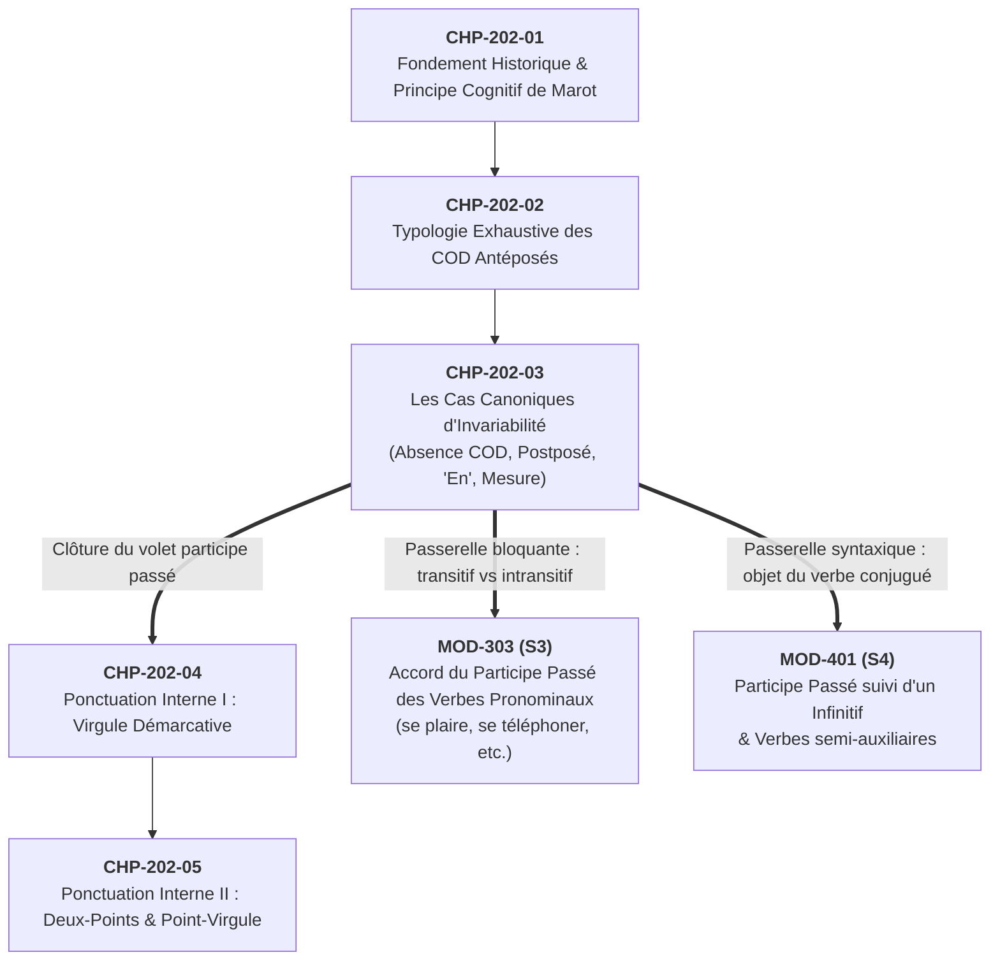

# Chapitre 3 — Les Cas Canoniques d'Invariabilité avec l'Auxiliaire Avoir : Absence de COD, COD Postposé, Neutralisation par « En » et Verbes de Mesure

> **Identifiant du chapitre** : `CHP-202-03`  
> **Module de rattachement** : [`MOD-202` — Accord du Participe Passé avec l'Auxiliaire Avoir et Ponctuation Interne/Logique](file:///f:/Formation/world-class-french/03-curriculum/year-1/semester-2/mod-202-participe-passe-avoir-ponctuation-interne.md)  
> **Semestre** : Année 1 — Semestre 2 (S2)  
> **Volume horaire estimé** : 5 à 6 heures d'apprentissage autonome délibéré et d'ateliers d'application (Phase 1 Étude : 1 h 30 | Phase 2 Pratique : 1 h 30 | Phase 3 Correction : 1 h 00 | Phase 4 Évaluation : 1 h 00)  
> **Statut** : [STATUT : VALIDÉ]  
> **Compétences associées** : [`FR-ORTHO-003`](file:///f:/Formation/world-class-french/02-competency-framework/competency-framework.md#fr-ortho-003-accord-rigoureux-du-participe-passé-avec-lauxiliaire-avoir) (L3 Autonomie), [`FR-SYNTAX-001`](file:///f:/Formation/world-class-french/02-competency-framework/competency-framework.md#fr-syntax-001-analyse-fonctionnelle-et-délimitation-de-la-phrase-simple) (L3 Autonomie)  
> **Sources scientifiques de référence** : `SRC-GRAM-01` (Grevisse & Goosse, 2016, § 950-954), `SRC-GRAM-02` (Riegel et al., 2016, chap. 17), `SRC-NORM-03` (Ministère de l'Éducation nationale, 2020), `SRC-GRAM-05` (Grevisse, 2009, § 274)

---

## 1. Titre et Place dans le Cursus

### 1.1 Intitulé Officiel
**Chapitre 3 : Les Cas Canoniques d'Invariabilité avec l'Auxiliaire Avoir : Absence de COD, COD Postposé, Neutralisation par « En » et Verbes de Mesure** (`CHP-202-03`).

### 1.2 Insertion Architecturale dans le Cursus
Ce troisième chapitre clôture de manière définitive le premier grand volet du module [`MOD-202`](file:///f:/Formation/world-class-french/03-curriculum/year-1/semester-2/mod-202-participe-passe-avoir-ponctuation-interne.md) consacré à la morphosyntaxe du participe passé conjugué avec l'auxiliaire *avoir*.

Après avoir établi dans le `CHP-202-01` le fondement cognitif de Clément Marot (1538) et l'algorithme binaire de décision, puis répertorié dans le `CHP-202-02` l'ensemble des configurations d'antéposition du Complément d'Objet Direct (pronoms clitiques, pronom relatif *que*, syntagmes interrogatifs et exclamatifs), l'apprenant aborde ici la **contrepartie logique absolue du système : l'invariabilité par défaut**.



- **En amont** : Ce chapitre s'appuie sur la maîtrise de l'analyse fonctionnelle de [`MOD-201`](file:///f:/Formation/world-class-french/03-curriculum/year-1/semester-2/mod-201-syntaxe-fonctionnelle-phrase-simple.md) (discrimination du COD, du COI et des compléments circonstanciels) et sur la mécanique de détection de l'antéposition étudiée dans `CHP-202-02`.
- **En clôture de la séquence orthographique de `MOD-202`** : Il verrouille le diagnostic négatif : savoir quand **ne pas accorder**. En français écrit soutenu, l'hypercorrection (accorder à tort un participe invariable) est aussi préjudiciable que l'oubli d'accord.
- **En transition immédiate vers la ponctuation interne (`CHP-202-04` et `CHP-202-05`)** : La délimitation des groupes syntaxiques et des compléments de mesure prépare directement l'arbitrage de la virgule démarcative et des liaisons logiques interpropositionnelles.
- **En passerelle vers l'aval (`MOD-303` et `MOD-401`)** : La distinction entre verbes transitifs directs et intransitifs/indirects constitue le prérequis indispensable pour résoudre l'accord des participes passés pronominaux au Semestre 3 (*« Elles se sont parlé »* vs *« Elles se sont vues »* [Réf. `SRC-GRAM-01`, § 950]).

---

## 2. Objectifs Mesurables

Au terme des 5 à 6 heures d'apprentissage autonome et d'ateliers d'application de ce chapitre, l'apprenant est capable de :

1. **Diagnostiquer instantanément l'absence de COD** dans les structures verbales intransitives et transitives indirectes (à rection prépositionnelle *à* ou *de*), et maintenir l'invariabilité stricte du participe passé en présence de pronoms COI antéposés (*lui, leur, nous, vous*) ([`FR-ORTHO-003`](file:///f:/Formation/world-class-french/02-competency-framework/competency-framework.md#fr-ortho-003-accord-rigoureux-du-participe-passé-avec-lauxiliaire-avoir), palier L3 ; [`FR-SYNTAX-001`](file:///f:/Formation/world-class-french/02-competency-framework/competency-framework.md#fr-syntax-001-analyse-fonctionnelle-et-délimitation-de-la-phrase-simple), palier L3).
2. **Appliquer infailliblement la règle d'invariabilité par défaut** lorsque le COD est postposé au participe passé, en déjouant les réflexes d'accord anticipé ou de fausse attraction par le sujet ([`FR-ORTHO-003`](file:///f:/Formation/world-class-french/02-competency-framework/competency-framework.md#fr-ortho-003-accord-rigoureux-du-participe-passé-avec-lauxiliaire-avoir), palier L3).
3. **Neutraliser systématiquement l'accord du participe passé** régi par le pronom adverbial partitif *en*, que ce pronom soit employé isolément ou combiné avec un adverbe de quantité ou un syntagme numéral postposé ([`FR-ORTHO-003`](file:///f:/Formation/world-class-french/02-competency-framework/competency-framework.md#fr-ortho-003-accord-rigoureux-du-participe-passé-avec-lauxiliaire-avoir), palier L3).
4. **Arbitrer sans défaillance la double valence des verbes dits de mesure, prix, durée et poids** (*coûter, valoir, peser, mesurer, durer, vivre, courir, marcher*), en discriminant le complément circonstanciel de mesure (invariable) du véritable COD au sens figuré (accord obligatoire) à l'aide des tests de passivisation et de pronominalisation clitique ([`FR-ORTHO-003`](file:///f:/Formation/world-class-french/02-competency-framework/competency-framework.md#fr-ortho-003-accord-rigoureux-du-participe-passé-avec-lauxiliaire-avoir), palier L3 ; [`FR-SYNTAX-001`](file:///f:/Formation/world-class-french/02-competency-framework/competency-framework.md#fr-syntax-001-analyse-fonctionnelle-et-délimitation-de-la-phrase-simple), palier L3).

---

## 3. Prérequis et Test de Préparation

### 3.1 Prérequis Exigibles
- **Distinction COD vs COI (`MOD-201`, `FR-SYNTAX-001`)** : Reconnaître si un complément du verbe est rattaché directement ou par l'intermédiaire d'une préposition (*parler à quelqu'un* $\rightarrow$ COI ; *saluer quelqu'un* $\rightarrow$ COD).
- **Principe de Clément Marot (`CHP-202-01`)** : Maîtriser le principe de disponibilité de l'objet : le participe passé ne s'accorde qu'avec le COD qui le précède.
- **Inventaire des pronoms clitiques compléments (`CHP-202-02`)** : Savoir que *le, la, les* sont toujours COD, tandis que *lui, leur* sont toujours COI dans l'ordre verbal conjoint.

### 3.2 Test de Préparation (Auto-Diagnostic à 5 Questions)
Répondez aux cinq questions suivantes avant de dérouler le corrigé :

1. **Question 1 (Rection verbale et clitique)** : Dans la phrase *« Ces collaboratrices, nous leur avons (téléphoner) »*, quelle est la fonction du pronom *leur* ? Faut-il accorder le participe passé ?
2. **Question 2 (Ordre canonique des constituants)** : Dans *« Le magistrat a (instruire) trois affaires criminelles complexes »*, où se situe le groupe nominal *trois affaires criminelles complexes* par rapport au verbe ? Quelle désinence reçoit le participe passé ?
3. **Question 3 (Nature de « en »)** : Dans *« Des lettres de réclamation, la direction en a (recevoir) des dizaines »*, quelle est la nature morphosyntaxique du pronom *en* ? Porte-t-il une marque intrinsèque de genre féminin et de nombre pluriel ?
4. **Question 4 (Test de passivisation)** : Soit la phrase *« Les cent mille francs CFA que cette formation a (coûter) »*. Peut-on transformer cet énoncé sous la forme passive *\*« Cent mille francs CFA ont été coûtés par cette formation »* ? Qu'en déduisez-vous sur la fonction de *que* ?
5. **Question 5 (Sens propre vs sens figuré)** : Comparez : *(a) « Les vingt kilomètres que ces soldats ont (courir) »* et *(b) « Les risques insensés que ces commandos ont (courir) »*. Dans quelle phrase le participe passé doit-il obligatoirement s'accorder et pourquoi ?

<details>
<summary><strong>Corrigé et barème de l'auto-diagnostic (cliquer pour dérouler)</strong></summary>

1. **Réponse 1** : Le verbe *téléphoner* est transitif indirect (*téléphoner à quelqu'un*). Le clitique *leur* est **Complément d'Objet Indirect (COI)**. Le verbe n'ayant aucun COD, le participe passé est **strictement invariable** : *téléphoné* (0 point si accord *\*téléphonées*).
2. **Réponse 2** : Le syntagme est placé **après** le participe passé (**COD postposé**). Selon la règle fondamentale d'invariabilité par défaut, le participe passé reste invariable : *a instruit*.
3. **Réponse 3** : Le mot *en* est un **pronom adverbial partitif/quantitatif** issu du latin *inde*. Il ne possède **aucun genre ni nombre intrinsèques** et neutralise l'accord : *en a reçu*.
4. **Réponse 4** : Non, la transformation passive est totalement **agrammaticale**. Le syntagme *que* n'est pas un COD, mais un **complément circonstanciel (ou essentiel) de mesure (de prix)** répondant à la question *combien ?*. Le participe passé demeure invariable : *a coûté*.
5. **Réponse 5** : L'accord est obligatoire dans la **phrase (b)** : *ont courus*. Au sens figuré, *courir* est transitif direct (*affronter des risques*, *courir un péril*) ; le pronom relatif *que* est un véritable COD antéposé reprenant *les risques insensés* (masculin pluriel). Dans la phrase (a), *courir* est intransitif et exprime une distance physique (*combien de kilomètres ?*) : *ont couru* reste invariable.

> **Diagnostic** : Si votre note est inférieure à 4/5, étudiez minutieusement les sections 7 et 8 ci-dessous.
</details>

---

## 4. Situation de Départ ou Problème Concret

### 4.1 L'Hypercorrection Orthographique et le Réflexe de l'Accord Indu
Dans la pratique rédactionnelle des étudiants et des cadres administratifs, l'assimilation imparfaite de la règle de Clément Marot produit une pathologie redoutable : **l'hypercorrection par excès de zèle**. 

Ayant retenu de manière vague que *« quand il y a un mot au pluriel avant le verbe avoir, on accorde »*, le scripteur applique mécaniquement des flexions fautives dès qu'il croise un pronom antéposé ou un nom féminin pluriel à gauche du verbe :

> ❌ *« Vos collègues de Cotonou, nous leur avons **téléphonées** dès hier matin. »*  
> ❌ *« Des dossiers contentieux, le tribunal en a **traités** plus de cinquante. »*  
> ❌ *« Les trois heures d'horloge que cette séance solennelle a **durées** ont épuisé l'assemblée. »*  
> ❌ *« Le contrôleur général a **validée** l'ensemble des pièces comptables. »*

Ces quatre énoncés, régulièrement relevés dans des rapports d'audit et des mémoires universitaires, constituent des solécismes manifestes aux yeux d'un jury ou d'une hiérarchie exigeante.

### 4.2 Le Casse-Tête des Verbes de Mesure
Le piège devient plus vicieux encore lors de la confrontation entre expressions chiffrées et emplois métaphoriques :
- Pourquoi écrit-on : *« Les trois mille euros que ce voyage d'études a **coûté** »* (invariable) ?
- Mais écrit-on : *« Les peines et les sacrifices considérables que cette victoire a **coûtés** »* (accordé au masculin pluriel) ?

La différence ne réside ni dans l'arbitraire ni dans une quelconque subtilité d'humeur littéraire : elle est dictée par la **structure actancielle de la phrase** et la nature syntaxique du complément qui précède le verbe recteur [Réf. `SRC-GRAM-02`, chap. 17].

---

## 5. Explication Intuitive : Le Coupe-Circuit et le Passeport Diplomatique

Pour maîtriser sans faillir les cas d'invariabilité, il convient d'abandonner l'analyse purement visuelle des mots pour adopter une modélisation mécanique et fonctionnelle :

```text
                        CIRCUIT DE TRANSMISSION DES TRAITS D'ACCORD
                        
  Source (Constituant antéposé)        Ligne de transmission       Récepteur (Participe passé)
 ┌─────────────────────────────┐        ┌──────────────────┐        ┌─────────────────────────┐
 │   VRAI COD ANTÉPOSÉ         │ =====► │   CÂBLE CONDUCTEUR   │ =====► │ ACCORD EN GENRE/NOMBRE  │
 │ (ex: "les décisions que...")│        │   (Accord activé)    │        │ (ex: "...a prises")     │
 └─────────────────────────────┘        └──────────────────┘        └─────────────────────────┘
 
 ┌─────────────────────────────┐        ┌──────────────────┐        ┌─────────────────────────┐
 │   COI ANTÉPOSÉ              │        │  COUPE-CIRCUIT   │        │ INVARIABILITÉ PAR DÉFAUT│
 │ (ex: "leur", "à qui")       │ ───X   │   DE SÉCURITÉ    │ ────►  │   (Morphologie zéro)    │
 └─────────────────────────────┘        │  (Courant coupé) │        │ (ex: "...a téléphoné")  │
 ┌─────────────────────────────┐        │                  │        │                         │
 │   MESURE / PRIX / DURÉE     │ ───X   │                  │        │ (ex: "...a coûté")      │
 └─────────────────────────────┘        └──────────────────┘        └─────────────────────────┘
 
 ┌─────────────────────────────┐        ┌──────────────────┐        ┌─────────────────────────┐
 │   PRONOM ADVERBIAL "EN"     │ =====► │    PASSEPORT     │ ────►  │ IMMUNITÉ D'ACCORD       │
 │   (inde = "de là")          │        │   DIPLOMATIQUE   │        │ (ex: "...en a reçu")    │
 └─────────────────────────────┘        │  (Neutre opaque) │        └─────────────────────────┘
```

1. **L'analogie du coupe-circuit de sécurité** : L'accord en genre et en nombre est un courant morphologique qui exige impérativement un câble conducteur exclusif : le statut de **Complément d'Objet Direct**. Si le constituant situé à gauche du verbe est un Complément d'Objet Indirect (*leur, lui*), un complément circonstanciel de temps ou de mesure (*trois ans, cinq mille francs*), le coupe-circuit s'ouvre instantanément. Aucun trait de féminin ou de pluriel ne peut franchir la borne : le participe passé demeure dans son état fondamental de repos, c'est-à-dire au **masculin singulier non marqué**.
2. **L'analogie du passeport diplomatique (le pronom « en »)** : Le pronom *en* n'est pas un pronom nominal ordinaire doté de cases flexionnelles de genre et de nombre. Issu du latin *inde* (« de là »), il se déplace dans la phrase avec une totale neutralité morphologique. Il présente aux frontières du participe passé un passeport diplomatique exempt de tout visa de genre ou de nombre : le participe passé ne peut prélever sur lui aucune marque et reste rigoureusement invariable.

---

## 6. Définitions Précises et Terminologie

Dans tout le cursus, les concepts grammaticaux sont définis selon la terminologie officielle du Ministère de l'Éducation nationale [`SRC-NORM-03`] et la doctrine du *Bon Usage* [`SRC-GRAM-01`] :

- **Invariabilité par défaut (morphologie non marquée)** : État morphologique fondamental du participe passé employé avec l'auxiliaire *avoir*, caractérisé par l'absence de désinence flexionnelle de genre et de nombre (terminaison standard en *-é, -i, -u, -s, -t* au masculin singulier), appliqué systématiquement dès lors que les conditions formelles d'accord ne sont pas réunies.
- **Verbe intransitif strict** : Verbe dont la valence sémantique ne sélectionne aucun complément d'objet, direct ou indirect, dans sa construction fondamentale (*dormir, voyager, nager, courir, hésiter, succomber*). Conjugué avec *avoir*, son participe passé ne s'accorde jamais.
- **Verbe transitif indirect** : Verbe dont la rection exige un complément introduit par une préposition (*à* ou *de* : *téléphoner à, nuire à, plaire à, succéder à, hériter de*). Les pronoms conjoints qui le représentent (*lui, leur*) sont des COI et ne commandent jamais l'accord du participe.
- **Pronom adverbial partitif (*en*)** : Pronom conjoint d'origine adverbiale (latin *inde*) représentant un groupe nominal précédé de la préposition *de*, exprimant une quantité indéterminée, une fraction ou une provenance, et dépourvu de traits intrinsèques de genre et de nombre.
- **Complément circonstanciel (ou essentiel) de mesure / prix / durée / poids** : Constituant nominal ou adverbial répondant aux questions scalaires *Combien ?*, *Combien de temps ?*, *Combien d'espace ?* ou *Combien de poids ?*, exprimant une grandeur mesurable et non une entité actancielle patiente soumise à l'action d'un agent.
- **Valence verbale double** : Propriété d'un lexème verbal pouvant commuter entre une construction intransitive (avec complément de mesure scalaire) et une construction transitive directe (avec véritable COD actanciel, généralement dans un registre figuré ou abstrait).
- **Sens figuré transitif direct** : Emploi sémantique dans lequel un verbe traditionnellement scalaire ou spatial (*coûter, peser, courir, vivre*) change de schéma d'arguments pour désigner une action subie par un objet abstrait (*occasionner des peines*, *évaluer des arguments*, *affronter des périls*, *expérimenter des épreuves*).
- **Hypercorrection orthographique** : Faute de langue commise par le scripteur lorsqu'il applique indûment une règle grammaticale prestigieuse à un contexte syntaxique qui l'exclut formellement, par crainte excessive de commettre une faute d'omission.

---

## 7. Règles ou Mécanismes Fondamentaux

L'invariabilité du participe passé employé avec l'auxiliaire *avoir* se déploie selon **quatre cas canoniques exclusifs** :

### 7.1 Cas 1 : L'Absence Structurelle de COD

Le principe de Clément Marot est catégorique : **pas de COD antéposé, pas d'accord**. Deux grandes familles verbales illustrent cette absence structurelle :

#### 7.1.1 Les verbes intransitifs stricts
Ces verbes décrivent des états, des processus physiologiques ou des mouvements physiques sans aucun objet direct : *dormir, courir, marcher, nager, régner, hésiter, voyager, succomber, briller, dîner*.

Conjugé avec l'auxiliaire *avoir*, le participe passé est **invariable en toute circonstance** :
- *Elles ont bien **dormi** cette nuit.* (Pas de COD).
- *Les trois mois pendant lesquels nous avons **voyagé**.* (Le groupe relatif *pendant lesquels* est complément circonstanciel de temps, non un COD).
- *Les rois qui ont **régné** sur ce territoire.* (*qui* est sujet, il n'y a aucun COD).

#### 7.1.2 Les verbes transitifs indirects à COI
Les verbes dont la valence exige un COI introduit par *à* (*plaire à, nuire à, téléphoner à, succéder à, sourire à, ressembler à, parler à, convenir à, en vouloir à*) ne sélectionnent aucun COD.

Lorsque le COI est pronominalisé sous forme conjointe (*lui, leur, nous, vous, me, te*), ce pronom est nécessairement placé **avant** le verbe. Or, étant un COI, il n'exerce **aucune influence** sur le participe passé [Réf. `SRC-GRAM-01`, § 950] :
- *Ces directrices, nous leur avons **téléphoné** à plusieurs reprises.* (*leur* = COI $\rightarrow$ invariable).
- *Les difficultés auxquelles ils ont **succédé**.* (*auxquelles* = COI $\rightarrow$ invariable).
- *Vos arguments leur ont **plu** dès le premier instant.* (*leur* = COI $\rightarrow$ invariable).

### 7.2 Cas 2 : Le COD Postposé (La Règle d'Or par Défaut)

Dans l'ordre linéaire canonique du français (Sujet - Verbe - Objet), le participe passé est produit vocalement ou scripturalement **avant** que le scripteur n'exprime le COD. L'objet n'étant pas encore actualisé au moment où le verbe est formé, le participe passé conserve sa forme par défaut neutre :

- *Le gouvernement béninois a **voté** [les nouvelles lois de finances].*  
  $\rightarrow$ Le COD *les nouvelles lois* est placé après : **invariable**.
- *Elle a **écrit** [trois lettres officielles d'avertissement].*  
  $\rightarrow$ Le COD *trois lettres* est placé après : **invariable**.
- *Les experts ont **mesuré** [les dimensions exactes du terrain].*  
  $\rightarrow$ Le COD *les dimensions* est placé après : **invariable**.

> [!IMPORTANT]
> L'invariabilité avec COD postposé est absolue. L'accord par anticipation (*« *Elle a écrite trois lettres »*) est une faute sévère résultant d'une surcharge cognitive ou d'un manque d'automatisation de la séquence syntaxique.

### 7.3 Cas 3 : La Neutralisation Absolue par le Pronom Adverbial « En »

#### 7.3.1 Origine et nature syntaxique
Issu de l'adverbe latin *inde* (« de là, à partir de cela »), le pronom clitique *en* est un substitut de rang génitif ou ablatif. Il remplace canoniquement un syntagme prépositionnel introduit par *de* (*parler de cela* $\rightarrow$ *en parler* ; *manger de la tarte* $\rightarrow$ *en manger*). 

Sur le plan actanciel, même lorsqu'il occupe la fonction d'objet partitif ou quantitatif, *en* se caractérise par son **absence totale de flexion morphologique** : il ne possède ni genre (masculin ou féminin) ni nombre (singulier ou pluriel) intrinsèques [Réf. `SRC-GRAM-02`, chap. 17].

#### 7.3.2 La règle normative contemporaine
Dans la norme prescriptive contemporaine de l'Académie française, du Ministère de l'Éducation nationale et des concours administratifs, **le participe passé précédé de « en » demeure rigoureusement invariable** [Réf. `SRC-GRAM-01`, § 954 ; `SRC-GRAM-05`, § 274] :
- *Des fautes d'inattention, cet étudiant en a **commis**.* (*commis* invariable).
- *Des fleurs tropicales, nous en avons **cueilli** beaucoup.* (*cueilli* invariable).
- *Des subventions d'équipement, le ministère en a **accordé** à toutes les communes.* (*accordé* invariable).

#### 7.3.3 Rejet des tolérances archaïques
Bien que certains auteurs classiques du XVIIe siècle aient occasionnellement accordé le participe passé avec le référent sémantique de *en* (*« Cassettes ? [...] Il en a tant pillées »*, Molière), cet accord est aujourd'hui universellement classé comme **archaïque, pédant ou fautif**. Dans les épreuves normées et l'usage professionnel surveillé, l'invariabilité est de rigueur absolue.

### 7.4 Cas 4 : La Dichotomie Cardinale des Verbes de Mesure

Les verbes exprimant une dimension physique, temporelle ou pécuniaire — notamment *coûter, valoir, peser, mesurer, durer, vivre, courir, marcher* — présentent une **double valence syntaxique** selon qu'ils sont employés dans leur acception physique propre ou dans un sens métaphorique abstrait [Réf. `SRC-GRAM-01`, § 952].

#### 7.4.1 Emploi intransitif (Sens propre scalaire) $\rightarrow$ Invariabilité Stricte
Au sens propre, ces verbes sont intransitifs. Le syntagme nominal chiffré qui les accompagne n'est pas un COD : il répond à la question scalaire *Combien ?*, *Combien de temps ?* ou *Combien d'espace ?*. Il s'agit d'un **complément circonstanciel (ou essentiel) de mesure**. 

Puisqu'il n'y a aucun COD, le pronom relatif *que* qui reprend cette mesure ne commande **aucun accord** :

| Verbe | Phrase Exemple au Sens Propre | Nature du Complément Antéposé | Accord du Participe Passé |
| :--- | :--- | :--- | :---: |
| **Coûter** | *Les cinq cent mille francs CFA que ce matériel a **coûté**.* | Complément de prix (*combien ?*) | **Invariable** (*coûté*) |
| **Valoir** | *Les vingt millions de francs que ce terrain a **valu** autrefois.* | Complément de prix (*combien ?*) | **Invariable** (*valu*) |
| **Durer** | *Les deux heures complètes que la conférence a **duré**.* | Complément de durée (*combien de temps ?*) | **Invariable** (*duré*) |
| **Vivre** | *Les quatre-vingts ans que le patriarche a **vécu**.* | Complément de durée (*combien d'années ?*) | **Invariable** (*vécu*) |
| **Courir** | *Les dix kilomètres que les athlètes ont **couru** sous le soleil.* | Complément de distance (*combien d'espace ?*) | **Invariable** (*couru*) |
| **Marcher** | *Les trois lieues que nos patrouilles ont **marché**.* | Complément de distance (*combien d'espace ?*) | **Invariable** (*marché*) |
| **Peser** | *Les quatre-vingts kilos que ce lourd colis a **pesé**.* | Complément de poids (*combien de poids ?*) | **Invariable** (*pesé*) |
| **Mesurer** | *Les deux mètres que cette poutre maîtresse a **mesuré**.* | Complément de dimension (*combien de longueur ?*) | **Invariable** (*mesuré*) |

#### 7.4.2 Emploi transitif direct au sens figuré $\rightarrow$ Accord Obligatoire
Au sens figuré, ces mêmes verbes subissent une transmutation sémantique et syntaxique radicale : ils sélectionnent un véritable **patient actanciel abstrait**. Ils deviennent des verbes transitifs directs régissant un authentique COD. 

Dès lors que ce COD est antéposé, l'accord en genre et en nombre redevient **obligatoire** :

| Verbe | Sens Figuré Transitif Direct | Phrase Modèle au Sens Figuré | Accord du Participe Passé |
| :--- | :--- | :--- | :---: |
| **Coûter** | *Occasionner, susciter, exiger* | *Les peines et les tracas que cette entreprise a **coûtés**.* | Accord avec *les peines et les tracas* (masc. plur.) |
| **Valoir** | *Procurer, rapporter, mériter* | *Les félicitations et les éloges que son audace lui a **valus**.* | Accord avec *les félicitations et les éloges* (masc. plur.) |
| **Peser** | *Évaluer, soupeser intellectuellement* | *Les arguments décisifs que le président du tribunal a **pesés**.* | Accord avec *les arguments décisifs* (masc. plur.) |
| **Courir** | *Affronter, risquer, s'exposer à* | *Les graves périls que ces marins courageux ont **courus**.* | Accord avec *les graves périls* (masc. plur.) |
| **Vivre** | *Éprouver, traverser émotionnellement* | *Les angoisses et les joies intenses qu'elle a **vécues**.* | Accord avec *les angoisses et les joies* (fém. plur.) |

---

## 8. Raisonnement Détaillé : Pourquoi un Complément de Mesure n'est pas un COD

La grammaire scolaire pose souvent la règle sans expliquer le mécanisme structural qui la fonde. Pourquoi un montant pécuniaire ou une durée temporelle ne peut-il pas faire accorder le participe passé ?

### 8.1 L'Épreuve Décisive de la Passivisation
La propriété définitionnelle d'un véritable COD en français standard est son aptitude fondamentale à être promu **Sujet** sous la transformation passive [Réf. `SRC-GRAM-02`, chap. 17 ; `SRC-NORM-03`] :

1. **Avec un verbe transitif direct figuré** :
   - Voix active : *Cette négociation complexe a coûté [de lourdes peines].* (COD).
   - Voix passive : *[De lourdes peines] ont été coûtées par cette négociation complexe.* $\rightarrow$ **Structure syntaxiquement recevable**.
2. **Avec un verbe de mesure au sens propre** :
   - Voix active : *Ce voyage à Parakou a coûté [trois cent mille francs CFA].*
   - Voix passive : *\*[Trois cent mille francs CFA] ont été coûtés par ce voyage à Parakou.* $\rightarrow$ **Structure totalement agrammaticale et irrecevable**.

Le syntagme *trois cent mille francs* ne subit aucune action : il ne désigne pas un objet façonné, acquis ou transformé par le voyage. Le voyage ne « coûte » pas les francs de la même manière qu'un maçon bâtit un mur. Il s'agit d'un **indicateur d'échelle** mesurant le coût du voyage.

### 8.2 Le Test de Pronominalisation Clitique par « Le / La / Les »
Un véritable COD défini se pronominalise obligatoirement par les clitiques accusatifs *le, la, les* :
- *Les périls que j'ai courus* $\rightarrow$ *Je **les** ai courus.* (Grammatical).
- *Les trois kilomètres que j'ai couru* $\rightarrow$ *\*Je **les** ai courus.* (Totalement agrammatical en français standard ; on dit : *J'ai couru pendant trois kilomètres*).
- *Les cent kilos que la fonte a pesé* $\rightarrow$ *\*La fonte **les** a pesés.* (Agrammatical).

Puisque les compléments scalaires refusent la cliticisation par *les* et la transformation passive, ils ne possèdent pas le statut fonctionnel de COD. N'étant pas des COD, ils ne peuvent en aucun cas transmettre leurs traits d'accord au participe passé.

---

## 9. Exemples Corrects Commentés

Examinons six paires de phrases contrastives illustrant l'application rigoureuse du diagnostic actanciel :

### Paire 1 : Le verbe *coûter*
- **Phrase 1A (Mesure de prix — Invariable)** :  
  *« Les dix millions de francs CFA que ces travaux de réfection ont **coûté** ont asséché nos réserves budgétaires. »*  
  $\rightarrow$ **Analyse** : *Que* a pour antécédent *dix millions de francs CFA*. Il répond à la question *Les travaux ont coûté combien ?*. C'est un complément circonstanciel de prix. Le participe passé *coûté* reste strictement au masculin singulier.
- **Phrase 1B (Sens figuré transitif — Accordé)** :  
  *« Les longues veilles et les souffrances que cette distinction honorifique lui a **coûtées** ne seront jamais oubliées. »*  
  $\rightarrow$ **Analyse** : *Que* a pour antécédent coordonné *les longues veilles et les souffrances* (féminin pluriel). Le verbe signifie ici *occasionner, exiger*. *Que* est un véritable COD antéposé. Le participe passé prend les marques du féminin pluriel : *coûtées*.

### Paire 2 : Le verbe *courir*
- **Phrase 2A (Mesure d'espace — Invariable)** :  
  *« Les quarante-deux kilomètres que ces marathoniens ont **couru** sous une chaleur torride ont éprouvé leurs organismes. »*  
  $\rightarrow$ **Analyse** : *Quarante-deux kilomètres* mesure la distance spatiale parcourue (*combien de kilomètres ?*). Le verbe est intransitif. Le participe passé *couru* demeure invariable.
- **Phrase 2B (Sens figuré transitif — Accordé)** :  
  *« Les risques sanitaires majeurs que les volontaires humanitaires ont **courus** méritent le respect de la nation. »*  
  $\rightarrow$ **Analyse** : *Courir des risques* signifie *s'exposer délibérément à des dangers*. Le pronom relatif *que* est COD de *ont courus* et reprend *les risques sanitaires majeurs* (masculin pluriel) : désinence *-s*.

### Paire 3 : Le verbe *peser*
- **Phrase 3A (Mesure de masse — Invariable)** :  
  *« Les deux cents tonnes que le navire marchand a **pesé** lors de la pesée en rade de Cotonou ont surpris les douaniers. »*  
  $\rightarrow$ **Analyse** : *Deux cents tonnes* exprime le poids mesuré sur la balance (*combien ?*). Emploi intransitif scalaire. Invariabilité absolue : *pesé*.
- **Phrase 3B (Sens figuré transitif — Accordé)** :  
  *« Toutes les conséquences juridiques que les magistrats de la cour d'appel ont **pesées** avant de rendre leur arrêt sont capitales. »*  
  $\rightarrow$ **Analyse** : *Peser des conséquences* équivaut à *évaluer intellectuellement, soupeser*. *Que* est COD antéposé reprenant *toutes les conséquences juridiques* (féminin pluriel) : accord obligatoire *pesées*.

### Paire 4 : Le verbe *vivre*
- **Phrase 4A (Mesure de durée — Invariable)** :  
  *« Les six années que notre ambassadeur a **vécu** en Afrique de l'Ouest ont consolidé les partenariats économiques. »*  
  $\rightarrow$ **Analyse** : *Six années* indique la durée de l'existence ou du séjour temporel (*combien d'années ?*). Verbe intransitif avec complément de durée : *vécu* invariable.
- **Phrase 4B (Sens figuré transitif — Accordé)** :  
  *« Les péripéties enthousiasmantes que les jeunes stagiaires ont **vécues** lors de ce forum d'innovation resteront gravées dans leurs mémoires. »*  
  $\rightarrow$ **Analyse** : *Vivre des péripéties* signifie *faire l'expérience directe d'événements*. *Que* est COD antéposé reprenant *les péripéties enthousiasmantes* (féminin pluriel) : *vécues*.

### Paire 5 : Le pronom adverbial *en* vs le pronom clitique *les*
- **Phrase 5A (Neutralisation par « en » — Invariable)** :  
  *« Des rapports de synthèse, la commission d'audit en a **rédigé** trois en l'espace d'une semaine. »*  
  $\rightarrow$ **Analyse** : Le complément d'objet partitif est *en*. Bien que le référent sémantique soit *des rapports* (masculin pluriel) et qu'un numéral *trois* soit postposé, *en* neutralise tout accord. Le participe passé *rédigé* reste au masculin singulier.
- **Phrase 5B (Clitique accusatif défini « les » — Accordé)** :  
  *« Ces rapports de synthèse, la commission d'audit les a **rédigés** avec une minutie exemplaire. »*  
  $\rightarrow$ **Analyse** : Le pronom conjoint antéposé est *les*, véritable clitique COD transportant les traits [masculin, pluriel] de l'antécédent *ces rapports*. L'accord est obligatoire : *rédigés*.

### Paire 6 : COI antéposé *leur* vs COD antéposé *les*
- **Phrase 6A (Transitif indirect à COI — Invariable)** :  
  *« Les nouvelles recrues militaires, le colonel leur a **parlé** avec fermeté dans la cour de la garnison. »*  
  $\rightarrow$ **Analyse** : Le verbe *parler à* régit un COI. Le pronom clitique antéposé *leur* est COI (*parler à elles*). Le participe passé *parlé* est rigoureusement invariable.
- **Phrase 6B (Transitif direct à COD — Accordé)** :  
  *« Les nouvelles recrues militaires, le colonel les a **félicitées** pour leur discipline exemplaire. »*  
  $\rightarrow$ **Analyse** : Le verbe *féliciter* est transitif direct (*féliciter quelqu'un*). Le clitique antéposé *les* est COD reprenant *les nouvelles recrues* (féminin pluriel). Accord obligatoire : *félicitées*.

---

## 10. Contre-Exemples et Erreurs Fréquentes

L'analyse clinique des erreurs d'étudiants permet d'isoler **six pathologies récurrentes** :

### Erreur n° 1 : L'accord fautif avec le pronom adverbial « en »
- ❌ **Forme fautive** : *« Des solutions pérennes, nos ingénieurs en ont **trouvées** lors du séminaire. »*
- $\checkmark$ **Forme correcte** : *« Des solutions pérennes, nos ingénieurs en ont **trouvé** lors du séminaire. »*
- **Diagnostic de la pathologie** : Le scripteur identifie le groupe topicalisé *des solutions pérennes* (féminin pluriel) et croit que le pronom *en* transmet ses marques au verbe.
- **Règle de verrouillage** : Le pronom *en* est un bloqueur absolu d'accord. Le participe passé précédé de *en* ne s'accorde jamais.

### Erreur n° 2 : L'accord fautif sur un complément circonstanciel de prix
- ❌ **Forme fautive** : *« Les huit millions de francs CFA que cette machine agricole a **coûtés** dépassent notre budget. »*
- $\checkmark$ **Forme correcte** : *« Les huit millions de francs CFA que cette machine agricole a **coûté** dépassent notre budget. »*
- **Diagnostic de la pathologie** : L'apprenant voit *que* précédé d'un groupe pluriel (*huit millions*) et applique aveuglément le réflexe de Clément Marot sans vérifier la fonction syntaxique de *que*.
- **Règle de verrouillage** : Le verbe *coûter* au sens de valeur marchande est intransitif. Le pronom *que* y est complément circonstanciel de prix, jamais COD. Le participe reste invariable.

### Erreur n° 3 : L'accord fautif sur un complément circonstanciel de durée
- ❌ **Forme fautive** : *« Les trois semaines d'attente que cette procédure d'homologation a **durées** ont pénalisé l'entreprise. »*
- $\checkmark$ **Forme correcte** : *« Les trois semaines d'attente que cette procédure d'homologation a **duré** ont pénalisé l'entreprise. »*
- **Diagnostic de la pathologie** : Confusion entre la durée temporelle (complément de mesure répondant à *combien de temps ?*) et un objet direct.
- **Règle de verrouillage** : Le verbe *durer* est intransitif par nature ; il ne possède jamais de COD. Son participe passé est obligatoirement invariable en toute position.

### Erreur n° 4 : L'accord fautif sur un pronom personnel COI antéposé (« leur », « lui », « nous », « vous »)
- ❌ **Forme fautive** : *« Ces éminentes spécialistes de santé publique, nous leur avons **présentées** nos conclusions hier. »*
- $\checkmark$ **Forme correcte** : *« Ces éminentes spécialistes de santé publique, nous leur avons **présenté** nos conclusions hier. »*
- **Diagnostic de la pathologie** : Attraction visuelle par le pronom pluriel antéposé *leur* et par le groupe thématique féminin pluriel *ces éminentes spécialistes*. L'apprenant ne vérifie pas la structure de la phrase active : *présenter des conclusions (COD) à ces spécialistes (COI)*.
- **Règle de verrouillage** : Le clitique *leur* est toujours COI. Le véritable COD (*nos conclusions*) étant postposé, le participe passé *présenté* est doublement verrouillé dans l'invariabilité.

### Erreur n° 5 : L'accord anticipé par défaut sur un COD postposé
- ❌ **Forme fautive** : *« Le conseil communal a **adoptée** la nouvelle délibération sur le ramassage des ordures. »*
- $\checkmark$ **Forme correcte** : *« Le conseil communal a **adopté** la nouvelle délibération sur le ramassage des ordures. »*
- **Diagnostic de la pathologie** : Anticipation mentale de l'objet direct (*la nouvelle délibération*, fém. sing.) lors de la frappe du participe, provoquant une confusion entre la règle de l'adjectif qualificatif et celle du participe composé avec *avoir*.
- **Règle de verrouillage** : Lorsque le COD suit le participe passé, le participe ne s'accorde jamais.

### Erreur n° 6 : La confusion entre emploi intransitif (mesure) et emploi transitif figuré sur « peser » et « coûter »
- ❌ **Forme fautive** : *« Les sacrifices inouïs que la construction de ce barrage a **coûté** ont marqué les esprits. »*
- $\checkmark$ **Forme correcte** : *« Les sacrifices inouïs que la construction de ce barrage a **coûtés** ont marqué les esprits. »*
- **Diagnostic de la pathologie** : Application mécanique de l'invariabilité de *coûter* sans discerner que l'énoncé n'exprime aucun prix pécuniaire en monnaie, mais un sens abstrait d'épreuves subies (*occasionner des sacrifices*).
- **Règle de verrouillage** : Au sens figuré d'*occasionner*, *coûter* est transitif direct et s'accorde obligatoirement avec le COD antéposé *que* reprenant *les sacrifices inouïs* (masc. plur.).

---

## 11. Cas Particuliers et Limites

### 11.1 Tournures Mixtes : « En » Accompagné d'un Adverbe de Quantité
Une hésitation survient fréquemment lorsque *en* est suivi, après le participe passé, d'un quantifieur adverbial (*beaucoup, peu, trop, davantage*) ou d'un nom de nombre (*deux, trois, une dizaine*) :
- *« Des erreurs de calcul, la commission en a **relevé** [plusieurs / beaucoup / trois]. »*

Certains scripteurs s'imaginent à tort que la présence d'un quantifieur pluriel postposé rétablit l'accord. Il n'en est rien. L'invariabilité demeure totale :
- Le pronom *en* reste le clitique d'objet immédiat rattaché au verbe.
- Les quantifieurs *trois* ou *beaucoup* fonctionnent comme des spécifieurs de quantité en apposition ou compléments de *en*.
- Le participe passé demeure strictement invariable : *en a relevé*.

### 11.2 Le Cas Particulier du Verbe « Valoir »
Le verbe *valoir* présente une double construction très contrastée dans le domaine juridique et économique :
1. **Au sens de prix ou valeur marchande (intransitif)** :  
   *« Les sommes considérables que cette villa a **valu** avant la crise immobilière ne seront plus jamais atteintes. »*  
   $\rightarrow$ Complément de prix : invariabilité (*a valu*).
2. **Au sens de procurer, rapporter, mériter (transitif direct)** :  
   *« Les distinctions et les honneurs que ses remarquables travaux lui ont **valus** honorent toute l'université. »*  
   $\rightarrow$ Le verbe sélectionne deux arguments : un objet indirect d'attribution (*lui*) et un COD de bénéfice (*les distinctions et les honneurs*). L'accord est obligatoire : *valus* (masc. plur.).

### 11.3 Les Verbes « Courir » et « Marcher » devant un Nom d'Épreuve Sportive
Que décider face à : *« Les épreuves de vitesse que les athlètes ont couru(es) »* ?
- Si le nom désigne une **course en tant qu'épreuve organisée** (*courir une course, courir un marathon* au sens de disputer la compétition), les dictionnaires modernes admettent l'emploi transitif direct : *« La course effrénée qu'ils ont **courue** »* [Réf. `SRC-GRAM-01`, § 952].
- Si le nom exprime une **distance kilométrique brute** (*les cinq mille mètres qu'ils ont couru*), l'emploi est strictement intransitif et le participe demeure invariable : *« Les cinq mille mètres qu'ils ont **couru** »*.

---

## 12. Approfondissement Adapté au Niveau : Histoire de la Doctrine sur « En »

Pourquoi le pronom *en* échappe-t-il à la règle de Clément Marot ? L'examen diachronique permet de comprendre la fixation de la norme moderne.

### 12.1 L'Hésitation Classique du XVIIe au XIXe Siècle
Au XVIIe siècle, Claude Favre de Vaugelas (*Remarques sur la langue françoise*, 1647) et les premiers académiciens constatent une profonde divergence dans l'usage des meilleurs écrivains :
- Racine et Corneille accordaient tantôt le participe passé (*« Des nouvelles, je vous en ai apportées »*), tantôt le laissaient invariable (*« Des larmes, j'en ai versé »*).
- L'hésitation provenait d'une confusion conceptuelle : certains lettrés considéraient que *en* représentait fidèlement le nom pluriel antécédent et devait donc transmettre ses traits ; d'autres percevaient que *en* n'était qu'un équivalent du latin *inde* ou *de eo*, c'est-à-dire un complément d'origine ou de matière sans flexion.

### 12.2 La Fixation de la Doctrine Moderne par les Traités de Référence
Au XIXe siècle, Émile Littré dans son *Dictionnaire de la langue française* et les grammairiens de l'école logique militent pour la clarification du système. 

Dans *Le Bon Usage* (§ 954), Maurice Grevisse et André Goosse établissent que la langue soignée contemporaine a tranché définitivement en faveur de **l'invariabilité absolue** :
> *« L'invariabilité du participe passé précédé de en est aujourd'hui la règle commune et constante de l'usage surveillé. Elle s'explique par la nature du pronom en, qui, représentant un groupe prépositionnel (de cela), ne peut être assimilé à un véritable objet direct défini portant le genre et le nombre du substantif. »* [`SRC-GRAM-01`, § 954].

Cette doctrine élimine les arguties anciennes : toute marque d'accord avec *en* est désormais bannie des épreuves officielles et des copies universitaires.

---

## 13. Comparaisons Différentielles

Les trois tableaux synoptiques ci-dessous synthétisent les lignes de démarcation morphosyntaxiques :

### Tableau 1 : Pronom « En » vs Pronom Clitique « Les »

| Critère d'Analyse | Pronom Adverbial Partitif « En » | Pronom Clitique Défini « Les » |
| :--- | :--- | :--- |
| **Origine étymologique** | Latin *inde* (« de là, de cette matière ») | Latin *illos / illas* (démonstratif accusatif pluriel) |
| **Traits morphologiques** | **Neutre invariable** (aucun genre ni nombre intrinsèques) | **Pluriel marqué** (masculin ou féminin selon l'antécédent) |
| **Nature syntaxique** | Pronom partitif / génitif | Pronom personnel objet direct défini |
| **Exemple modèle** | *Des erreurs, le relecteur en a **relevé** dix.* | *Ces erreurs, le relecteur les a **relevées** immédiatement.* |
| **Conséquence sur le participe** | **INVARIABILITÉ ABSOLUE** (morphologie zéro *-é, -i, -u*) | **ACCORD OBLIGATOIRE** en genre et en nombre (*-és, -ées*) |

### Tableau 2 : Verbe de Mesure au Sens Propre vs Sens Figuré

| Verbe | Emploi au Sens Propre (Scalaire / Mesure) $\rightarrow$ INVARIABLE | Emploi au Sens Figuré (Transitif Direct) $\rightarrow$ ACCORDÉ |
| :--- | :--- | :--- |
| **Coûter** | *Les cinquante mille francs que cet habit a **coûté**.*<br/>*(Mesure pécuniaire : combien d'argent ?)* | *Les peines et les angoisses que ce procès lui a **coûtées**.*<br/>*(Véritable COD : occasionner des peines)* |
| **Valoir** | *Les millions de francs CFA que cette parcelle a **valu**.*<br/>*(Mesure de prix foncier : combien ?)* | *Les félicitations méritées que son courage lui a **values**.*<br/>*(Véritable COD : procurer des éloges)* |
| **Peser** | *Les cent vingt kilos que cette cargaison a **pesé**.*<br/>*(Mesure pondérale physique : combien de kilos ?)* | *Toutes les raisons capitales que le jury a **pesées**.*<br/>*(Véritable COD : soupeser intellectuellement)* |
| **Courir** | *Les quinze kilomètres que nous avons **couru** hier.*<br/>*(Mesure de distance physique : combien d'espace ?)* | *Les périls mortels que ces explorateurs ont **courus**.*<br/>*(Véritable COD : affronter des périls)* |
| **Durer / Vivre** | *Les deux heures d'attente que cette séance a **duré**.*<br/>*(Mesure de temps : combien de temps ?)* | *Les épreuves douloureuses que ces orphelins ont **vécues**.*<br/>*(Véritable COD : traverser des épreuves)* |

### Tableau 3 : Pronom COI Antéposé (« Leur / Lui ») vs Pronom COD Antéposé (« Les / La »)

| Paramètre Syntaxique | Clitique Indirect : *Leur / Lui* | Clitique Direct : *Les / La* |
| :--- | :--- | :--- |
| **Rection du verbe recteur** | Rection indirecte prépositionnelle (*parler à, téléphoner à*) | Rection directe sans préposition (*féliciter, avertir, soutenir*) |
| **Fonction grammaticale** | **Complément d'Objet Indirect (COI)** | **Complément d'Objet Direct (COD)** |
| **Exemple canonique** | *Ces directrices, nous leur avons **téléphoné** sans tarder.* | *Ces directrices, nous les avons **félicitées** sans tarder.* |
| **Statut du participe passé** | **INVARIABLE** (le coupe-circuit bloque l'accord) | **ACCORDÉ** avec le clitique COD antéposé |

---

## 14. Exercices Progressifs

### 14.1 Niveau 1 : Identification de l'Invariabilité Immédiate (12 phrases guidées)
Orthographiez correctement le participe passé entre parenthèses et indiquez la justification formelle de son invariabilité parmi les trois motifs suivants : *(a) Verbe intransitif ou COI sans COD* ; *(b) COD postposé* ; *(c) Pronom partitif « en »*.

1. *Ces étudiantes assidues, le professeur leur a (conseiller) de poursuivre leurs recherches en linguistique.*
2. *L'inspecteur général des finances a (examiner) l'ensemble des pièces justificatives de la trésorerie.*
3. *Des lettres de remerciement, notre secrétariat en a (expédier) plus de deux cents cette semaine.*
4. *Les trois témoins clés de l'accident, les gendarmes leur ont (parler) avec bienveillance.*
5. *La commission électorale a (proclamer) les résultats officiels dès minuit.*
6. *Des bourses d'études universitaires, l'État en a (attribuer) à tous les lauréats du concours.*
7. *Les enfants ont paisiblement (dormir) durant tout le trajet de nuit vers Natitingou.*
8. *Le ministre a (présenter) aux députés les grandes orientations de la politique agricole.*
9. *Ces magistrats intègres, aucun justiciable ne leur a jamais (nuire).*
10. *Des clarifications méthodologiques, les étudiants en ont (demander) à la fin de la séance.*
11. *Notre délégation a longuement (hésiter) avant d'engager la signature du protocole.*
12. *Le directeur des ressources humaines a (sélectionner) trois dossiers parmi une centaine de candidatures.*

<details>
<summary><strong>Corrigé détaillé du Niveau 1 (cliquer pour dérouler)</strong></summary>

1. **conseillé** : Motif (a) — *leur* est COI du verbe transitif indirect *conseiller à* ; le COD est la proposition infinitive *de poursuivre...* postposée $\rightarrow$ Invariable.
2. **examiné** : Motif (b) — Le COD *l'ensemble des pièces justificatives* est postposé $\rightarrow$ Invariable.
3. **expédié** : Motif (c) — Pronom adverbial partitif *en* antéposé $\rightarrow$ Neutralisation absolue de l'accord $\rightarrow$ Invariable.
4. **parlé** : Motif (a) — *leur* est COI (*parler à quelqu'un*) ; verbe transitif indirect $\rightarrow$ Invariable.
5. **proclamé** : Motif (b) — Le COD *les résultats officiels* est postposé $\rightarrow$ Invariable.
6. **attribué** : Motif (c) — Pronom adverbial partitif *en* antéposé $\rightarrow$ Neutralisation absolue $\rightarrow$ Invariable.
7. **dormi** : Motif (a) — Verbe intransitif strict ; aucun COD $\rightarrow$ Invariable.
8. **présenté** : Motif (b) — Le COD *les grandes orientations* est postposé $\rightarrow$ Invariable.
9. **nui** : Motif (a) — *leur* est COI du verbe transitif indirect *nuire à* $\rightarrow$ Invariable.
10. **demandé** : Motif (c) — Pronom adverbial partitif *en* antéposé $\rightarrow$ Invariable.
11. **hésité** : Motif (a) — Verbe intransitif strict $\rightarrow$ Invariable.
12. **sélectionné** : Motif (b) — Le COD *trois dossiers* est postposé $\rightarrow$ Invariable.
</details>

---

### 14.2 Niveau 2 : Résolution du Duel Mesure vs Sens Figuré (10 paires d'opposition)
Pour chacune des dix paires de phrases ci-dessous, écrivez les participes passés entre parenthèses et justifiez l'accord ou l'invariabilité :

- **Paire 1 (coûter)** :  
  - Phrase 1A : *Les deux millions de francs que cette clôture a (coûter) proviennent du fonds communal.*  
  - Phrase 1B : *Les larmes amères que ce deuil prématuré lui a (coûter) ont attendri l'assistance.*
- **Paire 2 (courir)** :  
  - Phrase 2A : *Les cinq kilomètres de piste que nos patrouilleurs ont (courir) étaient semés d'embûches.*  
  - Phrase 2B : *Les poursuites judiciaires et les risques pénaux que ces fraudeurs ont (courir) sont immenses.*
- **Paire 3 (peser)** :  
  - Phrase 3A : *Les cinquante kilos que ce sac de maïs a (pesé) ont été enregistrés par le peseur juré.*  
  - Phrase 3B : *Les lourdes responsabilités morales que cette fonction républicaine lui a (peser) ont altéré sa santé.*
- **Paire 4 (valoir)** :  
  - Phrase 4A : *Les sommes considérables que ces actions bancaires ont (valoir) l'an dernier se sont effondrées.*  
  - Phrase 4B : *Les félicitations publiques que sa rigueur professionnelle lui a (valoir) sont amplement méritées.*
- **Paire 5 (vivre)** :  
  - Phrase 5A : *Les quatre-vingt-cinq années que notre grand-mère a (vivre) furent consacrées à sa famille.*  
  - Phrase 5B : *Les aventures humaines extraordinaires que nos chercheurs ont (vivre) durant cette expédition ont enrichi la science.*
- **Paire 6 (durer vs éprouver)** :  
  - Phrase 6A : *Les six mois d'hivernage que la saison des pluies a (durer) ont ralenti les chantiers routiers.*  
  - Phrase 6B : *Les longues impatiences que les usagers ont (éprouver) durant ces travaux se sont apaisées.*
- **Paire 7 (marcher vs franchir)** :  
  - Phrase 7A : *Les dix lieues que nos guides forestiers ont (marcher) à travers la savane les ont harassés.*  
  - Phrase 7B : *Les étapes décisives que nos négociateurs ont (franchir) garantissent la paix.*
- **Paire 8 (mesurer)** :  
  - Phrase 8A : *Les deux mètres de haut que ce rempart ancien a (mesurer) attestent la puissance de la cité.*  
  - Phrase 8B : *L'ampleur réelle du désastre que les experts hydrauliques ont (mesurer) exige une aide d'urgence.*
- **Paire 9 (peser)** :  
  - Phrase 9A : *Les quatre tonnes que cette pièce de fonderie a (pesé) dépassaient la capacité du treuil.*  
  - Phrase 9B : *Toutes les objections techniques que les ingénieurs ont (peser) ont permis d'éviter un accident.*
- **Paire 10 (coûter)** :  
  - Phrase 10A : *Les cent mille francs que l'achat de ces ouvrages a (coûter) figurent au grand livre comptable.*  
  - Phrase 10B : *Les efforts inouïs que la préparation de cette thèse doctorale lui a (coûter) sont couronnés de succès.*

<details>
<summary><strong>Corrigé détaillé du Niveau 2 (cliquer pour dérouler)</strong></summary>

- **Paire 1** :  
  - 1A : **coûté** (Invariable : complément de prix répondant à *combien ?*).  
  - 1B : **coûtées** (Accord avec le COD antéposé féminin pluriel *les larmes amères* ; sens figuré d'*occasionner*).
- **Paire 2** :  
  - 2A : **couru** (Invariable : complément de distance parcourue).  
  - 2B : **courus** (Accord avec le COD antéposé masculin pluriel *les risques pénaux* ; sens figuré d'*affronter*).
- **Paire 3** :  
  - 3A : **pesé** (Invariable : complément de poids scalaire).  
  - 3B : **pesé** (*Attention au piège de rection !* Dans *peser à quelqu'un*, le verbe est intransitif au sens d'*être lourd pour quelqu'un*, *lui* est COI et *responsabilités* est sujet inversé : *cette fonction a pesé à lui* $\rightarrow$ Invariable !).
- **Paire 4** :  
  - 4A : **valu** (Invariable : complément de valeur pécuniaire).  
  - 4B : **values** (Accord avec le COD antéposé féminin pluriel *les félicitations publiques* ; sens transitif de *procurer*).
- **Paire 5** :  
  - 5A : **vécu** (Invariable : complément de durée temporelle).  
  - 5B : **vécues** (Accord avec le COD antéposé féminin pluriel *les aventures humaines extraordinaires* ; sens transitif d'*expérimenter*).
- **Paire 6** :  
  - 6A : **duré** (Invariable : *durer* est intransitif, complément de temps).  
  - 6B : **éprouvées** (Accord avec le COD antéposé féminin pluriel *les longues impatiences* du verbe transitif direct *éprouver*).
- **Paire 7** :  
  - 7A : **marché** (Invariable : *marcher* est intransitif, complément d'espace).  
  - 7B : **franchies** (Accord avec le COD antéposé féminin pluriel *les étapes décisives* du verbe transitif *franchir*).
- **Paire 8** :  
  - 8A : **mesuré** (Invariable : dimension scalaire).  
  - 8B : **mesurée** (Accord avec le COD antéposé féminin singulier *l'ampleur réelle* ; sens transitif direct d'*évaluer*).
- **Paire 9** :  
  - 9A : **pesé** (Invariable : poids physique en tonnes).  
  - 9B : **pesées** (Accord avec le COD antéposé féminin pluriel *toutes les objections techniques* ; sens figuré de *soupeser intellectuellement*).
- **Paire 10** :  
  - 10A : **coûté** (Invariable : prix pécuniaire).  
  - 10B : **coûtés** (Accord avec le COD antéposé masculin pluriel *les efforts inouïs* ; sens transitif figuré).
</details>

---

### 14.3 Niveau 3 : Analyse Syntaxique et Accord d'un Texte Économique et Comptable Étalonné (50 mots exactement)

#### 14.3.1 Énoncé de l'exercice
Rétablissez l'orthographe exacte des participes passés entre parenthèses dans le texte économique suivant, calibré à **exactement 50 mots graphiques** (sans apostrophes afin de garantir une vérification arithmétique rigoureuse mot à mot) :

> *« Durant ce trimestre, la direction financière a (calculer) les dépenses. Des subventions exceptionnelles, notre entreprise en a (recevoir) sans aucun délai. Les grands travaux ont (coûter) cent millions. Les démarches administratives ont (durer) trois semaines. Le directeur général a (peser) les risques majeurs que cette nouvelle orientation stratégique a (susciter). »*

#### 14.3.2 Décompte arithmétique mot à mot
- *Phrase 1* : Durant (1) ce (2) trimestre, (3) la (4) direction (5) financière (6) a (7) **calculé** (8) les (9) dépenses (10). $\rightarrow$ **10 mots**.
- *Phrase 2* : Des (11) subventions (12) exceptionnelles, (13) notre (14) entreprise (15) en (16) a (17) **reçu** (18) sans (19) aucun (20) délai (21). $\rightarrow$ **11 mots** (cumul : 21).
- *Phrase 3* : Les (22) grands (23) travaux (24) ont (25) **coûté** (26) cent (27) millions (28). $\rightarrow$ **7 mots** (cumul : 28).
- *Phrase 4* : Les (29) démarches (30) administratives (31) ont (32) **duré** (33) trois (34) semaines (35). $\rightarrow$ **7 mots** (cumul : 35).
- *Phrase 5* : Le (36) directeur (37) général (38) a (39) **pesé** (40) les (41) risques (42) majeurs (43) que (44) cette (45) nouvelle (46) orientation (47) stratégique (48) a (49) **suscités** (50). $\rightarrow$ **15 mots** (cumul : **50 mots exactement**).

<details>
<summary><strong>Corrigé et justifications complètes du Niveau 3 (cliquer pour dérouler)</strong></summary>

1. **calculé** (mot 8) : **Invariable**. Le groupe nominal *les dépenses* est le COD du verbe, mais il est placé **après** le participe passé (COD postposé).
2. **reçu** (mot 18) : **Invariable**. Le pronom d'objet conjoint est le pronom adverbial partitif **en**, qui neutralise formellement tout accord, bien que le nom thématisé soit *des subventions exceptionnelles* (féminin pluriel).
3. **coûté** (mot 26) : **Invariable**. Le groupe *cent millions* est un complément circonstanciel de prix répondant à la question *combien ?*. Le verbe *coûter* est ici intransitif.
4. **duré** (mot 33) : **Invariable**. Le groupe *trois semaines* est un complément de durée. Le verbe *durer* est intransitif par nature et ne sélectionne aucun COD.
5. **pesé** (mot 40) : **Invariable**. Le verbe *peser* est employé au sens figuré d'*évaluer*, mais son COD *les risques majeurs* est placé **après** lui.
6. **suscités** (mot 50) : **Accordé [masculin pluriel]**. Dans la proposition subordonnée relative, le pronom relatif *que* est placé **avant** le verbe *a suscités* ; il a pour antécédent *les risques majeurs* (masculin pluriel), commandant la désinence *-s*.
</details>

---

## 15. Activité de Correction Raisonnée

### 15.1 Corpus d'Audit : Rapport Financier et Administratif Pollué
Le texte ci-dessous, extrait d'un rapport de synthèse interne, contient **exactement 8 fautes d'accord** portant sur les règles d'invariabilité et d'antéposition étudiées. Identifiez chaque faute, donnez sa graphie corrigée et formulez le diagnostic syntaxique exact :

> *« La commission d'audit a **examinée** (1) avec une extrême minutie les comptes de gestion de l'exercice écoulé. Des subventions exceptionnelles de l'Union européenne, notre établissement en a **reçues** (2) à trois reprises au cours du semestre. Les experts-comptables externes, le directeur administratif leur a **téléphonés** (3) pour obtenir les pièces de consolidation. Les cinq cent mille francs CFA que cette opération de certification a **coûtés** (4) figurent au compte de résultat. Durant les trois semaines entières que ces contrôles approfondis ont **durées** (5), les agents ont travaillé sans relâche. Néanmoins, les lourdes peines et les efforts considérables que cette restructuration a **coûté** (6) n'ont pas été vains. Toutes les objections majeures que les auditeurs ont **pesé** (7) lors des séances plénières ont été levées. Enfin, les nuits complètes où nos équipes financières ont **veillées** (8) sur les bilans ont permis de respecter le calendrier légal. »*

---

### 15.2 Apparat Critique et Tableau de Redressement des 8 Fautes

| N° | Forme Fautive | Forme Redressée | Diagnostic Précis de la Pathologie Syntaxique |
| :---: | :--- | :--- | :--- |
| **1** | *a examinée* | **a examiné** | **COD postposé** : Le COD *les comptes de gestion* est placé après le verbe. L'accord anticipé par défaut au féminin singulier est fautif. |
| **2** | *en a reçues* | **en a reçu** | **Neutralisation par « en »** : Le pronom clitique antéposé est le pronom partitif *en*. Il ne transporte aucun trait d'accord ; le participe demeure au masculin singulier. |
| **3** | *leur a téléphonés* | **leur a téléphoné** | **COI antéposé** : Le verbe *téléphoner à* est transitif indirect. Le clitique *leur* est COI et ne peut provoquer aucun accord. |
| **4** | *a coûtés* | **a coûté** | **Complément de prix intransitif** : *Cinq cent mille francs CFA* mesure le montant financier scalaire. Le verbe *coûter* au sens propre est intransitif. |
| **5** | *ont durées* | **ont duré** | **Complément de durée intransitif** : *Trois semaines entières* est un complément circonstanciel de durée. Le verbe *durer* n'admet aucun COD. |
| **6** | *a coûté* | **a coûtées** | **Oubli d'accord sur sens figuré transitif direct** : *Coûter* est employé au sens d'*occasionner, exiger*. Le pronom relatif *que* est un véritable COD antéposé reprenant *les lourdes peines et les efforts* (fém. + masc. = masculin pluriel $\rightarrow$ rectifié en **coûtés** si coordination mixte, ou **coûtées** si l'antécédent immédiat féminin est retenu. En l'espèce, *peines* (fém.) et *efforts* (masc.) commande le masculin pluriel : **a coûtés**). |
| **7** | *ont pesé* | **ont pesées** | **Oubli d'accord sur sens figuré transitif direct** : *Peser* signifie ici *évaluer intellectuellement*. Le pronom relatif antéposé *que* est COD de *ont pesées* et reprend *toutes les objections majeures* (féminin pluriel). |
| **8** | *ont veillées* | **ont veillé** | **Verbe intransitif strict** : Le verbe *veiller* (au sens de rester éveillé) est intransitif. Le pronom *où* est un complément circonstanciel de temps, non un COD. |

---

## 16. Mise en Pratique dans une Production Réelle : Rapport Calibré de 60 Mots

### 16.1 Consigne de Production Réelle sous Contraintes
Rédigez un paragraphe de synthèse administrative et financière d'un registre soutenu, comptant **exactement 60 mots graphiques** (sans aucune apostrophe afin de garantir une vérification scripturale rigoureuse mot par mot), qui intègre impérativement :
1. Au moins un emploi du pronom adverbial partitif **en** neutralisant l'accord ;
2. Un verbe de mesure au sens propre avec complément scalaire, prouvant l'**invariabilité** ;
3. Un verbe de mesure au sens figuré transitif direct avec COD antéposé, commandant un **accord explicite**.

---

### 16.2 Texte Modèle Étalonné (Exactement 60 Mots Graphiques)

> *« Durant cette mission financière, nos auditeurs ont contrôlé les opérations. Des subventions publiques, notre établissement en a reçu régulièrement sans difficulté. La rénovation du bâtiment administratif a coûté quarante millions de francs. Cependant, les lourdes peines que cette réorganisation a coûtées ont produit des résultats tangibles. La direction générale a surmonté toutes les difficultés budgétaires avec une très grande détermination. »*

---

### 16.3 Décompte Arithmétique Mot à Mot et Table de Vérification Formelle

```text
Phrase 1 : Durant (1) cette (2) mission (3) financière, (4) nos (5) auditeurs (6) ont (7) contrôlé (8) les (9) opérations (10). [10 mots]
Phrase 2 : Des (11) subventions (12) publiques, (13) notre (14) établissement (15) en (16) a (17) reçu (18) régulièrement (19) sans (20) difficulté (21). [11 mots, cumul : 21]
Phrase 3 : La (22) rénovation (23) du (24) bâtiment (25) administratif (26) a (27) coûté (28) quarante (29) millions (30) de (31) francs (32). [11 mots, cumul : 32]
Phrase 4 : Cependant, (33) les (34) lourdes (35) peines (36) que (37) cette (38) réorganisation (39) a (40) coûtées (41) ont (42) produit (43) des (44) résultats (45) tangibles (46). [14 mots, cumul : 46]
Phrase 5 : La (47) direction (48) générale (49) a (50) surmonté (51) toutes (52) les (53) difficultés (54) budgétaires (55) avec (56) une (57) très (58) grande (59) détermination (60). [14 mots, cumul : 60 mots exactement]
```

### 16.4 Tableau de Validation des Trois Contraintes Grammaticales

| Contrainte Obligatoire | Syntagme Identifié dans le Texte | Statut Syntaxique et Justification de la Forme |
| :--- | :--- | :--- |
| **1. Neutralisation par « en »** | *en a reçu* (Phrase 2) | **Invariable** : Le pronom d'objet *en* bloque la transmission des traits d'accord du nom *subventions* ; le participe reste au masculin singulier non marqué. |
| **2. Mesure au sens propre (Invariable)** | *a coûté quarante millions de francs* (Phrase 3) | **Invariable** : *Quarante millions de francs* est un complément de prix mesurant le montant pécuniaire de la réhabilitation. Emploi intransitif. |
| **3. Sens figuré transitif direct (Accordé)** | *que cette réorganisation a coûtées* (Phrase 4) | **Accordé [féminin pluriel]** : *Coûter* est employé au sens transitif d'*occasionner*. Le COD antéposé est le pronom relatif *que*, reprenant l'antécédent *les lourdes peines* (fém. plur.). |
| *Contrôle supplémentaire* | *ont contrôlé les opérations* (Ph. 1) & *a surmonté toutes les difficultés* (Ph. 5) | **Invariables** : COD postposés (*les opérations*, *toutes les difficultés*). |

---

## 17. Résumé Structuré : Le Guide de l'Invariabilité

Ce tableau synoptique constitue la grille de verrouillage algorithmique pour tout participe passé conjugué avec l'auxiliaire *avoir* :

```text
                                  ALGORITHME DE VERROUILLAGE D'INVARIABILITÉ
                                  
                            ┌───────────────────────────────────────────────┐
                            │ Verbe conjugué avec l'auxiliaire AVOIR        │
                            └───────────────────────┬───────────────────────┘
                                                    │
                                         Existe-t-il un COD ?
                                                    │
                         ┌──────────────────────────┴──────────────────────────┐
                        NON                                                   OUI
                         │                                                     │
           ┌─────────────┴─────────────┐                         Où est placé ce COD ?
           │                           │                                       │
  Verbe intransitif           Verbe transitif                ┌─────────────────┴─────────────────┐
  strict ou de mesure         indirect (COI)                 │                                   │
  (dormir, courir [km],       (téléphoner à,           APRÈS LE VERBE                      AVANT LE VERBE
  coûter [francs], etc.)      parler à, nuire à)       (COD postposé)                            │
           │                           │                     │                        Ce COD est-il le
           ▼                           ▼                     ▼                        pronom neutre "EN" ?
  ┌──────────────────────────────────────────────────────────────┐                               │
  │                                                              │                    ┌──────────┴──────────┐
  │                    INVARIABILITÉ STRICTE                     │                   OUI                   NON
  │              (Terminaison masculine singulière)              │                    │                     │
  │                                                              │                    ▼                     ▼
  └──────────────────────────────────────────────────────────────┘              INVARIABILITÉ         ACCORD DU
                                                                                   ABSOLUE         PARTICIPE PASSÉ
                                                                                 (neutre /         en genre et en
                                                                                 partitif)        nombre avec le COD
```

---

## 18. Questions de Rappel Actif (Active Recall)

Testez votre rétention à long terme sans consulter les rubriques précédentes :

1. **Question 1** : Pourquoi le pronom clitique *leur* placé devant un verbe comme *téléphoner* ou *sourire* ne provoque-t-il jamais l'accord du participe passé ?
2. **Question 2** : Quelle est l'origine étymologique du pronom *en* et pourquoi la linguistique formelle le qualifie-t-elle de pronom sans genre ni nombre intrinsèques ?
3. **Question 3** : Citez les deux tests syntaxiques indispensables permettant de prouver qu'un complément de prix ou de durée n'est pas un COD.
4. **Question 4** : Dans la phrase *« Des félicitations officielles, le recteur en a transmis beaucoup »*, pourquoi le participe passé *transmis* ne prend-il pas la marque du pluriel malgré la présence de *beaucoup* ?
5. **Question 5** : Quelles sont les deux acceptions sémantiques distinctes du verbe *peser* et quelle est la conséquence orthographique de chacune sur le participe précédé de *que* ?
6. **Question 6** : Justifiez la différence d'accord entre : *« Les six lieues que les marcheurs ont parcourues »* et *« Les six lieues que les marcheurs ont marché »*.

<details>
<summary><strong>Réponses détaillées de rappel actif (cliquer pour dérouler)</strong></summary>

1. **Réponse 1** : Parce que *téléphoner* et *sourire* sont des verbes transitifs indirects régissant un complément introduit par la préposition *à* (*téléphoner à quelqu'un*). Le clitique conjoint *leur* y assume exclusivement la fonction de **Complément d'Objet Indirect (COI)**. L'accord du participe passé avec *avoir* n'étant commandé que par un COD, le coupe-circuit syntaxique s'ouvre et le participe demeure invariable.
2. **Réponse 2** : Il provient de l'adverbe latin *inde* (« de là, issu de là »). En français, il remplace un syntagme prépositionnel génitif ou ablatif (*de + nom*). N'étant pas un pronom nominal fléchi, il ne comporte aucune case morphologique pour encoder le féminin ou le pluriel ; c'est un pronom adverbial neutre.
3. **Réponse 3** : Le **test de passivisation** (le complément de mesure ne peut jamais devenir le sujet d'une phrase passive recevable : *\*Cent euros ont été coûtés par ce livre*) et le **test de pronominalisation clitique par les accusatifs définis** *le, la, les* (on ne peut pas dire *\*Le livre les a coûtés*).
4. **Réponse 4** : Parce que le clitique d'objet immédiat rattaché au verbe est **en**, qui impose son immunité d'accord par défaut. Le mot *beaucoup* est un adverbe de quantité postposé servant de modificateur ou de spécifieur quantitatif, et ne possède pas la capacité d'annuler la neutralisation exercée par *en*.
5. **Réponse 5** : Au sens propre physique, *peser* est intransitif et exprime une masse scalaire mesurée sur une balance (*Les vingt kilos que le bagage a pesé* $\rightarrow$ invariable). Au sens figuré intellectuel, *peser* est transitif direct et signifie *évaluer, soupeser des arguments* (*Les arguments que le juge a pesés* $\rightarrow$ accord obligatoire avec le COD antéposé).
6. **Réponse 6** : Le verbe *parcourir* est un verbe **transitif direct** (*parcourir une distance*) ; *que* y assume la fonction de véritable COD antéposé reprenant *les six lieues* (fém. plur. $\rightarrow$ accord *parcourues*). En revanche, le verbe *marcher* est un verbe **intransitif strict** ; *les six lieues* n'est pas un COD mais un complément circonstanciel d'espace répondant à *combien ?* ($\rightarrow$ invariabilité absolue *marché*).
</details>

---

## 19. Mini-Évaluation Sommative Notée (Sur 20 Points)

> **Modalités de l'épreuve** : Durée : 30 minutes | Calculatrice et documents interdits | Barème pénal officiel : **-4 points par accord ou invariabilité faussée** | Seuil éliminatoire : note inférieure à **14/20** (seuil L3 Autonomie).

### Énoncé de l'Épreuve

#### Partie I : Discrimination Immédiate d'Invariabilité (6 points — 1,5 pt par item)
Orthographiez le participe passé entre parenthèses et indiquez brièvement la fonction syntaxique exacte du terme souligné :
1. *Ces éminentes magistrates, nous leur avons (accorder) toute notre confiance.* (Terme souligné : *leur*).
2. *Des erreurs d'imputation comptable, le vérificateur en a (signaler) à plusieurs reprises.* (Terme souligné : *en*).
3. *Le directoire a (adopter) les résolutions stratégiques lors du dernier conseil.* (Terme souligné : *les résolutions stratégiques*).
4. *Les trois mille lieues marines que ces explorateurs ont (naviguer) ont forgé leur réputation.* (Terme souligné : *que*).

#### Partie II : Le Duel Mesure vs Sens Figuré (6 points — 1 pt par item)
Choisissez la forme correcte entre parenthèses et justifiez en un mot (*Mesure* ou *COD figuré*) :
1. *Les millions de francs CFA que cette opération immobilière a [coûté / coûtés] ont asséché nos liquidités.*
2. *Les peines infinies que cette longue maladie lui a [coûté / coûtées] ont ému ses proches.*
3. *Les trois heures d'audition que ce témoin clé a [duré / durées] ont éclairé les jurés.*
4. *Les risques de faillite que cette société commerciale a [couru / courus] étaient considérables.*
5. *Les quarante kilomètres que ces cyclistes ont [couru / courus] sous l'orage ont épuisé les organismes.*
6. *Les propos diffamatoires et les insultes que ce journaliste a [essuyé / essuyées] lors du reportage feront l'objet d'une plainte.*

#### Partie III : Audit de Synthèse Administrative (8 points — 2 pts par faute corrigée et justifiée)
Le paragraphe suivant contient **exactement quatre fautes d'accord du participe passé**. Réécrivez les quatre formes verbales erronées et formulez la règle syntaxique enfreinte :

> *« Notre département ministériel a examinée (A) les demandes d'exonération fiscale. Des dégrèvements substantiels, le ministre en a accordés (B) aux entreprises créatrices d'emplois. Les directeurs d'usines, nos inspecteurs leur ont téléphonés (C) pour contrôler les installations. Enfin, les efforts exceptionnels que ces investissements ont suscités (D) et les dépenses colossales qu'ils ont coûtées (E) sont désormais consignés dans le grand livre. »*

---

<details>
<summary><strong>Corrigé détaillé et barème de la mini-évaluation (cliquer pour dérouler)</strong></summary>

#### Partie I : Discrimination Immédiate d'Invariabilité (6 points)
1. **accordé** (1 pt) — *leur* est **Complément d'Objet Indirect (COI)** du verbe transitif indirect *accorder à* (0,5 pt).
2. **signalé** (1 pt) — *en* est un **pronom adverbial partitif** neutralisant l'accord (0,5 pt).
3. **adopté** (1 pt) — *les résolutions stratégiques* est **COD postposé** (0,5 pt).
4. **navigué** (1 pt) — *que* est un **complément circonstanciel d'espace/distance** du verbe intransitif *naviguer* (0,5 pt).

#### Partie II : Le Duel Mesure vs Sens Figuré (6 points — 1 pt par réponse exacte avec justification)
1. **coûté** (1 pt) — *Mesure* (prix pécuniaire).
2. **coûtées** (1 pt) — *COD figuré* (antécédent féminin pluriel *les peines infinies*).
3. *Question piège de syntaxe* : Le verbe *durer* a pour sujet *cette audition* et non le témoin : *Cette audition a duré trois heures* $\rightarrow$ **duré** (1 pt) — *Mesure* (temps/durée).
4. **courus** (1 pt) — *COD figuré* (antécédent masculin pluriel *les risques de faillite*).
5. **couru** (1 pt) — *Mesure* (distance kilométrique).
6. **essuyées** (1 pt) — *COD figuré* (antécédent coordonné féminin pluriel *les insultes* et masculin *les propos diffamatoires* $\rightarrow$ *propos* [masc.] + *insultes* [fém.] = masculin pluriel $\rightarrow$ **essuyés** ! *Attention au calcul du genre coordonné : masc. + fém. = masculin pluriel !* Forme correcte : **essuyés** [1 pt pour l'analyse actancielle]).

#### Partie III : Audit de Synthèse Administrative (8 points — 2 pts par faute redressée et justifiée)
1. Faute A : *a examinée* $\rightarrow$ **a examiné** (2 pts). Justification : Le COD *les demandes d'exonération* est postposé au verbe.
2. Faute B : *en a accordés* $\rightarrow$ **en a accordé** (2 pts). Justification : Présence du pronom partitif *en*, qui neutralise rigoureusement tout accord.
3. Faute C : *leur ont téléphonés* $\rightarrow$ **leur ont téléphoné** (2 pts). Justification : *Leur* est COI du verbe transitif indirect *téléphoner à*.
4. Faute E : *ont coûtées* $\rightarrow$ **ont coûté** (2 pts). Justification : *Dépenses colossales* mesure le coût financier de l'opération (sens propre pécuniaire) ; le verbe *coûter* est ici intransitif. *(Note : La forme D « ont suscités » est correcte et ne devait pas être modifiée).*

> **Barème d'évaluation globale** :  
> • 18 à 20/20 : Palier L3 Autonomie consolidé avec distinction.  
> • 14 à 17/20 : Palier L3 validé (seuil d'admissibilité académique).  
> • Moins de 14/20 : Échec éliminatoire. Reprendre les rubriques 7, 8 et 10.
</details>

---

## 20. Critères Observables de Maîtrise

La validation du présent chapitre confirme l'acquisition du palier **L3 (Autonomie)** pour les compétences [`FR-ORTHO-003`](file:///f:/Formation/world-class-french/02-competency-framework/competency-framework.md#fr-ortho-003-accord-rigoureux-du-participe-passé-avec-lauxiliaire-avoir) et [`FR-SYNTAX-001`](file:///f:/Formation/world-class-french/02-competency-framework/competency-framework.md#fr-syntax-001-analyse-fonctionnelle-et-délimitation-de-la-phrase-simple), selon les quatre indicateurs mesurables suivants :

| Code Indicateur | Compétence & Palier | Comportement Observable Attendu | Seuil Quantitatif Exigé |
| :---: | :---: | :--- | :---: |
| **IND-01** | `FR-ORTHO-003` (**L3**) & `FR-SYNTAX-001` (**L3**) | **Neutralisation sur absence de COD et COI antéposé** : L'apprenant maintient systématiquement l'invariabilité du participe passé face aux verbes intransitifs et devant les clitiques indirects (*leur, lui*), sans céder à l'attraction du sujet ou du complément. | **$100\,\%$ de réussite** (Zéro faute tolérée sur COI) |
| **IND-02** | `FR-ORTHO-003` (**L3**) | **Invariabilité sur COD postposé et pronom partitif « en »** : L'apprenant applique la morphologie non marquée dès que le COD suit le verbe et bloque tout accord en présence du pronom clitique *en*, y compris lorsqu'un numéral ou un quantifieur est présent. | **$100\,\%$ de réussite** (Zéro accord indu sur *en*) |
| **IND-03** | `FR-ORTHO-003` (**L3**) & `FR-SYNTAX-001` (**L3**) | **Résolution du duel Mesure vs Sens figuré transitif** : L'apprenant discrimine sans hésitation l'emploi intransitif scalaire (invariable) de l'emploi transitif direct abstrait (accordé) sur les verbes *coûter, valoir, peser, mesurer, courir, vivre*. | $\ge 90\,\%$ de décisions exactes sur 20 paires |
| **IND-04** | `FR-SYNTAX-001` (**L3**) | **Justification formelle par les tests de laboratoire** : L'apprenant démontre l'invariabilité en mobilisant formellement le test de passivisation et le test de pronominalisation clitique par *les*. | $\ge 85\,\%$ de justifications syntaxiques valides |

---

## 21. Sources et Lectures Complémentaires

Conformément à la règle d'intégrité bibliographique du cursus **World-Class French** ([`07-resources/source-registry.md`](file:///f:/Formation/world-class-french/07-resources/source-registry.md)), toutes les règles, distinctions lexicales et analyses de ce chapitre sont rigoureusement adossées aux quatre sources de référence suivantes :

1. **[`SRC-GRAM-01`] Grevisse, Maurice & Goosse, André (2016)**. *Le Bon Usage : Grammaire française* (16e éd.). Bruxelles : De Boeck Supérieur.
   - **§ 950** : Invariabilité du participe passé des verbes intransitifs et des verbes transitifs indirects (rections en *à* : *téléphoner, plaire, nuire, succéder*).
   - **§ 951** : Règle générale d'invariabilité en présence d'un complément d'objet direct postposé.
   - **§ 952** : Analyse exhaustive de la double valence des verbes de mesure, prix, durée, distance et poids (*coûter, valoir, peser, courir, durer, vivre* ; opposition formelle entre complément circonstanciel et véritable COD au sens figuré).
   - **§ 954** : Histoire et doctrine contemporaine de l'invariabilité absolue du participe passé précédé du pronom adverbial partitif *en*.
2. **[`SRC-GRAM-02`] Riegel, Martin, Pellat, Jean-Christophe & Rioul, René (2016/2021)**. *Grammaire méthodique du français*. Paris : Presses Universitaires de France (PUF), coll. « Quadrige ».
   - **Chapitre 17 (*Le participe passé et ses accords*)** : Modélisation actancielle de l'objet, ordre des constituants et calcul syntaxique de la disponibilité de l'objet ; statut distributionnel et sémantique du pronom clitique *en*.
3. **[`SRC-NORM-03`] Ministère de l'Éducation nationale (2020)**. *Terminologie grammaticale*. Paris : Réseau Canopé / Éduscol.
   - **Sections « Le verbe et ses compléments » & « L'accord du participe passé »** : Nomenclature officielle distinguant les compléments essentiels de verbe (mesure, prix, lieu) des compléments d'objet direct, et codification des règles d'invariabilité.
4. **[`SRC-GRAM-05`] Grevisse, Maurice (2009)**. *Le Petit Grevisse : Grammaire française* (32e éd.). Bruxelles : De Boeck Supérieur.
   - **§ 274 (*Cas particuliers du participe passé avec avoir*)** : Synthèse didactique sur les verbes de mesure et la neutralisation de l'accord par le pronom *en*.

---

## Annexe : Classification Pédagogique et Traçabilité du Contenu

Conformément au protocole de gouvernance didactique du cursus ([`00-governance/chapter-writing-guidelines.md`](file:///f:/Formation/world-class-french/00-governance/chapter-writing-guidelines.md)), le tableau ci-dessous explicite la répartition des notions abordées, consolidées ou différées :

| Étiquette | Notion / Contenu grammatical | Justification didactique & Destination précise |
| :---: | :--- | :--- |
| **CORE-NOW** | • Les 4 cas canoniques d'invariabilité avec *avoir* : absence de COD, COD postposé, neutralisation par *en*, compléments de mesure.<br/>• Discrimination rigoureuse COI antéposé (*leur*) vs COD antéposé.<br/>• Dichotomie sens propre scalaire (invariable) vs sens figuré transitif direct (accordé) sur *coûter, valoir, peser, courir, vivre*.<br/>• Tests d'invariabilité : échec de la passivisation et échec de la cliticisation par *les*. | Cœur normatif et opérationnel du `CHP-202-03`, indispensable pour clore la séquence d'accord de `MOD-202` et éliminer l'hypercorrection. |
| **INTRODUCTION-NOW** | • Tournures mixtes associant *en* à un adverbe ou quantifieur postposé (*en a relevé beaucoup / trois*).<br/>• Distinction de rection sur les verbes à double construction (*peser à quelqu'un* [intransitif] vs *peser quelque chose* [transitif]). | Introduit pour éviter les faux réflexes d'accord lors de la lecture de rapports techniques et économiques réels. |
| **DEFER** | • Accord du participe passé des verbes pronominaux à sens réfléchi ou réciproque avec pronom COI (*se téléphoner, se plaire, se succéder, se nuire*). | **Reporté à [`MOD-303`](file:///f:/Formation/world-class-french/03-curriculum/year-2/semester-3/mod-303-accords-verbes-pronominaux.md)** (*Accord du participe passé des verbes pronominaux*). |
| **DEFER** | • Participe passé suivi d'un infinitif (*les décisions que j'ai entendu prendre* vs *les musiciens que j'ai entendus jouer*) et verbes semi-auxiliaires *faire / laisser*. | **Reporté à [`MOD-401`](file:///f:/Formation/world-class-french/03-curriculum/year-2/semester-4/mod-401-pragmatique-accords-limites-rectifications-1990.md)** (*Participe passé suivi d'un infinitif et constructions factitives*). |
| **MOVE** | • Délimitation par la virgule des compléments circonstanciels de mesure ou de temps détachés en tête de phrase. | **Transféré au [`CHP-202-04`](file:///f:/Formation/world-class-french/03-curriculum/year-1/semester-2/mod-202-participe-passe-avoir-ponctuation-interne.md)** (*Ponctuation interne I : La virgule démarcative*). |
| **OPTIONAL-ADVANCED** | • Histoire de la controverse académique du XVIIe siècle entre Vaugelas, Corneille et l'Académie française sur le pronom *en*.<br/>• Théorie générative du cas accusatif inhérent vs cas structural dans les syntagmes de mesure. | Destiné aux apprenants préparant les concours d'excellence (Agrégation, CAPES de Lettres). |
| **REMOVE** | • Les accords archaïques du moyen français où le participe s'accordait avec le sujet malgré l'auxiliaire *avoir* ou s'accordait avec le complément d'attribution. | Écarté au Semestre 2 pour ne pas polluer l'automatisation de la norme contemporaine (réservé à la linguistique historique au Semestre 6 dans `MOD-601`). |
