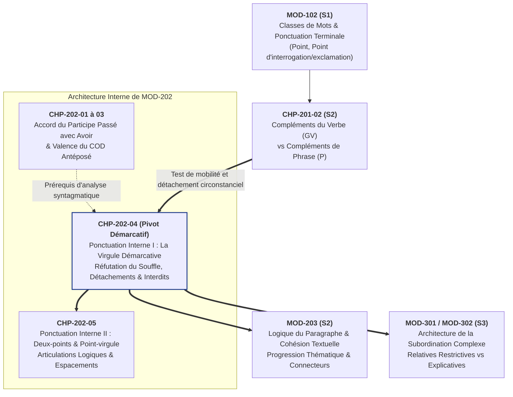
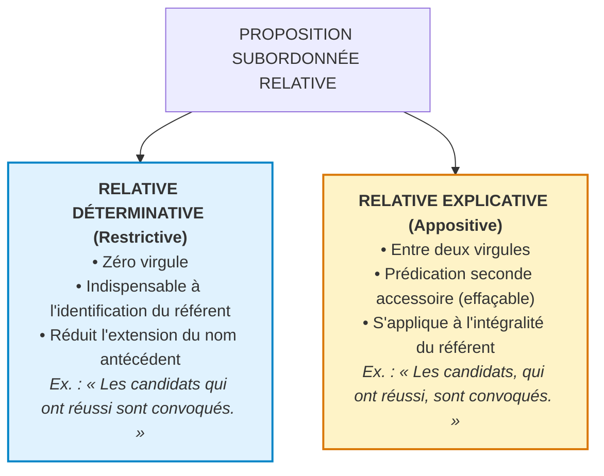
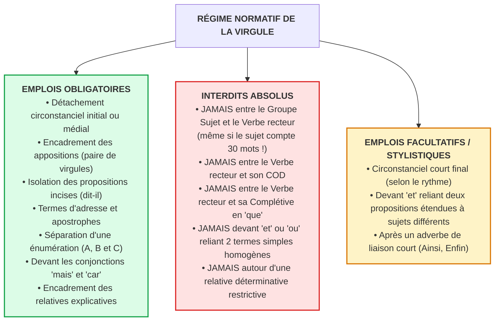

# Chapitre 4 — Ponctuation Interne I : Les Règles de la Virgule Démarcative — Réfutation du Mythe Respiratoire, Détachements, Appositions et Interdits Absolus

> **Identifiant du chapitre** : `CHP-202-04`  
> **Module de rattachement** : [`MOD-202` — Accord du Participe Passé avec l'Auxiliaire Avoir et Ponctuation Interne/Logique](file:///f:/Formation/world-class-french/03-curriculum/year-1/semester-2/mod-202-participe-passe-avoir-ponctuation-interne.md)  
> **Semestre** : Année 1 — Semestre 2 (S2)  
> **Volume horaire canonique** : 5 à 6 heures d'apprentissage autonome délibéré et d'ateliers d'application (Phase 1 Étude : 1 h 30 | Phase 2 Pratique : 1 h 30 | Phase 3 Correction : 1 h 00 | Phase 4 Évaluation : 1 h 00)  
> **Statut** : [STATUT : VALIDÉ]  
> **Compétences associées** : [`FR-INT-001`](file:///f:/Formation/world-class-french/02-competency-framework/competency-framework.md#fr-int-001-rédiger-un-texte-long-cohérent-en-maîtrisant-accords-et-ponctuation) (L3 Autonomie), [`FR-SYNTAX-001`](file:///f:/Formation/world-class-french/02-competency-framework/competency-framework.md#fr-syntax-001-analyse-fonctionnelle-et-délimitation-de-la-phrase-simple) (L3 Autonomie)  
> **Sources scientifiques de référence** : `SRC-TYPO-01` (Imprimerie nationale, *Lexique des règles typographiques*, 2002/2014, p. 147-151), `SRC-GRAM-02` (Riegel, Pellat, Rioul, *Grammaire méthodique du français*, 2016, chap. 4), `SRC-GRAM-01` (Grevisse & Goosse, *Le Bon Usage*, 2016, § 122-126), `SRC-NORM-03` (Ministère de l'Éducation nationale, *Terminologie grammaticale*, 2020)

---

## 1. Titre et Place dans le Cursus

### 1.1 Intitulé Officiel
**Chapitre 4 : Ponctuation Interne I — Les Règles de la Virgule Démarcative : Réfutation du Mythe Respiratoire, Détachements, Appositions et Interdits Absolus** (`CHP-202-04`).

### 1.2 Insertion Architecturale dans le Cursus
Le module [`MOD-202`](file:///f:/Formation/world-class-french/03-curriculum/year-1/semester-2/mod-202-participe-passe-avoir-ponctuation-interne.md) se structure en deux grands axes complémentaires de sécurisation scripturale : après avoir traité la morphologie positionnelle de l'accord du participe passé avec l'auxiliaire *avoir* (Chapitres 1 à 3), il ouvre avec ce Chapitre 4 son volet consacré à la **ponctuation interne et logique**.

La ponctuation n'est ni un ornement facultatif ni une transcription phonétique des pauses pulmonaires : elle constitue le **balisage syntaxique visible** qui rend l'armature logique d'un énoncé immédiatement décodable pour le lecteur [Réf. `SRC-TYPO-01`, p. 147 ; `SRC-GRAM-02`, chap. 4].



- **En amont** :
  - [`MOD-102`](file:///f:/Formation/world-class-french/03-curriculum/year-1/semester-1/mod-102/chp-102-01-nature-vs-fonction.md) a posé la ponctuation terminale (clôture de la phrase graphique par le point) et l'autonomie des classes grammaticales.
  - [`CHP-201-02`](file:///f:/Formation/world-class-french/03-curriculum/year-1/semester-2/mod-201/chp-201-02-complements-verbe-vs-complements-phrase.md) a établi la distinction fondamentale entre les compléments du verbe (non déplaçables et essentiels) et les compléments de phrase (mobiles et effaçables). Le présent chapitre explicite la conséquence typographique de cette frontière : tout complément circonstanciel déplacé en tête de proposition requiert impérativement une virgule de détachement.
- **Au sein de `MOD-202`** :
  - Il forme un diptyque indissociable avec le Chapitre 5 (`CHP-202-05`), qui étudiera les opérateurs logiques majeurs que sont le point-virgule (balancement d'indépendantes) et les deux-points (causalité, explication, citation).
- **En aval** :
  - [`MOD-203`](file:///f:/Formation/world-class-french/03-curriculum/year-1/semester-2/mod-203-logique-paragraphe-cohesion-textuelle.md) (Cohésion textuelle et logique du paragraphe) : la maîtrise de la virgule conditionne la fluidité des enchaînements et l'absence d'ambiguïtés syntaxiques.
  - [`MOD-301`](file:///f:/Formation/world-class-french/03-curriculum/year-2/semester-3/mod-301-architecture-subordination-completives.md) et `MOD-302` (Subordination complexe) : le maniement rigoureux de la virgule sur la proposition subordonnée relative constitue le pivot de la distinction sémantique capitale entre relative déterminative (restrictive) et relative explicative (appositive).

---

## 2. Objectifs Mesurables

Au terme des 5 à 6 heures d'étude théorique et d'entraînement délibéré de ce chapitre, l'apprenant aura atteint le palier **L3 (Autonomie)** des compétences [`FR-INT-001`](file:///f:/Formation/world-class-french/02-competency-framework/competency-framework.md#fr-int-001-rédiger-un-texte-long-cohérent-en-maîtrisant-accords-et-ponctuation) et [`FR-SYNTAX-001`](file:///f:/Formation/world-class-french/02-competency-framework/competency-framework.md#fr-syntax-001-analyse-fonctionnelle-et-délimitation-de-la-phrase-simple) en étant capable de :

1. **Réfuter scientifiquement le mythe de la « virgule respiratoire »** et analyser la virgule comme un opérateur syntaxique formel de segmentation et de hiérarchisation de l'information écrite [Réf. `SRC-TYPO-01`, p. 147 ; `SRC-GRAM-02`, chap. 4].
2. **Identifier et appliquer sans omission les règles de détachement obligatoire** : isoler les compléments circonstanciels antéposés ou incidents, les syntagmes en apposition, les propositions incises de discours rapporté et les termes d'adresse (apostrophes) [Réf. `SRC-NORM-03`, p. 32-34].
3. **Respecter avec une vigilance absolue les deux interdits majeurs du français écrit** : proscrire formellement toute virgule isolée rompant le lien de rection immédiate entre le groupe sujet et le verbe recteur, ainsi qu'entre le verbe recteur et son complément d'objet direct ou sa proposition complétive [Réf. `SRC-GRAM-01`, § 125].
4. **Arbitrer l'emploi de la virgule sur les propositions relatives en fonction de leur portée logique** : employer zéro virgule pour les relatives déterminatives (restrictives) indispensables à la référence du nom, et encadrer systématiquement de deux virgules les relatives explicatives (appositives) constituant une prédication seconde [Réf. `SRC-GRAM-02`, chap. 20].

---

## 3. Prérequis et Test de Préparation (Auto-Diagnostic)

### 3.1 Prérequis Cognitifs et Techniques
- Distinction nette entre la phrase graphique (délimitée par la majuscule initiale et le point final) et la proposition syntaxique (organisée autour d'un verbe recteur) [`MOD-102`].
- Reconnaissance immédiate des constituants immédiats de la phrase simple : Groupe Sujet (GS), Groupe Verbal (GV) et Compléments de Phrase périphériques (CP) [`CHP-201-02`].
- Identification de la valence verbale et distinction entre verbe transitif direct (avec COD) et verbe intransitif [`CHP-201-01`].

### 3.2 Test Diagnostique d'Entrée (5 Questions)
Évaluez vos réflexes analytiques sur ces cinq questions avant d'entamer l'étude des règles fondamentales :

1. Observez l'énoncé suivant : *« Le directeur des affaires juridiques de notre institution financière, a approuvé la transaction. »* Cette virgule est-elle licite sous prétexte que le groupe sujet est particulièrement long ? Pourquoi ?
2. Dans la phrase : *« Dès l'ouverture des audiences le président de la cour a rappelé les règles de procédure. »*, quel signe de ponctuation manque-t-il, à quel endroit précis et en vertu de quelle règle syntaxique ?
3. Dans la phrase : *« L'expert a certifié, que les documents produits étaient parfaitement authentiques. »*, la virgule est-elle correcte pour marquer une pause d'insistance avant la complétive ?
4. Analysez la différence logique et juridique fondamentale entre ces deux énoncés :
   - (a) *« Les employés qui ont commis une faute lourde seront licenciés sans préavis. »*
   - (b) *« Les employés, qui ont commis une faute lourde, seront licenciés sans préavis. »*
5. Pourquoi la phrase : *« Cet étudiant brillant travailleur acharné a obtenu la bourse d'excellence. »* est-elle défectueuse, et comment la ponctuer rigoureusement ?

---

#### Corrigé Détaillé de l'Auto-Diagnostic

<details>
<summary><b>Consulter le corrigé raisonné de l'auto-diagnostic</b></summary>

1. **Illégalité de la virgule sujet-verbe** :
   - **Non, cette virgule est strictement illicite.** Il s'agit d'une violation directe du Premier Interdit Absolu du français écrit.
   - Quelle que soit la longueur ou la complexité du Groupe Sujet (*Le directeur des affaires juridiques de notre institution financière*), aucune virgule ne peut le séparer de son verbe recteur (*a approuvé*), car le sujet et le verbe forment le nœud prédicatif indissociable de la phrase.
2. **Omission de la virgule après un circonstanciel initial** :
   - Il manque une **virgule de détachement immédiatement après *audiences*** : *« Dès l'ouverture des audiences, le président... »*
   - Règle : tout complément de phrase (circonstanciel) placé en tête de proposition est déplacé hors de sa position canonique postverbale ; il doit obligatoirement être démarqué par une virgule pour signaler la frontière avant le début du groupe sujet.
3. **Illégalité de la virgule verbe-complétive** :
   - **Non, cette virgule est fautive.** C'est une violation du Second Interdit Absolu du français écrit.
   - Le verbe transitif recteur (*a certifié*) régit directement sa proposition complétive (*que les documents...*), laquelle assume la fonction de COD. Aucune virgule ne peut briser un lien de rection directe.
4. **Différence d'extension sur la subordonnée relative** :
   - En (a) (sans virgule) : la relative est **déterminative (restrictive)**. Seule la fraction des employés ayant commis une faute est licenciée ; les employés irréprochables conservent leur emploi.
   - En (b) (entre virgules) : la relative est **explicative (appositive)**. La subordonnée s'applique à la totalité de la catégorie : tous les employés de l'entreprise ont commis une faute et la totalité de l'effectif est licenciée. Une virgule mal placée modifie radicalement la portée juridique du contrat.
5. **Rétablissement de l'apposition par double virgule** :
   - L'énoncé juxtapose deux groupes nominaux sans démarcation. Le syntagme nominal *travailleur acharné* est en apposition au nom sujet *étudiant*.
   - Une apposition incidente doit être obligatoirement isolée par **deux virgules** (une d'ouverture, une de fermeture) : *« Cet étudiant brillant, travailleur acharné, a obtenu la bourse d'excellence. »*

</details>

---

## 4. Situation de Départ ou Problème Concret : Le Fléau Universel de la « Virgule de Souffle »

### 4.1 L'Origine Scolaire d'un Mythe Toxique
Depuis l'enseignement primaire, des générations d'élèves ont entendu ce conseil pédagogique fallacieux : *« Mets une virgule là où tu reprends ton souffle à l'oral. »*

Ce prétendu réflexe de « bon sens » est la cause directe des erreurs de ponctuation les plus graves rencontrées dans les mémoires universitaires, les rapports d'expertise et les correspondances administratives. La respiration est un acte physiologique dépendant de la capacité pulmonaire de l'orateur, de son état de stress, de sa vitesse d'élocution ou de la longueur des phrases. L'écriture française, en revanche, est un **système normé d'encodage logique et morphosyntaxique**.

Si l'on plaçait les virgules d'après le souffle de l'orateur :
- Un lecteur essoufflé découperait un groupe sujet en trois morceaux ;
- Un lecteur à grande capacité pulmonaire n'en placerait aucune sur cinq lignes de texte ;
- Un comédien théâtral marquant une pause d'emphase dramatique insérerait une virgule entre un verbe et son COD (*« Il contempla... l'abîme »*).

Transposé à l'écrit, ce réflexe physiologique produit des aberrations syntaxiques dévastatrices.

### 4.2 Les Deux Fautes d'Interdit Absolu : Destruction de la Rection
L'application de la « virgule respiratoire » aboutit presque toujours à violer les deux relations syntaxiques les plus serrées de la langue :

1. **La virgule entre le Sujet et le Verbe** :  
   Lorsque le scripteur produit un sujet développé (comportant des adjectifs, des compléments du nom ou des propositions relatives), son esprit ressent le besoin d'une pause avant le verbe. Il écrit alors :  
   $$\text{\bf Fautif : } *\text{« La commission d'enquête parlementaire réunie ce matin, a rendu son rapport. »}$$  
   Cette virgule brise la chaîne d'accord morphologique et sépare artificiellement l'agent de son procès.

2. **La virgule entre le Verbe et le COD ou la Complétive** :  
   Ressentant le besoin de suspendre sa voix avant de formuler l'objet de la déclaration, le scripteur insère :  
   $$\text{\bf Fautif : } *\text{« Le ministre a déclaré devant la presse, que les réformes seraient maintenues. »}$$  
   Cette virgule isole le verbe recteur du complément essentiel qui sature sa valence.

### 4.3 La Destruction du Sens : Quand la Virgule Tue ou Sauve
L'absence ou le déplacement d'une virgule n'est pas un détail calligraphique : il bouleverse la structure sémantique globale de l'énoncé.

- **Le cas classique du terme d'adresse (apostrophe)** :
  - *« On va manger, les enfants ! »* $\rightarrow$ L'adulte s'adresse aux enfants pour les inviter au repas (terme d'adresse détaché).
  - *« On va manger les enfants ! »* $\rightarrow$ Sans virgule, *les enfants* devient le COD du verbe *manger* (déclaration d'anthropophagie).
- **Le quiproquo juridique et testamentaire** :
  - *« Je lègue ma maison à mon frère qui habite Cotonou. »* $\rightarrow$ Relative déterminative : si le testateur a plusieurs frères, seule la maison revient à celui qui réside à Cotonou.
  - *« Je lègue ma maison à mon frère, qui habite Cotonou. »* $\rightarrow$ Relative explicative : le testateur n'a qu'un seul frère, et la précision locative n'est qu'un commentaire incident accessoire.

---

## 5. Explication Intuitive : La Signalisation Routière et les Murs Porteurs

Pour dominer l'usage de la virgule, il convient d'abandonner l'analogie pulmonaire au profit d'une double analogie spatiale et mécanique : **l'armature architecturale** et **le code de la route**.

### 5.1 L'Analogie Architecturale : Les Murs Porteurs de la Phrase
Considérez la phrase simple comme un édifice maçonné :
- Le **Groupe Sujet (GS)** et le **Groupe Verbal (GV)** forment ensemble le **mur porteur central**. C'est le nœud prédicatif indissociable. Vous ne pouvez insérer aucune cloison (aucune virgule) au milieu d'un mur porteur sans faire écrouler la structure de la phrase.
- Les **Compléments Circonstanciels (CP)**, les **incises**, les **appositions** et les **termes d'adresse** sont des cloisons mobiles, des balcons ou des pièces annexes. Lorsqu'ils sont ajoutés à la périphérie ou suspendus au milieu du bâtiment, ils doivent impérativement reposer sur des joints de dilatation étanches : **les virgules de démarcation**.

```text
[ COMPLÉMENT CIRCONSTANCIEL DÉTACHÉ ]  ,  [ SUJET ────── RECTION ────── VERBE ────── RECTION ────── COD ]
        (Balcon périphérique)               (             MUR PORTEUR CENTRAL INDISSOCIABLE           )
      Séparé par une virgule                     AUCUNE VIRGULE N'A LE DROIT D'ÊTRE INSÉRÉE ICI
```

### 5.2 L'Analogie Routière : La Ligne Blanche Démarcative
Sur une autoroute, la virgule n'est pas une « aire de repos » où l'automobiliste s'arrête pour boire de l'eau. C'est une **ligne de peinture blanche** tracée au sol :
- Elle délimite les voies de circulation parallèles (les termes énumérés) ;
- Elle trace la bande d'arrêt d'urgence ou la voie d'insertion (les compléments circonstanciels en tête) ;
- Elle interdit de couper la trajectoire entre la motrice (le sujet) et sa remorque immédiate (le verbe).

---

## 6. Définitions Précises et Terminologie

Pour manipuler la ponctuation avec exactitude universitaire, fixons le lexique formel de la syntaxe démarcative [Réf. `SRC-NORM-03`, p. 28-34 ; `SRC-GRAM-02`, chap. 4] :

| Terme Canonique | Définition Syntaxique Rigoureuse | Exemple Illustratif |
| :--- | :--- | :--- |
| **Signe de ponctuation démarcatif** | Signe graphique intérieur à la phrase (virgule, tiret cadratin, parenthèse) ayant pour fonction de baliser les frontières syntagmatiques et de hiérarchiser les unités d'information. | *La virgule, les deux-points, le point-virgule.* |
| **Opérateur syntaxique** | Marqueur typographique dont l'apparition est commandée par la structure grammaticale de l'énoncé et non par l'intonation orale. | La virgule encadrant une apposition. |
| **Rupture syntagmatique illicite** | Insertion fautive d'une virgule rompant un lien de rection grammaticale immédiate (sujet-verbe ou verbe-objet). | *\*« Le juge, a prononcé la sentence. »* |
| **Détachement circonstanciel** | Déplacement d'un complément de phrase (circonstanciel) en tête d'énoncé ou au sein du groupe propositionnel, imposant une virgule de séparation. | *« **À cette époque**, tout était plus simple. »* |
| **Mise en apposition** | Adjonction d'un nom, d'un adjectif ou d'un participe détaché apportant une caractérisation seconde au nom noyau, obligatoirement isolé par des virgules. | *« **Ému aux larmes**, l'orateur s'est tu. »* |
| **Syntagme incident / Incise** | Segment propositionnel ou adverbial inséré dans le cours d'une phrase principale pour indiquer l'énonciation (*dit-il*) ou un commentaire du locuteur (*certes, hélas*). | *« « Partez », **ordonna le chef** ; « Ce choix, **hélas**, est irréversible. »* |
| **Terme d'adresse (Apostrophe)** | Syntagme nominal désignant l'allocutaire interpellé directement par le locuteur, devant toujours être isolé du reste de la phrase par la ponctuation. | *« **Messieurs**, la séance est ouverte. »* |
| **Coordination vs Juxtaposition** | Liaison de constituants de même statut grammatical : par un mot-lien explicite (conjonction) dans la coordination, ou par un simple signe démarcatif (virgule) dans la juxtaposition. | Juxtaposition : *« Il court, nage, saute. »*<br/>Coordination : *« Il court et saute. »* |
| **Relative déterminative (restrictive)** | Proposition subordonnée relative nécessaire à l'identification de l'antécédent, formant avec lui un syntagme nominal indissociable (**zéro virgule**). | *« Les lois **qui protègent les faibles** sont sacrées. »* |
| **Relative explicative (appositive)** | Proposition subordonnée relative apportant une prédication seconde accessoire sur un antécédent déjà totalement identifié (**encadrée de virgules**). | *« La Terre, **qui tourne autour du Soleil**, est fragile. »* |

---

## 7. Règles et Mécanismes Fondamentaux

```text
CARTOGRAPHIE DES RÈGLES DE LA VIRGULE DÉMARCATIVE
├── 7.1 RÉFUTATION SCIENTIFIQUE DU MYTHE RESPIRATOIRE (Syntaxe écrite vs Élocution orale)
├── 7.2 LES DÉTACHEMENTS SYNTAXIQUES LICITES ET OBLIGATOIRES
│   ├── Circonstanciel antéposé ou médial
│   ├── Syntagmes en apposition et adjectifs/participes détachés
│   ├── Propositions incises de discours rapporté
│   └── Termes d'adresse et apostrophes
├── 7.3 LES RÈGLES DE COORDINATION ET DE JUXTAPOSITION
│   ├── Énumération de 3 termes ou plus
│   ├── Conjonctions « mais » et « car »
│   └── Emplois réguliers et exceptionnels devant « et » / « ou »
├── 7.4 LES DEUX INTERDITS ABSOLUS DU FRANÇAIS ÉCRIT
│   ├── Interdit 1 : Proscription de la virgule Sujet-Verbe
│   └── Interdit 2 : Proscription de la virgule Verbe-COD / Verbe-Complétive
└── 7.5 L'INCIDENCE SÉMANTIQUE SUR LA PROPOSITION SUBORDONNÉE RELATIVE
    ├── Relative déterminative restrictive (Zéro virgule)
    └── Relative explicative appositive (Entre deux virgules)
```

---

### 7.1 Réfutation Scientifique du Mythe Respiratoire

La virgule est une création de l'imprimerie et de la grammaire textuelle, non un enregistrement électroacoustique de la glotte ou du diaphragme [Réf. `SRC-TYPO-01`, p. 147].

1. **La prosodie suit la syntaxe, et non l'inverse** : Lorsqu'un comédien ou un orateur lit un texte à voix haute, son intonation et ses pauses respiratoires sont guidées par la structure syntaxique et le balisage typographique imprimé. Écrire en fonction de son souffle personnel inverse la causalité sémiotique de la langue.
2. **L'autonomie du code écrit** : La langue écrite possède ses propres contraintes d'architecture. À l'oral, des indices suprasegmentaux (hauteur tonale, intensité, débit, pauses silencieuses) guident la compréhension de l'auditeur. À l'écrit, en l'absence de voix, seuls les signes typographiques noirs empêchent les ambiguïtés structurelles.
3. **Le principe fondamental de Jacques Drillon** :
   > *« La ponctuation ne sert pas à marquer le souffle : elle sert à marquer les rapports syntaxiques et logiques entre les mots, les membres de phrase et les phrases. »* [Jacques Drillon, *Traité de la ponctuation française*, Gallimard].

---

### 7.2 Les Détachements Syntaxiques Licites et Obligatoires

En syntaxe française canonique, l'ordre non marqué des constituants est :
$$\text{Phrase} = \text{Sujet} + \text{Verbe} + \text{Compléments d'objet} + \text{Compléments circonstanciels}$$

Dès qu'un constituant est extrait de sa position naturelle postverbale pour être déplacé en tête ou inséré au milieu de l'énoncé, ce **détachement** doit être matérialisé par des virgules démarcatives [Réf. `SRC-NORM-03`, p. 32-34].

#### A. Le Complément Circonstanciel Placé en Tête ou en Incise Médiale
- **En tête de proposition** : Tout complément de phrase placé en ouverture d'énoncé doit être séparé du sujet par une virgule.
  - *« **Dès l'aube**, les troupes se mirent en marche. »*
  - *« **Dans ce tribunal d'instance**, la justice était rendue avec sérénité. »*
- **En incise médiale** : Lorsqu'un complément de phrase s'intercale entre le sujet et le verbe, il doit être rigoureusement isolé par **deux virgules** (une d'ouverture et une de fermeture).
  - *« Le ministre, **dès son arrivée**, a réuni ses plus proches conseillers. »*
  - *(Remarque capitale : ce n'est pas le sujet qui est suivi d'une virgule, c'est l'incise circonstancielle qui est mise entre parenthèses visuelles).*

#### B. Les Syntagmes en Apposition et Adjectifs/Participes Détachés
Lorsqu'un groupe nominal, un adjectif qualificatif ou un participe est détaché du nom qu'il qualifie pour apporter une explication seconde, il forme une construction apposée obligatoirement encadrée de virgules.
- **En tête de phrase** :
  - *« **Épuisés par la longue marche**, les soldats s'endormirent immédiatement. »*
  - *« **Diplomate chevronné**, l'ambassadeur a désamorcé la crise. »*
- **En position médiale** :
  - *« Ce magistrat, **intègre et respecté**, refusa toute compromission. »*
  - *« Le président de l'université, **éminent spécialiste de droit constitutionnel**, a ouvert le colloque. »*

#### C. Les Propositions Incises de Discours Rapporté
Dans le discours direct, la proposition qui indique l'auteur des paroles prononcées (*affirma le témoin*, *dit-elle*, *répondit l'accusé*) est séparée de la citation par une virgule.
- *« « Nous vaincrons », **affirma avec solennité le général**. »*
- *« « Il est trop tard », **murmura-t-il**, « pour revenir sur cette décision. » »*

#### D. Les Termes d'Adresse et Apostrophes
Lorsqu'un locuteur interpelle directement son interlocuteur par son nom ou son titre, ce terme d'adresse n'a aucun lien de dépendance avec le verbe de la proposition. Il doit être obligatoirement détaché par une virgule.
- En début d'énoncé : *« **Monsieur le Président**, permettez-moi de réfuter ces allégations. »*
- En milieu d'énoncé : *« Écoutez bien, **mes chers collègues**, ce que prévoient les statuts. »*
- En fin d'énoncé : *« Je vous remets ce rapport, **Maître**. »*

---

### 7.3 Les Règles de Coordination et de Juxtaposition

#### A. L'Énumération (Juxtaposition de Trois Termes ou Plus)
Dans une suite de constituants syntaxiquement équivalents (noms, adjectifs, verbes, propositions) :
- Les termes juxtaposés sont séparés par une virgule ;
- Le dernier terme est habituellement relié par la conjonction de coordination *et* ou *ou*, **sans virgule devant la conjonction**.
  - *« Il a acheté des fruits, des légumes et des céréales. »*
  - *« Elle étudie avec rigueur, persévérance, passion et méthode. »*

#### B. Les Conjonctions de Coordination : *Mais* et *Car*
- **Devant *mais* et *car*** : La virgule est **obligatoire** dans la prose soignée lorsque ces conjonctions relient deux propositions ou deux segments d'une certaine étendue [Réf. `SRC-TYPO-01`, p. 148].
  - *« La défense a présenté des arguments solides, **mais** le tribunal a rejeté la requête. »*
  - *« Le projet a été suspendu, **car** les crédits publics étaient épuisés. »*

#### C. L'Emploi de la Virgule devant *Et* et *Ou*
La règle par défaut est l'absence de virgule :
- **Règle générale (Absence de virgule)** : On ne met **jamais de virgule** devant *et* ou *ou* lorsque la conjonction unit simplement deux termes de même fonction ou deux propositions très courtes ayant le même sujet.
  - *« Le vent souffle **et** la pluie tombe. »* (Pas de virgule).
  - *« Il a commandé un café **et** un verre d'eau. »* (Pas de virgule).
- **Exceptions licites (Virgule obligatoire ou recommandée devant *et*)** :
  1. **Changement de sujet dans deux propositions étendues** : Lorsque deux propositions coordonnées sont longues et ont des sujets grammaticaux distincts, la virgule isole la première proposition pour éviter une fausse lecture.
     - *« Le gouvernement a promulgué la nouvelle loi foncière, **et** les magistrats ont immédiatement engagé son application. »*
  2. **Insistance rhétorique ou valeur d'opposition / conséquence** :
     - *« Il a travaillé pendant dix ans sans relâche, **et** pour quel résultat ! »*
  3. **Répétition stylistique de la conjonction (polysyndète)** :
     - *« Et le riche, **et** le pauvre, **et** le puissant subiront le même sort. »*

---

### 7.4 LES DEUX INTERDITS ABSOLUS DU FRANÇAIS ÉCRIT

Les deux règles suivantes ne souffrent **aucune exception en prose soignée**. Leur transgression constitue une faute éliminatoire au regard des critères universitaires et des concours de la fonction publique [Réf. `SRC-GRAM-01`, § 125 ; `SRC-TYPO-01`, p. 147].

#### INTERDIT N° 1 : Proscription Absolue de la Virgule entre le Sujet et le Verbe Recteur
Il est formellement interdit d'insérer une virgule isolée entre le groupe nominal sujet et son verbe conjugué.

$$\begin{aligned}
\text{\bf Fautif : } & *\text{« Le président de séance, a ouvert les débats. »} \\
\text{\bf Correct : } & \text{« Le président de séance a ouvert les débats. »}
\end{aligned}$$

- **Même si le sujet est extrêmement long** (20 ou 30 mots), aucune virgule ne peut être tolérée avant le verbe recteur :
  - *« Le rapport rédigé conjointement par les experts indépendants et les membres de la commission administrative d'arbitrage financier **a enfin été publié** ce matin. »* (Zéro virgule après *financier*).
- **Attention au piège de l'incise** : Si un syntagme circonstanciel ou une apposition est inséré entre le sujet et le verbe, il doit comporter **deux virgules**. La présence d'une seule virgule constitue une faute d'interdit absolu.
  - *\*« Le ministre dès son arrivée, a parlé. »* (Fautif : virgule orpheline).
  - *« Le ministre**, dès son arrivée,** a parlé. »* (Correct : paire de virgules circonscrivant l'incise).

#### INTERDIT N° 2 : Proscription Absolue de la Virgule entre le Verbe et son Objet Direct ou sa Complétive
Il est formellement interdit d'insérer une virgule entre le verbe recteur et son Complément d'Objet Direct (COD) ou sa proposition subordonnée complétive introduite par *que*.

$$\begin{aligned}
\text{\bf Fautif : } & *\text{« Le magistrat a déclaré, que l'inculpé était libre sous caution. »} \\
\text{\bf Correct : } & \text{« Le magistrat a déclaré que l'inculpé était libre sous caution. »}
\end{aligned}$$

$$\begin{aligned}
\text{\bf Fautif : } & *\text{« Cette décision judiciaire implique, la restitution immédiate des biens. »} \\
\text{\bf Correct : } & \text{« Cette décision judiciaire implique la restitution immédiate des biens. »}
\end{aligned}$$

- Le verbe et son objet direct constituent le noyau du Groupe Verbal ($\text{GV}$). Intercaler une virgule brise la rection directe sans préposition.

---

### 7.5 L'Incidence Sémantique et Logique sur la Proposition Relative

Le maniement de la virgule sur la subordonnée relative introduite par *qui, que, dont, où* modifie profondément la sémantique de l'énoncé [Réf. `SRC-GRAM-02`, chap. 20].



#### A. La Relative Déterminative (Restrictive) : ZÉRO VIRGULE
- **Caractéristique** : Elle restreint l'extension du nom antécédent. Elle sélectionne un sous-ensemble parmi un ensemble plus vaste.
- **Test d'effacement** : Elle **ne peut pas être supprimée** sans dénaturer gravement le sens de la phrase ou rendre l'énoncé absurde.
- **Ponctuation** : **Aucune virgule** n'est admise, ni avant le pronom relatif, ni à la fin de la subordonnée avant le verbe principal.
  - *« Les dossiers **que le comité a rejetés** feront l'objet d'un recours gracieux. »*  
    $\rightarrow$ *Sens* : Seule la sous-partie des dossiers rejetés est contestée. Les dossiers acceptés ne sont pas concernés.

#### B. La Relative Explicative (Appositive) : ENTRE DEUX VIRGULES
- **Caractéristique** : L'antécédent est déjà totalement identifié et délimité dans l'esprit du récepteur. La relative apporte une information incidente, explicative ou justificative, équivalente à une parenthèse.
- **Test d'effacement** : Elle **peut être intégralement supprimée** sans altérer l'identification du référent ni la grammaticalité de la proposition matrice.
- **Ponctuation** : Elle doit être **obligatoirement isolée par deux virgules** (ou une virgule si elle clôt l'énoncé).
  - *« Les dossiers**, que le comité a rejetés,** feront l'objet d'un recours gracieux. »*  
    $\rightarrow$ *Sens* : L'ensemble des dossiers a été rejeté par le comité, et tous les dossiers feront l'objet d'un recours. La relative explique pourquoi ils font l'objet d'un recours, sans en restreindre le nombre.

---

## 8. Raisonnement Détaillé : Pourquoi la Coupure Sujet-Verbe est une Rupture de Rection

Pour comprendre l'interdiction absolue de la virgule entre le sujet et le verbe, il est nécessaire d'examiner le fonctionnement fondamental de la syntaxe structurale [Réf. `SRC-GRAM-02`, chap. 7].

### 8.1 Le Nœud Prédicatif Fondamental
La phrase française canonique n'est pas une simple succession linéaire de vocables ajoutés les uns aux autres. Elle repose sur une relation d'interdépendance bilatérale indissoluble :
$$\text{Phrase} = \text{Groupe Sujet} \longleftrightarrow \text{Groupe Verbal}$$

- Le **Sujet** fournit le support de la prédication (ce dont on parle) et donne ses marques morphologiques de **personne** et de **nombre** au verbe recteur.
- Le **Verbe** apporte l'attribution prédicative (ce qu'on en dit) et confère au sujet son rôle sémantique (agent, patient, siège).

Sur le plan sémiotique, le sujet et le verbe forment les deux pôles d'un même arc électrique. L'insertion d'une virgule équivaut à introduire un isolant plastique au milieu du circuit : elle bloque la transmission continue de l'accord et brise l'unité de la proposition de base.

### 8.2 La Théorie de la Rection et la Cohésion du Groupe Verbal
La même démonstration s'applique au verbe et à son complément d'objet direct :
$$\text{GV} = \text{Verbe Recteur} + \text{Complément d'Objet Direct}$$

Le verbe transitif direct sélectionne son complément sans médiation prépositionnelle (rection directe). La complétive en *que* fonctionne exactement comme un groupe nominal COD (*« Il dit [son accord] »* $\rightarrow$ *« Il dit [qu'il est d'accord] »*). Insérer une virgule entre le verbe et *que* suggère faussement au lecteur que le verbe a terminé sa rection et que ce qui suit est un ajout facultatif, ce qui égare le traitement syntaxique cérébral.

---

## 9. Exemples Corrects Commentés

Examinons quatre phrases issues de corpus juridiques et académiques démontrant l'application rigoureuse du balisage démarcatif :

### Exemple 1 : Détachement d'un Circonstanciel Complexe et Préservation du Nœud Prédicatif
> *« En dépit des contestations réitérées formulées par les actionnaires minoritaires, le conseil d'administration a voté l'augmentation de capital sans la moindre hésitation. »*

- **Analyse du balisage** :
  - *En dépit des contestations... minoritaires* : Syntagme prépositionnel assumant la fonction de complément de phrase (circonstanciel de concession). Placé en tête de proposition, son détachement est obligatoirement matérialisé par la virgule après *minoritaires*.
  - *le conseil d'administration a voté* : Le groupe sujet nominal (*le conseil d'administration*) est directement lié à la forme verbale composée (*a voté*). **Zéro virgule** n'intervient entre le nom noyau *conseil* et l'auxiliaire *a*.
  - *a voté l'augmentation de capital* : Le COD direct est enchaîné immédiatement après le verbe recteur sans aucune coupure.

### Exemple 2 : Double Virgule Isolant une Apposition Incidente
> *« Maître Alapini, avocat émérite au barreau de Cotonou, a plaidé la cause des victimes avec une éloquence remarquable. »*

- **Analyse du balisage** :
  - *Maître Alapini* : Sujet de la phrase.
  - *, avocat émérite au barreau de Cotonou,* : Syntagme nominal en apposition détachée. Il apporte une information qualificative accessoire. Il est rigoureusement circonscrit par **deux virgules symétriques**.
  - Si l'on efface l'apposition, la phrase conserve son intégrité prédicative parfaite : *« Maître Alapini a plaidé la cause des victimes... »*

### Exemple 3 : L'Énumération et la Conjonction de Coordination
> *« Le rapport d'expertise dénonce des malversations financières, des abus d'autorité répétés, une opacité comptable délibérée et un mépris flagrant des textes en vigueur. »*

- **Analyse du balisage** :
  - Les trois premiers groupes nominaux COD sont séparés par des virgules de juxtaposition (*financières,*, *répétés,*).
  - Le quatrième groupe est coordonné par la conjonction *et*, qui prend en charge la liaison syntaxique finale : **aucune virgule ne précède *et***.

### Exemple 4 : Relative Restrictive vs Incise Déclarative
> *« Les magistrats qui ont examiné les pièces à conviction ont conclu, lors de l'audience publique, que la falsification était avérée. »*

- **Analyse du balisage** :
  - *Les magistrats qui ont examiné les pièces à conviction* : Le sujet est enrichi d'une subordonnée relative restrictive. Pas de virgule autour de *qui ont examiné les pièces à conviction*, et **aucune virgule** entre *conviction* et le verbe *ont conclu*.
  - *, lors de l'audience publique,* : Circonstanciel de temps intercalé en incise médiale, parfaitement clos par ses deux virgules.
  - *ont conclu [...] que la falsification était avérée* : La complétive COD en *que* dépend directement de *ont conclu*, sans virgule parasite devant *que*.

---

## 10. Contre-Exemples et Erreurs Fréquentes (Clinique des Six Pathologies Démarcatives)

L'observation des rédactions universitaires et professionnelles révèle une taxonomie récurrente de six fautes majeures, qu'il convient de diagnostiquer et de neutraliser méthodiquement.

### Erreur n° 1 : La rupture illicite de la chaîne sujet-verbe (sujet long ou souffle oral)
- **Forme fautive** :  
  $$\text{\bf Fautif : } *\text{« La commission consultative chargée de réviser les programmes d'enseignement secondaire, remettra ses conclusions vendredi. »}$$
- **Diagnostic linguistique** : Le scripteur, intimidé par la longueur du sujet nominal (11 mots), ressent une pause respiratoire et place une virgule avant le verbe. Cette virgule brise la relation prédicative directe entre le nom noyau *commission* et le verbe *remettra*.
- **Forme corrigée** :  
  $$\text{\bf Correct : } \text{« La commission consultative chargée de réviser les programmes d'enseignement secondaire remettra ses conclusions vendredi. »}$$

### Erreur n° 2 : La coupure syntagmatique entre le verbe recteur et son objet direct ou sa complétive
- **Forme fautive** :  
  $$\text{\bf Fautif : } *\text{« Le porte-parole du gouvernement a confirmé hier soir, que les frontières demeureraient ouvertes. »}$$
- **Diagnostic linguistique** : Insertion d'une virgule immédiatement avant la conjonction complétive *que*. La proposition subordonnée *que les frontières demeureraient ouvertes* exerce la fonction essentielle de COD du verbe *a confirmé*. Elle ne peut être détachée.
- **Forme corrigée** :  
  $$\text{\bf Correct : } \text{« Le porte-parole du gouvernement a confirmé hier soir que les frontières demeureraient ouvertes. »}$$

### Erreur n° 3 : L'omission de la virgule de clôture après un complément circonstanciel initial
- **Forme fautive** :  
  $$\text{\bf Fautif : } *\text{« Dès la fin des travaux de réfection de la route nationale les usagers ont constaté un ralentissement notable du trafic. »}$$
- **Diagnostic linguistique** : Le complément circonstanciel initial (*Dès la fin... route nationale*) se télescope avec le sujet (*les usagers*). En l'absence de virgule démarcative, l'œil du lecteur tente d'agréger *nationale* et *les usagers*, créant un faux raccord syntaxique (*garden-path sentence*).
- **Forme corrigée** :  
  $$\text{\bf Correct : } \text{« Dès la fin des travaux de réfection de la route nationale**,** les usagers ont constaté un ralentissement notable du trafic. »}$$

### Erreur n° 4 : La virgule orpheline isolant à moitié une construction en apposition ou une incise
- **Forme fautive** :  
  $$\text{\bf Fautif : } *\text{« Le préfet de région, nommé il y a trois mois à peine a ordonné l'évacuation de la zone inondée. »}$$
- **Diagnostic linguistique** : Le scripteur a ouvert l'apposition par une virgule après *région*, mais a oublié de la refermer après *peine*. La phrase se retrouve avec une virgule isolée entre le sujet et le verbe, violant l'Interdit n° 1.
- **Forme corrigée** :  
  $$\text{\bf Correct : } \text{« Le préfet de région**,** nommé il y a trois mois à peine**,** a ordonné l'évacuation de la zone inondée. »}$$

### Erreur n° 5 : La virgule fautive devant les conjonctions « et » ou « ou » reliant deux constituants homogènes
- **Forme fautive** :  
  $$\text{\bf Fautif : } *\text{« L'entreprise recrute des ingénieurs en informatique, et des techniciens de maintenance réseau. »}$$
- **Diagnostic linguistique** : La conjonction de coordination *et* relie deux groupes nominaux de même rang assumant la même fonction de COD (*des ingénieurs* et *des techniciens*). La virgule est pléonastique et fautive.
- **Forme corrigée** :  
  $$\text{\bf Correct : } \text{« L'entreprise recrute des ingénieurs en informatique et des techniciens de maintenance réseau. »}$$

### Erreur n° 6 : La confusion sémantique fatale entre relative restrictive et relative explicative
- **Forme fautive** (dans un règlement sanitaire strict) :  
  $$\text{\bf Ambigu / Fautif : } *\text{« Les passagers, qui présentent des symptômes de fièvre, seront placés en quarantaine. »}$$
- **Diagnostic linguistique** : L'adjonction de deux virgules transforme la relative en proposition explicative appositive. Le texte affirme littéralement que *tous* les passagers sans exception ont de la fièvre et que le navire entier doit être consigné. Si l'on souhaite restreindre la quarantaine aux seuls malades, la relative doit être déterminative (zéro virgule).
- **Forme corrigée** :  
  $$\text{\bf Correct (restrictif) : } \text{« Les passagers qui présentent des symptômes de fièvre seront placés en quarantaine. »}$$

---

## 11. Cas Particuliers et Limites

### 11.1 Sujet Long Terminé par une Énumération Interne
Lorsqu'un sujet grammatical est coordonné ou comporte une énumération de plusieurs termes, les virgules de l'énumération sont parfaitement licites, mais **aucune virgule ne doit séparer le dernier terme du verbe recteur**.
- *« Le Mali, le Niger, le Burkina Faso et le Bénin **ont conclu** un partenariat douanier. »*  
  $\rightarrow$ Les virgules séparent les trois premiers pays ; le dernier est lié par *et* ; aucune virgule n'apparaît entre *Bénin* et *ont conclu*.
- Cas du sujet terminé par un complément du nom complexe :
  - *« L'accord bilatéral signé entre la France, l'Allemagne et l'Italie **a été ratifié** par les parlements. »*  
    $\rightarrow$ La virgule après *France* sépare les composantes du complément du nom *accord* ; il n'y a aucune virgule après *Italie*.

### 11.2 La Dislocation avec Reprise Pronominale (Thématisation Licite)
La syntaxe française admet un procédé stylistique d'insistance appelé **dislocation à gauche** ou thématisation. Un constituant nominal est placé en tête d'énoncé et repris par un pronom clitique devant le verbe. Dans ce cas précis, la virgule est **obligatoire** :
- *« Cet accusé, **je le connais** bien. »* (Le groupe *Cet accusé* est détaché ; la fonction de COD est exercée auprès du verbe par le pronom *le*).
- *« Moi, **je soutiens** la position inverse. »* (Pronom disjoint thématisé).
- *Distinction fondamentale* : Si le sujet n'est pas repris par un pronom clitique, la dislocation n'a pas lieu et la virgule est interdite (*« Cet accusé nie les faits »* vs *\*« Cet accusé, nie les faits »*).

### 11.3 L'Incise Intercalée entre le Sujet et le Verbe
Lorsque des adverbes d'opinion (*certes, assurément, sans doute, hélas*) ou de courtes locutions sont intercalés entre le sujet et le verbe, ils doivent impérativement être encadrés par une paire de virgules :
- *« Cette démarche, **certes**, présente des risques certains. »*
- *« L'accusé, **semble-t-il**, ignorait tout de ce complot. »*

---

## 12. Approfondissement Adapté au Niveau : Théorie et Histoire de la Virgule

### 12.1 La Dichotomie de Jacques Drillon et Nina Catach : Ponctuation Noire vs Ponctuation Blanche
Dans leurs traités fondamentaux sur la graphématique du français [Réf. `SRC-ORTHO-01` ; Jacques Drillon, *Traité de la ponctuation française*, 1991], les linguistes établissent une distinction théorique majeure :
1. **La Ponctuation Noire (Syntaxique et Logique)** :
   Ce sont les signes d'encre imprimés sur la feuille : le point, la virgule, le point-virgule, les deux-points, les tirets et parenthèses. Leur fonction première est d'ordre **architectural** : délimiter les propositions, baliser les dépendances hiérarchiques et prévenir les confusions de rection. La ponctuation noire est régie par un code normatif strict.
2. **La Ponctuation Blanche (Rythmique et Visuelle)** :
   Ce sont les blancs typographiques : l'alinéa, le saut de paragraphe, l'espace inter-mot, l'espacement insécable. Elle organise la respiration du texte et la disposition spatiale sur la page.
3. **Le glissement didactique** : Confondre la virgule (ponctuation noire) avec une respiration pulmonaire (rythme personnel) est une régression théorique qui ruine la fonction démarcative de l'écrit.

### 12.2 Aux Origines de la Virgule : D'Alde Manuce à Geofroy Tory
Historiquement, les manuscrits médiévaux utilisaient la **virgate** (*virgula suspensiva*), matérialisée par un trait oblique `/`, pour marquer une suspension oratoire indécise dans les textes liturgiques psalmodiés.

La révolution de la virgule moderne naît avec la typographie humaniste de la Renaissance :
- **Alde Manuce (Venise, 1501)** : L'imprimeur humaniste vénitien courbe le trait oblique pour créer la virgule contemporaine (`,`) dans son édition de Virgile en caractères italiques. Il l'assigne désormais à la démarcation des clauses de la phrase latine et vulgaire.
- **Geofroy Tory et Robert Estienne (Paris, 1530-1540)** : Les humanistes parisiens introduisent la virgule dans l'édition française pour structurer la syntaxe de la langue vulgaire ordonnée par François Ier. La virgule devient l'instrument par excellence de la clarté intellectuelle et de l'architecture périodique classique.

---

## 13. Comparaisons Différentielles

### 13.1 Circonstanciel Initial vs Circonstanciel Final

| Critère Syntaxique | Complément Circonstanciel Initial (Antéposé) | Complément Circonstanciel Final (Postverbal Canonique) |
| :--- | :--- | :--- |
| **Position dans l'énoncé** | En tête de phrase, avant le Groupe Sujet. | En fin de proposition, après le Groupe Verbal. |
| **Statut discursif** | Cadre spatio-temporel ou thématique (Thème). | Précision d'arrière-plan ou focus d'information. |
| **Règle de ponctuation** | **Virgule obligatoire de détachement**. | **Absence de virgule par défaut** (sauf insistance ou rupture). |
| **Exemple correct** | *« **Après de longues délibérations**, les jurés sont revenus dans la salle d'audience. »* | *« Les jurés sont revenus dans la salle d'audience **après de longues délibérations**. »* |
| **Risque d'erreur** | Omettre la virgule, créant une collision visuelle avec le sujet. | Mettre une virgule inutile isolant abusivement le circonstant en fin de phrase. |

---

### 13.2 Relative Déterminative (Restrictive) vs Relative Explicative (Appositive)

| Critère d'Analyse | Subordonnée Relative Déterminative (Restrictive) | Subordonnée Relative Explicative (Appositive) |
| :--- | :--- | :--- |
| **Portée sémantique** | Restreint l'extension du nom (sélectionne un sous-groupe). | Ne modifie pas l'extension (s'applique à la totalité). |
| **Nécessité informative** | Indispensable à l'identification de l'antécédent. | Accessoire : simple commentaire descriptif ou causal. |
| **Test de suppression** | **Impossible** sans altérer le sens ou rendre la phrase fausse. | **Parfaitement supprimable** sans altérer l'identité de l'antécédent. |
| **Régime de la virgule** | **Zéro virgule** (jamais de virgule avant *qui/que*, ni après). | **Entre deux virgules** (virgule d'ouverture et de clôture). |
| **Illustration type** | *« Les automobilistes **qui conduisent en état d'ivresse** seront lourdement sanctionnés. »* | *« Les diplomates**, qui sont arrivés hier soir,** ont rencontré le Premier ministre. »* |
| **Contresens si inversé** | Mettre des virgules signifierait que *tous* les automobilistes conduisent ivres ! | Supprimer les virgules suggérerait qu'il y a d'autres diplomates arrivés à un autre moment. |

---

### 13.3 Virgule de Coordination vs Virgule de Juxtaposition

| Paramètre | Virgule de Juxtaposition | Virgule de Coordination |
| :--- | :--- | :--- |
| **Mécanisme** | Remplace l'absence de connecteur entre des éléments équivalents. | Précède un coordonnant explicite (*mais, car*, parfois *et*). |
| **Cadre d'application** | Énumération de constituants ou de propositions indépendantes. | Liaison de deux propositions denses ou contrastées. |
| **Règle générale** | Obligatoire entre les membres d'une liste de 3 éléments et plus. | Obligatoire devant *mais* et *car* ; proscrite devant *et* simple. |
| **Exemple type** | *« Il plaide, convainc, triomphe. »* | *« La cause paraissait perdue, mais l'avocat a renversé le procès. »* |

---

## 14. Exercices Progressifs

### 14.1 Niveau 1 : Traque et Élimination des Virgules Interdites (12 Phrases)
Dans chacune des douze phrases suivantes, déterminez si la virgule est **licite** ou s'il s'agit d'une **virgule interdite** (rupture sujet-verbe ou rupture verbe-objet/complétive). Si elle est interdite, supprimez-la et justifiez le rejet :

1. *Le procureur spécial de la république près la cour d'assises, a requis la réclusion criminelle à perpétuité.*
2. *Dès l'ouverture des débats judiciaires, le public a manifesté une vive émotion.*
3. *Le président du tribunal a affirmé avec autorité, que la séance ne serait pas suspendue.*
4. *Les trois témoins oculaires entendus sous serment ce matin, ont formellement reconnu le prévenu.*
5. *Dans cette affaire de malversations, les preuves matérielles font cruellement défaut.*
6. *L'expert-comptable a démontré aux enquêteurs, que le registre avait été falsifié.*
7. *Chaque citoyen respectueux des institutions républicaines et soucieux de l'ordre public, doit accomplir son devoir civique.*
8. *Ce célèbre juriste, professeur émérite à l'université, a publié un commentaire critique remarquable.*
9. *La cour a ordonné sans hésitation, la comparution immédiate de tous les complices.*
10. *L'avocat de la défense soutient avec véhémence, que son client a été victime d'une machination policière.*
11. *Les magistrats instructeurs chevronnés qui avaient diligenté cette vaste enquête financière, ont déposé leur dossier hier soir.*
12. *En dépit de ces accusations infondées, le directeur général a conservé la confiance intégrale du conseil d'administration.*

---

<details>
<summary><b>Consulter le corrigé raisonné du Niveau 1</b></summary>

1. **VIRGULE INTERDITE** (Interdit n° 1) : rupture entre le Groupe Sujet (*Le procureur... d'assises*) et le verbe (*a requis*). Correction : *« Le procureur spécial de la république près la cour d'assises a requis la réclusion criminelle à perpétuité. »*
2. **VIRGULE LICITE** : virgule de détachement obligatoire fermant le complément circonstanciel initial (*Dès l'ouverture des débats judiciaires*).
3. **VIRGULE INTERDITE** (Interdit n° 2) : rupture entre le verbe recteur (*a affirmé*) et sa proposition subordonnée complétive COD (*que la séance...*). Correction : *« Le président du tribunal a affirmé avec autorité que la séance ne serait pas suspendue. »*
4. **VIRGULE INTERDITE** (Interdit n° 1) : rupture entre le Groupe Sujet (*Les trois témoins... ce matin*) et le verbe (*ont formellement reconnu*). Correction : *« Les trois témoins oculaires entendus sous serment ce matin ont formellement reconnu le prévenu. »*
5. **VIRGULE LICITE** : détachement obligatoire du complément de phrase circonstanciel de lieu/domaine antéposé (*Dans cette affaire de malversations*).
6. **VIRGULE INTERDITE** (Interdit n° 2) : rupture entre le verbe recteur (*a démontré*) et sa proposition complétive COD (*que le registre...*). Correction : *« L'expert-comptable a démontré aux enquêteurs que le registre avait été falsifié. »*
7. **VIRGULE INTERDITE** (Interdit n° 1) : rupture entre le sujet complexe (*Chaque citoyen... public*) et le verbe (*doit accomplir*). Correction : *« Chaque citoyen respectueux des institutions républicaines et soucieux de l'ordre public doit accomplir son devoir civique. »*
8. **VIRGULE LICITE** : le syntagme *professeur émérite à l'université* est une apposition incidente entourée de ses deux virgules obligatoires.
9. **VIRGULE INTERDITE** (Interdit n° 2) : rupture entre le verbe recteur (*a ordonné*) et son syntagme nominal COD direct (*la comparution immédiate...*). Correction : *« La cour a ordonné sans hésitation la comparution immédiate de tous les complices. »*
10. **VIRGULE INTERDITE** (Interdit n° 2) : rupture illicite devant la complétive COD introduite par *que*. Correction : *« L'avocat de la défense soutient avec véhémence que son client a été victime d'une machination policière. »*
11. **VIRGULE INTERDITE** (Interdit n° 1) : le Groupe Sujet enrichi d'une relative restrictive (*Les magistrats... financière*) ne peut en aucun cas être séparé de son verbe (*ont déposé*). Correction : *« Les magistrats instructeurs chevronnés qui avaient diligenté cette vaste enquête financière ont déposé leur dossier hier soir. »*
12. **VIRGULE LICITE** : détachement obligatoire du circonstanciel de concession antéposé (*En dépit de ces accusations infondées*).

</details>

---

### 14.2 Niveau 2 : Rétablissement des Virgules de Détachement et de Relative (10 Phrases)
Rétablissez toutes les virgules manquantes dans les dix phrases suivantes en explicitant la règle syntaxique appliquée :

1. *Dès les premières lueurs du jour les forces de sécurité ont encerclé le bâtiment administratif.*
2. *Maître Dossou avocat général près la haute juridiction a prononcé un réquisitoire implacable.*
3. *Le témoin principal épuisé par dix heures d'interrogatoire a fini par reconnaître les faits.*
4. *Les véhicules qui ne possèdent pas de vignette de contrôle technique valide seront immobilisés par la police.*
5. *Cette ancienne colonie devenue une république souveraine a célébré son accession à l'indépendance.*
6. *Pendant toute la durée de la séance publique les députés de la majorité ont soutenu le projet de loi de finances.*
7. *Le chef de l'État lors de son allocution télévisée d'hier soir a appelé l'ensemble des citoyens à la réconciliation.*
8. *Les résolutions adoptées par le conseil de sécurité qui imposent des sanctions financières seront appliquées sans délai.*
9. *Monsieur le ministre permettez-moi de vous soumettre ce dossier d'audit interne.*
10. *L'armée régulière manquait cruellement d'armements lourds mais les soldats ont défendu héroïquement la frontière.*

---

<details>
<summary><b>Consulter le corrigé raisonné du Niveau 2</b></summary>

1. *« Dès les premières lueurs du jour**,** les forces de sécurité ont encerclé le bâtiment administratif. »*  
   $\rightarrow$ Virgule de détachement obligatoire après le complément circonstanciel de temps initial.
2. *« Maître Dossou**,** avocat général près la haute juridiction**,** a prononcé un réquisitoire implacable. »*  
   $\rightarrow$ Paire de virgules obligatoire encadrant le syntagme nominal en apposition incidente.
3. *« Le témoin principal**,** épuisé par dix heures d'interrogatoire**,** a fini par reconnaître les faits. »*  
   $\rightarrow$ Paire de virgules obligatoire encadrant le syntagme participial détaché en apposition.
4. *« Les véhicules qui ne possèdent pas de vignette de contrôle technique valide seront immobilisés par la police. »*  
   $\rightarrow$ **Zéro virgule**. La subordonnée relative est strictement déterminative (restrictive) : seuls les véhicules non conformes sont immobilisés. Aucune virgule n'est admise.
5. *« Cette ancienne colonie**,** devenue une république souveraine**,** a célébré son accession à l'indépendance. »*  
   $\rightarrow$ Paire de virgules encadrant le participe passé détaché en apposition.
6. *« Pendant toute la durée de la séance publique**,** les députés de la majorité ont soutenu le projet de loi de finances. »*  
   $\rightarrow$ Virgule de détachement obligatoire après le complément circonstanciel de temps initial étendu.
7. *« Le chef de l'État**,** lors de son allocution télévisée d'hier soir**,** a appelé l'ensemble des citoyens à la réconciliation. »*  
   $\rightarrow$ Paire de virgules isolant le complément circonstanciel inséré en incise médiale entre le sujet et le verbe.
8. *« Les résolutions adoptées par le conseil de sécurité**,** qui imposent des sanctions financières**,** seront appliquées sans délai. »*  
   $\rightarrow$ Paire de virgules encadrant une relative explicative (les résolutions sont déjà identifiées par le participe *adoptées*, la relative apporte une qualification explicative).
9. *« Monsieur le ministre**,** permettez-moi de vous soumettre ce dossier d'audit interne. »*  
   $\rightarrow$ Virgule obligatoire isolant le terme d'adresse (apostrophe) en tête d'énoncé.
10. *« L'armée régulière manquait cruellement d'armements lourds**,** mais les soldats ont défendu héroïquement la frontière. »*  
    $\rightarrow$ Virgule obligatoire devant la conjonction de coordination d'opposition *mais* reliant deux propositions indépendantes à sujets distincts.

</details>

---

### 14.3 Niveau 3 : Ponctuation Complète d'un Texte d'Opinion Brut de 50 Mots

Voici un texte d'opinion politique brut, de **strictement 50 mots typographiques**, totalement dépourvu de ponctuation interne :

```text
Dans ce débat crucial les citoyens vigilants qui défendent la démocratie doivent refuser toute dérive autoritaire car notre avenir commun menacé par la corruption exige une vigilance constante des institutions fortes et des lois justes afin que la justice sociale longtemps bafouée dans le silence triomphe enfin de la résignation.
```

*(Vérification du décompte mot par mot : 1: Dans | 2: ce | 3: débat | 4: crucial | 5: les | 6: citoyens | 7: vigilants | 8: qui | 9: défendent | 10: la | 11: démocratie | 12: doivent | 13: refuser | 14: toute | 15: dérive | 16: autoritaire | 17: car | 18: notre | 19: avenir | 20: commun | 21: menacé | 22: par | 23: la | 24: corruption | 25: exige | 26: une | 27: vigilance | 28: constante | 29: des | 30: institutions | 31: fortes | 32: et | 33: des | 34: lois | 35: justes | 36: afin | 37: que | 38: la | 39: justice | 40: sociale | 41: longtemps | 42: bafouée | 43: dans | 44: le | 45: silence | 46: triomphe | 47: enfin | 48: de | 49: la | 50: résignation.)*

**Consigne** :
1. Rétablissez l'intégralité de la ponctuation interne obligatoire (virgules) en veillant à ne commettre aucun interdit absolu.
2. Justifiez la présence ou l'absence de virgule sur les quatre segments stratégiques suivants :
   - Le segment *Dans ce débat crucial* ;
   - La subordonnée relative *qui défendent la démocratie* ;
   - Le syntagme participial *menacé par la corruption* ;
   - L'énumération *une vigilance constante des institutions fortes et des lois justes*.

---

<details>
<summary><b>Consulter le texte ponctué et les justifications du Niveau 3</b></summary>

#### Texte Rigoureusement Ponctué
> *Dans ce débat crucial**,** les citoyens vigilants qui défendent la démocratie doivent refuser toute dérive autoritaire**,** car notre avenir commun**,** menacé par la corruption**,** exige une vigilance constante**,** des institutions fortes et des lois justes**,** afin que la justice sociale**,** longtemps bafouée dans le silence**,** triomphe enfin de la résignation.*

#### Justifications Syntaxiques Formelles
1. ***Dans ce débat crucial,*** : Complément circonstanciel de domaine/lieu antéposé $\rightarrow$ **virgule de détachement obligatoire**.
2. ***les citoyens vigilants qui défendent la démocratie doivent...*** :
   - La relative *qui défendent la démocratie* est **déterminative (restrictive)** : elle sélectionne parmi l'ensemble des citoyens ceux qui s'engagent pour la démocratie. **Zéro virgule** devant *qui*.
   - Le groupe sujet complexe se termine par *démocratie* : **Interdit n° 1 absolu**, aucune virgule entre *démocratie* et le verbe recteur *doivent*.
   - Aucune virgule entre *refuser* et son COD *toute dérive autoritaire* (Interdit n° 2).
3. ***, car*** : Conjonction de coordination causale reliant deux propositions étendues avec changement de sujet $\rightarrow$ **virgule obligatoire devant *car***.
4. ***notre avenir commun, menacé par la corruption, exige*** :
   - Le syntagme participial *menacé par la corruption* est une **apposition incidente** intercalée entre le sujet (*notre avenir commun*) et le verbe (*exige*) $\rightarrow$ **paire de virgules symétriques obligatoire**.
5. ***une vigilance constante, des institutions fortes et des lois justes*** :
   - Énumération de trois syntagmes nominaux COD du verbe *exige*. Virgule séparatrice entre le premier et le deuxième terme ; conjonction *et* sans virgule entre le deuxième et le troisième terme.
6. ***, afin que la justice sociale, longtemps bafouée dans le silence, triomphe...*** :
   - Virgule devant la subordonnée circonstancielle finale introduite par *afin que*.
   - Le syntagme participial incident *longtemps bafouée dans le silence* est intercalé entre le sujet *la justice sociale* et le verbe subjonctif *triomphe* $\rightarrow$ **isolé par une paire de virgules**.

</details>

---

## 15. Activité de Correction Raisonnée : Plaidoyer Judiciaire Défectueux

### 15.1 Énoncé de l'Épreuve
Le texte ci-dessous est un extrait de plaidoirie rédigé par un stagiaire en droit. Il comporte **strictement huit erreurs de ponctuation interne** (virgules interdites, virgules manquantes ou fausses coupures).  
Identifiez chaque anomalie, diagnostiquez la règle bafouée et rétablissez la formulation conforme aux normes académiques.

```text
EXTRAIT DE PLAIDOYER — TRIBUNAL DE PREMIERE INSTANCE
=====================================================
1. Devant la gravite exceptionnelle des faits reproches mon client sollicite
   l'indulgence bienveillante de votre tribunal.
2. Le procureur de la Republique dans son requisitoire vehement, a demande une
   peine exemplaire sans tenir compte du repentir de l'accuse.
3. Cet homme honnete pere de trois enfants en bas age n'a jamais cherche a fuir
   ses responsabilites professionnelles.
4. Le directeur financier a certifie sous serment, que tous les virements
   litigieux avaient ete autorises par le conseil d'administration.
5. La societe civile exige la condamnation des coupables, et la restitution des
   sommes detournees.
6. Les temoins, qui ont reconnu formellement le suspect sur les photographies,
   seront seuls entendus lors de l'audience de demain matin.
7. Le tribunal doit prononcer l'acquittement car aucune preuve materielle
   n'etaye cette accusation fantaisiste.
8. « L'innocence de cet accuse eclatera aux yeux de tous » affirma la defense
   avec conviction.
```

---

### 15.2 Corrigé Raisonné et Grille d'Audit Critique

| N° | Ligne et Segment Défectueux | Diagnostic Linguistique de l'Anomalie | Correction Normative Conforme |
| :---: | :--- | :--- | :--- |
| **1** | L. 1 : *...faits reprochés mon client...* | **Omission de la virgule de détachement après circonstanciel initial** : *Devant la gravité... reprochés* est un complément de phrase antéposé qui doit être séparé du sujet. | **« Devant la gravité exceptionnelle des faits reprochés, mon client sollicite... »** |
| **2** | L. 2 : *...son réquisitoire véhément, a demandé...* | **Double faute : virgule orpheline et violation de l'Interdit n° 1** : L'incise circonstancielle n'a pas été ouverte après *République*, laissant une virgule fautive isolant le sujet du verbe. | **« Le procureur de la République, dans son réquisitoire véhément, a demandé... »** |
| **3** | L. 3 : *Cet homme honnête père de trois enfants...* | **Omission de la paire de virgules encadrant l'apposition** : Le syntagme nominal *père de trois enfants en bas âge* est en apposition au sujet et doit être isolé par deux virgules. | **« Cet homme honnête, père de trois enfants en bas âge, n'a jamais cherché... »** |
| **4** | L. 4 : *...a certifié sous serment, que tous...* | **Violation de l'Interdit Absolu n° 2 (rupture verbe-complétive)** : La subordonnée introduite par *que* est le COD direct de *a certifié*. Aucune virgule n'est admise devant *que*. | **« Le directeur financier a certifié sous serment que tous les virements... »** |
| **5** | L. 5 : *...des coupables, et la restitution...* | **Virgule fautive devant « et » reliant deux COD simples** : Les syntagmes nominaux *la condamnation* et *la restitution* ont la même fonction ; la virgule devant *et* est erronée. | **« La société civile exige la condamnation des coupables et la restitution des sommes... »** |
| **6** | L. 6 : *Les témoins, qui ont reconnu... photographies, seront seuls...* | **Contresens sémantique majeur (relative explicative au lieu de restrictive)** : Le texte précise que seuls les témoins ayant formellement reconnu le suspect sont entendus. La relative doit être déterminative (zéro virgule). | **« Les témoins qui ont reconnu formellement le suspect sur les photographies seront seuls entendus... »** |
| **7** | L. 7 : *...l'acquittement car aucune...* | **Omission de la virgule obligatoire devant « car »** : La conjonction de coordination causale reliant deux propositions autonomes exige une virgule démarcatrice. | **« Le tribunal doit prononcer l'acquittement, car aucune preuve matérielle... »** |
| **8** | L. 8 : *« ...yeux de tous » affirma la défense...* | **Omission de la virgule fermant la citation avant proposition incise** : Dans le discours direct, la fin de la citation doit être séparée du verbe d'incise par une virgule. | **« « L'innocence de cet accusé éclatera aux yeux de tous », affirma la défense... »** |

---

## 16. Mise en Pratique dans une Production Réelle : Note Stratégique sous Triple Contrainte (60 Mots)

### 16.1 Consigne de Production Sous Contrainte
Vous êtes juriste auprès d'une institution publique. Rédigez un paragraphe de synthèse stratégique de **strictement 60 mots typographiques**, sans élision par apostrophe ni trait d'union (pour garantir un décompte univoque mot à mot), respectant les trois contraintes obligatoires suivantes :
1. Intégrer un **complément circonstanciel initial détaché** par sa virgule obligatoire ;
2. Intégrer un **syntagme en apposition** rigoureusement encadré par sa **paire de virgules** ;
3. Intégrer une **proposition subordonnée relative déterminative (restrictive)** avec **zéro virgule** ;
4. Ne commettre **aucune virgule interdite** (zéro coupure sujet-verbe ou verbe-complétive).

---

### 16.2 Texte Modèle de la Note Stratégique (60 Mots)

> *Devant cette auguste juridiction les magistrats intègres qui instruisent cette affaire doivent sanctionner ces manœuvres frauduleuses. Le prévenu principal coupable de détournements massifs tente de tromper votre vigilance. Toutefois les documents comptables falsifiés par ses soins révèlent une faute lourde. En conséquence nous sollicitons une condamnation exemplaire des coupables afin de réparer le préjudice financier subi par notre jeune république.*

---

### 16.3 Décompte Typographique Certifié Mot par Mot (1 à 60)

| N° | Mot | N° | Mot | N° | Mot | N° | Mot |
| :---: | :--- | :---: | :--- | :---: | :--- | :---: | :--- |
| **1** | Devant | **16** | frauduleuses. | **31** | documents | **46** | condamnation |
| **2** | cette | **17** | Le | **32** | comptables | **47** | exemplaire |
| **3** | auguste | **18** | prévenu | **33** | falsifiés | **48** | des |
| **4** | juridiction | **19** | principal | **34** | par | **49** | coupables |
| **5** | les | **20** | coupable | **35** | ses | **50** | afin |
| **6** | magistrats | **21** | de | **36** | soins | **51** | de |
| **7** | intègres | **22** | détournements | **37** | révèlent | **52** | réparer |
| **8** | qui | **23** | massifs | **38** | une | **53** | le |
| **9** | instruisent | **24** | tente | **39** | faute | **54** | préjudice |
| **10** | cette | **25** | de | **40** | lourde. | **55** | financier |
| **11** | affaire | **26** | tromper | **41** | En | **56** | subi |
| **12** | doivent | **27** | votre | **42** | conséquence | **57** | par |
| **13** | sanctionner | **28** | vigilance. | **43** | nous | **58** | notre |
| **14** | ces | **29** | Toutefois | **44** | sollicitons | **59** | jeune |
| **15** | manœuvres | **30** | les | **45** | une | **60** | république. |

**Total certifié** : **60 mots typographiques**.

---

### 16.4 Justification Syntaxique et Table de Ponctuation Conforme

Rétablissons la ponctuation interne du texte modèle et explicitons chaque signe :

> *Devant cette auguste juridiction**,** les magistrats intègres qui instruisent cette affaire doivent sanctionner ces manœuvres frauduleuses. Le prévenu principal**,** coupable de détournements massifs**,** tente de tromper votre vigilance. Toutefois**,** les documents comptables falsifiés par ses soins révèlent une faute lourde. En conséquence**,** nous sollicitons une condamnation exemplaire des coupables afin de réparer le préjudice financier subi par notre jeune république.*

| Position de la Virgule | Segment Concerné | Type de Balisage Syntaxique | Justification Formelle |
| :---: | :--- | :--- | :--- |
| **Virgule 1** | *...juridiction, les magistrats...* | **Complément circonstanciel initial** | Isole le complément de lieu en ouverture d'énoncé avant le groupe sujet. |
| **Zéro virgule** | *...les magistrats intègres qui instruisent cette affaire doivent...* | **Relative déterminative restrictive** | *qui instruisent cette affaire* est restrictive (sélectionne les juges en charge du dossier) : zéro virgule avant *qui* et zéro virgule avant *doivent* (Interdit n° 1). |
| **Virgules 2 et 3** | *Le prévenu principal, coupable de détournements massifs, tente...* | **Syntagme en apposition incidente** | Isole parfaitement l'adjectif qualificatif détaché et son complément de part et d'autre ; zéro virgule isolée entre sujet et verbe. |
| **Virgule 4** | *Toutefois, les documents...* | **Connecteur adverbial initial** | Détache l'adverbe logique en tête de proposition. |
| **Virgule 5** | *En conséquence, nous sollicitons...* | **Locution circonstancielle initiale** | Détache la locution adverbiale consécutive avant le sujet pronominal *nous*. |

---

## 17. Résumé Structuré : Le Code de la Route de la Virgule

Le tableau synoptique suivant récapitule l'intégralité des configurations normatives régissant la virgule en français écrit :



### Synthèse Opératoire

| Domaine Syntaxique | Obligatoire (À mettre impérativement) | Interdit Absolu (Ne jamais mettre) | Facultatif / Nuance |
| :--- | :--- | :--- | :--- |
| **Sujet et Verbe** | Paire de virgules si une incise est intercalée : *Le juge, ému, a parlé.* | **Une virgule isolée entre Sujet et Verbe** : *\*Le juge, a parlé.* | Aucun. |
| **Verbe et Objets** | Paire de virgules si une incise est intercalée : *Il a dit, hier, que...* | **Une virgule entre Verbe et COD / Complétive** : *\*Il a dit, que...* | Aucun. |
| **Circonstanciels** | En tête de phrase : *Dès l'aube, il part.* | Si le complément est essentiel au verbe (lieu directionnel : *\*Il va, à Paris*). | En fin de phrase : la virgule est omise par défaut. |
| **Coordination** | Devant *mais* et devant *car*. | Devant *et* ou *ou* reliant deux constituants homogènes simples. | Devant *et* si les deux propositions sont longues avec sujets distincts. |
| **Relatives** | Autour des relatives **explicatives** (appositives) : *Paul, qui dort, rêve.* | Autour des relatives **déterminatives** (restrictives) : *L'homme qui dort rêve.* | Aucun (le sens impose la structure). |

---

## 18. Questions de Rappel Actif (Active Recall)

Testez votre rétention à long terme en répondant à ces six questions sans consulter les notes de cours :

1. **Question 1** : Pourquoi l'argument de la « pause respiratoire » est-il scientifiquement réfuté en linguistique pour justifier le placement d'une virgule à l'écrit ?
2. **Question 2** : Quels sont les **deux interdits absolus** de la ponctuation interne en français, et quelle relation syntaxique brisent-ils ?
3. **Question 3** : Quelle différence formelle existe-t-il entre l'insertion licite d'une incise entre le sujet et le verbe et la faute d'interdit absolu ? Donnez la règle du nombre de virgules.
4. **Question 4** : Décrivez le test syntaxique et sémantique infaillible permettant de décider si une proposition subordonnée relative doit ou non être encadrée de virgules.
5. **Question 5** : Dans quels cas précis la présence d'une virgule devant la conjonction de coordination *et* est-elle grammaticalement admise ou recommandée ?
6. **Question 6** : Pourquoi la phrase *« On va manger les enfants »* change-t-elle de statut grammatical lorsqu'on ajoute une virgule avant *les enfants* ? Nommez la fonction du syntagme dans les deux cas.

---

### Réponses aux Questions de Rappel Actif

<details>
<summary><b>Consulter les réponses détaillées d'Active Recall</b></summary>

1. **Réfutation de la pause respiratoire** :
   - La respiration est un phénomène physiologique individuel et contingent (capacité pulmonaire, élocution orale), alors que l'écriture est un système normé de relations logiques et morphosyntaxiques.
   - À l'oral, l'élocution s'adapte à la syntaxe écrite préexistante ; déduire la ponctuation du souffle inverse la hiérarchie linguistique et produit des ruptures de rection.
2. **Les deux interdits absolus** :
   - **Interdit 1** : Jamais de virgule isolée entre le Groupe Sujet et le Verbe recteur (brise le nœud prédicatif et la chaîne morphologique d'accord).
   - **Interdit 2** : Jamais de virgule entre le Verbe recteur et son Complément d'Objet Direct ou sa proposition complétive en *que* (brise la rection directe sans préposition au sein du Groupe Verbal).
3. **Règle de l'incise vs virgule orpheline** :
   - Une incise ou un circonstanciel intercalé entre le sujet et le verbe exige impérativement **deux virgules** (une d'ouverture, une de fermeture) qui forment une boîte étanche : *« Le ministre, dès son arrivée, a signé. »*
   - Si le scripteur n'en met qu'une seule (*« *Le ministre dès son arrivée, a signé »* ou *\*« Le ministre, dès son arrivée a signé »*), il commet une faute d'interdit absolu en laissant une virgule orpheline couper le lien sujet-verbe.
4. **Test de la proposition relative** :
   - On applique le **test de suppression** :
     - Si la relative **peut être supprimée** sans altérer l'identification de l'antécédent ni le sens de la phrase matrice, elle est **explicative (appositive)** $\rightarrow$ **deux virgules**.
     - Si la relative **ne peut pas être supprimée** sans rendre la phrase fausse ou indéterminée, elle est **déterminative (restrictive)** $\rightarrow$ **zéro virgule**.
5. **Cas licites de la virgule devant « et »** :
   - Lorsque *et* relie deux propositions étendues ayant des **sujets grammaticaux distincts**, afin de clore la première proposition et d'éviter une mauvaise lecture.
   - En cas d'insistance rhétorique (valeur de rupture ou de conséquence inattendue).
   - Dans la polysyndète (répétition stylistique de la conjonction devant chaque terme d'une énumération).
6. **Le terme d'adresse (*On va manger les enfants*)** :
   - Sans virgule (*On va manger les enfants*), *les enfants* est **COD** du verbe *manger* (procès cannibale).
   - Avec virgule (*On va manger, les enfants*), *les enfants* est un **terme d'adresse (apostrophe)** détaché, et le verbe *manger* est employé de manière absolue au sens d'« entrer à table ».

</details>

---

## 19. Mini-Évaluation Sommative Notée sur 20 Points

> **Durée** : 30 minutes sans document.  
> **Barème pénal officiel** : **-2 points par virgule interdite commise** (rupture sujet-verbe ou verbe-complétive).  
> **Seuil d'élimination (Palier L3 Autonomie)** : **Note strictement inférieure à 14/20 éliminatoire**, imposant la révision intégrale des ateliers de détachement syntaxique.

---

### 19.1 Sujet de l'Épreuve

#### Partie 1 : Traque des Fautes d'Interdit Absolu et Justification Formelle (6 points)
Parmi les trois phrases suivantes, identifiez les deux phrases défectueuses, nommez précisément l'interdit violé et réécrivez-les correctement (3 points par phrase corrigée et justifiée) :
1. *Le comité consultatif national d'éthique pour les sciences de la vie et de la santé, a émis un avis réservé sur ce protocole d'expérimentation.*
2. *En application des accords régionaux, les douaniers ont procédé au contrôle des véhicules sur la frontière nord.*
3. *Le président de l'assemblée a rappelé aux députés frondeurs, que le règlement intérieur interdisait toute obstruction systématique.*

#### Partie 2 : Ponctuation Contrôlée de Propositions Relatives Contrastées (6 points)
Ponctuez les deux phrases suivantes selon la consigne sémantique assignée, puis justifiez rigoureusement la présence ou l'absence de virgules (3 points par phrase) :
1. **Consigne restrictive** (la mesure ne frappe qu'une catégorie d'étudiants) :  
   *« Les étudiants qui ont obtenu une note inférieure à dix sur vingt devront passer l'épreuve de rattrapage le mois prochain. »*
2. **Consigne explicative** (tous les députés ont voté la loi et tous sont félicités) :  
   *« Les députés qui ont voté à l'unanimité ce texte historique ont été chaleureusement félicités par le président. »*

#### Partie 3 : Ponctuation Intégrale d'un Extrait d'Arrêt Juridique (8 points)
Rétablissez l'ensemble des virgules nécessaires dans le passage juridique suivant (huit virgules attendues, 1 point par virgule correctement insérée et justifiée) :

> *Attendu que dans cette affaire complexe la cour d'appel a rejeté les prétentions de la société requérante au motif que le contrat signé en janvier était caduc. Considérant que le directeur général assisté de son conseil juridique n'a formulé aucune réserve formelle lors de la signature des actes le tribunal confirme le jugement entrepris car les dispositions légales ont été respectées.*

---

### 19.2 Corrigé Officiel et Barème de Notation

<details>
<summary><b>Consulter le corrigé officiel et le barème chiffré</b></summary>

#### Partie 1 (6 points : 1,5 pt pour la correction + 1,5 pt pour la justification formelle)
1. **Phrase 1 (Fautive)** :
   - *Interdit violé* : **Interdit n° 1 (coupure Sujet-Verbe)**. Le syntagme prépositionnel *pour les sciences...* est un complément du nom *éthique*, lui-même complément du nom *comité*. Aucune virgule ne peut être tolérée avant le verbe composé *a émis*.
   - *Correction* : *« Le comité consultatif national d'éthique pour les sciences de la vie et de la santé **a émis** un avis réservé sur ce protocole d'expérimentation. »*
2. **Phrase 2 (Correcte)** :
   - La virgule après *régionaux* isole régulièrement le complément circonstanciel initial. Zéro faute.
3. **Phrase 3 (Fautive)** :
   - *Interdit violé* : **Interdit n° 2 (coupure Verbe-Complétive)**. La proposition *que le règlement...* est le COD direct du verbe trivalent *a rappelé [quelque chose] [à quelqu'un]*. Aucune virgule ne peut séparer *frondeurs* de *que*.
   - *Correction* : *« Le président de l'assemblée a rappelé aux députés frondeurs **que** le règlement intérieur interdisait toute obstruction systématique. »*

#### Partie 2 (6 points : 1,5 pt pour la graphie + 1,5 pt pour la démonstration)
1. **Phrase 1 (Restrictive)** :
   - *Graphie* : **Zéro virgule**. *« Les étudiants qui ont obtenu une note inférieure à dix sur vingt devront passer l'épreuve de rattrapage le mois prochain. »*
   - *Justification* : La relative est déterminative restrictive ; si on l'enlevait, la phrase signifierait que *tous* les étudiants sans distinction vont au rattrapage. Elle est indissociable du nom *étudiants* et ne peut comporter de virgule avant *qui*, ni avant *devront* (Interdit n° 1).
2. **Phrase 2 (Explicative)** :
   - *Graphie* : **Deux virgules obligatoires**. *« Les députés**, qui ont voté à l'unanimité ce texte historique,** ont été chaleureusement félicités par le président. »*
   - *Justification* : La relative est appositive explicative ; elle peut être supprimée (*« Les députés ont été chaleureusement félicités par le président »*) sans modifier la délimitation de l'antécédent, car la totalité des députés a voté le texte.

#### Partie 3 (8 points : 1 point par virgule correctement placée)
Texte intégralement ponctué (huit virgules) :
> *Attendu que**,** **(1)** dans cette affaire complexe**,** **(2)** la cour d'appel a rejeté les prétentions de la société requérante au motif que le contrat signé en janvier était caduc. Considérant que le directeur général**,** **(3)** assisté de son conseil juridique**,** **(4)** n'a formulé aucune réserve formelle lors de la signature des actes**,** **(5)** le tribunal confirme le jugement entrepris**,** **(6)** car les dispositions légales ont été scrupuleusement respectées.*

1. **Virgule 1 et 2** : Circonscrivent le complément circonstanciel *dans cette affaire complexe* intercalé après la conjonction *que* avant le sujet *la cour d'appel*.
2. **Virgules 3 et 4** : Paire de virgules isolant le syntagme participial en apposition *assisté de son conseil juridique* intercalé entre le sujet *le directeur général* et le verbe *n'a formulé*.
3. **Virgule 5** : Virgule de clôture de la vaste proposition participiale incidente circonstancielle (*Considérant que... des actes,*) avant la proposition principale (*le tribunal confirme...*).
4. **Virgule 6** : Virgule obligatoire devant la conjonction de coordination causale *car*.

*(Pénalité appliquée : toute virgule insérée entre « cour d'appel » et « a rejeté », ou entre « motif que » et « le contrat » retire immédiatement 2 points).*

</details>

---

## 20. Critères Observables de Maîtrise (Indicateurs L3 Autonomie pour `FR-INT-001`)

La validation du présent chapitre au palier **L3 (Autonomie)** repose sur l'observation de comportements scripturaux objectifs :

| Identifiant | Indicateur Observable Attendu | Preuve d'Évaluation | Seuil Minimal de Réussite |
| :---: | :--- | :--- | :---: |
| **IND-202-04A** | **Éradication absolue de la coupure Sujet-Verbe** | Dans un texte rédigé sous pression ou comportant des sujets de plus de 15 mots, l'apprenant ne place aucune virgule isolée avant le verbe recteur. | **100 % de conformité (zéro virgule interdite)** |
| **IND-202-04B** | **Éradication de la coupure Verbe-COD / Complétive** | L'apprenant n'insère jamais de virgule avant un COD nominal ou une proposition subordonnée complétive introduite par *que*. | **100 % de conformité (zéro coupure)** |
| **IND-202-04C** | **Fermeture bilatérale systématique des incises et appositions** | Tout ajout incident (apposition, circonstanciel intercalé, adverbe d'opinion) situé entre le sujet et le verbe est encadré par exactement deux virgules. | **Zéro virgule orpheline** |
| **IND-202-04D** | **Discrimination fonctionnelle des subordonnées relatives** | L'apprenant sélectionne avec une justesse sans faille le régime de ponctuation (zéro virgule vs deux virgules) en fonction de la portée logique (restrictive vs appositive). | **Score $\ge 14/20$ à l'évaluation sommative** |

---

## 21. Sources et Lectures Complémentaires

Les règles, analyses et critères typographiques de ce chapitre s'appuient exclusivement sur les autorités de référence inscrites au registre [`07-resources/source-registry.md`](file:///f:/Formation/world-class-french/07-resources/source-registry.md) :

1. **`SRC-TYPO-01` — Imprimerie nationale (2002/2014)**. *Lexique des règles typographiques en usage à l'Imprimerie nationale*. Paris : Imprimerie nationale.
   - *Pages de référence* : **p. 147-151** (*Ponctuation : la virgule, ses fonctions démarcatives, les coordinations et les proscriptions absolues d'usage*).
   - *Apport didactique* : Établit la norme de l'édition française, l'interdiction de la coupure sujet-verbe et les règles d'isolation des incises.
2. **`SRC-GRAM-02` — Riegel, Martin, Pellat, Jean-Christophe & Rioul, René (2016)**. *Grammaire méthodique du français*. Paris : PUF, coll. « Quadrige ».
   - *Chapitres de référence* : **Chapitre 4** (*La ponctuation et les unités graphiques*) et **Chapitre 20** (*La proposition subordonnée relative : relatives déterminatives et explicatives*).
   - *Apport didactique* : Fonde la distinction scientifique entre la ponctuation syntaxique et la prosodie orale ; théorise la portée sémantique de la virgule sur l'antécédent nominal.
3. **`SRC-GRAM-01` — Grevisse, Maurice & Goosse, André (2016)**. *Le Bon Usage* (16e éd.). Bruxelles : De Boeck Supérieur.
   - *Paragraphes de référence* : **§ 122-126** (*La virgule : principes d'emploi, membres détachés, propositions incidentes et cas d'interdiction formelle*).
   - *Apport didactique* : Fournit l'inventaire exhaustif des exemples classiques et juridiques illustrant les risques de contresens causés par l'omission ou l'adjonction fautive de virgules.
4. **`SRC-NORM-03` — Ministère de l'Éducation nationale (2020)**. *Terminologie grammaticale*. Paris : Réseau Canopé.
   - *Pages de référence* : **p. 28-34** (*Les constituants de la phrase, les constructions détachées et les fonctions circonstancielles périphériques*).
   - *Apport didactique* : Fixe la nomenclature officielle opposant le noyau prédicatif indissociable aux constituants détachés.

---

## Annexe : Classification Pédagogique et Traçabilité du Contenu

Conformément au guide de rédaction canonique [`00-governance/chapter-writing-guidelines.md`](file:///f:/Formation/world-class-french/00-governance/chapter-writing-guidelines.md), chaque notion abordée dans ce chapitre est répertoriée ci-après selon sa fonction d'apprentissage :

| Étiquette Normative | Notions et Contenus Concernés | Justification Didactique et Renvoi Précis |
| :--- | :--- | :--- |
| **CORE-NOW** | • Réfutation formelle du mythe de la virgule respiratoire.<br/>• Les deux interdits absolus : proscription de la virgule Sujet-Verbe et Verbe-COD/Complétive.<br/>• Détachement obligatoire des compléments circonstanciels antéposés et des incises médiales.<br/>• Encadrement par paire de virgules des syntagmes en apposition et des adjectifs détachés.<br/>• Virgule obligatoire pour les termes d'adresse (apostrophes) et les incises de discours.<br/>• Opposition stricte entre Relative Déterminative (zéro virgule) et Relative Explicative (entre virgules). | Cœur opératoire de `CHP-202-04`. Indispensable pour valider le palier L3 des compétences `FR-INT-001` et `FR-SYNTAX-001`. |
| **INTRODUCTION-NOW** | • La polysyndète (répétition stylistique de *et* avec virgule).<br/>• La dislocation à gauche avec reprise pronominale (*Cet homme, je le connais*).<br/>• La virgule devant *et* reliant deux propositions étendues avec sujets distincts. | Sensibilise l'apprenant aux nuances de style sans compromettre la règle générale d'absence de virgule devant *et*. |
| **DEFER** | • Le maniement des deux-points (causalité, explication, citation) et du point-virgule (balancement d'indépendantes). | **Reporté à `CHP-202-05`** (*Ponctuation Interne II : Deux-points et Point-virgule*). |
| **DEFER** | • L'architecture complète du paragraphe, la progression thématique et l'enchaînement des connecteurs logiques. | **Reporté à [`MOD-203`](file:///f:/Formation/world-class-french/03-curriculum/year-1/semester-2/mod-203-logique-paragraphe-cohesion-textuelle.md)** (*Logique du Paragraphe et Cohésion Textuelle*). |
| **DEFER** | • La syntaxe avancée des subordonnées circonstancielles d'opposition, de concession, de condition et de cause complexe. | **Reporté à l'Année 2 — Semestre 3 (`MOD-302`)**. |
| **MOVE** | • L'analyse stylistique des figures de ponctuation poétique (asindète, gradation, rejet, contre-rejet). | **Déplacé vers le Cycle 2 — Stylistique littéraire (`MOD-501`)**. |
| **OPTIONAL-ADVANCED** | • Histoire comparée de la ponctuation humaniste (analyse des incunables d'Alde Manuce et des traités de Geofroy Tory).<br/>• Théorie générative de la structure prosodique opposée à la syntaxe formelle (Intonational Phrases vs Phonological Phrases). | Réservé aux étudiants préparant les concours d'agrégation ou poursuivant un master de linguistique. |
| **REMOVE** | • Pseudo-règle tolérant la virgule avant le verbe si le sujet est « trop long pour être prononcé d'un trait ».<br/>• Règles basées sur le décompte subjectif des « secondes de pause » (virgule = 1 seconde, point-virgule = 2 secondes, etc.). | Banni catégoriquement pour éradiquer l'impressionnisme phonétique au profit de la syntaxe logique rigoureuse. |
