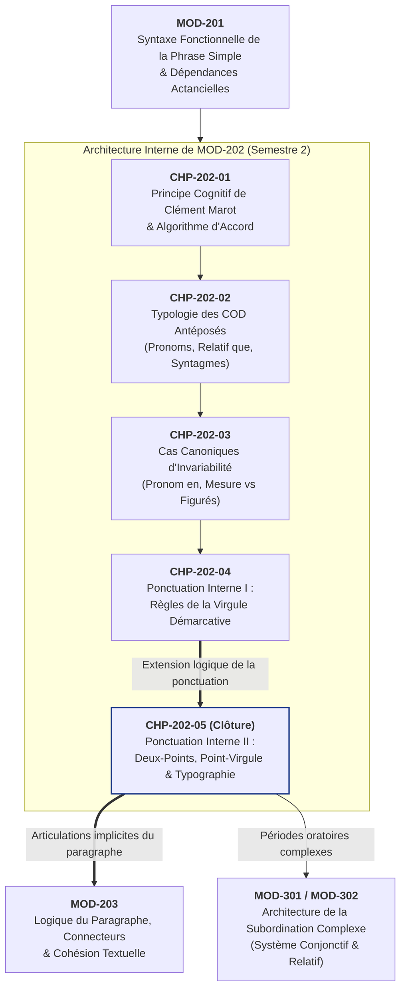

# Chapitre 5 — Ponctuation Interne II — Les Deux-Points et le Point-Virgule : Logique Causalité/Déduction, Balancement Stylistique et Typographie Officielle

> **Identifiant du chapitre** : `CHP-202-05`  
> **Module de rattachement** : [`MOD-202` — Accord du Participe Passé avec l'Auxiliaire Avoir et Ponctuation Interne/Logique](file:///f:/Formation/world-class-french/03-curriculum/year-1/semester-2/mod-202-participe-passe-avoir-ponctuation-interne.md)  
> **Semestre** : Année 1 — Semestre 2 (S2)  
> **Volume horaire canonique** : 5 à 6 heures d'apprentissage autonome délibéré et d'ateliers d'application (Phase 1 Étude : 1 h 30 | Phase 2 Pratique : 1 h 30 | Phase 3 Correction : 1 h 00 | Phase 4 Évaluation : 1 h 00)  
> **Statut** : [STATUT : VALIDÉ]  
> **Compétences associées** : [`FR-INT-001`](file:///f:/Formation/world-class-french/02-competency-framework/competency-framework.md#fr-int-001-rédiger-un-texte-long-cohérent-en-maîtrisant-accords-et-ponctuation) (L3), [`FR-STYLE-001`](file:///f:/Formation/world-class-french/02-competency-framework/competency-framework.md#fr-style-001-maîtrise-des-figures-de-rhétorique-et-commentaire-stylistique) (L2/L3), [`FR-SYNTAX-001`](file:///f:/Formation/world-class-french/02-competency-framework/competency-framework.md#fr-syntax-001-analyse-fonctionnelle-et-délimitation-de-la-phrase-simple) (L3)  
> **Sources scientifiques de référence** : `SRC-TYPO-01` (Imprimerie nationale, *Lexique des règles typographiques*, p. 148-150), `SRC-GRAM-02` (Riegel, Pellat, Rioul, *Grammaire méthodique du français*, chap. 4), `SRC-GRAM-01` (Grevisse & Goosse, *Le Bon Usage*, § 127-133), `SRC-NORM-03` (Ministère de l'Éducation nationale, *Terminologie grammaticale*, 2020)

---

## 1. Titre et Place dans le Cursus

### 1.1 Intitulé Officiel
**Chapitre 5 : Ponctuation Interne II — Les Deux-Points et le Point-Virgule : Logique Causalité/Déduction, Balancement Stylistique et Typographie Officielle** (`CHP-202-05`).

### 1.2 Insertion Architecturale dans le Cursus
Ce cinquième et dernier chapitre du module [`MOD-202`](file:///f:/Formation/world-class-french/03-curriculum/year-1/semester-2/mod-202-participe-passe-avoir-ponctuation-interne.md) clôture le Cycle de sécurisation orthographique et syntaxique fondamentale de l'Année 1. Après avoir étudié dans [`CHP-202-04`](file:///f:/Formation/world-class-french/03-curriculum/year-1/semester-2/mod-202/chp-202-04-ponctuation-interne-virgule-demarcative.md) la virgule comme opérateur démarcatif indispensable, l'apprenant découvre ici les **signes nobles de la ponctuation logique** : les deux-points (`:`) et le point-virgule (`;`).

Ces deux signes ne constituent en aucun cas des ornements facultatifs ou des survivances surannées : ils forment l'ossature de la **parataxe savante**, permettant à l'écrivain, au juriste et à l'universitaire de tisser des liens logiques d'une densité et d'une concision inaccessibles à la simple coordination par conjonctions explicites [Réf. `SRC-GRAM-02`, chap. 4 ; `SRC-GRAM-01`, § 127-133].



- **En amont** : Ce chapitre mobilise directement la délimitation des propositions indépendantes et la proscription des coupures erronées entre constituants majeurs acquises dans [`CHP-202-04`](file:///f:/Formation/world-class-french/03-curriculum/year-1/semester-2/mod-202/chp-202-04-ponctuation-interne-virgule-demarcative.md).
- **Au sein du module [`MOD-202`](file:///f:/Formation/world-class-french/03-curriculum/year-1/semester-2/mod-202-participe-passe-avoir-ponctuation-interne.md)** : Il assure l'aboutissement stylistique et rhétorique du module en dotant l'étudiant d'un système complet de balisage interne de l'énoncé.
- **En aval dans le cursus** : Il constitue le socle direct de [`MOD-203`](file:///f:/Formation/world-class-french/03-curriculum/year-1/semester-2/mod-203-logique-paragraphe-cohesion-textuelle.md) (Logique du paragraphe et cohésion textuelle), où l'alternance entre parataxe ponctuée et hypotaxe conjonctive régit le rythme de la prose académique.

---

## 2. Objectifs Mesurables

Au terme des 5 à 6 heures d'apprentissage autonome et d'ateliers d'application, l'apprenant sera capable de :

1. **Identifier et mobiliser avec exactitude les 4 valeurs logico-sémantiques des deux-points** (causalité explicative, déduction conclusive, énumération spécificative, annonce d'une citation directe) afin d'éliminer les connecteurs lexicaux redondants dans l'argumentation écrite [Réf. `SRC-GRAM-02`, chap. 4 ; `SRC-GRAM-01`, § 133]. (`FR-INT-001` — Palier L3).
2. **Construire des périodes équilibrées au moyen du point-virgule** en exploitant ses 3 fonctions stylistiques canoniques : articulation de propositions indépendantes à forte proximité thématique, balancement antithétique ou parallélique, et segmentation d'énumérations complexes comportant déjà des virgules internes [Réf. `SRC-GRAM-01`, § 128]. (`FR-STYLE-001` — Palier L3).
3. **Appliquer avec une conformité de 100 % les règles typographiques officielles de l'Imprimerie nationale (`SRC-TYPO-01`)** relatives aux deux-points et au point-virgule : insertion systématique de l'espace insécable avant le signe, respect de l'espace sécable après, et maintien rigoureux de la minuscule initiale sauf dans les cas d'exception formellement répertoriés (citations complètes entre guillemets, noms propres). (`FR-INT-001` — Palier L3).
4. **Réviser, arbitrer et corriger des textes académiques ou professionnels défectueux** en éradiquant les 6 pathologies récurrentes de la ponctuation intermédiaire : double emploi des deux-points dans une même phrase, rupture logique sous point-virgule, virgule de raccordement abusive (*comma splice*), et bévues d'espacement éditorial. (`FR-INT-001` — Palier L3).

---

## 3. Prérequis et Test de Préparation (Auto-Diagnostic)

### 3.1 Prérequis Cognitifs Exigibles
- Maîtrise de la notion de **proposition indépendante** et distinction formelle entre juxtaposition, coordination et subordination ([`MOD-201`](file:///f:/Formation/world-class-french/03-curriculum/year-1/semester-2/mod-201-syntaxe-fonctionnelle-phrase-simple.md)).
- Connaissance des connecteurs logiques élémentaires de cause (*car, en effet, parce que*) et de conséquence (*donc, par conséquent, ainsi*) ([`MOD-102`](file:///f:/Formation/world-class-french/03-curriculum/year-1/semester-1/mod-102-classes-mots-accords-fondamentaux.md)).
- Maîtrise des interdits de la virgule (proscription absolue de la virgule entre sujet et verbe ou entre verbe et complément essentiel, [`CHP-202-04`](file:///f:/Formation/world-class-french/03-curriculum/year-1/semester-2/mod-202/chp-202-04-ponctuation-interne-virgule-demarcative.md)).

### 3.2 Test de Préparation Immédiat (5 Questions)
Répondez aux cinq questions suivantes avant d'entamer l'étude du chapitre, puis comparez vos analyses au corrigé repliable.

1. Quelle est la différence structurelle entre deux propositions indépendantes coordonnées et deux propositions indépendantes juxtaposées ?
2. Dans la phrase *« La séance a été suspendue : le quorum n'était pas atteint »*, quel mot de liaison explicite pourrait être inséré à la place des deux-points sans altérer la valeur logique ?
3. Pourquoi l'énoncé *« Les négociations ont échoué, les ambassadeurs quittent la capitale »* est-il considéré comme syntaxiquement fautif dans une copie universitaire ou un acte juridique ?
4. Sur le plan typographique et informatique, qu'est-ce qu'une « espace insécable » et quel incident visuel prévient-elle lors de la mise en page d'un texte ?
5. Dans la phrase *« Le doyen déclara : "Nous maintiendrons l'excellence du cursus." »*, pour quelle raison le mot *Nous* prend-il une majuscule après les deux-points ?

---

#### Corrigé Détaillé de l'Auto-Diagnostic

<details>
<summary><b>Consulter le corrigé raisonné des 5 questions de préparation</b></summary>

1. **Coordination vs Juxtaposition** :
   - Deux propositions coordonnées sont unies par un mot de liaison explicite (conjonction de coordination comme *mais, ou, et, donc, or, ni, car* ou adverbe de liaison comme *cependant, ainsi*).
   - Deux propositions juxtaposées sont posées l'une à côté de l'autre sans aucun connecteur lexical, leur lien syntaxique et logique étant entièrement confié à un signe de ponctuation (virgule, point-virgule ou deux-points).
2. **Équivalence logique des deux-points** :
   - On pourrait insérer une conjonction ou locution de cause : *car*, *parce que* ou *en effet* (*« La séance a été suspendue, car le quorum n'était pas atteint »*). Les deux-points expriment ici une relation de causalité ou d'explication rétroactive.
3. **Le vice de la virgule de raccordement (*comma splice*)** :
   - Deux propositions indépendantes complètes ayant chacune leur verbe conjugué et leur pleine autonomie prédicative ne peuvent pas être unies par une simple virgule en l'absence de conjonction de coordination, sauf en cas d'énumération symétrique rapide. Une telle liaison est une faute de segmentation ; il convient d'employer soit un point-virgule, soit deux-points, soit une conjonction explicite.
4. **Rôle de l'espace insécable** :
   - Une espace insécable est un caractère typographique qui interdit au moteur de composition de renvoyer le caractère suivant au début de la ligne suivante. Placée avant un signe double (`:`, `;`, `?`, `!`), elle empêche le signe de ponctuation d'apparaître seul et orphelin en tête de ligne, ce qui constituerait une faute d'édition intolérable.
5. **Majuscule après deux-points dans une citation** :
   - La majuscule est requise parce que les deux-points introduisent ici une citation directe textuelle formant une phrase complète et autonome, délimitée par des guillemets. En dehors des citations complètes et des noms propres, les deux-points sont obligatoirement suivis d'une lettre minuscule.

</details>

---

## 4. Situation de Départ ou Problème Concret : Le Déclin de la Ponctuation Logique et ses Ravages

Dans les productions écrites professionnelles et académiques contemporaines, la ponctuation intermédiaire subit une dégradation alarmante qui affecte directement la qualité du raisonnement :

### 4.1 L'Abandon Tragique du Point-Virgule
Le point-virgule est souvent perçu à tort comme un vestige désuet du XIXe siècle, une coquetterie littéraire réservée aux érudits. Cet abandon produit deux écueils opposés :
- **Le style télégraphique haché** : L'auteur n'utilise plus que des points simples. Chaque phrase fait huit mots. La pensée perd son architecture d'ensemble, son souffle et sa nuance ; elle ressemble à une suite de télégrammes sans hiérarchie.
- **La phrase-fleuve confuse et le *comma splice*** : Craignant le point sec, le scripteur accumule des virgules molles pour relier des propositions autonomes complètes. Le lecteur suffoque, les limites des idées s'effacent, et la syntaxe s'effondre dans le relâchement.

### 4.2 L'Usage Anarchique des Deux-Points
À l'inverse du point-virgule qui disparaît, les deux-points sont souvent surutilisés de manière anarchique :
- Ils sont réduits à la simple fonction de déclencheur de listes énumératives ou de factures d'épicerie.
- Des rédacteurs enchaînent deux fois, voire trois fois des deux-points dans une même phrase (*« La décision est prise : le chantier démarre : les ouvriers sont prêts »*), créant un emboîtement illisible où le lecteur ignore quelle proposition explique laquelle.

### 4.3 Les Bévues Typographiques d'Espacement
À ces défaillances syntaxiques s'ajoutent les fautes typographiques :
- Omission de l'espace insécable avant les deux-points ou le point-virgule (provoquant des signes orphelins renvoyés en début de ligne).
- Majuscules intempestives après les deux-points hors citation directe (*« Il refusa l'offre : Les conditions étaient inacceptables »*).

De telles négligences discréditent immédiatement une thèse universitaire, une publication scientifique, un acte notarié ou une note diplomatique [Réf. `SRC-TYPO-01`, p. 148].

---

## 5. Explication Intuitive : La Balance de Précision et le Projecteur Focalisé

Pour manier ces deux signes avec une autorité infaillible, il suffit d'adopter deux modèles mécaniques et visuels distincts :

```
      LE POINT-VIRGULE (;)                        LES DEUX-POINTS (:)
   [ La Balance de Précision ]                 [ Le Projecteur Focalisé ]

       ▲ Proposition A                             ▲ Énoncé de départ
      / \                                         / \
     /   \                                       /   \
  [ A ]   [ B ]                                 =======> [ Faisceau lumineux ]
      \   /                                              • Cause cachée
       \ /                                               • Conséquence logique
   Équilibre & Balancement                               • Énumération / Spécification
  Deux pensées de même poids                             • Citation textuelle
```

### 5.1 Le Point-Virgule : La Balance de Précision
Le point-virgule fonctionne comme une **balance à deux plateaux**. Il maintient en équilibre parfait deux pensées indépendantes de même poids syntaxique et d'égale dignité intellectuelle. 
- Il ne subordonne pas ; il ne focalise pas vers l'aval.
- Il établit un pont suspendu entre deux propositions complètes qui se répondent en écho, s'opposent en antithèse ou se prolongent thématiquement. 
- Sa pause est plus marquée que celle de la virgule (qui n'isole pas), mais moins définitive que celle du point (qui clôturerait le dossier conceptuel).

### 5.2 Les Deux-Points : Le Projecteur Focalisé
Les deux-points fonctionnent comme un **projecteur optique orienté vers l'avant**. 
- La première proposition pose un constat ou une affirmation.
- Les deux-points concentrent le faisceau lumineux et projettent l'attention de l'esprit sur ce qui suit immédiatement.
- Ce qui suit vient **élucider**, **démontrer**, **déduire** ou **illustrer** l'affirmation initiale. Le regard ne revient pas en arrière : il plonge dans l'explication, la conséquence ou la matière concrète annoncée.

---

## 6. Définitions Précises et Terminologie

Dans le cadre du cursus académique et conformément à la nomenclature officielle [Réf. `SRC-NORM-03`, p. 12 ; `SRC-GRAM-02`, chap. 4], les concepts suivants sont définis avec rigueur :

- **Signe de ponctuation logique** : Signe typographique dont la fonction principale n'est pas de marquer une intonation ou une pause respiratoire, mais de matérialiser visuellement les articulations syntaxiques et les relations logico-sémantiques entre les propositions d'un énoncé.
- **Deux-points (`:`)** : Signe de ponctuation interne à valeur projective, annonçant une relation sémantique immédiate (cause, déduction, explicitation, inventaire) ou introduisant un discours rapporté direct.
- **Point-virgule (`;`)** : Signe de ponctuation intermédiaire marquant une séparation plus forte que la virgule et moins tranchée que le point, employé pour articuler des propositions indépendantes syntaxiquement autonomes mais unies par une étroite solidarité sémantique.
- **Proposition indépendante juxtaposée** : Proposition qui ne dépend d'aucune autre et dont aucune autre ne dépend, reliée à la proposition voisine uniquement par un signe de ponctuation, sans morphème de coordination ni de subordination.
- **Relation logico-sémantique implicite** : Lien conceptuel (causalité, finalité, déduction, opposition) qui s'établit entre deux énoncés en l'absence de connecteur lexical explicite, ce lien étant inféré par le lecteur grâce au signe de ponctuation choisi.
- **Balancement stylistique** : Figure de construction caractérisée par la disposition symétrique ou antithétique de deux segments de phrase de structure syntaxique semblable ou de longueur comparable, créant une harmonie rythmique et une mise en relief argumentative.
- **Énumération complexe** : Suite ordonnée d'éléments textuels ou d'arguments dont les membres comportent eux-mêmes des virgules de détachement ou des précisions internes, imposant l'usage du point-virgule pour éviter l'indifférenciation des paliers de segmentation.
- **Espace insécable** : Espace typographique (code Unicode `U+00A0` pour l'espace insécable ordinaire ; `U+202F` pour l'espace fine insécable) liant indissolublement le signe de ponctuation au mot qui le précède, garantissant qu'aucun saut de ligne automatique ne viendra isoler le signe en tête de ligne.

---

## 7. Règles et Mécanismes Fondamentaux

### 7.1 Les Deux-Points (`:`) et leurs Valeurs Logico-Sémantiques

Les deux-points ne doivent jamais être employés au hasard. Ils répondent à **quatre valeurs sémantiques canoniques** [Réf. `SRC-GRAM-02`, chap. 4 ; `SRC-GRAM-01`, § 133] :

#### 1. Causalité ou Explication Implicite
La seconde proposition fournit la cause, la raison ou l'éclaircissement de ce qui est énoncé dans la première. Elle équivaut sémantiquement aux connecteurs *car*, *parce que*, *en effet* ou *puisque*.
- *Exemple canonique* : *Il refusa l'offre : les conditions étaient inacceptables.*  
  $\rightarrow$ Équivaut rigoureusement à : *Il refusa l'offre, car les conditions étaient inacceptables.*

#### 2. Déduction ou Conséquence Logique
La seconde proposition exprime la conclusion inéluctable, le résultat ou la déduction tirée du constat formulé dans la première. Elle équivaut sémantiquement aux connecteurs *donc*, *par conséquent*, *aussi* ou *c'est pourquoi*.
- *Exemple canonique* : *Les preuves sont accablantes : l'accusé sera condamné.*  
  $\rightarrow$ Équivaut rigoureusement à : *Les preuves sont accablantes, par conséquent l'accusé sera condamné.*

#### 3. Annonce d'une Énumération ou d'une Spécification Détaillée
Les deux-points annoncent le déploiement analytique d'un terme générique ou d'un nombre posé préalablement dans la phrase.
- *Exemple canonique* : *Trois principes régissent notre action : la rigueur, l'intégrité, l'audace.*  
  $\rightarrow$ Les trois termes constituent le développement explicite du groupe nominal d'attente *Trois principes*.

#### 4. Annonce d'une Citation Directe ou d'un Discours Rapporté
Les deux-points signalent l'introduction textuelle de paroles rapportées ou d'un extrait textuel, et sont immédiatement suivis de guillemets ouvrants.
- *Exemple canonique* : *L'avocat général conclut : « La loi doit s'appliquer dans toute sa rigueur. »*

#### La Règle Stylistique d'Or des Deux-Points
> [!IMPORTANT]
> **Interdiction absolue d'enchaîner deux fois des deux-points dans une même phrase.**  
> Il est formellement proscrit d'imbriquer deux relations projectives successives au sein de la même unité phrastique.  
> - Forme fautive : *« Le projet échoue : les crédits sont épuisés : la banque a refusé l'emprunt. »*  
> - Forme correcte et élégante : *« Le projet échoue : les crédits sont épuisés, la banque ayant refusé l'emprunt. »* ou *« Le projet échoue car les crédits sont épuisés : la banque a refusé l'emprunt. »*

---

### 7.2 Le Point-Virgule (`;`) et le Balancement Stylistique

Le point-virgule est un signe de haute tenue syntaxique qui se caractérise par trois fonctions fondamentales [Réf. `SRC-GRAM-01`, § 128 ; `SRC-GRAM-02`, chap. 4] :

#### 1. Articulation de Propositions Indépendantes à Forte Affinité Thématique
Lorsque deux propositions possèdent une autonomie grammaticale complète (chacune a son verbe et son sens achevé) mais concourent à décrire une seule et même scène, une seule atmosphère ou une même dynamique narrative, le point-virgule évite la rupture brutale du point simple tout en prévenant le laxisme d'une virgule insuffisante.
- *Exemple canonique* : *Le ciel s'assombrit ; les premières gouttes commencèrent à tomber.*  
  $\rightarrow$ Les deux faits sont temporellement et thématiquement solidaires ; le point-virgule maintient leur unité dramaturgique.

#### 2. Balancement Stylistique, Antithèse et Parallélisme
Le point-virgule est l'instrument privilégié des figures de pensée et de construction reposant sur le contraste ou la symétrie bipartite. Il scande l'opposition entre deux thèses ou deux attitudes.
- *Exemple canonique* : *Les uns réclamaient la clémence ; les autres exigeaient le châtiment.*  
  $\rightarrow$ La structure bipartite distribue les actants de part et d'autre de la césure typographique.

#### 3. Séparation d'Éléments d'une Énumération Complexe ou Longue
Dès lors que les membres d'une énumération sont développés et contiennent déjà en leur sein des virgules de détachement ou des précisions incidentes, le point-virgule intervient au rang hiérarchique supérieur pour délimiter chaque bloc sans équivoque.
- *Exemple canonique* : *L'accord tripartite comprend trois volets : d'abord, une refonte fiscale, attendue depuis dix ans ; ensuite, un plan d'investissement ciblé, financé par l'emprunt ; enfin, un pacte social garantissant le pouvoir d'achat.*

---

### 7.3 Les Normes Typographiques Officielles de l'Imprimerie Nationale (`SRC-TYPO-01`)

La composition typographique française obéit à des règles strictes définies par le *Lexique des règles typographiques en usage à l'Imprimerie nationale* [Réf. `SRC-TYPO-01`, p. 148-150] :

#### Tableau des Espacements Réglementaires

| Signe | Espace Avant | Espace Après | Justification Normative |
| :---: | :---: | :---: | :--- |
| **Deux-points (`:`)** | **Espace insécable** (`U+00A0` ou fine `U+202F`) | **Espace sécable** ordinaire | Empêche le décollement du signe et son passage en tête de ligne. |
| **Point-virgule (`;`)** | **Espace insécable** (de préférence fine `U+202F`) | **Espace sécable** ordinaire | Assure l'adhérence du signe au mot qui le précède. |
| **Point simple (`.`)** | Aucune espace | Espace sécable ordinaire | Signe simple fermant l'unité textuelle. |
| **Virgule (`,`)** | Aucune espace | Espace sécable ordinaire | Signe simple collé au mot précédent. |

#### Règle de Casse après le Signe
- **Après le point-virgule** : Le mot suivant prend **toujours une lettre minuscule**, sans aucune exception (sauf s'il s'agit d'un nom propre).
- **Après les deux-points** : Le mot suivant prend **obligatoirement une lettre minuscule** dans tous les cas de causalité, de conséquence ou d'énumération intégrée.
- **Exception unique de la majuscule après deux-points** : La majuscule est prescrite **uniquement** si les deux-points introduisent une **citation textuelle directe** formant une phrase complète entre guillemets (*Le ministre a déclaré : « L'État tiendra ses engagements. »*) ou si le premier mot est un nom propre.

---

## 8. Raisonnement Détaillé : Pourquoi la Ponctuation Noble Éclipse les Connecteurs Lourds

### 8.1 L'Économie Linguistique et le Principe de Condensation
L'expression de la pensée complexe est souvent alourdie par la prolifération de béquilles lexicales telles que *en effet*, *c'est pourquoi*, *il s'ensuit que*, *de telle sorte que*. Si ces connecteurs sont indispensables pour baliser les articulations majeures d'une dissertation, leur répétition mécanique au sein d'un même paragraphe produit une prose pédante et traînante.

En confiant la relation logique aux deux-points ou au point-virgule, le rédacteur réalise une **économie linguistique majeure** :
- *Version alourdie par hypotaxe explicite* : *« L'armée ennemie battit en retraite précipitamment, parce que ses lignes de ravitaillement avaient été coupées par la cavalerie adverse. »* (21 mots).
- *Version condensée par parataxe ponctuée* : *« L'armée ennemie battit en retraite précipitamment : ses lignes de ravitaillement avaient été coupées par la cavalerie adverse. »* (20 mots).
La suppression de *parce que* dynamise le texte. La relation de cause à effet n'est plus lourdement commentée : elle s'impose à l'esprit comme une évidence cognitive immédiate.

### 8.2 L'Élégance de la Parataxe Logique
La linguistique moderne démontre que la **parataxe** (juxtaposition d'énoncés sans connecteur de subordination) n'est pas une régression vers l'inarticulé, mais le degré suprême de la maîtrise stylistique :
- Dans l'hypotaxe (*« Comme les crédits manquaient, nous avons renoncé »*), le travail de synthèse est prémâché pour le lecteur.
- Dans la parataxe ponctuée (*« Les crédits manquaient : nous avons renoncé »* ou *« Les crédits manquaient ; l'ambition demeurait »*), la ponctuation crée un **vide sémantique contrôlé** que l'intelligence du récepteur franchit instantanément. Ce saut logique suscite l'adhésion argumentative et confère à la prose une autorité naturelle [Réf. `SRC-GRAM-02`, chap. 4].

---

## 9. Exemples Corrects Commentés

Examinons quatre extraits représentatifs de la haute prose française, classique, moderne et contemporaine, démontrant la puissance expressive de ces signes :

### Exemple 1 : Bossuet — Le Balancement Tragique par le Point-Virgule
> *« La santé de l'homme est fragile ; sa vie est un songe ; ses desseins sont trompés par la mort. »*  
> (Bossuet, *Oraison funèbre d'Henriette d'Angleterre*, 1670).

- **Analyse stylistique et syntaxique** :  
  Trois propositions indépendantes juxtaposées, rigoureusement coordonnées par le point-virgule. La cadence est ternaire. Chacune comporte un sujet abstrait (*La santé*, *sa vie*, *ses desseins*) et un attribut ou participe passif. Bossuet refuse la virgule simple, qui banaliserait le constat, et refuse le point final, qui morcellerait l'unité pathétique du destin humain. Le point-virgule installe un rythme liturgique inéluctable.

### Exemple 2 : Chateaubriand — La Causalité Projective des Deux-Points
> *« Les forêts précèdent les peuples : les déserts les suivent. »*  
> (Chateaubriand, *Mémoires d'outre-tombe*, 1848).

- **Analyse stylistique et syntaxique** :  
  Une formule lapidaire devenue proverbe historique. La première proposition annonce un constat écologique et historique ; les deux-points projettent la sentence conclusive et symétrique. Le rapport logique cumule l'antithèse chronologique (*précèdent / suivent*) et la causalité historique implicite (la présence humaine dégrade le milieu naturel). Aucun connecteur (*et par conséquent*) n'aurait égalé la force de frappe de ces deux-points.

### Exemple 3 : Léopold Sédar Senghor — Le Parallélisme Incantatoire
> *« Nous sommes les hommes de la danse ; nous sommes les hommes du verbe ; notre force réside dans la fidélité à la terre nourricière. »*  
> (Léopold Sédar Senghor, *Liberté 1 : Négritude et humanisme*, 1964).

- **Analyse stylistique et syntaxique** :  
  Les deux premiers segments anaphoriques sont solidarisés par le point-virgule. Ce choix typographique marque une césure rythmique qui soutient le souffle poétique sans briser la continuité oratoire. Le point-virgule agit ici comme un régulateur de diction et d'harmonie sonore.

### Exemple 4 : Analyse Géopolitique Contemporaine (Éditorial de Presse d'Élite)
> *« Les puissances émergentes refusent l'alignement systématique : elles entendent négocier chaque partenariat au regard exclusif de leurs intérêts souverains ; les chancelleries occidentales doivent réviser d'urgence leurs postulats diplomatiques. »*

- **Analyse stylistique et syntaxique** :  
  Articulation architecturée à double niveau :  
  1. Les deux-points expriment l'explication et la spécification immédiate du refus (*pourquoi refusent-elles ? parce qu'elles entendent négocier au cas par cas*).  
  2. Le point-virgule bascule ensuite de l'analyse factuelle vers la déduction géostratégique prescriptive (*d'un côté l'attitude du Sud global ; de l'autre la conséquence incombant aux chancelleries occidentales*). La hiérarchie logique est d'une parfaite limpidité.

---

## 10. Contre-Exemples et Erreurs Fréquentes (Clinique des Pathologies Scripturales)

### Erreur n° 1 : Le double emploi de deux-points dans une même phrase (cascade projective)
- **Forme pathologique** :  
  *« Le gouvernement annonce un plan d'austérité : les caisses publiques sont vides : la récession a diminué les recettes fiscales. »*
- **Diagnostic linguistique** :  
  Empilement de deux projecteurs au sein d'une seule et même phrase. Le lecteur est désorienté : le troisième segment explique-t-il le deuxième, ou l'ensemble explique-t-il le premier ?
- **Forme corrigée** :  
  *« Le gouvernement annonce un plan d'austérité : les caisses publiques sont vides, la récession ayant drastiquement diminué les recettes fiscales. »*  
  *(Ou : « Les caisses publiques étant vides en raison de la baisse des recettes fiscales, le gouvernement annonce un plan d'austérité : les coupes budgétaires seront immédiates. »)*

### Erreur n° 2 : La majuscule fautive après les deux-points hors citation directe
- **Forme pathologique** :  
  *« La décision des juges est irrévocable : L'accusé purgera sa peine sans possibilité de remise. »*
- **Diagnostic typographique** :  
  Violation des normes de l'Imprimerie nationale [Réf. `SRC-TYPO-01`, p. 148]. Les deux-points n'interrompent pas la phrase ; le segment qui suit n'est pas une citation entre guillemets mais une déduction directe.
- **Forme corrigée** :  
  *« La décision des juges est irrévocable : l'accusé purgera sa peine sans possibilité de remise. »*

### Erreur n° 3 : Le point-virgule reliant des propositions sans affinité logique ni sémantique
- **Forme pathologique** :  
  *« L'inflation progresse de trois pour cent ; mon frère cadet prépare son concours de médecine. »*
- **Diagnostic linguistique** :  
  Le point-virgule exige une solidarité thématique ou un contraste intentionnel. Ici, les deux faits appartiennent à des univers référentiels totalement disjoints. Leur juxtaposition par un point-virgule constitue un solécisme pragmatique.
- **Forme corrigée** :  
  *« L'inflation progresse de trois pour cent. Par ailleurs, mon frère cadet prépare son concours de médecine. »*

### Erreur n° 4 : La confusion fonctionnelle entre deux-points et point-virgule
- **Forme pathologique** :  
  *« L'expédition a dû rebrousser chemin ; les tempêtes de neige rendaient les cols totalement impraticables. »*
- **Diagnostic linguistique** :  
  Le second membre apporte la cause directe de l'avortement de l'expédition (*pourquoi a-t-on rebroussé chemin ? à cause des tempêtes*). Le point-virgule est inopérant pour focaliser sur une relation causale directe ; il convient d'utiliser les deux-points projectifs.
- **Forme corrigée** :  
  *« L'expédition a dû rebrousser chemin : les tempêtes de neige rendaient les cols totalement impraticables. »*

### Erreur n° 5 : L'omission de l'espace insécable avant le signe typographique
- **Forme pathologique** :  
  *« Trois candidats ont été retenus:la directrice,l'ingénieur et le juriste;tous prendront leurs fonctions lundi. »*
- **Diagnostic typographique** :  
  Collage du signe au mot précédent (calque de la typographie anglo-saxonne) et omission des espaces après. En typographie française normée, les deux-points et le point-virgule requièrent obligatoirement une espace insécable avant, et une espace ordinaire après [Réf. `SRC-TYPO-01`, p. 148-150].
- **Forme corrigée** :  
  *« Trois candidats ont été retenus : la directrice, l'ingénieur et le juriste ; tous prendront leurs fonctions lundi. »*

### Erreur n° 6 : L'abus du point-virgule fragmentant inutilement la fluidité de la phrase
- **Forme pathologique** :  
  *« Le matin ; il prenait son café ; puis ; il consultait ses courriels ; avant de partir. »*
- **Diagnostic stylistique** :  
  Hachage maniaque et destructeur de la phrase. Le point-virgule ne doit jamais segmenter des compléments circonstanciels ou des syntagmes prépositionnels courts qui relèvent de la virgule ou de l'enchaînement direct.
- **Forme corrigée** :  
  *« Le matin, il prenait son café, puis il consultait ses courriels avant de partir. »*

---

## 11. Cas Particuliers et Limites

### 11.1 Les Listes à Puces et Alinéas Numérotés
Dans l'édition technique, juridique ou administrative, la présentation d'une liste verticale régie par une phrase d'introduction obéit à une codification rigoureuse [Réf. `SRC-TYPO-01`, p. 23] :
- La phrase introductive s'achève par des **deux-points**.
- Chaque alinéa commence par une **lettre minuscule** (sauf s'il constitue une phrase complète débutant par un sujet).
- Chaque alinéa se termine par un **point-virgule**.
- L'avant-dernier alinéa peut éventuellement comporter la conjonction *et* après le point-virgule.
- Le dernier alinéa se termine obligatoirement par un **point final**.

*Exemple normé* :
> Le dossier de candidature doit obligatoirement comporter :
> - une lettre de motivation dactylographiée ;
> - un curriculum vitæ certifié conforme ;
> - la copie des diplômes universitaires.

### 11.2 Les Deux-Points et le Tiret Cadratin en Dialogue
Dans la transcription du dialogue littéraire classique français :
- La formule incise introductive se termine par des **deux-points**.
- Si la réplique va à la ligne, le paragraphe commence par un **tiret cadratin** (`—`) suivi d'une espace.
- On ne met pas de guillemets ouvrants et fermants à chaque réplique si le dialogue est scandé par des tirets cadratins, ou l'on ouvre les guillemets en tête de dialogue pour ne les fermer qu'au terme du passage dialogué [Réf. `SRC-TYPO-01`, p. 64].

### 11.3 Les Deux-Points sans Verbe dans la Titraille de Presse
Dans la presse et l'édition contemporaine, les deux-points sont fréquemment employés de manière elliptique dans les titres d'articles ou de dépêches :
- *« Crise énergétique : les ministres européens trouvent un compromis. »*  
Ici, les deux-points jouent le rôle d'un opérateur de thématisation : ils posent le thème général, puis focalisent sur l'événement particulier. Cet emploi est admis dans le style journalistique et la titraille, mais doit être manié avec parcimonie dans la prose académique suivie.

---

## 12. Approfondissement Adapté au Niveau : La Querelle du Point-Virgule et la Renaissance de la Prose d'Élite

Le point-virgule a suscité des débats passionnés dans la littérature mondiale :
- Aux États-Unis, le romancier Kurt Vonnegut écrivait de façon provocatrice : *« N'utilisez pas de points-virgules. Ils ne représentent absolument rien. Tout ce qu'ils font, c'est montrer que vous avez été à l'université. »*
- À cette vision utilitariste et simplificatrice, la tradition stylistique française oppose la conviction que le point-virgule est le **métronome de la pensée nuancée**. 

Chez Marcel Proust, Colette, Julien Gracq ou Marguerite Yourcenar, le point-virgule n'est pas un signe d'ostentation ; il est le moyen technique indispensable pour :
1. **Éviter le dogmatisme de l'assertion péremptoire** : Un point final tranche et sépare ; le point-virgule suggère que la vérité d'une proposition n'existe que par résonance avec la proposition suivante.
2. **Mesurer le tempo de la prose d'apparat** : Le point-virgule crée une demi-pause respiratoire et mentale qui permet d'apprécier la musicalité de la période sans en briser l'élan oratoire.

Savoir employer le point-virgule avec naturel et rigueur dans un rapport de synthèse, une note ministérielle ou un mémoire de recherche est la marque distinctive d'un rédacteur d'élite, capable de dominer l'architecture de ses phrases au lieu de la subir.

---

## 13. Comparaisons Différentielles

### Tableau 1 : Deux-Points vs Conjonctions Explicites (*Car* / *Donc*)

| Critère | Deux-Points (`:`) | Conjonction Explicite (*Car* / *Donc*) |
| :--- | :--- | :--- |
| **Mécanisme syntaxique** | Parataxe logique (juxtaposition pure). | Coordination explicite par connecteur lexical. |
| **Effet stylistique** | Vitesse, concision, densité, autorité de l'évidence. | Démonstration didactique, explicitation pas à pas. |
| **Effort cognitif requis** | Le lecteur infère lui-même la relation de cause ou d'effet. | La relation est nommée et balisée pour le lecteur. |
| **Risque d'erreur** | Ambiguïté si la relation causale n'est pas évidente. | Lourdeur par accumulation de connecteurs consécutifs. |

### Tableau 2 : Point-Virgule vs Point Simple

| Critère | Point-Virgule (`;`) | Point Simple (`.`) |
| :--- | :--- | :--- |
| **Degré de séparation** | Séparation moyenne (continuité thématique forte). | Séparation forte (clôture de l'unité phrastique). |
| **Typographie suivante** | Lettre minuscule obligatoire. | Lettre majuscule obligatoire. |
| **Rythme discursif** | Prolonge le souffle oratoire dans une même période. | Réinitialise la cadence syntaxique et prosodique. |
| **Usage recommandé** | Balancement, antithèse, suite d'actions solidaires. | Changement d'angle, rupture thématique ou conclusion. |

### Tableau 3 : Point-Virgule vs Virgule

| Critère | Point-Virgule (`;`) | Virgule (`,`) |
| :--- | :--- | :--- |
| **Autonomie des membres** | Sépare deux propositions complètes et autonomes. | Isole des éléments dépendants ou détachés au sein d'une proposition. |
| **Risque de faute** | Aucun si les propositions sont complètes et liées. | Faute grave (*comma splice*) si elle relie deux indépendantes sans coordination. |
| **Complexité interne** | Capable d'englober des propositions contenant des virgules. | Ne peut pas hiérarchiser une proposition déjà segmentée. |

---

## 14. Exercices Progressifs

### Niveau 1 : Discrimination et Choix Raisonné (10 Phrases)
*Consigne* : Pour chacune des dix phrases suivantes, déterminez si l'espace entre crochets `[...]` doit recevoir des **deux-points** (`:`) ou un **point-virgule** (`;`). Justifiez votre décision par l'analyse du lien logique ou syntaxique.

1. La nuit enveloppait la savane [...] aucun bruit ne troublait le repos du campement.
2. Le résultat financier est sans appel [...] l'entreprise enregistre des pertes colossales.
3. Les jeunes cadres prônaient une transformation numérique radicale [...] les anciens directeurs défendaient les procédures traditionnelles.
4. L'expédition fut immédiatement annulée [...] la météo annonçait un cyclone dévastateur.
5. Trois vertus cardinales guident le magistrat [...] l'indépendance, la probité, la réserve.
6. Le silence se fit dans l'hémicycle [...] l'orateur s'avança lentement vers la tribune.
7. La diplomatie n'a pas réussi à apaiser le conflit [...] les armes parleront désormais.
8. Les lois de la physique sont immuables [...] l'homme ne peut que s'y conformer humblement.
9. La première option exige des capitaux considérables [...] la seconde réclame un temps de déploiement excessif.
10. Il refusa de signer le procès-verbal [...] les aveux avaient été extorqués sous la contrainte.

---

#### Corrigé Détaillé du Niveau 1

<details>
<summary><b>Consulter le corrigé raisonné du Niveau 1</b></summary>

1. **Point-virgule (`;`)** : *« La nuit enveloppait la savane ; aucun bruit ne troublait le repos du campement. »*  
   $\rightarrow$ Affinité thématique étroite et continuité descriptive entre deux indépendantes complètes.
2. **Deux-points (`:`)** : *« Le résultat financier est sans appel : l'entreprise enregistre des pertes colossales. »*  
   $\rightarrow$ Déduction ou spécification explicative immédiate du constat posé.
3. **Point-virgule (`;`)** : *« Les jeunes cadres prônaient une transformation numérique radicale ; les anciens directeurs défendaient les procédures traditionnelles. »*  
   $\rightarrow$ Balancement antithétique parfait entre deux attitudes opposées.
4. **Deux-points (`:`)** : *« L'expédition fut immédiatement annulée : la météo annonçait un cyclone dévastateur. »*  
   $\rightarrow$ Causalité explicative implicite (équivalent de *car* ou *parce que*).
5. **Deux-points (`:`)** : *« Trois vertus cardinales guident le magistrat : l'indépendance, la probité, la réserve. »*  
   $\rightarrow$ Annonce de l'énumération détaillée spécifiant le terme d'attente *Trois vertus*.
6. **Point-virgule (`;`)** : *« Le silence se fit dans l'hémicycle ; l'orateur s'avança lentement vers la tribune. »*  
   $\rightarrow$ Succession d'actions indépendantes formant une même unité dramaturgique.
7. **Deux-points (`:`)** : *« La diplomatie n'a pas réussi à apaiser le conflit : les armes parleront désormais. »*  
   $\rightarrow$ Déduction et conséquence inéluctable (équivalent de *par conséquent*).
8. **Deux-points (`:`)** : *« Les lois de la physique sont immuables : l'homme ne peut que s'y conformer humblement. »*  
   $\rightarrow$ Déduction logique tirée du principe initial.
9. **Point-virgule (`;`)** : *« La première option exige des capitaux considérables ; la seconde réclame un temps de déploiement excessif. »*  
   $\rightarrow$ Balancement comparatif et structure parallèle entre deux solutions.
10. **Deux-points (`:`)** : *« Il refusa de signer le procès-verbal : les aveux avaient été extorqués sous la contrainte. »*  
    $\rightarrow$ Causalité explicative directe motivant le refus.

</details>

---

### Niveau 2 : Remplacement de Connecteurs et Normalisation Typographique (6 Phrases)
*Consigne* : Réécrivez chacune des phrases suivantes en remplaçant les connecteurs lexicaux soulignés par le signe de ponctuation adéquat (`:` ou `;`). Veillez à respecter scrupuleusement les règles typographiques de l'Imprimerie nationale (insertion d'une espace insécable avant le signe, minuscule après).

1. *« Le plan de redressement a échoué <u>parce que</u> les investisseurs étrangers ont retiré leurs capitaux. »*
2. *« Les partisans du candidat célébraient la victoire sur les boulevards, <u>tandis que</u> les militants adverses se dispersaient en silence. »*
3. *« Les conclusions de l'audit sont catégoriques, <u>par conséquent</u> la direction générale doit démissionner sur-le-champ. »*
4. *« Les frontières ont été fermées par mesure de sécurité <u>en effet</u> une épidémie virulente se propage dans les provinces voisines. »*
5. *« Le ministre a rappelé les trois priorités budgétaires, <u>à savoir</u> l'éducation nationale, la santé publique et la transition énergétique. »*
6. *« L'armée régulière contrôlait les centres urbains, <u>alors que</u> les bandes rebelles tenaient les zones forestières. »*

---

#### Corrigé Détaillé du Niveau 2

<details>
<summary><b>Consulter le corrigé raisonné du Niveau 2</b></summary>

1. **Remplacement par deux-points (causalité)** :  
   *« Le plan de redressement a échoué : les investisseurs étrangers ont retiré leurs capitaux. »*  
   *(Espace insécable avant les deux-points, minuscule à « les »).*
2. **Remplacement par point-virgule (balancement antithétique)** :  
   *« Les partisans du candidat célébraient la victoire sur les boulevards ; les militants adverses se dispersaient en silence. »*  
   *(Espace insécable avant le point-virgule, suppression du connecteur lourd, minuscule à « les »).*
3. **Remplacement par deux-points (déduction/conséquence)** :  
   *« Les conclusions de l'audit sont catégoriques : la direction générale doit démissionner sur-le-champ. »*  
   *(Espace insécable avant les deux-points, minuscule à « la »).*
4. **Remplacement par deux-points (explication)** :  
   *« Les frontières ont été fermées par mesure de sécurité : une épidémie virulente se propage dans les provinces voisines. »*  
   *(Espace insécable avant les deux-points, minuscule à « une »).*
5. **Remplacement par deux-points (énumération/spécification)** :  
   *« Le ministre a rappelé les trois priorités budgétaires : l'éducation nationale, la santé publique et la transition énergétique. »*  
   *(Suppression de « à savoir », espace insécable avant les deux-points).*
6. **Remplacement par point-virgule (balancement d'opposition)** :  
   *« L'armée régulière contrôlait les centres urbains ; les bandes rebelles tenaient les zones forestières. »*  
   *(Suppression de « alors que », espace insécable avant le point-virgule, minuscule à « les »).*

</details>

---

### Niveau 3 : Ponctuation et Justification Logique d'un Texte Géopolitique (Exactement 50 Mots)
*Consigne* : Voici un texte brut d'analyse géopolitique de **50 mots exactement**. Ce texte a été dépouillé de sa ponctuation interne noble (deux-points et points-virgules). Rétablissez les deux-points et points-virgules requis aux emplacements stratégiques pour conférer au texte toute sa rigueur démonstrative, puis justifiez chaque intervention.

#### Texte Brut (sans ponctuation interne noble) :
> *Cet équilibre régional demeure très fragile chaque tension frontalière augmente sous la pression des ressources minières. Ces diplomates préconisent une médiation rapide ces généraux massent leurs troupes armées aux frontières. Une telle confrontation menace cette stabilité continentale nul compromis pacifique ne saurait émerger sans un dialogue franc, constructif et loyal.*

#### Décompte Arithmétique Préalable (50 Mots Réels) :
`[1]` Cet `[2]` équilibre `[3]` régional `[4]` demeure `[5]` très `[6]` fragile `[7]` chaque `[8]` tension `[9]` frontalière `[10]` augmente `[11]` sous `[12]` la `[13]` pression `[14]` des `[15]` ressources `[16]` minières. `[17]` Ces `[18]` diplomates `[19]` préconisent `[20]` une `[21]` médiation `[22]` rapide `[23]` ces `[24]` généraux `[25]` massent `[26]` leurs `[27]` troupes `[28]` armées `[29]` aux `[30]` frontières. `[31]` Une `[32]` telle `[33]` confrontation `[34]` menace `[35]` cette `[36]` stabilité `[37]` continentale `[38]` nul `[39]` compromis `[40]` pacifique `[41]` ne `[42]` saurait `[43]` émerger `[44]` sans `[45]` un `[46]` dialogue `[47]` franc, `[48]` constructif `[49]` et `[50]` loyal.  
**Total exact : 50 mots.**

---

#### Corrigé Détaillé du Niveau 3

<details>
<summary><b>Consulter le texte ponctué et l'apparat critique justificatif</b></summary>

#### Texte Ponctué dans les Règles de l'Art :
> *Cet équilibre régional demeure très fragile : chaque tension frontalière augmente sous la pression des ressources minières. Ces diplomates préconisent une médiation rapide ; ces généraux massent leurs troupes armées aux frontières. Une telle confrontation menace cette stabilité continentale : nul compromis pacifique ne saurait émerger sans un dialogue franc, constructif et loyal.*

#### Apparat Critique et Justifications :
1. **Insertion de deux-points après *fragile* (mot n° 6)** :  
   - *Fonction* : Causalité explicative rétroactive. La proposition qui suit (*chaque tension frontalière augmente...*) explicite la cause fondamentale de la fragilité énoncée.  
   - *Typographie* : Espace insécable avant le signe, minuscule au mot *chaque*.
2. **Insertion d'un point-virgule après *rapide* (mot n° 22)** :  
   - *Fonction* : Balancement stylistique et antithèse politique. Mise en parallèle contrastée de deux attitudes contradictoires : l'effort pacificateur des diplomates face à la préparation guerrière des états-majors.  
   - *Typographie* : Espace insécable avant le signe, minuscule au mot *ces*.
3. **Insertion de deux-points après *continentale* (mot n° 37)** :  
   - *Fonction* : Déduction logique conclusive. La seconde proposition démontre pourquoi et comment la confrontation menace la paix : elle exclut tout compromis sans franchise.  
   - *Typographie* : Espace insécable avant le signe, minuscule au mot *nul*.

</details>

---

## 15. Activité de Correction Raisonnée

Voici un extrait tiré d'une épreuve d'article académique soumis à un comité de lecture universitaire. Ce paragraphe comporte **exactement 8 erreurs** relatives à l'emploi des deux-points, des points-virgules ou aux normes typographiques d'espacement et de casse.

### Texte Fautif Témoin :
> *Le comité de sélection s'est réuni hier matin dans la grande salle du conseil;Le président a ouvert les débats en exposant les contraintes financières de l'institution:les dotations publiques diminuent de quinze pour cent:les partenaires privés hésitent à renouveler leurs subventions. Deux camps se sont immédiatement opposés:les partisans d'un gel des recrutements prônaient l'attente prudente;les défenseurs de la recherche exigeaient le maintien des bourses doctorales. Le rapporteur général a ensuite présenté les trois critères d'évaluation;l'excellence des publications antérieures, l'originalité du projet scientifique et l'ancrage territorial. Enfin, la séance fut levée à midi;parce que aucun accord n'avait pu être formalisé.*

---

### Apparat Critique et Tableau de Redressement des 8 Erreurs

| N° | Segment Fautif | Diagnostic Scientifique | Correction Normée | Source Normative |
| :---: | :--- | :--- | :--- | :--- |
| **1** | *...conseil;Le président...* | Deux erreurs combinées : absence d'espace insécable avant le point-virgule, et majuscule fautive après le point-virgule hors nom propre. De plus, un point simple s'imposait entre ces deux phrases autonomes sans lien sémantique direct. | *...conseil. Le président...* | `SRC-TYPO-01`, p. 148 |
| **2** | *...de l'institution:les...* | Omission de l'espace insécable avant les deux-points et de l'espace sécable après. | *...de l'institution : les...* | `SRC-TYPO-01`, p. 148 |
| **3** | *...pour cent:les partenaires...* | **Double emploi des deux-points dans une même phrase** (cascade projective fautive). Le deuxième lien causal doit être coordonné ou subordonné. | *...pour cent, et les partenaires...* (ou *...pour cent, tandis que les...*) | `SRC-GRAM-02`, chap. 4 |
| **4** | *...opposés:les partisans...* | Confusion fonctionnelle : emploi de deux-points au lieu d'un point-virgule (ou absence d'espace insécable avant le signe) pour introduire un balancement antithétique. | *...opposés : les partisans...* (avec espace insécable) ou reformulation d'attente. | `SRC-TYPO-01`, p. 148 |
| **5** | *...prudente;les défenseurs...* | Omission de l'espace insécable avant le point-virgule et de l'espace sécable après dans le balancement antithétique. | *...prudente ; les défenseurs...* | `SRC-TYPO-01`, p. 150 |
| **6** | *...d'évaluation;l'excellence...* | **Confusion flagrante** : emploi d'un point-virgule au lieu de deux-points pour annoncer une énumération détaillée annoncée par un nombre (*les trois critères*). | *...d'évaluation : l'excellence...* | `SRC-GRAM-01`, § 133 |
| **7** | *...à midi;parce que aucun...* | **Point-virgule fautif devant une subordonnée de cause** : le point-virgule ne doit jamais couper une proposition principale de sa subordonnée conjonctive introduite par *parce que*. De plus, élision manquante (*parce qu'aucun*). | *...à midi, parce qu'aucun...* | `SRC-GRAM-02`, chap. 4 |
| **8** | *...parce que aucun...* | Omission de l'élision obligatoire de la conjonction *parce que* devant la voyelle initiale du pronom indéfini *aucun*. | *...parce qu'aucun...* | `SRC-GRAM-01`, § 44 |

### Texte Intégralement Corrigé :
> *Le comité de sélection s'est réuni hier matin dans la grande salle du conseil. Le président a ouvert les débats en exposant les contraintes financières de l'institution : les dotations publiques diminuent de quinze pour cent, et les partenaires privés hésitent à renouveler leurs subventions. Deux camps se sont immédiatement opposés : les partisans d'un gel des recrutements prônaient l'attente prudente ; les défenseurs de la recherche exigeaient le maintien des bourses doctorales. Le rapporteur général a ensuite présenté les trois critères d'évaluation : l'excellence des publications antérieures, l'originalité du projet scientifique et l'ancrage territorial. Enfin, la séance fut levée à midi, parce qu'aucun accord n'avait pu être formalisé.*

---

## 16. Mise en Pratique dans une Production Réelle : L'Éditorial de 60 Mots

### Consigne de Rédaction Sous Contraintes Multiples
Rédigez un éditorial politique ou économique de **60 mots exactement**. Votre texte doit obligatoirement satisfaire les trois contraintes suivantes :
1. Intégrer un emploi irréprochable de **causalité ou explication par deux-points** (`:`).
2. Intégrer un emploi de **balancement antithétique ou parallélisme par point-virgule** (`;`).
3. Appliquer avec une perfection absolue les **espacements typographiques officiels** (espace insécable avant le signe, espace ordinaire après, minuscule après le signe).

---

### Texte Produit (Exactement 60 Mots Réels) :

> *La souveraineté économique impose des sacrifices indispensables : aucune nation ne prospère dans la passivité permanente. Les peuples courageux construisent leur avenir ; les régimes hésitants subissent leur déclin. Face aux mutations industrielles, notre devoir collectif commande un redressement immédiat, méthodique et lucide. Nous devons investir massivement dans la jeunesse, valoriser le travail créateur, protéger nos compétences et consolider notre indépendance nationale.*

---

### Décompte Arithmétique Mot à Mot (1 à 60) :
`[1]` La `[2]` souveraineté `[3]` économique `[4]` impose `[5]` des `[6]` sacrifices `[7]` indispensables `[8]` aucune `[9]` nation `[10]` ne `[11]` prospère `[12]` dans `[13]` la `[14]` passivité `[15]` permanente.  
`[16]` Les `[17]` peuples `[18]` courageux `[19]` construisent `[20]` leur `[21]` avenir `[22]` les `[23]` régimes `[24]` hésitants `[25]` subissent `[26]` leur `[27]` déclin.  
`[28]` Face `[29]` aux `[30]` mutations `[31]` industrielles, `[32]` notre `[33]` devoir `[34]` collectif `[35]` commande `[36]` un `[37]` redressement `[38]` immédiat, `[39]` méthodique `[40]` et `[41]` lucide.  
`[42]` Nous `[43]` devons `[44]` investir `[45]` massivement `[46]` dans `[47]` la `[48]` jeunesse, `[49]` valoriser `[50]` le `[51]` travail `[52]` créateur, `[53]` protéger `[54]` nos `[55]` compétences `[56]` et `[57]` consolider `[58]` notre `[59]` indépendance `[60]` nationale.  
**Total arithmétique rigoureux : 60 mots.**

### Justification Stylistique et Typographique :
- **Emploi des deux-points (mot n° 7)** : *La souveraineté économique impose des sacrifices indispensables : aucune nation ne prospère dans la passivité permanente.* La seconde proposition fournit la cause philosophique et économique directe de la première (*car aucune nation ne prospère...*). Typographie : espace insécable avant le signe, espace ordinaire après, lettre minuscule au mot *aucune*.
- **Emploi du point-virgule (mot n° 21)** : *Les peuples courageux construisent leur avenir ; les régimes hésitants subissent leur déclin.* Balancement antithétique rigoureux : sujet pluriel valorisant vs sujet pluriel dépréciatif, verbe d'action vs verbe de passivité, complément symétrique opposé. Typographie : espace insécable avant le signe, espace ordinaire après, minuscule au mot *les*.

---

## 17. Résumé Structuré : Le Tableau de Maîtrise des Signes Nobles

```
========================================================================================
                     MATRICE SYNTHÉTIQUE DE LA PONCTUATION NOBLE
========================================================================================
SIGNE          VALEURS MAJEURES              ESPACEMENT NORME          INTERDITS ABSOLUS
----------------------------------------------------------------------------------------
DEUX-POINTS    1. Causalité (car/en effet)   • Avant : Insécable       • Double emploi
     (:)       2. Déduction (donc/ainsi)     • Après : Sécable           successif dans la
               3. Énumération / Détail       • Casse : Minuscule         même phrase.
               4. Citation directe ("...")     (sauf citation/propre)  • Majuscule hors citation.
----------------------------------------------------------------------------------------
POINT-VIRGULE  1. Affinité thématique        • Avant : Insécable       • Coupure principale /
     (;)       2. Balancement / Antithèse    • Après : Sécable           subordonnée.
               3. Énumération complexe avec  • Casse : Minuscule       • Liaison sans aucun
                  virgules internes            absolue (sans exception) lien thématique.
========================================================================================
```

---

## 18. Questions de Rappel Actif (Active Recall)

Répondez mentalement ou par écrit à ces six questions fondamentales sans consulter le cours, puis déployez les réponses pour valider votre ancrage mnésique.

1. Quelles sont les 4 valeurs logico-sémantiques majeures des deux-points en français ?
2. Pourquoi est-il formellement interdit d'utiliser deux fois des deux-points au sein d'une même phrase ?
3. Quelles sont les 3 fonctions stylistiques canoniques du point-virgule ?
4. Dans quel cas unique est-il licite de placer une lettre majuscule immédiatement après des deux-points ?
5. Quelle règle d'espacement l'Imprimerie nationale prescrit-elle pour le point-virgule et les deux-points ?
6. Quelle est la différence de fonction syntaxique entre une virgule et un point-virgule séparant deux propositions indépendantes ?

---

#### Réponses Repliables aux Questions de Rappel Actif

<details>
<summary><b>Consulter les réponses détaillées du rappel actif</b></summary>

1. **Les 4 valeurs des deux-points** :
   - Causalité ou explication implicite (*car, en effet*).
   - Déduction ou conséquence logique (*donc, par conséquent*).
   - Annonce d'une énumération ou d'une spécification détaillée.
   - Annonce d'une citation directe ou d'un discours rapporté entre guillemets.
2. **Proscription du double deux-points** :
   - Parce que les deux-points ont une portée projective vers l'aval. Deux deux-points créent un emboîtement ambigu où le lecteur ne sait plus quel segment éclaire ou déduit quel autre.
3. **Les 3 fonctions du point-virgule** :
   - Articulation de deux indépendantes unies par une étroite proximité thématique ou narrative.
   - Balancement stylistique, parallélisme ou antithèse entre deux pensées symétriques.
   - Délimitation des membres d'une énumération complexe comportant déjà des virgules internes.
4. **Majuscule après deux-points** :
   - Uniquement lorsque les deux-points introduisent une citation directe textuelle formant une phrase complète entre guillemets, ou lorsque le mot suivant est un nom propre.
5. **Règle d'espacement de l'Imprimerie nationale** :
   - Espace insécable obligatoire avant le signe (`:` ou `;`) ; espace sécable ordinaire après le signe.
6. **Virgule vs Point-virgule entre deux indépendantes** :
   - La virgule seule ne peut pas relier deux propositions complètes autonomes sans connecteur de coordination (faute de *comma splice*) ; le point-virgule possède la force séparatrice nécessaire pour assumer cette juxtaposition tout en préservant leur unité sémantique.

</details>

---

## 19. Mini-Évaluation Sommative Notée (Sur 20 Points)

> **Durée conseillée** : 30 minutes  
> **Barème** : Noté sur 20 points.  
> **Seuil de validation L3** : $\ge 14/20$. Toute note inférieure à 14/20 impose la reprise des exercices du Niveau 2 et l'activité de correction raisonnée.

---

### Épreuve

#### Exercice 1 — Identification des Valeurs Logiques (5 points : 1 pt par item)
*Identifiez la valeur sémantique exacte des deux-points ou du point-virgule dans chacun des énoncés suivants (choisir parmi : Causalité, Déduction, Énumération, Balancement antithétique, Affinité thématique).*

1. *« La brume s'épaissit sur le fleuve ; les mariniers amarrèrent leurs péniches pour la nuit. »*
2. *« Le plan financier est chimérique : les recettes fiscales prévues reposent sur une hypothèse irréaliste. »*
3. *« L'industrie recherche l'automatisation intégrale ; les syndicats défendent le maintien des postes manuels. »*
4. *« Les stocks de matières premières sont épuisés : les usines suspendront la production dès demain. »*
5. *« Le nouveau code civil retient quatre principes fondamentaux : l'égalité, la transparence, la responsabilité, la liberté contractuelle. »*

#### Exercice 2 — Diagnostic et Correction Typographique (5 points : 1 pt par phrase)
*Identifiez l'erreur dans chaque phrase et réécrivez-la selon les normes de l'Imprimerie nationale.*

1. *« L'accord de paix a été ratifié:Les combats ont cessé sur toute la ligne de front. »*
2. *« Le témoin affirme ; « J'ai vu l'accusé quitter les lieux avant minuit. » »*
3. *« La recherche fondamentale exige de la patience ; parce que les découvertes majeures demandent des décennies d'efforts. »*
4. *« Nous retiendrons deux candidatures : Monsieur Diallo pour l'informatique : Madame Touré pour le secrétariat. »*
5. *« L'inflation appauvrit les épargnants ;La hausse des salaires compense à peine la perte de pouvoir d'achat. »*

#### Exercice 3 — Remplacement Parataxique Élégant (5 points : 1 pt par phrase)
*Supprimez le connecteur logique en gras et réécrivez la phrase en employant des deux-points ou un point-virgule avec une typographie irréprochable.*

1. *« L'arbitre a interrompu la rencontre **car** un projectile avait atteint le gardien de but. »*
2. *« Les premiers colons cultivaient le blé et le maïs **tandis que** les arrivants suivants se consacraient à l'élevage extensif. »*
3. *« Les crédits alloués à la rénovation urbaine ont été gelés **par conséquent** les chantiers de réhabilitation sont arrêtés. »*
4. *« La forêt boréale absorbe d'immenses volumes de carbone **en effet** sa masse végétale agit comme un poumon régulateur. »*
5. *« Les historiens analysent les archives du passé **alors que** les prospectiveurs s'efforcent d'anticiper les crises futures. »*

#### Exercice 4 — Production Synthétique sous Contraintes (5 points)
*Rédigez une période argumentative de 30 à 40 mots exactement sur le thème de la rigueur scientifique. Vous devez obligatoirement employer un jeu de deux-points exprimant la déduction et un point-virgule exprimant un balancement stylistique. Respectez scrupuleusement les espacements typographiques.*

---

### Barème de Notation et Corrigé

<details>
<summary><b>Consulter le corrigé et la grille d'attribution des 20 points</b></summary>

#### Corrigé de l'Exercice 1 (5 points)
1. **Affinité thématique** (propositions descriptives solidaires) [1 pt].
2. **Causalité ou explication implicite** (la seconde proposition donne la cause de la chimère) [1 pt].
3. **Balancement antithétique** (opposition symétrique industrie vs syndicats) [1 pt].
4. **Déduction ou conséquence logique** (la suspension est la suite inéluctable de l'épuisement des stocks) [1 pt].
5. **Énumération détaillée** [1 pt].

#### Corrigé de l'Exercice 2 (5 points)
1. *« L'accord de paix a été ratifié : les combats ont cessé sur toute la ligne de front. »* (Espace insécable avant `: `, suppression de la majuscule à *les*) [1 pt].
2. *« Le témoin affirme : « J'ai vu l'accusé quitter les lieux avant minuit. » »* (Remplacement du point-virgule par des deux-points d'annonce de citation) [1 pt].
3. *« La recherche fondamentale exige de la patience, parce que les découvertes majeures demandent des décennies d'efforts. »* (Remplacement du point-virgule par une virgule devant la subordonnée de cause) [1 pt].
4. *« Nous retiendrons deux candidatures : Monsieur Diallo pour l'informatique, et Madame Touré pour le secrétariat. »* (Suppression du deuxième deux-points fautif) [1 pt].
5. *« L'inflation appauvrit les épargnants ; la hausse des salaires compense à peine la perte de pouvoir d'achat. »* (Espace insécable avant `; `, minuscule obligatoire à *la*) [1 pt].

#### Corrigé de l'Exercice 3 (5 points)
1. *« L'arbitre a interrompu la rencontre : un projectile avait atteint le gardien de but. »* [1 pt].
2. *« Les premiers colons cultivaient le blé et le maïs ; les arrivants suivants se consacraient à l'élevage extensif. »* [1 pt].
3. *« Les crédits alloués à la rénovation urbaine ont été gelés : les chantiers de réhabilitation sont arrêtés. »* [1 pt].
4. *« La forêt boréale absorbe d'immenses volumes de carbone : sa masse végétale agit comme un poumon régulateur. »* [1 pt].
5. *« Les historiens analysent les archives du passé ; les prospectiveurs s'efforcent d'anticiper les crises futures. »* [1 pt].

#### Corrigé de l'Exercice 4 (5 points : Exemple Modèle de 34 mots)
*« La recherche exige une rigueur implacable : l'approximation ruine la crédibilité du chercheur. Les amateurs se fient à leurs intuitions ; les savants vérifient scrupuleusement chaque donnée empirique avant d'énoncer la moindre loi générale. »*  
- Décompte : 34 mots [1 pt].
- Déduction par deux-points bien formée (*La recherche exige une rigueur implacable : l'approximation ruine...*) [2 pts].
- Balancement par point-virgule réussi (*Les amateurs se fient... ; les savants vérifient...*) [1 pt].
- Espacements typographiques irréprochables (espace insécable avant `:` et `;`, minuscules après) [1 pt].

</details>

---

## 20. Critères Observables de Maîtrise (Palier L3 Autonomie)

| Compétence Cible | Indicateur Observable | Seuil de Validation L3 | Modalité de Preuve |
| :--- | :--- | :---: | :--- |
| [`FR-INT-001`](file:///f:/Formation/world-class-french/02-competency-framework/competency-framework.md#fr-int-001-rédiger-un-texte-long-cohérent-en-maîtrisant-accords-et-ponctuation) | Discrimination entre causalité, déduction et énumération sous deux-points. | **100 %** | Aucune confusion de sens sur un test de 10 cas parataxiques. |
| [`FR-INT-001`](file:///f:/Formation/world-class-french/02-competency-framework/competency-framework.md#fr-int-001-rédiger-un-texte-long-cohérent-en-maîtrisant-accords-et-ponctuation) | Éradication du double deux-points dans une même phrase. | **Zéro faute** | Contrôle systématique en révision critique. |
| [`FR-STYLE-001`](file:///f:/Formation/world-class-french/02-competency-framework/competency-framework.md#fr-style-001-maîtrise-des-figures-de-rhétorique-et-commentaire-stylistique) | Construction de périodes équilibrées par point-virgule (balancement/antithèse). | $\ge 90\ \%$ de pertinence | Production d'un paragraphe oratoire ou argumentatif noté. |
| [`FR-INT-001`](file:///f:/Formation/world-class-french/02-competency-framework/competency-framework.md#fr-int-001-rédiger-un-texte-long-cohérent-en-maîtrisant-accords-et-ponctuation) | Conformité typographique (espace insécable avant, minuscule après). | **100 % d'exactitude** | Audit de copie d'édition sans aucune infraction d'espacement. |

---

## 21. Sources et Lectures Complémentaires

Conformément à la règle d'intégrité bibliographique du cursus [`source-registry.md`](file:///f:/Formation/world-class-french/07-resources/source-registry.md), les notions développées dans ce chapitre s'appuient exclusivement sur les autorités savantes suivantes :

1. **`SRC-TYPO-01` — Imprimerie nationale** :  
   *Lexique des règles typographiques en usage à l'Imprimerie nationale*, Paris, Imprimerie nationale, rééd. 2002/2014.  
   - *Pages 148-150* : Règles canoniques de ponctuation, espacements insécables et sécables avant et après les deux-points et le point-virgule, gestion de la casse après ponctuation.
2. **`SRC-GRAM-02` — Martin Riegel, Jean-Christophe Pellat, René Rioul** :  
   *Grammaire méthodique du français*, Paris, PUF, coll. « Quadrige », 2016/2021.  
   - *Chapitre 4 (« La ponctuation et l'organisation du texte écrit »)* : Statut sémiologique de la ponctuation, distinction entre ponctuation démarcative et ponctuation logique/sémantique, la parataxe propositionnelle.
3. **`SRC-GRAM-01` — Maurice Grevisse, André Goosse** :  
   *Le Bon Usage*, Bruxelles, De Boeck Supérieur, 16e éd., 2016.  
   - *Paragraphes 127 à 133* : Emplois descriptifs et normatifs du point-virgule (§ 128) et des deux-points (§ 133), tolérances littéraires, interdiction du cumul de deux-points.
4. **`SRC-NORM-03` — Ministère de l'Éducation nationale (France)** :  
   *Terminologie grammaticale*, Paris, 2020.  
   - *Pages 12-14* : Nomenclature officielle des signes de ponctuation et analyse de la phrase complexe sans connecteur lexical.

---

## Annexe : Classification Pédagogique des Notions du Chapitre

| Étiquette | Notion / Contenu | Justification Curriculaire |
| :--- | :--- | :--- |
| `CORE-NOW` | Les 4 valeurs logico-sémantiques des deux-points (cause, déduction, énumération, citation). | Indispensable pour structurer l'argumentation écrite en Année 1. |
| `CORE-NOW` | Les 3 fonctions stylistiques du point-virgule (affinité thématique, balancement, énumération complexe). | Socle du style académique et de la rédaction soignée (`FR-INT-001`). |
| `CORE-NOW` | Règles d'espacement typographique de l'Imprimerie nationale (`SRC-TYPO-01`). | Norme incontournable d'édition et de crédibilité scripturale. |
| `CORE-NOW` | Interdiction absolue du double deux-points dans une même phrase. | Règle négative essentielle pour éviter les ruptures de clarté. |
| `INTRODUCTION-NOW` | La parataxe logique opposée à l'hypotaxe conjonctive. | Introduction conceptuelle préparant directement le module `MOD-203`. |
| `DEFER` | La métrique et le rythme oratoire de la période chez Proust et Gracq. | Reporté en Année 2 (`MOD-304` et `MOD-403`, stylistique littéraire avancée). |
| `OPTIONAL-ADVANCED` | La querelle anglo-saxonne de la mort du point-virgule (Kurt Vonnegut). | Éclairage culturel pour enrichir la réflexion personnelle de l'apprenant. |
| `REMOVE` | L'affirmation selon laquelle le point-virgule indiquerait une « respiration orale moyenne ». | Idée fausse et non scientifique proscrite du cursus. |
