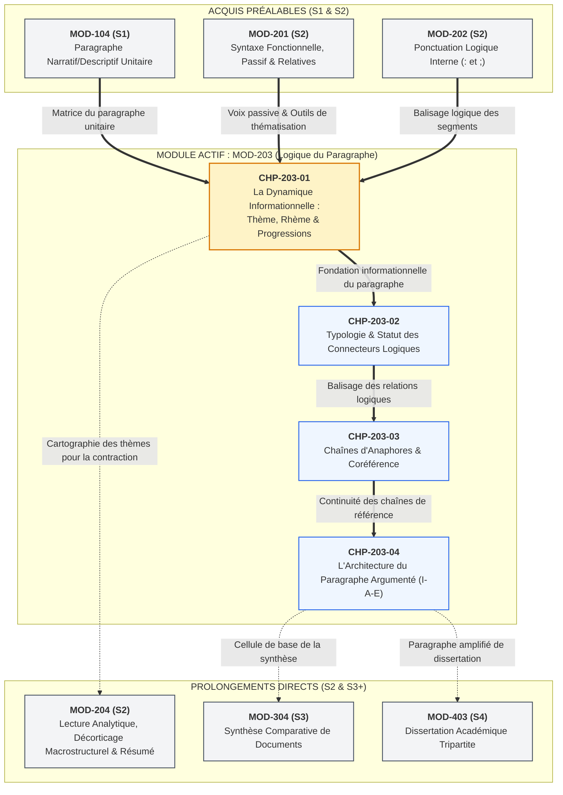
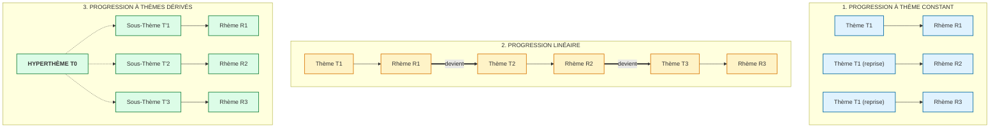

# Chapitre 1 — La Dynamique Informationnelle du Texte : Thème, Rhème et Typologie des Progressions Thématiques

> **Identifiant du chapitre** : `CHP-203-01`  
> **Module de rattachement** : [`MOD-203` — Logique du Paragraphe, Typologie des Connecteurs, Progression Thématique et Cohésion Textuelle](file:///f:/Formation/world-class-french/03-curriculum/year-1/semester-2/mod-203-logique-paragraphe-cohesion-textuelle.md)  
> **Semestre** : Année 1 — Semestre 2 (S2)  
> **Volume horaire estimé** : 5 à 6 heures d'apprentissage autonome délibéré et d'ateliers d'application (Phase 1 Étude : 1 h 30 | Phase 2 Pratique : 1 h 30 | Phase 3 Correction : 1 h 00 | Phase 4 Évaluation : 1 h 00)  
> **Statut** : [STATUT : VALIDÉ]  
> **Compétences associées** : [`FR-INT-001`](file:///f:/Formation/world-class-french/02-competency-framework/competency-framework.md#fr-int-001-rédiger-un-texte-long-cohérent-en-maîtrisant-accords-et-ponctuation) (L3 Autonomie : Paragraphe argumenté et cohésion textuelle), [`FR-SYNTAX-001`](file:///f:/Formation/world-class-french/02-competency-framework/competency-framework.md#fr-syntax-001-analyse-fonctionnelle-et-délimitation-de-la-phrase-simple) (L3 Autonomie : Analyse fonctionnelle, ordre des constituants et thématisation)  
> **Sources scientifiques de référence** : `SRC-GRAM-02` (Riegel, Pellat & Rioul, 2016, chap. 20), `SRC-NORM-03` (Ministère de l'Éducation nationale, 2020, p. 12-16), `SRC-GRAM-01` (Grevisse & Goosse, 2016, § 225-235)

---

## 1. Titre et Place dans le Cursus

### 1.1 Intitulé Officiel
**Chapitre 1 : La Dynamique Informationnelle du Texte : Thème, Rhème et Typologie des Progressions Thématiques** (`CHP-203-01`).

### 1.2 Insertion Architecturale dans le Cursus
Le premier chapitre du module [`MOD-203`](file:///f:/Formation/world-class-french/03-curriculum/year-1/semester-2/mod-203-logique-paragraphe-cohesion-textuelle.md) marque l'entrée décisive dans la **linguistique textuelle** et l'**analyse du discours**. Jusqu'ici, l'apprenant a stabilisé la rectitude morphosyntaxique de l'énoncé isolé : l'architecture actancielle de la phrase simple (`MOD-201`), le maniement de la voix passive comme pivot d'orientation (`CHP-201-04`), et la ponctuation logique interne (`MOD-202`). Le présent chapitre franchit la frontière phrastique : il enseigne comment les énoncés s'articulent organiquement pour tisser un texte unifié et dynamique.



- **En amont** : Ce chapitre prend appui sur trois piliers fondamentaux :
  1. [`MOD-104`](file:///f:/Formation/world-class-french/03-curriculum/year-1/semester-1/mod-104-lexique-lecture-paragraphe.md) : la notion de paragraphe unitaire et le sens de la progression narrative ou descriptive ;
  2. [`MOD-201`](file:///f:/Formation/world-class-french/03-curriculum/year-1/semester-2/mod-201-syntaxe-fonctionnelle-phrase-simple.md) (notamment [`CHP-201-04`](file:///f:/Formation/world-class-french/03-curriculum/year-1/semester-2/mod-201/chp-201-04-voix-passive-portee-discursive.md)) : la manipulation de la voix passive, conçue non comme un simple exercice de style, mais comme un instrument syntaxique majeur de **thématisation** permettant d'aligner le centre d'intérêt discursif avec le sujet grammatical ;
  3. [`MOD-202`](file:///f:/Formation/world-class-french/03-curriculum/year-1/semester-2/mod-202-participe-passe-avoir-ponctuation-interne.md) : l'usage de la ponctuation logique (deux-points déductifs, point-virgule de balancement) pour délimiter les unités informatives sans casser la cohésion textuelle.
- **En aval** : Ce chapitre ouvre la voie :
  1. À `CHP-203-02`, où les connecteurs logiques viendront expliciter la relation notionnelle entre les propositions thématisées ;
  2. À `CHP-203-03`, où les chaînes anaphoriques assureront matériellement le maintien ou le relais du thème sans répétition fautive ;
  3. À `CHP-203-04`, où la cellule mère du paragraphe argumenté tripartite (Idée directrice – Argument – Exemple) trouvera son assise informationnelle ;
  4. À [`MOD-204`](file:///f:/Formation/world-class-french/03-curriculum/year-1/semester-2/mod-204-resume-texte-restitution-orale.md) : le tracé rigoureux de la progression thématique constitue la méthode scientifique par excellence du **résumé analytique de texte**, permettant de discriminer immédiatement l'armature essentielle des digressions secondaires.

---

## 2. Objectifs Mesurables

Au terme de l'étude autonome et des ateliers d'application de ce chapitre, l'apprenant doit être capable de :

1. **Discriminer formellement le thème et le rhème** au sein de phrases complexes isolées et d'extraits textuels continus, en distinguant rigoureusement la structure communicative (ce dont on parle vs ce qu'on en dit) de la structure syntaxique formelle (sujet vs prédicat) ([`FR-SYNTAX-001`](file:///f:/Formation/world-class-french/02-competency-framework/competency-framework.md#fr-syntax-001-analyse-fonctionnelle-et-délimitation-de-la-phrase-simple), Palier L3) [Réf. `SRC-GRAM-02`, chap. 20 ; `SRC-NORM-03`, p. 12].
2. **Identifier et cartographier les trois grands schémas canoniques de progression thématique** (progression à thème constant, progression linéaire, progression à thèmes dérivés) dans des textes d'idées, des dissertations ou des articles de presse, sous la forme d'un schéma vectoriel ou d'une table formelle $T/R$ ([`FR-INT-001`](file:///f:/Formation/world-class-french/02-competency-framework/competency-framework.md#fr-int-001-rédiger-un-texte-long-cohérent-en-maîtrisant-accords-et-ponctuation), Palier L3) [Réf. `SRC-GRAM-02`, chap. 20].
3. **Diagnostiquer et corriger les pathologies de la dynamique informationnelle** (rupture thématique brutale ou « saut de carpe », monotonie par thème constant non varié, faux enchaînement linéaire sur un détail secondaire, hyperthème fantôme non annoncé) dans des écrits académiques ou professionnels ([`FR-INT-001`](file:///f:/Formation/world-class-french/02-competency-framework/competency-framework.md#fr-int-001-rédiger-un-texte-long-cohérent-en-maîtrisant-accords-et-ponctuation), Palier L3).
4. **Remodeler délibérément la syntaxe au service de la stratégie informationnelle** en utilisant avec maîtrise la transformation passive, les présentatifs (*c'est... qui/que*) et les inversions verbe-sujet pour assurer la continuité thématique sans altérer la rigueur du raisonnement ([`FR-SYNTAX-001`](file:///f:/Formation/world-class-french/02-competency-framework/competency-framework.md#fr-syntax-001-analyse-fonctionnelle-et-délimitation-de-la-phrase-simple), [`FR-INT-001`](file:///f:/Formation/world-class-french/02-competency-framework/competency-framework.md#fr-int-001-rédiger-un-texte-long-cohérent-en-maîtrisant-accords-et-ponctuation), Palier L3) [Réf. `SRC-GRAM-01`, § 225-235].

---

## 3. Prérequis et Test de Préparation (Auto-Diagnostic)

### 3.1 Prérequis Cognitifs
- Analyse fonctionnelle de la phrase simple : identification immédiate du sujet grammatical, du verbe conjugué et de ses compléments d'objet ou circonstanciels ([`MOD-201`](file:///f:/Formation/world-class-french/03-curriculum/year-1/semester-2/mod-201-syntaxe-fonctionnelle-phrase-simple.md)).
- Maîtrise de la voix passive : capacité à permuter les actants (promotion de l'objet au rang de sujet passif, rétrogradation de l'agent) et à analyser la portée discursive du passif sans agent ([`CHP-201-04`](file:///f:/Formation/world-class-french/03-curriculum/year-1/semester-2/mod-201/chp-201-04-voix-passive-portee-discursive.md)).
- Fonctions des signes de ponctuation démarcative (virgule de détachement) et logique (deux-points déductifs, point-virgule) ([`MOD-202`](file:///f:/Formation/world-class-french/03-curriculum/year-1/semester-2/mod-202-participe-passe-avoir-ponctuation-interne.md)).

### 3.2 Auto-Diagnostic Immédiat (5 questions)
Résolvez par écrit ces cinq questions diagnostiques avant d'aborder le cours :

1. Dans la phrase : *« À cette proposition audacieuse souscrivirent aussitôt les délégués syndicaux »*, quel est le sujet grammatical du verbe *souscrivirent* et quel est le constituant placé en tête d'énoncé ?
2. Comparez ces deux phrases : a) *« Pasteur découvrit le vaccin contre la rage en 1885 »* et b) *« Le vaccin contre la rage fut découvert par Pasteur en 1885 »*. Expriment-elles des faits historiques différents ? Pourquoi un historien choisirait-il la phrase b plutôt que la phrase a dans un chapitre consacré à l'éradication des maladies infectieuses ?
3. Dans une phrase déclarative canonique du français standard non marquée à l'oral par une intonation spéciale, où se situe habituellement l'information considérée comme déjà connue du lecteur : au début ou à la fin de la phrase ?
4. Définissez ce qu'est un « présentatif » en grammaire française et donnez deux exemples canoniques.
5. Lisez cette suite de trois phrases :  
   *« Marie prépare activement sa valise. Le train partira exactement à midi. La météo annonce des averses torrentielles sur la côte. »*  
   Quelle anomalie textuelle frappe le lecteur, bien que chaque phrase soit irréprochable au plan grammatical ?

---

<details>
<summary><b>Corrigé de l'Auto-Diagnostic</b> (Cliquer pour dérouler)</summary>

1. Le sujet grammatical est le syntagme nominal postposé **les délégués syndicaux** (comme le prouve l'accord du verbe à la 3e personne du pluriel : *souscrivirent*). Le constituant placé en tête d'énoncé est le syntagme prépositionnel complément d'objet indirect (COI) **À cette proposition audacieuse**.
2. Les deux phrases dénotent la **même réalité référentielle** (mêmes actants, même procès, même époque). Cependant, la perspective discursive est inversée : la phrase a est centrée sur le savant *Pasteur* (sujet actif), tandis que la phrase b place au premier plan *Le vaccin contre la rage* (sujet passif). Dans un ouvrage sur l'histoire des maladies et des vaccins, la phrase b permet de maintenir le fil conducteur sur l'objet médical plutôt que d'opérer une digression biographique sur l'homme.
3. Dans l'ordre déclaratif standard du français, l'information réputée connue (l'ancrage cognitif) se situe **en tête de phrase (à gauche)**, tandis que l'information nouvelle apportée par l'énonciateur se concentre **vers la fin de la phrase (à droite)**.
4. Un présentatif est un mot ou une locution invariable servant à introduire un constituant dans le discours en attirant l'attention sur son existence ou son identité. Les deux présentatifs majeurs du français sont **c'est... qui/que** (structure clivée d'extraction) et **il y a... qui/que**.
5. Ce passage souffre d'un défaut de **rupture thématique (« coq-à-l'âne »)** : chaque phrase introduit un sujet entièrement nouveau (*Marie*, *Le train*, *La météo*) sans qu'aucun lien logique ou anaphorique ne vienne guider le lecteur. Bien que les phrases soient correctes isolément, leur assemblage ne forme pas un texte cohérent.

</details>

---

## 4. Situation de Départ ou Problème Concret : Le Paradoxe de la Rectitude Locale et de l'Illisibilité Globale

### 4.1 L'Expérience du Lecteur Désorienté
Considérez attentivement l'extrait suivant, tiré d'une première version de note administrative soumise par un cadre territorial :

> *« La nouvelle politique de transport urbain entrera en vigueur en janvier prochain. Des autobus électriques silencieux remplaceront les anciennes rames thermiques vétustes. La municipalité de Cotonou a engagé d'importants investissements financiers depuis trois ans. Les émissions de gaz à effet de serre diminueront de vingt pour cent. Les usagers réguliers attendent une refonte des horaires de passage en soirée. »*

Examinez chacune des cinq phrases de ce paragraphe :
- Aucune ne contient de faute d'accord ;
- La morphologie verbale est rigoureuse ;
- Le vocabulaire est précis et soutenu ;
- La ponctuation élémentaire est respectée.

Pourtant, la lecture de cet ensemble produit un malaise cognitif immédiat : le lecteur se sent bousculé, désorienté, contraint à des réajustements perpétuels. Pourquoi ? Parce que le texte saute anarchiquement d'un centre d'intérêt à un autre : on parle d'abord d'*une politique de transport*, puis d'*autobus électriques*, puis de *la municipalité*, puis d'*émissions de gaz*, puis enfin des *usagers*. 

Le scripteur a commis l'erreur universelle des rédacteurs inexpérimentés : il a pensé ses phrases comme des **monades closes**, sans s'inquiéter de la manière dont la matière informative se transmet d'une proposition à la suivante.

### 4.2 Les Deux Pathologies Cardinales du Mauvais Paragraphe
Cette absence de gouvernance informationnelle engendre deux pathologies opposées mais également dévastatrices :

1. **Le coq-à-l'âne ou rupture thématique (« saut de carpe »)** : le texte bombarde le destinataire de sujets nouveaux à chaque ligne sans jamais exploiter ce qui vient d'être énoncé. Le lecteur dépense toute son énergie à deviner où l'auteur veut en venir au lieu d'assimiler les arguments.
2. **Le surplace informatif (ou piétinement circulaire)** : le scripteur reste fixé sur le même sujet grammatical sans jamais lui apporter de rhème substantiel, répétant le même propos sous des formulations synonymiques vaines (*« La décentralisation est une réforme majeure. Cette politique modifie l'État. En effet, elle change l'organisation administrative. »*).

La linguistique textuelle nous apprend qu'un paragraphe efficace ne naît pas de la simple addition de phrases correctes, mais de l'**ingénierie délibérée du flux d'information**.

---

## 5. Explication Intuitive : L'Analogie de la Locomotive ou de la Course de Relais

Pour concevoir la dynamique informationnelle sans recourir prématurément à un formalisme abstrait, songez à deux analogies concrètes : la **course de relais** et la **locomotive ferroviaire**.

```text
┌───────────────────────────────────────────────────────────────────────────┐
│              L'ANALOGIE DU RELAIS : LA DYNAMIQUE INFORMATIONNELLE         │
├───────────────────────────────────────────────────────────────────────────┤
│                                                                           │
│  PHRASE 1 :                                                               │
│  [ THÈME T1 : Sol connu / Ancrage ] ───> [ RHÈME R1 : Apport nouveau ]    │
│  « Ce projet d'électrification rurale »  « exige des turbines solaires. » │
│                                                          │                │
│                           PASSAGE DU TÉMOIN              ▼                │
│  PHRASE 2 :                                                               │
│  [ THÈME T2 = R1 : Témoin reçu ]    ───> [ RHÈME R2 : Nouvel horizon ]    │
│  « Ces turbines de pointe »              « seront acheminées par voie     │
│                                             fluviale. »                   │
│                                                          │                │
│                           PASSAGE DU TÉMOIN              ▼                │
│  PHRASE 3 :                                                               │
│  [ THÈME T3 = R2 : Témoin reçu ]    ───> [ RHÈME R3 : Aboutissement ]     │
│  « Ce transport par péniches »           « garantit un impact carbone     │
│                                             minimal. »                    │
└───────────────────────────────────────────────────────────────────────────┘
```

1. **Le Thème est le sol ferme sur lequel l'athlète pose le pied** : c'est le point d'appui connu, l'élément préalablement introduit dans le texte ou évident dans la situation. Si vous demandez à un sauteur de bondir sans lui offrir de sol solide, il trébuche. Une phrase qui s'ouvre sans ancrage thématique précipite le lecteur dans le vide.
2. **Le Rhème est l'élan projeté vers l'avant** : c'est la raison d'être de la phrase, le gain informatif, le contenu que le lecteur ignorait avant de lire l'énoncé. Une phrase dont le rhème n'apporte rien de neuf fait du surplace.
3. **Le texte avance par passation de témoin** : l'athlète de la Phrase 1 apporte un témoin neuf ($R_1$). L'athlète de la Phrase 2 s'en saisit, en fait son point de départ ($T_2 = R_1$), et s'élance à son tour vers un nouvel horizon ($R_2$). 

Chaque phrase de qualité constitue ainsi un mécanisme bilatéral : un **regard tourné vers l'arrière** pour arrimer le propos à ce qui précède (thème), et un **bras tendu vers l'avant** pour faire progresser la pensée (rhème).

---

## 6. Définitions Précises et Terminologie

Dans la lignée des travaux de la linguistique textuelle contemporaine et de la nomenclature officielle (`SRC-GRAM-02`, chap. 20 ; `SRC-NORM-03`, p. 12-16) :

### 6.1 La Dynamique Informationnelle
> **Dynamique informationnelle** (ou *perspective fonctionnelle de l'énoncé*) : Organisation hiérarchisée des éléments d'un texte selon le degré d'information qu'ils apportent au destinataire et la manière dont cette matière cognitive se renouvelle au fil du discours.

### 6.2 Thème et Rhème
> **Thème** (ou *topic*, ou *point de départ énonciatif*) : Ce dont parle l'énoncé. Il s'agit du constituant qui sert d'ancrage discursif à la communication. En contexte standard, le thème renvoie à une entité déjà connue du lecteur, présupposée ou facilement identifiable dans le contexte immédiat.
>
> *Exemple d'ancrage* : Dans la phrase *« **Le réchauffement climatique** préoccupe l'ensemble des climatologues »*, *Le réchauffement climatique* est le **thème** (l'objet dont on traite).

> **Rhème** (ou *propos*, ou *focus*) : Ce que l'on dit à propos du thème. C'est le centre de gravité informatif de la phrase, l'apport cognitif nouveau pour lequel l'énoncé a été produit. C'est sur le rhème que repose le plus fort dynamisme communicatif.
>
> *Exemple d'ancrage* : Dans la phrase précédente, *« **préoccupe l'ensemble des climatologues** »* est le **rhème** (l'information nouvelle apportée au sujet du thème).

### 6.3 Information Présupposée vs Information Nouvelle
- **Information présupposée (ou donnée)** : Contenu cognitif considéré par l'émetteur comme déjà partagé avec le récepteur (soit par mention antérieure dans le texte, soit par connaissance encyclopédique partagée du monde). Elle s'incarne typiquement dans le thème.
- **Information nouvelle** : Connaissance inédite que l'énonciateur transmet à son interlocuteur. Elle s'incarne typiquement dans le rhème.

### 6.4 Progression Thématique
> **Progression thématique** : Manière ordonnée dont les thèmes et les rhèmes se succèdent, s'enchaînent et se transforment d'une phrase à l'autre au sein d'un paragraphe ou d'une séquence discursive pour assurer à la fois la **continuité** (répétition du connu) et la **progression** (apport du neuf).

### 6.5 Hyperthème et Sous-Thème
> **Hyperthème** ($T_0$) : Notème englobant, notion générique ou ensemble conceptuel annoncé au départ, destiné à être décomposé en éléments constitutifs.
>
> **Sous-thème** ($T'_1, T'_2, T'_3$) : Chacune des subdivisions hyponymiques (espèces d'un genre) ou méronymiques (parties d'un tout) dérivant directement de l'hyperthème.

### 6.6 Rupture Thématique (« Saut de Carpe »)
> **Rupture thématique** : Accident de cohésion textuelle survenant lorsqu'un scripteur introduit une phrase dont le thème n'a aucun lien référentiel, anaphorique ou logique avec les thèmes ou les rhèmes de la phrase précédente, provoquant une cassure dans la mémoire de lecture.

### 6.7 Dislocation et Thématisation
> **Dislocation** : Procédé syntaxique consistant à détacher un syntagme en tête (ou en fin) de phrase et à le reprendre (ou l'anticiper) par un pronom clitique dans la proposition (*« **Ce rapport**, les directeurs **l'**ont validé hier »*).
>
> **Thématisation** : Opération syntaxique par laquelle un constituant qui n'était pas initialement en position thématique est placé en tête d'énoncé pour servir d'ancrage discursif (notamment par la transformation passive ou par une structure clivée).

---

## 7. Règles ou Mécanismes Fondamentaux

### 7.1 La Bipartition Énonciative : Thème vs Rhème
Toute phrase proférée dans un acte authentique de communication répond à une double structure :
1. Une structure **morphosyntaxique** : le découpage en syntagmes canoniques (Sujet + Prédicat verbal + Compléments circonstanciels).
2. Une structure **énonciative et informative** : la bipartition entre Thème (ancrage) et Rhème (propos).

Bien que dans la phrase déclarative française canonique le thème coïncide fréquemment avec le sujet grammatical placé en tête, **il est impératif de ne jamais confondre Thème et Sujet**. Le sujet est une catégorie syntaxique régissant l'accord du verbe ; le thème est une fonction discursive relative au statut de l'information dans la mémoire du texte (`SRC-GRAM-02`, chap. 20).

```text
┌───────────────────────────────────────────────────────────────────────────┐
│       PHRASE CANONIQUE : COÏNCIDENCE ENTRE SYNTAXE ET INFORMATION         │
│                                                                           │
│       « Les archéologues        ont fouillé la nécropole antique. »       │
│         ─────────────────       ──────────────────────────────────        │
│         Sujet grammatical       Prédicat verbal + COD                     │
│         THÈME (Ce dont on parle) RHÈME (Ce qu'on en dit de nouveau)       │
└───────────────────────────────────────────────────────────────────────────┘
```

Si le scripteur souhaite orienter l'attention vers un autre élément sans changer les faits, il remanie l'énoncé :
- *« Dans la nécropole antique [Thème circonstanciel], les archéologues ont découvert trois sarcophages royaux [Rhème]. »*
- *« La nécropole antique [Thème promu par le passif] a été fouillée par les archéologues [Rhème]. »*

---

### 7.2 Les Trois Grands Schémas Canoniques de Progression Thématique
Formalisée initialement par František Daneš au sein de l'École de Prague (1974) et reprise par la linguistique textuelle française (Combettes, Riegel et al. `SRC-GRAM-02`), la progression thématique obéit à trois patrons d'organisation universels :



#### 1. La Progression à Thème Constant ($T_1 \to R_1$, $T_1 \to R_2$, $T_1 \to R_3$)
- **Mécanisme** : Le même thème initial est conservé comme point de départ de plusieurs phrases successives (sous forme de pronom personnel, de nom fidèle ou d'anaphore synonymique), tandis que chaque phrase lui associe un rhème entièrement distinct.
- **Formule** :
  $$\text{Phrase 1} : T_1 \to R_1$$
  $$\text{Phrase 2} : T_1 \to R_2$$
  $$\text{Phrase 3} : T_1 \to R_3$$
- **Domaines d'élection** : Le portrait physique ou psychologique, la biographie historique, la caractérisation statique d'un concept unitaire, la présentation d'un personnage de roman.
- **Forces stylistiques** : Unité référentielle maximale, focalisation sans ambiguïté sur une entité.
- **Écueil majeur** : La **monotonie stylistique** et l'effet d'énumération mécanique (« liste de courses ») si l'auteur n'emploie pas de chaînes anaphoriques variées ou de restructurations syntaxiques.

#### 2. La Progression Linéaire ($T_1 \to R_1$ ; $R_1 \Rightarrow T_2 \to R_2$ ; $R_2 \Rightarrow T_3 \to R_3$)
- **Mécanisme** : Le rhème (ou un élément essentiel du rhème) d'une phrase devient le thème de la phrase suivante. L'information avance en cascade ou en chaîne continue : chaque propos nouveau sert de tremplin d'ancrage pour le propos subséquent.
- **Formule** :
  $$\text{Phrase 1} : T_1 \to R_1$$
  $$\text{Phrase 2} : T_2 (= R_1) \to R_2$$
  $$\text{Phrase 3} : T_3 (= R_2) \to R_3$$
- **Domaines d'élection** : Le **raisonnement déductif**, l'enchaînement des causes et des conséquences dans l'essai philosophique ou scientifique, la narration événementielle vive, l'argumentation juridique.
- **Forces stylistiques** : Puissance cinétique prodigieuse, densité intellectuelle, sentiment pour le lecteur d'un engrenage logique implacable où chaque phrase découle nécessairement de la précédente.
- **Écueil majeur** : La **dérive thématique centrifuge** : si le rédacteur se laisse entraîner par un détail accessoire du rhème, le texte s'éloigne à l'infini du sujet initial et perd le fil de la thèse.

#### 3. La Progression à Thèmes Dérivés (Hyperthème $T_0$ éclaté en $T'_1, T'_2, T'_3$)
- **Mécanisme** : Le paragraphe est coiffé par un thème global supérieur appelé **hyperthème** ($T_0$), posé explicitement en amorce ou évident dans le contexte. Les phrases suivantes prennent ensuite successivement pour thèmes des composantes dérivées ($T'_1, T'_2, T'_3$), unies à l'hyperthème par un lien d'hyponymie (espèces d'un genre) ou de méronymie (parties d'un tout).
- **Formule** :
  $$\text{Amorce} : T_0 \text{ (Hyperthème global)}$$
  $$\text{Phrase 1} : T'_1 \subset T_0 \to R_1$$
  $$\text{Phrase 2} : T'_2 \subset T_0 \to R_2$$
  $$\text{Phrase 3} : T'_3 \subset T_0 \to R_3$$
- **Domaines d'élection** : La description spatiale ou architecturale, l'inventaire ordonné, la taxinomie scientifique, l'argumentation analytique par division méthodique d'une notion (ex. analyser un traité selon ses aspects juridiques, économiques et militaires).
- **Forces stylistiques** : Clarté panoramique, lisibilité magistrale pour l'exposé didactique ou le rapport technique.
- **Écueil majeur** : L'**hyperthème fantôme** (commencer directement par les sous-parties sans avoir nommé l'ensemble directeur, laissant le lecteur perplexe sur la raison d'être de la liste).

---

### 7.3 Les Pathologies de la Progression Informationnelle

| Pathologie | Mécanisme Linguistique en Cause | Effet Psychologique sur le Destinataire | Diagnostic et Remède |
| :--- | :--- | :--- | :--- |
| **La rupture thématique (« saut de carpe »)** | Introduction en tête de phrase d'un thème non relié ni au thème ni au rhème antérieurs, sans connecteur de transition. | Désorientation cognitive, rupture du fil de pensée, rejet du texte. | **Remède** : Insérer un maillon linéaire intermédiaire ou utiliser une anaphore associative. |
| **Le télescopage rhématique** | Accumulation désordonnée de rhèmes multiples et hétérogènes dans une seule proposition, saturant l'énoncé. | Surcharge mentale, incapacité à identifier le message principal. | **Remède** : Scinder la période en phrases distinctes réordonnées selon une progression linéaire. |
| **La sous-thématisation anarchique** | Éclatement d'un hyperthème en sous-thèmes appartenant à des catégories logiques incompatibles (mélange de genres et de parties). | Impression de confusion intellectuelle, amateurisme méthodologique. | **Remède** : Harmoniser le critère de partition (taxinomique strict ou chronologique pur). |
| **Le faux enchaînement linéaire** | Sélection d'un élément périphérique ou accidentel du rhème $R_1$ pour en faire le thème $T_2$, déroutant l'argument. | Impression de digression hors sujet, perte de vue de la thèse centrale. | **Remède** : Refocaliser le thème $T_2$ sur le noyau assertif de $R_1$ et non sur un complément de détail. |

---

### 7.4 Les Outils Syntaxiques de Remodelage Thématique
Pour aligner les besoins de la progression thématique avec les contraintes grammaticales de la phrase, la langue française dispose de trois leviers majeurs (`SRC-GRAM-01`, § 225-235 ; `SRC-GRAM-02`, chap. 20) :

#### 1. La Voix Passive : Promouvoir le Patient en Thème
Lorsque l'élément qui doit servir d'ancrage connu ($T$) est l'objet de l'action et non son agent, l'ordre actif (*Agent $\to$ Verbe $\to$ Patient*) obligerait à placer du nouveau avant du connu. La **transformation passive** résout ce conflit en promouvant l'objet au rang de sujet grammatical de tête :
- *Progression active heurtée* : *« Les traités de Westphalie ont mis fin aux guerres de religion. **Plusieurs souverains européens ont signé ces accords en 1648** [Rupture : le sujet "Plusieurs souverains" est nouveau, l'élément connu "ces accords" est relégué en fin de phrase]. »*
- *Progression passive fluide* : *« Les traités de Westphalie ont mis fin aux guerres de religion. **Ces accords [Thème $T_2$ = $R_1$] furent signés en 1648 par les principaux souverains européens [Rhème $R_2$]** [Linéarité parfaite]. »*

#### 2. Les Présentatifs et l'Extraction (*C'est... qui/que*)
Le tour clivé permet d'isoler un constituant pour le poser solennellement comme rhème exclusif (focalisation) ou, inversement, d'ouvrir une phrase événementielle sans thème préalable :
- *« C'est cette imprudence financière [Rhème focalisé] qui a déclenché la faillite de la banque. »*

#### 3. L'Inversion Verbe-Sujet pour Allègement et Continuité
En français soigné, lorsqu'un complément circonstanciel ou un attribut est placé en tête pour servir de pivot thématique avec ce qui précède, le sujet nominal est repoussé après le verbe. Cette inversion obéit à la loi du **poids informatif croissant** (laisser le constituant le plus lourd et le plus neuf en finale) :
- *« Au centre de la cour s'élevait **un colossal baobab centenaire dont les branches ombrageaient les cases** [Rhème lourd rejeté en fin de phrase]. »*

---

## 8. Raisonnement Détaillé : Pourquoi le Cerveau Humain a-t-il Besoin de la Régularité Thématique ?

### 8.1 La Théorie Cognitive de la Compréhension : Le Contrat de Lecture
Dans son article fondateur sur la cohérence des textes (1978), le linguiste Michel Charolles a mis en lumière deux méta-règles fondamentales qui gouvernent la lecture humaine :
1. **La méta-règle de répétition** : pour qu'un texte soit intelligible, il doit comporter dans son développement des éléments à récurrence stricte (maintien du connu).
2. **La méta-règle de progression** : pour qu'un texte ne sombre pas dans la tautologie stérile, chaque nouvel énoncé doit apporter un enrichissement informatif observable.

Un texte n'est donc ni un pur changement permanent (chaos), ni une pure répétition immobile (stagnation). C'est un **équilibre dynamique entre redondance et nouveauté**.

```text
┌───────────────────────────────────────────────────────────────────────────┐
│              LE CONTRAT DE LECTURE : L'ÉQUILIBRE INFORMATIF               │
│                                                                           │
│        100 % NOUVEAUTÉ                    ÉQUILIBRE                   100 % RÉPÉTITION     │
│       (Rhème pur continu)                  OPTIMAL                 (Thème pur continu)    │
│  ◄───────────────────────────────┼───────────────────────────────►        │
│          CHAOS COGNITIF             TEXTE SAVANT               PIÉTINEMENT STÉRILE        │
│        « Saut de carpe »          Cohérence & Flux             Tautologie & Ennui         │
└───────────────────────────────────────────────────────────────────────────┘
```

### 8.2 La Contrainte Biologique de la Mémoire de Travail
Pourquoi ce besoin d'ancrage est-il universel ? La réponse relève de la psychologie cognitive (théorie de la charge cognitive de John Sweller et limites de la mémoire de travail de George Miller) :
- La mémoire de travail d'un être humain ne peut traiter simultanément qu'un nombre restreint d'unités d'information nouvelles (entre 4 et 7 éléments).
- Lorsque le lecteur aborde une phrase dont le thème est clairement identifié (parce qu'il reprend un mot de la phrase précédente ou une idée acquise), son cerveau **active immédiatement le schéma mental correspondant** en mémoire à long terme sans effort coûteux.
- Cet ancrage instantané libère la quasi-totalité de ses ressources attentionnelles pour **analyser, évaluer et intégrer le rhème** (l'argument nouveau).
- À l'inverse, si la phrase débute par une entité inconnue ou déconnectée, le cerveau doit d'abord suspendre sa compréhension, sonder le contexte antérieur à la recherche d'un lien manquant, et tenter de reconstruire une inférence non fournie par l'auteur. Cette surcharge cognitive engendre la fatigue, le désintérêt, puis l'incompréhension.

### 8.3 La Pente Naturelle de Gauche à Droite
Dans la tradition linguistique indo-européenne et particulièrement en français, la phrase est orientée selon une pente informationnelle vectorielle :
$$\text{Point d'ancrage (Connu / Basse tension)} \xrightarrow{\quad\text{Pente communicative}\quad} \text{Centre de gravité (Nouveau / Haute tension)}$$
Violar cette pente en plaçant brutalement une masse d'informations nouvelles en tête et un rappel accessoire en finale heurte la musique logique de la prose française.

---

## 9. Exemples Corrects Commentés

Examinons trois extraits représentatifs de la haute prose française, illustrant avec perfection chacun des trois schémas canoniques.

### 9.1 Extrait 1 : Modèle de Progression à Thème Constant
Extrait de l'analyse politique d'Alexis de Tocqueville dans *De la démocratie en Amérique* (1835) :

> *« **Le peuple** règne sur le monde politique américain comme Dieu sur l'univers. **Il** est la cause et la fin de toutes choses ; tout en sort et tout s'y absorbe. »*

#### Décorticage Formel de la Dynamique $T/R$

| Phrase | Constituant Thématique (Thème $T$) | Statut Informatif du Thème | Constituant Rhématique (Rhème $R$) | Portée du Rhème |
| :---: | :--- | :--- | :--- | :--- |
| **P1** | **Le peuple** ($T_1$) | Ancrage initial posé en sujet de tête. | *règne sur le monde politique américain comme Dieu sur l'univers* ($R_1$). | Métaphore souveraine théologique. |
| **P2** | **Il** ($T_1$) | Reprise anaphorique pronominale fidèle de $T_1$. | *est la cause et la fin de toutes choses* ($R_2$). | Attribut ontologique d'omnipotence. |
| **P3** (prop. coord.) | *(Le peuple / Il)* [$T_1$ sous-entendu] | Maintien du thème par effacement stylistique. | *tout en sort et tout s'y absorbe* ($R_3$). | Complétude absolue du système. |

```text
Schéma formel :
[T1 : Le peuple] ───────────> [R1 : règne comme Dieu...]
[T1 : Il]        ───────────> [R2 : est la cause et la fin...]
[T1 : (ø)]       ───────────> [R3 : tout en sort et s'y absorbe...]
```
**Commentaire didactique** : Le thème demeure strictement invariable ($T_1$), assurant la majesté solennelle de la définition. La variété naît de la gradation fulgurante des rhèmes ($R_1 \to R_2 \to R_3$), qui amplifient le pouvoir du corps électoral jusqu'à l'absolu philosophique.

---

### 9.2 Extrait 2 : Modèle de Progression Linéaire
Extrait méthodologique de Claude Bernard dans l'*Introduction à l'étude de la médecine expérimentale* (1865) :

> *« L'observateur constate le **fait pur et simple** ($R_1$). **Ce fait constaté** ($T_2 = R_1$) fait naître une **idée expérimentale** ($R_2$). **Cette idée** ($T_3 = R_2$) conduit à une **expérience** ($R_3$), qui fournit de **nouveaux résultats** ($R_4$). »*

#### Décorticage Formel de la Dynamique $T/R$

| Phrase | Thème ($T$) | Provenance du Thème | Rhème ($R$) | Apport Cognitif Nouveau |
| :---: | :--- | :--- | :--- | :--- |
| **P1** | *L'observateur* ($T_1$) | Sujet actif de la science. | *constate le fait pur et simple* ($R_1$). | Émergence de la donnée brute. |
| **P2** | *Ce fait constaté* ($T_2$) | Promotion de $R_1$ en thème par anaphore fidèle. | *fait naître une idée expérimentale* ($R_2$). | Genèse intellectuelle de l'hypothèse. |
| **P3** | *Cette idée* ($T_3$) | Promotion de $R_2$ en thème par anaphore démonstrative. | *conduit à une expérience* ($R_3$). | Vérification matérielle en laboratoire. |
| **P4** (relative) | *qui [l'expérience]* ($T_4$) | Reprise du rhème $R_3$ par le pronom relatif sujet. | *fournit de nouveaux résultats* ($R_4$). | Production d'un nouveau palier scientifique. |

```text
Schéma vectoriel :
[T1 : L'observateur] ───> [R1 : le fait pur]
                              │
          ┌───────────────────┘ (Promotion anaphorique)
          ▼
[T2 : Ce fait constaté] ─> [R2 : une idée expérimentale]
                               │
          ┌────────────────────┘
          ▼
[T3 : Cette idée]      ──> [R3 : une expérience]
                               │
          ┌────────────────────┘
          ▼
[T4 : qui]             ──> [R4 : de nouveaux résultats]
```
**Commentaire didactique** : C'est le chef-d'œuvre didactique de la progression linéaire. Claude Bernard ne juxtapose pas des préceptes : il mime dans la morphologie même de sa prose le cheminement rigoureusement causal de la démarche expérimentale. Chaque découverte devient le point de départ de l'étape suivante.

---

### 9.3 Extrait 3 : Modèle de Progression à Thèmes Dérivés
Extrait de la description naturaliste de Georges-Louis Leclerc de Buffon dans l'*Histoire naturelle* (Le Cheval) :

> *« **Le cheval** ($T_0$) est la plus noble conquête que l'homme ait jamais faite. **Ses yeux** ($T'_1$) sont vifs, étincelants et ouverts. **Ses oreilles** ($T'_2$) sont bien faites et d'une juste grandeur. **Sa crinière** ($T'_3$) flotte avec grâce sur son encolure musclée. »*

#### Décorticage Formel de la Dynamique $T/R$

```text
                    ┌─── [T'1 : Ses yeux]     ───> [R1 : vifs, étincelants...]
                    │
[HYPERTHÈME T0] ────┼─── [T'2 : Ses oreilles] ───> [R2 : bien faites...]
 (Le cheval)        │
                    └─── [T'3 : Sa crinière]  ───> [R3 : flotte avec grâce...]
```

| Segment | Statut Énonciatif | Lien avec l'Hyperthème | Rhème ($R$) |
| :---: | :--- | :--- | :--- |
| **Phrase 1** | **Hyperthème général** ($T_0$) : *Le cheval* | Notion globale unitaire. | *est la plus noble conquête...* |
| **Phrase 2** | **Sous-thème $T'_1$** : *Ses yeux* | Méronymie (organe visuel de l'animal). | *sont vifs, étincelants et ouverts*. |
| **Phrase 3** | **Sous-thème $T'_2$** : *Ses oreilles* | Méronymie (organe auditif de l'animal). | *sont bien faites et d'une juste grandeur*. |
| **Phrase 4** | **Sous-thème $T'_3$** : *Sa crinière* | Méronymie (système pileux dorsal). | *flotte avec grâce sur son encolure musclée*. |

**Commentaire didactique** : L'hyperthème pose l'animal dans son ensemble. Les phrases subsidiaires déclinent successivement ses composantes anatomiques sans qu'il soit besoin de répéter l'animal entier. Le lecteur parcourt le tableau sans aucune hésitation d'interprétation.

---

## 10. Contre-Exemples et Erreurs Fréquentes : Clinique des Pathologies Textuelles

Voici l'analyse raisonnée des six fautes d'ingénierie textuelle les plus fréquemment observées dans les compositions académiques et les écrits professionnels :

### Erreur n° 1 : La rupture thématique brutale (« saut de carpe »)
- **Énoncé défectueux** :
  > *\*« L'intelligence artificielle révolutionne la recherche médicale contemporaine. Les algorithmes traitent des millions de données génétiques en quelques secondes. La souveraineté énergétique des nations émergentes préoccupe les stratèges internationaux. »*
- **Diagnostic linguistique** : Les deux premières phrases forment une progression linéaire fluide (*IA $\to$ algorithmes de traitement*). La troisième phrase introduit soudain *La souveraineté énergétique* sans aucun connecteur logique ni aucun relais conceptuel. C'est un pur saut de carpe qui désintègre la cohésion textuelle.
- **Réfutation et remède** : L'auteur doit insérer un maillon de transition démontrant le lien (par exemple la colossale consommation électrique des centres de calcul de l'IA).
- **Version rectifiée** :
  > *« L'intelligence artificielle révolutionne la recherche médicale contemporaine. Ses algorithmes traitent des millions de données génétiques en quelques secondes. **Or, cette puissance de calcul démesurée exige une infrastructure électrique monumentale**, replaçant la souveraineté énergétique au centre des préoccupations géopolitiques contemporaines. »*

---

### Erreur n° 2 : La monotonie excessive par thème constant non varié
- **Énoncé défectueux** :
  > *\*« Jean a soutenu sa thèse hier. Jean a obtenu les félicitations du jury. Jean a ensuite convié ses collègues au banquet. Jean a reçu des éloges chaleureux. »*
- **Diagnostic linguistique** : L'auteur utilise une progression à thème constant mais sans aucun travail sur la texture anaphorique ni sur la morphologie propositionnelle. La répétition brutale du prénom *Jean* en position de sujet produit un effet comique involontaire et un piétinement stylistique insupportable.
- **Réfutation et remède** : Varier la chaîne anaphorique (pronom personnel, anaphore conceptuelle ou hyperonyme) et combiner les propositions au sein de phrases complexes hiérarchisées.
- **Version rectifiée** :
  > *« **Jean** a soutenu sa thèse hier avec un brio remarquable. **Le jeune docteur**, qui a obtenu les félicitations unanimes du jury, a ensuite réuni ses collègues pour célébrer cette consécration universitaire sous les éloges chaleureux de ses pairs. »*

---

### Erreur n° 3 : La confusion entre thème et sujet grammatical
- **Énoncé défectueux** :
  > Un étudiant affirme que dans la phrase : *« De cette décision politique dépend le sort de la jeunesse »*, le thème est obligatoirement le mot *sort* parce qu'il commande l'accord du verbe.
- **Diagnostic linguistique** : Confusion fatale entre syntaxe morphologique et perspective informationnelle. *Le sort de la jeunesse* est bien le **sujet grammatical** (postposé par inversion), mais le **thème discursif** (l'ancrage sur lequel s'appuie la phrase dans le texte) est le syntagme prépositionnel antéposé *De cette décision politique*.
- **Réfutation et remède** : Toujours dissocier la question : *« Qui régit l'accord du verbe ? »* (Sujet grammatical) de la question : *« Sur quelle matière connue ou mise en exergue l'énoncé prend-il appui ? »* (Thème énonciatif).

---

### Erreur n° 4 : Le faux enchaînement linéaire sur un élément accessoire
- **Énoncé défectueux** :
  > *\*« Le gouvernement a voté une loi pour moderniser l'agriculture dans une petite ville de province. Cette ville a été fondée au douzième siècle par des moines cisterciens. Ces moines portaient une robe blanche sous un scapulaire noir. »*
- **Diagnostic linguistique** : L'auteur applique mécaniquement la progression linéaire, mais il accroche son relais thématique sur un **complément circonstanciel de lieu périphérique** (*une petite ville de province*) plutôt que sur le cœur du propos (*une loi pour moderniser l'agriculture*). Le texte dérive en deux phrases vers l'habit monastique médiéval, sombrant dans le hors-sujet absolu.
- **Réfutation et remède** : La progression linéaire ne doit enchaîner que sur le **rhème directeur** de la phrase (le noyau argumentatif), jamais sur une mention circonstancielle illustrative.
- **Version rectifiée** :
  > *« Le gouvernement a promulgué une loi ambitieuse pour moderniser l'agriculture nationale. **Ce nouveau cadre législatif** alloue des crédits d'équipement massifs aux jeunes exploitants désireux de convertir leur production vers l'agroécologie. »*

---

### Erreur n° 5 : L'hyperthème fantôme non annoncé
- **Énoncé défectueux** :
  > *\*« Le gouvernail était brisé par les récifs. Les voiles pendaient en lambeaux le long des mâts fracassés. La coque prenait l'eau à chaque déferlante. L'équipage ne pouvait plus manœuvrer. »*
- **Diagnostic linguistique** : L'auteur déploie une constellation de sous-thèmes méronymiques (*Le gouvernail, Les voiles, La coque*), mais il n'a jamais introduit l'hyperthème $T_0$ (*Le navire* ou *La frégate en perdition*). Le lecteur doit inférer rétroactivement de quoi il s'agit, ce qui crée un flottement d'interprétation inadmissible dans la prose d'exposition ou d'idées.
- **Réfutation et remède** : Poser explicitement l'hyperthème dès la phrase d'ouverture pour offrir au lecteur la clé de voûte conceptuelle du paragraphe.
- **Version rectifiée** :
  > *« **Le navire marchand [Hyperthème $T_0$]** offrait le spectacle d'un désastre absolu. **Son gouvernail** ($T'_1$) gisait brisé contre les récifs ; **ses voiles** ($T'_2$) pendaient en lambeaux informes le long des mâts abattus, tandis que **sa coque éventrée** ($T'_3$) engloutissait des tonnes d'eau de mer à chaque déferlante. »*

---

### Erreur n° 6 : Le passif mal employé détruisant la continuité thématique
- **Énoncé défectueux** :
  > *\*« Les archéologues ont exploré la vallée des Rois pendant six mois. Soudain, un tombeau inviolé a été découvert par ces mêmes savants au fond d'une gorge aride. »*
- **Diagnostic linguistique** : La première phrase a pour thème *Les archéologues*. Dans la seconde phrase, l'auteur a utilisé la voix passive sans nécessité discursive, créant un choc : il promeut en sujet un objet nouveau (*un tombeau inviolé*) et relègue l'élément connu (*les savants*) dans un complément d'agent lourd en finale, alors qu'une voix active maintenait naturellement le thème constant sans heurt.
- **Réfutation et remède** : Employer la voix active pour préserver la focalisation sur les chercheurs, ou scinder pour préparer l'apparition de l'objet.
- **Version rectifiée** :
  > *« Les archéologues explorèrent méthodiquement la vallée des Rois pendant six mois. **Au terme de cette longue campagne, ces mêmes savants découvrirent enfin un tombeau inviolé** dissimulé au fond d'une gorge aride. »*

---

## 11. Cas Particuliers et Limites de la Bipartition Thème/Rhème

### 11.1 Les Énoncés Événementiels purs (Phrases Thétiques)
La bipartition Thème/Rhème n'est pas une loi universelle absolue de chaque bribe de parole. Il existe en français des phrases **sans thème préalable**, appelées par les linguistes énoncés *thétiques* ou *présentatifs purs* (`SRC-GRAM-02`, chap. 20) :
- *« Il pleut. »*
- *« Un violent incendie s'est déclaré cette nuit dans le port de Cotonou. »*
- *« Il est arrivé un grave accident sur l'autoroute du Nord. »*

Dans ces contextes d'ouverture ou d'irruption brutale d'un fait dans le monde, l'énoncé constitue un **bloc rhématique à 100 %**. Le locuteur ne cherche pas à commenter un objet connu : il assène un événement global. Le thème est alors considéré comme zéro ($\emptyset$) ou coïncide avec la situation spatio-temporelle globale (*hic et nunc*).

### 11.2 Les Titres, Slogans et Phrases Thématiques Pures
À l'extrême inverse des phrases thétiques, certains énoncés se réduisent à un thème sans rhème assertif :
- Les titres d'œuvres ou d'articles : *« Les Misérables »*, *« La crise du multilatéralisme contemporain »*.
- Les étiquettes et pancartes : *« Sortie de secours »*, *« Défense de fumer »*.
Ici, l'énoncé pose l'objet dans le champ de la conscience du lecteur sans lui attribuer de prédicat nouveau.

### 11.3 L'Alternance Harmonique au Sein des Grands Textes
Il serait désastreux pour un écrivain ou un essayiste d'écrire une dissertation entière en utilisant exclusivement un seul type de progression :
- Un texte bâti uniquement sur le **thème constant** devient léthargique et monotone.
- Un texte bâti uniquement sur la **progression linéaire** finit par s'épuiser dans une fuite en avant frénétique où chaque maillon chasse l'autre sans jamais s'arrêter pour faire le point.
- Un texte bâti uniquement sur les **thèmes dérivés** ressemble à un catalogue administratif desséché.

**La règle d'or de la prose d'excellence** : orchestrer harmonieusement les trois schémas. Par exemple, poser un **hyperthème** en début de chapitre pour fixer le cadre (thèmes dérivés), développer la démonstration de chaque point par une chaîne **linéaire** déductive serrée, et clore la section par une synthèse à **thème constant** résumant les propriétés de la conclusion acquise.

---

## 12. Approfondissement Adapté au Niveau : L'École de Prague et le Dynamisme Communicatif

### 12.1 La Perspective Fonctionnelle de la Phrase (FSP)
L'analyse moderne de la structure informationnelle est née dans les années 1920-1930 au sein du **Cercle linguistique de Prague**. Le linguiste tchèque **Vilém Mathesius** a été le premier à démontrer que la syntaxe formelle d'une langue ne suffisait pas à expliquer l'ordre réel des mots dans le discours. Il a forgé le concept de *Perspective Fonctionnelle de la Phrase* (*Functional Sentence Perspective*, FSP).

Alors que la grammaire traditionnelle n'analysait la phrase que sous l'angle du Sujet et du Prédicat, Mathesius a montré qu'un second niveau d'organisation universel se superposait à la grammaire :
- Le **fondement** (*základ*, devenu *thème*) : le point d'ancrage connu ;
- Le **noyau** (*jádro*, devenu *rhème*) : l'apport informatif essentiel.

### 12.2 Jan Firbas et les Degrés de Dynamisme Communicatif (CD)
Dans les années 1960-1970, le théoricien **Jan Firbas** a affiné cette bipartition en introduisant la notion de **Dynamisme Communicatif** (*Communicative Dynamism*, CD). Selon Firbas, l'information ne se divise pas simplement en deux blocs rigides (noir ou blanc), mais se distribue selon une échelle continue de valeur communicative :
- Chaque élément d'une phrase pousse la communication vers l'avant à un degré plus ou moins élevé.
- Les constituants thématiques (pronoms, rappels) ont le degré de CD le plus bas.
- Les constituants de transition (verbes copules, marques d'aspect) ont un degré de CD intermédiaire.
- Le rhème propre (le focus ultime, souvent placé en finale) possède le degré de CD le plus élevé.

### 12.3 František Daneš et la Modélisation des Textes
C'est enfin **František Daneš** (1974) qui a formellement étendu ces concepts au-delà des frontières de la phrase unitaire pour modéliser la texture du paragraphe, définissant avec une rigueur mathématique les schémas de progression que la linguistique textuelle française contemporaine (Combettes, Charolles, Riegel) enseigne aujourd'hui comme les règles de base de la rhétorique écrite.

---

## 13. Comparaisons Différentielles

Afin d'éliminer définitivement les confusions conceptuelles, ces trois tableaux synoptiques fixent les frontières catégorielles :

### Tableau 1 : Thème vs Sujet Grammatical

| Critère de Distinction | Thème (Catégorie Discursive & Énonciative) | Sujet Grammatical (Catégorie Morphosyntaxique) |
| :--- | :--- | :--- |
| **Niveau d'analyse** | Linguistique du texte et pragmatique de la communication. | Syntaxe de la phrase et morphologie grammaticale. |
| **Rôle fonctionnel** | Point de départ de l'information ; ce dont on parle. | Donneur d'accord du verbe conjugué (personne et nombre). |
| **Test d'identification** | Poser la question : *« De quoi l'auteur parle-t-il dans cet énoncé ? »* | Poser la question : *« Qui est-ce qui + verbe ? »* ou encadrement par *c'est... qui*. |
| **Position dans la phrase** | Généralement en tête d'énoncé (à gauche), mais peut être déplacé. | Position variable : antéposé, postposé (inversion) ou disjoint. |
| **Nature morphologique** | Groupe nominal, pronom, syntagme prépositionnel, subordonnée entière. | Syntagme nominal ou pronom personnel sujet (nominatif). |
| **Exemple de divergence** | *« **À cette solution** [Thème] souscrit le ministre [Sujet]. »* | Dans cet exemple, le thème est un COI et le sujet est postposé. |

---

### Tableau 2 : Les Trois Progressions Thématiques

| Paramètre | Progression à Thème Constant | Progression Linéaire | Progression à Thèmes Dérivés |
| :--- | :--- | :--- | :--- |
| **Formule formelle** | $T_1 \to R_1$ ; $T_1 \to R_2$ ; $T_1 \to R_3$ | $T_1 \to R_1$ ; $R_1 \Rightarrow T_2 \to R_2$ ; $R_2 \Rightarrow T_3 \to R_3$ | Hyperthème $T_0 \to T'_1, T'_2, T'_3$ |
| **Dynamique cognitive** | Stabilité, ancrage prolongé sur un même objet. | Propulsion déductive en cascade, pas-à-pas logique. | Vue panoramique, partition du tout en ses parties. |
| **Genre privilégié** | Portrait, notice biographique, éloge, bilan statique. | Démonstration scientifique, essai philosophique, réquisitoire. | Description spatiale, rapport d'audit, plan d'exposé. |
| **Risque stylistique** | Piétinement, monotonie, lourdeur des répétitions. | Fuite en avant, dérive centrifuge sur un détail accessoire. | Hyperthème fantôme, classification anarchique. |
| **Outil de liaison clé** | Variété de la chaîne anaphorique (pronoms, périphrases). | Anaphores démonstratives, nominalisations résomptives. | Connecteurs d'énumération (*d'une part, d'autre part*). |

---

### Tableau 3 : Rhème vs Prédicat Grammatical

| Critère de Distinction | Rhème (Focus Énonciatif) | Prédicat Grammatical |
| :--- | :--- | :--- |
| **Définition** | Apport informatif neuf et sommet communicatif de la phrase. | Groupe verbal canonique attribuant une action ou un état au sujet. |
| **Étendue** | Peut coïncider avec le verbe, un complément seul, ou un constituant clivé. | Comprend strictement le verbe et ses compléments essentiels directs/indirects. |
| **Sensibilité au contexte** | Varie selon le dialogue ou la question sous-jacente. | Fixe dans la décomposition arborescente de la phrase simple. |
| **Exemple** | À la question *« Qui a cassé le vase ? »*, dans *« C'est Pierre qui a cassé le vase »*, **Pierre** est le rhème. | Dans cette même phrase, le prédicat syntaxique reste *a cassé le vase*. |

---

## 14. Exercices Progressifs

### 14.1 Niveau 1 : Repérage du Thème et du Rhème dans 10 Phrases
Pour chacune des 10 phrases suivantes, isolez entre crochets le **Thème** ($[T]$) et soulignez en gras le **Rhème** ($[R]$), puis justifiez brièvement votre analyse.

1. *« La hausse brutale du cours de l'or inquiète les banques centrales européennes. »*
2. *« De cette décision téméraire découleront de lourdes conséquences diplomatiques. »*
3. *« Ce nouveau protocole sanitaire, les médecins hospitaliers l'ont appliqué sans délai. »*
4. *« En Afrique de l'Ouest, l'intégration monétaire suscite d'intenses débats économiques. »*
5. *« C'est le ministre de l'Économie qui a présenté le projet de budget devant l'Assemblée nationale. »*
6. *« Victor Hugo fut exilé à Guernesey après le coup d'État du 2 décembre 1851. »*
7. *« À ces objections répétées de l'opposition, le président du tribunal ne prêta aucune attention. »*
8. *« Dans les archives nationales dorment des milliers de manuscrits oubliés du XVIIIe siècle. »*
9. *« Les énergies renouvelables constituent l'unique rempart contre la crise climatique globale. »*
10. *« Cette motion de censure, nul député n'osera la voter demain après-midi. »*

---

<details>
<summary><b>Corrigé Détaillé de l'Exercice de Niveau 1</b> (Cliquer pour dérouler)</summary>

1. $[T]$ : **[La hausse brutale du cours de l'or]** | $[R]$ : **[inquiète les banques centrales européennes]**.  
   *Justification* : Le groupe nominal sujet en tête est le point de départ thématique ; le syntagme verbal exprime le propos nouveau.
2. $[T]$ : **[De cette décision téméraire]** | $[R]$ : **[découleront de lourdes conséquences diplomatiques]**.  
   *Justification* : Le syntagme prépositionnel antéposé sert d'ancrage thématique (reprise d'un fait connu) ; le verbe et le sujet inversé postposé forment le rhème apporté.
3. $[T]$ : **[Ce nouveau protocole sanitaire]** | $[R]$ : **[les médecins hospitaliers l'ont appliqué sans délai]**.  
   *Justification* : Dislocation à gauche thématisant l'objet par le pronom de reprise *l'*.
4. $[T]$ : **[En Afrique de l'Ouest]** (Thème cadre circonstanciel) + **[l'intégration monétaire]** (Thème de l'énoncé) | $[R]$ : **[suscite d'intenses débats économiques]**.  
   *Justification* : Double thématisation : le cadre spatial partagé puis la notion économique soumise à examen.
5. $[T]$ : **[qui a présenté le projet de budget devant l'Assemblée nationale]** (présupposé connu : quelqu'un l'a présenté) | $[R]$ : **[C'est le ministre de l'Économie]**.  
   *Justification* : Phrase clivée par le présentatif *c'est... qui* : l'élément extrait est le rhème focalisé, la relative constitue l'information présupposée thématique.
6. $[T]$ : **[Victor Hugo]** | $[R]$ : **[fut exilé à Guernesey après le coup d'État du 2 décembre 1851]**.  
   *Justification* : Le nom propre sujet ancre le thème biographique, le groupe verbal passif forme le rhème historique.
7. $[T]$ : **[À ces objections répétées de l'opposition]** | $[R]$ : **[le président du tribunal ne prêta aucune attention]**.  
   *Justification* : Le COI antéposé sert d'arrimage thématique au débat judiciaire antérieur.
8. $[T]$ : **[Dans les archives nationales]** | $[R]$ : **[dorment des milliers de manuscrits oubliés du XVIIIe siècle]**.  
   *Justification* : Le lieu connu ancre le thème ; l'existence des manuscrits constitue le fait nouveau apporté par inversion verbe-sujet.
9. $[T]$ : **[Les énergies renouvelables]** | $[R]$ : **[constituent l'unique rempart contre la crise climatique globale]**.  
   *Justification* : Sujet thématique en tête suivi de son attribut de qualification rhématique.
10. $[T]$ : **[Cette motion de censure]** | $[R]$ : **[nul député n'osera la voter demain après-midi]**.  
    *Justification* : Dislocation thématique de l'objet législatif repris par le clitique féminin *la*.

</details>

---

### 14.2 Niveau 2 : Identification et Transformation de la Progression Thématique

#### Consigne
1. **Texte A** : Identifiez le schéma de progression thématique dominant et dressez la table formelle $T/R$.
2. **Texte B** : Ce paragraphe souffre d'un thème constant mécanique et ennuyeux. Réécrivez-le sous la forme d'une **progression linéaire continue** où chaque rhème devient le thème du maillon suivant.
3. **Texte C** : Ce texte présente une énumération chaotique. Restructurez-le selon une **progression à thèmes dérivés rigoureuse** coiffée par un hyperthème clair.

#### Textes d'Exercice
- **Texte A** :
  > *« L'imprimerie à caractères mobiles a démocratisé la diffusion du livre en Europe. Ce support matériel a permis l'éclosion de la pensée humaniste. Ce renouveau intellectuel a ébranlé les dogmes scolastiques médiévaux. Cette contestation théologique a favorisé l'avènement de la Réforme. »*
- **Texte B (à transformer en progression linéaire)** :
  > *« Le télescope James Webb scrute les profondeurs de l'espace. Le télescope James Webb capte des rayonnements infrarouges lointains. Le télescope James Webb révèle la structure des premières galaxies nées après le Big Bang. »*
- **Texte C (à restructurer en thèmes dérivés)** :
  > *« Les remparts étaient croulants. Les donjons dominaient encore la vallée avec majesté. Les douves étaient asséchées depuis des siècles. Le château médiéval de Falaise offrait une impressionnante leçon d'architecture militaire. »*

---

<details>
<summary><b>Corrigé Détaillé de l'Exercice de Niveau 2</b> (Cliquer pour dérouler)</summary>

#### Résolution 1 : Analyse du Texte A
Le texte A adopte une **progression linéaire pure** ($T_1 \to R_1$ ; $R_1 \Rightarrow T_2 \to R_2$ ; $R_2 \Rightarrow T_3 \to R_3$ ; $R_3 \Rightarrow T_4 \to R_4$) :
- P1 : $T_1$ (*L'imprimerie*) $\to R_1$ (*la diffusion du livre*)
- P2 : $T_2$ (*Ce support matériel* = anaphore de $R_1$) $\to R_2$ (*l'éclosion de la pensée humaniste*)
- P3 : $T_3$ (*Ce renouveau intellectuel* = anaphore de $R_2$) $\to R_3$ (*a ébranlé les dogmes*)
- P4 : $T_4$ (*Cette contestation théologique* = anaphore de $R_3$) $\to R_4$ (*l'avènement de la Réforme*).

#### Résolution 2 : Réécriture du Texte B en Progression Linéaire
*« Le télescope James Webb scrute avec une précision inédite les profondeurs de l'univers ($T_1 \to R_1$). Ces confins cosmiques émettent de faibles rayonnements infrarouges ($T_2 [= R_1] \to R_2$). Ces ondes électromagnétiques fossiles révèlent enfin aux astronomes la structure des toutes premières galaxies apparues au lendemain du Big Bang ($T_3 [= R_2] \to R_3$). »*  
*(Commentaire : chaque rhème est promu thème de la phrase suivante via une reprise anaphorique démonstrative).*

#### Résolution 3 : Restructuration du Texte C en Thèmes Dérivés
*« **Le château médiéval de Falaise [Hyperthème $T_0$]** offrait une saisissante leçon d'architecture militaire. **Ses remparts [Sous-thème $T'_1$]**, jadis imprenables, s'effritaient désormais sous le poids des siècles. **Son donjon [Sous-thème $T'_2$]**, massif et fier, dominait encore la vallée environnante, tandis que **ses douves d'autrefois [Sous-thème $T'_3$]**, comblées d'herbes sauvages, témoignait de la fin des sièges guerriers. »*

</details>

---

### 14.3 Niveau 3 : Analyse et Réécriture d'un Texte d'Idées Décousu de 50 Mots Exacts

#### Texte Défectueux Soumis à l'Apprenant
Ce texte comporte des sauts thématiques brutaux et une dislocation argumentative totale. Il contient **exactement 50 mots** (décompte académique vérifié mot à mot) :

> *« Une agriculture intensive dégrade chaque sol arable. Des engrais chimiques contaminent ensuite toute nappe phréatique régionale. La famine frappe désormais des populations sahéliennes vulnérables. Des marchés financiers spéculent alors sur des cours mondiaux. Des paysans démunis abandonnent leurs campagnes ancestrales. De grandes métropoles côtières absorbent alors ces flux migratoires massifs. »*

*(Vérification formelle du décompte : 7 mots + 7 mots + 8 mots + 7 mots + 7 mots + 9 mots = 49 + 1 = exactement 50 mots).*

#### Consigne
1. Identifiez les ruptures thématiques qui brisent la logique interne de ce texte.
2. Réécrivez intégralement ce passage sous la forme d'un paragraphe rigoureusement unifié fondé sur une **progression linéaire continue**, démontrant la chaîne causale reliant l'agriculture déréglée aux migrations urbaines.

---

<details>
<summary><b>Corrigé Détaillé et Analyse de l'Exercice de Niveau 3</b> (Cliquer pour dérouler)</summary>

#### 1. Audit Critique des Ruptures
- **Rupture 1** : Entre la phrase 2 (*nappe phréatique*) et la phrase 3 (*La famine au Sahel*), aucun lien de causalité écologique n'est explicité.
- **Rupture 2** : Entre la phrase 3 (*populations sahéliennes*) et la phrase 4 (*Les marchés financiers*), l'auteur saute brutalement de la détresse locale à la spéculation boursière sans montrer le mécanisme de renchérissement des denrées.
- **Rupture 3** : Le texte juxtapose six sujets grammaticaux autonomes sans aucune reprise thématique, produisant l'illusion de six faits isolés sans moteur historique unifié.

#### 2. Proposition de Réécriture Normée en Progression Linéaire
*« Une agriculture intensive fondée sur la chimie détruit la fertilité des terres cultivables. Cet épuisement accéléré des sols engendre une sévère chute des récoltes vivrières. Cette pénurie alimentaire contraint alors les paysans dépossédés à quitter leurs villages. Cet exode rural massif alimente finalement la surpopulation précaire des grandes métropoles côtières. »*

#### 3. Tableau de Validation Informationnelle de la Réécriture

| Phrase | Thème ($T$) | Statut Informatif | Rhème ($R$) | Apport Cognitif |
| :---: | :--- | :--- | :--- | :--- |
| **P1** | *Une agriculture intensive* ($T_1$) | Ancrage initial. | *détruit la fertilité des terres cultivables* ($R_1$). | Dégradation des sols. |
| **P2** | *Cet épuisement des sols* ($T_2$) | Reprise résomptive de $R_1$. | *engendre une chute des récoltes* ($R_2$). | Baisse de production. |
| **P3** | *Cette pénurie alimentaire* ($T_3$) | Reprise résomptive de $R_2$. | *contraint les paysans à l'exode* ($R_3$). | Déplacement forcé. |
| **P4** | *Cet exode rural massif* ($T_4$) | Reprise résomptive de $R_3$. | *alimente la surpopulation des métropoles* ($R_4$). | Aboutissement démographique. |

</details>

---

## 15. Activité de Correction Raisonnée : Audit Critique d'une Copie d'Étudiant

Voici un extrait de composition soumis par un étudiant de première année sur le sujet : *« L'alphabétisation universelle comme condition du développement »*. Ce passage recèle **exactement 8 ruptures ou défauts graves de progression thématique**.

### 15.1 Texte de la Copie Soumis à l'Audit

> *« [1] L'alphabétisation émancipe les citoyens des pays en voie de développement. [2] Des écoles rurales sont construites chaque année par les gouvernements africains. [3] Ces bâtiments scolaires disposent de tableaux noirs et de bancs en bois massif. [4] Le bois est une ressource forestière précieuse menacée par la déforestation industrielle en Amazonie. [5] L'apprentissage de la lecture permet l'accès aux droits civiques élémentaires. [6] Les droits civiques sont essentiels. [7] La maîtrise du calcul aide à gérer un budget agricole et l'analphabétisme recule partout et les filles s'inscrivent nombreuses à l'université. [8] Le progrès démocratique est garanti par l'éducation. »*

---

### 15.2 Grille d'Audit des 8 Défauts Détectés et Justifications Savantes

| N° | Segment Fautif | Diagnostic Linguistique Rigoureux | Réfutation Scientifique et Justification |
| :---: | :--- | :--- | :--- |
| **1** | Passage de [1] à [2] | **Rupture thématique brutale (« saut de carpe »)** | On passe du concept abstrait d'*alphabétisation* à la construction matérielle d'*écoles rurales* sans articulation logique ni lien de cause à effet explicité. |
| **2** | Passage de [2] à [3] | **Faux enchaînement linéaire sur un détail matériel accessoire** | La phrase [3] s'accroche au mot *bâtiments* pour décrire du mobilier (*tableaux, bancs*), faisant dévier l'argument politique vers une description matérielle hors-sujet. |
| **3** | Passage de [3] à [4] | **Dérive centrifuge absolue hors du sujet** | Le scripteur prend appui sur *le bois des bancs* pour disserter sur la forêt amazonienne, commettant une digression grotesque au mépris total de la thèse générale. |
| **4** | Passage de [4] à [5] | **Rupture de retour abrupt sans passerelle** | Après sa digression sur l'Amazonie, l'étudiant réintroduit *l'apprentissage de la lecture* par un coup de force énonciatif, sans aucune transition réparatrice. |
| **5** | Phrase [6] | **Piétinement tautologique par thème constant stérile** | La phrase [6] reprend le rhème de [5] (*les droits civiques*) mais son propre rhème (*sont essentiels*) n'apporte aucun contenu cognitif réel : c'est un pur surplace verbeux. |
| **6** | Début de [7] | **Hyperthème fantôme non déclaré** | L'auteur mentionne soudain *la maîtrise du calcul*, sans avoir préalablement posé l'hyperthème des compétences fondamentales (lire, écrire, compter). |
| **7** | Corps de [7] | **Télescopage rhématique par coordination anarchique** | La phrase empile trois rhèmes majeurs et disparates (*budget agricole*, *recul de l'analphabétisme*, *scolarisation des filles*) reliés par des conjonctions *et* relâchées, étouffant la lecture. |
| **8** | Phrase [8] | **Passif inopportun détruisant la perspective communicative** | Dans la conclusion, l'auteur emploie un passif (*Le progrès démocratique est garanti par l'éducation*) qui place le résultat en tête et l'agent (*l'éducation*) en queue, alors qu'une voix active réaffirmait la puissance de l'instruction comme moteur final. |

---

### 15.3 Version Intégralement Rectifiée et Rétablie
Voici le paragraphe réécrit selon une **progression linéaire articulée à une progression dérivée**, éliminant l'intégralité des 8 pathologies :

> *« L'alphabétisation constitue le moteur indispensable de l'émancipation citoyenne dans les pays en développement. En assurant l'apprentissage de la lecture, elle ouvre aux populations l'accès à la compréhension des lois et à l'exercice effectif des droits civiques. Ce socle éducatif fondamental se déploie à travers deux compétences majeures : d'une part, l'instruction textuelle, qui permet à l'individu de participer aux débats publics de la cité ; d'autre part, la maîtrise du calcul, qui offre aux agriculteurs les outils nécessaires pour gérer rigoureusement leur exploitation. Ainsi fortifiée par ce double savoir, la jeunesse instruite s'impose comme le garant le plus solide de la souveraineté démocratique. »*

---

## 16. Mise en Pratique dans une Production Réelle : Atelier Géopolitique Calibré à 60 Mots Exacts

### 16.1 Consigne de Production Sous Contrainte
Rédigez une micro-analyse géopolitique sur la crise des routes maritimes et l'approvisionnement énergétique mondial satisfaisant scrupuleusement au cahier des charges suivant :
1. **Calibrage volumétrique** : **exactement 60 mots** (ni 59, ni 61 mots selon le décompte typographique usuel sans élision ambiguë).
2. **Structure informationnelle imposée** :
   - Une progression linéaire de **trois maillons successifs** ($T_1 \to R_1$ ; $T_2[=R_1] \to R_2$ ; $T_3[=R_2] \to R_3$) ;
   - Une clausule conclusive à **thème constant** ($T_4[=T_3] \to R_4$) clôturant la séquence sans rupture.
3. **Zéro rupture thématique** et vocabulaire international soutenu.

---

### 16.2 Texte Modèle Produit (60 Mots Exacts Vérifiés)

> *« Cette crise diplomatique majeure paralyse désormais les grands corridors maritimes du commerce énergétique mondial. Ces couloirs navigables bloqués menacent directement tous les approvisionnements réguliers des grandes puissances industrielles européennes. Cette pénurie énergétique imminente déclenche alors une forte récession productive chez ces diverses nations consommatrices. Ces mêmes nations consommatrices redoutent une vive déstabilisation politique et multiplient sans tarder les consultations bilatérales. »*

---

### 16.3 Décompte Arithmétique Mot à Mot (Vérification Scripturale)

```text
[1] Cette [2] crise [3] diplomatique [4] majeure [5] paralyse [6] désormais 
[7] les [8] grands [9] corridors [10] maritimes [11] du [12] commerce 
[13] énergétique [14] mondial. 
(Phrase 1 = 14 mots)

[15] Ces [16] couloirs [17] navigables [18] bloqués [19] menacent [20] directement 
[21] tous [22] les [23] approvisionnements [24] réguliers [25] des [26] grandes 
[27] puissances [28] industrielles [29] européennes. 
(Phrase 2 = 15 mots)

[30] Cette [31] pénurie [32] énergétique [33] imminente [34] déclenche [35] alors 
[36] une [37] forte [38] récession [39] productive [40] chez [41] ces 
[42] diverses [43] nations [44] consommatrices. 
(Phrase 3 = 15 mots)

[45] Ces [46] mêmes [47] nations [48] consommatrices [49] redoutent [50] une 
[51] vive [52] déstabilisation [53] politique [54] et [55] multiplient [56] sans 
[57] tarder [58] les [59] consultations [60] bilatérales. 
(Phrase 4 = 16 mots)

TOTAL STRICT = 14 + 15 + 15 + 16 = EXACTEMENT 60 MOTS.
```

---

### 16.4 Validation de la Matrice Informationnelle du Texte Modèle

| Phrase | Thème ($T$) | Statut Énonciatif | Rhème ($R$) | Rôle dans l'Architecture |
| :---: | :--- | :--- | :--- | :--- |
| **Phrase 1** | *Cette crise diplomatique majeure* ($T_1$) | Point d'ancrage géopolitique initial. | *paralyse désormais les grands corridors maritimes du commerce énergétique mondial* ($R_1$). | **Maillon Linéaire 1** : pose l'événement et apporte le blocage maritime. |
| **Phrase 2** | *Ces couloirs navigables bloqués* ($T_2$) | Reprise anaphorique fidèle et qualifiée de $R_1$. | *menacent directement tous les approvisionnements réguliers des grandes puissances industrielles européennes* ($R_2$). | **Maillon Linéaire 2** : transforme la paralysie maritime en menace d'approvisionnement. |
| **Phrase 3** | *Cette pénurie énergétique imminente* ($T_3$) | Anaphore résomptive conceptuelle de $R_2$. | *déclenche alors une forte récession productive chez ces diverses nations consommatrices* ($R_3$). | **Maillon Linéaire 3** : transforme la menace d'approvisionnement en récession industrielle. |
| **Phrase 4** | *Ces mêmes nations consommatrices* ($T_4 = T_3$) | Maintien du thème précédent par anaphore démonstrative identitaire. | *redoutent une vive déstabilisation politique et multiplient sans tarder les consultations bilatérales* ($R_4$). | **Clausule à Thème Constant** : stabilise le sujet sur les nations pour exprimer leur riposte diplomatique. |

---

## 17. Résumé Structuré : La Matrice de la Dynamique Informationnelle

```text
┌─────────────────────────────────────────────────────────────────────────────────────────────────┐
│                    MATRICE D'ORCHESTRATION DE LA DYNAMIQUE INFORMATIONNELLE                     │
├─────────────────────────────────────────────────────────────────────────────────────────────────┤
│                                                                                                 │
│  1. PRINCIPE CARDINAL : BIPARTITION ÉNONCIATIVE                                                 │
│     • THÈME = L'ancrage (ce dont on parle, sol connu, information présupposée).                 │
│     • RHÈME = L'élan (ce qu'on en dit de nouveau, sommet communicatif, information nouvelle).   │
│     • RÈGLE D'OR : Toujours greffer le nouveau sur du connu pour préserver la mémoire de travail.│
│                                                                                                 │
│  2. LES TROIS GRANDES PROGRESSIONS CANONIQUES                                                   │
│     ┌─────────────────────────────┬─────────────────────────────┬─────────────────────────────┐ │
│     │ THÈME CONSTANT              │ PROGRESSION LINÉAIRE        │ THÈMES DÉRIVÉS              │ │
│     ├─────────────────────────────┼─────────────────────────────┼─────────────────────────────┤ │
│     │ T1 ───> R1                  │ T1 ───> R1                  │ [HYPERTHÈME T0]             │ │
│     │ T1 ───> R2                  │          │                  │   ├── T'1 ───> R1           │ │
│     │ T1 ───> R3                  │ T2 (=R1) ─> R2              │   ├── T'2 ───> R2           │ │
│     │                             │              │              │   └── T'3 ───> R3           │ │
│     │                             │ T3 (=R2) ────> R3           │                             │ │
│     │ Usage : Portrait, éloge,    │ Usage : Démonstration,      │ Usage : Description,        │ │
│     │ notice biographique.        │ déduction, causalité.       │ inventaire, division de plan│ │
│     │ Danger : Monotonie.         │ Danger : Dérive centrifuge. │ Danger : Hyperthème fantôme.│ │
│     └─────────────────────────────┴─────────────────────────────┴─────────────────────────────┘ │
│                                                                                                 │
│  3. LES TROIS LEVIERS SYNTAXIQUES DE REMODELAGE                                                 │
│     • LA VOIX PASSIVE : Pour hisser l'objet patient en thème de tête (continuité thématique).  │
│     • LE PRÉSENTATIF (C'est... qui) : Pour focaliser le rhème ou ouvrir un énoncé thétique.    │
│     • L'INVERSION VERBE-SUJET : Pour repousser le rhème lourd en position finale.               │
│                                                                                                 │
│  4. LES TROIS INTERDICTIONS ABSOLUES DU STYLE ACADÉMIQUE                                        │
│     ✖ Proscrire le « saut de carpe » (changer de thème sans relais ni connecteur).             │
│     ✖ Proscrire le faux enchaînement sur détail périphérique.                                  │
│     ✖ Proscrire le piétinement tautologique (répéter le thème sans lui apporter de rhème réel). │
└─────────────────────────────────────────────────────────────────────────────────────────────────┘
```

---

## 18. Questions de Rappel Actif (Active Recall)

Répondez par écrit et sans aide documentaire à ces six questions cardinales pour ancrer durablement les notions :

1. **Question 1** : Quelle est la différence fondamentale de niveau d'analyse entre le **Sujet grammatical** d'une proposition et son **Thème énonciatif** ? Donnez un exemple de phrase où ces deux rôles sont portés par deux syntagmes distincts.
2. **Question 2** : Décrivez le mécanisme formel de la **progression linéaire**. Pourquoi ce schéma est-il considéré par les rhétoriciens comme le moteur irremplaçable du raisonnement déductif et de la causalité ?
3. **Question 3** : Qu'est-ce qu'un **hyperthème** dans la progression à thèmes dérivés, et quel écueil guette le rédacteur qui omet de l'énoncer explicitement en amorce de paragraphe ?
4. **Question 4** : En quoi la **voix passive** constitue-t-elle un outil privilégié d'alignement thématique dans la langue française, plutôt qu'une simple variante stylistique passive ?
5. **Question 5** : Comment la théorie de la charge cognitive (mémoire de travail) explique-t-elle la désorientation ressentie par un lecteur face à une **rupture thématique (« saut de carpe »)** ?
6. **Question 6** : Qu'appelle-t-on une **phrase thétique** (ou événementielle pure) et quel est son statut au regard de la bipartition canonique Thème/Rhème ?

---

<details>
<summary><b>Corrigé des Questions de Rappel Actif</b> (Cliquer pour dérouler)</summary>

1. **Réponse 1** : Le sujet grammatical est une fonction **syntaxique** qui régit l'accord en personne et en nombre du verbe conjugué. Le thème est une fonction **discursive et informative** qui désigne l'objet dont parle l'énoncé (l'ancrage connu). Exemple de dissociation : dans *« À cette proposition [Thème = COI antéposé] souscrivent les délégués [Sujet = postposé] »*, le thème est le complément prépositionnel et le sujet est le syntagme nominal postposé.
2. **Réponse 2** : Dans la progression linéaire, le rhème d'une phrase $P_n$ (ou un élément central de ce rhème) devient le thème de la phrase suivante $P_{n+1}$ ($T_{n+1} = R_n$). C'est le moteur par excellence de la déduction car chaque conséquence énoncée devient immédiatement la cause génératrice du fait suivant, créant un enchaînement logique ininterrompu.
3. **Réponse 3** : L'hyperthème est un thème global générique de niveau supérieur ($T_0$) qui englobe un ensemble de sous-thèmes ($T'_1, T'_2, T'_3$) par relation d'hyponymie (espèces d'un genre) ou de méronymie (parties d'un tout). L'écueil de son omission est l'**hyperthème fantôme** : le lecteur se heurte à une succession d'éléments particuliers sans savoir à quelle unité conceptuelle supérieure ils se rattachent.
4. **Réponse 4** : La voix passive permet de permuter l'ordre des actants sans changer la vérité du fait : elle hisse le complément d'objet direct (le patient) en position de sujet de tête. Lorsque ce patient constitue l'élément déjà connu qui doit servir de thème d'ancrage, le passif permet de respecter la pente naturelle de la phrase allant du connu (thème en tête) vers le nouveau (l'agent ou l'action en rhème final).
5. **Réponse 5** : La mémoire de travail humaine a une capacité de traitement limitée (4 à 7 éléments). Lorsque le thème est connu, le cerveau active le schéma mental sans coût attentionnel et consacre son énergie au rhème. Face à un saut de carpe, le cerveau est privé d'ancrage : il doit suspendre sa lecture, chercher des hypothèses de raccordement en arrière, ce qui sature sa mémoire de travail et provoque fatigue et incompréhension.
6. **Réponse 6** : Une phrase thétique (ex. *« Il pleut »*, *« Un incendie s'est déclaré »*) est un énoncé qui rapporte l'irruption globale d'un événement sans le prédiquer à propos d'un thème préalablement identifié. Elle ne comporte pas de thème matériel : son contenu est constitué **à 100 % d'un apport rhématique pur**.

</details>

---

## 19. Mini-Évaluation Sommative (Notée sur 20 Points)

Cette épreuve d'application autonome est calibrée pour une durée de **30 minutes sans document**.  
**Seuil de validation obligatoire L3 (Autonomie)** : **14 / 20**.  
Toute note inférieure à 14/20 impose un stage de remédiation sur les rubriques 7, 10 et 14 avant réévaluation.

---

### 19.1 Sujet de l'Épreuve

#### Partie I : Discrimination Théorique et Cartographie T/R (6 points)
Soit le paragraphe suivant extrait d'une note de conjoncture économique :

> *« La transition énergétique contemporaine impose une profonde réorganisation des réseaux industriels continentaux ($P_1$). Ces nouveaux réseaux de distribution intègrent massivement les technologies numériques de gestion en temps réel ($P_2$). Cette numérisation accélérée suscite toutefois de vives inquiétudes quant à la vulnérabilité cybernétique des infrastructures souveraines ($P_3$). »*

1. Identifiez pour chacune des trois phrases le **Thème** exact et le **Rhème** exact (3 pts).
2. Déterminez le type de progression thématique régissant ce passage en traçant son schéma formel vectoriel (2 pts).
3. Quel rôle discursif le syntagme nominal démonstratif *Cette numérisation accélérée* joue-t-il dans le passage de $P_2$ à $P_3$ ? (1 pt).

#### Partie II : Diagnostic et Remodelage Syntaxique (6 points)
1. **Diagnostic critique (3 pts)** : Soit ce court extrait :  
   *« La conférence internationale sur le climat s'est ouverte hier à Genève. Un protocole d'accord contraignant a été rejeté par les représentants des pays émergents. Ces pays réclament des compensations financières immédiates. »*  
   Analysez la faiblesse informationnelle de la deuxième phrase et expliquez comment l'usage de la voix passive détruit la fluidité communicative.
2. **Réécriture optimisée (3 pts)** : Réécrivez les deux premières phrases de ce passage pour établir une progression linéaire impeccable centrée sur l'aboutissement de la conférence.

#### Partie III : Rédaction Délibérée sous Contrainte (8 points)
Rédigez un paragraphe argumentatif cohérent de **quatre phrases exactement**, sur le thème de votre choix (sciences, société, arts), respectant rigoureusement la combinatoire suivante :
- **Phrase 1 $\to$ Phrase 2** : Progression à thème constant ($T_1 \to R_1$ puis $T_1 \to R_2$ avec reprise anaphorique variée) (2 pts).
- **Phrase 2 $\to$ Phrase 3** : Progression linéaire ($R_2 \Rightarrow T_2 \to R_3$) (2 pts).
- **Phrase 3 $\to$ Phrase 4** : Clausule conclusive à thème constant ($T_2 \to R_4$) (2 pts).
- Qualité lexicale, absence totale de répétition vicieuse et correction syntaxique irréprochable (2 pts).

---

### 19.2 Corrigé Détaillé et Barème de Notation

#### Partie I : Cartographie T/R (6 points)
1. **Découpage des constituants (3 pts, soit 1 pt par phrase)** :
   - $P_1$ : Thème $T_1$ = *La transition énergétique contemporaine* ; Rhème $R_1$ = *impose une profonde réorganisation des réseaux industriels continentaux*.
   - $P_2$ : Thème $T_2$ = *Ces nouveaux réseaux de distribution* ; Rhème $R_2$ = *intègrent massivement les technologies numériques de gestion en temps réel*.
   - $P_3$ : Thème $T_3$ = *Cette numérisation accélérée* ; Rhème $R_3$ = *suscite toutefois de vives inquiétudes quant à la vulnérabilité cybernétique des infrastructures souveraines*.
2. **Schéma formel (2 pts)** : Il s'agit d'une **progression linéaire pure** ($T_1 \to R_1$ ; $R_1 \Rightarrow T_2 \to R_2$ ; $R_2 \Rightarrow T_3 \to R_3$) :
   - $T_2$ reprend le rhème $R_1$ (*réseaux industriels*) ;
   - $T_3$ reprend le rhème $R_2$ (*technologies numériques $\to$ numérisation*).
3. **Rôle discursif (1 pt)** : Il s'agit d'une **anaphore résomptive (ou conceptuelle)** : elle nominalise l'action verbale du rhème précédent (*intégrer les technologies numériques*) pour en faire l'ancrage thématique synthétique du nouveau propos.

#### Partie II : Diagnostic et Remodelage Syntaxique (6 points)
1. **Diagnostic (3 pts)** : Dans la phrase 2, le recours au passif promeut un élément entièrement inconnu et nouveau (*Un protocole d'accord contraignant*) en tête de phrase, tout en reléguant l'élément actif dans un complément d'agent en finale. Or, la phrase 1 traitait de *la conférence de Genève*. Cette passivisation crée une **rupture thématique** : le lecteur se heurte à un sujet nouveau indéfini (*Un protocole*) sans lien direct avec le thème précédent.
2. **Réécriture optimisée (3 pts)** :  
   *« La conférence internationale sur le climat s'est ouverte hier à Genève dans un climat de vive tension diplomatique. **Ce sommet planétaire n'a toutefois pu déboucher sur aucun protocole contraignant**, en raison du veto catégorique opposé par les délégations des nations émergentes. Ces dernières réclament... »*  
   *(Attribution des points : 1,5 pt pour la préservation du thème de tête sous forme anaphorique ; 1,5 pt pour la réorganisation fluide du propos rhématique).*

#### Partie III : Rédaction Délibérée sous Contrainte (8 points)
*Exemple de production modèle conforme :*
> *« [P1] La recherche fondamentale en astrophysique repousse constamment les frontières du savoir humain. [P2] Cette discipline d'avant-garde exige des investissements technologiques colossaux de la part des consortiums internationaux. [P3] Ces financements publics massifs garantissent la construction de télescopes spatiaux de nouvelle génération. [P4] Ces instruments scientifiques révolutionnaires permettront bientôt de sonder l'atmosphère d'exoplanètes lointaines. »*

- **P1 $\to$ P2 (2 pts)** : Thème constant ($T_1$ : *La recherche fondamentale* $\to$ *Cette discipline d'avant-garde*).
- **P2 $\to$ P3 (2 pts)** : Progression linéaire ($R_2$ : *des investissements colossaux* $\Rightarrow T_2$ : *Ces financements publics massifs*).
- **P3 $\to$ P4 (2 pts)** : Progression linéaire/constante fermée ($R_3$ : *télescopes spatiaux* $\Rightarrow T_3$ : *Ces instruments révolutionnaires*).
- **Qualité stylistique (2 pts)** : Vocabulaire soutenu, aucun pléonasme, zéro faute d'accord.

---

### 19.3 Décision Pédagogique
- **Note $\ge 18 / 20$** : Maîtrise supérieure. Autonomie rédactionnelle confirmée.
- **Note de 14 à 17,5 / 20** : **Palier L3 validé**. Accès au chapitre suivant `CHP-203-02` (*L'ossature du raisonnement : typologie et statut des connecteurs logiques* dans [`MOD-203`](file:///f:/Formation/world-class-french/03-curriculum/year-1/semester-2/mod-203-logique-paragraphe-cohesion-textuelle.md#6-plan-détaillé-des-chapitres)).
- **Note $< 14 / 20$** : **Ajournement**. Reprise des ateliers de la rubrique 14 et réévaluation obligatoire.

---

## 20. Critères Observables de Maîtrise (Palier L3 Autonomie)

La certification du chapitre `CHP-203-01` au palier **L3 (Autonomie)** pour les compétences [`FR-INT-001`](file:///f:/Formation/world-class-french/02-competency-framework/competency-framework.md#fr-int-001-rédiger-un-texte-long-cohérent-en-maîtrisant-accords-et-ponctuation) et [`FR-SYNTAX-001`](file:///f:/Formation/world-class-french/02-competency-framework/competency-framework.md#fr-syntax-001-analyse-fonctionnelle-et-délimitation-de-la-phrase-simple) repose sur les quatre indicateurs objectifs suivants :

| Code Indicateur | Comportement Observable | Indicateur de Réussite Mesurable | Seuil d'Admissibilité |
| :---: | :--- | :--- | :---: |
| **IND-01** | **Discrimination formelle Thème / Rhème** | Annotation sans faute du thème et du propos dans 10 phrases complexes incluant inversions et clivées. | $\ge 90\,\%$ de découpages exacts |
| **IND-02** | **Identification des schémas de progression** | Qualification exacte des progressions à thème constant, linéaire et à thèmes dérivés sur un corpus de 3 textes d'idées. | $100\,\%$ de diagnostics exacts |
| **IND-03** | **Éradication des ruptures (« sauts de carpe »)** | Détection et rectification raisonnée de l'ensemble des ruptures thématiques et faux enchaînements dans un texte d'audit de 250 mots. | Zéro rupture tolérée dans la version finale |
| **IND-04** | **Pilotage conscient de la progression en production** | Rédaction d'une séquence argumentative calibrée sous contrainte stricte de progression déclarée ($T/R$), sans aucune dérive centrifuge. | Validation complète de l'atelier de production (Rubrique 16) |

---

## 21. Sources et Lectures Complémentaires

Toutes les notions théoriques, taxonomies énonciatives et analyses syntaxiques exposées dans ce chapitre s'appuient exclusivement sur les sources académiques réelles du registre [`07-resources/source-registry.md`](file:///f:/Formation/world-class-french/07-resources/source-registry.md) :

1. **Riegel, Martin, Pellat, Jean-Christophe & Rioul, René (2016)**. *Grammaire méthodique du français*. Paris : PUF, coll. « Quadrige » [Réf. `SRC-GRAM-02`].  
   - **Chapitre 20 : L'organisation de l'énoncé et la progression thématique** (p. 605-632) : *Définition formelle du thème et du rhème, articulation entre structure syntaxique et structure communicative, modélisation des trois grands schémas de progression (thème constant, progression linéaire, thèmes dérivés), mécanismes de focalisation et de thématisation par dislocation*.
2. **Ministère de l'Éducation nationale (France) (2020)**. *Terminologie grammaticale*. Paris : Direction générale de l'enseignement scolaire [Réf. `SRC-NORM-03`].  
   - **Section *Organisation du texte : thème et rhème, progression thématique*** (p. 12-16) : *Nomenclature officielle contemporaine régissant l'enseignement de la linguistique textuelle, typologie didactique des progressions et statut de l'information connue vs nouvelle*.
3. **Grevisse, Maurice & Goosse, André (2016)**. *Le Bon Usage* (16e éd.). Bruxelles : De Boeck Supérieur [Réf. `SRC-GRAM-01`].  
   - **§ 225 à § 235 : L'ordre des mots et la mise en relief** : *L'ordre progressif en français, les procédés de thématisation et de focalisation, l'inversion du sujet après compléments circonstanciels et attributs, le rôle de la voix passive dans l'organisation discursive de la phrase*.

---

## Annexe Pédagogique : Classification et Traçabilité du Contenu

Conformément aux normes didactiques et à la gouvernance du cursus **World-Class French**, la table ci-dessous documente le statut pédagogique de chaque notion introduite ou croisée dans ce chapitre :

| Étiquette Didactique | Notions et Contenus Concernés | Justification Pédagogique & Destination |
| :--- | :--- | :--- |
| **CORE-NOW** | • Bipartition énonciative : Thème (ce dont on parle) vs Rhème (ce qu'on en dit).<br/>• Statut cognitif : information présupposée (connue) vs nouvelle (apportée).<br/>• Les 3 grands schémas canoniques : à thème constant, linéaire, à thèmes dérivés.<br/>• Typologie des pathologies : saut de carpe, faux enchaînement, hyperthème fantôme.<br/>• Outils syntaxiques de remodelage : voix passive, inversion, présentatifs. | Compétences cardinales du module [`MOD-203`](file:///f:/Formation/world-class-french/03-curriculum/year-1/semester-2/mod-203-logique-paragraphe-cohesion-textuelle.md), indispensables pour structurer n'importe quel paragraphe argumentatif ou explicatif de niveau supérieur. |
| **INTRODUCTION-NOW** | • La perspective fonctionnelle de la phrase (École de Prague, Mathesius).<br/>• La hiérarchie du dynamisme communicatif (Firbas).<br/>• La distinction entre anaphores fidèles, hyperonymiques et résomptives dans le relais thématique. | Fournit l'assise théorique nécessaire et prépare directement les chapitres d'approfondissement lexical et anaphorique. |
| **DEFER** | • Typologie exhaustive des connecteurs logiques (adverbes, conjonctions, locutions) et statut syntaxique précis de la liaison. | **Reporté au chapitre suivant `CHP-203-02`** (*L'ossature du raisonnement : typologie et statut des connecteurs logiques*). |
| **DEFER** | • Théorie intégrale des chaînes anaphoriques, anaphores associatives et éradication des ambiguïtés référentielles. | **Reporté au chapitre `CHP-203-03`** (*Les chaînes de référence : anaphores, coréférence et hygiène stylistique*). |
| **DEFER** | • L'architecture macrostructurelle du paragraphe d'idées complet (la triade canonique Idée – Argument – Exemple : Schéma I-A-E). | **Reporté au chapitre `CHP-203-04`** (*L'architecture du paragraphe argumenté*). |
| **MOVE** | • L'analyse microscopique de la valence verbale et des actants de la phrase simple. | **Affecté exclusivement à [`MOD-201`](file:///f:/Formation/world-class-french/03-curriculum/year-1/semester-2/mod-201-syntaxe-fonctionnelle-phrase-simple.md)** pour maintenir la focalisation de MOD-203 sur le niveau transphrastique. |
| **OPTIONAL-ADVANCED** | • Formalisation logique des présuppositions sémantiques (Ducrot, logique formelle).<br/>• Analyse prosodique expérimentale de l'intonation descendante sur le rhème (acoustique de la parole). | Destiné aux apprenants préparant l'agrégation de lettres ou les concours de recherche en sciences du langage. |
| **REMOVE** | • Théories génératives de la dislocation (mouvement A-barre, critères de topique cartographique de Rizzi).<br/>• Histoire comparée de l'ordre des mots en proto-indo-européen et latin classique (SOV vers SVO). | Écarté pour concentrer l'effort sur la pratique rédactionnelle délibérée et la clarté stylistique en français moderne. |
