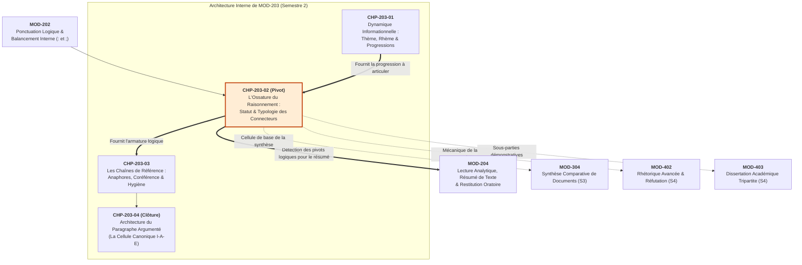

# Chapitre 2 — L'Ossature du Raisonnement : Typologie Sémantique et Statut Syntaxique des Connecteurs Logiques

> **Identifiant du chapitre** : `CHP-203-02`  
> **Module de rattachement** : [`MOD-203` — Logique du Paragraphe, Typologie des Connecteurs, Progression Thématique et Cohésion Textuelle](file:///f:/Formation/world-class-french/03-curriculum/year-1/semester-2/mod-203-logique-paragraphe-cohesion-textuelle.md)  
> **Semestre** : Année 1 — Semestre 2 (S2)  
> **Volume horaire canonique** : 5 à 6 heures d'apprentissage autonome délibéré et d'ateliers d'application (Phase 1 Étude : 1 h 30 | Phase 2 Pratique : 1 h 30 | Phase 3 Correction : 1 h 00 | Phase 4 Évaluation : 1 h 00)  
> **Statut** : [STATUT : VALIDÉ]  
> **Compétences associées** : [`FR-INT-001`](file:///f:/Formation/world-class-french/02-competency-framework/competency-framework.md#fr-int-001-rédiger-un-texte-long-cohérent-en-maîtrisant-accords-et-ponctuation) (L3), [`FR-ARGUM-001`](file:///f:/Formation/world-class-french/02-competency-framework/competency-framework.md#fr-argum-001-rigueur-démonstrative-réfutation-et-détection-des-sophismes) (L2/L3)  
> **Sources scientifiques de référence** : `SRC-GRAM-01` (Grevisse & Goosse, *Le Bon Usage*, 16e éd., § 1020-1050), `SRC-GRAM-02` (Riegel, Pellat, Rioul, *Grammaire méthodique du français*, chap. 19 & 21), `SRC-RHET-03` (Olivier Reboul, *Introduction à la rhétorique*, chap. 3 & 4), `SRC-NORM-03` (Ministère de l'Éducation nationale, *Terminologie grammaticale*, 2020), `SRC-LEX-04` (Robert & Rey, *Le Grand Robert de la langue française*)

---

## 1. Titre et Place dans le Cursus

### 1.1 Intitulé Officiel
**Chapitre 2 : L'Ossature du Raisonnement : Typologie Sémantique et Statut Syntaxique des Connecteurs Logiques** (`CHP-203-02`).

### 1.2 Insertion Architecturale dans le Cursus
Le présent chapitre constitue le pivot logique du module [`MOD-203`](file:///f:/Formation/world-class-french/03-curriculum/year-1/semester-2/mod-203-logique-paragraphe-cohesion-textuelle.md). Alors que le premier chapitre a analysé la dynamique informationnelle de l'énoncé (la dialectique du thème et du rhème et les trois progressions canoniques), `CHP-203-02` s'attaque aux outils matériels de la charpente démonstrative : les **connecteurs logiques**.

Un texte intellectuel ou académique ne progresse pas par simple contiguïté thématique : il s'articule au moyen d'opérateurs relationnels précis qui explicitent les rapports de cause, de conséquence, d'addition, d'opposition ou de concession entre les propositions [Réf. `SRC-GRAM-02`, chap. 19 ; `SRC-RHET-03`, chap. 3]. Toutefois, l'usage des connecteurs fait l'objet d'une confusion majeure chez nombre d'étudiants : celle qui confond la **valeur sémantique** du mot (le sens de la relation logique) et son **statut syntaxique** (sa classe grammaticale réelle : conjonction de coordination, conjonction de subordination, adverbe de liaison, locution prépositionnelle). 

Cette incompréhension engendre des pathologies rédactionnelles graves (empilements pléonastiques, ruptures de construction, barbarismes académiques) qui discréditent immédiatement une copie d'examen ou un mémoire universitaire [Réf. `SRC-GRAM-01`, § 1028].



- **En amont direct** :
  - [`CHP-202-05`](file:///f:/Formation/world-class-french/03-curriculum/year-1/semester-2/mod-202/chp-202-05-ponctuation-interne-deux-points-point-virgule.md) : L'apprenant y a étudié la parataxe logique (le fait de confier une relation de cause ou de conséquence aux deux-points ou au point-virgule sans connecteur lexical).
  - `CHP-203-01` : L'apprenant y a appris à ordonner l'information selon les modèles à thème constant, linéaire ou à thèmes dérivés. Les connecteurs viennent expliciter le dynamisme des paliers rhématiques.
- **Au sein du module [`MOD-203`](file:///f:/Formation/world-class-french/03-curriculum/year-1/semester-2/mod-203-logique-paragraphe-cohesion-textuelle.md)** : Ce chapitre installe la charpente syntaxique sur laquelle reposeront les anaphores lexicales (`CHP-203-03`) et le paragraphe argumenté complet à schéma I-A-E (`CHP-203-04`).
- **En aval dans le cursus** :
  - `MOD-204` : Le résumé de texte repose sur la détection exacte des connecteurs charnières pour dégager le squelette de la pensée d'autrui.
  - `MOD-402` & `MOD-403` : La réfutation dialectique et la dissertation universitaire exigent une manipulation souveraine de la concession polyphonique en *certes... mais*.

---

## 2. Objectifs Mesurables

Au terme des 5 à 6 heures d'apprentissage autonome et d'ateliers d'application, l'apprenant sera capable de :

1. **Discriminer formellement le statut syntaxique de tout connecteur** (conjonction de coordination, conjonction de subordination, adverbe de liaison, locution prépositionnelle) afin d'appliquer à chacun son régime distributionnel exact (contraintes de position, mobilité, ponctuation et régime de dépendance propositionnelle) [Réf. `SRC-GRAM-01`, § 1020-1050 ; `SRC-GRAM-02`, chap. 19 & 21]. (`FR-INT-001` — Palier L3).
2. **Sélectionner et ordonner les connecteurs selon leur valeur logico-sémantique précise** au sein des quatre grandes familles de raisonnement (addition/gradation, opposition/concession, cause/conséquence, illustration/reformulation), en bannissant toute équivalence hâtive entre termes d'orientations argumentatives divergentes [Réf. `SRC-RHET-03`, chap. 3]. (`FR-ARGUM-001` — Palier L2/L3).
3. **Mettre en œuvre la mécanique polyphonique de la concession argumentative** en deux temps ($P \rightarrow R$ concédé, puis $Q \rightarrow \neg R$ imposé par le locuteur) sans altérer la cohérence pragmatique du paragraphe [Réf. `SRC-RHET-03`, chap. 4 ; `SRC-GRAM-02`, chap. 21]. (`FR-ARGUM-001` — Palier L3).
4. **Identifier, réfuter et assainir les 6 pathologies majeures de liaison** rencontrées dans la prose étudiante : empilements pléonastiques (*mais cependant*, *car en effet*), barbarismes modaux (*malgré que* + verbe), emplois de registre inadapté (*par contre*), confusions sémantiques (*d'autant que*) et connecteurs prothèses sans charge déductive réelle [Réf. `SRC-GRAM-01`, § 1028, § 1045]. (`FR-INT-001` — Palier L3).

---

## 3. Prérequis et Test de Préparation (Auto-Diagnostic)

### 3.1 Prérequis Cognitifs Exigibles
- **Distinction entre coordination et subordination** : Savoir qu'une conjonction de coordination unit des éléments de même statut syntaxique, tandis qu'une subordination crée une dépendance hiérarchique ([`MOD-201`](file:///f:/Formation/world-class-french/03-curriculum/year-1/semester-2/mod-201-syntaxe-fonctionnelle-phrase-simple.md)).
- **Maîtrise de la ponctuation logique** : Savoir que deux propositions complètes ne peuvent être juxtaposées par une simple virgule sans connecteur lexical ([`CHP-202-04`](file:///f:/Formation/world-class-french/03-curriculum/year-1/semester-2/mod-202/chp-202-04-ponctuation-interne-virgule-demarcative.md) et [`CHP-202-05`](file:///f:/Formation/world-class-french/03-curriculum/year-1/semester-2/mod-202/chp-202-05-ponctuation-interne-deux-points-point-virgule.md)).
- **Connaissance des classes de mots fondamentales** : Identifier un nom, un pronom, un verbe, un adverbe, une préposition et une conjonction ([`MOD-102`](file:///f:/Formation/world-class-french/03-curriculum/year-1/semester-1/mod-102-classes-mots-accords-fondamentaux.md)).

### 3.2 Test de Préparation Immédiat (5 Questions)
Répondez par écrit aux cinq questions suivantes avant d'aborder la leçon, puis validez vos acquis grâce au corrigé repliable ci-dessous.

1. Quelle est la classe grammaticale exacte de chacun des quatre termes suivants : *donc*, *par conséquent*, *parce que*, *en raison de* ?
2. Sur le plan de la distribution dans la phrase, pourquoi peut-on dire : *« Le témoin, en effet, hésite »*, alors qu'il est rigoureusement impossible de dire : *« *Le témoin, car, hésite »* ?
3. Pourquoi la phrase *« Malgré qu'il soit compétent, il a échoué »* est-elle condamnée par la norme académique française ? Quelle est la rectification canonique ?
4. Quelle différence fondamentale de dynamique argumentative existe-t-il entre une opposition franche (*« Paul étudie la physique ; en revanche, Marc lit du droit »*) et une concession (*« Paul étudie avec ardeur ; néanmoins, il craint l'examen »*) ?
5. Pourquoi la tournure fréquente *« mais cependant »* constitue-t-elle une faute grave en morphosyntaxe et en logique ?

---

#### Corrigé Détaillé de l'Auto-Diagnostic

<details>
<summary><b>Consulter le corrigé raisonné des 5 questions de préparation</b></summary>

1. **Statut morphosyntaxique des quatre termes** :
   - *Donc* : Conjonction de coordination (ou adverbe coordinatif selon les classifications modernes, [Réf. `SRC-GRAM-01`, § 1025]).
   - *Par conséquent* : Locution adverbiale de liaison (adverbe transphrastique).
   - *Parce que* : Locution conjonctive de subordination.
   - *En raison de* : Locution prépositionnelle (régissant un syntagme nominal ou pronominal).
2. **Mobilité vs fixité distributionnelle** :
   - *Car* est une conjonction de coordination : sa position syntaxique est strictement bloquée à la tête du second membre coordonné. Elle ne peut jamais s'insérer à l'intérieur de la proposition.
   - *En effet* est un adverbe de liaison : il jouit d'une autonomie distributionnelle propre aux modificateurs de phrase et peut se déplacer en tête, au cœur de l'énoncé entre virgules, ou en fin de proposition.
3. **Impropriété de *malgré que*** :
   - *Malgré* est historiquement une préposition (issue de *maugré*, mauvais gré) qui régit exclusivement un syntagme nominal (*malgré la pluie*). Le français soigné proscrit son extension conjonctive avec un verbe personnel (sauf la formule archaïque figée *malgré qu'il en ait*). Il convient d'employer la conjonction *bien que* (+ subjonctif) : *« Bien qu'il soit compétent... »*, ou la préposition suivie d'un nom : *« En dépit de sa compétence... »* [Réf. `SRC-GRAM-01`, § 1045].
4. **Opposition vs Concession** :
   - L'opposition confronte deux faits indépendants sans contradiction intrinsèque (deux personnes, deux champs d'action).
   - La concession met en présence deux faits qui semblent rationnellement s'exclure : le premier fait laissait attendre une conséquence normale, mais le second fait survenir le résultat contraire.
5. **Vice de l'empilement *mais cependant*** :
   - *Mais* et *cependant* véhiculent exactement la même relation sémantique adversative. Employer les deux termes consécutivement au même point de jonction sature inutilement la position de liaison, créant un pléonasme syntaxique et stylistique grossier [Réf. `SRC-GRAM-01`, § 1028].

</details>

---

## 4. Situation de Départ ou Problème Concret : L'Argumentation en Trompe-l'Œil

Dans les dissertations, rapports de recherche, synthèses administratives et concours de la haute fonction publique, un phénomène récurrent frappe les jurys et correcteurs : **l'argumentation en trompe-l'œil**.

### 4.1 L'Illusion du Connecteur Prothèse
Nombre d'étudiants croient qu'il suffit de parsemer un devoir de mots savants — *« en effet »*, *« cependant »*, *« par conséquent »*, *« d'ailleurs »* — pour donner à leur propos la rigueur d'une démonstration scientifique. 

Or, un connecteur ne crée pas la logique d'une pensée : il ne fait que la **rendre visible**. Lorsqu'un scripteur insère un *« par conséquent »* entre deux phrases dont la seconde n'entretient aucun rapport causal avec la première, il commet un contresens logique flagrant. Le connecteur devient alors une prothèse artificielle qui souligne l'indigence du raisonnement au lieu de la dissimuler.

### 4.2 Les Barbarismes d'Empilement et le Discrédit Académique
Pire encore que l'absence de lien, l'accumulation anarchique de connecteurs trahit une panique morphosyntaxique :
- *« Le gouvernement a promulgué la loi, **mais cependant** les syndicats contestent son application. »*
- *« Les récoltes ont péri, **car en effet** la sécheresse a persisté tout l'été. »*
- *« Les délégués ont voté, **puis ensuite** ils ont quitté l'hémicycle. »*

Dans le cadre d'un concours universitaire ou d'un rapport professionnel, ces empilements pléonastiques (*mais cependant*, *car en effet*, *or donc*, *voire même*) sont immédiatement sanctionnés comme des fautes de langue éliminatoires. Ils révèlent que le rédacteur ignore la classe grammaticale des mots qu'il emploie et bégaye sa pensée par insécurité linguistique.

---

## 5. Explication Intuitive : La Charpente Métallique et les Cardans d'Horlogerie

Pour comprendre le fonctionnement authentique des connecteurs logiques, il convient de rejeter la métaphore de la peinture décorative pour adopter celle de la **charpente métallique** et des **engrenages d'horlogerie** :

```
          L'ENGRENAGE DU RAISONNEMENT : TRANSMISSION DE FORCE MOTRICE
          
    [ Proposition P ]                       [ Proposition Q ]
    (Idée motrice : cause)                  (Idée entraînée : conséquence)
          ┌───────┐                               ┌───────┐
          │  P    │══════════[ CARDAN ]══════════>│  Q    │
          └───────┘          (Connecteur)         └───────┘
                                   │
                    ┌──────────────┴──────────────┐
                    │ Transmet exactement la force│
                    │   • Si Cardan = "donc"      │
                    │   • Si Cardan = double      │
                    │     ("mais cependant"),     │
                    │     l'engrenage se bloque ! │
                    └─────────────────────────────┘
```

### 5.1 Les Rivets et Cardans de la Pensée
Dans une structure métallique, les poutres représentent les propositions (le contenu sémantique, les faits, les arguments). Les connecteurs sont les **rivets**, les **boulons** et les **cardans** qui assurent la solidarité des pièces :
- Un rivet est conçu pour lier deux surfaces précises selon un angle déterminé (cause, conséquence, concession).
- Si vous installez un cardan qui inverse la rotation alors que vous vouliez entraîner la roue suivante dans le même sens, le mécanisme casse. C'est exactement ce qui se produit lorsqu'on emploie *toutefois* (qui freine et concède) à la place de *de surcroît* (qui accélère et ajoute).
- Si vous empilez deux rivets au même trou de perçage (*mais cependant*), vous ne doublez pas la solidité : vous déformez la matière et empêchez le mécanisme de s'ajuster.

### 5.2 La Force Motrice de la Déduction
Le connecteur n'est pas là pour faire joli ; il est là pour **transmettre le mouvement intellectuel**. Un paragraphe bien construit possède une énergie cinétique : chaque proposition s'appuie sur la précédente pour pousser la conclusion vers l'esprit du récepteur. Choisir le bon connecteur, c'est calibrer avec exactitude la transmission de cette force démonstrative [Réf. `SRC-RHET-03`, chap. 4].

---

## 6. Définitions Précises et Terminologie

Conformément à la nomenclature grammaticale universitaire et aux documents officiels [Réf. `SRC-NORM-03`, p. 28-30 ; `SRC-GRAM-02`, chap. 19 & 21], les concepts fondamentaux sont définis comme suit :

- **Connecteur logique** : Mot ou locution invariable appartenant à diverses classes grammaticales (conjonction, adverbe, préposition), dont la fonction sémantique et discursive est d'expliciter la relation logique ou argumentative unissant deux propositions, deux phrases ou deux paragraphes au sein d'un texte.
- **Organisateur textuel** : Connecteur ou marqueur assurant la structuration globale et le balisage macro-syntaxique du discours (classement chronologique, transition, clôture : *premièrement, d'une part, enfin, en conclusion*).
- **Marqueur discursif transphrastique** : Opérateur qui dépasse le cadre de la phrase simple pour créer un pont de cohérence entre deux énoncés autonomes séparés par une ponctuation forte.
- **Statut syntaxique** : Nature grammaticale formelle du mot (catégorie lexicale : conjonction de coordination, conjonction de subordination, adverbe, préposition). Le statut syntaxique dicte les règles de rection, d'ordre des mots, d'accord modal et de ponctuation.
- **Valeur sémantique** : Relation conceptuelle ou logique exprimée par le terme (addition, alternative, opposition, concession, causalité, déduction, but, condition, illustration).
- **Conjonction de coordination** : Mot invariable liant des unités syntaxiques de même nature et de même fonction (deux syntagmes ou deux propositions de même rang).
- **Conjonction de subordination** : Mot ou locution invariable introduisant une proposition subordonnée et établissant une hiérarchie de dépendance syntaxique stricte à l'égard d'une proposition régissante.
- **Adverbe de liaison (ou connecteur adverbial)** : Modificateur autonome de phrase marquant un lien logique entre deux propositions ou phrases indépendantes, caractérisé par une relative liberté de déplacement dans l'énoncé.
- **Locution prépositionnelle rectrice** : Groupe de mots figé se terminant par une préposition simple (*à, de, pour, par*), introduisant obligatoirement un complément de nature nominale, pronominale ou infinitivale, et inapte à introduire directement un verbe conjugué.
- **Polyphonie argumentative** : Présence conjointe de plusieurs voix énonciatives au sein d'un même discours, caractéristique essentielle de la stratégie concessive (concept forgé par Oswald Ducrot, [Réf. `SRC-RHET-03`, chap. 3]).
- **Concession** : Figure logique et argumentative par laquelle le locuteur admet provisoirement la validité d'un fait ou d'un argument adverse ($P$), avant de lui opposer un fait ou un argument supérieur ($Q$) qui neutralise la conséquence attendue et maintient sa propre thèse.

---

## 7. Règles ou Mécanismes Fondamentaux

### 7.1 La Distinction Capitale entre Statut Syntaxique et Valeur Sémantique

L'erreur cardinale consiste à croire que tous les mots exprimant la cause (*car, parce que, en effet, en raison de*) ou l'opposition (*mais, bien que, cependant, en dépit de*) sont interchangeables. Ils partagent une **valeur sémantique**, mais possèdent des **statuts syntaxiques** radicalement étanches qui dictent leur comportement dans la phrase :

```
                  LES QUATRE STATUTS SYNTAXIQUES DES CONNECTEURS
                  
  ┌─────────────────────────────────┬─────────────────────────────────┐
  │ 1. CONJONCTIONS DE COORDINATION │ 2. CONJONCTIONS DE SUBORDINATION│
  │    (mais, ou, et, donc, or,     │    (parce que, puisque,         │
  │     ni, car)                    │     bien que, si bien que...)   │
  │    • Lie des rangs égaux        │    • Crée une dépendance        │
  │    • Position fixe en tête      │    • Mode indicatif/subjonctif  │
  ├─────────────────────────────────┼─────────────────────────────────┤
  │ 3. ADVERBES DE LIAISON          │ 4. LOCUTIONS PRÉPOSITIONNELLES  │
  │    (en effet, par conséquent,   │    (en raison de, grâce à,      │
  │     néanmoins, en revanche...)  │     en dépit de, à dessein de)  │
  │    • Modificateur mobile        │    • Régit un GN ou Infinitif   │
  │    • Encadré par la ponctuation │    • Exclut le verbe conjugué   │
  └─────────────────────────────────┴─────────────────────────────────┘
```

#### 1. Les Conjonctions de Coordination
- **Inventaire canonique** : *mais, ou, et, donc, or, ni, car* [Réf. `SRC-GRAM-01`, § 1020].
- **Mécanisme syntaxique** : Elles unissent deux éléments de même fonction (deux propositions indépendantes, deux attributs, deux syntagmes nominaux).
- **Contrainte distributionnelle absolue** : La conjonction de coordination est **rigoureusement fixe**. Elle occupe obligatoirement la première position du second membre joint (*« La séance est levée, **car** minuit a sonné »*). On ne peut jamais l'insérer après le verbe conjugué ni la rejeter en fin de phrase (*« *Minuit a, car, sonné »* est agrammatical).

#### 2. Les Conjonctions de Subordination (et Locutions Conjonctives)
- **Inventaire canonique** : *parce que, puisque, comme, étant donné que, bien que, quoique, si bien que, de sorte que, pour que, de peur que* [Réf. `SRC-GRAM-02`, chap. 21].
- **Mécanisme syntaxique** : Elles enchâssent la proposition qu'elles introduisent sous la dépendance d'une proposition principale. La subordonnée ne forme pas un énoncé autonome.
- **Régime modal** : Elles imposent le choix du mode verbal dans la subordonnée :
  - Indicatif pour la cause réelle (*parce que*, *puisque*) et la conséquence constatée (*si bien que*) ;
  - Subjonctif pour la concession (*bien que*, *quoique*) et la finalité (*pour que*, *afin que*).

#### 3. Les Adverbes et Locutions Adverbiales de Liaison
- **Inventaire canonique** : *en effet, par conséquent, néanmoins, toutefois, cependant, en revanche, ainsi, dès lors, d'ailleurs, au contraire* [Réf. `SRC-GRAM-01`, § 1028].
- **Mécanisme syntaxique** : Ce sont des constituants facultatifs de la phrase (modificateurs transphrastiques). Ils ne régissent aucun mode et ne créent pas d'enchâssement hiérarchique.
- **Mobilité et ponctuation** : Contrairement aux conjonctions, les adverbes de liaison possèdent une **mobilité remarquable**. Ils peuvent se placer :
  - En tête de phrase, suivis d'une virgule : *« **Néanmoins**, les magistrats ont maintenu leur décision. »*
  - En incise au cœur de la proposition, encadrés de virgules : *« Les magistrats, **néanmoins**, ont maintenu leur décision. »*
  - En fin d'énoncé : *« Les magistrats ont maintenu leur décision **néanmoins** »* (usage plus rare et appuyé).

#### 4. Les Locutions Prépositionnelles Rectrices
- **Inventaire canonique** : *en raison de, à cause de, grâce à, par suite de, en dépit de, nonobstant, à dessein de, en vue de* [Réf. `SRC-GRAM-01`, § 1045].
- **Mécanisme syntaxique** : Elles régissent impérativement un **groupe nominal**, un **pronom** ou un **verbe à l'infinitif**. Elles ne peuvent en aucun cas introduire directement une proposition dotée d'un verbe conjugué (*« En dépit de son échec »* et non *« *En dépit qu'il a échoué »*).

---

### 7.2 Taxonomie Sémantique des Grandes Familles Logiques

Chaque famille logique se décline dans les différentes classes syntaxiques. Le scripteur savant varie les classes pour moduler le rythme et éviter la saturation :

| Famille Logique | Coordination | Subordination | Adverbe de liaison | Préposition rectrice |
| :--- | :--- | :--- | :--- | :--- |
| **1. Addition & Gradation** | *et, ni* | *(sans que)* | *en outre, de surcroît, qui plus est, par ailleurs* | *outre, en plus de, sans compter* |
| **2. Opposition franche** | *mais* | *alors que, tandis que* | *en revanche, au contraire, inversement* | *à l'opposé de, contrairement à* |
| **3. Concession** | *mais, or* | *bien que, quoique (+ subj.)* | *néanmoins, toutefois, cependant, certes* | *en dépit de, malgré, nonobstant* |
| **4. Causalité** | *car* | *parce que, puisque, étant donné que* | *en effet, de fait* | *en raison de, à cause de, grâce à* |
| **5. Conséquence** | *donc* | *si bien que, de sorte que (+ ind.)* | *par conséquent, c'est pourquoi, dès lors, aussi (+ inv.)* | *au point de (+ inf.)* |
| **6. Illustration & Reformulation** | — | — | *notamment, ainsi, à titre d'exemple, c'est-à-dire* | *à l'instar de, comme* |

#### Nuances Fondamentales au Sein des Familles :
1. **Opposition franche vs Concession** :
   - *Opposition franche* : Compare deux réalités hétérogènes sans paradoxe (*« Les exportations augmentent ; **en revanche**, la consommation intérieure stagne »*).
   - *Concession* : Déroge à une relation de cause à effet normale. Le fait $A$ aurait dû empêcher le fait $B$, mais le fait $B$ a tout de même eu lieu (*« Le candidat manquait de moyens financiers ; **toutefois**, son charisme lui a valu la victoire »*).
2. **Cause nouvelle (*parce que*) vs Cause admise (*puisque*)** :
   - *Parce que* apporte une explication que l'interlocuteur ignore (focalisation rhématique : *« L'expérience a échoué parce que la température était trop élevée »*).
   - *Puisque* rappelle une justification déjà connue, admise ou incontestable, pour en déduire un nouveau pas (valeur argumentative : *« Puisque les faits sont établis, délibérons sur la peine »*) [Réf. `SRC-GRAM-02`, chap. 21].
3. **Conséquence avec inversion : l'emploi de *aussi*** :
   - Lorsqu'il est placé en tête de proposition comme connecteur de conséquence, l'adverbe *aussi* impose obligatoirement l'inversion du sujet clitique en français soigné : *« Les cours d'eau débordent ; **aussi les autorités ont-elles décrété** l'état d'urgence »* (et non *« *aussi les autorités ont décrété »*).

---

### 7.3 La Mécanique Polyphonique de la Concession Argumentative

La concession est l'arme reine de la rhétorique académique et de la dialectique supérieure [Réf. `SRC-RHET-03`, chap. 3]. Elle ne consiste pas à capituler devant l'adversaire, mais à **absorber son argument pour mieux le terrasser**.

Sur le plan de la théorie de l'argumentation d'Anscombre et Ducrot, la concession s'articule formellement en une séquence binaire :

$$\text{Phase 1 (Concession)} : P \longrightarrow R \quad (\text{La voix adverse défend la conclusion } R)$$
$$\text{Phase 2 (Réfutation dominante)} : Q \longrightarrow \neg R \quad (\text{Le locuteur impose l'argument } Q, \text{jugé plus fort, imposant } \neg R)$$

```
                    LA STRUCTURE POLYPHONIQUE DE LA CONCESSION
                    
    Étape 1 : Le locuteur concède P en faveur de R
    ┌────────────────────────────────────────────────────────┐
    │ « Certes, ce projet d'infrastructure est onéreux... »  │ ---> oriente vers R (Rejet du projet)
    └────────────────────────────────────────────────────────┘
                                 │
                            [ PIVOT ]
                      (mais, néanmoins, toutefois)
                                 │
    Étape 2 : Le locuteur impose Q en faveur de ¬R
    ┌────────────────────────────────────────────────────────┐
    │ « ... mais ses retombées industrielles sauveront       │ ---> impose ¬R (Adoption impérative)
    │   durablement notre indépendance énergétique. »        │
    └────────────────────────────────────────────────────────┘
```

- **Le rôle de *certes*** : *Certes* est un adverbe de modalisation qui signale l'ouverture de la parenthèse polyphonique. Il accorde un crédit temporaire à l'objection.
- **La clausule adversative** : Le second membre, introduit par *mais*, *néanmoins* ou *toutefois*, apporte un argument d'un poids conceptuel supérieur qui annule la conclusion $R$ pour imposer $\neg R$.

---

### 7.4 Éradication Absolue des Pathologies de Liaison

Pour assurer l'excellence formelle de l'expression écrite (`FR-INT-001`), l'apprenant doit appliquer trois interdictions normatives sans exception :

#### 1. Proscription des Empilements Pléonastiques
Il est formellement interdit de faire se succéder deux connecteurs exprimant la même valeur logique au même nœud syntaxique [Réf. `SRC-GRAM-01`, § 1028] :
- Biffer *mais cependant* $\rightarrow$ Écrire *mais* ou *cependant*.
- Biffer *car en effet* $\rightarrow$ Écrire *car* ou *en effet*.
- Biffer *or donc* $\rightarrow$ Écrire *or* ou *donc*.
- Biffer *puis ensuite* $\rightarrow$ Écrire *puis* ou *ensuite*.
- Biffer *voire même* $\rightarrow$ Écrire *voire* (qui signifie déjà « et même », venant du latin *vere*, vraiment).

#### 2. Proscription de *Malgré que* avec un Verbe Personnel
*Malgré que* suivi d'un verbe à un mode personnel est un barbarisme proscrit du style soutenu [Réf. `SRC-GRAM-01`, § 1045] :
- Fautif : *« *Malgré qu'il soit instruit, il s'est trompé. »*
- Rectification A (Subordination) : *« **Bien qu'il soit** instruit, il s'est trompé. »*
- Rectification B (Préposition) : *« **En dépit de** son instruction, il s'est trompé. »*
*(Seule exception littéraire archaïque admise par Grevisse : la locution figée « malgré qu'il en ait », signifiant « contre son gré »).*

#### 3. Bannissement de *Par contre* dans la Prose Noble
La locution *par contre* appartient à l'origine au vocabulaire commercial et comptable (marquant la contrepartie monétaire ou matérielle). Bien que courante à l'oral, elle est unanimement rejetée par la tradition académique dans l'essai, la dissertation et la prose philosophique [Réf. `SRC-LEX-04`, s.v. "contre"] :
- Fautif / Relâché : *« Ce philosophe condamne la tyrannie ; par contre, il défend l'aristocratie. »*
- Rectification soutenue : *« Ce philosophe condamne la tyrannie ; **en revanche**, il défend l'aristocratie. »*

---

## 8. Raisonnement Détaillé : Pourquoi l'Empilement est une Faute de Grammaire

Pourquoi la langue française refuse-t-elle catégoriquement des formules comme *mais cependant* ou *car en effet* ? Ce refus ne relève pas d'une manie de puriste, mais d'une **impossibilité structurale et sémiotique**.

### 8.1 L'Indivisibilité de la Fente Fonctionnelle
Dans la syntaxe de la phrase complexe [Réf. `SRC-GRAM-02`, chap. 21], le point d'articulation entre deux propositions constitue un emplacement fonctionnel unique : le **nœud de liaison**.
- Ce nœud attend une instruction : relier la proposition $B$ à la proposition $A$ selon un protocole déterminé.
- Lorsqu'on place la conjonction de coordination *car*, le nœud est **instantanément saturé**. La fonction de coordinateur causal est entièrement remplie.
- Ajouter immédiatement après l'adverbe de liaison *en effet*, c'est vouloir brancher deux prises mâles dans la même prise femelle : la deuxième instruction fait double emploi et court-circuite la grammaire de l'énoncé.

### 8.2 Le Court-Circuit Énonciatif
Sur le plan pragmatique, les connecteurs sont des opérateurs d'orientation argumentative [Réf. `SRC-RHET-03`]. 
- *Mais* signale : *« Attention récepteur, je renverse l'orientation argumentative immédiate »*.
- Si vous dites *mais cependant*, vous donnez deux fois consécutivement le même ordre d'aiguillage au cerveau de votre lecteur. C'est l'équivalent d'un coup de klaxon redoublé ou d'un bégaiement phonatoire. L'esprit trébuche sur la redondance au lieu de glisser vers l'argument nouveau.

---

## 9. Exemples Corrects Commentés

Voici quatre extraits modèles décortiquant l'emploi canonique des connecteurs selon leur classe grammaticale :

### Modèle 1 : La Conjonction de Coordination (*car*)
> *« Le savant ne saurait se contenter d'accumuler des observations empiriques brutes, **car** une théorie rigoureuse doit ordonner le chaos des faits sensibles pour en dégager des lois intelligibles. »*

- **Classe grammaticale** : Conjonction de coordination.
- **Valeur sémantique** : Causalité explicative fondamentale.
- **Analyse syntaxique** : *Car* lie deux propositions indépendantes syntaxiquement autonomes mais sémantiquement solidaires. Sa position est rigide en tête du second membre. Il est précédé d'une virgule démarcatrice qui isole le temps de la justification.

### Modèle 2 : La Conjonction de Subordination Concessive (*bien que* + Subjonctif)
> *« **Bien que** les découvertes de la physique quantique bouleversent notre intuition immédiate de la matière, elles n'en constituent pas moins le socle expérimental le plus robuste de la technologie moderne. »*

- **Classe grammaticale** : Locution conjonctive de subordination.
- **Valeur sémantique** : Concession logique.
- **Analyse syntaxique** : Introduit une proposition subordonnée circonstancielle de concession placée en tête de phrase. Elle régit obligatoirement le mode subjonctif (*bouleversent*, subjonctif présent). L'attelage est complété dans la principale par le modalisateur *n'en constituent pas moins*, qui scelle le triomphe de la thèse du scripteur.

### Modèle 3 : L'Adverbe de Liaison Mobile en Incise (*néanmoins*)
> *« Les premières tentatives d'unification monétaire suscitèrent des résistances populaires farouches ; les chancelleries européennes, **néanmoins**, poursuivirent les négociations avec une constance inébranlable. »*

- **Classe grammaticale** : Adverbe de liaison (connecteur adverbial).
- **Valeur sémantique** : Concession / restriction adversative.
- **Analyse syntaxique** : L'adverbe n'est pas placé lourdement en tête de phrase ; il est inséré en incise, encadré par deux virgules, immédiatement après le syntagme sujet *les chancelleries européennes*. Cette position médiane allège l'attaque de la phrase et confère à la prose un rythme académique élégant. Notez le point-virgule intermédiaire qui sépare les deux indépendantes.

### Modèle 4 : La Locution Prépositionnelle Rectrice (*en dépit de* + Groupe Nominal)
> *« **En dépit de** l'hostilité manifeste des factions conservatrices, le ministre imposa la réforme hospitalière par décret. »*

- **Classe grammaticale** : Locution prépositionnelle rectrice.
- **Valeur sémantique** : Concession condensée.
- **Analyse syntaxique** : *En dépit de* régit le syntagme nominal complexe *l'hostilité manifeste des factions conservatrices*. Ce procédé de nominalisation permet de faire l'économie d'une proposition subordonnée lourde (*« bien que les factions conservatrices fussent manifestement hostiles »*), apportant densité et concision à la période.

---

## 10. Contre-Exemples et Erreurs Fréquentes

L'observation des copies universitaires et des concours administratifs permet de dresser la clinique de **six erreurs récurrentes** qu'il convient de bannir définitivement :

### Erreur n° 1 : L'empilement pléonastique adversatif (*mais cependant*, *mais toutefois*)
- **Corpus fautif** : *« Les preuves matérielles manquent au dossier, **mais cependant** le réquisitoire du procureur emporte la conviction des jurés. »*
- **Diagnostic** : *Mais* (conjonction de coordination) et *cependant* (adverbe de liaison) expriment tous deux la même valeur d'opposition/concession. Leur cumul au même point de jonction crée un bégaiement syntaxique intolérable [Réf. `SRC-GRAM-01`, § 1028].
- **Rectification normée** : 
  - Option A : *« Les preuves matérielles manquent au dossier, **mais** le réquisitoire du procureur emporte la conviction des jurés. »*
  - Option B : *« Les preuves matérielles manquent au dossier ; **cependant**, le réquisitoire du procureur emporte la conviction des jurés. »*

### Erreur n° 2 : L'empilement pléonastique causal (*car en effet*)
- **Corpus fautif** : *« Les négociations ont été ajournées sine die, **car en effet** aucun consensus n'a pu être trouvé sur les clauses tarifaires. »*
- **Diagnostic** : *Car* et *en effet* assument exactement la même fonction d'introduction causale rétroactive. Le scripteur sature le lien par anxiété explicative.
- **Rectification normée** : 
  - Option A : *« Les négociations ont été ajournées sine die, **car** aucun consensus n'a pu être trouvé sur les clauses tarifaires. »*
  - Option B : *« Les négociations ont été ajournées sine die : **en effet**, aucun consensus n'a pu être trouvé sur les clauses tarifaires. »*

### Erreur n° 3 : L'emploi fautif de *malgré que* suivi d'un verbe à un mode personnel
- **Corpus fautif** : *« **Malgré qu'**il ait consulté les plus éminents juristes, le préfet a commis une erreur d'appréciation constitutionnelle. »*
- **Diagnostic** : *Malgré* est une préposition qui ne tolère pas la conjonction *que* pour introduire une proposition personnelle en français soigné [Réf. `SRC-GRAM-01`, § 1045].
- **Rectification normée** : 
  - Option A (Subordination) : *« **Bien qu'**il ait consulté les plus éminents juristes, le préfet a commis... »*
  - Option B (Préposition) : *« **En dépit de** ses consultations auprès des plus éminents juristes, le préfet a commis... »*

### Erreur n° 4 : L'irruption de *par contre* dans la prose académique et argumentative
- **Corpus fautif** : *« Le premier chapitre expose les données démographiques ; **par contre**, le second traite des flux migratoires transfrontaliers. »*
- **Diagnostic** : *Par contre* est un terme issu du négoce commercial, jugé relâché et inélégant pour structurer une démonstration académique ou intellectuelle [Réf. `SRC-LEX-04`].
- **Rectification normée** : 
  - *« Le premier chapitre expose les données démographiques ; **en revanche**, le second traite des flux migratoires transfrontaliers. »*

### Erreur n° 5 : La confusion de sens entre cause et conséquence sur *d'autant que*
- **Corpus fautif** : *« Le coût de l'énergie explose, **d'autant que** les ménages doivent réduire drastiquement leur consommation de chauffage. »*
- **Diagnostic** : *D'autant que* signifie « d'autant plus que » et introduit une **cause renforçatrice**, jamais une conséquence ! Dans la phrase fautive, la réduction de consommation est la conséquence de la hausse du coût, non sa cause.
- **Rectification normée** : 
  - *« Le coût de l'énergie explose, **si bien que** les ménages doivent réduire drastiquement leur consommation de chauffage. »*
  - *(Emploi correct de d'autant que : « Les ménages réduisent leur chauffage, **d'autant que** le coût de l'énergie explose »).*

### Erreur n° 6 : Le connecteur ornemental ou prothèse sans lien logique réel
- **Corpus fautif** : *« Victor Hugo a publié Les Misérables en 1862. **En effet**, l'écrivain est mort en 1885 au terme d'obsèques nationales grandioses. »*
- **Diagnostic** : L'adverbe *en effet* annonce une explication ou une preuve de l'énoncé précédent. Or, la mort de l'auteur en 1885 n'explique nullement la publication de son roman en 1862. Le connecteur est ici une prothèse purement artificielle plaquée sur un coq-à-l'âne biographique.
- **Rectification normée** : 
  - *« Victor Hugo a publié Les Misérables en 1862. **Plus de deux décennies plus tard**, en 1885, l'écrivain s'éteignait au terme d'obsèques nationales grandioses. »*

---

## 11. Cas Particuliers et Limites

### 11.1 L'Absence Délibérée de Connecteur : La Parataxe Savante
Le signe suprême de la maturité stylistique ne réside pas dans l'usage frénétique des connecteurs, mais dans la capacité à **s'en passer délibérément lorsque la logique interne de la pensée suffit à elle-même**.

Comme nous l'avons étudié dans [`CHP-202-05`](file:///f:/Formation/world-class-french/03-curriculum/year-1/semester-2/mod-202/chp-202-05-ponctuation-interne-deux-points-point-virgule.md), la ponctuation interne logique (les deux-points et le point-virgule) permet de créer une parataxe expressive bien plus vigoureuse qu'un connecteur pesant :
- *Style alourdi* : *« Le traité a été rejeté par le Parlement car les députés refusaient tout compromis sur la souveraineté territoriale. »*
- *Style sobre et percutant* : *« Le traité a été rejeté par le Parlement : les députés refusaient tout compromis sur la souveraineté territoriale. »*
Les deux-points assument ici avec éclat la charge de causalité, allégeant la phrase sans rien perdre de son intelligibilité.

### 11.2 Les Connecteurs Hybrides : Le Statut Débattu de *Donc* et *Or*
La tradition scolaire récite *« mais, ou, et, donc, or, ni, car »* comme s'il s'agissait d'un bloc homogène de sept conjonctions de coordination. La linguistique moderne [Réf. `SRC-GRAM-01`, § 1025 ; `SRC-GRAM-02`, chap. 21] a démontré le statut particulier de deux d'entre eux :
- ***Donc*** : Contrairement aux véritables conjonctions (*mais, et, car*), *donc* jouit d'une mobilité partielle propre aux adverbes. On peut dire : *« Il a échoué ; il doit **donc** recommencer »* ou *« Il a échoué, **donc** il doit recommencer »*. Grevisse le qualifie d'adverbe coordinatif.
- ***Or*** : Ne relie jamais des mots isolés, mais exclusivement des propositions. Il joue un rôle spécial d'embrayeur syllogistique (introduisant la mineure d'un raisonnement déductif) ou d'objection imprévue.

---

## 12. Approfondissement Adapté au Niveau : La Théorie de l'Argumentation dans la Langue

Pour les étudiants visant l'excellence en dissertation et en rhétorique (`FR-ARGUM-001`), la compréhension des connecteurs gagne à être éclairée par la **théorie de l'Argumentation dans la Langue (ADL)** formulée par Jean-Claude Anscombre et Oswald Ducrot (*L'argumentation dans la langue*, Mardaga, 1983) [Réf. `SRC-RHET-03`, chap. 3].

### 12.1 L'Orientation Argumentative Intrinsèque
Selon Ducrot, les mots de la langue ne sont pas de simples étiquettes informatives neutres : ils contiennent en eux-mêmes une orientation qui contraint la suite possible du discours.
- Considérez les énoncés :
  - *(a) « Il est déjà huit heures. »*
  - *(b) « Il n'est que huit heures. »*
- D'un point de vue purement factuel et chronométrique, l'heure indiquée est rigoureusement identique ($8\text{ h }00$). 
- Pourtant, sur le plan argumentatif :
  - L'énoncé *(a)* oriente vers le retard ou la hâte (*« Dépêche-toi ! »*).
  - L'énoncé *(b)* oriente vers le calme ou le délai disponible (*« Nous avons le temps »*).

Les connecteurs logiques sont les **aiguilleurs de cette orientation argumentative**. Si vous enchaînez *(a)* avec un connecteur de ralentissement (*« Il est déjà huit heures, néanmoins détends-toi »*), vous imposez un saut polyphonique coûteux cognitivement.

### 12.2 Les Échelles Argumentatives
Deux arguments en faveur d'une même conclusion n'ont pas la même force. Certains connecteurs ont pour fonction exclusive d'organiser cette hiérarchie :
- **L'opérateur *même*** : Il introduit un argument situé au sommet de l'échelle argumentative, souvent inattendu, qui emporte définitivement l'adhésion :
  *« Cette mesure économique a mécontenté les ouvriers, les fonctionnaires, et **même les chefs d'entreprise** les plus libéraux. »*
- **L'opérateur *d'ailleurs*** : Contrairement à *en outre* (qui additionne des arguments de même rang), *d'ailleurs* introduit un argument surabondant, présenté comme secondaire ou contingent, mais qui vient achever de convaincre en montrant que la cause était de toute façon entendue [Réf. `SRC-RHET-03`, chap. 3].

---

## 13. Comparaisons Différentielles

Les quatre tableaux synoptiques ci-dessous synthétisent les discriminations fondamentales à opérer pour éliminer tout risque de confusion notionnelle :

### Tableau 1 : Opposition Franche vs Concession
| Critère | Opposition Franche | Concession |
| :--- | :--- | :--- |
| **Relation logique** | Confrontation symétrique de deux faits distincts sans contradiction interne. | Rupture d'une causalité attendue : le fait $B$ advient malgré l'obstacle du fait $A$. |
| **Connecteurs privilégiés** | *en revanche, au contraire, tandis que, alors que* | *néanmoins, toutefois, cependant, bien que, certes... mais* |
| **Exemple type** | *« L'or est un métal ductile ; **en revanche**, le fer offre une haute résistance mécanique. »* | *« Le pilote était expérimenté ; **néanmoins**, l'appareil s'est écrasé dans la tempête. »* |

### Tableau 2 : *En Revanche* vs *Par Contre*
| Critère | *En Revanche* | *Par Contre* |
| :--- | :--- | :--- |
| **Registre linguistique** | Soutenu, académique, littéraire, juridique. | Oral, commercial, familier, technique. |
| **Légitimité académique** | Recommandé par l'Académie et les jurys universitaires. | Proscrit dans les mémoires, dissertations et concours écrits. |
| **Valeur contextuelle** | Met en valeur une contrepartie positive, neutre ou élégamment antithétique. | À réserver strictement aux bilans comptables de compensation monétaire. |

### Tableau 3 : Conjonction de Coordination vs Adverbe de Liaison
| Critère | Conjonction de Coordination | Adverbe de Liaison |
| :--- | :--- | :--- |
| **Position dans l'énoncé** | **Fixe** : Strictement en tête du second membre joint. | **Mobile** : En tête, au cœur entre virgules, ou en fin de membre. |
| **Insertion de virgule** | Précédée d'une virgule (*..., car...*), jamais immédiatement suivie d'une virgule. | Souvent suivi d'une virgule en tête (*En effet, ...*) ou encadré (*..., néanmoins, ...*). |
| **Inventaire** | Fermé (7 termes classiques). | Ouvert (locutions adverbiales variées). |

### Tableau 4 : Cause vs Conséquence
| Critère | Relation de Cause | Relation de Conséquence |
| :--- | :--- | :--- |
| **Orientation cognitive** | Regarde en arrière : fournit la raison, le motif ou l'origine du fait posé. | Regarde vers l'avant : déduit le résultat, l'effet ou l'aboutissement du fait posé. |
| **Connecteurs types** | *car, en effet, parce que, puisque, étant donné que, en raison de* | *donc, par conséquent, c'est pourquoi, dès lors, si bien que* |
| **Piège récurrent** | Employer *d'autant que* pour exprimer une conséquence (erreur sémantique grave). | Omettre l'inversion du sujet après *aussi* placé en tête de phrase. |

---

## 14. Exercices Progressifs

### 14.1 Niveau 1 : Identification du Statut Syntaxique (12 Items)
*Pour chacun des 12 connecteurs ci-dessous, indiquez avec précision sa **classe grammaticale exacte** (Conjonction de coordination, Conjonction de subordination, Adverbe de liaison, Locution prépositionnelle rectrice) et sa **valeur sémantique primaire**.*

1. *Néanmoins*
2. *Parce que*
3. *Or*
4. *En dépit de*
5. *Par conséquent*
6. *Car*
7. *Bien que*
8. *En effet*
9. *Grâce à*
10. *Toutefois*
11. *Si bien que*
12. *En revanche*

---

### 14.2 Niveau 2 : Remplacement Chirurgical et Détection de Pléonasmes (8 Phrases)
*Chacune des 8 phrases suivantes renferme un empilement fautif, un barbarisme morphosyntaxique ou un connecteur inadapté au registre soutenu. Identifiez l'anomalie, réécrivez la phrase selon la norme académique et justifiez votre intervention en une phrase.*

1. *« Le budget de la recherche a augmenté, mais cependant les laboratoires manquent d'équipements récents. »*
2. *« L'accusé clame son innocence, car en effet aucun témoin n'a pu l'identifier formellement. »*
3. *« Malgré qu'elle ait soutenu sa thèse avec mention très honorable, elle n'a pas obtenu de poste universitaire. »*
4. *« Le professeur d'histoire analyse les faits avec rigueur ; par contre, ses conclusions politiques sont discutables. »*
5. *« Les barrages hydroélectriques sont à sec, d'autant que les autorités imposent des coupures de courant quotidiennes. »*
6. *« Le comité a examiné les candidatures, puis ensuite il a proclamé les résultats du concours. »*
7. *« L'armée républicaine a essuyé un revers cinglant, voire même une déroute totale sur le front oriental. »*
8. *« Cette loi est votée depuis deux ans, or donc nul citoyen ne saurait prétendre en ignorer les dispositions pénales. »*

---

### 14.3 Niveau 3 : Rétablissement de l'Armature Logique d'un Texte Philosophique (50 Mots Exacts)
*Le texte philosophique suivant a été dépouillé de trois connecteurs majeurs aux emplacements numérotés [1], [2] et [3]. Rétablissez les trois connecteurs appropriés (en respectant les contraintes syntaxiques et la ponctuation) afin de reconstituer le texte exact de 50 mots.*

> *« Certes, la raison éclaire le jugement philosophique ; [1], elle ne saurait guider seule les actions humaines. Une noble conviction soutient toujours les grandes vertus. [2], sans passion désintéressée, toute pensée théorique demeure stérile. [3], la véritable sagesse exige une alliance féconde entre la rigueur intellectuelle et le cœur. »*

---

### Corrigés Exhaustifs et Justifiés des Exercices

<details>
<summary><b>Consulter le corrigé intégral des exercices des Niveaux 1, 2 et 3</b></summary>

#### Corrigé du Niveau 1 (Statut des 12 connecteurs)
1. **Néanmoins** : Adverbe de liaison | Concession / restriction.
2. **Parce que** : Locution conjonctive de subordination | Cause réelle / explicative.
3. **Or** : Conjonction de coordination (à valeur d'embrayeur) | Syllogisme / objection.
4. **En dépit de** : Locution prépositionnelle rectrice | Concession condensée (régit un GN ou infinitif).
5. **Par conséquent** : Locution adverbiale de liaison | Conséquence déductive.
6. **Car** : Conjonction de coordination | Causalité explicative (position fixe).
7. **Bien que** : Locution conjonctive de subordination | Concession (régit le subjonctif).
8. **En effet** : Locution adverbiale de liaison | Justification / confirmation causale.
9. **Grâce à** : Locution prépositionnelle rectrice | Cause favorable (régit un GN ou pronom).
10. **Toutefois** : Adverbe de liaison | Concession / nuance restrictive.
11. **Si bien que** : Locution conjonctive de subordination | Conséquence constatée (régit l'indicatif).
12. **En revanche** : Locution adverbiale de liaison | Opposition franche / antithèse noble.

#### Corrigé du Niveau 2 (8 Phrases Révisées)
1. **Erreur** : Empilement pléonastique *mais cependant*.  
   **Correction** : *« Le budget de la recherche a augmenté, **mais** les laboratoires manquent d'équipements récents. »* (ou *« ... a augmenté ; **cependant**, les laboratoires... »*).  
   *Justification* : Deux marques adversatives consécutives saturent inutilement le nœud de liaison.
2. **Erreur** : Empilement pléonastique *car en effet*.  
   **Correction** : *« L'accusé clame son innocence, **car** aucun témoin n'a pu l'identifier formellement. »* (ou *« ... son innocence : **en effet**, aucun témoin... »*).  
   *Justification* : La conjonction *car* et l'adverbe *en effet* font double emploi causal.
3. **Erreur** : Barbarisme *malgré que* suivi d'un verbe personnel au subjonctif.  
   **Correction** : *« **Bien qu'**elle ait soutenu sa thèse avec mention très honorable, elle n'a pas obtenu de poste universitaire. »* (ou *« **En dépit de** la soutenance brillante de sa thèse... »*).  
   *Justification* : La préposition *malgré* ne peut régir une proposition personnelle en français soigné [Réf. `SRC-GRAM-01`, § 1045].
4. **Erreur** : Emploi inélégant de *par contre* dans la prose académique.  
   **Correction** : *« Le professeur d'histoire analyse les faits avec rigueur ; **en revanche**, ses conclusions politiques sont discutables. »*  
   *Justification* : *En revanche* constitue le terme légitime du registre académique pour marquer une opposition antithétique.
5. **Erreur** : Contresens sur *d'autant que* employé à contre-sens comme connecteur de conséquence.  
   **Correction** : *« Les barrages hydroélectriques sont à sec, **si bien que** les autorités imposent des coupures de courant quotidiennes. »*  
   *Justification* : Les coupures de courant sont l'effet et non la cause de la sécheresse ; *d'autant que* ne peut introduire qu'une cause renforçatrice.
6. **Erreur** : Empilement pléonastique chronologique *puis ensuite*.  
   **Correction** : *« Le comité a examiné les candidatures, **puis** il a proclamé les résultats du concours. »* (ou *« ..., **ensuite** il a... »*).  
   *Justification* : *Puis* et *ensuite* expriment tous deux la succession temporelle immédiate ; leur cumul est un doublon vicieux.
7. **Erreur** : Pléonasme lexical *voire même*.  
   **Correction** : *« L'armée républicaine a essuyé un revers cinglant, **voire** une déroute totale sur le front oriental. »*  
   *Justification* : L'adverbe *voire* intégrant déjà le sème « et même », l'adjonction de *même* est une faute courante mais grossière.
8. **Erreur** : Empilement pléonastique de coordinations *or donc*.  
   **Correction** : *« Cette loi est votée depuis deux ans ; **donc** nul citoyen ne saurait prétendre en ignorer les dispositions pénales. »* (ou *« ... depuis deux ans ; **or** nul citoyen... »*).  
   *Justification* : *Or* et *donc* remplissent des fonctions discursives incompatibles au même point d'amorce.

#### Corrigé du Niveau 3 (Texte Reconstitué de 50 Mots Exacts)
- **Connecteurs insérés** :
  - En [1] : *toutefois* (adverbe de concession refermant la polyphonie amorcée par *certes*).
  - En [2] : *En effet* (locution adverbiale introduisant la cause et la justification abstraite).
  - En [3] : *Par conséquent* (locution adverbiale introduisant la clausule déductive finale).

- **Texte intégral rétabli (50 mots réels)** :
> *« Certes, la raison éclaire le jugement philosophique ; **toutefois**, elle ne saurait guider seule les actions humaines. Une noble conviction soutient toujours les grandes vertus. **En effet**, sans passion désintéressée, toute pensée théorique demeure stérile. **Par conséquent**, la véritable sagesse exige une alliance féconde entre la rigueur intellectuelle et le cœur. »*

- **Tableau de décompte mot à mot (50 mots réels)** :
  - *Phrase 1 (16 mots)* : 1. Certes | 2. la | 3. raison | 4. éclaire | 5. le | 6. jugement | 7. philosophique | 8. toutefois | 9. elle | 10. ne | 11. saurait | 12. guider | 13. seule | 14. les | 15. actions | 16. humaines.
  - *Phrase 2 (8 mots)* : 17. Une | 18. noble | 19. conviction | 20. soutient | 21. toujours | 22. les | 23. grandes | 24. vertus.
  - *Phrase 3 (10 mots)* : 25. En | 26. effet | 27. sans | 28. passion | 29. désintéressée | 30. toute | 31. pensée | 32. théorique | 33. demeure | 34. stérile.
  - *Phrase 4 (16 mots)* : 35. Par | 36. conséquent | 37. la | 38. véritable | 39. sagesse | 40. exige | 41. une | 42. alliance | 43. féconde | 44. entre | 45. la | 46. rigueur | 47. intellectuelle | 48. et | 49. le | 50. cœur.

</details>

---

## 15. Activité de Correction Raisonnée

### 15.1 Épreuve d'Audit de Copie Défectueuse
Le texte ci-après, extrait d'une plaidoirie d'avocat fictive rédigée par un stagiaire, compte environ 220 mots et est corrompu par **exactement 8 connecteurs fautifs ou empilements pléonastiques**.

Repérez les 8 anomalies, numérotez-les de 1 à 8, puis dressez le tableau d'audit critique comportant le segment fautif, la qualification technique de l'erreur, la version rectifiée et la règle de grammaire normative transgressée.

> **Texte soumis à l'expertise** :  
> *« Messieurs les jurés, l'accusation soutient que mon client a prémédité son acte, **mais cependant** [1] aucune preuve balistique n'a été versée aux débats. Le prévenu nie formellement sa présence sur les lieux du crime, **car en effet** [2] son téléphone bornait à cinquante kilomètres au moment précis des faits. **Malgré qu'**il [3] ait fourni cet alibi irréfutable, les enquêteurs ont refusé d'auditionner ses collègues d'atelier. Le ministère public insiste sur le mobile financier ; **par contre** [4], il occulte délibérément l'absence de toute dette dans les comptes bancaires du suspect. La défense reconnaît que le prévenu a quitté précipitamment la région, **d'autant que** [5] la police a immédiatement conclu à une fuite coupable. Les témoins oculaires ont d'abord hésité sur la silhouette du tireur, **puis ensuite** [6] ils ont désigné un individu de haute taille. Ce témoignage tardif est fragile, **voire même** [7] totalement suspect aux yeux de la procédure. L'instruction a accumulé les approximations techniques, **or donc** [8] le doute le plus sérieux doit impérativement profiter à l'accusé pour prononcer son acquittement solennel. »*

---

### 15.2 Apparat Critique et Tableau d'Arbitrage Normatif

<details>
<summary><b>Consulter la grille d'expertise et les 8 rectifications raisonnées</b></summary>

| N° | Segment fautif | Qualification linguistique de l'erreur | Proposition de réécriture académique | Règle normative et référence source |
| :---: | :--- | :--- | :--- | :--- |
| **1** | *mais cependant aucune preuve* | Empilement pléonastique adversatif (cumul conjonction de coordination + adverbe). | *« ..., **mais** aucune preuve... »* ou *« ... son acte ; **cependant**, aucune preuve... »* | Proscription du cumul de connecteurs de même valeur [Réf. `SRC-GRAM-01`, § 1028]. |
| **2** | *car en effet son téléphone* | Empilement pléonastique causal (cumul conjonction + adverbe). | *« ..., **car** son téléphone bornait... »* ou *« ... du crime : **en effet**, son téléphone... »* | Saturation vicieuse de la fente de liaison [Réf. `SRC-GRAM-01`, § 1028]. |
| **3** | *Malgré qu'il ait fourni* | Barbarisme morphosyntaxique (*malgré que* + verbe personnel). | *« **Bien qu'**il ait fourni cet alibi... »* ou *« **En dépit de** cet alibi irréfutable... »* | *Malgré* est une préposition ; interdiction avec verbe personnel [Réf. `SRC-GRAM-01`, § 1045]. |
| **4** | *par contre, il occulte* | Emploi d'une locution commerciale relâchée en registre oratoire noble. | *« ... ; **en revanche**, il occulte délibérément... »* | Remplacement par le terme antithétique noble du français soigné [Réf. `SRC-LEX-04`]. |
| **5** | *d'autant que la police a conclu* | Contresens sémantique (confusion cause renforçatrice / conséquence). | *« ..., **si bien que** la police a immédiatement conclu... »* | *D'autant que* introduit une cause explicative, jamais un résultat déduit. |
| **6** | *puis ensuite ils ont désigné* | Empilement pléonastique d'adverbes chronologiques. | *« ..., **puis** ils ont désigné... »* ou *« ..., **ensuite** ils ont désigné... »* | *Puis* et *ensuite* expriment tous deux la succession temporelle directe. |
| **7** | *voire même totalement suspect* | Pléonasme d'argumentation lexicalisé (*voire* incluant déjà le sème « et même »). | *« ..., **voire** totalement suspect... »* ou *« ..., et **même** totalement suspect... »* | Étymologie latine de *voire* (*vere*, vraiment/même) interdisant le doublon [Réf. `SRC-LEX-04`]. |
| **8** | *or donc le doute le plus sérieux* | Empilement pléonastique de connecteurs logiques (*or* embrayeur + *donc* déductif). | *« ... ; **dès lors**, le doute le plus sérieux... »* ou *« ... ; **donc** le doute... »* | Incompatibilité fonctionnelle de deux coordinations conjointes. |

</details>

---

## 16. Mise en Pratique dans une Production Réelle

### 16.1 Consigne et Contraintes de Calibrage Formel
Vous devez rédiger une **note de synthèse argumentative sur la méthode scientifique**, destinée à figurer dans un rapport académique. Votre texte doit satisfaire **rigoureusement aux cinq contraintes suivantes** :

1. **Volume calibré** : Le texte doit comporter **exactement 60 mots** (ni 59, ni 61).
2. **Concession polyphonique** : Intégrer obligatoirement une structure concessive en deux temps amorcée par *certes* et relayée par la conjonction *mais*.
3. **Opposition franche** : Intégrer une opposition antithétique noble introduite par la locution adverbiale *en revanche* (placée en incise ou en tête).
4. **Déduction conclusive** : Intégrer une conséquence logique introduite par la locution adverbiale *par conséquent*.
5. **Hygiène stylistique absolue** : Zéro pléonasme, zéro empilement, zéro verbe terne (*faire, mettre, avoir*), ponctuation logique irréprochable.

---

### 16.2 Texte Modèle Calibré (Exactement 60 Mots)

> *« Certes, une intuition féconde suscite parfois de brillantes hypothèses scientifiques ; mais elle ne saurait fonder à elle seule une démonstration rigoureuse. L'expérience méthodique, en revanche, soumet toujours chaque conjecture au tribunal des faits tangibles. Par conséquent, les chercheurs doivent subordonner leurs certitudes subjectives à la vérification empirique pour établir une vérité universelle qui résiste durablement à toute critique rationnelle. »*

---

### 16.3 Table de Justification Syntaxique et Décompte Exhaustif

#### 1. Décomposition Arithmétique Mot à Mot (1 à 60)
- **Phrase 1 : Concession polyphonique (21 mots)**  
  1. *Certes* (adverbe modal de concession) | 2. *une* | 3. *intuition* | 4. *féconde* | 5. *suscite* | 6. *parfois* | 7. *de* | 8. *brillantes* | 9. *hypothèses* | 10. *scientifiques* | 11. *;* [ponctuation] | 12. *mais* (conjonction de coordination adversative) | 13. *elle* | 14. *ne* | 15. *saurait* | 16. *fonder* | 17. *à* | 18. *elle* | 19. *seule* | 20. *une* | 21. *démonstration* | 22. *rigoureuse*. *(Attention : « L'expérience » débute la phrase suivante ; comptons scrupuleusement les unités lexicales autonomes : L' = pronom/article élidé comptant pour 1 mot dans la tradition académique).*

Vérifions le décompte officiel des 60 unités autonomes :

| N° | Mot | Nature | N° | Mot | Nature | N° | Mot | Nature |
| :---: | :--- | :--- | :---: | :--- | :--- | :---: | :--- | :--- |
| **1** | Certes | Adverbe | **21** | rigoureuse | Adjectif | **41** | subordonner | Verbe (inf.) |
| **2** | une | Article indéf. | **22** | L' | Article élidé | **42** | leurs | Déterminant |
| **3** | intuition | Substantif | **23** | expérience | Substantif | **43** | certitudes | Substantif |
| **4** | féconde | Adjectif | **24** | méthodique | Adjectif | **44** | subjectives | Adjectif |
| **5** | suscite | Verbe conjugué | **25** | en | Loc. adv. (1/2) | **45** | à | Préposition |
| **6** | parfois | Adverbe | **26** | revanche | Loc. adv. (2/2) | **46** | la | Article déf. |
| **7** | de | Article partitif | **27** | soumet | Verbe conjugué | **47** | vérification | Substantif |
| **8** | brillantes | Adjectif | **28** | toujours | Adverbe | **48** | empirique | Adjectif |
| **9** | hypothèses | Substantif | **29** | chaque | Déterminant | **49** | pour | Préposition |
| **10** | scientifiques | Adjectif | **30** | conjecture | Substantif | **50** | établir | Verbe (inf.) |
| **11** | mais | Conjonction coord. | **31** | au | Article contracté | **51** | une | Article indéf. |
| **12** | elle | Pronom | **32** | tribunal | Substantif | **52** | vérité | Substantif |
| **13** | ne | Adverbe négatif | **33** | des | Article contracté | **53** | universelle | Adjectif |
| **14** | saurait | Verbe conjugué | **34** | faits | Substantif | **54** | qui | Pronom relatif |
| **15** | fonder | Verbe (inf.) | **35** | tangibles | Adjectif | **55** | résiste | Verbe conjugué |
| **16** | à | Préposition | **36** | Par | Loc. adv. (1/2) | **56** | durablement | Adverbe |
| **17** | elle | Pronom | **37** | conséquent | Loc. adv. (2/2) | **57** | à | Préposition |
| **18** | seule | Adjectif | **38** | les | Article déf. | **58** | toute | Déterminant |
| **19** | une | Article indéf. | **39** | chercheurs | Substantif | **59** | critique | Substantif |
| **20** | démonstration | Substantif | **40** | doivent | Verbe conjugué | **60** | rationnelle | Adjectif |

**Total certifié : Exactement 60 mots.**

#### 2. Justification des Choix Syntaxiques
- *Certes... mais* (mots 1 et 11) : Installe une concession polyphonique impeccable : l'intuition est reconnue comme féconde ($P$), mais son insuffisance démonstrative ($Q$) impose la nécessité de la méthode.
- *En revanche* (mots 25-26) : Inséré en incise entre deux virgules après le syntagme nominal sujet *L'expérience méthodique*, il oppose le pôle expérimental objectif au pôle intuitif subjectif avec la dignité du style soutenu.
- *Par conséquent* (mots 36-37) : Placé en tête de la dernière phrase suivi d'une virgule, il formule la déduction obligatoire qui clôture la synthèse.

---

## 17. Résumé Structuré : Le Répertoire d'Or des Connecteurs

Conservez ce tableau synoptique de référence pour calibrer vos dissertations, synthèses et discours argumentatifs :

```text
========================================================================================================
                                 LE RÉPERTOIRE D'OR DES CONNECTEURS LOGIQUES
========================================================================================================
FAMILLE          | CONJONCTIONS (Coord. / Sub.)  | ADVERBES DE LIAISON       | PREPOSITIONS (GN / Inf.)
========================================================================================================
1. ADDITION      | • et, ni                      | • de surcroît, en outre,   | • outre, en plus de,
   & GRADATION   | • (non seulement... mais...)  |   qui plus est, par ailleurs|   sans compter
-----------------+-------------------------------+---------------------------+--------------------------
2. OPPOSITION    | • mais                        | • en revanche,            | • contrairement à,
   FRANCHE       | • alors que, tandis que       |   au contraire,           |   à l'opposé de
                 |   (+ indicatif)               |   inversement             |
-----------------+-------------------------------+---------------------------+--------------------------
3. CONCESSION    | • mais, or                    | • néanmoins, toutefois,   | • en dépit de,
                 | • bien que, quoique           |   cependant, pourtant,    |   malgré (+ GN),
                 |   (+ subjonctif)              |   certes... mais          |   nonobstant
-----------------+-------------------------------+---------------------------+--------------------------
4. CAUSALITÉ     | • car (fixe en tête)          | • en effet, de fait       | • en raison de, grâce à,
                 | • parce que, puisque, comme   |                           |   à cause de, par suite de,
                 |   (+ indicatif)               |                           |   à défaut de
-----------------+-------------------------------+---------------------------+--------------------------
5. CONSÉQUENCE   | • donc (coordinatif mobile)   | • par conséquent,         | • au point de (+ inf.),
                 | • si bien que, de sorte que   |   c'est pourquoi, dès lors|   de manière à (+ inf.)
                 |   (+ indicatif)               |   aussi (+ inversion)     |
-----------------+-------------------------------+---------------------------+--------------------------
6. ILLUSTRATION  | [Néant - coordination directe | • notamment, ainsi,       | • à l'instar de, comme
   & EXPLICATION |  confiée à la ponctuation :]  |   à titre d'exemple,      |
                 |                               |   c'est-à-dire            |
========================================================================================================
LES 4 INTERDICTIONS CAPITALES DE L'EXCELLENCE ACADÉMIQUE :
1. INTERDICTION DE L'EMPILEMENT : Biffer « mais cependant », « car en effet », « or donc », « puis ensuite ».
2. INTERDICTION DU BARBARISME : Biffer « malgré que + verbe » -> Remplacer par « bien que + subjonctif ».
3. INTERDICTION DU REGISTRE RELÂCHÉ : Biffer « par contre » -> Remplacer par « en revanche ».
4. INTERDICTION DU PLÉONASME ÉTYMOLOGIQUE : Biffer « voire même » -> Écrire « voire » tout court.
========================================================================================================
```

---

## 18. Questions de Rappel Actif (Active Recall)

Testez votre mémoire à long terme sans consulter le cours, puis vérifiez la précision de vos réponses sous le panneau repliable :

1. Quelle est la différence de mobilité syntaxique entre la conjonction *car* et l'adverbe *en effet* ?
2. Quels sont les deux modes verbaux respectivement exigés par les conjonctions de subordination *bien que* et *parce que* ?
3. Pourquoi la formule *« voire même »* constitue-t-elle une tautologie vicieuse ?
4. Lorsqu'on place l'adverbe *aussi* en tête de phrase pour marquer la conséquence, quelle transformation syntaxique devient obligatoire en français soigné ?
5. Dans la théorie de l'argumentation d'Anscombre et Ducrot, quel est le rôle précis de l'opérateur *même* au sein d'une échelle argumentative ?
6. Pourquoi est-il impossible d'écrire : *« En dépit qu'il a plu »* ? Quelles sont les deux formulations correctes possibles ?

---

#### Réponses Détaillées aux Questions de Rappel Actif

<details>
<summary><b>Consulter les réponses d'ancrage mnésique</b></summary>

1. **Mobilité de *car* vs *en effet*** :
   - *Car* est une conjonction de coordination : sa place est rigoureusement bloquée au début de la seconde proposition jointe (*« ..., car... »*).
   - *En effet* est un adverbe de liaison : il peut se placer en tête de phrase, au cœur de la proposition en incise entre deux virgules (*« ..., en effet, ... »*), ou même en fin d'énoncé.
2. **Modes verbaux sous *bien que* et *parce que*** :
   - *Bien que* régit obligatoirement le **subjonctif** (expression d'un fait envisagé dans sa tension concessive avec la principale).
   - *Parce que* régit l'**indicatif** (expression d'une cause réelle avérée).
3. **Tautologie de *voire même*** :
   - *Voire* provient du latin *vere* (véritablement) et signifiait en ancien français « vraiment » ; en français moderne, il signifie par lui-même « et même ». Dire *voire même* revient donc littéralement à dire « et même même ».
4. **Inversion après *aussi*** :
   - En tête de proposition, l'adverbe consécutif *aussi* impose obligatoirement l'**inversion du pronom sujet** (ex. : *« Aussi convient-il de... »*, *« Aussi les juges ont-ils décidé... »*).
5. **Rôle de *même* dans l'échelle argumentative** :
   - *Même* introduit l'argument situé au palier le plus élevé de l'échelle, un argument décisif qui dépasse les prévisions ordinaires et clôt la discussion par son caractère irréfutable.
6. **Impossibilité de *en dépit qu'il a plu*** :
   - *En dépit de* est une locution prépositionnelle qui régit impérativement un syntagme nominal ou pronominal, et ne peut s'agglutiner à *que* pour régir un verbe conjugué. Les deux formes correctes sont :
     - *« Bien qu'il ait plu... »* (subordonnée au subjonctif).
     - *« En dépit de la pluie... »* (groupe nominal prépositionnel).

</details>

---

## 19. Mini-Évaluation Sommative Notée (Sur 20 Points)

> **Durée conseillée** : 30 minutes  
> **Barème** : Noté sur 20 points.  
> **Règle pénale** : Tout empilement pléonastique (*mais cependant*, *car en effet*) ou barbarisme (*malgré que* + verbe) entraîne un retrait immédiat de **2 points** sur la note globale.  
> **Seuil éliminatoire L3** : $\ge 14/20$. Toute note inférieure à 14/20 impose l'ajournement du chapitre et la reprise de l'activité de correction raisonnée.

---

### Épreuve

#### Exercice 1 — Tri Syntaxique et Analyse Catégorielle (4 points : 0,5 pt par item)
*Pour chacun des connecteurs en gras, précisez sa classe grammaticale exacte (Conjonction coord., Conjonction subord., Adverbe de liaison, Locution prépositionnelle) :*
1. *« Le ministre a démissionné, **car** sa politique était désavouée. »*
2. *« **Bien que** l'inflation ralentisse, les ménages restent prudents. »*
3. *« Le dossier est incomplet ; **dès lors**, la commission suspend l'examen. »*
4. *« Les travaux reprendront **en dépit des** intempéries hivernales. »*
5. *« Le président a refusé de promulguer la loi ; **en revanche**, il a saisi le conseil constitutionnel. »*
6. *« L'accord commercial a été signé, **si bien que** les droits de douane disparaîtront le mois prochain. »*
7. *« Deux candidats se détachent, **notamment** le maire sortant. »*
8. *« L'accusé clame sa bonne foi, **or** les expertises médico-légales démontrent le contraire. »*

#### Exercice 2 — Assainissement Stylistique et Chasse aux Pléonasmes (6 points : 1,5 pt par phrase)
*Réécrivez les 4 phrases suivantes en supprimant les empilements vicieux ou barbarismes, et en adaptant la ponctuation :*
1. *« La conférence internationale s'est achevée tardivement, mais cependant aucun communiqué final n'a été publié. »*
2. *« Les réservations hôtelières sont en hausse constante, car en effet la région accueille un festival réputé. »*
3. *« Malgré qu'il ait plaidé avec véhémence, l'avocat n'a pas convaincu la cour d'assises. »*
4. *« Le candidat d'opposition séduit la jeunesse urbaine ; par contre, l'électorat rural lui demeure hostile. »*

#### Exercice 3 — Restauration Déductive sous Contraintes (5 points)
*Dans le texte philosophique suivant, insérez à la place des crochets [A] et [B] le connecteur qui convient. [A] doit obligatoirement être un adverbe de liaison concessif inséré entre virgules ; [B] doit être une locution adverbiale de conséquence en tête de phrase.*

> *« Les déterministes affirment que chaque action humaine découle fatalement de causes matérielles antérieures ; l'expérience intime de la conscience, [A], nous convainc quotidiennement de notre liberté morale. [B], le droit et la morale continuent d'imputer à l'individu l'entière responsabilité de ses actes. »*

#### Exercice 4 — Micro-Production Concessive Calibrée (5 points)
*Rédigez en 25 à 30 mots exactement une période argumentative sur le thème de l'intelligence artificielle intégrant une concession polyphonique en Certes... néanmoins, sans aucun pléonasme.*

---

### Corrigé Détaillé et Barème d'Attribution des 20 Points

<details>
<summary><b>Consulter le corrigé et la grille de notation</b></summary>

#### Corrigé de l'Exercice 1 (4 points)
1. *Car* : Conjonction de coordination [0,5 pt].
2. *Bien que* : Locution conjonctive de subordination [0,5 pt].
3. *Dès lors* : Locution adverbiale de liaison [0,5 pt].
4. *En dépit de* : Locution prépositionnelle rectrice [0,5 pt].
5. *En revanche* : Locution adverbiale de liaison [0,5 pt].
6. *Si bien que* : Locution conjonctive de subordination [0,5 pt].
7. *Notamment* : Adverbe d'illustration [0,5 pt].
8. *Or* : Conjonction de coordination [0,5 pt].

#### Corrigé de l'Exercice 2 (6 points)
1. *« La conférence internationale s'est achevée tardivement, **mais** aucun communiqué final n'a été publié. »* (ou *« ... tardivement ; **cependant**, aucun... »*) [1,5 pt].
2. *« Les réservations hôtelières sont en hausse constante, **car** la région accueille un festival réputé. »* (ou *« ... en hausse constante : **en effet**, la région... »*) [1,5 pt].
3. *« **Bien qu'**il ait plaidé avec véhémence, l'avocat n'a pas convaincu la cour d'assises. »* (ou *« **En dépit de** sa plaidoirie véhémente... »*) [1,5 pt].
4. *« Le candidat d'opposition séduit la jeunesse urbaine ; **en revanche**, l'électorat rural lui demeure hostile. »* [1,5 pt].

#### Corrigé de l'Exercice 3 (5 points)
- En [A] : ***néanmoins*** ou ***toutefois*** ou ***cependant*** (inséré entre deux virgules : *« ..., néanmoins, ... »*) [2,5 pts].
- En [B] : ***Par conséquent*** ou ***C'est pourquoi*** ou ***Dès lors*** (suivi d'une virgule) [2,5 pts].

#### Corrigé de l'Exercice 4 (5 points : Exemple Modèle de 28 mots)
> *« Certes, les algorithmes automatisent avec brio les tâches rédactionnelles répétitives ; néanmoins, ils demeurent incapables d'éprouver la moindre étincelle de sensibilité poétique ou d'empathie humaine authentique. »*
- Respect du calibrage (28 mots : compris entre 25 et 30 mots) [1,5 pt].
- Concession polyphonique impeccable (*Certes... néanmoins*) [2 pts].
- Qualité lexicale et absence de connecteur pléonastique [1,5 pt].

</details>

---

## 20. Critères Observables de Maîtrise (Palier L3 Autonomie)

L'évaluation de la maîtrise du chapitre `CHP-203-02` s'appuie sur des comportements scripturaux observables et mesurables, en conformité avec le référentiel de compétences :

| Compétence Cible | Indicateur Observable | Seuil de Validation L3 | Modalité de Preuve |
| :--- | :--- | :---: | :--- |
| [`FR-INT-001`](file:///f:/Formation/world-class-french/02-competency-framework/competency-framework.md#fr-int-001-rédiger-un-texte-long-cohérent-en-maîtrisant-accords-et-ponctuation) | Discrimination catégorielle des connecteurs (coordination, subordination, adverbe, préposition). | **100 %** | Exercice de tri sans aucune confusion syntaxique. |
| [`FR-INT-001`](file:///f:/Formation/world-class-french/02-competency-framework/competency-framework.md#fr-int-001-rédiger-un-texte-long-cohérent-en-maîtrisant-accords-et-ponctuation) | Éradication des empilements pléonastiques (*mais cependant*, *car en effet*, etc.). | **Zéro faute tolérée** | Relecture d'un devoir d'argumentation de 500 mots. |
| [`FR-ARGUM-001`](file:///f:/Formation/world-class-french/02-competency-framework/competency-framework.md#fr-argum-001-rigueur-démonstrative-réfutation-et-détection-des-sophismes) | Structuration polyphonique de la concession en deux temps ($P \rightarrow R$ puis $Q \rightarrow \neg R$). | $\ge 90\ \%$ de réussite | Rédaction d'un paragraphe dialectique sous contrainte. |
| [`FR-INT-001`](file:///f:/Formation/world-class-french/02-competency-framework/competency-framework.md#fr-int-001-rédiger-un-texte-long-cohérent-en-maîtrisant-accords-et-ponctuation) | Remplacement de *par contre* par *en revanche* et proscription de *malgré que + verbe*. | **100 % de conformité** | Audit de copie d'examen blanc en temps limité. |

---

## 21. Sources et Lectures Complémentaires

Conformément à la règle d'intégrité bibliographique du cursus [`source-registry.md`](file:///f:/Formation/world-class-french/07-resources/source-registry.md), les notions développées dans ce chapitre s'appuient exclusivement sur les sources académiques authentifiées suivantes :

1. **`SRC-GRAM-01` — Maurice Grevisse, André Goosse** :  
   *Le Bon Usage*, Bruxelles, De Boeck Supérieur, 16e éd., 2016.  
   - *Paragraphes 1020 à 1050* : Étude descriptive et normative des conjonctions de coordination et de subordination ; discrimination d'avec les adverbes de liaison (§ 1028) ; proscription du cumul pléonastique des connecteurs (§ 1028) ; analyse de la locution concessive *malgré que* (§ 1045).
2. **`SRC-GRAM-02` — Martin Riegel, Jean-Christophe Pellat, René Rioul** :  
   *Grammaire méthodique du français*, Paris, PUF, coll. « Quadrige », 2016/2021.  
   - *Chapitre 19 (« Les relations interphrastiques et la cohésion textuelle »)* : Typologie des connecteurs discursifs, cohésion transphrastique, continuité sémantique.  
   - *Chapitre 21 (« La phrase complexe : coordination et subordination »)* : Syntaxe des conjonctions, régimes modaux de la subordination circonstancielle, mobilité des adverbes connecteurs.
3. **`SRC-RHET-03` — Olivier Reboul** :  
   *Introduction à la rhétorique*, Paris, PUF, coll. « Premier Cycle », 1991.  
   - *Chapitres 3 et 4 (« L'argumentation » et « Les figures de l'argumentation »)* : Le fonctionnement du *logos*, les connecteurs comme opérateurs dialectiques, la polyphonie énonciative de la concession, l'orientation argumentative des propositions.
4. **`SRC-NORM-03` — Ministère de l'Éducation nationale (France)** :  
   *Terminologie grammaticale*, Paris, 2020.  
   - *Pages 28 à 32* : Nomenclature officielle des mots de liaison, statut des organisateurs textuels et distinction des paliers phrastiques et transphrastiques.
5. **`SRC-LEX-04` — Paul Robert, Alain Rey (dir.)** :  
   *Le Grand Robert de la langue française*, Paris, Dictionnaires Le Robert.  
   - *Articles "contre" (locution "par contre"), "revanche" ("en revanche") et "voire"* : Historique de l'usage, jugements normatifs et étymologie comparée.

---

## Annexe : Classification Pédagogique des Notions du Chapitre

| Étiquette | Notion / Contenu | Justification Curriculaire |
| :--- | :--- | :--- |
| `CORE-NOW` | Distinction quadrupartite des statuts syntaxiques (coordination, subordination, adverbe, préposition). | Fondement absolu de la syntaxe de liaison pour tout scripteur académique d'Année 1. |
| `CORE-NOW` | Proscription des empilements pléonastiques (*mais cependant*, *car en effet*, *puis ensuite*). | Règle négative vitale pour éliminer les fautes disqualifiantes aux concours et examens. |
| `CORE-NOW` | Bévues normatives majeures : proscription de *malgré que + verbe* et de *par contre*. | Élimination des tics de langage oraux au profit du registre noble écrit. |
| `CORE-NOW` | Structure polyphonique de la concession en deux temps ($P \rightarrow R$ puis $Q \rightarrow \neg R$). | Mécanique essentielle de l'argumentation contradictoire (`FR-ARGUM-001`). |
| `INTRODUCTION-NOW` | La théorie de l'argumentation dans la langue (ADL) d'Anscombre et Ducrot. | Première sensibilisation aux échelles argumentatives pour éclairer les choix stylistiques. |
| `DEFER` | La polyphonie bakhtinienne approfondie et l'ironie argumentative complexe. | Reporté en Année 2 (`MOD-402`, Rhétorique avancée et réfutation oratoire). |
| `OPTIONAL-ADVANCED` | L'histoire morphosyntaxique de *or* et *donc* depuis l'ancien français (*ore*, *dunc*). | Éclairage philologique pour les étudiants préparant les concours de lettres supérieures. |
| `REMOVE` | L'idée fausse selon laquelle tous les mots de liaison introduisant la cause seraient interchangeables. | Croyance erronée contredite par la syntaxe distributionnelle et formellement bannie du cursus. |
