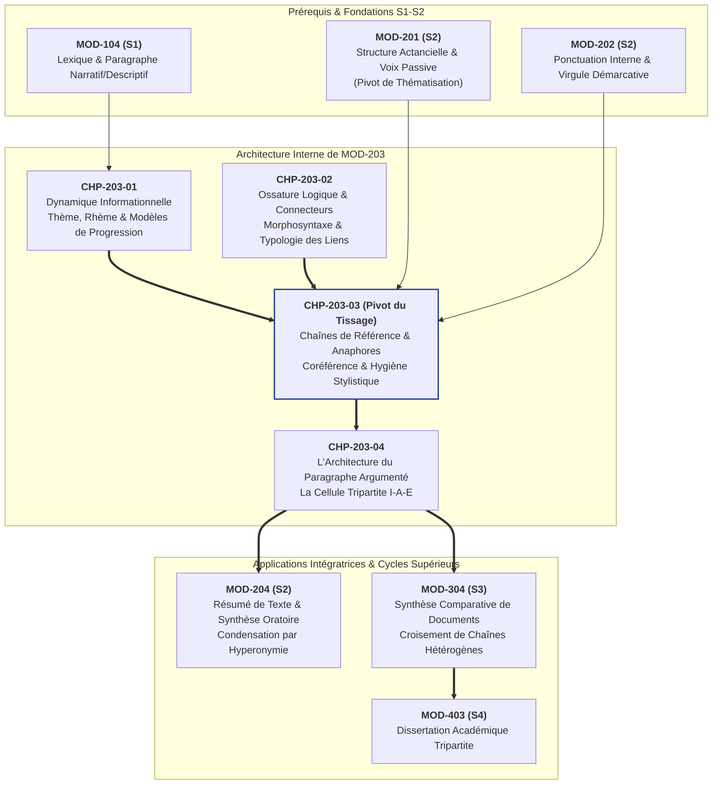

# Chapitre 3 — Les Chaînes de Référence : Anaphores, Coréférence et Hygiène Stylistique du Tissage Textuel

> **Identifiant du chapitre** : `CHP-203-03`  
> **Module de rattachement** : [`MOD-203` — Logique du Paragraphe, Typologie des Connecteurs, Progression Thématique et Cohésion Textuelle](file:///f:/Formation/world-class-french/03-curriculum/year-1/semester-2/mod-203-logique-paragraphe-cohesion-textuelle.md)  
> **Semestre** : Année 1 — Semestre 2 (S2)  
> **Volume horaire canonique** : 5 à 6 heures d'apprentissage autonome délibéré et d'ateliers d'application (Phase 1 Étude : 1 h 30 | Phase 2 Pratique : 1 h 30 | Phase 3 Correction : 1 h 00 | Phase 4 Évaluation : 1 h 00)  
> **Statut** : [STATUT : VALIDÉ]  
> **Compétences associées** : [`FR-INT-001`](file:///f:/Formation/world-class-french/02-competency-framework/competency-framework.md#fr-int-001-rédiger-un-texte-long-cohérent-en-maîtrisant-accords-et-ponctuation) (L3 Autonomie), [`FR-LEXIC-001`](file:///f:/Formation/world-class-french/02-competency-framework/competency-framework.md#fr-lexic-001-précision-sémantique-nuances-synonymiques-et-collocations) (L3 Autonomie)  
> **Sources scientifiques de référence** : `SRC-GRAM-02` (Riegel, Pellat, Rioul, *Grammaire méthodique du français*, 2016, chap. 19), `SRC-LEX-04` (Robert & Rey, *Le Grand Robert de la langue française*), `SRC-GRAM-01` (Grevisse & Goosse, *Le Bon Usage*, 16e éd., 2016, § 987 & § 665-680), `SRC-LEX-01` (ATILF / CNRS, *Trésor de la Langue Française informatisé* [TLFi]), `SRC-NORM-03` (Ministère de l'Éducation nationale, *Terminologie grammaticale*, 2020)

---

## 1. Titre et Place dans le Cursus

### 1.1 Intitulé Officiel
**Chapitre 3 : Les Chaînes de Référence : Anaphores, Coréférence et Hygiène Stylistique du Tissage Textuel** (`CHP-203-03`).

### 1.2 Insertion Architecturale dans le Cursus
Le module [`MOD-203`](file:///f:/Formation/world-class-french/03-curriculum/year-1/semester-2/mod-203-logique-paragraphe-cohesion-textuelle.md) orchestre le passage fondamental de la phrase autonome à la linguistique textuelle. Après avoir modélisé la dynamique informationnelle de l'énoncé (Chapitre 1 : Thème, Rhème et Progressions thématiques) et l'ossature logique transphrastique (Chapitre 2 : Statut et Typologie des Connecteurs), ce Chapitre 3 installe le moteur indispensable de la **texture discursive** : la continuité référentielle et le tressage des chaînes anaphoriques [Réf. `SRC-GRAM-02`, chap. 19].

Un texte cohérent ne se contente pas de relier des propositions par des conjonctions ou d'ordonner des thèmes ; il doit faire circuler des objets de pensée continus dans l'esprit du lecteur, sans rupture de perception et sans redondance lassante.



- **En amont** :
  - [`MOD-104`](file:///f:/Formation/world-class-french/03-curriculum/year-1/semester-1/mod-104-lexique-lecture-paragraphe.md) a posé les premières règles de précision sémantique et de bannissement des vocables passe-partout.
  - [`MOD-201`](file:///f:/Formation/world-class-french/03-curriculum/year-1/semester-2/mod-201-syntaxe-fonctionnelle-phrase-simple.md) a démontré le rôle de la voix passive et des déplacements actanciels pour promouvoir un complément en position de sujet thématique.
  - Au sein de [`MOD-203`](file:///f:/Formation/world-class-french/03-curriculum/year-1/semester-2/mod-203-logique-paragraphe-cohesion-textuelle.md), le Chapitre 1 a établi la distinction Thème/Rhème, et le Chapitre 2 a classé les connecteurs. Le présent chapitre montre comment le thème d'une proposition s'ancre matériellement dans le cotexte antérieur grâce aux reprises nominales et pronominales.
- **En aval** :
  - `CHP-203-04` exploitera ces chaînes pour bâtir la cellule mère du discours académique : le paragraphe argumenté unitaire (Idée directrice, Argument, Exemple), où l'exemple concret doit être arrimé à l'idée abstraite par une anaphore résomptive infaillible.
  - [`MOD-204`](file:///f:/Formation/world-class-french/03-curriculum/year-1/semester-2/mod-204-resume-texte-restitution-orale.md) (Résumé de texte) et `MOD-304` (Synthèse de documents) exigeront la maîtrise immédiate de l'hyperonymie et de l'anaphore conceptuelle pour contracter des développements prolixes sans en dénaturer le sens.

---

## 2. Objectifs Mesurables

Au terme des 5 à 6 heures d'apprentissage autonome et d'entraînement délibéré de ce chapitre, l'apprenant aura atteint le palier **L3 (Autonomie)** des compétences [`FR-INT-001`](file:///f:/Formation/world-class-french/02-competency-framework/competency-framework.md#fr-int-001-rédiger-un-texte-long-cohérent-en-maîtrisant-accords-et-ponctuation) et [`FR-LEXIC-001`](file:///f:/Formation/world-class-french/02-competency-framework/competency-framework.md#fr-lexic-001-précision-sémantique-nuances-synonymiques-et-collocations) en démontrant sa capacité à :

1. **Disséquer et tracer avec une rigueur formelle une chaîne de référence continue** : identifier l'antécédent initial et catégoriser chaque maillon subséquent (pronominal, démonstratif, lexical fidèle, synonymique, hyperonymique, résomptif, associatif) sur un empan de 5 à 8 propositions consécutives [Réf. `SRC-GRAM-02`, chap. 19].
2. **Désambiguïser infailliblement les anaphores pronominales concurrentes** : arbitrer l'emploi des pronoms de 3e personne (*il, elle, le, lui*), des démonstratifs sélectifs (*celui-ci, ce dernier*) ou de la reprise nominale pour proscrire tout doute sur l'assignation du référent dans des contextes à plusieurs antécédents de même genre et nombre [Réf. `SRC-GRAM-01`, § 665-680].
3. **Piloter l'apport sémantique et axiologique des anaphores lexicales** : remplacer les répétitions mécaniques par des reprises hyperonymiques, méronymiques ou résomptives qui qualifient l'objet de pensée, soutiennent la progression argumentative et densifient le propos [Réf. `SRC-LEX-04` ; `SRC-GRAM-02`, chap. 19].
4. **Appliquer une hygiène stylistique rigoureuse et éradiquer les pléonasmes d'argumentation** : biffer les doublons tautologiques (*panacée universelle, perspective d'avenir, collaborer ensemble, prévoir d'avance, hasard imprévu, ajouter en plus*) et assainir la prose savante [Réf. `SRC-GRAM-01`, § 987 ; `SRC-LEX-01`].

---

## 3. Prérequis et Test de Préparation (Auto-Diagnostic)

### 3.1 Prérequis Cognitifs et Syntaxiques
- Distinction des neuf classes grammaticales, en particulier substantifs, déterminants (définis, indéfinis, démonstratifs) et pronoms (personnels, relatifs, démonstratifs) [`MOD-102`].
- Maîtrise des fonctions syntaxiques de base : Sujet, Complément d'Objet Direct, Complément Prépositionnel, Complément Circonstanciel [`MOD-201`].
- Compréhension de la bipartition de la phrase : Thème (support d'information connue) et Rhème (apport d'information nouvelle) [`MOD-203`, Chapitre 1].

### 3.2 Test Diagnostique d'Entrée (5 Questions)
Vérifiez vos réflexes d'analyse sur ces cinq cas pratiques avant d'entamer l'étude des mécanismes de coréférence :

1. Observez l'énoncé suivant : *« Le directeur général a convoqué le responsable financier dans son bureau parce qu'il contestait les chiffres de clôture. »* Pourquoi l'attribution du pronom sujet *il* est-elle linguistiquement indécidable ? Comment résoudre cette ambiguïté sans répéter le titre ?
2. Quelle distinction sémiotique fondamentale sépare une **anaphore fidèle** (*« Un voyageur entra. Cet homme semblait épuisé. »*) d'une **anaphore par hyperonymie** (*« Un étalon franchit l'obstacle. L'animal impressionna la foule. »*) ?
3. Dans la phrase : *« Les grévistes ont bloqué les accès portuaires pendant trois semaines. Cette paralysie logistique a provoqué des pénuries nationales. »*, quel est le segment anaphorique, quel type précis d'anaphore constitue-t-il et quel est son antécédent ?
4. Dans le passage : *« Nous avons visité un monastère cistercien du XIIe siècle ; le cloître était silencieux, la nef baignait dans la pénombre et le réfectoire sentait la pierre humide. »*, pourquoi les syntagmes soulignés sont-ils qualifiés d'« anaphores associatives » plutôt que de coréférents stricts de *monastère* ?
5. Identifiez le pléonasme dissimulé dans l'argumentation suivante et proposez sa rectification académique : *« Pour juguler l'inflation galopante, la banque centrale a proposé une panacée universelle tout en prétendant prédire l'avenir des marchés obligataires. »*

---

#### Corrigé Détaillé de l'Auto-Diagnostic

<details>
<summary><b>Consulter le corrigé raisonné de l'auto-diagnostic</b></summary>

1. **Collision de traits morphosyntaxiques et ambiguïté référentielle** :
   - Le pronom *il* est de 3e personne du masculin singulier. Or, la proposition principale contient deux syntagmes nominaux masculins singuliers éligibles à la fonction d'antécédent : *le directeur général* (Sujet) et *le responsable financier* (COD). Le lecteur ne peut savoir avec certitude qui conteste les chiffres.
   - *Résolution* : Si le scripteur veut désigner le COD (*le responsable financier*), il emploiera le pronom démonstratif sélectif de proximité textuelle : *« ... parce que **ce dernier** contestait les chiffres. »* S'il veut désigner le sujet (*le directeur général*), il réorganisera la phrase ou utilisera une reprise lexicale spécifique : *« Contestant les chiffres de clôture, le directeur général a convoqué... »* [Réf. `SRC-GRAM-01`, § 672].
2. **Degré d'apport conceptuel (Fidélité vs Taxonomie)** :
   - L'anaphore fidèle reprend le même nom noyau en modifiant simplement le déterminant (*un homme $\rightarrow$ cet homme*) ; elle assure l'ancrage référentiel sans rien ajouter à la définition du terme.
   - L'anaphore par hyperonymie substitue à l'hyponyme spécifique (*étalon*) un terme de rang générique supérieur (*animal*), intégrant le référent dans une catégorie taxinomique plus vaste et élargissant la portée sémantique de l'énoncé [Réf. `SRC-GRAM-02`, chap. 19].
3. **Anaphore conceptuelle résomptive** :
   - Le segment anaphorique est *Cette paralysie logistique*.
   - Il s'agit d'une **anaphore conceptuelle (ou résomptive)** : elle résume sous la forme d'un syntagme nominal abstrait l'ensemble du procès propositionnel antérieur (*Les grévistes ont bloqué les accès portuaires pendant trois semaines*).
   - L'antécédent n'est pas un nom isolé, mais toute la proposition antérieure [Réf. `SRC-GRAM-02`, chap. 19].
4. **Méronymie et savoirs partagés (Anaphore associative)** :
   - *Le cloître*, *la nef* et *le réfectoire* ne désignent pas le monastère lui-même (ils n'ont pas la même référence extralinguistique), mais des composantes architecturales faisant partie du monastère (relation méronymique de partie à tout).
   - L'emploi de l'article défini *le/la* est rendu possible parce que le concept de *monastère* active dans l'esprit du lecteur un cadre cognitif (*frame*) où la présence de ces lieux est immédiatement inférée sans avoir besoin d'être introduite au préalable [Réf. `SRC-GRAM-02`, chap. 19].
5. **Éradication des pléonasmes d'argumentation** :
   - L'énoncé cumule deux pléonasmes :
     - *« Panacée universelle »* : *panacée* vient du grec *panakeia* (*pan*, tout, et *akos*, remède), désignant par nature un remède souverain à tous les maux. L'adjectif *universelle* est un doublon redondant grossier.
     - *« Prédire l'avenir »* : *prédire* signifie étymologiquement annoncer d'avance un événement futur (*praedicere*). On ne peut prédire le passé ni le présent.
   - *Rectification soignée* : *« Pour juguler l'inflation galopante, la banque centrale a proposé **une panacée** tout en prétendant **prédire l'évolution** des marchés obligataires. »* [Réf. `SRC-LEX-01`, s.v. "panacée" ; `SRC-GRAM-01`, § 987].

</details>

---

## 4. Situation de Départ ou Problème Concret : Le Texte Asphyxié ou Obscurci

### 4.1 L'Asphyxie par Répétition Infantile
Considérez l'extrait suivant, typique d'une note de synthèse administrative ou d'une dissertation rédigée par un scripteur peu formé :

> *« L'État a décidé de réformer le système de santé. L'État a constaté que le système de santé manquait de moyens. L'État veut donc allouer de nouveaux crédits au système de santé. Mais l'État craint que cette réforme de l'État ne provoque l'hostilité des syndicats de la santé. »*

Ce passage produit une impression insupportable de piétinement et d'infantilisme. La réitération obstinée des mêmes syntagmes nominaux (*L'État*, *le système de santé*) sature la mémoire immédiate du lecteur sans apporter la moindre nuance intellectuelle. Le texte est asphyxié par son inertie lexicale : la pensée ne progresse pas, elle tourne en boucle sur ses étiquettes de départ.

### 4.2 Le Labyrinthe du Flou Référentiel
À l'opposé de la répétition mécanique se dresse un vice stylistique tout aussi destructeur : l'avalanche de pronoms ambigus et instables.

> *« Lorsque le ministre a soumis le rapport au président du conseil constitutionnel, il a estimé qu'il comportait des vices majeurs de procédure. Il lui a alors demandé de le réviser avant qu'il ne soit promulgué, car cela risquerait de le discréditer aux yeux de l'opinion. »*

Face à cette période :
- Qui a estimé ? Le ministre ou le président ?
- Qui doit réviser ? Qui est « il » ?
- À quoi réfère le pronom « cela » ? À l'acte de promulgation, au vice de procédure, ou à la demande de révision ?
- Qui risque d'être discrédité ? Le ministre, le président, le rapport ou le gouvernement ?

Le lecteur, contraint de relire trois fois la phrase pour tenter de deviner l'intention de l'auteur, abandonne sa lecture. Dans un traité international, une loi ou un mémoire de master, un tel flou référentiel ruine la crédibilité intellectuelle du scripteur et peut engendrer des contentieux juridiques majeurs.

### 4.3 La Méconnaissance du Tissage Textuel
Le scripteur débutant croit souvent qu'écrire consiste à juxtaposer des phrases grammaticalement correctes. Or, **la phrase n'est pas l'unité ultime de la communication savante ; c'est le texte**. 

Entre les phrases circulent des fils conducteurs : les **référents**. Maîtriser le tissage textuel, c'est savoir faire voyager un même objet d'analyse à travers huit propositions consécutives sans jamais le répéter mot à mot et sans jamais laisser planer la moindre ambiguïté sur son identité.

---

## 5. Explication Intuitive : L'Analogie du Fil d'Ariane et de la Tapisserie

Pour comprendre la fonction des chaînes de référence, concevez la rédaction d'un paragraphe comme le **tissage d'une tapisserie de haute lisse** :

```text
================================================================================
                    L'ANALOGIE DE LA TRAME ET DU FIL CONDUCTEUR
================================================================================

         Énoncé 1          Énoncé 2          Énoncé 3          Énoncé 4
  +-----------------+-----------------+-----------------+-----------------+
  | [Antécédent]    |  [Pronom]       |  [Hyperonyme]   |  [Résomption]   |
  | "Le cyclone"    |  "Il"           |  "Le cataclysme"| "Ce désastre"   |
  |       ●~~~~~~~~~~~~~~~●~~~~~~~~~~~~~~~~~●~~~~~~~~~~~~~~~~~●           |
  |     (Fil A)         (Fil A)           (Fil A)           (Fil A)       |
  +-----------------+-----------------+-----------------+-----------------+
  | "L'île"         |  "Cette terre"  |  "Elle"         |  "Le territoire"|
  |       ■---------------■-----------------■-----------------■           |
  |     (Fil B)         (Fil B)           (Fil B)           (Fil B)       |
  +-----------------+-----------------+-----------------+-----------------+
================================================================================
```

1. **Le fil d'Ariane (Le Référent)** :  
   Chaque entité de votre discours (un événement, une institution, un personnage, un concept philosophique) est un fil qui guide le lecteur à travers le labyrinthe des arguments. Si ce fil casse, le lecteur est perdu ; s'il se noue avec un fil voisin, le lecteur trébuche.

2. **La matière du fil (La diversité anaphorique)** :  
   Un tisserand ne fabrique pas une tapisserie avec un fil de fer uniforme. Il fait alterner la laine brute (le nom propre ou l'antécédent plein), la soie discrète (le pronom personnel de troisième personne), le fil doré (l'anaphore hyperonymique qui ennoblit et généralise) et le nœud de velours (l'anaphore résomptive qui ramasse plusieurs mailles en une seule).

3. **L'interdiction absolue de l'emmêlement** :  
   Si deux fils de la même teinte traversent le métier à tisser (par exemple deux personnages masculins : *le juge* et *l'avocat*), le scripteur ne peut pas employer un pronom indifférencié (*il*). Il doit impérativement utiliser des fuseaux marqués (*celui-ci*, *ce dernier*, *le magistrat*) pour que l'œil distingue instantanément chaque trajectoire.

---

## 6. Définitions Précises et Terminologie

Pour manipuler ces mécanismes avec la rigueur d'un linguiste et d'un styliste, assimilons le lexique scientifique de la cohésion référentielle [Réf. `SRC-GRAM-02`, chap. 19 ; `SRC-NORM-03`] :

- **Coréférence** : Relation sémantique liant deux ou plusieurs expressions linguistiques distinctes au sein d'un texte lorsqu'elles désignent exactement la même entité extralinguistique (le même individu, le même objet ou la même idée dans le monde référentiel).
- **Chaîne de référence** : Suite ordonnée de segments textuels coréférentiels (les maillons) qui jalonnent le déroulement du discours pour assurer la présence continue et le suivi d'un même référent.
- **Maillon anaphorique** : Chaque occurrence textuelle élémentaire (pronom, syntagme nominal, périphrase) appartenant à une chaîne de référence donnée.
- **Antécédent** : Segment textuel initial (le premier maillon de la chaîne) qui introduit le référent dans l'univers de discours et fournit la clé sémantique d'interprétation pour tous les maillons postérieurs.
- **Anaphore cotextuelle** : Procédé de renvoi endophorique dans lequel un élément linguistique n'a de sens que par référence à un segment exprimé antérieurement dans le texte (cotexte gauche).
- **Cataphore** : Procédé prospectif dans lequel l'élément substitutif (le plus souvent un pronom) devance matériellement le terme plein qui n'apparaît que plus loin dans le cotexte droit (*« Quand **elle** entra dans la cour, **la reine** frissonna. »*).
- **Déixis situationnelle** : Renvoi direct aux coordonnées concrètes de l'acte d'énonciation (locuteur, interlocuteur, lieu matériel, moment présent : *moi, vous, ici, maintenant, ce livre-ci*) sans aucun recours à un antécédent textuel préalable.
- **Anaphore grammaticale** : Reprise assurée par un morphème ou un mot grammatical vide de sémantisme propre (pronoms personnels de 3e personne, pronoms démonstratifs, possessifs, relatifs ou adverbes anaphoriques *en, y*).
- **Anaphore lexicale fidèle** : Reprise intégrale du même substantif noyau avec commutation du déterminant, passant généralement du statut d'indéfini ou de partitif au statut de défini ou de démonstratif (*un traité $\rightarrow$ ce traité*).
- **Anaphore lexicale par synonymie** : Reprise d'un référent au moyen d'un nom de sens équivalent ou contextuellement analogue (*le souverain $\rightarrow$ le monarque*).
- **Anaphore par hyperonymie** : Reprise d'un terme spécifique (hyponyme) par un substantif au contenu sémantique plus large et englobant (hyperonyme), opérant un glissement de l'espèce vers le genre (*ce baobab $\rightarrow$ cet arbre majestueux*).
- **Anaphore associative (méronymique)** : Phénomène de liaison où le syntagme de reprise réfère à une entité nouvelle qui n'a pas été formellement mentionnée auparavant, mais dont l'existence est immédiatement déduite de l'antécédent en vertu d'un lien de partie à tout (méronymie) ou d'un savoir culturel stéréotypé (*le navire $\rightarrow$ la proue, le gouvernail*).
- **Anaphore conceptuelle (ou résomptive)** : Synthèse sous forme d'un syntagme nominal substantivé abstrait de tout un pan de discours antérieur (une proposition, une phrase complète ou tout un raisonnement) : *« Les ministres refusèrent de siéger. **Cette fronde gouvernementale** paralysa l'exécutif. »*
- **Ambiguïté référentielle** : Défaillance syntaxique ou sémantique par laquelle un terme anaphorique peut être rattaché concurremment à deux ou plusieurs antécédents textuels distincts, créant une incertitude d'interprétation chez le lecteur.

---

## 7. Règles et Mécanismes Fondamentaux

### 7.1 La Continuité du Référent dans la Prose Soutenue
Dans la prose universitaire, juridique ou diplomatique de haute tenue, l'enjeu consiste à faire circuler un objet de pensée central à travers une séquence continue de **5 à 8 propositions consécutives** sans jamais succomber à la répétition servile ni risquer le décrochage cognitif [Réf. `SRC-GRAM-02`, chap. 19].

Cette circulation obéit à deux lois fondamentales :
1. **La loi de non-saturation lexicale** : Un mot plein ne doit pas être répété à l'identique dans le même paragraphe s'il peut être allégé par un pronom ou anobli par un hyperonyme.
2. **La loi de saillance mémorielle** : Plus la distance textuelle augmente depuis le dernier maillon, plus le recours à une anaphore lexicale pleine devient obligatoire pour réactiver le référent affaibli dans l'esprit du lecteur.

---

### 7.2 Typologie des Anaphores Grammaticales

Les anaphores grammaticales constituent l'ossature la plus légère et la plus rapide du rappel textuel.

#### A. Les Pronoms Personnels de Troisième Personne
- **Inventaire** : *il, elle, ils, elles* (sujets) ; *le, la, les* (COD) ; *lui, leur* (COI) ; *en, y* (adverbiaux prépositionnels).
- **Principe d'emploi** : Ils conviennent parfaitement lorsque le référent est en position de **haute saillance cognitive**, c'est-à-dire lorsqu'il est le sujet de la proposition immédiatement précédente et qu'aucun autre nom de même genre et nombre ne concourt à l'interprétation.
- *Exemple canonique* :  
  *« Le décret ministériel a été publié au Journal officiel. **Il** entrera en vigueur dès lundi prochain. »*

#### B. Les Pronoms Démonstratifs Sélectifs
Lorsque deux entités du même genre et nombre coexistent dans la proposition antérieure, le pronom personnel *il* est formellement interdit en raison du conflit de coréférence qu'il engendre. La langue française dispose alors de démonstratifs sélectifs discriminants [Réf. `SRC-GRAM-01`, § 672] :
- **« Celui-ci / Celle-ci / Ceux-ci / Celles-ci »** et **« Ce dernier / Cette dernière / Ces derniers »** : Réfèrent obligatoirement au **dernier élément mentionné** dans le cotexte gauche (l'antécédent le plus proche).
- **« Celui-là / Celle-là / Ceux-là / Celles-là »** : Réfèrent au **premier élément mentionné** (l'antécédent le plus éloigné).
- *Exemple canonique de désambiguïsation* :  
  *« Le procureur général a réfuté les arguments de l'avocat de la défense : **ce dernier** [= l'avocat] n'avait produit aucune pièce probante, tandis que **celui-là** [= le procureur] s'appuyait sur des procès-verbaux irréfutables. »*

#### C. Les Pathologies de l'Anaphore Pronominale Ambiguë
Deux écueils majeurs guettent le scripteur inattentif :
1. **La collision morphologique** : Placer un pronom *il* après deux antécédents masculins singuliers (*« Paul a salué Jacques alors qu'**il** montait dans le train »*).
2. **L'antécédent syntaxiquement enfoui** : Rattacher un pronom à un nom qui n'est pas le noyau du syntagme mais un simple complément déterminatif accessoire (*« Les décisions du conseil d'administration ont été contestées parce qu'**il** n'avait pas consulté les délégués »* $\rightarrow$ Le pronom *il* reprend fautivement le complément de nom *conseil* alors que le sujet grammatical recteur est le pluriel *Les décisions*).

---

### 7.3 Typologie des Anaphores Lexicales

Contrairement aux pronoms qui ne font que pointer, les anaphores lexicales enrichissent la texture notionnelle du discours [Réf. `SRC-GRAM-02`, chap. 19 ; `SRC-LEX-04`].

#### A. L'Anaphore Fidèle avec Commutation de Déterminant
Elle répète le substantif mais modifie son statut discursif :
- Déterminant indéfini $\rightarrow$ Déterminant démonstratif :  
  *« Les archéologues ont mis au jour **un temple** enfoui sous les sables. **Ce temple** présentait des colonnades intactes. »*
- Fonction : Verrouiller formellement l'identité du référent lors d'une première reprise technique ou juridique.

#### B. L'Anaphore par Synonymie
Elle substitue un vocable équivalent pour éviter la lassitude auditive tout en maintenant la précision dénotative :
- *« Le médecin ausculta le patient. Le praticien ne décela aucune anomalie pulmonaire. »*

#### C. L'Anaphore par Hyperonymie (Du Particulier au Général)
Elle remplace le terme spécifique par son terme générique englobant :
- Hyponyme spécifique $\rightarrow$ Hyperonyme intermédiaire $\rightarrow$ Hyperonyme abstrait :  
  $$\text{« Le faucon pèlerin » } \longrightarrow \text{ « Ce rapace » } \longrightarrow \text{ « Cet oiseau » } \longrightarrow \text{ « L'animal »}$$
- *Portée stylistique* : Elle élève le propos vers une dimension universelle et permet d'insérer l'exemple dans une loi générale.

#### D. L'Anaphore Conceptuelle ou Résomptive
C'est le joyau stylistique de la prose intellectuelle. Elle transforme une proposition entière (un événement, une crise, un discours) en un **concept substantivé**, servant de tremplin à la déduction suivante :
- *« Les puissances belligérantes ont unilatéralement suspendu les hostilités, retiré leurs pièces d'artillerie et ouvert des corridors humanitaires. **Cette désescalade inespérée** a permis la reprise des négociations. »*
- Le syntagme *Cette désescalade inespérée* synthétise en trois mots l'ensemble des trois actions antérieures.

---

### 7.4 L'Anaphore Associative (Méronymie et Cadres Cognitifs)

L'anaphore associative n'établit pas une coréférence stricte ($A = B$), mais une liaison de dépendance conceptuelle fondée sur la méronymie (relation partie-tout) ou l'activation d'un univers partagé [Réf. `SRC-GRAM-02`, chap. 19] :
- *« L'avion s'est posé en urgence dans un champ : **le train d'atterrissage** s'était brisé, mais **le fuselage** est demeuré intact. »*
- L'utilisation du déterminant défini *le* est légitime sans mention préalable du train d'atterrissage, car l'évocation de l'avion active immédiatement l'existence de ses composantes mécaniques dans l'esprit du récepteur.

---

### 7.5 Hygiène Stylistique et Éradication des Pléonasmes d'Argumentation

L'hygiène du tissage textuel exige d'extirper les scories verbales qui alourdissent et décrédibilisent la prose [Réf. `SRC-GRAM-01`, § 987 ; `SRC-LEX-01`] :

1. **Proscription absolue de la répétition mécanique du mot noyau** : Dans un paragraphe de 200 mots, un nom commun ne doit jamais apparaître trois fois à l'identique sauf intention rhétorique délibérée (anaphore poétique ou terme technique irremplaçable).
2. **Proscription des pléonasmes d'argumentation** : Bannir formellement les couples tautologiques qui trahissent la méconnaissance du sens étymologique des mots :

| Formule Fautive / Pléonastique | Raison Savante du Doublon | Formule Rectifiée Normée | Référence Lexicale |
| :--- | :--- | :--- | :--- |
| *\*« Une panacée universelle »* | *Panacée* (grec *panakeia*) signifie déjà « remède à toutes les maladies ». | **« Une panacée »** | `SRC-LEX-01`, s.v. "panacée" |
| *\*« Prédire l'avenir »* | *Prédire* (*praedicere*) signifie « dire d'avance ce qui va advenir ». | **« Prédire un événement »** ou **« Annoncer l'avenir »** | `SRC-LEX-04`, s.v. "prédire" |
| *\*« Collaborer ensemble »* | *Collaborer* (*con-laborare*) signifie littéralement « travailler ensemble ». | **« Collaborer »** ou **« Travailler ensemble »** | `SRC-GRAM-01`, § 987 |
| *\*« Une perspective d'avenir »* | Une *perspective* est par essence un regard prospectif tourné vers le futur. | **« Une perspective »** | `SRC-LEX-04`, s.v. "perspective" |
| *\*« Un hasard imprévu »* | Le *hasard* exclut par définition toute prévisibilité. | **« Un hasard »** ou **« Un événement imprévu »** | `SRC-GRAM-01`, § 987 |
| *\*« Ajouter en plus »* | *Ajouter* comporte déjà le sémantisme de l'adjonction supplémentaire. | **« Ajouter »** | `SRC-GRAM-01`, § 987 |

---

## 8. Raisonnement Détaillé : Pourquoi la Variété Anaphorique Enrichit le Sens

Il serait profondément erroné de considérer l'alternance des anaphores comme un simple artifice d'élégance ou une coquetterie de puriste destinée à « varier pour ne pas ennuyer ». En linguistique textuelle, **l'anaphore lexicale n'est jamais un substitut passif : elle est un acte de prédication seconde et d'évaluation sémantique** [Réf. `SRC-GRAM-02`, chap. 19].

### 8.1 L'Apport Informatif et la Densification du Discours
Lorsque vous remplacez un antécédent par un pronom (*« Victor Hugo est né en 1802. Il... »*), vous maintenez la référence à coût sémantique nul. Le pronom n'apporte aucune information nouvelle.
En revanche, lorsque vous tissez la chaîne par des anaphores lexicales :
- *« Victor Hugo a publié Les Misérables. »*
- *« **L'illustre proscrit de Guernesey** a dressé le tableau des misères sociales. »* (Apport biographique et géographique).
- *« **Ce monument des lettres françaises** a bouleversé la conscience européenne. »* (Apport critique et statut patrimonial).
- *« **Le visionnaire républicain** y plaidait pour l'instruction obligatoire. »* (Apport idéologique et politique).

Chaque maillon sélectionne et met en lumière un trait sémantique saillant du référent qui sert directement la démonstration en cours. L'anaphore lexicale économise des propositions subordonnées entières en injectant des prédicats sous forme d'appositions ou de syntagmes nominaux denses.

### 8.2 La Portée Axiologique et Argumentative
L'anaphore est l'instrument privilégié de l'orientation argumentative (la charge axiologique). Selon la manière dont vous reprenez un événement, vous imposez discrètement au lecteur votre jugement de valeur sans avoir l'air de polémiquer :
- Soit un antécédent neutre : *« L'armée a renversé le gouvernement civil. »*
- *Reprise favorable* : *« **Cette libération nationale** a suscité l'enthousiasme populaire. »*
- *Reprise défavorable* : *« **Ce coup de force prétorien** a suspendu les libertés constitutionnelles. »*
- *Reprise attentiste* : *« **Cette rupture institutionnelle** plonge le pays dans l'incertitude. »*

L'anaphore résomptive transforme ainsi l'exposé des faits en une thèse articulée.

---

## 9. Exemples Corrects Commentés : Démonstration d'une Chaîne Anaphorique Parfaite de 6 Maillons

Examinons l'analyse stylistique d'une séquence académique exemplaire portant sur la figure historique du savant Louis Pasteur. Observez comment le référent circule à travers **six propositions consécutives sans une seule répétition du nom propre** :

> **[Énoncé 1]** : En 1885, **Louis Pasteur** franchit une étape décisive dans l'histoire de la médecine expérimentale en inoculant son vaccin contre la rage au jeune Joseph Meister.  
> **[Énoncé 2]** : **Il** engageait alors sa réputation scientifique sur un traitement qui n'avait été testé que sur des animaux de laboratoire.  
> **[Énoncé 3]** : **Le savant jurassien** bravait le scepticisme d'une Académie de médecine réticente devant la théorie des germes.  
> **[Énoncé 4]** : La guérison éclatante de l'enfant consacra bientôt **le pionnier de la microbiologie** comme le bienfaiteur incontesté de l'humanité souffrante.  
> **[Énoncé 5]** : **Cette audace thérapeutique sans précédent** bouleversa les fondements de la prophylaxie moderne et ouvrit l'ère des campagnes mondiales d'immunisation.  
> **[Énoncé 6]** : Face aux épidémies infectieuses qui décimaient les populations, **ce dernier** venait de forger l'arme biologique la plus redoutable du siècle.

### Tableau de Décomposition Analytique des 6 Maillons

| N° | Maillon Textuel | Nature Morphosyntaxique | Type Précis d'Anaphore | Rôle Sémantique & Stylistique |
| :---: | :--- | :--- | :--- | :--- |
| **M1** | *Louis Pasteur* | Nom propre de personne | **Antécédent initial (Ancrage)** | Pose le référent avec ses coordonnées historiques complètes. |
| **M2** | *Il* | Pronom personnel sujet (3e masc. sg.) | **Anaphore grammaticale pronominale** | Allègement maximal ; le référent est en tête de saillance immédiate. |
| **M3** | *Le savant jurassien* | Syntagme nominal (Hyperonyme + Adjectif d'origine) | **Anaphore lexicale par hyperonymie qualifiante** | Rappelle le métier (*savant*) et l'ancrage régional (*Jura*), soulignant la ténacité provinciale. |
| **M4** | *Le pionnier de la microbiologie* | Syntagme nominal (Périphrase honorifique + complément du nom) | **Anaphore lexicale caractérisante** | Inscrit Pasteur dans son statut historique de fondateur d'une discipline scientifique nouvelle. |
| **M5** | *Cette audace thérapeutique sans précédent* | Syntagme nominal abstrait résomptif | **Anaphore conceptuelle résomptive** | Résume l'ensemble de l'acte d'inoculation et de défi des énoncés précédents en un concept opératoire. |
| **M6** | *Ce dernier* | Pronom démonstratif sélectif | **Anaphore grammaticale sélective** | Réactive le référent humain (*Pasteur*) après l'évocation concurrente du syntagme pluriel *les populations*. |

---

## 10. Contre-Exemples et Erreurs Fréquentes (Clinique des 6 Fautes Récurrentes)

Voici six erreurs récurrentes rigoureusement observées dans les productions écrites universitaires, analysées linguistiquement et accompagnées de leurs remèdes immédiats :

### Erreur n° 1 : L'anaphore pronominale ambiguë par collision de deux antécédents masculins
- **Énoncé fautif** :  
  *\*« Le doyen de la faculté a reçu le nouveau professeur titulaire après qu'**il** eut prononcé sa leçon inaugurale. »*
- **Diagnostic linguistique** :  
  La subordonnée temporelle s'ouvre par le pronom personnel sujet *il*. Or, la proposition principale contient deux syntagmes masculins singuliers occupant des fonctions nobles : *le doyen* (sujet) et *le nouveau professeur titulaire* (COD). Il est impossible de déterminer qui a prononcé la leçon.
- **Rectification soutenue** :  
  *« Le doyen de la faculté a reçu le nouveau professeur titulaire après que **ce dernier** eut prononcé sa leçon inaugurale. »* ou par tournure participiale : *« Ayant prononcé sa leçon inaugurale, le nouveau professeur titulaire fut reçu par le doyen de la faculté. »* [Réf. `SRC-GRAM-01`, § 672].

### Erreur n° 2 : L'antécédent syntaxiquement enfoui dans un syntagme prépositionnel accessoire
- **Énoncé fautif** :  
  *\*« L'adoption des nouvelles directives ministérielles par les directeurs d'hôpitaux montre qu'**ils** sont désormais conscients de la crise budgétaire. »*
- **Diagnostic linguistique** :  
  Le scripteur fait renvoyer le pronom sujet pluriel *ils* au syntagme *les directeurs d'hôpitaux*. Or, ce syntagme n'est que le complément d'agent d'un nom abstrait (*L'adoption*), lui-même noyau du sujet de la phrase. L'antécédent est enfoui à un niveau de dépendance syntaxique secondaire, ce qui crée une dissonance cognitive brutale à la lecture.
- **Rectification soutenue** :  
  *« En adoptant les nouvelles directives ministérielles, **les directeurs d'hôpitaux montrent qu'ils** ont désormais pris la mesure de la crise budgétaire. »* [Réf. `SRC-GRAM-02`, chap. 19].

### Erreur n° 3 : La répétition infantile du mot noyau par inertie lexicale
- **Énoncé fautif** :  
  *\*« La démocratie exige le respect des lois. Si la démocratie ne respecte pas les lois, la démocratie court le risque de sombrer dans l'anarchie. »*
- **Diagnostic linguistique** :  
  Le substantif *démocratie* est répété trois fois en 22 mots. Cette inertie lexicale témoigne d'une incapacité à mobiliser les ressources pronominales et hyperonymiques de la langue française.
- **Rectification soutenue** :  
  *« La démocratie exige le respect scrupuleux des lois ; dès lors que **ce régime** cesse d'en garantir l'autorité, **il** s'expose inévitablement à sombrer dans l'anarchie. »* [Réf. `SRC-LEX-04`, s.v. "démocratie"].

### Erreur n° 4 : L'anaphore résomptive inexacte trahissant le sens du segment antérieur
- **Énoncé fautif** :  
  *\*« Le parlement a voté des réductions d'impôts ciblées pour les entreprises innovantes. **Cette politique d'austérité drastique** a rassuré les marchés. »*
- **Diagnostic linguistique** :  
  L'anaphore résomptive *Cette politique d'austérité drastique* trahit sémantiquement l'énoncé source. Des allègements fiscaux ciblés ne constituent pas une « politique d'austérité drastique » ; il y a glissement notionnel et contresens conceptuel dans le maillon de synthèse.
- **Rectification soutenue** :  
  *« Le parlement a voté des réductions d'impôts ciblées pour les entreprises innovantes. **Cette mesure d'incitation fiscale** a immédiatement rassuré les milieux financiers. »* [Réf. `SRC-GRAM-02`, chap. 19].

### Erreur n° 5 : La rupture brutale de la chaîne par oubli de coréférence (« saut de carpe »)
- **Énoncé fautif** :  
  *\*« Le chômage des jeunes s'est aggravé au dernier trimestre. L'apprentissage professionnel souffre d'un manque criant de maîtres de stage. Les statistiques de l'emploi doivent être publiées demain. »*
- **Diagnostic linguistique** :  
  Chaque phrase introduit un thème entièrement neuf (*Le chômage*, *L'apprentissage*, *Les statistiques*) sans établir le moindre relais anaphorique ni connecteur logique. Le texte saute d'une idée à une autre sans continuité discursive.
- **Rectification soutenue** :  
  *« Le chômage des jeunes s'est aggravé au dernier trimestre. **Ce phénomène alarmant** s'explique notamment par la pénurie de maîtres de stage au sein des filières d'apprentissage ; **ces données préoccupantes** seront du reste officialisées demain lors de la publication des statistiques nationales de l'emploi. »* [Réf. `SRC-GRAM-02`, chap. 20].

### Erreur n° 6 : Le pléonasme lexical d'argumentation et la redondance tautologique
- **Énoncé fautif** :  
  *\*« Les chercheurs doivent collaborer ensemble pour préparer une perspective d'avenir et trouver une panacée universelle contre ce fléau. »*
- **Diagnostic linguistique** :  
  Cumul de trois pléonasmes stylistiques sévères : *collaborer ensemble* (tautologie préfixale), *perspective d'avenir* (redondance aspectuelle) et *panacée universelle* (non-sens étymologique).
- **Rectification soutenue** :  
  *« Les chercheurs doivent **collaborer** afin de dessiner **de nouvelles perspectives** et mettre au point **une panacée** contre ce fléau. »* [Réf. `SRC-GRAM-01`, § 987].

---

## 11. Cas Particuliers et Limites

### 11.1 La Cataphore Stylistique d'Amorce Littéraire
Si l'anaphore regarde vers le passé (cotexte gauche), la **cataphore** projette l'attention vers l'avenir (cotexte droit). Elle constitue une figure d'amorce très puissante dans le style noble :
- *« Lorsqu'**il** franchit le seuil des Tuileries ce matin-là, **Bonaparte** mesura toute l'étendue de sa solitude politique. »*

#### Conditions Strictes de Licéité
1. La cataphore n'est tolérée en français soutenu que si le pronom est situé dans une **proposition subordonnée circonstancielle antéposée**, et que son antécédent nominal plein apparaît obligatoirement en position de **sujet de la proposition principale immédiatement subséquente** [Réf. `SRC-GRAM-01`, § 678].
2. Il est formellement interdit de placer une cataphore dans une proposition principale autonome (*\*« Il entra dans la pièce. Le général contempla la carte. »* $\rightarrow$ Deux phrases indépendantes : l'identité de *il* reste indéterminée à l'oral comme à l'écrit lors de la première phrase).

### 11.2 Les Pronoms Neutres Résomptifs (*ce, cela, le*)
Pour reprendre non pas une entité matérielle, mais un fait complexe ou une idée propositionnelle, la langue emploie les pronoms neutres démonstratifs ou le pronom personnel neutre *le* :
- *« L'armée ennemie a battu en retraite, et le ministre de la Guerre **l'**a confirmé lors de son allocution. »* (Ici, *le* équivaut à : *que l'armée ennemie a battu en retraite*).
- *« La croissance économique s'est effondrée de quatre pour cent ; **cela** contraint le gouvernement à réviser la loi de finances. »*

### 11.3 Accord de Genre et de Nombre dans les Anaphores Hyperonymiques
Des tensions grammaticales délicates surviennent lorsqu'un référent humain change de genre grammatical lors d'une reprise hyperonymique [Réf. `SRC-GRAM-01`, § 667] :
- **Le cas des noms à genre fixe (*victime, sentinelle, personne*)** :  
  Bien que la sentinelle soit un soldat masculin, le nom *sentinelle* est grammaticalement féminin.
  - *Énoncé correct* : *« Le soldat veillait sur le rempart. **Cette sentinelle** vigilante scrutait l'horizon ; **elle** ne remarqua pourtant pas l'approche de l'ennemi. »*
  - *Règle absolue* : Une fois le substantif féminin *sentinelle* ou *personne* posé comme sujet, le pronom subséquent doit obligatoirement respecter l'accord grammatical (*elle*), et non le sexe biologique (*\*il*). L'accord *ad sensum* est formellement proscrit en prose académique surveillée.
- **Le cas des collectifs (*le gouvernement, le comité, la foule*)** :  
  En français châtié, un collectif singulier ne peut jamais être repris par un pronom pluriel :  
  - Fautif : *\*« Le comité de direction a délibéré. Ils ont voté le budget. »*  
  - Correct : *« Le comité de direction a délibéré. **Il** a voté le budget. »* ou *« Les membres du comité ont délibéré ; **ils** ont voté le budget. »*

---

## 12. Approfondissement Adapté au Niveau : Théories de la Cohésion et de la Saillance Cognitive

### 12.1 La Théorie de la Cohésion Textuelle de Halliday et Hasan (1976)
Dans leur ouvrage séminal *Cohesion in English*, M.A.K. Halliday et Ruqaiya Hasan ont formalisé le concept de **texture** : la texture est ce qui distingue un texte authentique d'une suite aléatoire de phrases déconnectées.
Selon ce modèle, la cohésion repose sur cinq mécanismes interconnectés :
1. **La référence** (anaphore pronominale, démonstrative et comparative).
2. **La substitution** (remplacement d'un constituant par un terme générique).
3. **L'ellipse** (omission volontaire d'un mot déjà connu pour alléger la phrase).
4. **La conjonction** (les connecteurs logiques et temporels).
5. **La cohésion lexicale** : subdivisée en *réitération* (répétition, synonyme, hyperonyme) et *collocation* (association habituelle de mots appartenant au même champ conceptuel).

### 12.2 L'Échelle d'Accessibilité Cognitive de Mira Ariel (1990)
Dans *Accessing Noun-Phrase Antecedents*, la linguiste cognitive Mira Ariel démontre que le choix d'un marqueur anaphorique n'est pas guidé par le hasard, mais par le **degré d'accessibilité mentale du référent** dans la mémoire de travail du destinataire :

```text
================================================================================
          L'ÉCHELLE D'ACCESSIBILITÉ DU RÉFÉRENT (MIRA ARIEL, 1990)
================================================================================
HAUTE ACCESSIBILITÉ                                            BASSE ACCESSIBILITÉ
(Référent immédiat,                                           (Référent éloigné,
 très saillant, sujet en cours)                                 enfoui ou nouveau)
       <------------------------------------------------------------->
  Pronoms zéros  >  Pronoms personnels  >  Démonstratifs  >  Descriptions définies  >  Noms propres
  (Ellipse sujet)   (il, elle, le)       (celui-ci)         (le jeune souverain)      (Béhanzin)
================================================================================
```

- **Marqueurs de haute accessibilité (High Accessibility Markers)** : Les pronoms personnels (*il, elle*) et les ellipses. Ils exigent un antécédent immédiat, univoque et occupant la fonction de sujet dans la proposition précédente. Si vous les employez pour un antécédent éloigné, vous créez une surcharge cognitive chez le lecteur.
- **Marqueurs de basse accessibilité (Low Accessibility Markers)** : Les descriptions définies complètes (*le monarque du Danxomè*) et les noms propres. Ils sont indispensables dès que la distance textuelle dépasse une phrase ou dès qu'un autre référent est intervenu entre-temps.

---

## 13. Comparaisons Différentielles

### 13.1 Anaphore Grammaticale vs Anaphore Lexicale

| Critère d'Analyse | Anaphore Grammaticale | Anaphore Lexicale |
| :--- | :--- | :--- |
| **Matériau linguistique** | Mots grammaticaux fermés (pronoms personnels, démonstratifs, possessifs, relatifs). | Syntagmes nominaux ouverts (noms communs, adjectifs, périphrases). |
| **Contenu sémantique** | Quasiment nul (simple étiquette morphologique : genre, nombre, personne). | Riche et modalisable (apporte des traits descriptifs nouveaux). |
| **Coût cognitif pour le lecteur** | Faible si le référent est saillant ; très élevé en cas d'ambiguïté. | Nul pour l'identification ; demande un traitement notionnel actif. |
| **Fonction stylistique majeure** | Allègement, célérité, dynamisme de la phrase. | Qualification, hiérarchisation, orientation argumentative (axiologie). |
| **Portée textuelle** | Empan court (proposition immédiatement précédente). | Empan long (peut réactiver un référent posé 5 phrases plus haut). |

### 13.2 Anaphore Fidèle vs Anaphore Résomptive

| Critère d'Analyse | Anaphore Fidèle | Anaphore Résomptive (Conceptuelle) |
| :--- | :--- | :--- |
| **Opération morphosyntaxique** | Répétition du même substantif avec changement de déterminant (*un pacte $\rightarrow$ ce pacte*). | Nominalisation substantivée d'un procès verbal (*Ils ont capitulé $\rightarrow$ Cette reddition*). |
| **Nature de l'antécédent** | Un syntagme nominal unitaire précis. | Une proposition entière, une phrase ou tout un paragraphe. |
| **Valeur argumentative** | Neutre : stabilise l'objet dans le discours. | Hautement active : qualifie et conceptualise l'événement. |
| **Risque discursif** | Monotonie si elle est répétée plus d'une fois. | Contresens ou distorsion idéologique si le résumé trahit les faits. |

### 13.3 Anaphore Cotextuelle vs Cataphore vs Déixis Situationnelle

| Procédé | Direction du Renvoi | Source de l'Interprétation | Exemple Typique |
| :--- | :--- | :--- | :--- |
| **Anaphore** | Rétrospective (vers l'amont / gauche). | Le texte antérieur (cotexte gauche). | *« **Rome** dominait. **La cité** régnait sur la mer. »* |
| **Cataphore** | Prospective (vers l'aval / droite). | Le texte postérieur (cotexte droit). | *« Dès qu'**il** parut, **le consul** harangua la foule. »* |
| **Déixis** | Extralinguistique (vers la situation). | L'environnement physique d'énonciation. | *« Regardez **ce monument** là-bas. »* (en montrant du doigt). |

---

## 14. Exercices Progressifs (3 Niveaux de Maîtrise)

### 14.1 Niveau 1 : Identification et Traçage d'une Chaîne de Référence
**Consigne** : Lisez attentivement le texte académique suivant composé de 10 phrases continues. Relevez l'ensemble des maillons anaphoriques se rapportant au référent principal (*L'imprimerie à caractères mobiles*) et complétez le tableau d'audit référentiel.

> [1] Vers 1450, à Mayence, Johannes Gutenberg mit au point **l'imprimerie à caractères métalliques mobiles**. [2] **Cette invention prodigieuse** bouleversa les modes de transmission du savoir en Occident. [3] En substituant des fontes de plomb réutilisables au travail fastidieux des copistes, **elle** démultiplica la cadence de production des livres. [4] **Le procédé novateur** se diffusa le long du Rhin avec une rapidité foudroyante. [5] En quelques décennies, **cet atelier mécanique** donna naissance à des centaines d'officines typographiques à travers l'Europe. [6] **Cette révolution technique sans précédent** permit aux idées de l'Humanisme et de la Réforme de circuler sans entrave. [7] L'Église et les cours princières tentèrent bien d'instaurer une censure préalable, mais **le fléau libérateur** échappa définitivement à leur contrôle. [8] Aujourd'hui encore, **cette rupture épistémologique majeure** demeure le socle matériel de la modernité démocratique. [9] **Elle** a fait passer l'humanité de la culture du manuscrit réservé aux élites à celle du texte partagé. [10] Nul historien ne saurait contester que **cette découverte** a transformé la structure même de la pensée occidentale.

---

### 14.2 Niveau 2 : Résolution d'Anaphores Ambiguës et Enrichissement Hyperonymique
**Consigne** : Chacun des cinq micro-textes suivants contient une défaillance grave de cohésion (ambiguïté pronominale, répétition vicieuse ou enfouissement). Réécrivez chaque passage en appliquant les techniques de désambiguïsation (démonstratifs sélectifs, anaphores hyperonymiques ou nominalisations résomptives).

1. *Le juge d'instruction a interrogé le prévenu pendant des heures parce qu'il refusait de reconnaître les faits consignés dans le dossier.*
2. *L'éléphant d'Afrique est menacé par le braconnage intensif. L'éléphant d'Afrique voit son habitat naturel se réduire chaque année. Les défenseurs de l'éléphant d'Afrique demandent des sanctions exemplaires.*
3. *La décision de renvoyer les diplomates par les autorités consulaires prouve qu'ils n'acceptent aucun compromis territorial.*
4. *Les scientifiques ont averti le ministre de l'environnement des conséquences de la sécheresse, mais il n'a pris aucune mesure d'urgence.*
5. *Le général a ordonné au colonel de sonner la retraite alors qu'il venait d'essuyer un revers cuisant sur le flanc gauche.*

---

### 14.3 Niveau 3 : Réécriture Stylistique Haute Tenue sous Contrainte Calibrée
**Consigne** : Le texte historique suivant comporte **exactement 50 mots**. Il est lourdement pénalisé par la répétition infantile et mécanique du syntagme *Le roi Béhanzin* (répété 5 fois en 5 propositions).  
Réécrivez ce passage en **une période historique fluide et noble**, sans répéter une seule fois le nom *Béhanzin*, en intégrant obligatoirement :
- Un pronom personnel sujet ;
- Une anaphore lexicale par hyperonymie qualifiante ;
- Une périphrase honorifique héroïque ;
- Une anaphore résomptive synthétisant la résistance militaire.

#### Texte Témoin Dégradé (50 mots exacts) :
> *« Le roi Béhanzin monta sur le trône du Dahomey. Le roi Béhanzin organisa la défense de son royaume. Le roi Béhanzin refusa de céder aux menaces coloniales. Les soldats du roi Béhanzin affrontèrent très courageusement les troupes françaises. Pourtant, les forces du roi Béhanzin subirent finalement une défaite militaire douloureuse. »*

---

### Corrigés Exhaustifs et Justifiés des Exercices

<details>
<summary><b>Consulter les corrigés complets des exercices (Niveaux 1 à 3)</b></summary>

#### Corrigé Niveau 1 : Traçage de la Chaîne Référentielle

| Phrase | Maillon Identifié | Nature Morphosyntaxique | Type d'Anaphore | Apport Sémantique / Axiologique |
| :---: | :--- | :--- | :--- | :--- |
| **P1** | *l'imprimerie à caractères métalliques mobiles* | Syntagme nominal étendu | **Antécédent initial** | Définition technique précise de l'objet d'histoire. |
| **P2** | *Cette invention prodigieuse* | Déterminant dém. + Nom + Adj. | **Anaphore lexicale par hyperonymie** | Classe l'imprimerie dans la catégorie des « inventions » avec éloge. |
| **P3** | *elle* | Pronom personnel sujet (3e fém. sg.) | **Anaphore grammaticale** | Allègement maximal : saillance haute après P2. |
| **P4** | *Le procédé novateur* | Déterminant déf. + Nom + Adj. | **Anaphore lexicale par synonymie** | Déplace l'accent sur la dimension méthodologique (*procédé*). |
| **P5** | *cet atelier mécanique* | Déterminant dém. + Nom métonymique | **Anaphore métonymique associative** | Désigne le dispositif matériel par son lieu d'exercice concret. |
| **P6** | *Cette révolution technique sans précédent* | Déterminant dém. + Nom résomptif | **Anaphore conceptuelle résomptive** | Élève l'invention technique au rang de bouleversement historique global. |
| **P7** | *le fléau libérateur* | Déterminant déf. + Oxymore nominal | **Anaphore métaphorique modalisée** | Adopte ironiquement le point de vue des censeurs (*fléau*) pour mieux le renverser (*libérateur*). |
| **P8** | *cette rupture épistémologique majeure* | Déterminant dém. + Nom abstrait | **Anaphore conceptuelle philosophique** | Conceptualise l'impact intellectuel sur les structures cognitives. |
| **P9** | *Elle* | Pronom personnel sujet (3e fém. sg.) | **Anaphore grammaticale** | Poursuit la démonstration sans alourdir la période. |
| **P10** | *cette découverte* | Déterminant dém. + Hyperonyme | **Anaphore par hyperonymie** | Synthèse conclusive ramenant à la catégorie générale des grandes découvertes. |

---

#### Corrigé Niveau 2 : Résolution et Enrichissement

1. **Désambiguïsation par démonstratif sélectif** :  
   *« Le juge d'instruction a interrogé le prévenu pendant des heures au motif que **ce dernier** refusait de reconnaître les faits consignés dans le dossier. »*  
   *Justification* : *Ce dernier* isole sans équivoque le second antécédent (*le prévenu*).
2. **Éradication des répétitions par hyperonymie et périphrase** :  
   *« L'éléphant d'Afrique est menacé par le braconnage intensif. **Ce pachyderme majestueux** voit son habitat naturel se réduire chaque année, poussant **les défenseurs de la faune sauvage** à exiger des sanctions exemplaires. »*  
   *Justification* : Emploi de l'hyperonyme zoologique *pachyderme* et élargissement catégoriel en fin de phrase.
3. **Résolution d'antécédent enfoui** :  
   *« En décidant de renvoyer les diplomates, **les autorités consulaires ont démontré qu'elles** refusaient tout compromis territorial. »*  
   *Justification* : La restructuration gérondive place *les autorités consulaires* en position de sujet saillant, justifiant immédiatement le pronom *elles*.
4. **Désambiguïsation institutionnelle** :  
   *« Les scientifiques ont alerté le ministre de l'environnement sur la gravité de la sécheresse ; pourtant, **le représentant de l'exécutif** n'a ordonné aucune mesure d'urgence. »*  
   *Justification* : Le pronom *il* flottait entre les savants et le ministre ; l'anaphore lexicale institutionnelle *le représentant de l'exécutif* verrouille la référence sur le ministre.
5. **Désambiguïsation par tournure participiale** :  
   *« Venant d'essuyer un revers cuisant sur le flanc gauche, **le général ordonna au colonel de faire sonner la retraite**. »*  
   *Justification* : La proposition participiale antéposée s'attache obligatoirement au sujet de la principale (*le général*), dissipant toute hésitation.

---

#### Corrigé Niveau 3 : Réécriture Haute Tenue

*Proposition de réécriture académique conforme aux 4 contraintes :*
> *« Élevé sur le trône du Dahomey, **le souverain emblématique** organisa résolument la défense de son royaume contre les menaces coloniales. **Il** insuffla une détermination farouche à ses troupes face à l'envahisseur français. Pourtant, malgré **cette résistance héroïque**, **le lion d'Abomey** dut finalement s'incliner devant la supériorité technique adverse. »*

*Analyse des contraintes satisfaites :*
1. Pronom personnel sujet : *« Il »* (amorce de la 2e phrase).
2. Hyperonyme qualifiant : *« le souverain emblématique »* (reprise noble).
3. Périphrase honorifique : *« le lion d'Abomey »* (titre traditionnel métaphorique de Béhanzin).
4. Anaphore résomptive : *« cette résistance héroïque »* (résume le combat armé).
5. Zéro répétition du vocable *Béhanzin*.

</details>

---

## 15. Activité de Correction Raisonnée (Apparat Critique d'une Chronique Dégradée)

### 15.1 Texte Soumis à l'Audit
Le texte suivant, extrait du brouillon d'un éditorial de politique économique, comporte **huit anomalies sévères** (ambiguïtés pronominales, répétitions infantiles, antécédents enfouis, pléonasmes d'argumentation et anaphores résomptives faussées).

> *« [Ligne 1] Le président de la république a reçu le premier ministre pour collaborer ensemble sur la future perspective d'avenir des retraites. [Ligne 2] Le président de la république a rappelé au premier ministre qu'il devait impérativement faire adopter la réforme. [Ligne 3] La contestation sociale de la mesure par les syndicats de travailleurs prouve qu'ils ne céderont rien sur l'âge légal. [Ligne 4] Le président de la république cherche une panacée universelle pour calmer les esprits. [Ligne 5] Les députés de la majorité ont voté le texte après de vifs débats, mais ce boycott parlementaire a surpris les observateurs. [Ligne 6] Le gouvernement a donc promulgué la loi, car ils estiment que le déficit doit être comblé sans ajouter en plus de nouveaux impôts. »*

---

### 15.2 Apparat Critique et Tableau d'Éradication des Anomalies

| N° | Ligne | Segment Défectueux | Diagnostic Savant & Règle Violée | Proposition de Réécriture Académique |
| :---: | :---: | :--- | :--- | :--- |
| **1** | L1 | *« collaborer ensemble »* | **Pléonasme d'argumentation** : le verbe *collaborer* (*con-laborare*) contient déjà l'idée de communauté d'action [`SRC-GRAM-01`, § 987]. | *« ... pour **collaborer** sur le dossier... »* |
| **2** | L1 | *« future perspective d'avenir »* | **Double pléonasme** : une perspective est par définition future et tournée vers l'avenir [`SRC-LEX-04`]. | *« ... sur **les perspectives** du régime des retraites. »* |
| **3** | L2 | *« Le président... a rappelé au premier ministre qu'il... »* | **Collision pronominale ambiguë** : deux antécédents masculins singuliers (*le président*, *le premier ministre*) rendent *il* indécidable [`SRC-GRAM-02`, chap. 19]. | *« ... a rappelé au premier ministre que **ce dernier** devait... »* |
| **4** | L3 | *« La contestation... par les syndicats... prouve qu'ils... »* | **Antécédent enfoui** : le pronom pluriel *ils* renvoie au complément d'agent *les syndicats*, alors que le sujet recteur est *La contestation* (fém. sg.). | *« En contestant la mesure, **les syndicats ont prouvé qu'ils** ne céderaient rien... »* |
| **5** | L4 | *« Le président de la république... »* | **Répétition infantile du mot noyau** : troisième occurrence en 4 lignes sans aucun recours à un pronom ou un hyperonyme. | *« **Le chef de l'État** recherche... »* |
| **6** | L4 | *« une panacée universelle »* | **Pléonasme étymologique grossier** : *panacée* désigne un remède à tous les maux ; *universelle* est un doublon redondant [`SRC-LEX-01`]. | *« ... recherche **une panacée** pour apaiser... »* |
| **7** | L5 | *« Les députés ont voté le texte... ce boycott parlementaire... »* | **Anaphore résomptive infidèle et contresens** : un vote positif ne peut pas être qualifié de « boycott parlementaire » [`SRC-GRAM-02`, chap. 19]. | *« ... mais **cette adoption sous tension** a surpris... »* |
| **8** | L6 | *« Le gouvernement a promulgué... car ils estiment... sans ajouter en plus... »* | **Double anomalie** : (a) accord *ad sensum* fautif (*le gouvernement $\rightarrow$ ils*) ; (b) pléonasme *ajouter en plus* [`SRC-GRAM-01`, § 987]. | *« Le gouvernement a donc promulgué la loi, car **il estime** que le déficit doit être comblé **sans ajouter** de nouveaux impôts. »* |

---

### 15.3 Texte Intégralement Réhabilité
> *« Le président de la République a reçu le Premier ministre afin de **collaborer** sur **les perspectives** du régime des retraites. L'hôte de l'Élysée a rappelé au chef du gouvernement que **ce dernier** devait impérativement faire adopter la réforme. En contestant vigoureusement le projet, **les syndicats ont prouvé qu'ils** ne céderaient rien sur l'âge légal. **Le chef de l'État** recherche désormais **une panacée** pour apaiser les tensions sociales. Les députés de la majorité ont certes fini par adopter le texte au terme d'âpres débats, mais **cette ratification laborieuse** a surpris les observateurs. Le gouvernement a néanmoins promulgué la loi, car **il estime** que le déficit des comptes publics doit être résorbé **sans ajouter** de nouveaux prélèvements fiscaux. »*

---

## 16. Mise en Pratique dans une Production Réelle (Hommage Historique Calibré à 60 Mots)

### 16.1 Consigne de Production Calibrée
Rédigez un hommage historique solennel consacré à une grande figure des lettres ou de la politique francophone (ici **Aimé Césaire**).  
Le texte doit compter **exactement 60 mots** (selon le décompte standard où les élisions comme *l'histoire* valent deux mots : *l'* et *histoire*).  
*Exigences normatives* :
1. Assurer une chaîne anaphorique continue de **5 maillons distincts** sur la figure historique ;
2. Zéro répétition du nom propre *Césaire* après l'antécédent d'ouverture ;
3. Alterner rigoureusement : nom propre, périphrase métaphorique, hyperonyme politique, anaphore démonstrative qualifiante et hyperonyme littéraire ;
4. Établir la table formelle des 5 maillons.

---

### 16.2 Texte Modèle Rédigé (60 Mots Exacts)

> *« Aimé Césaire a marqué l'histoire politique francophone. Le chantre de la négritude a défendu sans relâche la dignité humaine. L'homme politique martiniquais a forgé une conscience anticoloniale exemplaire. Cet orateur visionnaire incarnait la liberté des peuples opprimés face à l'injustice. L'écrivain illustre s'est éteint en laissant un héritage universel que la mémoire collective chérira toujours. »*

#### Contrôle Arithmétique du Décompte (60 mots) :
1. Aimé | 2. Césaire | 3. a | 4. marqué | 5. l' | 6. histoire | 7. politique | 8. francophone. | 9. Le | 10. chantre | 11. de | 12. la | 13. négritude | 14. a | 15. défendu | 16. sans | 17. relâche | 18. la | 19. dignité | 20. humaine. | 21. L' | 22. homme | 23. politique | 24. martiniquais | 25. a | 26. forgé | 27. une | 28. conscience | 29. anticoloniale | 30. exemplaire. | 31. Cet | 32. orateur | 33. visionnaire | 34. incarnait | 35. la | 36. liberté | 37. des | 38. peuples | 39. opprimés | 40. face | 41. à | 42. l' | 43. injustice. | 44. L' | 45. écrivain | 46. illustre | 47. s' | 48. est | 49. éteint | 50. en | 51. laissant | 52. un | 53. héritage | 54. universel | 55. que | 56. la | 57. mémoire | 58. collective | 59. chérira | 60. toujours.

---

### 16.3 Table Formelle des 5 Maillons de la Chaîne

| Maillon | Syntagme Textuel Exact | Type Précis d'Anaphore | Rôle Sémantique, Historique & Axiologique |
| :---: | :--- | :--- | :--- |
| **M1** | *Aimé Césaire* | Nom propre complet | **Antécédent d'ancrage** : identifie le personnage historique dans sa totalité. |
| **M2** | *Le chantre de la négritude* | Périphrase métaphorique noble | **Anaphore caractérisante majeure** : rattache l'homme à son concept philosophique fondateur. |
| **M3** | *L'homme politique martiniquais* | Anaphore lexicale par hyperonymie | **Ancre l'action civique** : souligne son engagement républicain et son origine insulaire. |
| **M4** | *Cet orateur visionnaire* | Anaphore démonstrative évaluative | **Met en gloire l'éloquence** : magnifie la puissance verbale et la projection d'avenir. |
| **M5** | *L'écrivain illustre* | Anaphore par hyperonymie littéraire | **Fige la postérité artistique** : consacre le dramaturge et poète au panthéon des lettres. |

---

## 17. Résumé Structuré : Le Guide d'Or des Chaînes Anaphoriques

```text
================================================================================
                    LE GUIDE D'OR DES PROCEDES DE REPRISE
================================================================================

  TYPE DE REPRISE     | CONDITIONS D'EMPLOI OPTIMALES   | INTERDICTIONS ABSOLUES
----------------------+---------------------------------+-------------------------------
  1. PRONOM           | • Haute saillance mémorielle.   | • Deux antécédents de même
     PERSONNEL        | • Sujet immédiat précédent.     |   genre/nombre (ambiguïté).
     (il, elle, ils)  | • Aucun concurrent masculin.    | • Antécédent syntaxiquement
                      |                                 |   enfoui dans un complément.
----------------------+---------------------------------+-------------------------------
  2. DÉMONSTRATIF     | • Deux antécédents concurrents. | • Employer "ce dernier" lorsqu'il
     SÉLECTIF         | • Désigne impérativement le     |   n'y a qu'un seul antécédent
     (celui-ci,       |   dernier élément nommé         |   (lourdeur inutile).
     ce dernier)      |   (le plus proche à gauche).    |
----------------------+---------------------------------+-------------------------------
  3. ANAPHORE         | • Première réitération d'un     | • Répéter le nom plus de 2
     LEXICALE         |   terme technique précis.       |   fois sans alternance.
     FIDÈLE           | • Verrouille la référence en    | • Conserver un déterminant
     (ce décret)      |   contexte juridique.           |   indéfini (rupture d'ancrage).
----------------------+---------------------------------+-------------------------------
  4. HYPERONYMIE      | • Élévation de l'espèce au      | • Désaccord de genre sur les
     & PÉRIPHRASE     |   genre (du fait à la loi).     |   noms à genre fixe (*cette
     (ce félin)       | • Qualification méliorative ou  |   personne -> *il proscrit).
                      |   axiologique de l'objet.       |
----------------------+---------------------------------+-------------------------------
  5. ANAPHORE         | • Synthétise tout un procès     | • Trahir les faits par un nom
     RÉSOMPTIVE       |   antérieur en un nom abstrait. |   qui contredit l'énoncé source.
     (cette scission) | • Fait progresser l'argument.   | • Abstraction creuse sans lien.
================================================================================
```

---

## 18. Questions de Rappel Actif (Active Recall)

Testez votre ancrage mnésique sans relire le chapitre en répondant à ces six questions fondamentales :

1. **Question 1** : Quelle est la différence de fonctionnement entre une **anaphore cotextuelle**, une **cataphore** et une **déixis situationnelle** ? Donnez un exemple prototypique pour chacune.
2. **Question 2** : Pourquoi l'emploi du pronom personnel *il* devient-il fautif dans une phrase comportant deux syntagmes nominaux masculins singuliers, et quel opérateur grammatical de proximité textuelle permet de lever l'ambiguïté ?
3. **Question 3** : Définissez avec précision l'**anaphore conceptuelle résomptive**. En quoi son antécédent diffère-t-il de celui d'une anaphore pronominale ordinaire ?
4. **Question 4** : Qu'est-ce qu'une **anaphore associative** ? Pourquoi permet-elle d'employer un article défini sans que le mot ait été préalablement introduit ?
5. **Question 5** : Citez trois pléonasmes d'argumentation sévères proscrits en langue soignée et explicitez pour chacun la redondance étymologique ou sémantique sous-jacente.
6. **Question 6** : Dans le cas d'un antécédent à genre grammatical fixe mais à référent masculin comme *cette sentinelle* ou *cette victime*, quel pronom personnel (masculin ou féminin) la norme académique impose-t-elle pour assurer la reprise ? Justifiez.

---

### Réponses aux Questions de Rappel Actif

<details>
<summary><b>Consulter les réponses détaillées d'Active Recall</b></summary>

1. **Orientation du renvoi référentiel** :
   - *Anaphore cotextuelle* : Renvoie au cotexte antérieur gauche (*« Le train arriva ; **il** freina »*).
   - *Cataphore* : Renvoie au cotexte postérieur droit (*« Dès qu'**il** entra, **César** salua »*).
   - *Déixis* : Renvoie directement au contexte matériel d'énonciation sans antécédent dans le texte (*« Prenez **cette feuille** »* en la tendant).
2. **Collision référentielle et démonstratif sélectif** :
   - Le pronom *il* n'indique que le genre et le nombre ; si deux candidats partagent ces mêmes traits, l'esprit ne peut décider lequel est l'antécédent.
   - On emploie le pronom démonstratif sélectif **« celui-ci »** ou **« ce dernier »**, qui désigne conventionnellement et obligatoirement l'antécédent le plus proche dans le texte (le dernier cité).
3. **L'anaphore conceptuelle résomptive** :
   - C'est un syntagme nominal abstrait (*cette volte-face, ce compromis*) qui résume et substantifie une proposition entière, un événement ou plusieurs phrases antérieures.
   - Son antécédent n'est pas un mot isolé (comme pour *il* qui reprend un substantif), mais une structure propositionnelle ou textuelle complète.
4. **L'anaphore associative** :
   - C'est l'introduction d'un nom nouveau pourvu de l'article défini (*le, la, les*) sans mention antérieure, parce qu'il entretient un lien de partie à tout (méronymie) ou d'association stéréotypique avec un nom préalable (*la voiture $\rightarrow$ le moteur*).
   - L'article défini est licite car le premier nom active un cadre cognitif partagé (*frame*) rendant l'existence du second immédiatement identifiable.
5. **Trois pléonasmes d'argumentation réfutés** :
   - *Panacée universelle* : *panacée* (grec *panakeia*) signifiant déjà « remède à tout », *universelle* est un doublon vide.
   - *Collaborer ensemble* : le préfixe latin *col-* (*cum*) signifie « avec/ensemble » ; l'adverbe *ensemble* répète l'affixe.
   - *Prédire l'avenir* : *prédire* (*praedicere*) signifiant « dire avant ce qui n'est pas encore », on ne peut prédire que le futur.
6. **Norme d'accord des noms à genre fixe** :
   - La norme exige impérativement le **féminin grammatical** (*« Cette sentinelle scrutait l'horizon ; **elle** veillait »*).
   - Le français écrit surveillé privilégie la rigueur de l'accord syntaxique avec le substantif recteur plutôt que l'accord sémantique *ad sensum* avec le sexe biologique.

</details>

---

## 19. Mini-Évaluation Sommative Notée sur 20 Points

> **Durée** : 30 minutes sans document.  
> **Barème pénal officiel** : **-2 points par ambiguïté référentielle non résolue ou par répétition mécanique injustifiée**.  
> **Seuil d'élimination (Palier L3 Autonomie)** : **Note strictement inférieure à 14/20 éliminatoire**, imposant la reprise intégrale des ateliers d'hygiène anaphorique.

---

### 19.1 Sujet de l'Épreuve

#### Partie 1 : Diagnostic d'Ambiguïtés et Arbitrage Référentiel (6 points)
Dans les trois phrases suivantes, identifiez l'anomalie de coréférence, nommez le conflit morphosyntaxique et proposez une réécriture impeccable (2 points par phrase) :
1. *« L'avocat a transmis le mémoire d'appel au greffier en chef pendant qu'il corrigeait les conclusions d'audience. »*
2. *« La prolifération des faux avis sur les plateformes numériques prouve qu'ils trompent sciemment les consommateurs vulnérables. »*
3. *« Quand il fut nommé à la tête du ministère, le premier décret de Paul surprit ses collaborateurs. »*

#### Partie 2 : Traque et Éradication des Pléonasmes d'Argumentation (6 points)
Nettoyez les trois phrases suivantes de leurs scories pléonastiques en justifiant l'intervention par l'étymologie ou la logique sémantique (2 points par phrase) :
1. *« Les deux nations ont décidé de collaborer ensemble pour préparer une perspective d'avenir sur le désarmement. »*
2. *« Les experts de la commission ont affirmé qu'il fallait prévoir d'avance ce hasard imprévu. »*
3. *« Cette politique monétaire ne constitue nullement une panacée universelle, mais il convient d'ajouter en plus des mesures fiscales. »*

#### Partie 3 : Réécriture Haute Tenue d'une Période Académique Dégradée (8 points)
Réécrivez le texte suivant (80 mots) pollué par l'inertie du vocable *Le Fonds monétaire international* (répété 4 fois) et par un flou référentiel final.  
Vous produirez une version fluide et élégante de niveau universitaire comportant obligatoirement : un pronom personnel sujet, une anaphore par hyperonymie institutionnelle, une anaphore résomptive synthétisant les conditions financières, et un pronom démonstratif sélectif.

> *« Le Fonds monétaire international a accordé un prêt d'urgence à cet État endetté. Le Fonds monétaire international a exigé des réformes structurelles drastiques en contrepartie. Le Fonds monétaire international a provoqué la colère des syndicats locaux. Le Fonds monétaire international a finalement envoyé une délégation d'experts auprès du ministre des finances alors qu'il présentait le budget d'austérité. »*

---

### 19.2 Corrigé Officiel et Barème de Notation

<details>
<summary><b>Consulter le corrigé officiel et le barème chiffré</b></summary>

#### Partie 1 (6 points : 1 pt pour le diagnostic formel + 1 pt pour la réécriture)
1. **Phrase 1 (Collision pronominale)** :
   - *Diagnostic* : Ambiguïté du pronom *il* entre *l'avocat* (sujet) et *le greffier en chef* (COI).
   - *Réécriture* : *« L'avocat a transmis le mémoire d'appel au greffier en chef au moment où **ce dernier** corrigeait les conclusions d'audience. »*
2. **Phrase 2 (Antécédent enfoui)** :
   - *Diagnostic* : Le pronom *ils* renvoie fautivement à *les faux avis* (ou *les plateformes*), alors que le sujet grammatical de la matrice est le nom singulier *La prolifération*.
   - *Réécriture* : *« En proliférant sur les plateformes numériques, **les faux avis trompent sciemment** les consommateurs vulnérables. »*
3. **Phrase 3 (Cataphore fautive en phrase matrice)** :
   - *Diagnostic* : La cataphore *il* précède *le premier décret de Paul* ; or le nom propre *Paul* n'est pas le sujet de la proposition principale (le sujet est *le premier décret*), ce qui viole la contrainte de coréférence syntaxique immédiate.
   - *Réécriture* : *« Dès sa nomination à la tête du ministère, **Paul promulgua un premier décret qui surprit** ses collaborateurs. »*

#### Partie 2 (6 points : 1 pt pour la correction + 1 pt pour la justification)
1. **Phrase 1** :
   - *Correction* : *« Les deux nations ont décidé de **collaborer** afin de tracer **des perspectives** sur le désarmement. »*
   - *Justification* : Biffage de *ensemble* (redondance avec le préfixe *co-*) et de *future/d'avenir* (redondance inhérente au mot *perspective*).
2. **Phrase 2** :
   - *Correction* : *« Les experts de la commission ont affirmé qu'il fallait **prévoir** cet **événement imprévu** [ou : *ce hasard*]. »*
   - *Justification* : *Prévoir d'avance* est pléonastique (*pré-* signifie avant) ; *hasard imprévu* est une tautologie car le hasard n'est jamais prévisible.
3. **Phrase 3** :
   - *Correction* : *« Cette politique monétaire ne constitue nullement **une panacée**, mais il convient **d'ajouter** des mesures fiscales. »*
   - *Justification* : Biffage de *universelle* (*panacée* guérit tout par étymologie grecque) et de *en plus* (*ajouter* exprime déjà l'accroissement).

#### Partie 3 (8 points : respect des 4 contraintes obligatoires et élégance)
*Proposition de réécriture académique optimale :*
> *« En accordant un prêt d'urgence à cet État endetté, **le Fonds monétaire international** a subordonné son assistance à des réformes structurelles drastiques. **Cette tutelle financière draconienne** a immédiatement suscité la réprobation des centrales syndicales locales. Loin de reculer, **l'institution de Washington** a dépêché une délégation de hauts fonctionnaires auprès du ministre des Finances au moment même où **ce dernier** soumettait à l'Assemblée un budget d'austérité contesté. »*

*Barème d'attribution des 8 points :*
- Éradication totale des répétitions du nom complet : 2 points.
- Anaphore résomptive exacte (*Cette tutelle financière draconienne*) : 2 points.
- Hyperonyme institutionnel précis (*l'institution de Washington* ou *l'organisme multilatéral*) : 2 points.
- Pronom démonstratif sélectif désambiguïsant le ministre (*ce dernier*) : 2 points.
*(Pénalité : -2 points par ambiguïté résiduelle).*

</details>

---

## 20. Critères Observables de Maîtrise (Indicateurs L3 Autonomie pour `FR-INT-001` et `FR-LEXIC-001`)

La validation formelle du présent chapitre repose sur l'évaluation de comportements scripturaux directement mesurables :

| Identifiant | Indicateur Observable Attendu | Preuve d'Évaluation | Seuil Minimal de Réussite |
| :---: | :--- | :--- | :---: |
| **IND-203-03A** | **Traçage et identification sans faille des chaînes anaphoriques** | Dans un texte dense de 300 mots, l'apprenant identifie l'ensemble des maillons coréférentiels et qualifie exactement leur nature morphosyntaxique et textuelle. | **Score $\ge 90\,\%$ d'identifications exactes** |
| **IND-203-03B** | **Résolution systématique des ambiguïtés pronominales** | Face à deux antécédents du même genre et nombre, l'apprenant emploie spontanément les démonstratifs sélectifs (*celui-ci*, *ce dernier*) ou la restructuration syntaxique. | **Zéro ambiguïté résiduelle tolérée** |
| **IND-203-03C** | **Déploiement d'anaphores hyperonymiques et résomptives qualifiantes** | Dans une composition continue de 250 mots, l'apprenant assure la continuité d'un référent sur au moins 6 maillons sans aucune répétition du mot noyau, en mobilisant des hyperonymes et des nominalisations résomptives. | **100 % de conformité (6 maillons sans doublon)** |
| **IND-203-03D** | **Éradication intégrale des pléonasmes et répétitions vicieuses** | L'apprenant débusque et biffe systématiquement les pléonasmes d'argumentation (*panacée universelle*, *collaborer ensemble*, *perspective d'avenir*) dans ses écrits et dans des épreuves d'audit. | **Note $\ge 14/20$ à l'évaluation sommative** |

---

## 21. Sources et Lectures Complémentaires

Les doctrines linguistiques, typologies et analyses stylistiques de ce chapitre sont strictement issues des autorités scientifiques inscrites au registre officiel [`07-resources/source-registry.md`](file:///f:/Formation/world-class-french/07-resources/source-registry.md) :

1. **`SRC-GRAM-02` — Riegel, Martin, Pellat, Jean-Christophe & Rioul, René (2016)**. *Grammaire méthodique du français*. Paris : PUF, coll. « Quadrige ».
   - *Chapitre de référence* : **Chapitre 19** (*Les relations anaphoriques et la cohésion textuelle*).
   - *Apport didactique* : Fonde la distinction scientifique entre anaphore grammaticale et anaphore lexicale, formalise la théorie de l'anaphore associative et résomptive, et définit les règles de l'empan référentiel.
2. **`SRC-LEX-04` — Robert, Paul & Rey, Alain (dir.) (2016)**. *Le Grand Robert de la langue française*. Paris : Dictionnaires Le Robert.
   - *Apport didactique* : Fournit les réseaux synonymiques d'élite, l'arborescence des hyperonymes abstraits et l'inventaire des collocations soutenues indispensables au renouvellement lexical du scripteur.
3. **`SRC-GRAM-01` — Grevisse, Maurice & Goosse, André (2016)**. *Le Bon Usage* (16e éd.). Bruxelles : De Boeck Supérieur.
   - *Paragraphes de référence* : **§ 987** (*Pléonasme, redondance et répétition vicieuse*) et **§ 665-680** (*Les pronoms personnels de troisième personne et les pronoms démonstratifs : coréférence, antécédents et ambiguïtés*).
   - *Apport didactique* : Établit la jurisprudence grammaticale sur la désambiguïsation par *celui-ci / ce dernier*, les tolérances littéraires et les interdits absolus en matière de reprise pronominale.
4. **`SRC-LEX-01` — ATILF / CNRS (2026)**. *Trésor de la Langue Française informatisé (TLFi)*. En ligne : `atilf.atilf.fr`.
   - *Apport didactique* : Analyse étymologique rigoureuse démontrant la fausseté des pléonasmes argumentatifs courants (*panacée*, *prédire*, *collaborer*).
5. **`SRC-NORM-03` — Ministère de l'Éducation nationale (2020)**. *Terminologie grammaticale*. Paris : Réseau Canopé.
   - *Pages de référence* : **p. 42-45** (*La cohésion du texte : anaphores grammaticales et lexicales, chaînes de coréférence et connecteurs*).
   - *Apport didactique* : Fixe la nomenclature institutionnelle officielle pour l'enseignement supérieur et les concours académiques.

### Lectures Scientifiques Théoriques Complémentaires (Approfondissement)
- **Ariel, Mira (1990)**. *Accessing Noun-Phrase Antecedents*. Londres & New York : Routledge. (Théorie cognitive de l'accessibilité des référents et échelle de saillance).
- **Halliday, Michael A.K. & Hasan, Ruqaiya (1976)**. *Cohesion in English*. Londres : Longman. (Traité fondateur de la linguistique textuelle moderne, définissant les concepts de texture et de cohésion lexicale).
- **Charolles, Michel (1988)**. *Les plans d'organisation textuelle : périodes, chaînes, portées*. *Pratiques*, n° 57, p. 3-13. (Analyse des chaînes de référence dans la macro-structure du texte).

---

## Annexe : Classification Pédagogique et Traçabilité du Contenu

Conformément aux normes directrices canoniques [`00-governance/chapter-writing-guidelines.md`](file:///f:/Formation/world-class-french/00-governance/chapter-writing-guidelines.md), chaque composante didactique du présent chapitre est répertoriée ci-après selon sa classification d'apprentissage :

| Étiquette Normative | Notions et Composantes Didactiques Concernées | Justification Didactique & Renvoi d'Exécution |
| :--- | :--- | :--- |
| **CORE-NOW** | • Définition formelle de la coréférence, de la chaîne de référence et de l'antécédent.<br/>• Typologie binaire des anaphores grammaticales vs anaphores lexicales.<br/>• Règle de désambiguïsation par les pronoms démonstratifs sélectifs (*celui-ci, ce dernier*).<br/>• Mécanique des reprises lexicales fidèles, synonymiques et hyperonymiques.<br/>• L'anaphore conceptuelle résomptive (nominalisation synthétique de procès).<br/>• Proscription absolue des répétitions infantiles et éradication des pléonasmes d'argumentation. | Cœur de métier impératif de `CHP-203-03`. Indispensable pour valider le palier L3 Autonomie de `FR-INT-001` et `FR-LEXIC-001`. |
| **INTRODUCTION-NOW** | • L'anaphore associative par méronymie et activation de cadres cognitifs (*frames*).<br/>• La cataphore stylistique d'amorce littéraire et ses contraintes de subordination antéposée.<br/>• La gestion des pronoms neutres résomptifs (*ce, cela, le*). | Sensibilise l'apprenant à la haute flexibilité du tissage textuel sans surcharger l'apprentissage des règles de base. |
| **DEFER** | • L'architecture complète du paragraphe argumenté tripartite (Idée directrice, Argument, Exemple analysé — schéma I-A-E). | **Reporté à `CHP-203-04`** (*L'Architecture du Paragraphe Argumenté*). |
| **DEFER** | • Les techniques de contraction de texte et de résumé critique universitaire. | **Reporté à [`MOD-204`](file:///f:/Formation/world-class-french/03-curriculum/year-1/semester-2/mod-204-resume-texte-restitution-orale.md)** (*Résumé de Texte et Restitution Orale*). |
| **DEFER** | • La confrontation et la fusion de chaînes anaphoriques issues de documents multiples. | **Reporté à l'Année 2 — Semestre 3 (`MOD-304` — Synthèse de Documents)**. |
| **MOVE** | • L'analyse poétique des répétitions stylistiques concertées (anaphore rhétorique en tête de vers, épiphore, anadiplose). | **Déplacé vers le Cycle 2 — Stylistique littéraire (`MOD-501`)**. |
| **OPTIONAL-ADVANCED** | • Modélisation formelle de l'accessibilité cognitive selon Mira Ariel (1990).<br/>• Théorie systématique de la cohésion textuelle selon Halliday et Hasan (1976).<br/>• Grammaire générative des principes de liage (Binding Theory de Chomsky : Principes A, B et C). | Réservé aux étudiants préparant l'agrégation de lettres modernes ou poursuivant une spécialisation en linguistique textuelle. |
| **REMOVE** | • Pseudo-tolérance autorisant l'emploi indifférencié du pronom *il* après deux antécédents masculins « si le contexte permet de deviner ».<br/>• Acceptation en style écrit de l'accord *ad sensum* au pluriel sur un collectif singulier (*\*Le gouvernement... ils ont décidé*). | Rejeté catégoriquement afin d'assurer l'excellence normative et d'éliminer tout relativisme d'expression. |
