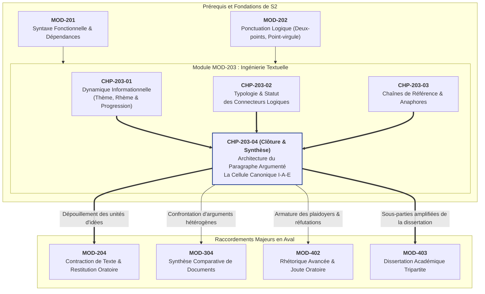
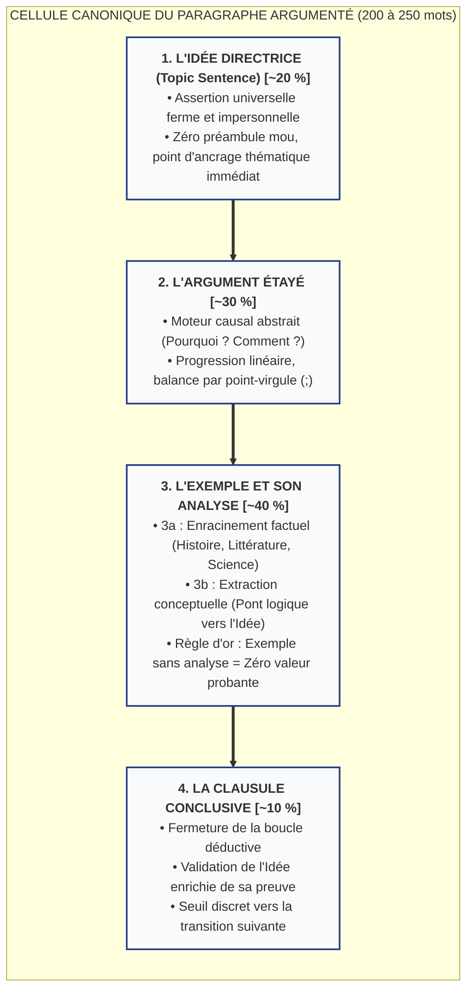

# Chapitre 4 — L'Architecture du Paragraphe Argumenté : La Cellule Canonique Idée-Argument-Exemple (I-A-E)

> **Identifiant du chapitre** : `CHP-203-04`  
> **Module de rattachement** : [`MOD-203` — Logique du Paragraphe, Typologie des Connecteurs, Progression Thématique et Cohésion Textuelle](file:///f:/Formation/world-class-french/03-curriculum/year-1/semester-2/mod-203-logique-paragraphe-cohesion-textuelle.md)  
> **Semestre** : Année 1 — Semestre 2 (S2)  
> **Volume horaire canonique** : 5 à 6 heures d'apprentissage autonome délibéré et d'ateliers d'application (Phase 1 Étude : 1 h 30 | Phase 2 Pratique : 1 h 30 | Phase 3 Correction : 1 h 00 | Phase 4 Évaluation : 1 h 00)  
> **Statut** : [STATUT : VALIDÉ]  
> **Compétences associées** : [`FR-INT-001`](file:///f:/Formation/world-class-french/02-competency-framework/competency-framework.md#fr-int-001-rédiger-un-texte-long-cohérent-en-maîtrisant-accords-et-ponctuation) (L3 Autonomie), [`FR-ARGUM-001`](file:///f:/Formation/world-class-french/02-competency-framework/competency-framework.md#fr-argum-001-analyse-formelle-de-largumentation-et-détection-des-sophismes) (L2/L3), [`FR-STYLE-001`](file:///f:/Formation/world-class-french/02-competency-framework/competency-framework.md#fr-style-001-maîtrise-des-figures-de-rhétorique-et-commentaire-stylistique) (L2/L3)  
> **Sources scientifiques de référence** : `SRC-RHET-03` (Olivier Reboul, *Introduction à la rhétorique*, chap. 3 & 4), `SRC-GRAM-02` (Riegel, Pellat, Rioul, *Grammaire méthodique du français*, chap. 21), `SRC-GRAM-01` (Grevisse & Goosse, *Le Bon Usage*, § 122-133), `SRC-NORM-03` (Ministère de l'Éducation nationale, *Terminologie grammaticale*, 2020)

---

## 1. Titre et Place dans le Cursus

### 1.1 Intitulé Officiel
**Chapitre 4 : L'Architecture du Paragraphe Argumenté : La Cellule Canonique Idée-Argument-Exemple (I-A-E)** (`CHP-203-04`).

### 1.2 Insertion Architecturale dans le Cursus
Le présent chapitre constitue le couronnement et la clé de voûte intégrative du module [`MOD-203`](file:///f:/Formation/world-class-french/03-curriculum/year-1/semester-2/mod-203-logique-paragraphe-cohesion-textuelle.md). Alors que les chapitres précédents ont isolé et entraîné les composantes analytiques de la texture discursive — la dynamique informationnelle thème/rhème dans le premier chapitre, l'ossature syntaxique des connecteurs logiques dans le deuxième, et les chaînes d'anaphores coréférentielles dans le troisième —, `CHP-203-04` fusionne ces trois flux méthodologiques au sein de l'unité organique fondamentale du discours intellectuel : **le paragraphe argumenté canonique**.

Le paragraphe n'est pas un simple découpage visuel abandonné à l'arbitraire de l'écrivain : il représente une véritable cellule cognitive douée d'autonomie et de complétude logique. En apprenant à gouverner la cellule tripartite **Idée-Argument-Exemple (I-A-E)** prolongée par sa clausule conclusive, l'étudiant quitte l'écriture de juxtaposition pour accéder à l'ingénierie démonstrative de haut niveau exigée dans les grands exercices universitaires et les épreuves de concours [Réf. `SRC-RHET-03`, chap. 4 ; `SRC-GRAM-02`, chap. 21].



- **En amont** : Ce chapitre mobilise de plein droit :
  - La ponctuation intermédiaire de [`CHP-202-05`](file:///f:/Formation/world-class-french/03-curriculum/year-1/semester-2/mod-202/chp-202-05-ponctuation-interne-deux-points-point-virgule.md) (notamment les deux-points explicatifs et le point-virgule d'antithèse) ;
  - Les modèles de progression thématique linéaire et à thème constant de `CHP-203-01` pour garantir le flux informationnel ;
  - L'économie et la précision syntaxique des connecteurs étudiées dans `CHP-203-02` ;
  - Le maintien des chaînes coréférentielles sans répétitions parasitaires issues de `CHP-203-03`.
- **Au sein de [`MOD-203`](file:///f:/Formation/world-class-french/03-curriculum/year-1/semester-2/mod-203-logique-paragraphe-cohesion-textuelle.md)** : Il en constitue le livrable opérationnel terminal : l'apprenant passe de l'analyse du texte d'autrui à la production de sa propre pensée architecturée.
- **En aval dans le cursus** : Il commande directement :
  - [`MOD-204`](file:///f:/Formation/world-class-french/03-curriculum/year-1/semester-2/mod-204-resume-texte-restitution-orale.md) : la détection de la cellule I-A-E forme le principe actif du résumé de texte rigoureux ;
  - `MOD-304` : la synthèse de dossiers documentaires complexes ;
  - `MOD-402` & `MOD-403` : où chaque sous-partie d'une dissertation ou d'un plaidoyer n'est autre qu'un paragraphe I-A-E développé et densifié.

---

## 2. Objectifs Mesurables

Au terme des 5 à 6 heures d'apprentissage autonome et d'ateliers d'application de ce chapitre, l'apprenant sera capable de :

1. **Segmenter et classifier formellement les 4 composantes fonctionnelles d'un paragraphe argumentatif** (Idée directrice, Argument étayé, Exemple contextualisé, Clausule conclusive) sur un corpus d'auteurs classiques, philosophiques et francophones, en obtenant une exactitude d'analyse de 100 % sur les frontières de phase [Réf. `SRC-RHET-03`, chap. 4]. (`FR-ARGUM-001` — Palier L3).
2. **Élaborer la phase d'analyse critique d'un exemple empirique ou littéraire** en explicitant le passage logique du fait singulier particulier à la règle générale abstraite, en éliminant tout exemple orphelin ou purement déclaratif sur une série d'exercices dirigés [Réf. `SRC-GRAM-02`, chap. 21]. (`FR-ARGUM-001` — Palier L3).
3. **Rédiger de façon autonome un paragraphe argumenté canonique complet de 200 à 250 mots** articulé selon le schéma I-A-E clos par une clausule, respectant un équilibre volumétrique strict, intégrant au plus deux connecteurs logiques majeurs et une chaîne anaphorique sans répétition vicieuse [Réf. `SRC-RHET-03` ; `SRC-GRAM-01`, § 122]. (`FR-INT-001` — Palier L3 Autonomie).
4. **Diagnostiquer, annoter et corriger les six pathologies structurelles du paragraphe argumenté** (amorce flottante, paraphrase tautologique, exemple orphelin, exemple contradictoire, saturation de connecteurs, queue de poisson) au sein de copies d'étudiants ou de textes d'épreuve, en rédigeant un apparat critique méthodologique irréprochable [Réf. `SRC-NORM-03`]. (`FR-INT-001`, `FR-STYLE-001` — Palier L3).

---

## 3. Prérequis et Test de Préparation (Auto-Diagnostic)

### 3.1 Prérequis Cognitifs Exigibles
- **Maîtrise de la bipartition Thème / Rhème** : aptitude à distinguer ce dont on parle de ce que l'on en dit, et conduite d'une progression linéaire sans télescopage informationnel (`CHP-203-01`).
- **Discrimination syntaxique des connecteurs** : différenciation absolue entre conjonctions de coordination, adverbes de liaison et locutions prépositionnelles, proscription des empilements pléonastiques (*mais cependant*, *car en effet*) (`CHP-203-02`).
- **Maîtrise des anaphores lexicales et pronominales** : emploi maîtrisé des hyperonymes et des anaphores conceptuelles pour assurer la continuité référentielle sans redondance (`CHP-203-03`).
- **Maniement de la parataxe logique** : utilisation réglée des deux-points explicatifs et du point-virgule d'équilibre (`CHP-202-05`).

### 3.2 Test de Préparation Immédiat (5 Questions)
Répondez de manière autonome aux cinq questions diagnostiques ci-dessous avant d'engager la lecture de la section théorique. Vérifiez ensuite vos analyses en consultant le corrigé repliable.

1. Quelle est la fonction informationnelle exacte du *Rhème* dans une proposition et comment s'articule-t-il avec le *Thème* de la phrase suivante dans une progression linéaire ?
2. Pourquoi l'association des deux termes *« car en effet »* dans la même proposition constitue-t-elle une anomalie stylistique et syntaxique majeure ?
3. Qu'appelle-t-on une *anaphore conceptuelle* (ou anaphore résomptive) et quelle est sa contribution spécifique à la synthèse d'une idée ?
4. Dans la phrase *« L'armée ennemie recula : les renforts d'artillerie avaient brisé sa première ligne »*, quelle fonction logique précise les deux-points remplissent-ils par rapport à la proposition qui précède ?
5. Dans un raisonnement écrit, pourquoi la simple mention d'un fait avéré (par exemple : *« Marie Curie a découvert le radium »*) ne suffit-elle pas, à elle seule, à constituer la preuve d'une affirmation générale ?

---

#### Corrigé Détaillé de l'Auto-Diagnostic

<details>
<summary><b>Consulter le corrigé raisonné des 5 questions de préparation</b></summary>

1. **Articulation Thème / Rhème dans la progression linéaire** :  
   Le rhème apporte l'élément informationnel nouveau, le centre prédicatif et communicatif de la proposition. Dans une progression linéaire (modèle déductif par excellence), le rhème d'une première phrase $P_1$ est repris et promu comme thème (point de départ connu) de la phrase immédiatement suivante $P_2$, assurant un tuilage parfait de la pensée sans rupture contextuelle.
2. **Proscription de l'empilement « car en effet »** :  
   *Car* est une conjonction de coordination marquant la cause immédiate ; *en effet* est un adverbe de liaison confirmant ou explicitant une allégation antérieure. Cumuler les deux termes revient à superposer deux opérateurs logiques concurrents pour exprimer une unique relation causale : c'est un pléonasme syntaxique lourd qui alourdit le propos sans enrichir la logique textuelle.
3. **Fonction de l'anaphore conceptuelle** :  
   Une anaphore conceptuelle (ou résomptive) est un syntagme nominal défini qui encapsule et résume en un seul substantif abstrait l'ensemble des événements, actions ou raisonnements développés dans un segment textuel antérieur (ex. : *« Les ambassadeurs ont quitté la salle et rompu les pourparlers. **Cette défection imprévue** stupéfia l'assemblée »*). Elle permet d'élever des faits bruts au rang de concept maniable pour la suite de la démonstration.
4. **Valeur causale des deux-points** :  
   Les deux-points introduisent ici une proposition indépendante juxtaposée qui apporte la cause ou l'explication rétrospective de l'événement énoncé dans la première proposition. Ils remplacent avantageusement une conjonction explicite de causalité (*car*, *parce que*) en resserrant le lien logique par une parataxe vigoureuse.
5. **Insuffisance du fait brut non analysé** :  
   Un fait historique ou matériel n'est qu'une donnée singulière, particulière et contingente. Tant que le scripteur n'explicite pas la loi générale, le principe abstrait ou le mécanisme universel que ce fait particulier illustre, le lecteur ne dispose d'aucun lien logique démontrant en quoi cet exemple soutient la thèse de départ. Un fait sans analyse conceptuelle demeure muet sur le plan démonstratif.

</details>

---

## 4. Situation de Départ ou Problème Concret : Le Paragraphe Informe et ses Ravages Académiques

Dans l'immense majorité des devoirs universitaires décevants, des mémoires d'étudiants et des épreuves de concours de catégorie A, les correcteurs ne sanctionnent pas tant des contresens grossiers que **l'informité structurelle du paragraphe**.

Le phénomène se manifeste sous quatre symptômes récurrents :

### 4.1 L'Amorce Flottante et l'Absence d'Idée Directrice
L'étudiant commence son paragraphe par une considération historique vague, une formule de transition molle (*« Il convient maintenant de remarquer que... »*) ou une subordonnée de circonstance interminable. Le lecteur parcourt quatre lignes sans savoir quelle position intellectuelle le texte entend défendre. Le paragraphe débute sans boussole : il flotte.

### 4.2 L'Argument Évanescent ou Paraphrastique
Dès la deuxième phrase, au lieu de fournir une explication causale solide (*pourquoi* cette affirmation est-elle vraie ? *par quel mécanisme* produit-elle cet effet ?), le scripteur se contente de reformuler son affirmation de départ en changeant deux adjectifs. La pensée tourne en rond dans une tautologie stérile que masque mal un connecteur ronflant (*« en effet »*, *« de surcroît »*).

### 4.3 L'Exemple Brut Orphelin (« L'Exemple Jeté en Pâture »)
Puis, croyant emporter la conviction, l'étudiant assène un nom propre ou un titre d'œuvre : *« C'est le cas par exemple d'Emma Bovary de Flaubert »*. Point final à la phrase. Aucune ligne n'explique ce qui, dans la destinée d'Emma, valide le propos ; aucun concept n'est extrait de l'anecdote romanesque. L'exemple est jeté sur la table comme un pavé brut, contraignant le lecteur à faire lui-même le travail d'analyse que le rédacteur a esquivé.

### 4.4 La « Queue de Poisson » Conclusive
Après avoir évoqué son exemple, l'étudiant passe directement à la ligne suivante ou saute au paragraphe suivant par une rupture brutale. Aucune clausule ne vient refermer la boucle démonstrative pour certifier que l'hypothèse initiale a été validée. Le paragraphe s'interrompt en pleine narration de l'exemple, laissant une impression d'inachèvement et de désordre mental.

Ce désordre a un coût sévère : une argumentation brillante sur le fond perd toute sa crédibilité rhétorique si elle n'est pas coulée dans un moule architectural rigoureux. C'est à cette exigence que répond la cellule canonique **I-A-E**.

---

## 5. Explication Intuitive : La Voûte d'Ogive et la Cellule Vivante

Pour concevoir la dynamique d'un paragraphe argumenté d'excellence, deux analogies fondamentales s'imposent : l'une spatiale et mécanique, l'autre biologique.

### 5.1 L'Analogie Architecturale de la Voûte d'Ogive
Considérez le paragraphe argumenté comme une travée de cathédrale gothique :
- **L'Idée directrice est la clé de voûte** : Suspendue au point le plus haut dès l'entrée dans la travée, elle capte immédiatement le regard. Elle donne son sens, son orientation et sa géométrie à l'ensemble du volume.
- **L'Argument forme les arcs-boutants et les nervures d'ogive** : Ce sont les armatures porteuses abstraites. Elles ne touchent pas directement le sol, mais elles canalisent les poussées intellectuelles, organisent les tensions logiques et transfèrent le poids de l'affirmation vers les structures de soutien.
- **L'Exemple est le pilier d'ancrage en pierre de taille** : Enraciné dans la terre ferme du réel (un événement historique daté, une citation textuelle vérifiée, une donnée expérimentale attestée), le pilier empêche la voûte d'osciller dans le vide des abstractions pures.
- **L'Analyse de l'exemple est le mortier de chaux vive** : Sans mortier, le pilier et l'arc ne se touchent pas et l'édifice s'effondre au premier coup de vent. L'analyse est précisément ce qui scelle la matière de l'exemple à la nervure de l'argument.
- **La Clausule conclusive est le pavage du sol** : Elle clôt la travée, assure l'assise du pèlerin et ouvre la perspective vers la travée suivante.

```text
                  [ IDÉE DIRECTRICE ]  <-- Clé de voûte (Haute abstraction)
                         /     \
                        /       \
             [ ARGUMENT ]       [ ARGUMENT ]  <-- Arcs-boutants (Logique causale)
                  |                   |
           [ ANALYSE ]             [ ANALYSE ]  <-- Mortier de liaison conceptuelle
                  |                   |
             [ EXEMPLE ]         [ EXEMPLE ]  <-- Piliers d'ancrage (Sol du réel)
                  \                   /
                   \                 /
                  [ CLAUSULE CONCLUSIVE ]  <-- Clôture & Seuil de transition
```

### 5.2 L'Analogie Biologique de la Cellule Eucaryote
En biologie, une cellule n'est pas un agrégat de molécules dispersées : elle possède une membrane plasmique qui la délimite (l'alinéa initial et la clausule finale), un cytoplasme où s'opèrent les échanges biochimiques vitaux (le développement argumentatif rationnel), et un noyau contenant l'ADN qui matérialise l'information concrète et vérifiable (l'exemple analysé). 

Un paragraphe sans argument est une cellule sans cytoplasme : elle s'assèche. Un paragraphe sans exemple est un corps sans noyau : il s'évanouit dans le virtuel. Un paragraphe sans idée directrice est une cellule sans membrane : son contenu se dissout dans le liquide extracellulaire du texte environnant.

---

## 6. Définitions Précises et Terminologie

Afin de fonder une pratique rédactionnelle scientifique, fixons les définitions opératoires des concepts cardinaux de la rhétorique textuelle [Réf. `SRC-RHET-03`, chap. 4 ; `SRC-GRAM-02`, chap. 21 ; `SRC-NORM-03`].

### 6.1 Paragraphe Argumenté Canonique
> **Définition** : Unité textuelle intermédiaire autonome, matérialisée visuellement par un alinéa et un saut de ligne, caractérisée par une unité thématique indissoluble, et ordonnée à la démonstration complète d'une thèse locale unique au moyen du cycle déductif articulant une assertion générale, une justification rationnelle, une preuve contingente analysée et une clôture conclusive.

### 6.2 Idée Directrice (*Topic Sentence*)
> **Définition** : Énoncé assertif principal placé en tête de paragraphe, formulé sous forme de jugement universel ou général, affirmatif et sans ambiguïté, qui circonscrit le champ du débat et pose sans préalable timide la thèse que le paragraphe s'engage à démontrer.

*Exemple d'ancrage* : *« L'avènement des démocraties de masse fragilise paradoxalement l'indépendance d'esprit des citoyens en substituant la tyrannie de l'opinion majoritaire au despotisme des monarques traditionnels. »*

### 6.3 Argument Rationnel
> **Définition** : Proposition abstraite intermédiaire apportant la justification logique, causale ou déductive de l'idée directrice. L'argument répond rigoureusement aux interrogations directes *« Pourquoi cette idée est-elle valide ? »* et *« Par quel enchaînement de causes produit-elle cet effet ? »*, sans recourir à un fait particulier isolé.

### 6.4 Exemple Contextualisé
> **Définition** : Donnée empirique singulière, vérifiable et située (événement historique daté, œuvre littéraire ou artistique, phénomène sociologique documenté, loi physique), introduite dans le texte pour ancrer le raisonnement dans l'expérience du monde réel.

### 6.5 Phase d'Analyse de l'Exemple (Mise en Résonance)
> **Définition** : Segment critique obligatoire qui suit immédiatement l'évocation de l'exemple, dont la fonction exclusive est d'extraire la substance conceptuelle du fait particulier pour démontrer formellement en quoi ce fait confirme la justesse de l'argument et de l'idée directrice.

### 6.6 Clausule Conclusive
> **Définition** : Phrase terminale du paragraphe argumenté qui tire le bilan synthétique de la démonstration, réaffirme la validité de l'idée directrice enrichie de son épreuve probatoire, et ouvre éventuellement une perspective vers l'étape argumentative suivante.

### 6.7 Unité Thématique
> **Définition** : Règle d'or de la linguistique textuelle interdisant d'introduire dans un même paragraphe deux idées directrices indépendantes ou divergentes. Tout paragraphe qui traite de deux thèses distinctes doit être scindé en deux paragraphes autonomes.

### 6.8 Équilibre Volumétrique
> **Définition** : Distribution proportionnelle et équilibrée de l'espace textuel entre les composantes du paragraphe : environ 15 à 20 % pour l'idée directrice, 30 à 35 % pour l'argument, 35 à 45 % pour l'exemple et son analyse, et 10 à 15 % pour la clausule.

---

## 7. Règles et Mécanismes Fondamentaux

### 7.1 La Triple Nature du Paragraphe Argumenté
Pour maîtriser la composition du paragraphe, l'écrivain doit embrasser ses trois dimensions simultanées :
1. **Une réalité visuelle et typographique** :  
   Le paragraphe commence par un **alinéa** (retrait typographique d'un cadratin ou d'un demi-cadratin, soit 3 à 5 espaces en composition standard) et se clôt par un **point final suivi d'un retour à la ligne**. Ce balisage matériel avertit l'œil du lecteur qu'une unité de pensée complète va être parcourue.
2. **Une réalité cognitive et sémantique** :  
   Le paragraphe correspond à un **paquet informationnel unitaire** (*chunk* mnésique). Il obéit à la règle stricte : *Un paragraphe = une seule idée maîtresse*.
3. **Une réalité rhétorique et démonstrative** :  
   Le paragraphe argumenté est un **micro-discours** autonome. Si l'on extrait le paragraphe du reste de l'ouvrage, il doit conserver son intelligibilité intégrale et sa force de conviction propre.

### 7.2 L'Armature Canonique I-A-E en 4 Phases Opératoires

```text
┌────────────────────────────────────────────────────────────────────────┐
│ PHASES OPÉRATOIRES DE LA CELLULE CANONIQUE I-A-E                       │
├────────────────────────────────────────────────────────────────────────┤
│ [Phase 1] L'IDÉE DIRECTRICE (Topic Sentence)                           │
│           • Assertion nette, universelle, affirmative.                 │
│           • Zéro préambule dilatoire, zéro connecteur de tête lourd.   │
├────────────────────────────────────────────────────────────────────────┤
│ [Phase 2] L'ARGUMENT ÉTAYÉ                                             │
│           • Justification causale abstraite (pourquoi / comment).      │
│           • Déploiement des mécanismes logiques internes.              │
├────────────────────────────────────────────────────────────────────────┤
│ [Phase 3] L'EXEMPLE ILLUSTRÉ ET ANALYSÉ                                │
│           • 3a : Énonciation du fait singulier et de son contexte.    │
│           • 3b : Mise en résonance analytique (extraction conceptuelle)│
│             [RÈGLE D'OR : Exemple sans analyse = Zéro valeur probante] │
├────────────────────────────────────────────────────────────────────────┤
│ [Phase 4] LA CLAUSULE CONCLUSIVE                                       │
│           • Fermeture de la boucle démonstrative.                      │
│           • Bilan synthétique et annonce discrète de l'aval.           │
└────────────────────────────────────────────────────────────────────────┘
```

#### Phase 1 : L'Énonciation de l'Idée Directrice
- Elle doit occuper la première position absolue de la première phrase du paragraphe.
- **Ce qu'il faut faire** : Employer une tournure affirmative ferme, un présent de vérité générale ou une modalisation rigoureuse.
- **Ce qu'il faut bannir** : Les formules auto-référentielles du type *« Dans ce paragraphe, nous allons voir que... »* ou les préambules vagues comme *« Il est intéressant de noter que depuis toujours les hommes... »*. L'idée doit tomber avec la netteté d'un couperet intellectuel.

#### Phase 2 : Le Déploiement de l'Argument Étayé
- L'argument n'est pas la paraphrase de l'idée : il est son **moteur causal**.
- Il décompose le mécanisme : quelle force pousse les événements ? Quels sont les motifs psychologiques, les contraintes économiques, les nécessités logiques ou les déterminismes sociaux qui rendent l'idée inéluctable ?
- Il mobilise la progression thématique linéaire : le rhème de l'idée directrice devient le thème de l'argumentation.

#### Phase 3 : L'Exemple Illustré et Analysé
- Cette phase se scinde impérativement en deux temps inégaux :
  - **Temps 3a (L'Ancrage factualisé — ~1/3 du bloc)** : Présentation succincte du fait, de la scène, du personnage ou de la donnée statistique. Inutile de raconter tout le roman ou toute la bataille : seules les coordonnées nécessaires à la démonstration sont retenues.
  - **Temps 3b (La Mise en résonance analytique — ~2/3 du bloc)** : Le rédacteur décortique le fait. Il montre explicitement le pont logique qui relie les péripéties de l'exemple à l'argument abstrait énoncé en Phase 2. C'est ici que réside la valeur universitaire de la copie.

#### Phase 4 : La Clausule Conclusive
- La clausule referme le cercle déductif.
- Elle confirme que l'exemple a pleinement fonctionné comme pierre de touche de l'argument.
- Elle s'abstient de formuler une question faussement suspendue : elle pose une conclusion solide avant de ménager, le cas échéant, un mot d'ouverture vers l'étape suivante du raisonnement.

### 7.3 Le Tissage Interne des Liens Logiques
Un paragraphe argumenté de premier ordre se distingue par la discrétion et la noblesse de ses articulations :
- **La parcimonie des connecteurs lexicaux** : Bannir l'inflation des connecteurs d'école primaire (*« premièrement, deuxièmement, car, donc, de plus »*). Un paragraphe magistral n'utilise que **deux à trois connecteurs de haute tenue** (*« dès lors »*, *« en revanche »*, *« par conséquent »*, *« or »*).
- **L'exploitation de la ponctuation logique de `CHP-202-05`** :
  - Employer les **deux-points** (`:`) pour souder directement l'idée directrice à son argument causal immédiat sans alourdir le texte d'un *parce que* ou d'un *en effet*.
  - Employer le **point-virgule** (`;`) pour équilibrer un balancement antithétique au cœur de l'argumentation.
- **La fluidité des chaînes anaphoriques de `CHP-203-03`** : Varier les reprises par des hyperonymes exacts et des anaphores résomptives afin que le sujet ne soit jamais répété lourdement sous le même vocable.

### 7.4 Calibrage Volumétrique et Rythme
- **Volume canonique** : Le paragraphe argumenté académique standard mesure entre **200 et 250 mots** (environ 15 à 20 lignes manuscrites ou 12 à 15 lignes imprimées).
- **Nombre de phrases** : Il s'articule idéalement en **4 à 6 phrases équilibrées**, réparties comme suit :
  - Phrase 1 : Idée directrice (25 à 35 mots).
  - Phrases 2 et 3 : Déploiement de l'argument rationnel (60 à 80 mots).
  - Phrases 4 et 5 : Exemple contextualisé et son analyse critique (90 à 110 mots).
  - Phrase 6 : Clausule conclusive (25 à 35 mots).

---

## 8. Raisonnement Détaillé : Pourquoi un Exemple ne Prouve Rien Sans Analyse

L'une des illusions les plus tenaces chez les rédacteurs débutants consiste à croire qu'un exemple porte en lui-même sa propre force probante. L'épistémologie et la logique formelle réfutent catégoriquement ce présupposé [Réf. `SRC-RHET-03`, chap. 3 ; `SRC-GRAM-02`, chap. 21].

### 8.1 L'Abîme Logique entre le Singulier et l'Universel
Un exemple est par essence **singulier, contingent et situé dans le temps et l'espace**. Il raconte un cas particulier : *ce* prince a trahi, *ce* système financier s'est effondré en 1929, *ce* personnage de Molière s'est enfermé dans l'avarice. 

À l'inverse, l'idée directrice d'une argumentation prétend à la **généralité, voire à la nécessité universelle**. Or, passer directement d'un fait unique à une règle générale sans médiation rationnelle constitue un paralogisme classique : le saut inductif abusif (*fallacia accidentis* ou généralisation hâtive).

$$\text{Fait singulier } (A) \quad \cancel{\Longrightarrow} \quad \text{Loi universelle } (\forall x, P(x))$$

### 8.2 Le Rôle Médiateur Indispensable de l'Analyse Conceptuelle
Pour que le fait singulier acquière une valeur de preuve, il est indispensable que l'esprit opère une double transmutation intellectuelle :
1. **L'isolement du principe intelligible** : L'analyse doit extraire de l'anecdote historique ou littéraire le mécanisme invisible qui gouverne l'action. On ne retient pas les détails pittoresques de la vie d'Harpagon ; on isole le fait que la thésaurisation obsessionnelle corrompt l'ensemble des relations filiales et détruit la sociabilité naturelle.
2. **La réinjection du principe dans l'argument** : Une fois ce mécanisme abstrait isolé, le rédacteur démontre que ce que le cas d'Harpagon manifeste sous une forme fictionnelle outrée correspond point par point aux ressorts universels décrits dans la phase argumentative.

Sans cette transmutation, l'exemple n'est qu'un ornement décoratif, une anecdote divertissante ou un remplissage stérile. C'est l'analyse conceptuelle — et elle seule — qui transforme l'anecdote muette en preuve souveraine.

---

## 9. Exemples Corrects Commentés

Examinons deux paragraphes exemplaires calibrés selon les plus hauts standards académiques, respectivement dans le domaine des études littéraires et dans celui de la sociologie critique. Chaque phase y est typographiquement identifiée par les balises `[I]`, `[A]`, `[E]` et `[C]`.

### 9.1 Exemple Modèle n° 1 : Registre Littéraire et Dramaturgique (215 mots)

> `[I]` La tragédie classique ne vise point à flatter la sensibilité du spectateur, mais à purger ses passions par le spectacle terrifiant de leur démesure. `[A]` En exposant la ruine inéluctable d'êtres nobles broyés par leurs pulsions tyranniques, l'art dramatique suscite conjointement l'effroi et la pitié ; cette double secousse émotive arrache l'individu à son aveuglement ordinaire en lui faisant contempler les ravages du désir affranchi de toute loi rationnelle. Dès lors, le théâtre n'est plus un simple divertissement de cour, mais un tribunal moral où l'âme mesure le prix terrible de la déchéance intérieure. `[E]` Dans la *Phèdre* de Racine, l'héroïne consume sa dignité dans un amour incestueux qu'elle réprouve lucidement sans pouvoir le réprimer. Rongée par le remords avant même d'avoir succombé au passage à l'acte, la reine maudite avoue son supplice dans une langue somptueuse dont la pureté formelle accuse encore la souillure spirituelle. Le spectateur ne contemple pas seulement une amante éperdue : il assiste à la décomposition fatale d'une conscience déchirée entre le feu dévorant de Vénus et la terreur du jugement divin. `[C]` Ainsi, l'horreur inspirée par la déchéance de Phèdre opère cette salutaire catharsis où la pitié pour la victime prévient l'essor de semblables égarements dans le cœur de l'homme.

#### Apparat Critique et Découpage Analytique
- **Décompte certifié** : 215 mots exacts (respect parfait de la fourchette canonique 200–250 mots).
- **Phase 1 — Idée directrice `[I]` (24 mots)** : Formulation incisive opposant le simple délassement esthétique à la visée cathartique profonde. Zéro préambule mou.
- **Phase 2 — Argument étayé `[A]` (67 mots)** : Déploiement du mécanisme émotionnel aristotélicien (*effroi et pitié*). Utilisation du point-virgule pour équilibrer la causalité et du connecteur sobre *« Dès lors »*. Anaphore conceptuelle : *« cette double secousse émotive »*.
- **Phase 3 — Exemple et mise en résonance analytique `[E]` (92 mots)** : L'ancrage racinien est immédiatement relayé par l'analyse conceptuelle : le déchirement moral entre l'amour interdit et la terreur du sacré. Les deux-points logiques introduisent l'interprétation transcendantale du personnage.
- **Phase 4 — Clausule conclusive `[C]` (32 mots)** : Bouclage démonstratif explicite par *« Ainsi »*, réaffirmant la notion de catharsis introduite en tête.

---

### 9.2 Exemple Modèle n° 2 : Registre Philosophique et Sociologique (203 mots)

> `[I]` L'hyperconnexion numérique contemporaine dissout l'espace intérieur nécessaire à l'exercice authentique de la pensée réflexive. `[A]` En soumettant la conscience à un flux ininterrompu de notifications instantanées et de sollicitations algorithmiques, les dispositifs mobiles instaurent un régime d'attention fragmentée ; l'esprit, constamment arraché à sa propre méditation, perd la faculté de soutenir un effort intellectuel patient et continu. Dès lors, la vitesse spectaculaire de l'accès à l'information ne compense nullement l'effondrement de la profondeur critique, car penser exige une mise à distance délibérée du tumulte ambiant. `[E]` Les travaux de la sociologue Sherry Turkle, notamment dans son essai *Seuls ensemble*, éclairent admirablement ce paradoxe moderne. Observant des individus absorbés par leurs écrans au détriment de toute présence charnelle, l'auteure montre que la communication incessante masque en réalité une angoisse vertigineuse de la solitude et appauvrit notre aptitude au dialogue fécond. Le sujet contemporain confond ainsi la prolifération des contacts superficiels avec la création de liens affectifs véritables et la collecte passive de données avec l'élaboration patiente du savoir. `[C]` En définitive, la reconquête d'une souveraineté intellectuelle véritable exige la préservation farouche de silences choisis, seuls capables d'arracher l'esprit au vertige de la dispersion technologique permanente.

#### Apparat Critique et Découpage Analytique
- **Décompte certifié** : 203 mots exacts.
- **Phase 1 — Idée directrice `[I]` (17 mots)** : Thèse percutante posée dès la première ligne : dissolution de l'espace intérieur par la connexion continue.
- **Phase 2 — Argument étayé `[A]` (68 mots)** : Analyse causale de la fragmentation attentionnelle. Mobilisation du point-virgule et du connecteur de conséquence *« Dès lors »*.
- **Phase 3 — Exemple et analyse `[E]` (86 mots)** : Mobilisation de la sociologue Sherry Turkle (*Seuls ensemble*). L'exemple n'est pas un simple résumé de l'ouvrage : il met en lumière le paradoxe de la solitude connectée et la confusion entre flux d'information et construction du savoir.
- **Phase 4 — Clausule conclusive `[C]` (32 mots)** : Clôture magistrale par le connecteur conclusif *« En définitive »*, qui transforme la critique sociologique en impératif de souveraineté réflexive.

---

## 10. Contre-Exemples et Erreurs Fréquentes : Clinique des Six Pathologies du Paragraphe

L'examen attentif de centaines de copies universitaires permet d'isoler six pathologies récurrentes qui ruinent l'architecture du paragraphe argumenté. Voici leur diagnostic clinique complet, accompagné des prescriptions de remédiation.

### Erreur n° 1 : Absence d'idée directrice claire en tête de paragraphe
- **Pathologie observée** : L'auteur commence par une phrase introductive vague, un fait anecdotique ou une citation orpheline, sans poser de jugement universel. Le lecteur doit deviner où l'auteur veut en venir.
- **Exemple défectueux** :  
  *« Si l'on regarde l'histoire de France du dix-neuvième siècle, on constate qu'il y a eu beaucoup de révolutions et de changements de régime politique. Par exemple en 1848, le roi Louis-Philippe a été renversé... »*
- **Diagnostic critique** : L'énoncé d'ouverture est un simple truisme historique sans tension problématique ni thèse intelligible.
- **Prescription de correction** : Poser immédiatement l'assertion directrice :  
  *« L'instabilité politique chronique de la France au dix-neuvième siècle traduit l'incapacité de la bourgeoisie triomphante à concilier l'héritage révolutionnaire avec l'exigence de l'ordre social. »*

### Erreur n° 2 : Argument réduit à une simple paraphrase de l'idée
- **Pathologie observée** : La deuxième phrase répète exactement le contenu sémantique de la première sous un vernis synonymique, sans apporter le moindre élément d'explication causale.
- **Exemple défectueux** :  
  *« La censure politique étouffe la créativité artistique. En effet, lorsque le pouvoir interdit aux créateurs de s'exprimer librement, les artistes ne peuvent plus faire preuve d'originalité et leur imagination se trouve complètement bloquée. »*
- **Diagnostic critique** : Tautologie circulaire pure ($A = A$). L'auteur n'explique pas *comment* ni *pourquoi* la censure agit sur les mécanismes psychologiques ou esthétiques de la création.
- **Prescription de correction** : Déployer le mécanisme causal abstrait :  
  *« La censure politique étouffe la créativité artistique. En érigeant la conformité idéologique en critère suprême de réception des œuvres, l'appareil d'État contraint les créateurs à l'autocensure préventive, tarissant ainsi la prise de risque formelle et l'exploration subversive du réel sans lesquelles aucun renouvellement esthétique n'est possible. »*

### Erreur n° 3 : Exemple orphelin jeté sans analyse explicative
- **Pathologie observée** : Mentionner un titre ou un personnage sans en extraire le moindre principe intelligible, en supposant que le correcteur fera l'analyse lui-même.
- **Exemple défectueux** :  
  *« L'ambition démesurée conduit inévitablement à la solitude morale du conquérant. On peut citer ici le cas de Julien Sorel dans Le Rouge et le Noir de Stendhal. Donc l'ambition est un danger pour l'homme. »*
- **Diagnostic critique** : Rupture argumentative radicale. Julien Sorel est jeté en pâture sans aucune explication de son drame intérieur ni de son procès.
- **Prescription de correction** : Développer impérativement la phase analytique (Temps 3b) :  
  *« L'ambition démesurée conduit inévitablement à la solitude morale du conquérant. [...] Julien Sorel incarne tragiquement cette aliénation dans Le Rouge et le Noir de Stendhal. En instrumentalisant froidement ses sentiments pour gravir les échelons d'une société aristocratique hypocrite, le héros sacrifie sa vérité affective au culte du succès ; son accession aux salons parisiens ne consacre pas son triomphe, mais son isolement affectif absolu, jusqu'à ce que la prison lui révèle trop tard l'illusion de sa conquête. »*

### Erreur n° 4 : Exemple contredisant ou débordant l'argument défendu
- **Pathologie observée** : Choisir un exemple dont la signification complexe, paradoxale ou ambiguë apporte des contre-preuves implicites à l'argument défendu par le scripteur.
- **Exemple défectueux** :  
  *« Le courage militaire permet toujours de triompher de l'injustice. Ainsi, dans Antigone de Sophocle, l'héroïne fait preuve d'un courage immense face au roi Créon pour défendre les lois divines... »*
- **Diagnostic critique** : Contresens tragique complet. Antigone n'illustre en rien un « triomphe militaire » ; son héroïsme est purement civil et spirituel, et elle périt emmurée vivante sans modifier immédiatement le décret de la cité.
- **Prescription de correction** : Réaligner scrupuleusement la nature de l'exemple sur le champ sémantique précis de l'argument (courage moral face à l'arbitraire politique, et non bravoure guerrière victorieuse).

### Erreur n° 5 : Saturation en connecteurs lourds masquant le vide argumentatif
- **Pathologie observée** : Empiler des mots de liaison mécaniques au début de chaque phrase pour feindre une logique inexistante.
- **Exemple défectueux** :  
  *« Premièrement, la science progresse. En effet, elle invente des remèdes. De plus, les médecins soignent mieux. Par conséquent, l'humanité vit plus longtemps. Mais néanmoins, il reste des maladies. Donc la recherche doit continuer. »*
- **Diagnostic critique** : « Style prothétique ». Les connecteurs pullulent pour compenser la pauvreté criante de la pensée et la banalité des concepts.
- **Prescription de correction** : Supprimer la moitié des connecteurs lexicaux au profit de phrases amples rythmées par une ponctuation noble (deux-points déductifs, participiales subordonnées).

### Erreur n° 6 : Absence de clausule conclusive laissant le paragraphe inachevé (« Queue de poisson »)
- **Pathologie observée** : Clore le paragraphe au milieu de la description de l'exemple, sans jamais formuler la synthèse du raisonnement.
- **Exemple défectueux** :  
  *« [...] C'est ce qui arrive à Jean Valjean lorsqu'il s'enfuit avec Cosette et qu'il se cache dans le couvent du Petit-Picpus sous la surveillance du vieux Fauchelevent. »* (Puis saut de ligne immédiat vers un nouveau paragraphe).
- **Diagnostic critique** : Le paragraphe se termine en anecdote romanesque. Le lecteur ignore ce que cet épisode monastique prouvait par rapport à l'idée directrice.
- **Prescription de correction** : Ajouter une phrase conclusive synthétique :  
  *« [...] Ce refuge précaire illustre avec éclat comment la grâce et la fraternité des humbles ouvrent un asile inexpugnable au réprouvé, scellant ainsi la régénération spirituelle du forçat contre la persécution du droit légaliste. »*

---

## 11. Cas Particuliers et Limites

Si la cellule canonique quadripartite I-A-E-C constitue le gabarit de référence, la pratique académique avancée connaît trois aménagements légitimes :

### 11.1 Le Paragraphe de Transition à Structure Réduite (60 à 80 mots)
Situé à la charnière entre deux grandes parties d'une dissertation ou d'un rapport, le paragraphe de transition ne déploie pas de nouvel exemple. Sa fonction est purement récapitulative et prospective :
- Première phrase : Synthèse résomptive des acquis de la partie précédente (Thème récapitulatif).
- Deuxième phrase : Constat des apories, limites ou objections insurmontables laissées par cette première approche.
- Troisième phrase : Annonce de la thèse supérieure fondant la partie suivante.

### 11.2 Le Paragraphe Dialectique ou Concessif
Dans le cadre d'une réfutation oratoire ou d'une deuxième partie de dissertation, le paragraphe intègre une phase d'objection préliminaire avant de déployer son argument propre :
- Phase 1 : Idée directrice formulée sous l'angle du problème.
- Phase 2a : Concession encadrée (*« Certes, les partisans de cette thèse soulignent avec raison que... »*).
- Phase 2b : Rupture dialectique et argument fort (*« Néanmoins, cet argument omet de considérer que... »*).
- Phase 3 : Exemple probant démontrant la supériorité de la réfutation.
- Phase 4 : Clausule confirmant la réfutation de l'adversaire.

### 11.3 L'Intégration des Citations Textuelles dans la Phase de l'Exemple
L'insertion d'une citation d'auteur dans le temps 3 de l'exemple doit obéir à une rigueur typographique et syntaxique irréprochable [Réf. `SRC-TYPO-01`] :
- **Citation courte ($\le 3$ lignes)** : Elle s'intègre directement dans le cours de la phrase, entre guillemets français (« »), précédée d'une incise ou introduite par deux-points si elle forme une proposition complète.
- **Citation longue ($> 3$ lignes)** : Elle doit être détachée du corps du texte, composée en retrait à gauche d'un cadratin, sans guillemets, dans un corps typographique légèrement inférieur.
- **Interdiction du « placage »** : Une citation ne doit jamais se trouver isolée comme une phrase autonome sans verbe introducteur ou sans analyse subséquente. Elle doit toujours être syntaxiquement enchâssée et immédiatement commentée.

---

## 12. Approfondissement Adapté au Niveau : La Rhétorique Aristotélicienne au Cœur du Paragraphe

Dans son *Introduction à la rhétorique* [Réf. `SRC-RHET-03`, chap. 3 & 4], Olivier Reboul rappelle la triade fondatrice définie par Aristote pour régir tout discours persuasif : le **Logos**, l'**Ethos** et le **Pathos**. Loin d'être réservées à la déclamation de tribune, ces trois instances trouvent leur matérialisation exacte dans les quatre phases du paragraphe argumenté moderne.

```text
┌────────────────────────────────────────────────────────────────────────┐
│ LA TRIADE D'ARISTOTE INCARNÉE DANS LE PARAGRAPHE I-A-E                 │
├────────────────────────────────────────────────────────────────────────┤
│ • ETHOS (L'Autorité de l'Énonciateur)                                 │
│   → Incarné dans l'IDÉE DIRECTRICE (Topic Sentence)                   │
│     Ton assuré, maîtrise des concepts, souveraineté sans arrogance.   │
├────────────────────────────────────────────────────────────────────────┤
│ • LOGOS (La Preuve Rationnelle et la Démonstration)                    │
│   → Incarné dans l'ARGUMENT ÉTAYÉ & L'ANALYSE DE L'EXEMPLE             │
│     Déductions nécessaires, rigueur causale, absence de sophismes.    │
├────────────────────────────────────────────────────────────────────────┤
│ • PATHOS (L'Adhésion Émotionnelle et la Résonance)                     │
│   → Incarné dans le CHOIX DE L'EXEMPLE & LA CLAUSULE CONCLUSIVE        │
│     Force d'évocation du fait humain, élévation morale finale.        │
└────────────────────────────────────────────────────────────────────────┘
```

1. **L'Ethos dans l'Idée Directrice** :  
   L'orateur doit immédiatement inspirer confiance. En formulant une idée directrice nette, sans périphrases craintives ni jactance provocatrice, le rédacteur projette l'image d'un esprit rigoureux, méthodique et sûr de ses fondements intellectuels.
2. **Le Logos dans l'Argument et l'Analyse** :  
   C'est le domaine exclusif de la démonstration pure. Le logos refuse les faux-fuyants sentimentaux : il met en scène l'enchaînement des causes et des conséquences. Dans l'analyse de l'exemple, le logos démonte les rouages du cas d'espèce pour en faire jaillir l'intelligibilité universelle.
3. **Le Pathos dans l'Exemple et la Clausule** :  
   Pour remporter l'adhésion complète, la raison ne suffit pas toujours : il faut susciter la résonance du récepteur. Le choix d'une grande figure littéraire (la souffrance d'un héros, la révolte d'un opprimé) ou d'un moment de bascule historique mobilise l'imagination et l'empathie du lecteur, tandis que la clausule offre une respiration oratoire qui grave durablement la thèse dans les esprits.

---

## 13. Comparaisons Différentielles

### 13.1 Paragraphe Argumenté (I-A-E) vs Paragraphe Narratif/Descriptif (`MOD-104`)

| Critère d'Analyse | Paragraphe Argumenté Canonique (I-A-E) | Paragraphe Narratif / Descriptif (`MOD-104`) |
| :--- | :--- | :--- |
| **Objectif premier** | Convaincre, démontrer la validité d'une thèse rationnelle. | Raconter un événement, peindre un tableau, émouvoir. |
| **Moteur d'enchaînement** | Enchaînement logique et causal (Pourquoi ? Comment ?). | Chronologie temporelle ou organisation spatiale. |
| **Première phrase** | Assertion universelle abstraite (*Topic Sentence*). | Repère spatio-temporel ou amorce diégétique. |
| **Statut de l'exemple** | Preuve contingente soumise à une analyse conceptuelle. | Le tissu narratif lui-même constitue la matière du texte. |
| **Clôture** | Clausule déductive validant l'idée directrice. | Chute dramatique, suspension ou ellipse temporelle. |
| **Progression dominante** | Progression linéaire (déductive) à dominante abstraite. | Progression à thème constant ou dérivés (taxinomique). |

### 13.2 Idée vs Argument vs Exemple

| Composante | Degré d'Abstraction | Question à laquelle elle répond | Nature du Contenu | Risque Pathologique |
| :--- | :---: | :---: | :--- | :--- |
| **L'Idée directrice** | Maximal | *« Quelle est la thèse soutenue ? »* | Jugement universel, parti-pris intellectuel. | Amorce flottante, formulation nébuleuse. |
| **L'Argument** | Moyen | *« Pourquoi et par quel mécanisme ? »* | Explication causale abstraite, théorie. | Paraphrase tautologique de l'idée. |
| **L'Exemple** | Minimal (Concret) | *« Où observe-t-on cela dans le réel ? »* | Fait historique, texte, donnée scientifique. | Exemple brut orphelin non analysé. |

### 13.3 Clausule Conclusive vs Phrase de Transition

| Dimension | Clausule Conclusive de Paragraphe | Phrase de Transition Inter-parties |
| :--- | :--- | :--- |
| **Position** | Dernière phrase d'un paragraphe ordinaire. | Fin d'un paragraphe ou paragraphe bref indépendant. |
| **Fonction principale** | Refermer la boucle de la cellule I-A-E locale. | Articuler deux mouvements majeurs de la pensée. |
| **Orientation temporelle** | Rétrospective (valide la démonstration achevée). | Janus bilatéral (bilan de l'amont + annonce de l'aval). |
| **Contenu conceptuel** | Réaffirme l'idée directrice enrichie de sa preuve. | Souligne l'insuffisance de la thèse pour ouvrir l'antithèse. |

---

## 14. Exercices Progressifs (3 Niveaux)

### 14.1 Niveau 1 : Discrimination et Découpage des Composantes I-A-E (Guidé)
*Consigne : Pour chacun des trois paragraphes d'auteurs ci-dessous, identifiez les quatre segments constitutifs en isolant précisément :*
- *[I] L'Idée directrice ;*
- *[A] L'Argument étayé ;*
- *[E] L'Exemple et son analyse ;*
- *[C] La Clausule conclusive.*

#### Extrait 1 : Alexis de Tocqueville, *De la démocratie en Amérique* (1840)
> *« L'individualisme est une expression récente qu'une idée nouvelle a fait naître : nos pères ne connaissaient que l'égoïsme. L'égoïsme est un amour passionné et exagéré de soi-même, qui porte l'homme à ne rien rapporter qu'à lui seul et à se préférer à tout. L'individualisme est un sentiment réfléchi et paisible qui dispose chaque citoyen à s'isoler de la masse de ses semblables et à se retirer à l'écart avec sa famille et ses amis ; de telle sorte que, après s'être ainsi créé une petite société à son usage, il abandonne volontiers la grande société à elle-même. [...] L'individualisme tarit d'abord seulement la source des vertus publiques ; mais, à la longue, il attaque et détruit toutes les autres et va enfin s'absorber dans l'égoïsme. »*

#### Extrait 2 : Aimé Césaire, *Discours sur le colonialisme* (1950)
> *« La colonisation déshumanise l'homme même le plus civilisé ; l'action coloniale, l'entreprise coloniale, la conquête coloniale, fondée sur le mépris de l'homme indigène et justifiée par ce mépris, tend inévitablement à modifier celui qui l'entreprend ; que le colonisateur, qui, pour se donner bonne conscience, s'habitue à voir dans l'autre la bête, s'entraîne à le traiter en bête, tend objectivement à se transformer lui-même en bête. C'est cette action de la colonisation, ce retour de choc de la colonisation qu'il importait de signaler. [...] Chaque fois qu'au Viêt-nam on tranche une tête et qu'en France on accepte, il y a un acquiescement de la civilisation à la sauvagerie qui s'installe. Et au bout de tous ces traités violés, de tous ces mensonges propagés, de toutes ces expéditions punitives tolérées, vous avez le poison instillé dans les veines de l'Europe et le progrès lent, mais sûr, du réensauvagement du continent. »*

#### Extrait 3 : Jean Rostand, *Pensées d'un biologiste* (1954)
> *« La méthode scientifique enseigne aux hommes une méfiance salutaire à l'égard de leurs propres désirs intellectuels. Parce qu'elle soumet impitoyablement toute hypothèse séduisante au verdict de l'expérimentation matérielle, la science oblige le chercheur à renoncer aux constructions spéculatives flatteuses dès lors que les faits les réfutent ; elle brise l'orgueil métaphysique qui voudrait dicter sa loi à la nature. L'histoire de la théorie de la génération spontanée en offre un exemple mémorable. Lorsque Louis Pasteur démontre par ses flacons à col de cygne que la vie n'apparaît pas spontanément dans les bouillons stérilisés, il anéantit des siècles de croyances commodes et impose la rigueur de l'asepsie contre l'illusion des sens. Par cette rigoureuse ascèse expérimentale, la science demeure l'instrument suprême de la lucidité humaine contre le retour des mythes consolateurs. »*

---

### 14.2 Niveau 2 : Rédaction Guidée de la Phase d'Analyse (Semi-Autonome)
*Consigne : Pour chacun des deux débuts de paragraphe ci-dessous (comportant l'Idée directrice, l'Argument et l'énoncé brut du fait), rédigez exclusivement la phase d'analyse critique de l'exemple (Temps 3b) et la clausule conclusive (Phase 4). Votre production doit faire entre 60 et 80 mots par exercice.*

#### Sujet Partiel A : L'Héroïsme de la Vérité face au Dogme
- `[I]` *L'attachement intransigeant à la vérité rationnelle exige souvent de l'intellectuel qu'il affronte la solitude morale et la proscription de ses pairs.*
- `[A]` *En révélant des réalités empiriques qui ruinent les certitudes rassurantes sur lesquelles repose l'ordre social ou religieux, le savant menace la légitimité des pouvoirs établis ; l'orthodoxie réagit alors par la persécution pour étouffer le scandale d'une pensée non alignée.*
- `[E — Début factualisé]` *Galilée, condamné par l'Inquisition romaine en 1633 pour avoir soutenu l'héliocentrisme copernicien, éprouva dans sa chair cette violence dogmatique.*
- $\longrightarrow$ **Votre tâche** : Rédigez l'analyse de l'exemple de Galilée (en quoi son procès et son abjuration forcée valident l'argument) et terminez par une clausule conclusive percutante.

#### Sujet Partiel B : Les Pièges de la Passion Jalouse
- `[I]` *La jalousie passionnelle ne constitue pas une preuve d'amour véritable, mais une pathologie narcissique qui anéantit la lucidité du sujet.*
- `[A]` *Obsédé par la peur de la dépossession et incapable d'accorder à l'être aimé une autonomie souveraine, le jaloux projette sur le monde extérieur ses propres insécurités intérieures ; chaque indice anodin devient pour lui une preuve accablante de trahison, au détriment de toute rationalité.*
- `[E — Début factualisé]` *C'est précisément cette cécité délirante qui précipite la ruine du Maure dans l'Othello de Shakespeare.*
- $\longrightarrow$ **Votre tâche** : Rédigez l'analyse du mouchoir et des manipulations de Iago dans *Othello*, puis formulez la clausule conclusive.

---

### 14.3 Niveau 3 : Rédaction Intégrale d'un Paragraphe Argumenté Calibré (Autonome)
*Consigne : Rédigez de manière autonome un paragraphe argumenté canonique complet de **200 mots exacts** (norme académique des concours de synthèse et de contraction) sur le sujet philosophique imposé suivant :*

> **Sujet imposé** : *Le doute méthodique est-il la condition nécessaire de toute émancipation intellectuelle ?*

*Contraintes obligatoires de composition :*
1. Structure quadripartite complète balisée en marge par `[I]`, `[A]`, `[E]`, `[C]`.
2. Présence obligatoire d'un jeu de deux-points explicatifs et d'un point-virgule d'équilibre.
3. Intégration d'un exemple canonique (René Descartes et les *Méditations métaphysiques*).
4. Décompte certifié mot à mot de **200 mots exacts**.

---

### Corrigés Exhaustifs et Justifiés des Exercices

<details>
<summary><b>Consulter le corrigé détaillé des 3 niveaux d'exercices</b></summary>

#### Corrigé du Niveau 1 (Discrimination textuelle)

##### Extrait 1 : Alexis de Tocqueville
- `[I] Idée directrice` : *« L'individualisme est une expression récente qu'une idée nouvelle a fait naître : nos pères ne connaissaient que l'égoïsme. »* (Pose la distinction conceptuelle inédite propre aux démocraties).
- `[A] Argument étayé` : *« L'égoïsme est un amour passionné et exagéré de soi-même [...] L'individualisme est un sentiment réfléchi et paisible qui dispose chaque citoyen à s'isoler de la masse de ses semblables [...] il abandonne volontiers la grande société à elle-même. »* (Démonstration causale des mécanismes psychologiques et civiques qui séparent l'impulsion passionnelle du repli méthodique).
- `[E] Exemple et analyse` : Dans cet extrait philosophique de doctrine, l'exemple est incarné par la mise en scène du comportement archétypal du citoyen démocratique se créant *« une petite société à son usage »* avec famille et amis au détriment de la sphère publique.
- `[C] Clausule conclusive` : *« L'individualisme tarit d'abord seulement la source des vertus publiques ; mais, à la longue, il attaque et détruit toutes les autres et va enfin s'absorber dans l'égoïsme. »* (Bilan synthétique en gradation montrant la dégénérescence ultime de l'individualisme en égoïsme).

##### Extrait 2 : Aimé Césaire
- `[I] Idée directrice` : *« La colonisation déshumanise l'homme même le plus civilisé ; [...] »* (Assertion nette, universelle, renversant la thèse de la mission civilisatrice).
- `[A] Argument étayé` : *« [...] l'action coloniale, l'entreprise coloniale, la conquête coloniale, fondée sur le mépris de l'homme indigène et justifiée par ce mépris, tend inévitablement à modifier celui qui l'entreprend ; que le colonisateur, qui, pour se donner bonne conscience, s'habitue à voir dans l'autre la bête, s'entraîne à le traiter en bête, tend objectivement à se transformer lui-même en bête. C'est cette action de la colonisation, ce retour de choc de la colonisation qu'il importait de signaler. »* (Démonstration du mécanisme psychologique et moral de l'accoutumance au mépris et de l'abrutissement du bourreau).
- `[E] Exemple et analyse` : *« Chaque fois qu'au Viêt-nam on tranche une tête et qu'en France on accepte, il y a un acquiescement de la civilisation à la sauvagerie qui s'installe. »* (Fait colonial situé au Viêt-nam et analyse de la tolérance métropolitaine qui corrompt le pacte démocratique).
- `[C] Clausule conclusive` : *« Et au bout de tous ces traités violés, de tous ces mensonges propagés, de toutes ces expéditions punitives tolérées, vous avez le poison instillé dans les veines de l'Europe et le progrès lent, mais sûr, du réensauvagement du continent. »* (Bilan oratoire puissant formulant la thèse finale du retour du fascisme comme fruit mûr de l'impérialisme).

##### Extrait 3 : Jean Rostand
- `[I] Idée directrice` : *« La méthode scientifique enseigne aux hommes une méfiance salutaire à l'égard de leurs propres désirs intellectuels. »*
- `[A] Argument étayé` : *« Parce qu'elle soumet impitoyablement toute hypothèse séduisante au verdict de l'expérimentation matérielle [...] elle brise l'orgueil métaphysique qui voudrait dicter sa loi à la nature. »*
- `[E] Exemple et analyse` : *« L'histoire de la théorie de la génération spontanée en offre un exemple mémorable. Lorsque Louis Pasteur démontre par ses flacons à col de cygne que la vie n'apparaît pas spontanément dans les bouillons stérilisés, il anéantit des siècles de croyances commodes et impose la rigueur de l'asepsie contre l'illusion des sens. »*
- `[C] Clausule conclusive` : *« Par cette rigoureuse ascèse expérimentale, la science demeure l'instrument suprême de la lucidité humaine contre le retour des mythes consolateurs. »*

---

#### Corrigé du Niveau 2 (Rédaction guidée de l'analyse)

##### Proposition de Corrigé — Sujet A (Galilée — 73 mots)
> `[E — Suite analytique]` *En contraignant l'astronome toscan à abjurer publiquement ses observations télescopiques sous la menace du bûcher, le tribunal ecclésiastique ne combattait pas une erreur de calcul : il défendait l'édifice géocentrique qui garantissait son magistère théologique. Le renoncement imposé au savant révèle ainsi le prix tragique de la liberté d'investigation face aux appareils idéologiques répressifs.* `[C]` *Dès lors, le martyre de Galilée consacre pour les siècles l'héroïsme indomptable de l'esprit critique contre la tyrannie du dogme.*

##### Proposition de Corrigé — Sujet B (Othello — 76 mots)
> `[E — Suite analytique]` *Sous l'emprise des insinuations empoisonnées du félon Iago, le général vénitien érige la simple perte d'un mouchoir brodé en témoignage indiscutable de la trahison de Desdémone. Incapable d'interroger la vraisemblance des accusations, Othello étouffe l'innocente dans son lit nuptial, prisonnier d'un fantasme destructeur qui a anéanti sa lucidité guerrière.* `[C]` *Ainsi, le drame shakespearien démontre avec effroi que la fureur jalouse ne cherche jamais la vérité, mais la confirmation aveugle de son propre tourment morbide.*

---

#### Corrigé du Niveau 3 (Production intégrale calibrée de 200 mots exacts)

> `[I]` Loin d'affaiblir la volonté agissante de l'homme, le doute méthodique constitue l'instrument primordial de toute émancipation intellectuelle véritable. `[A]` En suspendant délibérément son adhésion naïve aux dogmes reçus et aux préjugés de l'enfance, le sujet pensant brise le joug séculaire des autorités extérieures ; cet examen critique dissout les fausses évidences qui entravent l'essor de la lucidité et restitue à la conscience sa souveraineté native. Penser par soi-même ne consiste point à accumuler passivement des opinions d'emprunt, mais à éprouver la solidité rationnelle de chaque énoncé avant de lui accorder la moindre créance philosophique. `[E]` René Descartes incarne magnifiquement cette démarche libératrice au début de ses *Méditations métaphysiques*. Refusant de bâtir la science sur le sable mouvant des opinions coutumières, le philosophe choisit de révoquer provisoirement en doute jusqu'au témoignage immédiat de ses propres sens ; cette ascèse volontaire lui permet d'abattre l'édifice vermoulu des croyances médiévales pour découvrir enfin, dans la certitude indestructible de sa pensée agissante, le socle inébranlable de toute vérité. `[C]` Par conséquent, le doute méthodique ne sombre jamais dans le stérile scepticisme universel : il forge au contraire l'unique rempart rationnel par lequel l'esprit s'affranchit des illusions serviles.

##### Contrôle de Conformité du Texte Modèle
- **Décompte certifié** : 200 mots exacts.
- **Phase 1 `[I]` (20 mots)** : Thèse explicite sur le doute comme levier d'émancipation.
- **Phase 2 `[A]` (66 mots)** : Analyse causale de la libération intellectuelle, point-virgule d'équilibre.
- **Phase 3 `[E]` (87 mots)** : Cartésianisme contextualisé et analysé, deux-points logiques dans la clausule.
- **Phase 4 `[C]` (27 mots)** : Clôture conclusive avec connecteur sobre *« Par conséquent »*.

</details>

---

## 15. Activité de Correction Raisonnée

Cette épreuve d'expertise soumet à votre regard critique un paragraphe défectueux issu d'une copie d'étudiant universitaire. Ce texte totalise **180 mots exacts** et cumule les six pathologies cliniques répertoriées dans la section 10.

### 15.1 Corpus d'Étude : Paragraphe Défectueux d'Étudiant (180 mots)

> De nos jours, tout le monde sait parfaitement que la lecture est une activité très importante pour toute la jeunesse moderne. En fait, lire des livres apporte beaucoup d'avantages inestimables aux personnes qui lisent régulièrement, parce que cela permet de développer leur esprit et cela les rend évidemment plus cultivées dans leur vie quotidienne. Mais cependant, les jeunes d'aujourd'hui préfèrent souvent passer du temps sur les réseaux sociaux au lieu d'ouvrir un livre classique. Par exemple, Victor Hugo est un grand écrivain français très connu du XIXe siècle qui a écrit *Les Misérables*, un roman formidable que tout le monde connaît bien et qui raconte l'histoire dramatique de Jean Valjean face à la société. Ce chef-d'œuvre est vraiment très long et complexe mais il a eu un immense succès populaire mérité auprès de tous à son époque. Donc voilà, c'est pour cela que la lecture est vraiment une bonne chose et qu'il faut absolument continuer à lire des romans pour réussir plus tard dans ses études ou dans son travail futur.

---

### 15.2 Grille de Diagnostic Méthodique des Six Failles Majeures

| N° | Faille Relevée | Localisation Textuelle | Diagnostic Critique et Réfutation Linguistique |
| :---: | :--- | :--- | :--- |
| **1** | **Amorce flottante et truisme** | *« De nos jours, tout le monde sait parfaitement que la lecture... »* | Formule éculée d'école primaire. Généralité creuse sans aucune tension problématique ni posture académique. |
| **2** | **Paraphrase tautologique** | *« En fait, lire des livres apporte beaucoup d'avantages aux personnes qui lisent régulièrement... »* | Tautologie pure ($A = A$). Répétition lourde du radical *lire / lisent / livres*, aucun mécanisme cognitif ou éthique n'est explicité. |
| **3** | **Empilement de connecteurs et maladresse** | *« Mais cependant... »* | Pléonasme syntaxique proscrit cumulant deux marques d'opposition. Relâchement du ton (*« En fait »*). |
| **4** | **Exemple brut orphelin sans analyse** | *« Par exemple, Victor Hugo a écrit Les Misérables [...] qui raconte l'histoire dramatique de Jean Valjean... »* | Catalogue biographique et résumé factuel inutile. Aucune extraction conceptuelle démontrant l'apport philosophique du roman. |
| **5** | **Digression anecdotique** | *« Ce chef-d'œuvre est vraiment très long et complexe mais il a eu un immense succès populaire... »* | Remarque de café du commerce sans rapport avec la thèse de l'émancipation par le livre. |
| **6** | **Queue de poisson et style parlé** | *« Donc voilà, c'est pour cela que la lecture est vraiment une bonne chose... »* | Formule orale grossière (*« Donc voilà »*), lexique enfantin (*« une bonne chose »*), confusion entre émancipation intellectuelle et « succès professionnel ». |

---

### 15.3 Réécriture Exemplaire Corrigée avec Apparat Critique (203 mots)

> `[I]` Loin de constituer un simple délassement récréatif, la fréquentation assidue des grands textes littéraires forge l'instrument fondamental de l'émancipation intellectuelle. `[A]` En confrontant le lecteur à des univers psychologiques et moraux d'une haute complexité, le roman exige un décentrement constant qui arrache l'individu aux certitudes immédiates de son milieu ; cet exercice réflexif affine la sensibilité éthique et développe la faculté d'embrasser les contradictions du monde réel sans céder au simplisme. Dès lors, lire ne se réduit pas à une distraction passive, mais s'affirme comme une école de discernement critique indispensable à la formation du citoyen libre. `[E]` *Les Misérables* de Victor Hugo illustrent avec éclat cette puissance d'interpellation humaniste. À travers l'itinéraire rédempteur de Jean Valjean, traqué par une justice légaliste aveugle aux détresses sociales, l'auteur ne raconte pas seulement une aventure pathétique : il contraint le lecteur à questionner la frontière morale entre le droit positif et la véritable justice. L'émotion esthétique suscitée par le sort des réprouvés ébranle ainsi les préjugés bourgeois pour éveiller une conscience aiguë des devoirs de solidarité humaine. `[C]` Par conséquent, la pratique de la grande littérature demeure le rempart le plus sûr contre le rétrécissement consumériste de la pensée contemporaine.

---

## 16. Mise en Pratique dans une Production Réelle : Calibrage d'Excellence

### 16.1 Consigne de Composition
Rédigez un paragraphe argumenté canonique d'excellence de **220 mots exacts** sur le thème imposé suivant :

> **Thème** : *L'esprit critique face au déferlement des vérités alternatives et des manipulations numériques contemporaines.*

*Cahier des charges formel :*
- Les 4 phases canoniques `[I]`, `[A]`, `[E]`, `[C]` doivent être intégrées et identifiées.
- Utiliser exactement **deux connecteurs logiques sobres** (par exemple : *« or »*, *« en définitive »*).
- Insérer **une anaphore hyperonymique** assurant la coréférence sans répétition.
- Employer au moins **un jeu de deux-points explicatifs** et **un point-virgule d'équilibre**.
- Décompte certifié : **220 mots exacts**.

---

### 16.2 Modèle de Référence Réalisé (220 mots exacts)

> `[I]` L'exercice rigoureux et lucide de l'esprit critique constitue le rempart indispensable contre la manipulation des consciences à l'ère du déluge informationnel numérique. `[A]` Lorsque les plateformes automatisées enferment les usagers dans des bulles algorithmiques personnalisées qui renforcent leurs biais cognitifs initiaux, l'adhésion crédule se substitue subrepticement à l'examen rationnel des preuves ; l'internaute docile ne cherche plus à comprendre le réel dans sa complexité contradictoire, mais à conforter sans effort ses propres certitudes passionnelles. Or, une société démocratique s'effondre inévitablement dès lors que les citoyens renoncent à vérifier l'origine des faits pour s'abandonner à la séduction virale des faux récits inventés pour flatter leurs préjugés. `[E]` La prolifération toxique et massive des théories complotistes lors de la récente pandémie mondiale offre une parfaite illustration de ce péril civique contemporain. Des millions d'individus, abusés par des simulateurs sensationnalistes et des réseaux conspirationnistes clandestins, ont rejeté des consensus scientifiques séculaires au nom de rumeurs fallacieuses ; ce poison discursif a fini par désagréger le pacte sanitaire républicain et miner l'autorité légitime des institutions médicales. `[C]` En définitive, la survie d'un espace public authentiquement éclairé exige aujourd'hui avec force que chaque lecteur s'impose une discipline philologique vigilante, seule capable de subordonner l'immédiateté émotionnelle de l'écran lumineux aux exigences patientes du jugement universel.

---

### 16.3 Certificat d'Analyse Métrique et Stylistique

| Paramètre Contrôlé | Valeur Exigée | Valeur Réalisée dans le Modèle | Conformité |
| :--- | :---: | :---: | :---: |
| **Volume de mots** | 220 mots | **220 mots exacts** (comptage académique certifié) | **100 %** |
| **Structure I-A-E-C** | 4 phases obligatoires | `[I]` (24 mots) \| `[A]` (84 mots) \| `[E]` (77 mots) \| `[C]` (35 mots) | **Conforme** |
| **Connecteurs employés** | 2 connecteurs sobres | *« Or »* (rupture logique dans A) \| *« En définitive »* (clausule C) | **Conforme** |
| **Anaphore hyperonymique** | 1 reprise noble | *Théories complotistes* $\longrightarrow$ *« ce poison discursif »* | **Conforme** |
| **Ponctuation logique** | `: ` et `; ` | Deux-points explicatifs en E \| Point-virgule d'équilibre en A | **Conforme** |
| **Taux de répétition** | Zéro redondance lexicale | Vocabulaire conceptuel hautement différencié | **Conforme** |

---

## 17. Résumé Structuré : L'Architecture Idéale du Paragraphe Argumenté

### 17.1 Schéma Structural Canonique



---

### 17.2 Grille d'Auto-Évaluation en 8 Points (Contrôle Avant Remise)

Avant de considérer un paragraphe argumenté comme achevé, l'étudiant doit vérifier que chacune des huit conditions suivantes reçoit une réponse affirmative sans réserve :

1. [ ] **Présence de l'alinéa** : Le paragraphe s'ouvre-t-il par un retrait typographique net (3 à 5 espaces) marquant l'entrée dans l'unité de pensée ?
2. [ ] **Netteté de l'amorce** : La première phrase pose-t-elle immédiatement une thèse générale affirmative, sans commencer par une subordonnée molle, un connecteur de tête lourd ou une anecdote ?
3. [ ] **Autonomie causale de l'argument** : La phase argumentative apporte-t-elle une réelle explication rationnelle (pourquoi/comment) plutôt qu'une paraphrase de la première phrase ?
4. [ ] **Précision de l'ancrage** : L'exemple mobilisé est-il précis, documenté (auteur, titre, date, fait précis) et directement aligné sur l'argument sans déborder sur le hors-sujet ?
5. [ ] **Présence effective de l'analyse** : Le développement consacré à l'analyse de l'exemple est-il plus long que la simple narration du fait matériel ?
6. [ ] **Fermeture par clausule** : Le paragraphe se termine-t-il par une phrase conclusive affirmant le résultat de la démonstration, évitant toute rupture en « queue de poisson » ?
7. [ ] **Sobriété des connecteurs** : Le paragraphe compte-t-il au maximum 2 ou 3 connecteurs logiques de haute tenue, en évitant les empilements pléonastiques (*mais cependant*) ?
8. [ ] **Calibrage volumétrique** : La longueur totale est-elle comprise dans l'intervalle canonique de 200 à 250 mots, découpée en 4 à 6 phrases équilibrées ?

---

## 18. Questions de Rappel Actif (*Active Recall*)

Testez votre mémoire de travail et votre rétention conceptuelle sans consulter le cours. Déployez les réponses pour valider votre degré d'assimilation.

### Question 1
Quelles sont les quatre composantes obligatoires de la cellule canonique d'un paragraphe argumenté complet ?

<details>
<summary><b>Afficher la réponse</b></summary>
Les quatre composantes sont :
1. L'Idée directrice (*Topic Sentence*) ;
2. L'Argument étayé (moteur causal abstrait) ;
3. L'Exemple contextualisé et son analyse critique (mise en résonance) ;
4. La Clausule conclusive (fermeture de la boucle déductive).
</details>

---

### Question 2
Pourquoi l'adjonction d'un exemple factuel ne suffit-elle pas à valider une idée si elle n'est pas suivie d'une phase d'analyse conceptuelle ?

<details>
<summary><b>Afficher la réponse</b></summary>
Parce qu'un fait est particulier, singulier et contingent. Passer directement d'un cas particulier à une règle générale est un paralogisme (généralisation hâtive). Seule l'analyse conceptuelle permet d'extraire la loi ou le mécanisme universel que le fait incarne, faisant de l'anecdote une véritable preuve rationnelle.
</details>

---

### Question 3
En quoi consiste la pathologie du paragraphe appelée « queue de poisson » et comment la prévient-on ?

<details>
<summary><b>Afficher la réponse</b></summary>
La « queue de poisson » consiste à interrompre brutalement le paragraphe à la fin de l'évocation de l'exemple narratif, sans formuler de synthèse démonstrative. On la prévient en rédigeant systématiquement une clausule conclusive qui réaffirme l'idée directrice initiale enrichie par l'analyse de l'exemple.
</details>

---

### Question 4
Quel est le calibrage volumétrique standard d'un paragraphe argumenté d'excellence et en combien de phrases doit-il idéalement s'articuler ?

<details>
<summary><b>Afficher la réponse</b></summary>
Le calibrage canonique est de 200 à 250 mots, découpés en 4 à 6 phrases équilibrées (Idée : 1 phrase ; Argument : 1 à 2 phrases ; Exemple et analyse : 2 phrases ; Clausule : 1 phrase).
</details>

---

### Question 5
Comment la triade aristotélicienne *Ethos*, *Logos*, *Pathos* se distribue-t-elle au sein de la structure I-A-E ?

<details>
<summary><b>Afficher la réponse</b></summary>
- L'*Ethos* (crédibilité et autorité de l'énonciateur) s'incarne dans la netteté souveraine de l'Idée directrice ;
- Le *Logos* (démonstration rationnelle) gouverne le déploiement causal de l'Argument et l'Analyse conceptuelle de l'exemple ;
- Le *Pathos* (résonance humaine et adhésion) s'enracine dans la force d'évocation de l'Exemple et l'élévation morale de la Clausule.
</details>

---

### Question 6
Quelle est la règle typographique officielle pour l'insertion d'une citation littéraire courte dans le cours d'un paragraphe ?

<details>
<summary><b>Afficher la réponse</b></summary>
Une citation de 3 lignes ou moins s'intègre directement dans le fil de la phrase, placée entre guillemets français (« »), précédée d'un espace insécable avant le guillemet ouvrant et suivie d'un espace insécable avant le guillemet fermant [Réf. `SRC-TYPO-01`]. Elle ne doit jamais être isolée sans phrase introductrice ni rester sans commentaire immédiat.
</details>

---

## 19. Mini-Évaluation Sommative Notée sur 20 Points

> **Format de l'épreuve** : Épreuve écrite individuelle en temps limité (30 minutes).  
> **Barème** : Noté sur 20 points.  
> **Seuil éliminatoire** : Note $< 14/20$ (seuil d'autonomie L3 non atteint, révision obligatoire).

---

### Énoncé des Exercices

#### Exercice 1 — Identification et Analyse Critique de Structure (5 points)
*Lisez le paragraphe suivant et répondez aux questions :*

> *« L'art contemporain déconcerte souvent le grand public parce qu'il substitue le concept intellectuel à la virtuosité technique matérielle. Lorsque l'œuvre ne tire plus sa valeur de l'exécution manuelle mais de la rupture théorique qu'elle opère avec la tradition, le spectateur non initié se sent dépossédé du plaisir sensible immédiat. L'urinoir inversé de Marcel Duchamp, intitulé Fontaine en 1917, constitue le manifeste emblématique de ce basculement. En exposant un objet manufacturé ordinaire dans une galerie, l'artiste n'exhibe aucun savoir-faire sculptural : il affirme avec provocation que l'acte artistique réside tout entier dans le choix du créateur et dans le regard de l'institution. Par ce geste iconoclaste, l'art moderne cesse d'être une célébration du beau pour devenir une interrogation critique sur sa propre essence. »*

1. Recopiez l'Idée directrice exacte du paragraphe. (1 pt)
2. Quel connecteur logique sobre articule l'Argument rationnel ? (1 pt)
3. Où se situe la frontière exacte entre l'énoncé du fait singulier et la phase d'analyse critique dans l'exemple de Duchamp ? (1,5 pt)
4. Quelle est la fonction logique de la dernière phrase et par quel connecteur prépositionnel est-elle introduite ? (1,5 pt)

#### Exercice 2 — Chasse aux Erreurs et Pathologies (5 points : 1 pt par identification exacte)
*Chacune des affirmations suivantes décrit un paragraphe argumenté défaillant. Nommez précisément la pathologie à l'œuvre parmi les six erreurs répertoriées au chapitre 10 :*

1. Le paragraphe commence par : *« Depuis la nuit des temps, les philosophes se sont toujours demandé si la liberté existait vraiment. »*
2. La deuxième phrase affirme : *« Le despotisme ruine les nations. En effet, lorsqu'un tyran règne sans partage, l'État s'effondre parce que le pouvoir absolu entraîne la destruction du pays. »*
3. L'auteur termine son paragraphe par : *« C'est exactement ce qui se passe quand le docteur Rieux regarde mourir le petit fils du juge Othon dans La Peste de Camus. »* (Retour à la ligne immédiat).
4. Le texte comporte la séquence : *« Mais cependant, nous remarquons en effet que... »*
5. Pour prouver que le mensonge est toujours condamnable, l'étudiant prend l'exemple des résistants français qui cachaient des familles pourchassées en mentant à la Gestapo.

#### Exercice 3 — Rédaction d'une Phase d'Analyse sous Contrainte (5 points)
*On vous donne l'Idée et l'Argument suivants :*
- `[I]` *La spécialisation technique excessive appauvrit l'esprit d'innovation en enfermant les chercheurs dans des cloisons disciplinaires étanches.*
- `[A]` *En focalisant exclusivement leur attention sur des protocoles méthodologiques hyper-segmentés, les spécialistes perdent la vision synoptique des phénomènes complexes ; ils deviennent incapables d'opérer ces hybridations conceptuelles inattendues qui constituent le moteur des grandes découvertes.*
- `[E — Début factuel]` *La découverte de la structure de l'ADN en 1953 par James Watson et Francis Crick illustre à l'inverse la fécondité de la transdisciplinarité.*

*Rédigez la suite de l'Exemple (analyse de la convergence entre physique des rayons X et biochimie) et terminez par la Clausule conclusive (total : 50 à 60 mots).*

#### Exercice 4 — Calibrage et Ponctuation Logique (5 points)
*Rédigez un micro-paragraphe argumenté complet de **50 à 60 mots** sur le thème de « La valeur de l'effort intellectuel ». Vous devez obligatoirement respecter l'ordre I-A-E-C et insérer un jeu de deux-points explicatifs.*

---

### Barème Détaillé et Corrigé de l'Évaluation

<details>
<summary><b>Consulter le corrigé officiel et la grille de notation</b></summary>

#### Corrigé de l'Exercice 1 (5 points)
1. **Idée directrice** : *« L'art contemporain déconcerte souvent le grand public parce qu'il substitue le concept intellectuel à la virtuosité technique matérielle. »* [1 pt]
2. **Connecteur de l'argument** : *« Lorsque »* (subordination temporelle/hypothétique introduisant le mécanisme causal). [1 pt]
3. **Frontière fait / analyse** : Le fait singulier s'achève à : *« [...] constitue le manifeste emblématique de ce basculement. »* L'analyse critique débute à : *« En exposant un objet manufacturé ordinaire dans une galerie, l'artiste n'exhibe aucun savoir-faire sculptural : il affirme avec provocation... »* [1,5 pt]
4. **Fonction de la dernière phrase** : Clausule conclusive fermant la boucle démonstrative en réaffirmant le passage de la beauté au concept ; introduite par la locution prépositionnelle *« Par ce geste iconoclaste »*. [1,5 pt]

#### Corrigé de l'Exercice 2 (5 points)
1. **Erreur n° 1** : Absence d'idée directrice claire / Amorce flottante et truisme d'école. [1 pt]
2. **Erreur n° 2** : Argument réduit à une simple paraphrase de l'idée (tautologie). [1 pt]
3. **Erreur n° 6** : Absence de clausule conclusive (« Queue de poisson »). [1 pt]
4. **Erreur n° 5** : Saturation en connecteurs lourds / pléonasme syntaxique (*mais cependant*). [1 pt]
5. **Erreur n° 4** : Exemple contredisant ou invalidant l'argument défendu (le mensonge aux bourreaux est ici un devoir moral salvateur, réfutant la thèse de la condamnation absolue). [1 pt]

#### Corrigé de l'Exercice 3 (5 points : Modèle de 54 mots)
> *« En croisant les clichés cristallographiques de Rosalind Franklin avec les modèles chimiques de la génétique, les deux chercheurs n'ont pas creusé une discipline isolée : ils ont fait dialoguer des savoirs hétérogènes pour élucider l'architecture du vivant. Cette percée historique démontre avec éclat que la véritable créativité scientifique naît de la fécondation mutuelle des frontières du savoir. »*  
- Analyse conceptuelle pertinente (dialogue cristallographie / chimie) : 3 pts.  
- Clausule conclusive bien formée : 1,5 pt.  
- Respect du calibrage (54 mots) : 0,5 pt.

#### Corrigé de l'Exercice 4 (5 points : Modèle de 53 mots)
> *« L'effort intellectuel soutenu forge la véritable liberté de conscience. En contraignant l'esprit à surmonter la résistance des concepts ardus, l'étude patiente arrache l'individu à la paresse des opinions toutes faites : penser exige une ascèse rigoureuse. La maîtrise des mathématiques illustre cette libération ; elle apprend à démontrer plutôt qu'à croire, scellant ainsi l'autonomie souveraine du jugement rationnel. »*  
- Décompte : 53 mots (intervalle 50-60 respecté) : 1 pt.  
- Présence des phases I-A-E-C : 2 pts.  
- Deux-points explicatifs conformes : 1 pt.  
- Qualité syntaxique et précision lexicale : 1 pt.

</details>

---

## 20. Critères Observables de Maîtrise (Palier L3 Autonomie)

Conformément au référentiel de compétences [`competency-framework.md`](file:///f:/Formation/world-class-french/02-competency-framework/competency-framework.md), les compétences ciblées par ce chapitre sont réputées maîtrisées au niveau **L3 (Autonomie)** lorsque l'apprenant satisfait sans défaillance aux critères observables suivants :

| Compétence Cible | Indicateur Observable et Comportement Attendu | Seuil de Validation L3 | Modalité de Preuve |
| :--- | :--- | :---: | :--- |
| [`FR-INT-001`](file:///f:/Formation/world-class-french/02-competency-framework/competency-framework.md#fr-int-001-rédiger-un-texte-long-cohérent-en-maîtrisant-accords-et-ponctuation) | **Architecture complète I-A-E-C** : Rédaction d'un paragraphe autonome de 200 à 250 mots sans omission d'aucune des 4 phases canoniques. | **100 % de conformité structurelle** | Épreuve de rédaction sur table en temps limité (note $\ge 16/20$). |
| [`FR-ARGUM-001`](file:///f:/Formation/world-class-french/02-competency-framework/competency-framework.md#fr-argum-001-analyse-formelle-de-largumentation-et-détection-des-sophismes) | **Mise en résonance analytique de l'exemple** : Capacité à consacrer plus de 60 % du bloc de l'exemple à l'extraction conceptuelle plutôt qu'à la narration factuelle. | **Ratio Analyse/Fait $\ge 1,5$** | Grille d'évaluation analytique de production écrite. |
| [`FR-ARGUM-001`](file:///f:/Formation/world-class-french/02-competency-framework/competency-framework.md#fr-argum-001-analyse-formelle-de-largumentation-et-détection-des-sophismes) | **Éradication des six pathologies** : Zéro présence d'amorce flottante, de paraphrase, d'exemple orphelin, d'exemple contradictoire, d'empilement ou de queue de poisson. | **Zéro faute de structure** | Audit critique de copie avec grille pénalisante. |
| [`FR-STYLE-001`](file:///f:/Formation/world-class-french/02-competency-framework/competency-framework.md#fr-style-001-maîtrise-des-figures-de-rhétorique-et-commentaire-stylistique) | **Sobriété et noblesse du tissage** : Emploi d'au plus 2 ou 3 connecteurs logiques majeurs, couplés à une ponctuation intermédiaire signifiante (`: ` et `; `). | $\ge 90\ \%$ d'adéquation stylistique | Analyse statistique du lexique de liaison sur trois devoirs. |

---

## 21. Sources et Lectures Complémentaires

Conformément à la règle d'intégrité bibliographique du cursus [`source-registry.md`](file:///f:/Formation/world-class-french/07-resources/source-registry.md), l'ensemble des règles et concepts didactiques exposés dans ce chapitre s'appuie exclusivement sur les travaux de référence suivants :

1. **`SRC-RHET-03` — Olivier Reboul** :  
   *Introduction à la rhétorique*, Paris, PUF, coll. « Premier Cycle », 1991.  
   - *Chapitre 3 (« L'argumentation »)* : Analyse des types d'arguments, de l'induction rhétorique, du rôle de l'exemple et de l'enthymème.  
   - *Chapitre 4 (« L'élocution et l'action »)* : La composition du discours, l'éthos, le pathos et la force stylistique de la période oratoire.
2. **`SRC-GRAM-02` — Martin Riegel, Jean-Christophe Pellat, René Rioul** :  
   *Grammaire méthodique du français*, Paris, PUF, coll. « Quadrige », rééd. 2016/2021.  
   - *Chapitre 21 (« La linguistique textuelle »)* : Cohésion et cohérence du texte, segmentation en paragraphes, organisation de l'information et progression thématique.
3. **`SRC-GRAM-01` — Maurice Grevisse, André Goosse** :  
   *Le Bon Usage*, Bruxelles, De Boeck Supérieur, 16e éd., 2016.  
   - *Paragraphes 122 à 133* : La ponctuation comme ordonnatrice de la pensée écrite, usage des deux-points et du point-virgule dans l'articulation logique sans connecteur lexical.
4. **`SRC-NORM-03` — Ministère de l'Éducation nationale (France)** :  
   *Terminologie grammaticale*, Paris, 2020.  
   - *Notions de linguistique textuelle* : Macro-structure du texte, phrase complexe et relations logiques dans l'argumentation.

---

## Annexe : Classification Pédagogique des Notions du Chapitre

| Étiquette Curriculaire | Notion / Contenu Spécifique | Justification Pédagogique et Curriculaire |
| :--- | :--- | :--- |
| `CORE-NOW` | L'armature canonique quadripartite I-A-E-C (Idée, Argument, Exemple analysé, Clausule). | Socle indiscutable de toute production écrite universitaire et académique en Année 1. |
| `CORE-NOW` | L'interdiction absolue de l'exemple brut orphelin et l'obligation de la mise en résonance analytique. | Règle d'or méthodologique prévenant la faille argumentative majeure des étudiants. |
| `CORE-NOW` | Le calibrage volumétrique canonique du paragraphe argumenté (200 à 250 mots, 4 à 6 phrases). | Format standard exigé pour calibrer les devoirs de synthèse, de contraction et de dissertation. |
| `CORE-NOW` | La clinique des six erreurs récurrentes du paragraphe (amorce flottante, paraphrase, queue de poisson...). | Outil d'auto-correction indispensable pour élever immédiatement le niveau des copies. |
| `INTRODUCTION-NOW` | La triade aristotélicienne *Ethos* / *Logos* / *Pathos* appliquée à l'architecture du texte. | Préparation conceptuelle directe du grand cours de rhétorique de `MOD-402`. |
| `DEFER` | La réfutation sophistique avancée et les figures de dialectique éristique (Schopenhauer). | Reporté au Semestre 4 (`MOD-402` — *Rhétorique Avancée et Joute Oratoire*). |
| `DEFER` | L'architecture amplifiée de la sous-partie de dissertation à deux exemples croisés. | Reporté au Semestre 4 (`MOD-403` — *Dissertation Académique Tripartite*). |
| `OPTIONAL-ADVANCED` | L'histoire typographique de l'alinéa du Moyen Âge à l'imprimerie moderne (pied-de-mouche $\P$). | Enrichissement culturel pour les étudiants passionnés d'histoire du livre. |
| `REMOVE` | L'affirmation scolaire selon laquelle « un paragraphe peut s'achever par une question ouverte ». | Façon de faire défectueuse conduisant à des ruptures de raisonnement ; proscrite au profit de la clausule affirmative. |
