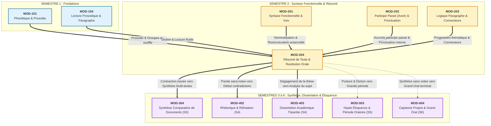

# Fiche Pédagogique Opérationnelle — Module MOD-204

> **Identifiant** : `MOD-204`  
> **Titre** : *Lecture Analytique, Méthodologie du Résumé de Texte Informatif, Restitution Orale Synthétique et Auto-Révision*  
> **Semestre** : Année 1 — Semestre 2 (S2)  
> **Domaines mobilisés** : DOM-06 (Compréhension écrite), DOM-07 (Expression écrite), DOM-08 (Expression orale), DOM-12 (Correction/révision), DOM-13 (Intégration)  
> **Volume horaire estimé** : 16 heures (Étude théorique et analyse de méthode : 4 h | Pratique délibérée : 6 h 30 | Correction raisonnée et analyse critique : 3 h 30 | Révision active et consolidation : 2 h)  
> **Statut** : [STATUT : PROPOSÉ — EN ATTENTE DE VALIDATION]  
> **Alignement** : [`academic-structure.md`](file:///f:/Formation/world-class-french/01-architecture/academic-structure.md), [`dependency-graph.md`](file:///f:/Formation/world-class-french/01-architecture/dependency-graph.md), [`competency-framework.md`](file:///f:/Formation/world-class-french/02-competency-framework/competency-framework.md), [`syllabus.md` (S2)](file:///f:/Formation/world-class-french/03-curriculum/year-1/semester-2/syllabus.md), [`source-registry.md`](file:///f:/Formation/world-class-french/07-resources/source-registry.md)

---

## 1. Présentation et Intérêt du Module

Le module `MOD-204` constitue le sommet intégrateur du Semestre 2 et la clé de voûte des compétences d'analyse et de communication synthétique du cursus **World-Class French**. Après l'étude des fonctions syntaxiques de la phrase simple (`MOD-201`), la stabilisation de l'accord du participe passé avec l'auxiliaire *avoir* et de la ponctuation interne (`MOD-202`), ainsi que la maîtrise de la logique du paragraphe et des connecteurs (`MOD-203`), l'apprenant franchit une étape décisive : **s'approprier la pensée d'autrui pour la restituer avec une exactitude scrupuleuse, une concision mathématique et une élégance irréprochable**, tant à l'écrit (résumé académique) qu'à l'oral (prise de parole structurée sans notes).

Ce module répond à quatre impératifs linguistiques et intellectuels majeurs :
1. **Désamorcer le réflexe de la paraphrase servile et du montage de citations** : Résumer ne consiste pas à découper des fragments du texte source pour les juxtaposer au moyen de quelques ligatures. C'est un exercice de haute décomposition logique qui exige de dégager l'architecture argumentative d'un texte d'idées (thèse, enchaînement des arguments, rejets, nuances), d'en retrancher les excroissances illustratives et de réécrire la trame conceptuelle dans un style personnel, dense et limpide [Réf. SRC-GRAM-02, chap. 21 ; Réf. SRC-RHET-03, chap. 3].
2. **Imposer une neutralité énonciative absolue** : L'apprenant doit faire taire ses propres opinions et proscrire toute intervention extérieure de régie (*« l'auteur affirme que »*, *« selon le texte »*, *« nous remarquons que »*). Le résumé est une réénonciation directe où le scripteur épouse le système d'énonciation du texte d'origine tout en divisant son étendue par quatre [Réf. SRC-GRAM-02, chap. 19].
3. **Développer l'éloquence synthétique sans béquilles textuelles** : Dans les contextes académiques et professionnels d'élite, savoir restituer oralement en 3 à 5 minutes la substantifique moelle d'un dossier complexe, sans lire ses notes, le regard ancré dans l'auditoire, avec une voix posée et une diction sans tic de langage, constitue le discriminant majeur de l'autorité intellectuelle [Réf. SRC-RHET-03, chap. 4 ; Réf. SRC-PHON-01, chap. 6].
4. **Instaurer un protocole d'auto-révision éditoriale intraitable** : La contraction de texte pousse la syntaxe dans ses derniers retranchements. Pour respecter une contrainte de longueur stricte ($\pm 10\,\%$) sans sacrifier la précision, le rédacteur risque la dislocation de la phrase. Le module arme l'apprenant d'une méthode clinique pour traquer les anacoluthes (ruptures de construction syntaxique), vérifier la cohésion des anaphores et garantir une orthographe sans faille [Réf. SRC-GRAM-01, § 440 ; Réf. SRC-TYPO-01].

---

## 2. Place dans le Cursus

- **Position séquentielle** : Semaines 11 et 12 du Semestre 2 (S2), immédiatement avant les révisions cumulatives de la Semaine 13 et les examens sommatifs de la Porte 2 (Semaine 14).
- **Rôle architectural** : Module d'intégration terminale du premier cycle (Année 1), assurant le passage de l'analyse microscopique de la phrase à la maîtrise macro-structurelle du discours.
- **Relations fonctionnelles amont/aval** :
  - *En amont* :
    - Prend appui sur `MOD-101` et `MOD-104` pour la diction, la respiration abdominale, le découpage en groupes de souffle et la modulation de la courbe prosodique ;
    - Mobilise `MOD-201` pour la manipulation des transformations actancielles (passivation, nominalisation) servant à condenser l'expression ;
    - Réinvestit `MOD-202` pour le contrôle infaillible des accords du participe passé avec *avoir* et l'emploi logique de la ponctuation interne (deux-points démonstratifs, point-virgule de balancement) ;
    - Concrétise `MOD-203` en exploitant les réseaux de connecteurs logiques, la progression thématique et l'éradication des pléonasmes.
  - *En aval* :
    - Constitue le prérequis direct indispensable (`DEP-LEC-01`, `DEP-RED-02`) pour aborder en S3 la synthèse comparative de plusieurs documents (`MOD-304`) ;
    - Prépare l'exercice de la dissertation académique en S4 (`MOD-403`) en apprenant à analyser objectivement la pensée d'un auteur avant de prétendre formuler une thèse contradictoire ;
    - Établit les fondations de l'art oratoire et de la dispute sans notes qui s'épanouiront en `MOD-503` (Haute éloquence) et lors du Grand Oral terminal du Capstone Project en S6 (`MOD-604`).

---

## 3. Prérequis et Diagnostic

### 3.1 Prérequis Formels
- Maîtrise de la morphologie et de l'accord sujet-verbe canonique et inversé [Validé en `MOD-102`].
- Identification sûre des constituants de la phrase simple (sujet, verbe, compléments essentiels, attributs, compléments de phrase) et maniement des tests syntaxiques d'effacement, de déplacement et de pronominalisation [Validé en `MOD-201`].
- Application infaillible de la règle d'accord du participe passé employé avec *avoir* dans les cas d'antéposition du COD (pronoms personnels, relatif *que*, adverbes de quantité) [Validé en `MOD-202`].
- Connaissance de la typologie des connecteurs logiques (cause, conséquence, opposition, concession, addition) et des trois modes de progression thématique (à thème constant, linéaire, à thèmes dérivés) [Validé en `MOD-203`].

### 3.2 Protocole Diagnostique Spécifique (Entrée de Module — 45 minutes)
Avant d'entamer l'apprentissage méthodologique, l'apprenant réalise une épreuve diagnostique tripartite :
1. **Test A — Détection du noyau argumentatif (15 min)** : Lecture d'un texte d'idées court (250 mots). L'apprenant doit, en deux phrases rédigées, formuler la thèse défendue par l'auteur et distinguer les deux arguments majeurs des trois exemples d'illustration purement contingents.
2. **Test B — Éradication du parasitisme énonciatif (15 min)** : Analyse d'un résumé défectueux de 80 mots. L'apprenant doit identifier et supprimer l'ensemble des formules méta-discursives (*« L'auteur démontre que »*, *« Selon le sociologue »*, *« Il conclut en disant »*) pour restituer un énoncé neutre et autonome.
3. **Test C — Prise de parole diagnostique enregistrée (90 secondes)** : Présentation orale sans préparation d'une idée directrice extraite du texte A. Évaluation du débit, de la présence physique, de la fixation du regard et relevé des tics verbaux (*euh*, *en fait*, *voilà*, *du coup*).

*Livrable diagnostique* : Grille d'auto-positionnement identifiant le degré de dépendance au texte source (tendance au plagiat lexical) et la charge de béquilles verbales orales.

---

## 4. Objectifs Pédagogiques Mesurables

Au terme des 16 heures de travail du module `MOD-204`, l'apprenant doit être capable de :
1. **Disséquer l'architecture argumentative d'un texte d'idées de 500 à 700 mots** : Identifier la question directrice implicite ou explicite, isoler la thèse centrale, schématiser l'articulation logique des arguments et distinguer infailliblement les arguments cardinaux des développements illustratifs, concessions passagères ou digressions oratoires [Réf. SRC-RHET-03, chap. 3 ; Réf. SRC-GRAM-02, chap. 21].
2. **Rédiger un résumé analytique rigoureux selon la norme académique** :
   - Réduire le texte au quart de sa longueur initiale avec une tolérance stricte de $\pm 10\,\%$ (ex. $150 \pm 15$ mots pour 600 mots) ;
   - Respecter scrupuleusement le système et la dynamique du texte source sans intervertir l'ordre logique des thèses ;
   - Reformuler intégralement la pensée de l'auteur par l'usage systématique de l'hyperonymie, de la nominalisation et de la restructuration syntaxique, sans jamais recourir à la paraphrase servile ni à la citation textuelle [Réf. SRC-LEX-01 ; Réf. SRC-GRAM-02, chap. 8] ;
   - Maintenir une neutralité énonciative absolue en proscrivant tout commentaire personnel et toute formule de régie textuelle.
3. **Appliquer les règles officielles du décompte typographique des mots** : Compter avec exactitude les mots selon la convention officielle des concours académiques et insérer un repère typographique visible toutes les cinquante unités [Réf. SRC-TYPO-01].
4. **Restituer oralement une synthèse de 3 à 5 minutes sans notes** :
   - Capter l'auditoire par un exorde sobre présentant l'enjeu intellectuel ;
   - Annoncer le plan logique sans lourdeur scolaire ;
   - Développer les articulations majeures avec une rigueur démonstrative impeccable ;
   - Conclure avec autorité sur la portée de la thèse ;
   - Maîtriser sa posture physique (regard dirigé, ancrage au sol), éliminer toute béquille verbale et réguler son débit entre 120 et 140 mots par minute [Réf. SRC-PHON-01, chap. 6 ; Réf. SRC-RHET-03, chap. 4].
5. **Mener un protocole d'auto-révision éditoriale en quatre passes** : Traquer et éliminer les anacoluthes, vérifier les chaînes anaphoriques, valider les accords complexes et la ponctuation logique avant toute remise de copie.

---

## 5. Compétences Visées et Niveaux de Maîtrise Attendus

| Identifiant | Intitulé officiel de la compétence | Palier d'entrée | Palier cible MOD-204 | Indicateur de preuve observable |
| :--- | :--- | :---: | :---: | :--- |
| [`FR-INT-001`](file:///f:/Formation/world-class-french/02-competency-framework/competency-framework.md#fr-int-001-rédaction-dun-texte-long-cohérent-avec-maîtrise-des-accords-et-de-la-ponctuation) | Paragraphe argumenté et cohésion textuelle (stade Résumé de texte) | L2 | **L3 (Autonomie)** | Rédaction d'un résumé de 150 mots respectant la métrique $\pm 10\,\%$, exempt d'anacoluthe, avec cohésion logique parfaite et zéro faute d'accord. |
| [`FR-INT-005`](file:///f:/Formation/world-class-french/02-competency-framework/competency-framework.md#fr-int-005-démonstration-orale-structurée-et-art-de-léloquence-sans-notes) | Restitution orale synthétique sans notes | L1 | **L2 / L3 (Autonomie guidée)** | Restitution orale chronométrée de 3 à 5 minutes d'un texte d'idées complexe, sans aucune note rédigée, avec fluidité, tenue du registre et zéro tic verbal. |
| [`FR-INT-003`](file:///f:/Formation/world-class-french/02-competency-framework/competency-framework.md#fr-int-003-réviser-et-corriger-un-texte-tiers-en-justifiant-les-interventions) | Auto-révision éditoriale et métalinguistique | L2 | **L3 (Autonomie)** | Détection et rectification de 100 % des anacoluthes et discordances syntaxiques dans un premier jet personnel. |
| [`FR-INT-006`](file:///f:/Formation/world-class-french/02-competency-framework/competency-framework.md#fr-int-006-analyser-un-texte-littéraire-sans-confondre-interprétation-et-preuve-textuelle) | Compréhension analytique et fidélité au texte d'idées | L2 | **L3 (Autonomie)** | Zéro contresens sur la thèse centrale et identification exacte de la hiérarchie des arguments du texte source. |
| [`FR-LEXIC-001`](file:///f:/Formation/world-class-french/02-competency-framework/competency-framework.md#fr-lexic-001-précision-sémantique-nuances-synonymiques-et-collocations) | Précision lexicale et reformulation par hyperonymie | L2 | **L3 (Autonomie)** | Substitution d'énumérations et de périphrases par des termes génériques abstraits sans perte de substance conceptuelle. |

---

## 6. Plan Détaillé des Chapitres

```text
ARCHITECTURE DES ENSEIGNEMENTS DU MODULE MOD-204
├── CHAPITRE 1 : LECTURE ANALYTIQUE ET DISSECTION DU TEXTE D'IDÉES
│   ├── 1.1 Typologie du texte d'idées : essai philosophique, plaidoyer, article scientifique, tribune critique.
│   ├── 1.2 La situation d'énonciation : repérage des indices déictiques, énonciateur direct vs polyphonie.
│   ├── 1.3 L'armature logique : problématique implicite, thèse de l'auteur et thèses adverses réfutées.
│   ├── 1.4 La cartographie des mouvements : hiérarchisation des arguments cardinaux et repérage des connecteurs pivots.
│   └── 1.5 Le crible du tri sélectif : discrimination formelle entre argument porteur et illustration contingente.
├── CHAPITRE 2 : MÉTHODOLOGIE ACADÉMIQUE DE LA CONTRACTION ÉCRITE
│   ├── 2.1 Les trois lois cardinales du résumé de texte :
│   │   ├── La loi de fidélité objective et l'interdiction absolue du contresens.
│   │   ├── La loi de neutralité énonciative (proscription de « l'auteur dit », des jugements et des interpolations).
│   │   └── La loi d'autonomie textuelle (le résumé doit être un texte fluide, lisible en lui-même sans connaître la source).
│   ├── 2.2 Techniques linguistiques de condensation conceptuelle :
│   │   ├── La réduction par hyperonymie (englober le particulier dans le général).
│   │   ├── La nominalisation à base verbale et la restructuration actancielle.
│   │   └── L'élagage des incidentes, relatives explicatives et redondances stylistiques.
│   ├── 2.3 La métrique académique et les règles du décompte typographique des mots :
│   │   ├── Définition normative du mot typographique (Imprimerie nationale et conventions des concours).
│   │   ├── Traitement des élisions, traits d'union, nombres et sigles.
│   │   └── La marge des ± 10 % et le balisage typographique tous les 50 mots.
├── CHAPITRE 3 : RHÉTORIQUE DE LA RESTITUTION ORALE SYNTHÉTIQUE SANS NOTES
│   ├── 3.1 La transmutation de l'écrit à l'oral : pourquoi résumer à voix haute n'est pas réciter un texte mémorisé.
│   ├── 3.2 La disposition oratoire classique appliquée à l'exposé de synthèse (3 à 5 minutes) :
│   │   ├── L'exorde : accroche intellectuelle et formulation de la question de fond (30-45 s).
│   │   ├── L'annonce du dessein : présentation sobre des axes de démonstration (15-30 s).
│   │   ├── Le corps démonstratif : déploiement en 2 ou 3 mouvements logiquement articulés (2 à 3 min).
│   │   └── La péroraison : clôture synthétique, réaffirmation de la thèse et portée générale (30-45 s).
│   ├── 3.3 La technique du schéma mental et l'interdiction des notes rédigées.
│   └── 3.4 Prosodie, incarnation et régulation du débit :
│       ├── Posture physique : ancrage au sol, buste vertical, élimination des mouvements parasites.
│       ├── Maîtrise du regard : balayage panoramique et connexion continue avec l'auditoire.
│       ├── Hygiène vocale et prosodie : respiration abdominale, modulation des cadences, pauses expressives.
│       └── Traque impitoyable des scories orales : éradication des tics verbaux (euh, en fait, voilà, du coup).
└── CHAPITRE 4 : LE PROTOCOLE D'AUTO-RÉVISION ÉDITORIALE EN QUATRE PASSES
    ├── 4.1 Passe 1 : Contrôle de conformité métrique et comptage des mots.
    ├── 4.2 Passe 2 : Examen de fidélité logique et de neutralité énonciative.
    ├── 4.3 Passe 3 : Crible micro-syntaxique et traque chirurgicale des anacoluthes :
    │   ├── L'anacoluthe du participe présent sans sujet syntaxique.
    │   ├── Les ruptures de corrélation et télescopages de propositions.
    │   └── La cohérence des chaînes anaphoriques pronominales et lexicales.
    └── 4.4 Passe 4 : Contrôle orthographique et ponctuation logique :
        ├── Vérification systématique des participes passés avec avoir (COD antéposé).
        └── Emploi normé des virgules démarcatives, deux-points logiques et points-virgules.
```

---

## 7. Concepts Fondamentaux et Notions Avancées

### 7.1 Concepts Fondamentaux
- **Schéma argumentatif** : Modélisation formelle du raisonnement déployé dans un texte. Il articule une *thèse* (proposition générale que l'auteur entend valider), des *arguments* (preuves logiques, déductives ou empiriques justifiant la thèse), des *objections* ou *contre-arguments* (points de vue adverses réfutés ou concédés) et des *exemples* (faits particuliers venant illustrer un argument) [Réf. SRC-RHET-03, chap. 3].
- **Exemple illustratif vs Exemple argumentatif** :
  - *Exemple illustratif* : Vient en appui d'un argument abstrait pour le rendre concret à l'esprit du lecteur. Il est strictement contingent et **doit être éliminé dans le résumé**.
  - *Exemple argumentatif (ou preuve inductive)* : Constitue le fondement même de la démonstration, sans lequel l'argument n'existe pas. Il doit être conservé sous une forme généralisée et synthétique [Réf. SRC-RHET-03, chap. 3].
- **Neutralité énonciative** : Obligation méthodologique pour le rédacteur de réénoncer le texte en adoptant le point de vue intérieur de l'auteur. Le scripteur s'interdit d'utiliser des formules d'attribution tierces (*« L'auteur souligne que... »*, *« Selon le texte... »*) et d'émettre le moindre jugement approbateur ou réprobateur (*« À juste titre »*, *« Malheureusement »*) [Réf. SRC-GRAM-02, chap. 19].
- **Décompte typographique officiel des mots** : Règle officielle des jurys académiques et des concours de l'enseignement supérieur. Est considéré comme mot toute unité linguistique isolée par deux espaces blancs ou par un signe de ponctuation (y compris le trait d'union et l'apostrophe) [Réf. SRC-TYPO-01] :
  - *C'est-à-dire* = 4 mots (*c'* / *est* / *à* / *dire*) ;
  - *L'univers* = 2 mots (*l'* / *univers*) ;
  - *Qu'ils* = 2 mots (*qu'* / *ils*) ;
  - *Aujourd'hui* = 1 mot (par exception lexicalisée consacrée) ;
  - *Sous-estimation* = 2 mots (*sous* / *estimation*) ;
  - *Chefd'œuvre* = 3 mots (*chef* / *d'* / *œuvre*) ;
  - Un nombre en chiffres (*1789*) = 1 mot (mais l'écriture en lettres est vivement recommandée dans la prose argumentative).

### 7.2 Notions Avancées
- **Reformulation par hyperonymie** : Opération sémantique consistant à remplacer une série de termes spécifiques (*hyponymes*) par le terme générique abstrait de rang supérieur (*hyperonyme*) qui englobe leur extension notionnelle.  
  *Exemple* : Remplacer *« le blé, l'orge, le seigle et le maïs »* par *« les céréales »* ; remplacer *« la peinture, la sculpture, la musique et l'architecture »* par *« les disciplines artistiques »* [Réf. SRC-LEX-01 ; Réf. SRC-GRAM-02, chap. 8].
- **Nominalisation à rection actancielle** : Transformation syntaxique consistant à condenser une proposition subordonnée ou un verbe conjugué en un syntagme nominal compact tout en réorganisant ses compléments d'objet en compléments du nom prépositionnels.  
  *Exemple* : *« Comme les ressources naturelles s'épuisent à un rythme alarmant, les États doivent réagir »* $\rightarrow$ *« L'épuisement critique des ressources impose une intervention étatique. »* [Réf. SRC-GRAM-02, chap. 14].
- **L'anacoluthe syntaxique** : Rupture brutale et involontaire de la construction syntaxique de la phrase en cours d'énonciation. Dans le résumé, elle survient principalement lors de l'emploi d'un participe présent ou d'un gérondif dont le sujet implicite n'est pas le sujet grammatical de la proposition principale [Réf. SRC-GRAM-01, § 440] :
  - *Forme fautive* : *« En analysant la crise économique, des solutions concrètes apparaissent à l'esprit du chercheur. »* (Le sujet grammatical est *des solutions*, ce ne sont pas les solutions qui analysent la crise !).
  - *Forme rectifiée* : *« En analysant la crise économique, le chercheur conçoit des solutions concrètes. »*
- **L'éthos oratoire et le regard focalisé** : Dans la prise de parole sans notes, l'autorité de l'orateur ne dépend pas du volume de la voix mais de la cohérence corporelle. Le regard doit être direct et soutenir le contact avec les évaluateurs ; les mains, ouvertes et au-dessus de la ceinture, accompagnent la logique sans gesticulation nerveuse ; le silence oratoire (pause de 2 secondes avant une idée majeure) remplace avantageusement la béquille sonore [Réf. SRC-RHET-03, chap. 4 ; Réf. SRC-PHON-01, chap. 6].

---

## 8. Erreurs et Confusions Fréquentes

| Type d'anomalie | Exemple fautif / relâché | Rectification normée et justification savante | Référence source |
| :--- | :--- | :--- | :--- |
| **Parasitisme énonciatif** | *« L'auteur commence par expliquer que la mondialisation a des failles, puis il démontre que... »* | *« La mondialisation engendre des déséquilibres structurels majeurs ; dès lors... »* — Interdiction absolue des formules de régie textuelle (*« l'auteur dit »*). Le résumé doit être la pensée en action, non le récit de la pensée. | [Réf. SRC-GRAM-02, chap. 19] |
| **Paraphrase servile & collage** | Recopier mot pour mot des propositions entières du texte en modifiant simplement les conjonctions de coordination. | Obligation d'assimiler le concept et de le reformuler intégralement par des termes nouveaux, des nominalisations et des hyperonymes. | [Réf. SRC-RHET-03, chap. 3] |
| **Contresens sur la thèse** | Prendre une concession de l'auteur pour son opinion définitive (ex. confondre ce que l'auteur réfute avec ce qu'il défend). | Repérer rigoureusement les embrayeurs d'opposition (*« Certes... mais », « Sans doute... toutefois »*) qui signalent la position adverse concédée temporairement. | [Réf. SRC-GRAM-02, chap. 21] |
| **Anacoluthe sur participe** | *« Ayant épuisé ses réserves d'énergie, la production industrielle s'est arrêtée net. »* | *« Ayant épuisé ses réserves d'énergie, **l'industrie a interrompu** sa production. »* — Le participe passé détaché doit qualifier le sujet réel de la proposition principale. | [Réf. SRC-GRAM-01, § 440] |
| **Faux décompte des mots** | Compter *« aujourd'hui »* pour deux mots ou compter *« c'est-à-dire »* pour un seul mot sous prétexte de traits d'union. | Appliquer la règle officielle : toute unité graphique séparée par une apostrophe ou un tiret compte pour un mot (*c' / est / à / dire* = 4 mots). Seul *aujourd'hui* est lexicalisé pour 1 mot. | [Réf. SRC-TYPO-01] |
| **Béquilles orales systématiques** | *« Euh, en fait, le texte, voilà, il montre que du coup la société change... »* | *« La mutation sociale s'accélère sous l'effet des technologies. »* — Remplacer le réflexe du mot bouche-trou (*euh, en fait, du coup, voilà*) par un silence respiratoire assumé. | [Réf. SRC-PHON-01, chap. 6] |
| **Perte du contact visuel** | Débiter son exposé les yeux levés au ciel, baissés vers la table ou fuyant l'interlocuteur. | Maintenir un balayage visuel soutenu et calme des auditeurs pour asseoir son autorité d'orateur (*éthos*). | [Réf. SRC-RHET-03, chap. 4] |

---

## 9. Exemples Progressifs

### 9.1 Niveau Simple (La Condensation Micro-Syntaxique et l'Hyperonymie)
- **Texte initial (54 mots)** :
  > *« Pour parvenir à ses fins, l'artisan utilisa des scies manuelles, des marteaux, des biseaux et des rabots très anciens. Il consacra de nombreuses heures à tailler le chêne et le hêtre afin de fabriquer des tables, des chaises et des armoires d'une rare élégance, sans jamais compter sa fatigue ni ménager sa peine. »*
- **Analyse des éléments réductibles** :
  - *Scies, marteaux, biseaux, rabots* $\rightarrow$ Hyperonyme : *outils traditionnels* ;
  - *Chêne et hêtre* $\rightarrow$ Hyperonyme : *bois précieux / essences nobles* ;
  - *Tables, chaises, armoires* $\rightarrow$ Hyperonyme : *mobilier* ;
  - *Sans jamais compter sa fatigue ni ménager sa peine* $\rightarrow$ Détail redondant à élaguer.
- **Version condensée (14 mots)** :
  > *« L'artisan façonna patiemment un mobilier raffiné en bois noble à l'aide d'outils traditionnels. »*  
  *(Réduction au quart exact de l'étendue : 14 mots pour 54 mots d'origine).*

---

### 9.2 Niveau Intermédiaire (Résumer un Paragraphe Argumenté de 200 Mots en 50 Mots)
- **Texte source (198 mots)** :
  > *« Il est un préjugé tenace qui consiste à envisager le travail exclusivement sous l'angle de la contrainte servile et du châtiment biblique. Selon cette perspective étroite, l'homme ne s'activerait que sous l'aiguillon de la nécessité matérielle et ne trouverait de repos véritable que dans l'oisiveté réparatrice. Or, cette conception fait l'impasse sur la dimension fondamentale d'accomplissement de soi que recèle toute tâche productive. Loin d'être une pure malédiction, le travail constitue pour l'individu le moyen privilégié d'inscrire sa volonté dans le monde réel, d'extérioriser ses facultés créatrices et d'arracher la matière informe aux lois de la pure nature brute. En sculptant la pierre, en enseignant une langue, en concevant un mécanisme complexe ou en labourant son sillon, le travailleur ne se contente pas de gagner sa subsistance : il s'humanise lui-même en transformant ce qui l'entoure. L'inactivité prolongée, que l'on pare si souvent de vertus chimériques, n'engendre que l'ennui, l'atrophie des compétences et le sentiment douloureux de l'inutilité sociale. C'est donc dans l'exercice exigeant d'une œuvre concrète, et non dans l'inertie stérile, que l'être humain édifie sa liberté et prend la mesure exacte de sa dignité propre. »*

- **Grille de décortication analytique** :
  1. *Thèse adverse réfutée* : Le travail perçu comme pure servitude et malédiction imposée par le besoin.
  2. *Thèse de l'auteur* : Le travail est l'instrument essentiel de l'humanisation, de la réalisation de soi et de la dignité humaine.
  3. *Arguments pivots* :
     - Le travail extériorise les facultés et donne une forme humaine au monde ;
     - L'oisiveté n'est pas le bonheur mais la déchéance et l'inutilité ;
     - L'œuvre concrète forge la véritable liberté.
  4. *Éléments à éliminer* : Les énumérations de métiers (*sculpter, enseigner, concevoir, labourer*), les métaphores poétiques secondaires.

- **Résumé académique normé (50 mots $\pm 10\,\%$, soit 45 à 55 mots)** :
  > *« Réduire le travail à une servitude matérielle méconnaît sa nature profonde. Loin d'aliéner l'homme, l'effort productif extériorise ses facultés créatrices et l'humanise en transformant le monde. Tandis que l'oisiveté corrompt l'individu dans un sentiment d'inutilité, l'accomplissement d'une tâche concrète édifie sa liberté véritable et fonde sa dignité. »*  
  *(Exactement 49 mots typographiques. Ratio de contraction : 24,7 %).*

---

### 9.3 Niveau Complexe (Démonstration Intégrale : Texte d'Idées de 600 Mots, Résumé de 150 Mots et Restitution Orale)

#### 1. Le Texte d'Idées Source (602 mots)

> **Titre : De l'illusion technicienne à la démission du jugement critique**  
> *Par Frédéric Mercier (Revue d'Humanités contemporaines)*
>
> On assiste aujourd'hui à une célébration quasi unanime des prothèses informationnelles qui accompagnent le quotidien de l'homme contemporain. L'accessibilité instantanée à une masse inépuisable de données est présentée par les zélateurs du progrès numérique comme l'avènement d'une ère d'émancipation sans précédent. Dès lors que le savoir universel se trouve concentré dans un terminal portatif à portée de main, l'apprentissage laborieux de la mémoire et la confrontation solitaire aux concepts abstraits sembleraient devenir des exercices anachroniques et dérisoires. Pourquoi contraindre l'écolier à mémoriser des dates, des déclinaisons ou des théorèmes, s'il lui suffit d'effleurer une vitre tactile pour convoquer la mémoire collective du globe ?
>
> Cette foi aveugle dans l'omniscience des banques de données repose sur une confusion pernicieuse entre l'information brute et la connaissance vivante. L'information n'est qu'un agrégat de faits disséminés, une matière inerte et discontinue que n'importe quelle machine peut stocker et redistribuer sans en comprendre la signification. La connaissance, quant à elle, exige une intériorisation lente, une digestion intellectuelle et une mise en résonance des notions au sein d'une conscience structurée. En déléguant systématiquement à des algorithmes le soin d'enregistrer, d'associer et de trier les éléments du réel, l'esprit humain ne s'allège pas d'un fardeau inutile : il s'atrophie. Une mémoire désertée par l'exercice engendre nécessairement une pensée désarticulée, incapable de repérer les anachronismes ou de lier deux idées dans une relation de cause à effet.
>
> Plus redoutable encore est l'illusion de lucidité produite par la vitesse de consultation. Accoutumé à recevoir des réponses immédiates à des interrogations fragmentées, l'individu moderne perd progressivement la patience de l'examen critique. Or, le jugement ne s'improvise pas au gré des impulsions d'un moteur de recherche. Il requiert le temps du doute, le silence de la réflexion et la capacité de déceler les biais rhétoriques dans les discours d'autorité. Faute de posséder en soi-même les repères culturels et logiques indispensables pour évaluer la validité des flux qui l'assaillent, le citoyen hyperconnecté devient la proie consentante de toutes les manipulations démagogiques et de tous les sophismes marchands.
>
> Certes, il ne saurait être question de condamner obscurément l'outil technique en lui-même, dont la puissance d'archivage et de calcul demeure un prodigieux levier pour la recherche scientifique et la conservation du patrimoine. Nul ne contestera qu'un inventaire numérisé facilite l'investigation des érudits. Mais l'instrument ne vaut que par la vigueur de la main qui le guide. Si la prolifération des dispositifs technologiques pallie les défaillances de notre curiosité sans être fermement subordonnée à une culture humaniste préalable, elle se borne à substituer le confort du psittacisme automatisé à la véritable liberté de penser. L'enjeu fondamental de notre époque n'est donc pas d'étendre indéfiniment la puissance de nos serveurs, mais de restaurer l'exigence de la discipline intérieure, seule garante d'un esprit capable de dominer ses propres créations.

#### 2. Le Résumé Écrit Normé (150 mots $\pm 10\,\%$, soit 135 à 165 mots)

> L'accessibilité immédiate du savoir numérique nourrit l'illusion d'une émancipation intellectuelle dispensant l'homme de tout effort d'apprentissage. Toutefois, célébrer la fin de la mémorisation repose sur une confusion funeste : l'information brute, simple accumulation de données inertes, ne constitue pas la connaissance vivante. **/** Celle-ci exige une assimilation lente et ordonnée. En se déchargeant de cette tâche sur la machine, l'esprit s'atrophie et devient incapable de lier logiquement les concepts.  
> De surcroît, la rapidité des réponses superficielles détruit la patience de l'examen critique. Dépourvu **/** de repères culturels intériorisés, l'individu connecté perd le discernement nécessaire pour déjouer les manipulations persuasives.  
> Si la puissance technique offre d'incontestables ressources aux chercheurs, elle ne saurait remplacer l'effort de la pensée. Faute d'être guidé par une authentique formation humaniste, le progrès technologique n'engendre qu'une servitude intellectuelle. **/** Dès lors, préserver notre liberté exige de réhabiliter la discipline de l'esprit face à la dérive technicienne.

*(Décompte officiel : **149 mots** typographiques. Balisage inséré tous les cinquante mots par le signe `**/**`. Respect absolu de la fourchette [135-165] et neutralité énonciative parfaite).*

#### 3. La Restitution Orale Synthétique sans Notes (Transcription annotée — 4 min 15 s)

```text
[POSTURE : Orateur debout, pieds ancrés à largeur d'épaules, buste droit, regard posé
 sur le jury. Silence de concentration de 3 secondes. Respiration abdominale calme.]

[EXORDE & ACCROCHE : 40 secondes]
« Mesdames et Messieurs, notre siècle célèbre volontiers l'avènement d'un individu omniscient 
par procuration, pour qui la possession d'un écran tactile tiendrait lieu de culture. 
Dans un essai pénétrant intitulé « De l'illusion technicienne à la démission du jugement critique », 
Frédéric Mercier démonte cette croyance et pose une question essentielle : l'abondance des données 
numériques libère-t-elle l'esprit humain, ou précipite-t-elle au contraire sa déchéance intellectuelle ? »

[ANNONCE DU PLAN : 20 secondes]
« Pour y répondre, l'auteur déploie une démonstration en trois mouvements rigoureux. 
Il met d'abord au jour la confusion fatale entre information et connaissance ; 
il analyse ensuite l'atrophie du jugement critique face à l'immédiateté ; 
il en déduit enfin la nécessité vitale de subordonner l'outil à une discipline intérieure. »

[DÉVELOPPEMENT — 1er MOUVEMENT : 1 minute]
« Premier temps de la réflexion : la nature de la connaissance. [Regard au centre, main ouverte] 
Mercier s'insurge contre ceux qui jugent la mémoire humaine obsolète sous prétexte que le savoir 
mondial est numérisé. C'est confondre deux réalités étrangères. L'information n'est qu'un tas de faits 
inertes que les machines enregistrent sans les comprendre. La connaissance, à l'inverse, est une conquête : 
elle suppose une digestion lente, une mise en cohérence des notions dans une conscience vivante. 
En nous déchargeant de l'effort de mémoriser, nous ne gagnons pas en légèreté : nous privons notre 
pensée de ses fondations et nous condamnons notre esprit à l'impuissance. »

[TRANSITION & 2e MOUVEMENT : 1 minute]
« Dès lors s'ouvre le deuxième volet du réquisitoire : la ruine du jugement. [Légère avancée du buste] 
Habitué à des réponses instantanées, l'homme hyperconnecté désapprend la lenteur du doute. 
Or, le jugement critique ne naît pas de la frappe d'un mot-clé : il exige des repères culturels solides. 
Faute de posséder ces repères en lui-même, l'individu se trouve désarmé devant les flux qui l'assaillent, 
devenant la proie facile de tous les sophismes et de toutes les démagogies. »

[3e MOUVEMENT : 45 secondes]
« Faut-il pour autant verser dans un obscurantisme passéiste ? [Pause expressive de 2 secondes] 
L'auteur s'en défend explicitement dans son troisième mouvement. L'outil technique est une formidable 
prothèse d'archivage, précieuse pour la science. Mais une prothèse ne supplée pas l'âme. Sans une culture 
humaniste préalable pour orienter la machine, l'homme ne fait qu'échanger sa liberté de penser contre 
un confort automatisé. »

[PÉRORAISON & CLÔTURE : 30 secondes]
« En conclusion, le texte de Frédéric Mercier nous avertit : l'enjeu véritable de notre temps n'est 
pas technologique, il est moral et éducatif. Ce ne sont pas nos serveurs qu'il faut élargir, c'est 
l'exigence intellectuelle qu'il nous appartient de refonder si nous voulons rester maîtres de nos propres 
outils. Je vous remercie. »
[Silence final, regard maintenu 2 secondes avant de saluer calmement].
```

---

## 10. Activités d'Observation et de Découverte

1. **Atelier "Radiographie d'un texte d'idées" (Travail sur corpus)** :
   - À partir de trois textes d'auteurs (Montaigne, Alain, Claude Lévi-Strauss), les apprenants soulignent en rouge la thèse centrale, en bleu les arguments moteurs et biffent au feutre noir l'ensemble des exemples d'illustration pure.
   - Confrontation collective : observer comment le texte, une fois débarrassé de son ornementation anecdotique, révèle son ossature déductive nue [Réf. SRC-RHET-03, chap. 3].
2. **Laboratoire "La traque du parasite énonciatif"** :
   - Distribution d'un résumé fictif de concours comportant 10 fautes d'énonciation (*« L'écrivain fait remarquer que »*, *« Selon nous »*, *« Il conclut par une remarque juste »*).
   - Les apprenants réécrivent le passage pour rétablir une énonciation neutre et calculent le gain immédiat en nombre de mots (dégraissage de 20 à 30 % du volume textuel).
3. **Atelier "L'écoute critique des tics oraux"** :
   - Écoute collective de trois enregistrements audio d'étudiants restituant un texte.
   - Les apprenants utilisent un compteur manuel pour comptabiliser chaque occurrence de béquilles verbales (*euh*, *en fait*, *du coup*, *voilà*, *donc*) et mesurent l'impact délétère de ces scories sur la crédibilité de l'orateur [Réf. SRC-PHON-01, chap. 6].

---

## 11. Exercices Progressifs

### 11.1 Niveau 1 : Décomposition et Condensation Éléments par Éléments
- **Exercice 1.1 — Discrimination Thèse vs Exemple** : Dans une série de 10 énoncés courts, distinguer les affirmations qui constituent une thèse de celles qui ne sont que des illustrations secondaires.
- **Exercice 1.2 — Réduction par Hyperonymie** : Condenser en un syntagme de moins de 4 mots les listes suivantes :
  1. *Les hélicoptères, les avions de ligne, les planeurs et les drones de reconnaissance* $\rightarrow$ ...
  2. *L'avarice, la jalousie, l'orgueil démesuré et la rancœur tenace* $\rightarrow$ ...
  3. *Les crues subites, les séismes destructeurs, les sécheresses prolongées et les typhons* $\rightarrow$ ...
- **Exercice 1.3 — Décompte métrique officiel** : Compter rigoureusement le nombre de mots des phrases suivantes selon la règle académique officielle :
  1. *« C'est-à-dire qu'aujourd'hui, l'homme ne s'appartient plus. »* (Solution attendue : *c'* / *est* / *à* / *dire* / *qu'* / *aujourd'hui* / *l'* / *homme* / *ne* / *s'* / *appartient* / *plus* = 12 mots).
  2. *« Qu'en a-t-il dit lorsqu'il s'est aperçu du chef-d'œuvre ? »* (Solution attendue : *qu'* / *en* / *a* / *t* / *il* / *dit* / *lorsqu'* / *il* / *s'* / *est* / *aperçu* / *du* / *chef* / *d'* / *œuvre* = 15 mots).

### 11.2 Niveau 2 : Contraction de Paragraphes et Chasse aux Anacoluthes
- **Exercice 2.1 — Condensation sous contrainte métrique** : Réduire un paragraphe de 120 mots à 30 mots ($\pm 10\,\%$, soit 27 à 33 mots) en supprimant les détails anecdotiques et en reformulant par nominalisation.
- **Exercice 2.2 — Éradication d'anacoluthes** : Identifier et corriger la rupture de construction syntaxique dans les 5 phrases suivantes :
  1. *En consultant les archives du ministère, une incohérence majeure est apparue aux yeux des historiens.*
  2. *Étant privé de ressources financières, le tribunal a rejeté la demande du plaignant.*
  3. *Après avoir lu attentivement le traité, plusieurs doutes subsistent dans notre esprit.*
  4. *Tout en admettant les difficultés du projet, une nouvelle approche a été proposée par l'ingénieur.*
  5. *Arrivé au sommet de la falaise, le panorama de la baie s'est déployé sous un ciel limpide.*
- **Exercice 2.3 — Élaboration de schémas oraux sans notes** : À partir d'un texte de 350 mots, concevoir en 10 minutes une fiche synoptique de 6 lignes maximum (mots-clés et flèches logiques exclusivement, aucune phrase rédigée) servant d'appui mental pour un exposé de 3 minutes.

### 11.3 Niveau 3 : Résumé Académique Complet et Simulation Orale
- **Exercice 3.1 — Contraction intégrale chronométrée (2 h)** : Résumé d'un texte d'idées de 500 mots en 125 mots ($\pm 10\,\%$, 112 à 138 mots) avec balisage tous les 50 mots et décompte final officiel.
- **Exercice 3.2 — Restitution orale en temps contraint** : Préparation (15 minutes) et enregistrement sans notes (durée : 4 minutes $\pm 30$ secondes) de la synthèse du texte précédent. Auto-évaluation à l'aide de la grille officielle du cursus.

---

## 12. Ateliers de Correction et de Révision

### 12.1 Le Crible d'Auto-Révision Éditoriale (Protocole des 4 Passes)
Avant de finaliser tout résumé académique, l'apprenant applique obligatoirement le crible en 4 passes :

```text
PROTOCOLE D'AUTO-RÉVISION ÉDITORIALE (CRIBLE EN 4 PASSES)
├── PASSE 1 : CONTRÔLE MÉTRIQUE & FORMEL
│   ├── Compter un à un les mots selon la norme (traits d'union, apostrophes).
│   ├── Vérifier que le total se situe dans la fourchette exacte [longueur cible ± 10 %].
│   └── Insérer une barre oblique (/) tous les cinquante mots et inscrire le décompte exact en fin de copie.
├── PASSE 2 : EXAMEN DE FIDÉLITÉ & NEUTRALITÉ ÉNONCIATIVE
│   ├── Vérifier qu'aucune phrase ne commence par « L'auteur », « Le philosophe », « Selon le texte ».
│   ├── Vérifier qu'aucun jugement personnel (adverbes d'opinion, adjectifs laudatifs/péjoratifs) n'a été introduit.
│   └── S'assurer qu'aucune citation textuelle servile de plus de 3 mots consécutifs ne subsiste.
├── PASSE 3 : CRIBLE SYNTAXIQUE & CHASSE AUX ANACOLUTHES
│   ├── Vérifier le sujet de chaque proposition subordonnée participiale ou gérondive (concordance avec la principale).
│   ├── Éliminer toute phrase averbale accidentelle ou proposition subordonnée orpheline de principale.
│   └── Valider la netteté des anaphores pronominales (s'assurer qu'aucun pronom « il » ou « ce » n'est ambigu).
└── PASSE 4 : CONTRÔLE ORTHOGRAPHIQUE & PONCTUATION LOGIQUE
    ├── Contrôler chaque accord sujet-verbe (éloignement, inversion).
    ├── Appliquer l'algorithme d'accord du participe passé avec avoir (traquer le COD antéposé).
    └── Vérifier l'usage logique des virgules (interdiction formelle de séparer le sujet du verbe).
```

### 12.2 Laboratoire d'Audit Croisé des Enregistrements Oraux
- En binôme, les apprenants échangent leurs fichiers audio de restitution de 5 minutes.
- Chaque évaluateur renseigne la fiche d'audit suivante :
  1. *L'exorde pose-t-il clairement l'enjeu intellectuel en moins de 45 secondes ?*
  2. *Le plan annoncé est-il scrupuleusement respecté dans le déroulement ?*
  3. *Combien de tics verbaux (« euh », « voilà », « en fait », « du coup ») ont été relevés ? (Pénalité de 0,25 pt par occurrence).*
  4. *Le débit est-il régulé sans emballement ni silences d'impuissance ?*
  5. *L'orateur a-t-il respecté le temps imparti (3 à 5 minutes) ?*

---

## 13. Production Intégratrice

La validation du module `MOD-204` repose sur une **double production sommative intégrée (écrite et orale)** réalisée sur la base d'un texte d'idées de 600 mots fourni lors de l'évaluation :

### Volet 1 : Production Écrite — Résumé Académique de Texte d'Idées (150 mots $\pm 10\,\%$)
- **Texte support** : Texte d'idées de 600 mots portant sur la philosophie de la culture, la sociologie des techniques ou l'éthique démocratique.
- **Cahier des charges formel** :
  1. Longueur obligatoire : **150 mots** avec une marge de tolérance de **$\pm 10\,\%$** (soit entre **135 et 165 mots** inclus). Tout dépassement ou sous-calibrage entraîne une pénalité immédiate selon le barème officiel ;
  2. Insertion d'une barre typographique oblique visible tous les 50 mots (`/`) et mention exacte du total final en chiffres à la fin du devoir ;
  3. Neutralité énonciative intégrale : interdiction absolue d'introduire des formules de régie textuelle (*« L'auteur démontre »*, *« Selon le sociologue »*) ou des commentaires critiques ;
  4. Zéro plagiat lexical : interdiction formelle de recopier plus de trois mots consécutifs du texte source (hors termes techniques ou notions philosophiques irremplaçables) ;
  5. Correction syntaxique absolue : zéro anacoluthe, maîtrise des participes passés avec *avoir* et ponctuation logique rigoureuse.

### Volet 2 : Production Orale — Restitution Synthétique sans Notes (3 à 5 minutes)
- **Modalité** : À partir de l'analyse du même texte d'idées et après **15 minutes de préparation mentale** (prise de notes limitée à une fiche synoptique de mots-clés) :
  1. Prononciation d'un exposé synthétique chronométré d'une durée comprise entre **3 et 5 minutes** ;
  2. **Interdiction formelle de lire des notes rédigées** : l'orateur se détache complètement de son support écrit pour s'adresser directement à son auditoire ou à la caméra ;
  3. Respect de la structure quadripartite : exorde accrocheur, annonce du plan, déploiement des axes directeurs, conclusion synthétique ;
  4. Qualité vocale et physique : tenue du regard, régulation du souffle, zéro tic verbal (*euh, voilà, en fait*), débit fluide (120-140 mots/min) et respect des liaisons obligatoires du français soigné.

---

## 14. Évaluation et Barème

L'évaluation sommative finale du module `MOD-204` est notée sur **20 points**, répartie à parts égales entre le Volet Écrit (10 points) et le Volet Oral (10 points) :

| Volet / Critère | Description des exigences et décompte des points | Seuil éliminatoire |
| :--- | :--- | :---: |
| **VOLET ÉCRIT (sur 10 points)** | | $< 7/10$ |
| 1. Respect de la métrique et du formatage (1,5 pt) | • Longueur exacte comprise entre 135 et 165 mots (1 pt — pénalité de -0,5 pt par tranche de 5 mots en excès ou en défaut)<br/>• Balisage tous les 50 mots et mention du décompte exact en fin de devoir (0,5 pt) | $< 1/1,5$ |
| 2. Fidélité intellectuelle et architecture logique (3,5 pts) | • Identification exacte de la thèse centrale de l'auteur (1 pt)<br/>• Sélection des arguments pivots et respect de leur enchaînement déductif (1,5 pt)<br/>• Élagage rigoureux des exemples illustratifs et détails secondaires (1 pt) | $< 2,5/3,5$ |
| 3. Neutralité énonciative et reformulation (2,5 pts) | • Neutralité absolue : zéro intervention de régie (*« l'auteur dit »*) (-0,5 pt par occurrence) (1 pt)<br/>• Absence totale de plagiat textuel et de citation servile (-0,5 pt par emprunt abusif) (1 pt)<br/>• Reformulation élégante par hyperonymie et nominalisation (0,5 pt) | $< 1,5/2,5$ |
| 4. Correction syntaxique, grammaticale et ponctuation (2,5 pts) | • Zéro anacoluthe ou rupture de construction (-0,5 pt par rupture) (1 pt)<br/>• Application parfaite des accords (sujet-verbe et participe passé avec avoir) (-0,5 pt par faute) (1 pt)<br/>• Ponctuation logique interne pertinente (virgules, deux-points) (0,5 pt) | $< 2/2,5$ |
| **VOLET ORAL (sur 10 points)** | | $< 7/10$ |
| 5. Disposition rhétorique et rigueur du plan (3 pts) | • Exorde efficace posant l'enjeu intellectuel en moins de 45 secondes (1 pt)<br/>• Annonce claire du plan et respect scrupuleux des mouvements annoncés (1 pt)<br/>• Péroraison conclusive nette synthétisant la portée de la thèse (1 pt) | $< 2/3$ |
| 6. Restitution sans notes et aisance cognitive (2,5 pts) | • Autonomie absolue sans lecture de texte rédigé (1,5 pt — lecture de notes rédigées = 0/1,5 pt)<br/>• Fluidité de l'expression et clarté de l'enchaînement des concepts (1 pt) | $< 1,5/2,5$ |
| 7. Tenue de la langue orale et éradication des tics (2,5 pts) | • Registre standard soutenu irréprochable (1 pt)<br/>• Éradication des béquilles verbales (*euh, en fait, voilà, du coup* : pénalité de -0,25 pt par tic résiduel) (1 pt)<br/>• Articulation soignée, respect des liaisons obligatoires et zéro liaison fautive (0,5 pt) | $< 1,5/2,5$ |
| 8. Posture, regard, prosodie et temps (2 pts) | • Ancrage au sol, gestuelle signifiante et regard maintenu avec l'auditoire (1 pt)<br/>• Débit régulé (120-140 mots/min) et respect strict du temps imparti [3 à 5 min] (1 pt) | $< 1,5/2$ |

> **Conditions impératives de validation du module** :
> - Note globale minimale requise pour valider le module : **14/20 (70 %)**.
> - **Note éliminatoire absolue** : Une note globale inférieure à **14/20**, OU une note inférieure à **7/10** au Volet Écrit, OU une note inférieure à **7/10** au Volet Oral, ajourne automatiquement le candidat et impose un stage de remédiation de 2 semaines en laboratoire de contraction et d'art oratoire.

---

## 15. Critères de Maîtrise

Le module `MOD-204` est déclaré acquis si l'apprenant manifeste de façon pérenne et vérifiable les comportements observables suivants :

- **Sur le plan du résumé écrit (`FR-INT-001` - Palier L3 Autonomie)** :
  - Il sait ramener n'importe quel texte d'idées de 500 à 700 mots à sa substantifique moelle conceptuelle en respectant scrupuleusement le quota métrique de $\pm 10\,\%$ ;
  - Il n'emploie jamais de formule d'attribution méta-discursive (*« l'auteur étudie »*, *« nous voyons que »*) et reformule les idées dans un style propre sans plagier le vocabulaire de l'auteur ;
  - Sa prose est rigoureusement exempte d'anacoluthes et d'approximations syntaxiques ;
  - Il applique sans hésitation l'accord du participe passé avec *avoir* et maîtrise la ponctuation logique de la phrase.

- **Sur le plan de la restitution orale (`FR-INT-005` - Palier L2/L3 Autonomie guidée)** :
  - Il s'exprime pendant 3 à 5 minutes de manière continue sans lire de notes rédigées, en s'appuyant uniquement sur une charpente logique intériorisée ;
  - Il soutient le regard de son auditoire, contrôle son souffle et bannit totalement les tics oraux (*euh, du coup, en fait, voilà*) ;
  - Il respecte scrupuleusement les liaisons obligatoires et ne produit aucune liaison fautive ;
  - Son débit est posé, compréhensible et calibré entre 120 et 140 mots par minute.

- **Sur le plan de l'auto-révision éditoriale (`FR-INT-003` - Palier L3 Autonomie)** :
  - Il applique spontanément le protocole des 4 passes avant de remettre tout document écrit ;
  - Il calcule son décompte de mots avec une exactitude mathématique conforme aux règles de l'Imprimerie nationale.

---

## 16. Révisions Espacées Recommandées

Afin d'ancrer définitivement les réflexes de contraction d'idées et de restitution oratoire sans notes, le calendrier de consolidation suivant est prescrit :

```text
CALENDRIER DE RAPPEL ACTIF — MODULE MOD-204
├── J+3 après validation : Exercice rapide de comptage de mots sur 5 phrases complexes à tirets et apostrophes (15 min).
├── J+10 : Contraction éclair d'un texte d'idées de 300 mots en 75 mots (45 min).
├── J+21 : Restitution orale impromptue sans notes de 3 minutes sur un article de presse d'idées (15 min).
├── J+45 : Résumé complet d'un texte d'idées de concours de 600 mots en 150 mots sous chronomètre de 2 heures.
└── Semestre 3 (S3) : Réinvestissement immédiat et permanent dans MOD-304 (Synthèse comparative de documents)
                      et dans la préparation aux épreuves de grand oral de S5/S6.
```

---

## 17. Sources de Référence Vérifiées

L'ensemble des principes méthodologiques, des règles syntaxiques, des taxonomies argumentatives et des normes typographiques de ce module est adossé exclusivement aux ouvrages de référence du registre officiel [`source-registry.md`](file:///f:/Formation/world-class-french/07-resources/source-registry.md) :

1. **Riegel, Martin, Pellat, Jean-Christophe & Rioul, René (2016)**. *Grammaire méthodique du français*. Paris : PUF, coll. « Quadrige ».  
   $\rightarrow$ Référence fondamentale pour la linguistique du texte, les typologies de progression thématique, la cohésion textuelle (chap. 21), la restructuration par nominalisation et la pragmatique énonciative [Réf. `SRC-GRAM-02`].
2. **Reboul, Olivier (1991)**. *Introduction à la rhétorique*. Paris : PUF, coll. « Premier Cycle ».  
   $\rightarrow$ Référence cardinale pour l'analyse du schéma argumentatif, la distinction entre thèse, argument et exemple (chap. 3), et la disposition oratoire classique (exorde, narration, confirmation, péroraison) appliquée à la prise de parole sans notes (chap. 4) [Réf. `SRC-RHET-03`].
3. **Léon, Pierre (2011)**. *Phonétique du français contemporain*. Paris : Armand Colin (éd. refondue).  
   $\rightarrow$ Référence scientifique majeure pour la physiologie du souffle, le découpage en groupes rythmiques (chap. 6), la régulation du débit verbal et l'élimination des scories articulatoires dans la prise de parole formelle [Réf. `SRC-PHON-01`].
4. **Grevisse, Maurice & Goosse, André (2016)**. *Le Bon Usage* (16e éd.). Bruxelles : De Boeck Supérieur.  
   $\rightarrow$ Référence normative d'autorité pour la traque des anacoluthes et ruptures syntaxiques (§ 440), la concordance des temps et les accords complexes du participe passé avec *avoir* (§ 947 à § 955) [Réf. `SRC-GRAM-01`].
5. **Imprimerie nationale (2002/2014)**. *Lexique des règles typographiques en usage à l'Imprimerie nationale*. Paris : Imprimerie nationale.  
   $\rightarrow$ Référence normative officielle pour les règles de décompte des mots, le traitement des traits d'union, des élisions, des majuscules et de la ponctuation interne [Réf. `SRC-TYPO-01`].
6. **ATILF / CNRS**. *Trésor de la Langue Française informatisé (TLFi)*. Base lexicographique en ligne (`atilf.atilf.fr`).  
   $\rightarrow$ Référence lexicographique pour l'exploration des réseaux d'hyperonymie/hyponymie indispensables à la reformulation conceptuelle dense [Réf. `SRC-LEX-01`].

---

## 18. Liens avec les Modules Précédents et Suivants


