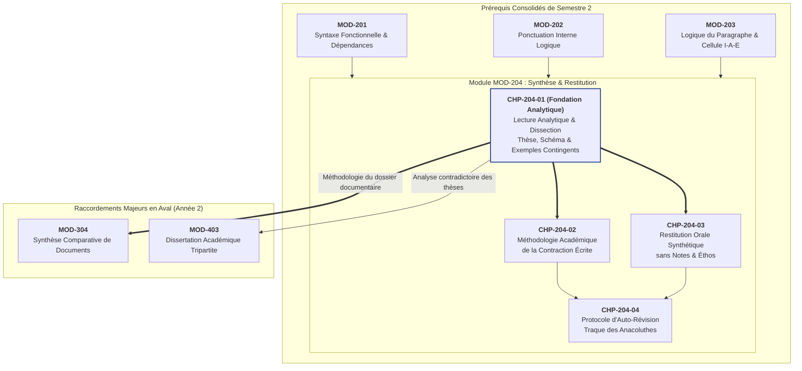

# Chapitre 1 — Lecture Analytique et Dissection du Texte d'Idées : Thèse, Schéma Argumentatif et Détection des Exemples Contingents

> **Identifiant du chapitre** : `CHP-204-01`  
> **Module de rattachement** : [`MOD-204` — Lecture Analytique, Méthodologie du Résumé de Texte Informatif, Restitution Orale Synthétique et Auto-Révision](file:///f:/Formation/world-class-french/03-curriculum/year-1/semester-2/mod-204-resume-texte-restitution-orale.md)  
> **Semestre** : Année 1 — Semestre 2 (S2)  
> **Volume horaire canonique** : 5 à 6 heures d'apprentissage autonome délibéré et d'ateliers d'application (Phase 1 Étude : 1 h 30 | Phase 2 Pratique : 1 h 30 | Phase 3 Correction : 1 h 00 | Phase 4 Évaluation : 1 h 00)  
> **Statut** : [STATUT : VALIDÉ]  
> **Compétences associées** : [`FR-INT-006`](file:///f:/Formation/world-class-french/02-competency-framework/competency-framework.md#fr-int-006-analyser-un-texte-littéraire-sans-confondre-interprétation-et-preuve-textuelle) (L3 Autonomie), [`FR-INT-001`](file:///f:/Formation/world-class-french/02-competency-framework/competency-framework.md#fr-int-001-rédiger-un-texte-long-cohérent-en-maîtrisant-accords-et-ponctuation) (L3 Autonomie), [`FR-ARGUM-001`](file:///f:/Formation/world-class-french/02-competency-framework/competency-framework.md#fr-argum-001-rigueur-démonstrative-réfutation-et-détection-des-sophismes) (L2/L3)  
> **Sources scientifiques de référence** : `SRC-RHET-03` (Olivier Reboul, *Introduction à la rhétorique*, chap. 3 & 4), `SRC-GRAM-02` (Riegel, Pellat, Rioul, *Grammaire méthodique du français*, chap. 21), `SRC-GRAM-01` (Grevisse & Goosse, *Le Bon Usage*, § 122-133), `SRC-NORM-03` (Ministère de l'Éducation nationale, *Terminologie grammaticale*, 2020)

---

## 1. Titre et Place dans le Cursus

### 1.1 Intitulé Officiel
**Chapitre 1 : Lecture Analytique et Dissection du Texte d'Idées : Thèse, Schéma Argumentatif et Détection des Exemples Contingents** (`CHP-204-01`).

### 1.2 Insertion Architecturale dans le Cursus
Le présent chapitre ouvre le module intégrateur [`MOD-204`](file:///f:/Formation/world-class-french/03-curriculum/year-1/semester-2/mod-204-resume-texte-restitution-orale.md), qui constitue le sommet académique du Semestre 2. Alors que le premier cycle a méthodiquement consolidé la combinatoire phrastique (les dépendances actancielles en [`MOD-201`](file:///f:/Formation/world-class-french/03-curriculum/year-1/semester-2/mod-201-syntaxe-fonctionnelle-phrase-simple.md)), la délimitation graphique (l'accord du participe passé et la ponctuation interne en [`MOD-202`](file:///f:/Formation/world-class-french/03-curriculum/year-1/semester-2/mod-202-participe-passe-avoir-ponctuation-interne.md)) ainsi que la texture discursive (l'agencement thème-rhème, les connecteurs et la cellule Idée-Argument-Exemple en [`MOD-203`](file:///f:/Formation/world-class-french/03-curriculum/year-1/semester-2/mod-203-logique-paragraphe-cohesion-textuelle.md)), `CHP-204-01` applique cette expertise linguistique à l'opération intellectuelle fondamentale de la vie académique : **la dissection analytique et objective de la pensée d'autrui**.

Avant de prétendre contracter un texte à l'écrit (`CHP-204-02`), d'en délivrer une restitution orale synthétique sans notes (`CHP-204-03`) ou d'en réviser la syntaxe (`CHP-204-04`), l'étudiant doit acquérir une acuité chirurgicale pour décomposer un texte d'idées de 500 à 700 mots en son squelette logique formel [Réf. `SRC-RHET-03`, chap. 3 ; `SRC-GRAM-02`, chap. 21].



- **En amont** : Ce chapitre réinvestit directement :
  - La valence verbale et la réorganisation des actants issues de [`MOD-201`](file:///f:/Formation/world-class-french/03-curriculum/year-1/semester-2/mod-201-syntaxe-fonctionnelle-phrase-simple.md) ;
  - Les valeurs sémantiques de la ponctuation logique (notamment les deux-points explicatifs et le point-virgule de balance) consolidées en [`MOD-202`](file:///f:/Formation/world-class-french/03-curriculum/year-1/semester-2/mod-202-participe-passe-avoir-ponctuation-interne.md) ;
  - La distinction entre information acquise (thème) et apport nouveau (rhème) ([`CHP-203-01`](file:///f:/Formation/world-class-french/03-curriculum/year-1/semester-2/mod-203/chp-203-01-dynamique-informationnelle-theme-rheme.md)) ainsi que la structure canonique de la cellule Idée-Argument-Exemple ([`CHP-203-04`](file:///f:/Formation/world-class-french/03-curriculum/year-1/semester-2/mod-203/chp-203-04-architecture-paragraphe-argumente-iae.md)).
- **Au sein de [`MOD-204`](file:///f:/Formation/world-class-french/03-curriculum/year-1/semester-2/mod-204-resume-texte-restitution-orale.md)** : Il pose le socle herméneutique incontournable : aucune contraction métrique (`CHP-204-02`) ni éloquence orale (`CHP-204-03`) ne saurait compenser une lecture erronée de la thèse directrice.
- **En aval dans le cursus** : Il commande directement :
  - [`MOD-304`](file:///f:/Formation/world-class-french/03-curriculum/year-2/semester-3/mod-304-synthese-comparative-documents.md) en Semestre 3 (confrontation synchronique de plusieurs textes d'idées aux thèses divergentes) ;
  - [`MOD-403`](file:///f:/Formation/world-class-french/03-curriculum/year-2/semester-4/mod-403-methodologie-dissertation-essai-academique.md) en Semestre 4 (dissertation académique où l'analyse rigoureuse d'une citation d'auteur conditionne toute la problématisation).

---

## 2. Objectifs Mesurables

Au terme des 5 à 6 heures d'apprentissage autonome et d'ateliers d'application de ce chapitre, l'étudiant sera capable de :

1. **Dégager la question directrice et isoler sans contresens la thèse centrale** d'un texte d'idées dense de 500 à 700 mots, en la distinguant formellement des concessions liminaires et des thèses adverses réfutées [Réf. `SRC-RHET-03`, chap. 3]. ([`FR-INT-006`](file:///f:/Formation/world-class-french/02-competency-framework/competency-framework.md#fr-int-006-analyser-un-texte-littéraire-sans-confondre-interprétation-et-preuve-textuelle) — Palier L3 Autonomie).
2. **Cartographier le schéma argumentatif complet** d'un texte d'idées (2 à 4 mouvements majeurs) en identifiant les arguments cardinaux, les connecteurs pivots et les relations logiques (déduction, cause, opposition, concession) [Réf. `SRC-GRAM-02`, chap. 21]. ([`FR-INT-006`](file:///f:/Formation/world-class-french/02-competency-framework/competency-framework.md#fr-int-006-analyser-un-texte-littéraire-sans-confondre-interprétation-et-preuve-textuelle), [`FR-ARGUM-001`](file:///f:/Formation/world-class-french/02-competency-framework/competency-framework.md#fr-argum-001-rigueur-démonstrative-réfutation-et-détection-des-sophismes) — Palier L3).
3. **Appliquer le crible de discrimination formelle entre arguments porteurs et exemples illustratifs contingents**, en éliminant 100 % des anecdotes, digressions et illustrations ornementales tout en identifiant les exemples argumentatifs (preuves inductives) [Réf. `SRC-RHET-03`, chap. 3]. ([`FR-INT-006`](file:///f:/Formation/world-class-french/02-competency-framework/competency-framework.md#fr-int-006-analyser-un-texte-littéraire-sans-confondre-interprétation-et-preuve-textuelle) — Palier L3 Autonomie).
4. **Établir une fiche de dissection analytique normalisée** (tableau conceptuel d'armature logique) préparatoire au résumé académique, sans recourir à la paraphrase servile ni interpoler de jugement d'opinion personnel [Réf. `SRC-NORM-03`]. ([`FR-INT-001`](file:///f:/Formation/world-class-french/02-competency-framework/competency-framework.md#fr-int-001-rédiger-un-texte-long-cohérent-en-maîtrisant-accords-et-ponctuation), [`FR-INT-006`](file:///f:/Formation/world-class-french/02-competency-framework/competency-framework.md#fr-int-006-analyser-un-texte-littéraire-sans-confondre-interprétation-et-preuve-textuelle) — Palier L3 Autonomie).

---

## 3. Prérequis et Test de Préparation (Auto-Diagnostic)

### 3.1 Prérequis Cognitifs Exigibles
- **Maîtrise des fonctions syntaxiques de la phrase simple** : aptitude à repérer le verbe recteur, le sujet syntaxique et les compléments essentiels pour ne pas se laisser égarer par les propositions incidentes ou les relatives explicatives ([`MOD-201`](file:///f:/Formation/world-class-french/03-curriculum/year-1/semester-2/mod-201-syntaxe-fonctionnelle-phrase-simple.md)).
- **Maniement de la ponctuation logique** : compréhension de la valeur conclusive ou explicative du deux-points et du balancement oppositif du point-virgule ([`MOD-202`](file:///f:/Formation/world-class-french/03-curriculum/year-1/semester-2/mod-202-participe-passe-avoir-ponctuation-interne.md)).
- **Analyse de la texture discursive** : repérage de la progression thématique (linéaire, constante) et des connecteurs argumentatifs majeurs ([`MOD-203`](file:///f:/Formation/world-class-french/03-curriculum/year-1/semester-2/mod-203-logique-paragraphe-cohesion-textuelle.md)).
- **Connaissance de la cellule I-A-E** : familiarité avec le modèle Idée-Argument-Exemple étudié dans [`CHP-203-04`](file:///f:/Formation/world-class-french/03-curriculum/year-1/semester-2/mod-203/chp-203-04-architecture-paragraphe-argumente-iae.md).

### 3.2 Test de Préparation Immédiat (5 Questions)
Répondez aux cinq questions diagnostiques suivantes avant d'engager la lecture de la section théorique. Dépliez ensuite le corrigé pour évaluer votre état de préparation.

1. Quelle différence fondamentale sépare le *thème* d'un texte de sa *thèse centrale* ?
2. Dans un texte argumentatif, quel rôle stratégique joue une *concession* introduite par *« Certes »* ou *« Sans doute »* ?
3. Pourquoi un fait historique ou un constat empirique particulier ne constitue-t-il pas, en lui-même, un argument général ?
4. Qu'appelle-t-on la *polyphonie énonciative* et à l'aide de quels indices linguistiques repère-t-on la voix d'un contradicteur convoquée par l'auteur ?
5. Pourquoi est-il méthodologiquement erroné de prétendre résumer un texte d'idées en sélectionnant mécaniquement une phrase par paragraphe ?

---

#### Corrigé Détaillé de l'Auto-Diagnostic

<details>
<summary><b>Consulter le corrigé raisonné des 5 questions de préparation</b></summary>

1. **Thème vs Thèse** :  
   Le *thème* désigne le sujet général dont traite le texte (le référent global, par exemple *le travail*, *la démocratie*, *le progrès technique*). Il répond à la question : *De quoi parle-t-on ?*  
   La *thèse* désigne la proposition de jugement spécifique, abstraite et orientée que l'auteur soutient et cherche à faire admettre. Elle répond à la question : *Que veut démontrer l'auteur sur ce sujet ?* (par exemple : *« Le travail n'est pas une aliénation mais l'instrument fondamental de l'accomplissement humain »*).

2. **Rôle d'une concession** :  
   Une concession est une manœuvre rhétorique par laquelle l'auteur accorde momentanément une part de vérité à une objection ou à la thèse adverse (*« Certes, l'outil numérique offre un accès immédiat aux données... »*) pour mieux réaffirmer ensuite la supériorité de sa propre position à l'aide d'un connecteur d'opposition fort (*« ... mais cette accumulation d'informations ne produit aucune connaissance véritable »*). Confondre la concession avec la thèse de l'auteur constitue le contresens le plus destructeur de l'analyse textuelle.

3. **Fait empirique vs Argument général** :  
   Un fait ou un exemple particulier (anecdote, événement historique, chiffre isolé) se situe dans l'ordre de la singularité et de la contingence temporelle ou spatiale. Un argument, au sens rigoureux, se situe dans l'ordre de la loi abstraite et de la causalité rationnelle : il énonce une relation de nécessité ou de principe universel reliant la thèse à une justification démontrée. Le fait ne fait qu'illustrer ou corroborer l'argument ; il n'est pas le principe explicatif lui-même.

4. **Polyphonie énonciative et indices de détection** :  
   La polyphonie (Mikhaïl Bakhtine, Oswald Ducrot) désigne la coprésence de plusieurs points de vue ou voix énonciatives au sein d'un même énoncé sans que l'auteur prenne en charge l'ensemble des affirmations. On repère la voix contradictoire par :
   - Le conditionnel de mise à distance (*« Selon certains, les écrans stimuleraient la créativité... »*) ;
   - Des verbes de parole ou de croyance modalisés (*« Ses partisans prétendent que... »*, *« On s'imagine volontiers que... »*) ;
   - Des guillemets d'ironie ou de citation ;
   - Des pronoms indéfinis distanciés (*on*, *certains* opposés au *nous* de l'auteur).

5. **Erreur du découpage paragraphe par paragraphe** :  
   Un paragraphe graphique ne coïncide pas nécessairement avec une étape logique majeure. Un auteur peut consacrer trois paragraphes consécutifs à déployer un seul et même argument par une série d'exemples détaillés, ou au contraire condenser deux mouvements logiques distincts dans un paragraphe resserré. Sélectionner une phrase par paragraphe conduit à juxtaposer des fragments disparates et produit un découpage mécanique aveugle à la dynamique d'ensemble du texte.

</details>

---

## 4. Situation de Départ ou Problème Concret

Considérons la situation récurrente d'un étudiant de licence confronté à un texte d'idées de 600 mots signé d'un philosophe, d'un sociologue ou d'un essayiste. L'épreuve exige d'en dégager la structure argumentative en vue de produire une contraction rigoureuse ou un compte rendu analytique.

À la lecture de la copie, l'évaluateur constate trois dérives systématiques :
1. **L'éblouissement anecdotique** : L'étudiant a été fasciné par une anecdote vivante racontée au deuxième paragraphe (par exemple, le cas d'un artisan médiéval ou une expérience menée sur des pigeons dans un laboratoire). Dans sa synthèse, cette anecdote occupe la moitié de son développement, tandis que l'argument sociologique de fond — énoncé de manière austère et abstraite dans la phrase suivante — a été purement et simplement omis.
2. **Le contresens sur la thèse par oubli de la polyphonie** : L'auteur débutait son texte en exposant, sur un ton faussement élogieux, les arguments des partisans de l'intelligence artificielle pour mieux en démonter les présupposés au paragraphe suivant. L'étudiant, victime d'une lecture au premier degré, attribue à l'auteur l'éloge qu'il s'employait précisément à détruire.
3. **Le résumé-inventaire par paraphrase linéaire** : Incapable d'apercevoir les lignes de force du raisonnement, l'étudiant produit une enfilade de formules parasites : *« L'auteur commence par dire que... Puis il parle de... Ensuite il donne l'exemple de... Enfin il termine sur... »*. L'ensemble ne forme qu'un catalogue descriptif plat, privé de toute armature intellectuelle.

Ces trois écueils procèdent d'une même carence méthodologique : **l'absence de protocole de lecture analytique active**. L'étudiant lit un texte d'idées comme il lirait une chronique anecdotique, en se laissant porter par les accidents de surface au lieu de disséquer l'armature logique interne.

---

## 5. Explication Intuitive : La Radiographie Médicale et l'Écorché d'Architecte

Pour comprendre la nature de la lecture analytique, recourons à l'analogie de la **radiographie médicale** et de **l'écorché d'architecte**.

Lorsqu'un profane contemple un monument ou un corps humain, son regard s'attarde immédiatement sur les éléments de surface : la carnation de la peau, la couleur des yeux, les vêtements ou l'ornementation d'une façade sculptée. Ces éléments constituent la **chair** de l'objet : ils sont séduisants, immédiatement perceptibles, mais aucun édifice ne tient debout grâce à ses stucs, et aucun organisme ne se meut sans son squelette.

```text
SURFACE DU TEXTE (Ce que le profane lit)
├── Chair ornementale : Anecdotes, métaphores, adjectifs expressifs
├── Tissu conjonctif : Digressions, comparaisons concrètes, citations orphelines
└── Voix d'emprunt : Objections passagères, concessions rhétoriques

         │
         ▼  [OPÉRATION DU CRIBLE ANALYTIQUE]
         │

SQUELETTE LOGIQUE (Ce que le clinicien extrait)
├── Colonne vertébrale : THÈSE CENTRALE (Réponse à la question de fond)
├── Côtes et piliers : ARGUMENTS CARDINAUX (Principes causaux abstraits)
└── Articulations maîtresses : CONNECTEURS PIVOTS (Mouvements de pensée)
```

Un texte d'idées est le produit d'un scripteur qui souhaite emporter l'adhésion d'un lecteur. Pour y parvenir, il ne lui présente pas un schéma abstrait dénudé : il habille son idée de métaphores, d'anecdotes historiques, d'exemples empruntés à l'actualité et d'effets de style. Cette parure est indispensable à la persuasion (*pathos*), mais elle dissimule l'architecture démonstrative (*logos*).

Faire une **lecture analytique**, c'est chausser les lunettes du radiologue :
- Traverser la chair descriptive sans s'y laisser piéger ;
- Identifier les poutres maîtresses (les arguments cardinaux) qui soutiennent le toit (la thèse) ;
- Repérer les joints de dilatation (les connecteurs logiques et articulations) ;
- Reléguer au néant les fioritures décoratives (les exemples contingents).

---

## 6. Définitions Précises et Terminologie

Pour disséquer un texte d'idées avec la précision requise, l'assimilation d'un vocabulaire opératoire rigoureux est indispensable [Réf. `SRC-NORM-03` ; `SRC-RHET-03`, chap. 3 ; `SRC-GRAM-02`, chap. 21].

### 6.1 Le Texte d'Idées et ses Genres
- **Texte d'idées** : Production discursive écrite dont la visée dominante est d'ordre intellectuel, conceptuel ou polémique. Contrairement au récit (qui narre des événements temporels) ou à la description (qui donne à voir un spectacle spatial), le texte d'idées déploie une argumentation ordonnée visant à modifier l'état cognitif, éthique ou politique du destinataire.
- **Essai** : Genre discursif en prose dans lequel un auteur examine librement une question philosophique, politique ou esthétique, sans prétendre à l'exhaustivité d'un traité scientifique ni à l'autorité dogmatique d'un système clos.
- **Plaidoyer** : Discours argumentatif construit pour défendre vigoureusement une cause, une personne ou une valeur, souvent structuré autour d'une tension axiologique entre le juste et l'injuste.
- **Tribune critique** : Article de presse d'opinion rédigé par un intellectuel ou un spécialiste pour intervenir publiquement dans un débat de société en interpellant les décideurs et les citoyens.

### 6.2 L'Armature Conceptuelle
- **Problématique (directrice)** : Tension intellectuelle ou question implicite à laquelle le texte cherche à apporter une réponse résolutoire. Elle n'est pas toujours formulée sous une forme interrogative directe dans le texte.
- **Thèse centrale** : Proposition assertive générale, abstraite et nécessaire que l'auteur entend démontrer ou faire triompher. Elle constitue la clé de voûte de l'ensemble du discours.
- **Thèse adverse (ou contre-thèse)** : Proposition concurrente, défendue par des opposants réels ou virtuels, que l'auteur mentionne soit pour en concéder temporairement certains aspects, soit pour en démontrer la fausseté par une réfutation méthodique.
- **Argument cardinal** : Proposition logique générale justifiant directement le bien-fondé de la thèse en invoquant un principe causal, déductif ou éthique. L'argument cardinal est indispensable : si on le supprime, l'édifice démonstratif s'effondre.
- **Argument secondaire (ou sous-argument)** : Proposition subordonnée qui explicite, nuance ou amplifie un argument cardinal pour en faciliter la réception.

### 6.3 Les Matériaux d'Illustration et la Dynamique Discursive
- **Exemple illustratif contingent** : Événement singulier, anecdote, référence statistique ponctuelle ou cas particulier convoqué par l'auteur pour rendre concret un argument déjà formulé. Il est *contingent* au sens philosophique : sa présence est facultative, sa suppression n'altère en rien la validité logique de l'argument.
- **Exemple argumentatif (ou preuve inductive)** : Cas particulier à partir duquel l'auteur construit, par induction, la règle générale. Sans cet exemple princeps, l'argument n'a aucune existence préalable.
- **Polyphonie énonciative** : Phénomène sémantique par lequel un scripteur intègre au fil de son discours des points de vue émanant d'autres énonciateurs que lui-même, créant une superposition ou une confrontation de voix distinctes.
- **Embrayeurs d'opposition et de concession** : Unités lexicales ou grammaticales (*certes, sans doute, or, mais, néanmoins, en revanche, toutefois*) qui signalent les changements de posture argumentative ou les inversions de polarité dans le raisonnement.

---

## 7. Règles et Mécanismes Fondamentaux

L'analyse méthodique d'un texte d'idées repose sur cinq paliers opératoires successifs [Réf. `SRC-GRAM-02`, chap. 21 ; `SRC-RHET-03`, chap. 3 & 4].

### 7.1 Typologie des Genres du Texte d'Idées
Tout texte d'idées s'inscrit dans une tradition générique qui conditionne sa tonalité, sa progression et son degré de véhémence :

| Genre discursif | Visée dominante | Posture énonciative | Stratégie argumentative type |
| :--- | :--- | :--- | :--- |
| **Essai philosophique / épistémologique** | Élucidation conceptuelle, définition des principes premiers. | Distanciée, réflexive, universalisante (*nous*, impersonnel *il*). | Déduction rigoureuse, problématisation des évidences, dépassement dialectique. |
| **Article scientifique / sociologique** | Démonstration empirique, modélisation de régularités du réel. | Neutre, descriptive, appuyée sur des concepts catégoriels. | Induction méthodique, analyse causale, confrontation de variables. |
| **Plaidoyer juridique / éthique** | Défense d'une valeur, réhabilitation d'un principe bafoué. | Engagée, solennelle, interpellation de l'auditoire. | Appel à la justice, antithèse forte entre devoir et réalité, gradation dramatique. |
| **Tribune polémique / manifeste** | Mobilisation de l'opinion, dénonciation d'un péril immédiat. | Combative, incisive, recours fréquent à l'ironie ou à l'hyperbole. | Réfutation tranchée, dilemmes moraux, clausules péremptoires. |

### 7.2 L'Analyse de la Situation d'Énonciation et la Détection de la Polyphonie
Avant d'examiner le contenu des arguments, le lecteur doit identifier **qui parle** et **à quel titre** [Réf. `SRC-GRAM-02`, chap. 19 & 21] :

1. **Repérage des marques énonciatives directes** :
   - Pronoms personnels et déterminants possessifs : l'emploi du *je* signale une démarche d'essai subjectif ou de témoignage intellectuel ; l'emploi du *nous* peut être un pluriel de modestie, un *nous* de communauté épistémique (le groupe des chercheurs) ou un *nous* de ralliement (l'humanité tout entière).
   - Les tournures impersonnelles (*il apparaît que*, *force est de constater que*) dissimulent l'énonciateur sous une autorité d'objectivité universelle.
2. **Les degrés de modalisation (la prise en charge énonciative)** :
   - *Certitude* : adverbes d'évidence (*incontestablement, indubitablement, manifestement*), indicatif assertif.
   - *Doute et réserve* : adverbes d'atténuation (*peut-être, probablement*), conditionnel d'hypothèse.
   - *Jugement axiologique* : lexique mélioratif (*fécond, rigoureux, émancipateur*) ou péjoratif (*fallacieux, illusoire, pernicieux*).
3. **Le piège de la polyphonie et la voix du contradicteur** :
   - L'auteur peut citer ou paraphraser une opinion adverse sans utiliser de guillemets explicites, simplement pour en suggérer l'inanité (*« À en croire les thuriféraires du marché, la libre concurrence suffirait à réguler les passions humaines... »*).
   - *Règle clinique* : Chaque fois qu'un verbe de parole ou d'opinion est associé à un sujet collectif indéfini (*certains avancent*, *on s'imagine*), l'analyste doit suspendre son jugement : il ne s'agit pas de la thèse de l'auteur, mais de l'énoncé d'une cible que l'auteur s'apprête à démolir.

### 7.3 L'Armature Logique : Isoler la Thèse et Déjouer la Concession
La thèse n'est presque jamais assénée dès la première phrase sans préparation :

1. **La question directrice** : Elle forme la matrice cachée du texte. L'analyste doit être capable de résumer le problème en une phrase interrogative unique : *« La technologie numérique aliène-t-elle le discernement humain ? »*, *« La souveraineté politique peut-elle s'accommoder de l'ignorance populaire ? »*.
2. **Le piège de la concession liminaire** : Les auteurs élégants évitent le dogmatisme brutal. Ils ouvrent souvent leur propos par une concession (*« Il est indéniable que les progrès de la mécanisation ont soulagé l'homme des tâches les plus écrasantes... »*). L'étudiant inattentif prend cet énoncé d'ouverture pour la thèse.
3. **La bascule de l'antithèse** : La véritable thèse se révèle immédiatement après le connecteur d'opposition pivot (*« Mais », « Toutefois », « Cependant », « Or »*). C'est là que l'auteur prend position : *« ... toutefois, en affranchissant l'esprit de tout effort de calcul personnel, elle l'enferme dans une dépendance intellectuelle létale. »*.
4. **La thèse finale ou conclusive** : Parfois, la thèse n'apparaît dans sa plénitude conceptuelle qu'au terme du texte, sous la forme d'un couronnement inductif.

### 7.4 La Cartographie des Mouvements Argumentatifs
Un texte d'idées de 500 à 700 mots s'articule généralement en **2, 3 ou 4 grands mouvements logiques**, rarement davantage :

```text
MOUVEMENT 1 : Déconstruction de l'illusion commune ou concession initiale.
             [Connecteur pivot : Or, Pourtant, Mais]
MOUVEMENT 2 : Déploiement de l'argumentation propre (causes, mécanismes profonds).
             [Connecteur pivot : En outre, De surcroît, D'autre part]
MOUVEMENT 3 : Démonstration des conséquences politiques, sociales ou existentielles.
             [Connecteur pivot : Dès lors, C'est pourquoi, Par conséquent]
MOUVEMENT 4 (Éventuel) : Dépassement dialectique, solution éthique ou appel à l'action.
```

- Pour chaque mouvement, l'analyste doit associer un **argument cardinal porteur** et un **connecteur logique directeur**.
- Les connecteurs secondaires internes à un paragraphe ne commandent pas le plan général : ils ne font qu'agencer les sous-arguments et les illustrations au sein de la cellule discursive.

### 7.5 Le Crible du Tri Sélectif : Séparer l'Argument Porteur de l'Exemple Contingent
Voici la règle d'or méthodologique de la lecture analytique :

$$\text{RÈGLE D'OR : } \text{Unité textuelle} = \begin{cases} \text{ARGUMENT CARTE} & \text{si abstraite, causale, indispensable à la logique} \\ \text{EXEMPLE CONTINGENT} & \text{si singulière, descriptive, éliminable sans rupture} \end{cases}$$

Pour décider du statut d'une unité de texte, appliquer le **test d'effacement conceptuel** :
1. *Supprimez mentalement le passage contesté.*
2. *Posez la question : Le raisonnement logique de l'auteur est-il brisé ? La conclusion devient-elle incompréhensible ?*
   - Si la réponse est **NON** (l'argument abstrait reste parfaitement intelligible et concluant) : le passage est un **exemple illustratif contingent**. Il doit être impérativement élagué.
   - Si la réponse est **OUI** (l'auteur procédait par induction à partir d'un cas unique dont il extrait la règle) : le passage est un **exemple argumentatif**. Il doit être conservé sous une forme abstraite et synthétique.

---

## 8. Raisonnement Détaillé : Pourquoi le Scripteur Dilue-t-il sa Pensée dans des Exemples ?

Une question fondamentale se pose à tout analyste : si le squelette logique d'un texte d'idées de 600 mots ne compte en réalité que quatre ou cinq propositions directrices (environ 150 mots), **pourquoi l'auteur consacre-t-il les trois quarts de son texte à des anecdotes, des images poétiques et des digressions ?**

La réponse relève de la psychologie de la communication et des lois de la rhétorique classique [Réf. `SRC-RHET-03`, chap. 3 & 4] :

1. **L'impératif de concrétisation pédagogique** :
   L'esprit humain appréhende difficilement les abstractions pures maintenues à un haut degré de généralité. Un lecteur ordinaire décroche face à un enchaînement ininterrompu d'axiomes philosophiques. L'exemple sensible réactive l'attention en fournissant un support visuel ou émotionnel à l'imagination (*enargeia* des Anciens).
2. **Le levier persuasif du *pathos*** :
   Pour convaincre, la logique pure (*logos*) ne suffit pas. L'auteur doit séduire son auditoire, exciter son indignation ou éveiller sa sympathie. Une anecdote poignante sur un ouvrier exploité ou un exemple concret de détresse morale touche les affects beaucoup plus profondément qu'une formule économique abstraite.
3. **La création de connivence culturelle (*l'éthos*)** :
   En convoquant une référence littéraire prestigieuse, un fait historique marquant ou une observation de mœurs spirituelle, le scripteur pose sa propre autorité (*éthos*) et flatte l'intelligence de son lecteur en le traitant comme un pair cultivé.

Cependant, ce qui constitue une **richesse pour l'auditoire premier** devient une **surcharge parasite pour l'analyste et le résumeur** :
- Le résumeur n'a pas à être séduit : il doit comprendre l'architecture rationnelle.
- S'il conserve l'anecdote dans son analyse au détriment de l'argument abstrait, il détruit la portée philosophique du texte pour la réduire à un fait divers.
- La maîtrise intellectuelle consiste précisément à savoir extraire l'essence conceptuelle sans se laisser abuser par la joliesse ou la verdeur de l'habillage stylistique.

---

## 9. Exemples Corrects Commentés : Décorticage d'un Texte Modèle

Examinons un texte d'idées complet de 350 mots portant sur la délibération démocratique face à l'immédiateté numérique. Nous allons en conduire la dissection analytique intégrale.

### 9.1 Le Texte Source (350 mots)

> **Titre : De l'empire de l'immédiateté au naufrage de la raison délibérative**  
> *Par Frédéric Mercier (Revue d'Humanités contemporaines)*
>
> La prolifération des opinions instantanées dans l'espace public suscite l'illusion d'une démocratisation sans précédent de la parole. Chacun se croit désormais investi de la légitimité nécessaire pour juger des affaires complexes de la cité, au seul motif qu'il dispose d'un moyen technique pour diffuser ses impressions. Pourtant, cette inflation de réactions immédiates ne constitue nullement une victoire de la raison collective. Elle traduit au contraire une dégradation profonde du débat démocratique, lequel ne saurait s'épanouir sans l'effort patient de la démonstration et la médiation de la culture critique.
>
> D'une part, la délibération authentique exige du temps, du silence et un recul méthodique à l'égard des émotions premières. Or, l'architecture des plateformes numériques privilégie systématiquement l'immédiateté, le scandale affectif et la polémique stérile. Les citoyens ne débattent plus pour rechercher ensemble la vérité ou éclairer une décision commune, mais pour saturer l'attention et conforter leurs préjugés partisans. L'exemple des controverses sanitaires récentes illustre parfaitement cette dérive : des foules numériques ont rejeté en quelques heures des consensus scientifiques établis après des décennies de recherche méthodique, au profit de rumeurs spectaculaires colportées par des influenceurs improvisés. L'argument rationnel s'efface ainsi devant le vacarme des passions tribales.
>
> D'autre part, la souveraineté populaire ne saurait s'exercer sans une formation rigoureuse du jugement. Confondre le droit démocratique d'expression avec l'équivalence de toutes les paroles revient à détruire le principe même de compétence civique. Une démocratie qui refuse d'instruire ses membres et qui flatte l'ignorance partagée prépare le terrain de la démagogie. Lorsque le citoyen cesse de distinguer le fait vérifié de la croyance subjective, il s'abandonne sans défense aux rhétoriques de manipulation. L'Histoire en fournit la preuve accablante dans la décomposition des républiques antiques, où l'éloquence corruptrice des sophistes l'emporta sur la sagesse des lois.
>
> Dès lors, la vitalité de l'idéal républicain dépend moins de l'extension indéfinie des réseaux de communication que de la restauration exigeante de l'école républicaine et de l'apprentissage méthodique de l'esprit critique.

*(Décompte exact : **350 mots**).*

---

### 9.2 Table Analytique de Dissection

Voici la formalisation de l'armature logique dégageant les thèses partielles, les arguments cardinaux et les éléments contingents à élaguer :

| Mouvement & Paragraphe | Thèse partielle / Idée directrice | Arguments cardinaux (Concepts porteurs) | Exemples contingents à éliminer | Connecteurs pivots & Enjeu conceptuel |
| :--- | :--- | :--- | :--- | :--- |
| **Paragraphe 1** (Introduction & Thèse centrale) | L'abondance des réactions instantanées n'est pas un progrès mais une déchéance du débat civique. | 1. La liberté technique de diffuser une opinion n'équivaut pas à la compétence rationnelle pour juger.<br/>2. La démocratie véritable requiert la temporalité longue de la démonstration et de la culture critique. | L'illusion subjective de légitimité éprouvée par chaque usager connecté. | **Connecteur pivot** : *Pourtant / Au contraire*.<br/>**Enjeu** : Opposition entre démocratisation quantitative et exigence qualitative. |
| **Paragraphe 2** (Mouvement I : L'obstacle psychologique et technique) | Les outils numériques détruisent la délibération en substituant l'émotion à l'examen réfléchi. | 1. La délibération rationnelle exige silence et recul temporel.<br/>2. L'économie numérique de l'attention valorise le scandale affectif et renforce les biais partisans au détriment de la vérité. | L'évocation des controverses sanitaires, des foules numériques et des rumeurs d'influenceurs. | **Connecteurs pivots** : *D'une part... Or...*<br/>**Enjeu** : Incompatibilité structurelle entre immédiateté pulsionnelle et raison critique. |
| **Paragraphe 3** (Mouvement II : L'exigence de formation civique) | L'égalité des droits politiques ne valide pas l'équivalence des jugements sans instruction préalable. | 1. Confondre droit d'expression et égale valeur des opinions ruine la compétence civique.<br/>2. Faute d'esprit critique instruit, le citoyen crédule devient la proie inéluctable de la manipulation démagogique. | L'allusion historique à la déchéance des républiques antiques corrompues par les sophistes. | **Connecteurs pivots** : *D'autre part... Lorsque...*<br/>**Enjeu** : La formation intellectuelle comme condition *sine qua non* de la souveraineté. |
| **Paragraphe 4** (Conclusion & Solution) | La survie de la démocratie passe par l'école républicaine et non par la technique. | La pérennité républicaine exige de privilégier la discipline intérieure du jugement critique plutôt que la prolifération des infrastructures de communication. | Aucune anecdote : formule synthétique pure. | **Connecteur pivot** : *Dès lors...*<br/>**Enjeu** : Primauté éthique et pédagogique sur l'illusion technicienne. |

---

## 10. Contre-Exemples et Erreurs Fréquentes (Clinique de Six Erreurs Récurrentes)

L'observation empirique des copies universitaires et de concours révèle **six erreurs récurrentes** lors de l'exercice de dissection d'un texte d'idées :

### Erreur n° 1 : Le contresens sur la thèse par confusion entre concession et conclusion
- **Manifestation clinique** : L'étudiant prend la proposition concédée par l'auteur pour sa prise de position définitive.
- **Exemple fautif** : Devant un texte s'ouvrant par *« Certes, le libéralisme économique a favorisé l'essor des échanges marchands ; néanmoins, il a creusé des inégalités insoutenables... »*, l'étudiant écrit : *« L'auteur fait l'éloge du libéralisme qui développe le commerce. »*.
- **Diagnostic linguistique** : Ignorance de la valeur syntaxique de l'adverbe concessif *certes* et du connecteur rectificatif *néanmoins*. L'étudiant a lu le texte de manière linéaire sans repérer que la concession ne sert qu'à désarmer une objection prévisible avant d'asséner la thèse réelle [Réf. `SRC-GRAM-02`, chap. 21].
- **Protocole de rectification** : Encadrer systématiquement au crayon les couples corrélatifs (*Certes... mais*, *Sans doute... toutefois*). La thèse de l'auteur se trouve **toujours après** le connecteur adversatif.

### Erreur n° 2 : La sacralisation de l'exemple secondaire érigé en argument cardinal
- **Manifestation clinique** : Élever une anecdote anecdotique au rang de pivot démonstratif.
- **Exemple fautif** : Dans le texte de Frédéric Mercier (§ 9.1), l'étudiant formule l'axe central du paragraphe 2 ainsi : *« L'auteur démontre que les influenceurs sur Internet racontent des bêtises pendant les épidémies sanitaires. »*.
- **Diagnostic linguistique** : Incapacité à distinguer le signifié conceptuel générique (l'incompatibilité de l'immédiateté avec la rigueur scientifique) de son instanciation conjoncturelle (la controverse sanitaire). L'étudiant résume l'image au lieu de résumer le concept.
- **Protocole de rectification** : Appliquer le test d'effacement (§ 7.5). Remplacer l'anecdote par la question : *Quel principe général ce cas particulier vient-il illustrer ?*

### Erreur n° 3 : La confusion réductrice entre thème général et thèse défendue
- **Manifestation clinique** : Se contenter d'identifier le champ lexical sans formuler de proposition prédicative de jugement.
- **Exemple fautif** : À la question *« Quelle est la thèse de l'auteur ? »*, l'étudiant répond : *« La thèse est les dérives de l'intelligence artificielle et des réseaux sociaux »*.
- **Diagnostic linguistique** : Une thèse ne peut pas être un syntagme nominal ; elle est obligatoirement une **proposition syntaxique complète** (Sujet + Verbe + Attribut ou Complément) formulant une prise de position falsifiable. *« Les réseaux sociaux »* est un thème ; *« Les réseaux sociaux dégradent la délibération démocratique »* est une thèse.
- **Protocole de rectification** : Exiger une phrase déclarative complète répondant formellement à : *L'auteur affirme que [X] produit [Y] parce que [Z]*.

### Erreur n° 4 : L'oubli de la polyphonie énonciative et l'imputation erronée de la voix adverse
- **Manifestation clinique** : Attribuer à l'auteur l'argument d'un contradicteur qu'il cite ironiquement ou polémiquement.
- **Exemple fautif** : Si l'auteur écrit *« Les technolâtres nous assurent doctement que l'algorithme résoudra bientôt la question du réchauffement climatique »*, l'étudiant note : *« L'auteur croit que l'algorithme sauvera le climat. »*.
- **Diagnostic linguistique** : Surdité aux marques de modalisation péjorative (*technolâtres*, *doctement*) et au verbe d'attribution distancié (*assurent*). L'énonciateur réel n'assume pas le contenu du propos énoncé.
- **Protocole de rectification** : Relever les modalisateurs ironiques et les désignateurs d'altérité avant de valider l'adhésion de l'auteur à une proposition.

### Erreur n° 5 : Le découpage mécanique paragraphe par paragraphe sans vue d'ensemble
- **Manifestation clinique** : Résumer chaque alinéa isolément, produisant des redondances et brisant les continuités logiques.
- **Exemple fautif** : Rédiger quatre paragraphes de résumé pour un texte de quatre paragraphes, alors que les paragraphes 2 et 3 constituent les deux volets coordonnés d'une seule et même démonstration.
- **Diagnostic linguistique** : Confusion entre le découpage typographique de mise en page (visuel) et le mouvement argumentatif (macrostructural). Un mouvement logique peut chevaucher plusieurs alinéas.
- **Protocole de rectification** : Procéder à une lecture globale préalable avec surlignage des connecteurs majeurs pour regrouper les paragraphes en 2 ou 3 mouvements de pensée synthétiques.

### Erreur n° 6 : L'extrapolation d'opinions personnelles non présentes dans le texte
- **Manifestation clinique** : Projeter ses propres convictions politiques ou morales sur le texte et déformer la pensée de l'auteur pour la rendre conforme à ses souhaits.
- **Exemple fautif** : Si l'auteur défend l'école républicaine face au numérique, l'étudiant ajoute dans sa fiche : *« L'auteur préconise également d'interdire totalement les smartphones aux enfants de moins de quinze ans »*, détail absent du texte source.
- **Diagnostic linguistique** : Violation du devoir d'objectivité herméneutique. L'étudiant comble les non-dits par son encyclopédie personnelle au lieu de s'en tenir scrupuleusement aux assertions textuelles.
- **Protocole de rectification** : Règle d'or de la preuve textuelle (`FR-INT-006`) : toute affirmation attribuée à l'auteur doit pouvoir être pointée mot à mot dans le texte source.

---

## 11. Cas Particuliers et Limites

La méthodologie standard de dissection doit être adaptée face à trois configurations textuelles complexes :

### 11.1 Les Textes à Thèse Implicite ou Ironique (Voltaire, Montesquieu)
Dans la grande tradition des Lumières (*De l'esclavage des nègres* de Montesquieu, *Candide* de Voltaire), l'auteur n'énonce jamais sa thèse sous une forme littérale directe :
- Il adopte le masque de son adversaire et pousse ses arguments jusqu'à l'absurde (antiphrase et ironie continuée).
- *Méthode de dissection* : L'analyste doit opérer une inversion pragmatique systématique : la thèse réelle de l'auteur est exactement le contraire de ce que l'énoncé affirme au premier degré. La mention des arguments de l'esclavagiste doit être identifiée comme une contre-thèse ridiculisée par l'outrance même de ses justifications.

### 11.2 Les Textes à Structure Dialectique Complexe (Thèse / Antithèse / Synthèse)
Certains textes d'inspiration hégélienne ou universitaire ne tranchent pas unilatéralement :
- Le premier mouvement expose la thèse $A$ (sa part de légitimité) ;
- Le deuxième mouvement expose l'antithèse $B$ (ses objections incontournables) ;
- Le troisième mouvement opère un dépassement conceptuel (la synthèse) où $A$ et $B$ sont réconciliés à un niveau supérieur.
- *Piège à éviter* : Prendre le premier mouvement pour la thèse définitive, ou croire que l'auteur est contradictoire. La véritable thèse de l'auteur ne se trouve **que dans le troisième temps**, qui relativise les deux précédents.

### 11.3 Les Textes Scientifiques ou Économiques à Argumentation Statistique
Dans un article sociologique ou économique, les chiffres et pourcentages abondent :
- *Règle de traitement des données empiriques* : Aucun chiffre particulier ne doit être conservé en tant que tel dans la cartographie logique (sauf s'il s'agit d'une constante universelle absolue). L'analyste doit convertir la donnée statistique en **loi de tendance qualitative** (ex. : remplacer *« 84 % des adolescents passent plus de 4 heures par jour sur les écrans contre 12 % en 2010 »* par *« l'accroissement exponentiel du temps d'exposition numérique chez les jeunes générations »*).

---

## 12. Approfondissement Adapté au Niveau : La Théorie de l'Argumentation de Perelman et Olbrechts-Tyteca

Pour conférer à la lecture analytique une armature universitaire de référence, il convient d'adosser l'analyse du texte d'idées aux travaux fondateurs de **Chaïm Perelman et Lucie Olbrechts-Tyteca** dans leur *Traité de l'argumentation : La nouvelle rhétorique* (1958) [Réf. `SRC-RHET-03`, chap. 3 & 4].

### 12.1 La Rupture avec le Modèle Cartésien de la Démonstration Pure
René Descartes identifiait la rationalité à la seule déduction géométrique et au calcul mathématique : ce qui n'est pas évident ou mathématiquement démontré est réputé douteux. Perelman et Olbrechts-Tyteca réhabilitent la rhétorique aristotélicienne en montrant que l'immense majorité des affaires humaines (le droit, la politique, la morale, la critique littéraire) ne relève pas de la certitude absolue, mais du **vraisemblable**, du **plausible** et du **préférable**.

L'argumentation d'un texte d'idées ne cherche pas à démontrer une vérité formelle close (comme on démontre un théorème en algèbre), mais à **provoquer ou accroître l'adhésion des esprits** aux thèses qu'on présente à leur assentiment.

### 12.2 La Distinction Cardinale entre *Convaincre* et *Persuader*
Perelman propose un critère fondamental pour distinguer deux types d'argumentation :
- **Convaincre** : Démarche rationnelle qui s'adresse à **l'auditoire universel**, c'est-à-dire à tout être doué de raison, par des arguments valides en droit indépendamment des passions locales et des appartenances communautaires. L'argument qui convainc repose sur des principes logiques universels, des analyses de cause à effet et des faits avérés.
- **Persuader** : Démarche psychologique qui s'adresse à un **auditoire particulier** (un groupe social, des partisans, une foule déterminée) en mobilisant ses croyances préalables, ses préjugés affectifs, ses craintes ou ses désirs.

### 12.3 Conséquence Opératoire pour la Lecture Analytique
Lorsqu'il dissèque un texte d'idées :
1. L'analyste identifie ce qui relève de la recherche de **l'assentiment rationnel** (les arguments visant à convaincre l'auditoire universel) : c'est cela qui constitue la matière noble à préserver dans l'armature logique ;
2. Il repère ce qui relève de la **séduction de l'auditoire particulier** (les ornements, les métaphores affectives, les exemples de connivence visant à persuader) : ce sont précisément ces éléments qu'il convient de neutraliser et d'élaguer sans regret.

---

## 13. Comparaisons Différentielles

Les quatre tableaux synoptiques ci-dessous fixent les distinctions conceptuelles indispensables à la maîtrise de l'analyse textuelle :

### 13.1 Thème vs Thèse
| Critère | Thème | Thèse |
| :--- | :--- | :--- |
| **Question directrice** | *De quoi traite le texte ?* | *Que démontre l'auteur sur ce sujet ?* |
| **Nature linguistique** | Syntagme nominal générique (*la liberté de la presse*). | Proposition assertive complète avec prédicat (*la liberté de la presse est menacée par la concentration financière*). |
| **Caractère polémique** | Neutre, objectif, partagé par tous les débatteurs. | Partisan, orienté, contestable par un contradicteur. |
| **Rôle dans le résumé** | Cadre contextuel liminaire. | Cœur substantiel de la démonstration. |

### 13.2 Argument vs Exemple
| Critère | Argument | Exemple |
| :--- | :--- | :--- |
| **Niveau d'abstraction** | Élevé (abstrait, universel, principiel). | Faible (concret, singulier, circonstancié). |
| **Portée logique** | Énonce la loi, la cause ou le mécanisme explicatif. | Illustre un cas d'application particulier de la loi. |
| **Test d'effacement** | Sa suppression ruine la validité du raisonnement. | Sa suppression laisse le raisonnement parfaitement intact. |
| **Sort dans le résumé** | **À conserver obligatoirement** (en le reformulant). | **À éliminer impérativement** (sauf induction pure). |

### 13.3 Exemple Illustratif (Contingent) vs Exemple Argumentatif (Inductif)
| Critère | Exemple illustratif contingent | Exemple argumentatif (Preuve inductive) |
| :--- | :--- | :--- |
| **Position dans la cellule** | Postérieur à l'argument (démarche déductive : Idée $\to$ Exemple). | Antérieur à la conclusion (démarche inductive : Faits $\to$ Loi). |
| **Fonction didactique** | Éclairer la pensée pour un lecteur profane, ornement. | Servir de fondement expérimental ou historique unique à la loi. |
| **Substituabilité** | Totalement interchangeable avec un autre exemple similaire. | Non substituable : la règle naît de l'observation de ce cas singulier. |
| **Traitement sélectif** | Élagage pur et simple sans trace. | Synthétisation sous forme de principe abstrait. |

### 13.4 Concession vs Réfutation
| Critère | Concession | Réfutation |
| :--- | :--- | :--- |
| **Poste stratégique** | Reconnaissance temporaire d'une vérité partielle de l'adversaire. | Destruction intégrale de la validité de la thèse adverse. |
| **Connecteurs typiques** | *Certes... sans doute... bien que... il est vrai que...* | *Or... en réalité... c'est une illusion de croire que... faux...* |
| **Effet rhétorique** | Démontrer l'équité, l'honnêteté et l'ouverture d'esprit de l'auteur. | Établir la supériorité rationnelle définitive de sa propre thèse. |
| **Danger pour l'étudiant** | Confondre le concédé avec le soutenu. | Oublier que la réfutation prépare l'affirmation positive. |

---

## 14. Exercices Progressifs (Trois Niveaux)

### 14.1 Niveau 1 : Repérage de la Thèse et Tri Argument / Exemple (10 Courts Extraits)

Pour chacun des 10 extraits ci-dessous, formulez en une phrase déclarative complète la **thèse défendue** par l'auteur, puis identifiez formellement l'**argument porteur** et l'**exemple contingent** à élaguer.

#### Extrait 1 — Jean-Jacques Rousseau, *Du Contrat social* (1762)
> *« Le plus fort n'est jamais assez fort pour être toujours le maître, s'il ne transforme sa force en droit et l'obéissance en devoir. De là le droit du plus fort ; droit pris ironiquement en apparence, et réellement établi en principe. La force est une puissance physique ; je ne vois point quelle moralité peut résulter de ses effets. Céder à la force est un acte de nécessité, non de volonté ; c'est tout au plus un acte de prudence. En quel sens pourra-ce être un devoir ? Qu'un brigand me surprenne au coin d'un bois : non seulement il faut par force que je donne ma bourse, mais, quand je pourrais la soustraire, y suis-je en conscience obligé de la donner ? car enfin le pistolet qu'il tient est aussi une puissance. Convenons donc que force ne fait pas droit, et qu'on n'est obligé d'obéir qu'aux puissances légitimes. »*

#### Extrait 2 — Alexis de Tocqueville, *De la démocratie en Amérique* (1840)
> *« L'individualisme est une expression récente née d'une idée nouvelle. Nos pères ne connaissaient que l'égoïsme. L'égoïsme est un amour passionné et exagéré de soi-même, qui porte l'homme à ne rien rapporter qu'à lui seul et à se préférer à tout. L'individualisme est un sentiment réfléchi et paisible qui dispose chaque citoyen à s'isoler de la masse de ses semblables et à se retirer à l'écart avec sa famille et ses amis ; de telle sorte que, après s'être ainsi créé une petite société à son usage, il abandonne volontiers la grande société à elle-même. Dans les siècles démocratiques, le dévouement envers un souverain ou une caste s'efface ; chaque homme, croyant se suffire, oublie ses ancêtres et cache ses descendants. »*

#### Extrait 3 — Léopold Sédar Senghor, *Liberté 1 : Négritude et humanisme* (1964)
> *« L'assimilation intégrale est une illusion funeste et une mutilation spirituelle. On ne saurait couler une culture vivante dans le moule exclusif d'une autre sans tarir en elle les sources de la création authentique. La véritable renaissance des peuples noirs n'est point un repliement haineux sur le passé, ni l'imitation servile de l'Europe : elle est un dialogue fécond où chacun apporte sa part au banquet de l'universel. Assimiler sans être assimilé, tel est le mot d'ordre. Dès que nous copions passivement le modèle occidental sans y greffer notre sensibilité propre, nous devenons des consommateurs stériles au lieu d'être des producteurs de civilisation. »*

#### Extrait 4 — Simone de Beauvoir, *Pour une morale de l'ambiguïté* (1947)
> *« La liberté ne peut vouloir que la liberté ; mais cette liberté ne saurait s'accomplir dans l'isolement d'une conscience solitaire. Vouloir sa propre liberté, c'est nécessairement vouloir aussi la liberté des autres, car mon existence n'a de sens que si elle s'inscrit dans un monde où d'autres libertés reconnaissent et prolongent mes projets. Le tyran qui asservit ses sujets ne crée pas un monde humain, mais un désert de servilité où sa propre action s'enlise dans le néant. Dès lors, toute libération authentique exige la lutte solidaire contre toutes les oppressions réelles. »*

#### Extrait 5 — Stanislas Spero Adotevi, *Négro-Ghetto* (1972)
> *« Les discours incantatoires sur l'âme noire et les glorifications mystiques de la tradition ancestrale ne sauraient tenir lieu de projet politique ou économique. Il ne suffit pas de chanter les vertus du passé villageois ou la poésie du pagne traditionnel pour nourrir les populations et édifier des hôpitaux modernes. La fierté culturelle, si elle se contente d'un verbiage folklorique coupé des réalités matérielles de la production, devient l'opium des peuples exploités et le masque commode des tyrannies locales. La véritable dignité exige la maîtrise de la science contemporaine et la transformation concrète des conditions d'existence. »*

#### Extrait 6 — Paul Valéry, *Variété* (1924)
> *« Nous autres, civilisations, nous savons maintenant que nous sommes mortelles. Nous avions entendu parler de mondes disparus tout entiers, d'empires coulés à pic avec tous leurs hommes et tous leurs engins ; descendus au fond inexplorable des siècles avec leurs dieux et leurs lois, leurs académies et leurs sciences pures et appliquées. Mais ces désastres, après tout, n'étaient pas notre affaire. Élam, Ninive, Babylone étaient de beaux noms vagues, et la ruine totale de ces mondes avait aussi peu de signification pour nous que leur existence même. Mais France, Angleterre, Russie... ce seraient aussi de beaux noms. Nous voyons maintenant que l'abîme de l'histoire est assez grand pour tout le monde. »*

#### Extrait 7 — Montesquieu, *De l'esprit des lois* (1748)
> *« Il est vrai que, dans les démocraties, le peuple paraît faire ce qu'il veut ; mais la liberté politique ne consiste point à faire ce qu'on veut. Dans un État, c'est-à-dire dans une société où il y a des lois, la liberté ne peut consister qu'à pouvoir faire ce que l'on doit vouloir, et à n'être point contraint de faire ce que l'on ne doit pas vouloir. Il faut se mettre dans l'esprit ce que c'est que l'indépendance, et ce que c'est que la liberté. La liberté est le droit de faire tout ce que les lois permettent ; et, si un citoyen pouvait faire ce qu'elles défendent, il n'aurait plus de liberté, parce que les autres auraient tout de même ce pouvoir. »*

#### Extrait 8 — Frantz Fanon, *Les Damnés de la terre* (1961)
> *« La culture nationale n'est pas le folklore, où un populisme abstrait a cru découvrir la vérité du peuple. Elle n'est pas cette masse sédimentée de gestes purs, c'est-à-dire de moins en moins rattachés à la réalité présente du peuple. La culture nationale est l'ensemble des efforts faits par un peuple sur le plan de la pensée pour décrire, justifier et chanter l'action à travers laquelle le peuple s'est constitué et se maintient. Revendiquer une coutume figée ou exhiber des danses tribales devant des touristes étrangers ne constitue nullement un acte culturel vivant : c'est une démission intellectuelle face aux impératifs urgents de la libération historique. »*

#### Extrait 9 — Claude Lévi-Strauss, *Race et Histoire* (1952)
> *« L'attitude la plus ancienne, et qui repose sans doute sur des fondements psychologiques solides puisqu'elle tend à réapparaître chez chacun de nous quand nous sommes placés dans une situation inattendue, consiste à répudier purement et simplement les formes culturelles : morales, religieuses, sociales, esthétiques, qui sont les plus éloignées de celles avec lesquelles nous nous identifions. « Habitudes de sauvages », « cela n'est pas de chez nous », « on ne devrait pas permettre cela », autant de réactions grossières qui traduisent ce même frisson, cette même répulsion en présence de manières de vivre ou de penser qui nous sont étrangères. C'est ainsi que l'Antiquité confondait tout ce qui ne participait pas de la culture grecque puis gréco-romaine sous le même nom de barbare. Le barbare, c'est d'abord l'homme qui croit à la barbarie. »*

#### Extrait 10 — Paulin Hountondji, *Sur la « philosophie africaine »* (1977)
> *« La philosophie n'est pas une vision du monde inconsciente, collective et spontanée propre à une ethnie, que le chercheur aurait pour tâche d'exhumer comme un vestige archéologique. Définir la philosophie africaine comme une sagesse collective figée dans les proverbes ou les mythes ancestraux relève d'une illusion ethnologique aliénante. La philosophie est une discipline théorique universelle, rigoureuse, critique et personnelle, qui s'exprime dans des textes débattus et signés par des penseurs responsables. En refusant aux Africains l'exercice individuel de la pensée critique au profit d'unanimismes mythiques, on les exclut en réalité du débat philosophique mondial. »*

---

#### Corrigé Exhaustif et Justifié du Niveau 1

<details>
<summary><b>Consulter le corrigé analytique des 10 extraits du Niveau 1</b></summary>

1. **Rousseau** :
   - *Thèse centrale* : La force physique ne saurait fonder aucun droit légitime ni engendrer un devoir moral d'obéissance.
   - *Argument porteur* : L'obéissance à la contrainte physique relève de la pure nécessité mécanique ou de la prudence, et non d'une obligation morale libre.
   - *Exemple contingent à élaguer* : L'anecdote du brigand tenant un pistolet au coin d'un bois (à éliminer impérativement).

2. **Tocqueville** :
   - *Thèse centrale* : L'individualisme démocratique est un sentiment distinct de l'égoïsme qui menace la cohésion civique en incitant le citoyen au retrait dans la sphère privée.
   - *Argument porteur* : La dissolution des hiérarchies traditionnelles pousse l'homme démocratique à s'illusionner sur son autosuffisance et à délaisser la gestion de la communauté.
   - *Exemple contingent à élaguer* : L'évocation pittoresque du citoyen isolé avec ses amis et sa famille oubliant ses ancêtres.

3. **Senghor** :
   - *Thèse centrale* : L'émancipation culturelle authentique exige un métissage fécond (assimiler sans être assimilé) et récuse l'imitation servile de l'Occident.
   - *Argument porteur* : La reproduction passive d'un modèle étranger détruit la fécondité créatrice propre d'un peuple.
   - *Exemple contingent à élaguer* : L'image métaphorique du moule et du banquet de l'universel.

4. **Beauvoir** :
   - *Thèse centrale* : La liberté humaine ne peut se réaliser véritablement sans vouloir simultanément la liberté de tous les autres.
   - *Argument porteur* : Une conscience solitaire ne peut donner de sens à ses projets sans la reconnaissance réciproque d'autres libertés agissantes.
   - *Exemple contingent à élaguer* : L'évocation du tyran régnant sur un désert de servilité.

5. **Adotevi** :
   - *Thèse centrale* : La célébration passéiste et folklorique des traditions ancestrales est une mystification qui entrave la libération matérielle et scientifique réelle des peuples.
   - *Argument porteur* : Le verbiage identitaire déconnecté des exigences de production économique sert d'alibi à la domination et aux tyrannies.
   - *Exemple contingent à élaguer* : L'énumération concrète du pagne traditionnel, du passé villageois et des hôpitaux modernes.

6. **Valéry** :
   - *Thèse centrale* : Les civilisations modernes occidentales sont tout aussi mortelles et vulnérables que les empires disparus de l'Antiquité.
   - *Argument porteur* : L'histoire prouve qu'aucune puissance scientifique ou juridique ne garantit l'immortalité d'une société face aux catastrophes historiques.
   - *Exemple contingent à élaguer* : L'énumération des noms antiques (*Élam, Ninive, Babylone*) opposés aux nations contemporaines (*France, Angleterre, Russie*).

7. **Montesquieu** :
   - *Thèse centrale* : La liberté politique authentique ne réside pas dans la licence de tout faire, mais dans le pouvoir d'agir conformément aux lois protectrices.
   - *Argument porteur* : L'absence de bornes légales détruirait la liberté de chacun en accordant à autrui le pouvoir arbitraire d'opprimer.
   - *Exemple contingent à élaguer* : La mention hypothétique du citoyen transgressant les interdits légaux.

8. **Fanon** :
   - *Thèse centrale* : La culture nationale ne réside pas dans la fixation d'un passé folklorique, mais dans le combat politique conscient d'un peuple pour sa liberté présente.
   - *Argument porteur* : Muséifier des coutumes ancestrales déconnectées des luttes réelles détourne les énergies de l'émancipation historique.
   - *Exemple contingent à élaguer* : L'exhibition de danses tribales pour les touristes étrangers.

9. **Lévi-Strauss** :
   - *Thèse centrale* : L'ethnocentrisme qui qualifie de sauvage ce qui est étranger est un réflexe spontané mais absurde qui caractérise la véritable barbarie intellectuelle.
   - *Argument porteur* : Le rejet des mœurs d'autrui procède de l'incapacité psychologique à relativiser son propre système de référence culturel.
   - *Exemple contingent à élaguer* : Les locutions d'usage familier (*« habitudes de sauvages »*) et la référence au regard gréco-romain sur les barbares.

10. **Hountondji** :
    - *Thèse centrale* : La philosophie africaine ne saurait se confondre avec une sagesse collective ethnologique, mais doit être une pratique théorique critique et personnelle.
    - *Argument porteur* : Dissoudre la philosophie dans l'inconscient collectif d'une ethnie dénie aux penseurs africains leur responsabilité intellectuelle universelle.
    - *Exemple contingent à élaguer* : L'allusion aux proverbes, aux contes et aux vestiges archéologiques.

</details>

---

### 14.2 Niveau 2 : Cartographie du Schéma Logique d'un Texte de 250 Mots

#### Le Texte Support (250 mots exacts)

> La civilisation contemporaine a érigé la vitesse en valeur suprême, transformant l'acte de lire en une activité fébrile de survol et de consommation rapide. Sollicité en permanence par des notifications numériques et des flux ininterrompus de messages brefs, le lecteur moderne ne prend plus le temps d'habiter les textes. Il extrait des fragments d'informations sans jamais pénétrer la trame architecturée d'une pensée suivie. Or, cette accélération compulsive détruit les conditions mêmes de la compréhension profonde et de l'assimilation intellectuelle durable.
>
> Lire véritablement un texte d'idées n'est pas ingérer passivement une suite de mots, mais engager un dialogue silencieux et exigeant avec une conscience étrangère. Cette épreuve requiert la lenteur, la récurrence des relectures et la patience de l'analyse microscopique. Lorsque l'œil glisse à la surface des phrases à la recherche d'un résumé instantané, il manque précisément ce qui fait la valeur irremplaçable de la grande prose : la nuance conceptuelle, la rigueur des transitions logiques et la densité des raisonnements bien construits. C'est ainsi que l'on voit aujourd'hui des étudiants instruits incapables de restituer fidèlement la thèse d'un essai de trois pages après une seule lecture distraite, confondant l'accessibilité matérielle du document avec sa possession intellectuelle effective.
>
> Dès lors, réapprendre à ralentir n'est point une coquetterie passéiste ou un luxe d'érudit solitaire. C'est un acte de résistance intellectuelle indispensable pour sauver la liberté de jugement face aux automatismes aveugles de notre société marchande.

*(Décompte exact : **250 mots**).*

#### Consigne de Travail
Dressez la cartographie formelle de ce texte sous la forme d'un tableau analytique comprenant :
1. La question directrice implicite ;
2. La thèse centrale défendue par l'auteur ;
3. Le découpage des trois mouvements avec leurs arguments cardinaux respectifs ;
4. La liste précise des éléments contingents à éliminer.

---

#### Corrigé de la Cartographie (Niveau 2)

<details>
<summary><b>Consulter la cartographie logique du texte de 250 mots</b></summary>

- **Question directrice** : *L'accélération numérique de la lecture menace-t-elle la capacité humaine à comprendre et à juger de manière autonome ?*
- **Thèse centrale** : La précipitation de la lecture contemporaine détruit l'assimilation intellectuelle profonde ; retrouver la lenteur critique constitue un devoir d'émancipation face aux conditionnements techniques.

| Mouvement & Étendue | Fonction discursive | Contenu conceptuel (Arguments cardinaux) | Éléments contingents à élaguer |
| :--- | :--- | :--- | :--- |
| **Mouvement 1** (Paragraphe 1) | Constat critique : L'impératif de vitesse | L'injonction contemporaine à la rapidité numérique réduit la lecture à un survol fragmentaire qui anéantit toute assimilation intellectuelle durable. | Les allusions aux notifications numériques et aux flux ininterrompus de messages brefs. |
| **Mouvement 2** (Paragraphe 2) | Définition exigeante de l'acte de lire | La lecture analytique d'un texte d'idées requiert un dialogue patient et microscopique seul capable de saisir les nuances et la rigueur d'un raisonnement. | L'évocation anecdotique des étudiants modernes incapables de résumer un essai de trois pages. |
| **Mouvement 3** (Paragraphe 3) | Portée politique et conclusion | Le ralentissement de la lecture n'est pas un repli nostalgique, mais un acte de résistance civique préservant l'autonomie du jugement contre les automatismes marchands. | La formule antithétique ornementale du *« luxe d'érudit solitaire »*. |

</details>

---

### 14.3 Niveau 3 : Dissection Intégrale d'un Texte Dense de 50 Mots Exacts

#### Le Texte Support (50 mots exacts)

> La technique ne constitue jamais une puissance neutre. Elle impose une discipline mentale spécifique et transforme la perception du réel. Lorsque les individus abandonnent tout effort de discernement critique pour se soumettre aux automatismes des machines, ils ne libèrent nullement leur pensée : ils acceptent une aliénation intellectuelle invisible et durable.

*(Décompte exact : **50 mots**).*

#### Consigne
Exécutez la dissection formelle de ce micronoyau conceptuel selon le formalisme suivant :
- `[THÈSE GLOBALE]` : 1 phrase nominalisée ou déclarative dense ;
- `[ARGUMENT 1]` : relation logique abstraite ;
- `[ARGUMENT 2]` : principe de causalité ;
- `[CLAUSULE]` : conclusion éthique.

---

#### Corrigé du Niveau 3

<details>
<summary><b>Consulter la dissection formelle du texte de 50 mots</b></summary>

- **`[THÈSE GLOBALE]`** : Loin d'être un instrument neutre, la technique exerce une emprise cognitive aliénante sur les esprits qui abdiquent leur discernement critique.
- **`[ARGUMENT 1]`** : Tout système technique reconfigure en profondeur les catégories de pensée et formate le rapport perceptif de l'homme au monde.
- **`[ARGUMENT 2]`** : La délégation aveugle du jugement aux mécanismes automatisés engendre l'illusion trompeuse de la libération intellectuelle.
- **`[CLAUSULE]`** : La soumission passive aux automatismes mécaniques se solde par une servitude cognitive insidieuse et pérenne.

</details>

---

## 15. Activité de Correction Raisonnée

Un étudiant de première année a produit la fiche de lecture analytique ci-dessous à partir du texte de 250 mots sur la vitesse de lecture étudié à la section 14.2.

Son travail comporte **huit anomalies majeures** (contresens, confusions d'arguments, élévation d'anecdotes, fausse polyphonie, interpolation d'opinions personnelles).

### 15.1 Copie Fautive Soumise par l'Étudiant

```text
FICHE D'ANALYSE DE L'ÉTUDIANT :
1. Thème : Les étudiants d'aujourd'hui qui ont des mauvaises notes. [Anomalie 1]
2. Thèse de l'auteur : L'auteur affirme qu'il faut absolument interdire les téléphones portables et les notifications numériques à l'école pour que les jeunes arrêtent d'échouer. [Anomalie 2]
3. Premier argument : Les téléphones envoient trop de notifications de réseaux sociaux et cela fait vibrer les poches pendant la journée. [Anomalie 3]
4. Deuxième argument : L'auteur démontre que les professeurs ont tort de donner des essais de trois pages à lire parce que c'est beaucoup trop long pour un cerveau moderne. [Anomalie 4]
5. Exemple principal : La lecture d'un texte d'idées est comme un dialogue avec un étranger dans la rue. [Anomalie 5]
6. Voix de l'auteur : L'auteur est un conservateur réactionnaire nostalgique qui refuse le progrès technique et préfère le temps des bougies. [Anomalie 6]
7. Troisième argument : L'érudit solitaire n'a pas les moyens d'acheter les nouvelles technologies marchandes. [Anomalie 7]
8. Conclusion du texte : Il faut que le gouvernement régule le marché des télécommunications par une loi sévère. [Anomalie 8]
```

---

### 15.2 Apparat Critique et Grille de Redressement des Huit Anomalies

| N° | Nature de l'anomalie | Diagnostic critique rigoureux | Redressement méthodologique normé |
| :---: | :--- | :--- | :--- |
| **1** | **Confusion du thème avec un exemple secondaire** | L'étudiant a confondu le sujet général (l'impact de la vitesse sur la lecture réflexive) avec l'illustration concrète des étudiants mentionnée au paragraphe 2. | **Thème réel** : La mutation contemporaine de l'acte de lire sous l'empire de la vitesse et ses conséquences cognitives. |
| **2** | **Interpolation subjective et extrapolation** | L'auteur ne mentionne à aucun moment une interdiction scolaire du smartphone : l'étudiant projette une mesure politique concrète absente du texte. | **Thèse réelle** : L'accélération compulsive de la lecture détruit la compréhension profonde ; ralentir est un devoir critique d'émancipation. |
| **3** | **Élévation d'un détail contingent en argument** | Les vibrations et notifications ne sont que des instanciations concrètes de l'environnement numérique, non l'argument logique. | **Argument 1 réel** : La fragmentation de l'attention par le flux numérique empêche la pénétration de la trame logique continue d'un texte. |
| **4** | **Contresens complet par renversement de polarité** | L'étudiant attribue à l'auteur l'excuse de la paresse, alors que l'auteur déplore l'incapacité des étudiants à lire un texte de trois pages ! | **Argument 2 réel** : La véritable lecture exige l'effort microscopique et la saisie des nuances conceptuelles et des transitions argumentatives. |
| **5** | **Déformation métaphorique triviale** | L'auteur parle d'engager *« un dialogue silencieux et exigeant avec une conscience étrangère »* (l'auteur du livre), non d'aborder un passant dans la rue. | **Statut réel** : Définition philosophique de la lecture comme altérité spirituelle et herméneutique. |
| **6** | **Jugement axiologique personnel déplacé** | L'étudiant insulte l'auteur (*« réactionnaire nostalgique »*) au lieu d'analyser la posture énonciative textuelle. De plus, l'auteur réfute explicitement tout passéisme au § 3 (*« n'est point une coquetterie passéiste »*). | **Posture réelle** : Éthos d'humaniste critique refusant l'aliénation marchande au nom de la liberté universelle de jugement. |
| **7** | **Mécompréhension d'une clausule antithétique** | *« Luxe d'érudit solitaire »* est une expression réfutée par l'auteur (*« n'est point... »*) pour affirmer la portée civique universelle de son propos. | **Argument 3 réel** : Le ralentissement de la pensée est une nécessité démocratique collective face aux automatismes marchands. |
| **8** | **Invention d'une issue non textuelle** | L'étudiant substitue une mesure législative étatique imaginaire à la conclusion éthique et intellectuelle réelle de l'auteur. | **Conclusion réelle** : La réhabilitation de la lenteur intellectuelle comme acte de liberté et de souveraineté du jugement. |

---

## 16. Mise en Pratique dans une Production Réelle : Fiche de Dissection Analytique

### 16.1 Le Texte Support (60 mots exacts)

> Une démocratie véritable refuse de se réduire au seul rituel électoral périodique. Elle exige la vigilance permanente et critique de ses citoyens sur les affaires communes. Dès lors que le peuple renonce à surveiller ses gouvernants, comme à Athènes avant les tyrannies, la souveraineté disparaît : le système dérive alors vers une oligarchie où quelques privilégiés confisquent tout le pouvoir politique.

*(Décompte exact : **60 mots**).*

---

### 16.2 Livrable Attendu : Fiche Normalisée Remplie

```text
FICHE DE DISSECTION ANALYTIQUE (NORME ACADÉMIQUE)

I. CADRAGE ÉNONCIATIF & AXE DIRECTEUR
   • Question directrice : Quelle est la condition essentielle d'une démocratie authentique ?
   • Thèse centrale : La démocratie ne réside pas dans le formalisme électoral, mais dans le contrôle critique permanent exercé par les citoyens sur le pouvoir.

II. ARMATURE ARGUMENTATIVE
   • Argument cardinal porteur : L'abandon de la vigilance civique entraîne inéluctablement la confiscation du pouvoir par une minorité oligarchique.
   • Connecteur pivot : « Dès lors que... alors » (relation de condition à conséquence fatale).

III. CRIBLE DU TRI SÉLECTIF
   • Exemple contingent identifié : « comme à Athènes avant les tyrannies » (6 mots).
   • Justification d'élagage : Allusion historique rétrospective purement illustrative ; sa suppression n'altère en rien la démonstration de la dérive oligarchique.
```

---

### 16.3 Table de Contrôle Qualité (Auto-Évaluation de la Fiche)

| Critère de vérification | Indicateur observable | Validation |
| :--- | :--- | :---: |
| **Exactitude de la thèse** | Formulée en une proposition complète assertant une relation de principe (non un simple mot-clé). | [ ] OUI |
| **Absence de paraphrase** | Utilisation de termes abstraits personnels (hyperonymes : *formalisme électoral, confiscation oligarchique*). | [ ] OUI |
| **Identification de l'exemple** | L'allusion athénienne est isolée textuellement et désignée comme contingente. | [ ] OUI |
| **Élagage justifié** | Application explicite du test d'effacement conceptuel sans rupture logique. | [ ] OUI |
| **Neutralité énonciative** | Zéro formule d'opinion personnelle (*« je trouve que », « à mon avis »*). | [ ] OUI |

---

## 17. Résumé Structuré : L'Organigramme de la Lecture Analytique

Pour disséquer tout texte d'idées de manière autonome et infaillible, appliquez la matrice réflexe en cinq étapes :

```text
                  MATRICE DE DISSECTION DU TEXTE D'IDÉES
                                    │
                                    ▼
┌────────────────────────────────────────────────────────────────────────┐
│ ÉTAPE 1 : CADRAGE ÉNONCIATIF & PROBLÉMATIQUE                           │
│ • Qui parle ? Avec quelle modalisation (certitude, ironie, doute) ?    │
│ • Quelle est la question implicite directrice posée au monde ?         │
└───────────────────────────────────┬────────────────────────────────────┘
                                    │
                                    ▼
┌────────────────────────────────────────────────────────────────────────┐
│ ÉTAPE 2 : DÉGAGEMENT DE LA THÈSE CENTRALE                              │
│ • Déjouer la concession liminaire (« Certes... »).                     │
│ • Repérer le connecteur d'opposition pivot (« Mais, Or, Pourtant »).   │
│ • Formuler la réponse de l'auteur en une phrase prédicative complète. │
└───────────────────────────────────┬────────────────────────────────────┘
                                    │
                                    ▼
┌────────────────────────────────────────────────────────────────────────┐
│ ÉTAPE 3 : CARTOGRAPHIE DES MOUVEMENTS LOGIQUES                         │
│ • Identifier les 2 à 4 étapes majeures (et non les paragraphes).       │
│ • Isoler les connecteurs directeurs de premier rang.                   │
└───────────────────────────────────┬────────────────────────────────────┘
                                    │
                                    ▼
┌────────────────────────────────────────────────────────────────────────┐
│ ÉTAPE 4 : FILTRAGE AU CRIBLE DU TRI SÉLECTIF                           │
│ • Appliquer le test d'effacement sur chaque unité concrète.            │
│ • Conserver les arguments abstraits / lois causales.                   │
│ • Élaguer 100 % des anecdotes, métaphores et exemples contingents.     │
└───────────────────────────────────┬────────────────────────────────────┘
                                    │
                                    ▼
┌────────────────────────────────────────────────────────────────────────┐
│ ÉTAPE 5 : MODÉLISATION DU SQUELETTE FORMEL                             │
│ • Dresser la table analytique (Thèse - Arguments - Connecteurs pivots).│
│ • Vérifier la complétude logique de l'armature avant toute rédaction.  │
└────────────────────────────────────────────────────────────────────────┘
```

---

## 18. Questions de Rappel Actif (Active Recall)

Répondez de mémoire aux six questions fondamentales ci-dessous sans consulter le cours :

1. Comment distingue-t-on à coup sûr la thèse réelle de l'auteur d'une concession liminaire introduite par *« Certes »* ?
2. Quelle est la différence de nature logique entre un *exemple illustratif* et un *exemple argumentatif* ?
3. À quels indices morphosyntaxiques et lexicaux identifie-t-on la polyphonie énonciative dans un texte d'idées ?
4. Pourquoi une citation d'auteur célèbre figurant dans un texte ne constitue-t-elle pas automatiquement un argument cardinal ?
5. Pourquoi le découpage linéaire paragraphe par paragraphe est-il une faute méthodique en lecture analytique ?
6. Quelle règle déontologique interdit au résumeur d'insérer ses propres jugements critiques sur le texte analysé ?

---

#### Corrigé Détaillé des Questions de Rappel Actif

<details>
<summary><b>Consulter les réponses aux questions de rappel actif</b></summary>

1. **Thèse vs Concession** :  
   La concession (*« Certes... »*) reconnaît un argument adverse prévisible pour mieux s'en démarquer. La thèse réelle de l'auteur se trouve **systématiquement après le connecteur d'opposition fort** (*« mais », « cependant », « toutefois », « néanmoins »*) qui clôt la concession.

2. **Exemple illustratif vs argumentatif** :  
   L'exemple illustratif vient après l'argument abstrait pour le concrétiser ; il est contingent et effaçable sans dommage logique. L'exemple argumentatif se situe au point de départ d'une induction : c'est le cas expérimental ou historique singulier à partir duquel l'auteur induit la loi générale.

3. **Indices de polyphonie** :  
   Emploi du conditionnel d'incertitude ou de mise à distance (*« il prétendrait que »*), lexique de distance ironique (*« les soi-disant experts »*), verbes de parole à sujet indéfini (*« certains affirment »*), guillemets d'ironie, alternance pronominale (*ils / nous*).

4. **Statut d'une citation d'auteur** :  
   Une citation peut n'être qu'un ornement stylistique, une autorité d'emprunt (*argument d'autorité*) pour séduire l'auditoire (*éthos*), ou une illustration contingente. Elle ne devient argument cardinal que si elle formule le principe causal directeur sur lequel repose la thèse.

5. **Piège du découpage par alinéa** :  
   Parce qu'un alinéa typographique est une convention de mise en page visuelle et non une frontière logique contraignante. Deux alinéas peuvent développer le même argument, ou un alinéa unique peut concentrer deux articulations majeures.

6. **Neutralité déontologique de l'analyse** :  
   L'exercice d'analyse textuelle et de résumé académique exige d'exposer la rationalité intrinsèque de la pensée d'autrui dans sa pureté objective. Y mêler ses propres opinions détruit le statut de réénonciation fidèle et substitue la polémique personnelle à la rigueur de l'écoute intellectuelle.

</details>

---

## 19. Mini-Évaluation Sommative Notée sur 20 Points

> **Durée conseillée** : 30 minutes  
> **Barème** : Noté sur 20 points (Seuil d'autonomie L3 : **note minimale de 14/20**).  
> **Pénalités formelles** : Contresens sur la thèse centrale = **-6 points direct** (échec éliminatoire au palier L3).

### 19.1 Texte Support de l'Épreuve (246 mots)

> L'idée selon laquelle le développement scientifique garantirait à lui seul le progrès moral et social de l'humanité constitue l'un des mythes les plus tenaces de la modernité triomphante. Beaucoup s'imaginent encore que l'accumulation des découvertes techniques dissipe mécaniquement les préjugés, adoucit les mœurs et délivre les peuples de la servitude. Certes, il serait absurde de contester les bienfaits matériels de la recherche : la médecine moderne a vaincu des épidémies dévastatrices et les technologies de l'information facilitent les échanges entre les nations. Mais confondre la puissance instrumentale des outils avec la sagesse éthique des sociétés relève d'une dangereuse naïveté.
>
> En premier lieu, la science pure est axiologiquement neutre : elle décrit ce qui est et découvre ce qui est possible, mais elle ne saurait déterminer ce qui doit être. L'atome peut indifféremment éclairer une métropole ou anéantir une civilisation en quelques secondes. Dès lors, abandonner le destin humain aux seules décisions des techniciens équivaut à démissionner de toute responsabilité politique. En second lieu, une société qui perfectionne ses moyens sans interroger ses fins s'expose à une barbarie d'autant plus redoutable qu'elle dispose d'instruments plus efficaces. L'exemple tragique du vingtième siècle a cruellement démontré que l'appareil industriel pouvait être mis au service d'entreprises génocidaires minutieusement planifiées.
>
> Par conséquent, loin de nous affranchir de l'exigence philosophique, l'accélération technoscientifique rend plus urgente que jamais la subordination de la technique à une délibération éthique démocratique.

---

### 19.2 Questions d'Analyse et Barème Détaillé

1. **Question 1 : Cadrage énonciatif et thèse centrale** (4 points)  
   Formulez la question directrice du texte en une phrase interrogative, puis énoncez la thèse centrale défendue par l'auteur en une phrase déclarative complète, sans la confondre avec la concession du premier paragraphe.
2. **Question 2 : Schéma argumentatif et connecteurs pivots** (6 points)  
   Dégagez les deux arguments cardinaux déployés dans le deuxième paragraphe en précisant leurs connecteurs introducteurs et la relation logique exacte qu'ils établissent.
3. **Question 3 : Crible sélectif des exemples** (5 points)  
   Relevez les deux exemples empiriques mobilisés par l'auteur dans le texte. Justifiez pourquoi ils doivent être considérés comme contingents et éliminés de l'armature abstraite.
4. **Question 4 : Clausule conclusive et portée éthique** (5 points)  
   Explicitez en deux phrases la solution apportée par l'auteur dans le paragraphe de conclusion. Quel rôle le connecteur *« Par conséquent »* joue-t-il dans la structure d'ensemble ?

---

### 19.3 Corrigé Type et Grille d'Attribution des Points

<details>
<summary><b>Consulter le corrigé officiel et le barème de notation</b></summary>

#### Question 1 (4 points)
- *Question directrice (1,5 pt)* : Le perfectionnement des sciences et des techniques assure-t-il automatiquement le progrès moral et politique de l'humanité ?
- *Thèse centrale (2,5 pts)* : L'accroissement de la puissance technique ne garantit nullement le progrès moral des sociétés ; il exige au contraire une vigilance éthique et politique accrue pour éviter la barbarie technologique.  
*(Pénalité de 4 points si l'étudiant retient la concession : « la science apporte des bienfaits matériels »).*

#### Question 2 (6 points)
- *Premier argument (3 pts)* : La science est neutre axiologiquement : elle établit les faits et les moyens techniques, mais ne peut fixer les finalités morales ni décider du bien commun (*Connecteur : « En premier lieu »* / relation de principe déductif).
- *Second argument (3 pts)* : Le développement des moyens sans maîtrise des fins accroît le pouvoir destructeur de la barbarie humaine (*Connecteur : « En second lieu »* / relation de causalité cumulative).

#### Question 3 (5 points)
- *Relevé des deux exemples (2 pts)* :
  1. L'exemple médical et informationnel du § 1 (*« la médecine moderne a vaincu des épidémies... »*) ;
  2. L'exemple historique du vingtième siècle et de l'appareil industriel génocidaire du § 2.
- *Justification du statut contingent (3 pts)* : Ces deux références illustrent respectivement les bienfaits matériels (concédés) et la dérive barbare (affirmée). L'argumentation repose sur des principes logiques (neutralité axiologique, dissociation moyens/fins) qui demeurent universellement valides même si l'on efface ces deux mentions particulières.

#### Question 4 (5 points)
- *Explicitation de la conclusion (3 pts)* : Loin de rendre la réflexion philosophique obsolète, l'essor technologique impose de subordonner impérativement la puissance des outils au contrôle de la délibération démocratique et éthique.
- *Rôle de « Par conséquent » (2 pts)* : Ce connecteur de déduction conclusive marque l'aboutissement nécessaire du raisonnement : la conclusion découle rigoureusement de la conjonction des deux arguments précédents.

</details>

---

## 20. Critères Observables de Maîtrise (Palier L3 Autonomie)

Pour certifier la maîtrise de la compétence [`FR-INT-006`](file:///f:/Formation/world-class-french/02-competency-framework/competency-framework.md#fr-int-006-analyser-un-texte-littéraire-sans-confondre-interprétation-et-preuve-textuelle) au terme de ce premier chapitre, l'étudiant doit valider les seuils de performance suivants :

| Indicateur observable | Seuil de validation L3 | Méthode de vérification empirique |
| :--- | :---: | :--- |
| **Isolation de la thèse centrale** | **100 % d'exactitude** (zéro contresens) | Formulation en 1 phrase déclarative autonome sans confusion avec les concessions ou thèses adverses. |
| **Identification des arguments cardinaux** | $\ge \mathbf{90\,\%}$ des arguments porteurs dégagés | Cartographie sans omission des pivots démonstratifs sur texte de 500 à 700 mots. |
| **Discrimination des exemples contingents** | **100 % des exemples illustratifs éliminés** | Aucune anecdote ni cas singulier érigé en argument dans la table analytique. |
| **Détection de la polyphonie et des voix adverses** | $\ge \mathbf{90\,\%}$ des voix démarquées | Identification des guillemets ironiques, conditionnels de réserve et concessions. |
| **Absence de paraphrase servile** | **Taux d'emprunt textuel brut $\le 10\,\%$** | Reformulation par des concepts abstraits personnels et des nominalisations. |
| **Résultat à la mini-évaluation sommative** | **Note $\ge 14/20$** | Exécution de l'épreuve de 30 minutes sous barème officiel. |

---

## 21. Sources et Lectures Complémentaires

Les analyses, classifications et protocoles de ce chapitre sont rigoureusement adossés aux ouvrages scientifiques et didactiques suivants :

1. **`SRC-RHET-03` — Olivier Reboul**, *Introduction à la rhétorique*, Paris, Presses Universitaires de France (PUF), coll. « Premier Cycle », 1991.  
   - *Chapitre 3 : Les arguments* : Typologie des arguments quasi logiques, fondés sur la structure du réel et fondant la structure du réel (le rôle de l'exemple et de l'illustration).  
   - *Chapitre 4 : L'élocution et l'action* : Analyse de l'éthos, de la conviction et de la persuasion.
2. **`SRC-GRAM-02` — Martin Riegel, Jean-Christophe Pellat, René Rioul**, *Grammaire méthodique du français*, Paris, PUF, coll. « Quadrige », 2016/2021.  
   - *Chapitre 19 : L'énonciation* : Marques de personne, indices de modalisation, discours rapporté et polyphonie.  
   - *Chapitre 21 : L'organisation des textes : cohérence et cohésion* : Enchaînement des propositions, connecteurs logiques, progression thématique et structures de l'argumentation.
3. **`SRC-GRAM-01` — Maurice Grevisse, André Goosse**, *Le Bon Usage*, Bruxelles, De Boeck Supérieur, 16e éd., 2016.  
   - *§ 122-133* : L'organisation du paragraphe, la phrase complexe et les nuances sémantiques des conjonctions de coordination et adverbes de liaison.
4. **`SRC-NORM-03` — Ministère de l'Éducation nationale (France)**, *Terminologie grammaticale*, Paris, 2020.  
   - Nomenclature officielle de l'analyse discursive : définitions de la thèse, de l'argument, de la concession et des connecteurs logiques.
5. **`SRC-TYPO-01` — Imprimerie nationale**, *Lexique des règles typographiques en usage à l'Imprimerie nationale*, Paris, 2002/2014.  
   - Normes de découpage des mots, usage des traits d'union, des apostrophes et des espacements de ponctuation.
6. **`SRC-LEX-01` — ATILF / CNRS**, *Trésor de la Langue Française informatisé* (TLFi).  
   - Consultation des définitions notionnelles, des hyperonymes et des collocations savantes pour la reformulation conceptuelle.

---

## Annexe : Classification Pédagogique

Conformément aux directives de gouvernance du cursus **World-Class French**, les composantes de ce chapitre sont classées selon la taxonomie didactique suivante :

| Balise pédagogique | Périmètre notionnel couvert | Justification didactique & Destination |
| :--- | :--- | :--- |
| **`CORE-NOW`** | • Identification de la thèse centrale et de la problématique directrice.<br/>• Cartographie du schéma argumentatif (arguments cardinaux, connecteurs pivots).<br/>• Crible sélectif : discrimination argument porteur vs exemple contingent.<br/>• Détection de la polyphonie et des concessions liminaires. | Socle indispensable et non négociable de la lecture analytique pour tout le cursus S2-S6. |
| **`INTRODUCTION-NOW`** | • Notions préliminaires de contraction de texte et de métrique typographique.<br/>• Articulation entre analyse écrite et restitution orale synthétique. | Sensibilisation préparatoire aux chapitres d'application immédiate du module `MOD-204`. |
| **`DEFER`** | • Rédaction effective du résumé et techniques d'hyperonymie $\to$ **reportées à `CHP-204-02`**.<br/>• Diction oratoire sans notes et régulation du débit $\to$ **reportées à `CHP-204-03`**.<br/>• Traque des anacoluthes et protocole d'auto-révision $\to$ **reportées à `CHP-204-04`**.<br/>• Synthèse comparative multipolaire de plusieurs dossiers $\to$ **reportée à [`MOD-304`](file:///f:/Formation/world-class-french/03-curriculum/year-2/semester-3/mod-304-synthese-comparative-documents.md)**. | Prévention de la surcharge cognitive (§ 8 de la Charte) : stabiliser la dissection avant d'exiger la contraction rédigée. |
| **`MOVE`** | *Aucun déplacement conceptuel.* | L'ensemble des notions théoriques est parfaitement ordonné selon la progressivité des prérequis. |
| **`OPTIONAL-ADVANCED`** | • La théorie de l'argumentation de Chaïm Perelman et Lucie Olbrechts-Tyteca (*Traité de l'argumentation*).<br/>• Distinction approfondie auditoire universel vs auditoire particulier. | Approfondissement épistémologique réservé aux étudiants visant l'excellence concours (Agrégation, ENS, Capstone). |
| **`REMOVE`** | • La paraphrase descriptive linéaire alinéa par alinéa.<br/>• Le résumé subjectif fondé sur l'opinion personelle de l'étudiant. | Pratiques vicieuses éradiquées définitivement des habitudes académiques de travail. |
