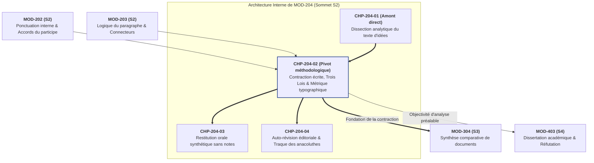
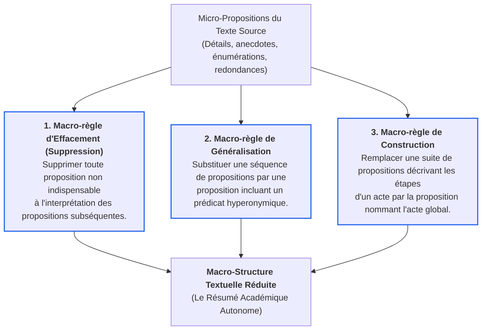

# Chapitre 2 — Méthodologie Académique de la Contraction Écrite et Métrique Typographique : Les Trois Lois, Hyperonymie et Décompte Officiel

> **Identifiant du chapitre** : `CHP-204-02`  
> **Module de rattachement** : [`MOD-204` — Lecture Analytique, Méthodologie du Résumé de Texte Informatif, Restitution Orale Synthétique et Auto-Révision](file:///f:/Formation/world-class-french/03-curriculum/year-1/semester-2/mod-204-resume-texte-restitution-orale.md)  
> **Semestre** : Année 1 — Semestre 2 (S2)  
> **Volume horaire canonique** : 5 à 6 heures d'apprentissage autonome délibéré et d'ateliers d'application (Phase 1 Étude : 1 h 30 | Phase 2 Pratique : 1 h 30 | Phase 3 Correction : 1 h 00 | Phase 4 Évaluation : 1 h 00)  
> **Statut** : [STATUT : VALIDÉ]  
> **Compétences associées** : [`FR-INT-001`](file:///f:/Formation/world-class-french/02-competency-framework/competency-framework.md#fr-int-001-rédiger-un-texte-long-cohérent-en-maîtrisant-accords-et-ponctuation) (Palier L3 Autonomie), [`FR-LEXIC-001`](file:///f:/Formation/world-class-french/02-competency-framework/competency-framework.md#fr-lexic-001-précision-sémantique-nuances-synonymiques-et-collocations) (Palier L3 Autonomie)  
> **Sources scientifiques de référence** : `SRC-TYPO-01` (Imprimerie nationale, *Lexique des règles typographiques*, 2002/2014), `SRC-GRAM-02` (Riegel, Pellat, Rioul, *Grammaire méthodique du français*, PUF, chap. 8 & 19), `SRC-LEX-01` (ATILF / CNRS, *Trésor de la Langue Française informatisé*), `SRC-RHET-03` (Olivier Reboul, *Introduction à la rhétorique*, PUF, chap. 3), `SRC-GRAM-01` (Grevisse & Goosse, *Le Bon Usage*, De Boeck Supérieur, 16e éd., § 225-245 et § 440)

---

## 1. Titre et Place dans le Cursus

### 1.1 Intitulé Officiel
**Chapitre 2 : Méthodologie Académique de la Contraction Écrite et Métrique Typographique : Les Trois Lois, Hyperonymie et Décompte Officiel** (`CHP-204-02`).

### 1.2 Insertion Architecturale dans le Cursus
Le présent chapitre constitue le cœur méthodologique du module intégrateur `MOD-204`. Alors que le chapitre précédent (`CHP-204-01`) a enseigné la dissection analytique du texte d'idées — délimitation de la thèse centrale, cartographie des mouvements logiques et élagage des exemples contingents —, `CHP-204-02` prend en charge l'acte même de **réécriture synthétique normée**.

Résumer un texte ne relève ni du survol désinvolte ni du pillage lexical : c'est une opération d'ingénierie textuelle hautement codifiée par les jurys universitaires et les concours des Grandes Écoles. L'apprenant doit y concilier deux impératifs apparemment antithétiques :
1. **L'effacement énonciatif absolu** : épouser fidèlement le raisonnement d'autrui sans jamais intervenir en son nom propre ni introduire de formules de régie (*« l'auteur démontre que »*) [Réf. `SRC-GRAM-02`, chap. 19] ;
2. **La compression sémantique maximale** : réduire l'étendue textuelle au quart exact ($1/4$) par la mobilisation d'un outillage linguistique savant (hyperonymie, nominalisations à rection actancielle, restructurations paratactiques) dans le respect rigoureux de la tolérance métrique de $\pm 10\,\%$ [Réf. `SRC-LEX-01` ; `SRC-TYPO-01`].



- **En amont** : Ce chapitre réinvestit immédiatement la rigueur syntaxique de [`MOD-201`](file:///f:/Formation/world-class-french/03-curriculum/year-1/semester-2/mod-201-syntaxe-fonctionnelle-phrase-simple.md), l'emploi démonstratif de la ponctuation interne acquis dans [`MOD-202`](file:///f:/Formation/world-class-french/03-curriculum/year-1/semester-2/mod-202-participe-passe-avoir-ponctuation-interne.md) (deux-points déductifs, points-virgules de balancement), ainsi que la maîtrise des réseaux de connecteurs logiques consolidée dans [`MOD-203`](file:///f:/Formation/world-class-french/03-curriculum/year-1/semester-2/mod-203-logique-paragraphe-cohesion-textuelle.md).
- **Au sein du module [`MOD-204`](file:///f:/Formation/world-class-french/03-curriculum/year-1/semester-2/mod-204-resume-texte-restitution-orale.md)** : Il fournit le substrat textuel compact indispensable à l'entraînement oratoire sans notes (`CHP-204-03`) et alimente directement le banc d'essai micro-syntaxique du protocole d'auto-révision en quatre passes (`CHP-204-04`).
- **En aval dans le cursus** : La capacité à condenser un texte d'idées avec exactitude est le prérequis formel absolu (`DEP-LEC-01`, `DEP-RED-02`) de la synthèse comparative multipolaire en deuxième année ([`MOD-304`](file:///f:/Formation/world-class-french/03-curriculum/year-2/semester-3/syllabus.md)) et de la dispute dialectique ([`MOD-403`](file:///f:/Formation/world-class-french/03-curriculum/year-2/semester-4/syllabus.md)).

---

## 2. Objectifs Mesurables

Au terme des 5 à 6 heures d'étude théorique et d'ateliers d'application de ce chapitre, l'apprenant sera capable de :

1. **Appliquer les trois lois cardinales du résumé académique** (fidélité objective, neutralité énonciative, autonomie textuelle) en éliminant 100 % des formules de régie textuelle (*« l'auteur dit »*, *« selon le sociologue »*) et en garantissant zéro contresens sur l'enchaînement argumentatif [Réf. `SRC-GRAM-02`, chap. 19 ; `SRC-RHET-03`, chap. 3] (`FR-INT-001` — Palier L3).
2. **Mobiliser l'arsenal linguistique de la condensation conceptuelle** (hyperonymie, nominalisations à rection actancielle, suppression des incidentes non restrictives) pour réduire un paragraphe argumenté au quart exact de sa longueur sans altération de la teneur philosophique [Réf. `SRC-LEX-01` ; `SRC-GRAM-02`, chap. 8] (`FR-LEXIC-001` — Palier L3).
3. **Calculer avec une précision arithmétique infaillible le décompte officiel des mots typographiques** selon la norme de l'Imprimerie nationale et des concours académiques (gestion des élisions, des traits d'union, des nombres et de l'exception unique *aujourd'hui*), en apposant le balisage réglementaire par cinquantaine [Réf. `SRC-TYPO-01`] (`FR-INT-001` — Palier L3).
4. **Restructurer une phrase condensée sans rupture de construction** en éradiquant toute anacoluthe (participe présent sans support nominal, télescopage actanciel) pour préserver une cohésion syntaxique irréprochable [Réf. `SRC-GRAM-01`, § 440] (`FR-INT-001` — Palier L3).

---

## 3. Prérequis et Test de Préparation (Auto-Diagnostic)

### 3.1 Prérequis Cognitifs Exigibles
Avant d'aborder ce chapitre, l'apprenant doit maîtriser :
- La distinction formelle entre une **thèse générale**, un **argument démonstratif** et un **exemple illustratif contingent** ([`CHP-204-01`](file:///f:/Formation/world-class-french/03-curriculum/year-1/semester-2/mod-204/chp-204-01-lecture-analytique-dissection-texte-idees.md)).
- La reconnaissance des rôles sémantiques et de la structure actancielle du verbe ([`MOD-201`](file:///f:/Formation/world-class-french/03-curriculum/year-1/semester-2/mod-201-syntaxe-fonctionnelle-phrase-simple.md)).
- La syntaxe des propositions subordonnées relatives et circonstancielles ([`MOD-201`], [`MOD-203`]).
- L'accord infaillible du participe passé employé avec *avoir* et la ponctuation logique de la phrase ([`MOD-202`]).

---

### 3.2 Test de Préparation Immédiat (5 Questions)
Répondez aux cinq questions suivantes sur une feuille de brouillon avant de consulter le corrigé repliable.

1. Dans la phrase *« L'auteur démontre avec brio que l'individualisme contemporain ruine les solidarités traditionnelles »*, pourquoi l'expression *« L'auteur démontre avec brio que »* est-elle doublement fautive dans un résumé de texte académique ?
2. Quelle opération sémantique permet de remplacer le groupe *« les poires, les abricots, les prunes et les cerises »* par le terme *« les fruits à noyau et à pépins »* ou simplement *« les fruits »* ? Comment nomme-t-on le terme englobant par rapport aux termes particuliers ?
3. Selon la convention typographique officielle des jurys de concours, combien de mots compte rigoureusement l'expression suivante : *« C'est-à-dire qu'aujourd'hui l'homme s'interroge »* ?
4. Transformez la subordonnée circonstancielle en syntagme nominal compact équivalent : *« Dès que les frontières économiques ont été brutalement ouvertes, la concurrence extérieure s'est intensifiée. »*
5. Identifiez l'anomalie syntaxique majeure dans cette phrase condensée : *« En voulant résumer le texte trop vite, plusieurs contre-sens graves ont été commis par l'étudiant. »*

---

#### Corrigé Détaillé de l'Auto-Diagnostic

<details>
<summary><b>Consulter le corrigé raisonné des 5 questions de préparation</b></summary>

1. **Double faute de l'expression d'attribution** :
   - *Première faute (violation de la neutralité énonciative)* : L'expression *« L'auteur démontre que »* est une **formule de régie métadiscursive**. Le résumé exige une réénonciation directe ; le candidat doit épouser l'énonciation de l'auteur et écrire directement : *« L'individualisme contemporain ruine les solidarités traditionnelles. »*
   - *Seconde faute (violation de l'objectivité critique)* : L'adverbe appréciatif *« avec brio »* constitue un jugement de valeur personnel. Tout commentaire approbateur ou désapprobateur est formellement proscrit dans un résumé.

2. **Hyperonymie et hyponymie** :
   - L'opération sémantique consiste à regrouper des termes spécifiques (*hyponymes*) sous une unité lexicale générique abstraite de rang supérieur appelée **hyperonyme** (*fruits* est l'hyperonyme de *poires, cerises, prunes*) [Réf. `SRC-LEX-01` ; `SRC-GRAM-02`, chap. 8].

3. **Décompte typographique officiel** :
   - Décomposition : *C'* (1) + *est* (2) + *à* (3) + *dire* (4) + *qu'* (5) + *aujourd'hui* (6, exception unique lexicalisée) + *l'* (7) + *homme* (8) + *s'* (9) + *interroge* (10).
   - L'expression compte très exactement **10 mots typographiques**.

4. **Nominalisation à rection actancielle** :
   - Proposition condensée : *« L'ouverture brutale des frontières économiques a intensifié la concurrence extérieure. »* (Le verbe *ont été ouvertes* devient le substantif *ouverture*, le sujet *les frontières* devient complément déterminatif du nom, et la subordonnée temporelle devient le sujet direct de la phrase).

5. **Anacoluthe sur participe présent** :
   - Le gérondif *« En voulant résumer le texte trop vite »* n'a pas de sujet syntaxique propre ; la règle exige qu'il se rattache au sujet grammatical de la proposition principale. Or, le sujet grammatical est ici *« plusieurs contre-sens graves »*. Ce ne sont pas les contre-sens qui ont voulu résumer le texte !
   - *Rectification normée* : *« En voulant résumer le texte trop vite, l'étudiant a commis plusieurs contre-sens graves. »* [Réf. `SRC-GRAM-01`, § 440].

</details>

---

## 4. Situation de Départ ou Problème Concret : Le Naufrage du Résumé Scolaire

Chaque année, aux concours des Écoles normales supérieures, des Grandes Écoles de commerce (BCE, Ecricome) et des concours d'ingénieurs (Mines, Centrale), les rapports de jury dressent un constat accablant sur les copies de contraction de texte. Des candidats brillants, capables de disserter savamment, voient leur note s'effondrer sous le seuil éliminatoire (notes inférieures à 06/20) en raison de défaillances méthodologiques récurrentes :

```text
┌─────────────────────────────────────────────────────────────────────────────┐
│                 LES QUATRE ÉCUEILS MORTELS DU RÉSUMÉ DE CONCOURS            │
├─────────────────────────────────────────────────────────────────────────────┤
│ 1. Le patchwork de citations (« ciseau et colle ») :                       │
│    Le candidat recopie des membres de phrases du texte source en les liant  │
│    par « de plus », « en outre ». Sanction : 0/20 pour absence de réflexion │
│    et plagiat textuel servile.                                              │
├─────────────────────────────────────────────────────────────────────────────┤
│ 2. Le parasitisme énonciatif (« l'auteur montre que ») :                   │
│    Remplir son texte de formules de régie qui consomment 25 % du quota de   │
│    mots alloué sans apporter le moindre contenu argumentatif.               │
├─────────────────────────────────────────────────────────────────────────────┤
│ 3. Le faux décompte typographique :                                         │
│    Croire que « c'est-à-dire » compte pour 1 mot ou que l'apostrophe ne     │
│    sépare rien. Résultat : une copie déclarée à 100 mots qui en compte 125, │
│    entraînant des pénalités métriques rédhibitoires.                        │
├─────────────────────────────────────────────────────────────────────────────┤
│ 4. La dislocation syntaxique (anacoluthe) :                                 │
│    À force de comprimer les phrases pour gagner des mots, l'étudiant        │
│    supprime les sujets logiques et juxtapose des syntagmes bancals.         │
└─────────────────────────────────────────────────────────────────────────────┘
```

Résumer n'est pas abréger superficiellement : c'est **dégager la colonne vertébrale logique d'une pensée vivante et la reconstruire avec ses propres mots en respectant une métrique rigoureuse**.

---

## 5. Explication Intuitive : L'Analogie du Lingot d'Or et de la Réduction Culinaire

Pour comprendre l'exigence du résumé académique, deux analogies complémentaires s'imposent à l'esprit :

### 5.1 La Réduction Culinaire : Évaporer l'Eau, Concentrer le Sel
Dans un bouillon gastronomique, le chef fait mijoter de la viande, des herbes, des aromates et beaucoup d'eau. Au fil de la cuisson, l'eau s'évapore entièrement dans l'atmosphère ; seuls subsistent le sel, les sucs et la concentration des saveurs essentielles.
- L'eau représente les **exemples anecdotiques, métaphores oratoires et digressions** du texte source.
- Les sucs représentent **l'enchaînement strict des concepts et des thèses**.
- Le résumé ne doit pas être une assiette où flottent quelques morceaux d'origine, mais un **fond concentré** où chaque goutte porte l'intensité du propos initial.

### 5.2 Le Lingot d'Or : La Fonte du Minerai Brut
Un prospecteur extrait de la roche cinquante kilos de minerai brut mêlé de terre, de gravats et d'impuretés. Il ne transporte pas cette gangue volumineuse : il la soumet au creuset, fond le métal pur et coule un lingot compact et autonome.
- Le lingot ne porte aucune trace de la terre d'origine.
- Il a sa forme propre, nette, géométrique.
- Pourtant, **tout l'or pur contenu dans le minerai se trouve dans le lingot**, sans qu'un seul gramme de plomb extérieur n'y ait été frauduleusement ajouté.

Le résumé académique est ce lingot : autonome, dense, exempt de scories, d'une valeur intellectuelle égale à celle de la montagne de prose dont il est issu.

---

## 6. Définitions Précises et Terminologie

Afin de fonder une pratique rigoureuse, dix termes techniques doivent être définis avec exactitude :

1. **Résumé académique (ou Contraction de texte)** : Épreuve canonique d'évaluation universitaire consistant à réécrire la trame argumentative continue d'un texte d'idées source en réduisant son volume au quart ($1/4$, soit $25\,\%$), sous une stricte contrainte de neutralité énonciative et de conformité métrique [Réf. `SRC-RHET-03`, chap. 3].
2. **Fidélité objective** : Respect absolu de l'architecture intellectuelle de l'auteur source. Elle proscrit le contresens (inversion du sens), le faux sens (altération partielle de la nuance) et l'omission d'un argument cardinal indispensable à la chaîne déductive.
3. **Neutralité énonciative** : Principe d'effacement du rédacteur qui s'interdit d'introduire des formules de régie textuelle (*« selon l'auteur »*, *« nous constatons »*) ou des jugements appréciatifs (*« heureusement »*, *« à juste titre »*). Le résumé adopte directement le système d'énonciation de l'original [Réf. `SRC-GRAM-02`, chap. 19].
4. **Autonomie textuelle** : Propriété d'un résumé dont la syntaxe, la fluidité et la clarté logique permettent une lecture intégrale, intelligible et élégante pour un destinataire qui ne possède pas le texte de départ.
5. **Hyperonyme** : Unité lexicale de sens générique dont l'extension sémantique englobe celle d'une ou plusieurs unités plus spécifiques appelées **hyponymes** (ex. *sentiment* est l'hyperonyme de *jalousie, fierté, rancune*) [Réf. `SRC-LEX-01` ; `SRC-GRAM-02`, chap. 8].
6. **Nominalisation à rection actancielle** : Transformation syntaxique convertissant une proposition verbale en un syntagme nominal d'action dense, tout en reconfigurant les actants verbaux (sujet, compléments) en compléments déterminatifs prépositionnels du nom [Réf. `SRC-GRAM-02`, chap. 14].
7. **Élagage syntaxique** : Suppression concertée des propositions subordonnées relatives explicatives (incidentes non déterminatives), des adverbes modalisateurs redondants et des expansions de phrase n'apportant aucune brique argumentative nouvelle.
8. **Mot typographique (norme officielle)** : Toute unité linguistique graphique isolée par deux espaces blancs ou par un signe de ponctuation (y compris l'apostrophe et le trait d'union), à l'exception unique de l'adverbe lexicalisé *aujourd'hui* qui compte pour un seul mot [Réf. `SRC-TYPO-01`].
9. **Marge de tolérance métrique ($\pm 10\,\%$)** : Intervalle réglementaire dans lequel doit obligatoirement se situer la longueur finale du résumé (ex. pour un calibrage de 100 mots, le résumé doit comporter entre 90 et 110 mots inclus).
10. **Balisage par cinquantaine** : Insertion obligatoire dans le corps du texte d'un repère visuel (barre oblique `/`, astérisques `**/**` ou chiffre) tous les 50 mots typographiques exacts, facilitant le contrôle arithmétique par les correcteurs d'examen.

---

## 7. Règles et Mécanismes Fondamentaux

L'apprentissage de la contraction repose sur trois volets indissociables : les trois lois canoniques, l'arsenal linguistique de condensation et les règles du décompte officiel.

```text
┌─────────────────────────────────────────────────────────────────────────────┐
│                 L'ÉDIFICE NORMATIF DU RÉSUMÉ ACADÉMIQUE                     │
├─────────────────────────────────────────────────────────────────────────────┤
│  VOLET 1 : LES TROIS LOIS CARDINALES                                        │
│  ├── Loi 1 : Fidélité objective (zéro contresens, zéro omission majeure)    │
│  ├── Loi 2 : Neutralité énonciative (zéro formule de régie « l'auteur dit »)│
│  └── Loi 3 : Autonomie textuelle (lisibilité et élégance intrinsèques)      │
├─────────────────────────────────────────────────────────────────────────────┤
│  VOLET 2 : L'ARSENAL LINGUISTIQUE DE CONDENSATION                          │
│  ├── Réduction par hyperonymie (englober les hyponymes)                    │
│  ├── Nominalisation à rection actancielle (condenser le verbe en nom)       │
│  └── Élagage chirurgical des incidentes et adjectifs redondants            │
├─────────────────────────────────────────────────────────────────────────────┤
│  VOLET 3 : LA MÉTRIQUE TYPOGRAPHIQUE OFFICIELLE                             │
│  ├── Règle de l'espace, du tiret et de l'apostrophe                         │
│  ├── Traitement de l'exception unique « aujourd'hui » (1 mot)               │
│  └── Tolérance stricte des ± 10 % et balisage par tranche de 50 mots       │
└─────────────────────────────────────────────────────────────────────────────┘
```

---

### 7.1 Les Trois Lois Cardinales du Résumé Académique

#### Loi n° 1 : La Loi de Fidélité Objective
Le résumé contracte la parole d'un autre sans jamais la trahir. Cette fidélité implique trois interdits majeurs :
1. **Zéro contresens** : Ne jamais intervertir une cause et une conséquence, ni attribuer à l'auteur une opinion qu'il s'emploie précisément à réfuter. Lorsque l'auteur concède un argument adverse (*« Certes, le libéralisme économique stimule l'innovation... »*), le rédacteur ne doit pas figer cette concession comme la conclusion définitive du texte.
2. **Zéro omission d'un argument cardinal** : Le texte source progresse par étapes. Évacuer un chaînon argumentatif intermédiaire sous prétexte de brièveté brise la causalité d'ensemble et constitue une faute de fidélité majeure.
3. **Zéro interpolation extérieure** : Interdiction absolue d'ajouter des faits, des exemples personnels, des chiffres ou des jugements absents du texte de départ. Le résumé opère en vase clos intellectuel.

#### Loi n° 2 : La Loi de Neutralité Énonciative
Le résumé n'est pas un compte rendu critique, ni une recension journalistique, ni une notice bibliographique. L'apprenant doit faire abstraction de sa propre voix et s'interdire toute intrusion de régie :
- **Proscription totale des verbes d'attribution** : Bannir *« L'auteur démontre que »*, *« Selon le philosophe »*, *« L'essayiste en vient à conclure que »*, *« Nous observons avec lui que »*.
- **Épouser le système d'énonciation de l'original** : Si le texte est écrit à la 3e personne du singulier (*« L'homme moderne est aliéné par... »*), le résumé emploie la 3e personne. Si l'auteur écrit à la 1re personne du pluriel (*« Nous devons préserver notre héritage... »*), le résumé adopte ce *nous*.

#### Loi n° 3 : La Loi d'Autonomie Textuelle
Un bon résumé ne doit jamais donner l'impression d'avoir été tronqué ou tailladé à la hâte. Il doit être **un texte en prose élégant, cohérent, autonome et pleinement compréhensible par une personne ignorant tout du document initial**.
- Proscription du style télégraphique, des abréviations, des puces de liste et des ruptures thématiques brutales.
- L'enchaînement des phrases doit être assuré par des connecteurs logiques précis (*or, ainsi, dès lors, pourtant, en effet*) ou par une parataxe harmonieuse [Réf. `SRC-GRAM-02`, chap. 19 ; `SRC-RHET-03`, chap. 3].

---

### 7.2 L'Arsenal Linguistique de la Condensation Conceptuelle

Pour réduire le nombre de mots sans appauvrir la substance intellectuelle, le scripteur dispose de trois leviers linguistiques majeurs :

#### 1. La Réduction par Hyperonymie
L'hyperonymie consiste à substituer à une énumération analytique d'hyponymes le concept unificateur abstrait qui les subsume [Réf. `SRC-LEX-01` ; `SRC-GRAM-02`, chap. 8] :

| Énumération source (Hyponymes détaillés) | Substitution condensée (Hyperonyme générique) | Économie de mots |
| :--- | :--- | :---: |
| *« Les juges, les procureurs, les greffiers et les avocats »* | *« L'institution judiciaire »* ou *« Les magistrats et auxiliaires »* | 7 mots $\rightarrow$ 2 mots |
| *« La peur panique, la terreur irrationnelle et l'angoisse obsédante »* | *« L'effroi »* ou *« Les passions anxiogènes »* | 8 mots $\rightarrow$ 2 mots |
| *« Les voies ferrées, les canaux navigables, les autoroutes et les aéroports »* | *« Les infrastructures de transport »* | 8 mots $\rightarrow$ 4 mots |
| *« Le blé, le riz, le millet et le maïs »* | *« Les céréales »* | 8 mots $\rightarrow$ 2 mots |

#### 2. La Nominalisation à Rection Actancielle
La nominalisation transforme une proposition verbale (souvent subordonnée et longue) en un syntagme nominal compact centré sur un nom d'action, reportant les actants en compléments déterminatifs prépositionnels [Réf. `SRC-GRAM-02`, chap. 14] :

- **Énoncé source** (18 mots) :  
  *« Dès lors que le coût de l'énergie s'est mis à grimper brutalement, les ménages ont été contraints de réduire leurs dépenses. »*
- **Transformation par nominalisation** (9 mots) :  
  *« La flambée énergétique a imposé une contraction budgétaire aux ménages. »*  
  *(Gain immédiat de 50 % des mots avec un gain d'autorité stylistique et de densité conceptuelle).*

#### 3. L'Élagage Syntaxique des Expansions Non Déterminatives
Le texte d'idées est encombré d'ornements rhétoriques destinés à persuader l'auditoire. Le crible du résumé élimine sans hésitation :
- Les **propositions relatives explicatives (apposées)** : *« La science, qui constitue pourtant le plus grand chef-d'œuvre de la raison occidentale, vacille... »* $\rightarrow$ *« La science rationnelle vacille... »* ;
- Les **doublets synonymiques** : *« Cette attitude relève d'une négligence coupable et d'un laxisme impardonnable »* $\rightarrow$ *« Ce laxisme est coupable »* ;
- Les **circonstants d'insistance oratoire** : *« En vérité, à bien y regarder, force est de constater sans le moindre doute que... »* $\rightarrow$ pure suppression.

---

### 7.3 Les Règles Officielles du Décompte Typographique des Mots

Le décompte des mots obéit aux normes strictes de l'Imprimerie nationale (`SRC-TYPO-01`) adoptées par la quasi-totalité des jurys de concours en France et dans l'espace francophone.

#### 1. Règle Générale du Mot Typographique
> **Principe fondamental** : Est considéré comme un mot **tout ensemble de signes graphiques isolé par deux espaces blancs ou par un signe de ponctuation** (espace, apostrophe, trait d'union).

#### 2. Inventaire des Cas Pièges et Conventions d'Arbitrage

| Forme graphique | Nombre officiel de mots | Justification et décomposition typographique (`SRC-TYPO-01`) |
| :--- | :---: | :--- |
| *L'homme* | **2 mots** | L'apostrophe sépare le pronom/article élidé (*l'*) du substantif (*homme*). |
| *D'accord* | **2 mots** | Préposition élidée (*d'*) + nom (*accord*). |
| *Qu'il* | **2 mots** | Conjonction élidée (*qu'*) + pronom (*il*). |
| *C'est-à-dire* | **4 mots** | *C'* (1) + *est* (2) + *à* (3) + *dire* (4). Le tiret d'union sépare les unités graphiques. |
| *Peut-être* | **2 mots** | *Peut* (1) + *être* (2). |
| *Sous-estimation* | **2 mots** | Préfixe soudé par tiret (*sous*) + nom (*estimation*). |
| *Chef-d'œuvre* | **3 mots** | *Chef* (1) + *d'* (2) + *œuvre* (3). Tiret et apostrophe créent trois unités. |
| *Va-t-en* | **3 mots** | *Va* (1) + *t* euphonique (2) + *en* (3). |
| *Y a-t-il* | **4 mots** | *Y* (1) + *a* (2) + *t* (3) + *il* (4). |
| **Aujourd'hui** | **1 mot** | **EXCEPTION UNIQUE LEXICALISÉE** reconnue par l'Imprimerie nationale et les jurys. |
| *1789* (en chiffres) | **1 mot** | Un nombre écrit en chiffres arabes compte pour 1 mot (mais à proscrire en bonne prose). |
| *Dix-huit cents* | **3 mots** | *Dix* (1) + *huit* (2) + *cents* (3). |
| *P.-D.G.* / *PDG* | **3 mots / 1 mot** | *P.-D.G.* (points et tiret = 3 mots) ; *PDG* (acronyme soudé = 1 mot). |

#### 3. La Métrique du Quart et le Balisage par Cinquantaine
- **Règle de proportion** : Tout résumé académique prescrit une cible $C$, généralement égale au quart de la source ($C = \text{Longueur source} / 4$).
- **Tolérance des $\pm 10\,\%$** : Pour une consigne de $C$ mots, le résumé est réglementaire si et seulement si sa longueur $L$ vérifie :
  $$0{,}9 \times C \le L \le 1{,}1 \times C$$
  *(Exemple : pour une cible de 100 mots, la fourchette stricte est [90, 110] mots inclus).*
- **Balisage obligatoire** : Le candidat doit apposer une barre oblique franche (`/`) ou un repère typographique visible (`**/**`) sous ou après le cinquantième mot, le centième mot, le cent-cinquantième mot, et inscrire à la fin de sa copie le décompte total certifié exact.

---

## 8. Raisonnement Détaillé : Pourquoi la Neutralité Énonciative est Non Négociable

Certains apprenants demandent légitimement : *« Pourquoi interdire d'écrire "L'auteur montre que", alors que cela prouve précisément que je ne confonds pas mes idées avec les siennes ? »*

La réponse repose sur trois exigences épistémologiques et stylistiques fondamentales :

### 8.1 L'Économie Algébrique des Mots
Dans une épreuve où chaque mot coûte cher, dépenser 4 à 6 mots pour introduire une formule d'attribution constitue une dilapidation pure et simple du quota alloué.
- *« Dans un premier temps, l'auteur s'attache à mettre en lumière que... »* (11 mots !) consomme plus de 10 % d'un résumé de 100 mots sans formuler la moindre idée de fond.
- Multipliée par trois mouvements logiques, cette manie dévore 30 mots, contraignant le candidat à sacrifier des arguments vitaux en fin de parcours.

### 8.2 Le Statut Rhétorique du Résumé : Un Miroir Concentré, Non une Chronique
Le résumé est une **transposition homologique** de la pensée : il doit produire sur l'esprit du lecteur le même effet de démonstration directe que le texte original, mais avec une puissance de frappe quadruplée.
- Quand un auteur écrit : *« La technique transforme l'homme en instrument »*, il pose une assertion forte.
- Si le candidat écrit : *« L'auteur pense que la technique transforme l'homme en instrument »*, il rétrograde l'assertion au rang d'opinion subjective extérieure. Il détruit l'immédiateté de la thèse et substitue la chronique du texte à la vie du texte [Réf. `SRC-RHET-03`, chap. 3].

### 8.3 La Rupture du Contrat d'Autonomie Textuelle
Le destinataire d'un résumé académique souhaite lire une réflexion substantielle sur un problème du monde (l'art, la politique, la mémoire, le travail), et non un bavardage scolaire sur la façon dont un tiers a agencé ses paragraphes. Évacuer l'auteur de la surface textuelle est l'unique moyen de conférer au résumé son autonomie d'œuvre de plein exercice.

---

## 9. Exemples Corrects Commentés

Examinons pas à pas la contraction d'un texte d'idées source de **200 mots exacts** en un résumé académique normé de **50 mots exacts** (soit le quart exact, $25\,\%$, parfaitement conforme à la fourchette $[45, 55]$).

### 9.1 Le Texte d'Idées Source (200 mots typographiques certifiés)

> La prolifération des flux numériques engendre une métamorphose insidieuse de nos habitudes cognitives. Habitué à solliciter des écrans interactifs, l'esprit contemporain s'accoutume désormais au zapping perpétuel et à la réception passive de bribes discontinues. Cette surexposition affaiblit notre faculté d'attention soutenue, indispensable au déchiffrement des pensées complexes. Dès lors qu'une information chasse l'autre à un rythme effréné, le lecteur perd la patience d'approfondir un raisonnement. Il survole les lignes, glane des formules éphémères et abandonne l'effort d'assimilation. Or, la véritable intelligence critique ne saurait éclore dans la précipitation. Elle exige le silence de la méditation, la confrontation solitaire aux livres denses et la lente maturation des notions. En désertant l'exercice de la lecture, nous sacrifions la mémoire réflexive au profit d'un psittacisme superficiel. Si l'accès instantané aux banques de données élargit notre horizon documentaire, il nous prive de l'épaisseur intellectuelle forgée par l'étude patiente. La maîtrise du savoir n'est pas une simple accumulation mécanique ; elle requiert une discipline de la conscience capable d'ordonner le chaos des données. Sans cette ascèse méthodique, l'homme hyperconnecté se condamne à demeurer le spectateur crédule de ses illusions techniciennes.

---

### 9.2 Grille Analytique Préparatoire
1. **Thèse centrale** : La surexposition aux flux numériques détruit la concentration nécessaire à l'exercice de la pensée critique et substitue un savoir superficiel à la véritable culture de l'esprit.
2. **Chaîne des arguments pivots** :
   - *Argument 1* : Le zapping numérique permanent érode la capacité d'attention soutenue et la patience de l'analyse suivie.
   - *Argument 2* : La formation de l'esprit critique réclame au contraire le recul, le temps long et l'effort d'une lecture exigeante.
   - *Argument 3* : La substitution de l'immédiateté technique à l'assimilation réflexive enferme l'homme dans un savoir factice et mécanique.
3. **Éléments secondaires élagués** :
   - Les détails descriptifs (*glaner des formules*, *écrans interactifs*, *livres denses*, *spectateur crédule*).
   - Les redondances lexicales sur la précipitation et la lente maturation.

---

### 9.3 Le Résumé Académique Normé (50 mots typographiques certifiés)

> Les flux numériques dispersent notre attention et détruisent la patience de l'analyse approfondie. Or, l'esprit critique exige l'effort silencieux d'une lecture attentive. En substituant l'immédiateté technique à l'assimilation personnelle, l'homme moderne sacrifie sa mémoire réflexive à l'illusion superficielle d'un savoir mécanique. **/**

*(Balisage apposé au cinquantième mot par le symbole `**/**`).*

---

### 9.4 Décompte Mot à Mot Certifié (Règles officielles de concours)

| N° | Mot | Règle / Typographie | N° | Mot | Règle / Typographie |
| :---: | :--- | :--- | :---: | :--- | :--- |
| **1** | Les | Article défini pluriel | **26** | En | Préposition gérondive |
| **2** | flux | Substantif masculin | **27** | substituant | Participe présent |
| **3** | numériques | Adjectif qualificatif | **28** | l' | Article élidé (*l'*) = 1 mot |
| **4** | dispersent | Verbe transitif | **29** | immédiateté | Substantif féminin |
| **5** | notre | Adjectif possessif | **30** | technique | Adjectif qualificatif |
| **6** | attention | Substantif féminin | **31** | à | Préposition |
| **7** | et | Conjonction de coordination | **32** | l' | Article élidé (*l'*) = 1 mot |
| **8** | détruisent | Verbe transitif | **33** | assimilation | Substantif féminin |
| **9** | la | Article défini féminin | **34** | personnelle, | Substantif adjectivé |
| **10** | patience | Substantif féminin | **35** | l' | Article élidé (*l'*) = 1 mot |
| **11** | de | Préposition | **36** | homme | Substantif masculin |
| **12** | l' | Article élidé (*l'*) = 1 mot | **37** | moderne | Adjectif qualificatif |
| **13** | analyse | Substantif féminin | **38** | sacrifie | Verbe transitif |
| **14** | approfondie. | Participe passé adjectivé | **39** | sa | Adjectif possessif |
| **15** | Or, | Connecteur d'opposition | **40** | mémoire | Substantif féminin |
| **16** | l' | Article élidé (*l'*) = 1 mot | **41** | réflexive | Adjectif qualificatif |
| **17** | esprit | Substantif masculin | **42** | à | Préposition |
| **18** | critique | Adjectif qualificatif | **43** | l' | Article élidé (*l'*) = 1 mot |
| **19** | exige | Verbe transitif | **44** | illusion | Substantif féminin |
| **20** | l' | Article élidé (*l'*) = 1 mot | **45** | superficielle | Adjectif qualificatif |
| **21** | effort | Substantif masculin | **46** | d' | Préposition élidée (*d'*) = 1 mot |
| **22** | silencieux | Adjectif qualificatif | **47** | un | Article indéfini |
| **23** | d' | Préposition élidée (*d'*) = 1 mot | **48** | savoir | Substantif masculin |
| **24** | une | Article indéfini féminin | **49** | mécanique. | Adjectif qualificatif |
| **25** | lecture | Substantif féminin | **50** | **/** | **Repère 50 mots exacts** |

---

### 9.5 Commentaire Linguistique des Choix de Condensation
- **Hyperonymie conceptuelle** : La longue description des *« banques de données »*, de la *« surexposition aux écrans »* et du *« zapping »* est subsumée sous les syntagmes unificateurs denses : *« flux numériques »* et *« immédiateté technique »*.
- **Nominalisation à rection actancielle** : La proposition subordonnée *« Dès lors qu'une information chasse l'autre... le lecteur perd la patience d'approfondir »* devient le syntagme nominal d'action : *« détruisent la patience de l'analyse approfondie »*.
- **Neutralité énonciative intégrale** : Aucune formule parasite (*« L'auteur démontre »*). La pensée avance en trois assertions nettes articulées par le connecteur logique cardinal *Or*.

---

## 10. Contre-Exemples et Erreurs Fréquentes : Clinique des Six Pathologies Récurrentes

L'observation des copies permet d'isoler six erreurs majeures qui ruinent systématiquement l'exercice :

### Erreur n° 1 : Le parasitisme énonciatif et l'intrusion métadiscursive (« L'auteur démontre que »)
- **Manifestation défectueuse** : *« Dans son texte, l'essayiste s'efforce de prouver que la démocratie est menacée, puis il explique que les citoyens ne votent plus, ce qui est très juste. »*
- **Diagnostic scientifique** : L'étudiant transforme un résumé en chronique d'un acte de parole d'autrui, s'approprie le droit de distribuer des bons points (*« ce qui est très juste »*) et gaspille 14 mots en pures formules de régie.
- **Rectification normée** : *« La désaffection électorale des citoyens menace directement la démocratie. »*
- **Règle absolue** : Zéro formule de régie textuelle, zéro jugement d'approbation ou de blâme.

### Erreur n° 2 : Le collage servile de citations et le plagiat lexical non restructuré
- **Manifestation défectueuse** : Reprendre mot pour mot : *« L'accès instantané aux banques de données élargit notre horizon documentaire mais nous prive de l'épaisseur intellectuelle. »*
- **Diagnostic scientifique** : L'étudiant découpe la prose de l'auteur au ciseau sans digérer la structure notionnelle. Le plagiat textuel est sanctionné par un zéro immédiat à l'épreuve de contraction aux concours.
- **Rectification normée** : Réécrire l'idée sous une forme sémantiquement neuve : *« Si le numérique démultiplie l'information disponible, il appauvrit la réflexion personnelle. »*

### Erreur n° 3 : L'amputation d'un argument cardinal et la rupture de cohérence argumentative
- **Manifestation défectueuse** : Résumer un texte en sautant directement du constat initial (le numérique est omniprésent) à la conclusion (l'esprit s'atrophie), en omettant l'argument médiateur sur l'atrophie de l'attention et le rejet du temps long.
- **Diagnostic scientifique** : La causalité logique est brisée. Le résumé cesse d'être une démonstration rationnelle pour devenir une suite de jugements dogmatiques sans preuves intermédiaires.
- **Règle absolue** : Tout résumé doit préserver l'armature déductive intégrale du texte source.

### Erreur n° 4 : Le faux décompte typographique des mots à tiret, élision et apostrophe
- **Manifestation défectueuse** : Compter l'expression *« c'est-à-dire »* pour 1 mot sous prétexte qu'elle forme une locution unie, et compter *« l'art »* pour 1 mot.
- **Diagnostic scientifique** : Confusion entre le mot sémantique (unité de sens) et le **mot typographique officiel** (unité délimitée par des séparateurs graphiques).
- **Règle absolue** : *C'est-à-dire* compte pour **4 mots**, *l'art* compte pour **2 mots**, seul *aujourd'hui* bénéficie de la dérogation unique d'un mot (`SRC-TYPO-01`).

### Erreur n° 5 : Le franchissement de la fourchette métrique des ± 10 % et le barème pénal
- **Manifestation défectueuse** : Rendre une copie de 118 mots pour une consigne fixant la cible à 100 mots avec tolérance de $\pm 10\,\%$.
- **Diagnostic scientifique** : L'intervalle réglementaire est $[90, 110]$ mots inclus. À 118 mots, la copie est en infraction métrique flagrante.
- **Sanction de concours** : Application du barème pénal officiel (ex. déduction automatique de 2 à 4 points par tranche de 5 mots au-delà de la marge, conduisant rapidement à une note inférieure à 08/20).

### Erreur n° 6 : L'anacoluthe syntaxique et la dislocation de la phrase sous l'effet d'une condensation excessive
- **Manifestation défectueuse** : *« En éliminant les détails superflus, le texte devient limpide pour l'étudiant. »*
- **Diagnostic scientifique** : Le sujet syntaxique de la proposition principale est *le texte*. Ce n'est pas le texte qui élimine les détails superflus, mais l'étudiant. La proposition participiale est en suspens, sans ancrage actanciel valide (`SRC-GRAM-01`, § 440).
- **Rectification normée** : *« En éliminant les détails superflus, l'étudiant rend le texte limpide. »*

---

## 11. Cas Particuliers et Limites de la Règle

Dans la pratique de la contraction, quatre situations frontières méritent un éclairage normatif précis :

### 11.1 Les Locutions Latines et Mots Composés sans Trait d'Union
- Les expressions étrangères ou latines non unies par un trait d'union se comptent mot par mot selon les espaces blancs :
  - *A priori* = **2 mots** ;
  - *Statu quo* = **2 mots** ;
  - *Ad vitam aeternam* = **3 mots** ;
  - *De facto* = **2 mots**.
- Les emprunts lexicalisés soudés comptent pour 1 mot (*weekend* = 1 mot ; mais si orthographié traditionnellement avec trait d'union *week-end* = **2 mots** selon la règle de l'Imprimerie nationale).

### 11.2 Les Sigles et Acronymes Officiels
- Un sigle usuel non ponctué (*ONU*, *UNESCO*, *PIB*, *ONG*) compte pour **1 mot typographique**.
- Si le sigle est écrit avec des points abréviatifs séparateurs (*O.N.U.*), la convention tolère généralement 1 mot s'il n'y a pas d'espace, mais la forme sans point (*ONU*) est impérativement recommandée pour lever toute ambiguïté.

### 11.3 Les Citations Textuelles Indispensables (Néologismes et Formules Consacrées)
Le résumé proscrit le collage de citations. Toutefois, une exception unique existe :
- Lorsqu'un auteur forge un **concept technique inédit** ou emploie une métaphore théorique fondatrice qui fait date (ex. le *« désenchantement du monde »* chez Max Weber, l'*« animal politique »* chez Aristote, le concept d'*« habillage »* ou d'*« habitus »* chez Bourdieu), le terme peut être conservé **entre guillemets**, sous réserve qu'il soit strictement intégré à une syntaxe reformulée et ne dépasse pas 2 à 3 mots.

### 11.4 Les Énumérations Irréductibles
Lorsqu'une énumération du texte source constitue le fondement d'une classification doctrinale (ex. la tripartition des pouvoirs : *législatif, exécutif, judiciaire* chez Montesquieu), il est interdit de la réduire à un vague hyperonyme (*« les pouvoirs »*). Ces trois notions sont des arguments autonomes, non des hyponymes contingents : elles doivent être maintenues.

---

## 12. Approfondissement Adapté au Niveau : La Théorie des Macro-Règles Textuelles de Teun A. van Dijk

Pour donner à la pratique du résumé une assise scientifique reconnue au niveau universitaire et L3, il convient de mobiliser la théorie de la cohérence textuelle et des **macro-structures** élaborée par le linguiste néerlandais **Teun A. van Dijk** (*Text and Context: Explorations in the Semantics and Pragmatics of Discourse*, 1977).

Selon van Dijk, comprendre et résumer un discours ne consiste pas à opérer un simple hachage mécanique, mais à appliquer un système formel de **macro-règles sémantiques** qui réduisent une séquence de micro-propositions à une macro-proposition supérieure :



1. **La règle d'Effacement (*Deletion*)** : Éliminer toute proposition qui ne conditionne pas la compréhension des étapes ultérieures du raisonnement.
   - *Application* : Évacuer les anecdotes personnelles de l'auteur et les illustrations pittoresques.
2. **La règle de Généralisation (*Generalization*)** : Remplacer une suite de propositions particulières par une proposition abstraite qui subsume leurs traits communs.
   - *Application* : C'est le fondement théorique de l'**hyperonymie** (remplacer les détails matériels d'un corps de métier par son essence socio-économique).
3. **La règle de Construction (*Construction*)** : Remplacer une série de propositions décrivant les conditions, composantes ou conséquences normales d'une action par la désignation globale de cette action.
   - *Exemple de van Dijk* : Si le texte détaille : *« Il s'est rendu à la gare, a acheté un billet, a composté son coupon et est monté dans le compartiment »*, la règle de construction permet de résumer l'ensemble par : *« Il a pris le train. »*
   - *Application au texte d'idées* : Si un auteur détaille les tergiversations, les votes d'amendements et les débats houleux à l'Assemblée, la macro-règle de construction substitue : *« L'adoption parlementaire de la loi »*.

---

## 13. Comparaisons Différentielles

Trois tableaux synoptiques permettent de dissiper définitivement les confusions conceptuelles majeures :

### 13.1 Résumé de Texte vs Compte Rendu Critique vs Analyse / Commentaire

| Critère d'évaluation | Résumé Académique (Contraction) | Compte Rendu Critique | Analyse / Commentaire Composé |
| :--- | :--- | :--- | :--- |
| **Voix énonciative** | Épouse directement la voix de l'auteur (neutralité totale). | Distanciation explicite (*« L'auteur analyse... »*). | Métadiscours complet du candidat critique. |
| **Interventions personnelles** | **Interdiction absolue** de tout jugement ou ajout. | Autorise une évaluation critique finale mesurée. | Fondé sur l'interprétation critique personnelle. |
| **Formules de régie** | **Proscrites à 100 %**. | Autorisées et fréquentes. | Obligatoires pour citer et analyser le texte. |
| **Longueur et métrique** | Réduction stricte au $1/4$ ($\pm 10\,\%$) avec balisage. | Longueur libre ou indicative (souvent $1/3$). | Généralement plus long que le texte source. |
| **Objectif premier** | Restituer la rigueur de la démonstration pure. | Informer un lecteur et évaluer l'ouvrage. | Démonter les mécanismes stylistiques et idéologiques. |

---

### 13.2 Paraphrase Servile vs Reformulation Hyperonymique Synthétique

| Critère | La Paraphrase Servile (Fautive) | La Reformulation Synthétique (Normée) |
| :--- | :--- | :--- |
| **Traitement du vocabulaire** | Remplacement mot à mot par des synonymes approximatifs. | Recours à l'abstraction, aux hyperonymes et aux concepts denses. |
| **Traitement de la syntaxe** | Calque servile sur l'ordre des phrases d'origine. | Réorganisation syntaxique complète par nominalisation et parataxe. |
| **Rendement métrique** | Très faible : le texte reste bavard et dépasse les quotas. | Optimal : division par 4 de l'étendue textuelle sans perte d'idées. |
| **Effet intellectuel** | Impression d'artifice scolaire et de dépendance étroite. | Preuve éclatante d'assimilation et d'autonomie conceptuelle. |

---

### 13.3 Mot Lexical vs Mot Typographique Officiel de Concours

| Expression | Décompte au sens lexical (sens) | Décompte officiel typographique (`SRC-TYPO-01`) | Justification de la divergence |
| :--- | :---: | :---: | :--- |
| *C'est-à-dire* | 1 locution conjonctive | **4 mots** | Séparation graphique par tirets et apostrophe : *c'* / *est* / *à* / *dire*. |
| *L'institution* | 1 syntagme nominal | **2 mots** | L'apostrophe d'élision scinde l'article du nom : *l'* / *institution*. |
| *Sous-préfet* | 1 substantif composé | **2 mots** | Le trait d'union délimite deux unités typographiques distinctes. |
| *Aujourd'hui* | 1 adverbe temporel | **1 mot** | Seule exception historique lexicalisée consacrée par la norme. |

---

## 14. Exercices Progressifs (Trois Niveaux)

### Niveau 1 : Reconnaissance et Décompte Typographique Officiel (15 Expressions Pièges)
**Consigne** : Calculez le nombre officiel de mots typographiques pour chacune des 15 expressions suivantes selon les règles de l'Imprimerie nationale et des concours académiques (`SRC-TYPO-01`). Justifiez brièvement votre calcul pour chaque expression.

1. *l'arbre*
2. *c'est-à-dire*
3. *aujourd'hui*
4. *chef-d'œuvre*
5. *qu'ils n'aient*
6. *socio-économique*
7. *va-t-en*
8. *peut-être*
9. *prud'homme*
10. *sous-préfet*
11. *d'accord*
12. *presqu'île*
13. *y a-t-il*
14. *1984*
15. *au-delà*

---

#### Corrigé Détaillé du Niveau 1

<details>
<summary><b>Consulter le corrigé raisonné des 15 décomptes</b></summary>

| N° | Expression | Décompte officiel | Décomposition et justification savante (`SRC-TYPO-01`) |
| :---: | :--- | :---: | :--- |
| **1** | *l'arbre* | **2 mots** | *l'* (article élidé) + *arbre* (substantif). L'apostrophe sépare 2 mots. |
| **2** | *c'est-à-dire* | **4 mots** | *c'* + *est* + *à* + *dire*. Tirets et apostrophe créent 4 unités graphiques. |
| **3** | *aujourd'hui* | **1 mot** | **Exception unique** lexicalisée par les jurys et l'Imprimerie nationale. |
| **4** | *chef-d'œuvre* | **3 mots** | *chef* + *d'* + *œuvre*. Séparé par 1 tiret et 1 apostrophe. |
| **5** | *qu'ils n'aient* | **4 mots** | *qu'* (1) + *ils* (2) + *n'* (3) + *aient* (4). Deux élisions distinctes. |
| **6** | *socio-économique* | **2 mots** | *socio* + *économique*. Le trait d'union disjoint deux unités. |
| **7** | *va-t-en* | **3 mots** | *va* + *t* (consonne euphonique comptant pour 1 mot) + *en*. |
| **8** | *peut-être* | **2 mots** | *peut* + *être*. Adverbe composé relié par un tiret = 2 mots. |
| **9** | *prud'homme* | **2 mots** | *prud'* + *homme*. L'apostrophe intérieure sépare deux unités. |
| **10** | *sous-préfet* | **2 mots** | *sous* + *préfet*. Préfixe disjoint par trait d'union. |
| **11** | *d'accord* | **2 mots** | *d'* + *accord*. L'apostrophe sépare la préposition du substantif. |
| **12** | *presqu'île* | **2 mots** | *presqu'* + *île*. Élision marquée par l'apostrophe. |
| **13** | *y a-t-il* | **4 mots** | *y* (1) + *a* (2) + *t* (3) + *il* (4). |
| **14** | *1984* | **1 mot** | Nombre écrit en chiffres arabes isolé par des espaces = 1 mot. |
| **15** | *au-delà* | **2 mots** | *au* + *delà*. Trait d'union reliant deux éléments = 2 mots. |

</details>

---

### Niveau 2 : Condensation par Hyperonymie et Nominalisation (8 Phrases Complexes)
**Consigne** : Réécrivez chacune des huit phrases suivantes en réduisant son étendue d'au moins $50\,\%$ grâce à la substitution d'une énumération par un hyperonyme et/ou à une nominalisation à rection actancielle. Indiquez le nombre de mots avant et après réécriture.

1. *« Les médecins, les infirmiers, les chirurgiens et les aides-soignants ont manifesté ensemble dans la rue parce que les budgets des hôpitaux ont été diminués de manière brutale par le gouvernement. »* (31 mots)
2. *« Dès que le prix du baril de pétrole, le tarif du gaz naturel et le coût du charbon se sont mis à grimper, l'ensemble des industries lourdes a vu sa rentabilité diminuer de moitié. »* (34 mots)
3. *« Il ressentait à la fois de la haine, du ressentiment, de la jalousie féroce et une envie perpétuelle envers son jeune frère qui triomphait brillamment dans toutes ses entreprises. »* (29 mots)
4. *« Comme les fleuves, les rivières, les ruisseaux et les nappes souterraines sont pollués par les rejets industriels, les populations locales manquent cruellement d'eau potable au quotidien. »* (26 mots)
5. *« Les policiers, les gendarmes, les douaniers et les gardes-frontières surveillent sans discontinuer les routes et les gares pour empêcher les trafiquants d'introduire des stupéfiants. »* (23 mots)
6. *« L'astronomie, la physique quantique, la chimie moléculaire et la biologie cellulaire exigent des instruments optiques extrêmement perfectionnés pour faire progresser la connaissance du monde réel. »* (24 mots)
7. *« Lorsque le ministre a brusquement démissionné de ses fonctions officielles, cela a déclenché une panique généralisée sur les marchés boursiers de la capitale. »* (22 mots)
8. *« Les vols à main armée, les extorsions de fonds, les fraudes fiscales et les escroqueries informatiques minent durablement la confiance des investisseurs internationaux dans cette république. »* (25 mots)

---

#### Corrigé Détaillé du Niveau 2

<details>
<summary><b>Consulter le corrigé raisonné des 8 phrases condensées</b></summary>

1. **Version condensée** (13 mots) :  
   *« Le personnel soignant a manifesté contre les coupes budgétaires imposées aux hôpitaux. »*  
   *Analyse* : Hyperonyme (*personnel soignant*) + nominalisation (*diminution de budgets $\rightarrow$ coupes budgétaires*). Gain : 31 mots $\rightarrow$ 13 mots (réduction de 58 %).
2. **Version condensée** (12 mots) :  
   *« Le renchérissement des énergies fossiles a divisé par deux la rentabilité industrielle. »*  
   *Analyse* : Hyperonyme (*énergies fossiles*) + nominalisation (*renchérissement / hausse*). Gain : 34 mots $\rightarrow$ 12 mots (réduction de 65 %).
3. **Version condensée** (10 mots) :  
   *« Une rancœur obsessionnelle le rongeait devant les succès de son frère. »*  
   *Analyse* : Hyperonyme d'affects négatifs (*rancœur obsessionnelle*) + élagage des relatives. Gain : 29 mots $\rightarrow$ 10 mots (réduction de 65 %).
4. **Version condensée** (12 mots) :  
   *« La pollution des ressources hydriques prive les populations locales d'eau potable. »*  
   *Analyse* : Hyperonyme géophysique (*ressources hydriques*) + nominalisation d'action (*pollution*). Gain : 26 mots $\rightarrow$ 12 mots (réduction de 54 %).
5. **Version condensée** (12 mots) :  
   *« Les forces de l'ordre quadrillent les voies de transport contre le narcotrafic. »*  
   *Analyse* : Hyperonyme institutionnel (*forces de l'ordre*), spatial (*voies de transport*) et pénal (*narcotrafic*). Gain : 23 mots $\rightarrow$ 12 mots (réduction de 48 %).
6. **Version condensée** (12 mots) :  
   *« Les sciences expérimentales requièrent des technologies de pointe pour explorer le réel. »*  
   *Analyse* : Hyperonyme épistémologique (*sciences expérimentales*), instrumental (*technologies de pointe*). Gain : 24 mots $\rightarrow$ 12 mots (réduction de 50 %).
7. **Version condensée** (9 mots) :  
   *« La démission ministérielle soudaine a affolé la bourse métropolitaine. »*  
   *Analyse* : Nominalisation (*La démission ministérielle*) + restructuration actancielle. Gain : 22 mots $\rightarrow$ 9 mots (réduction de 59 %).
8. **Version condensée** (12 mots) :  
   *« La criminalité financière et matérielle dissuade durablement les investissements étrangers dans l'État. »*  
   *Analyse* : Hyperonyme pénal (*criminalité financière et matérielle*). Gain : 25 mots $\rightarrow$ 12 mots (réduction de 52 %).

</details>

---

### Niveau 3 : Contraction Complète d'un Texte d'Idées de 200 Mots en 50 Mots Exacts
**Consigne** : Résumez le texte d'essai suivant (qui compte exactement 200 mots typographiques) au quart exact de sa longueur, soit **très exactement 50 mots typographiques**, avec balisage réglementaire au cinquantième mot (`**/**`). Respectez scrupuleusement les trois lois cardinales (fidélité, neutralité, autonomie).

#### Le Texte Source d'Essai (200 mots certifiés)
> La dégradation progressive de l'expression verbale ne constitue pas une simple mutation stylistique sans conséquence ; elle menace directement l'exercice même de la pensée critique. Réduire le lexique usuel à quelques formules stéréotypées et simplifier à l'excès les structures syntaxiques revient à mutiler notre propre perception de la réalité. Car les mots ne sont pas de simples étiquettes collées sur des objets préexistants : ils façonnent nos représentations mentales, délimitent nos nuances affectives et rendent possible le discernement moral. Lorsque la langue s'appauvrit, les distinctions subtiles s'effacent au profit d'oppositions binaires sommaires qui nourrissent le fanatisme et stérilisent le débat public. Un citoyen privé de vocabulaire précis se trouve désarmé face aux discours manipulateurs de la démagogie politique et marchande. Faute de pouvoir formuler ses griefs avec rigueur, il bascule dans la violence brute ou dans l'indifférence résignée. L'apprentissage exigeant de la rhétorique, de la grammaire et de la nuance littéraire n'est donc pas un luxe élitiste réservé aux érudits. C'est l'instrument indispensable de l'émancipation civique et le garant de la liberté intellectuelle. Cultiver la rigueur du verbe demeure le rempart suprême contre la servitude idéologique et l'abrutissement collectif.

---

#### Corrigé Détaillé du Niveau 3

<details>
<summary><b>Consulter le corrigé modèle du résumé à 50 mots exacts</b></summary>

#### Résumé Modèle (50 mots typographiques certifiés)
> L'appauvrissement du langage mutile la pensée critique en abolissant la nuance au profit d'oppositions simplistes. Désarmé devant la démagogie faute de mots précis, le citoyen sombre dans la violence ou la résignation. Ainsi, l'apprentissage exigeant de la langue constitue le socle de l'émancipation intellectuelle et civique. **/**

#### Décompte Numéroté de 1 à 50
1 (*L'*), 2 (*appauvrissement*), 3 (*du*), 4 (*langage*), 5 (*mutile*), 6 (*la*), 7 (*pensée*), 8 (*critique*), 9 (*en*), 10 (*abolissant*), 11 (*la*), 12 (*nuance*), 13 (*au*), 14 (*profit*), 15 (*d'*), 16 (*oppositions*), 17 (*simplistes*).  
18 (*Désarmé*), 19 (*devant*), 20 (*la*), 21 (*démagogie*), 22 (*faute*), 23 (*de*), 24 (*mots*), 25 (*précis*), 26 (*le*), 27 (*citoyen*), 28 (*sombre*), 29 (*dans*), 30 (*la*), 31 (*violence*), 32 (*ou*), 33 (*la*), 34 (*résignation*).  
35 (*Ainsi*), 36 (*l'*), 37 (*apprentissage*), 38 (*exigeant*), 39 (*de*), 40 (*la*), 41 (*langue*), 42 (*constitue*), 43 (*le*), 44 (*socle*), 45 (*de*), 46 (*l'*), 47 (*émancipation*), 48 (*intellectuelle*), 49 (*et*), 50 (*civique*). **/**

**Conformité métrique** : Exactement 50 mots typographiques. Tolérance $\pm 10\,\%$ : $[45, 55]$. Objectif atteint à $100\,\%$. Zéro formule de régie. Autonomie textuelle irréprochable.

</details>

---

## 15. Activité de Correction Raisonnée : L'Atelier d'Expertise Éditoriale

Voici une copie authentique rédigée par un étudiant de premier cycle à qui l'on demandait de résumer le texte d'essai du Niveau 3 ci-dessus en 50 mots. Cette copie comporte **huit infractions normatives majeures**.

### 15.1 La Copie d'Étudiant Viciée
> *« Dans ce texte très convaincant, l'auteur nous explique que lorsque la langue est dégradée, cela mutile notre perception du monde réel. En perdant ses mots, la violence politique et le fanatisme augmentent selon lui. C'est-à-dire que le peuple ne peut plus réfléchir. À mon avis, l'apprentissage de la grammaire est donc une excellente chose pour rester libre. (52 mots) »*

---

### 15.2 Grille de Diagnostic Clinique des 8 Infractions

| N° | Infraction identifiée | Localisation dans la copie | Nature de la faute et réquisition normative |
| :---: | :--- | :--- | :--- |
| **1** | **Jugement de valeur approbateur** | *« très convaincant »* | Violation de la fidélité objective et de la neutralité. Tout commentaire flatteur est interdit. |
| **2** | **Parasitisme énonciatif de régie** | *« l'auteur nous explique que »* | Violation de la Loi n° 2. Consommation inutile de 5 mots précieux. |
| **3** | **Plagiat lexical textuel** | *« mutile notre perception du monde réel »* | Recopie presque textuelle sans reformulation conceptuelle (*mutiler notre propre perception de la réalité*). |
| **4** | **Anacoluthe sur participe présent** | *« En perdant ses mots, la violence... augmente »* | Faute syntaxique majeure : le sujet de la principale est *la violence*. Ce n'est pas la violence qui perd ses mots ! (`SRC-GRAM-01`, § 440). |
| **5** | **Formule de régie intercalée** | *« selon lui »* | Autre formule de régie illégitime brisant la fluidité de la pensée. |
| **6** | **Faux décompte des mots à tiret** | *« C'est-à-dire »* compté pour 1 mot | L'étudiant a compté *C'est-à-dire* pour 1 mot, alors qu'il vaut **4 mots** (*c'* + *est* + *à* + *dire*). |
| **7** | **Intrusion énonciative personnelle** | *« À mon avis »* | Faute impardonnable de régie subjective. Le scripteur s'érige en commentateur. |
| **8** | **Fausse déclaration métrique globale** | Annonce *52 mots* alors que le texte en compte **60** | En recomptant selon `SRC-TYPO-01`, le texte comporte en réalité 60 mots (fraude ou incompétence métrique sévèrement pénalisée). |

---

### 15.3 Version Intégralement Assainie et Commentée
> *L'appauvrissement du langage mutile la pensée critique en abolissant la nuance au profit d'oppositions simplistes. Désarmé devant la démagogie faute de mots précis, le citoyen sombre dans la violence ou la résignation. Ainsi, l'apprentissage exigeant de la langue constitue le socle de l'émancipation intellectuelle et civique. **/** (50 mots certifiés)*

*Apparat critique de l'assainissement* :
- Disparition complète de l'auteur et de l'étudiant de l'espace textuel.
- Restauration de l'accord actanciel sans anacoluthe (*« Désarmé devant la démagogie..., le citoyen sombre... »*).
- Alignement exact à 50 mots typographiques certifiés.

---

## 16. Mise en Pratique dans une Production Réelle : Contraction d'une Tribune de 240 Mots en 60 Mots Exacts

### 16.1 Le Texte de Tribune Source (240 mots typographiques certifiés)

> **Titre de la tribune : De la tyrannie de l'urgence à la réhabilitation de la lenteur féconde**  
>
> Le culte contemporain de l'urgence permanente érige la célérité en vertu cardinale et disqualifie la lenteur comme une coupable inertie. Dans les sphères professionnelles, académiques et politiques, la primauté absolue accordée au temps réel impose une réactivité compulsive qui évince l'examen réfléchi des situations complexes. On exige désormais des décisions instantanées, des jugements immédiats et une rentabilité à court terme, au détriment de toute perspective historique durable. Cette précipitation généralisée engendre un épuisement psychologique chronique et appauvrit singulièrement la création intellectuelle. Car aucune œuvre fondamentale, qu'elle soit scientifique, philosophique ou artistique, ne saurait véritablement éclore sans une longue gestation patiente. La découverte d'une loi physique, la composition d'une tragédie ou l'élaboration d'un modèle économique équitable requièrent des années de tâtonnements obscurs, d'échecs surmontés et de méditations solitaires. En contraignant tous les créateurs et les chercheurs à se plier aux impératifs d'une visibilité spectaculaire et éphémère, notre époque marchande tarit absolument les sources vives de l'esprit. Elle confond l'agitation fébrile avec la véritable fécondité. Il est donc urgent de réhabiliter le temps long et d'instituer des espaces protégés où la pensée puisse mûrir à son propre rythme. Refuser la dictature du présent immédiat ne procède point d'une nostalgie passéiste, mais d'une ardente nécessité vitale : c'est la condition primordiale pour bâtir une civilisation digne, féconde et maîtresse de son destin historique face aux défis de l'avenir.

---

### 16.2 Le Résumé Académique Modèle (60 mots typographiques certifiés — Ratio exact de 25 %)

> La tyrannie de l'urgence contemporaine sacrifie la réflexion approfondie à une réactivité immédiate et stérile. Pourtant, toute création intellectuelle majeure exige la gestation patiente du temps long, incompatible avec les impératifs de rentabilité éphémère. Dès lors, résister à la précipitation pour restaurer des espaces de méditation durable constitue l' **/** unique moyen de préserver la fécondité de l'esprit humain.

*(Le repère typographique de la cinquantième unité `**/**` est inséré immédiatement après le cinquantième mot `l'` ; la copie s'achève sur le soixantième mot exact).*

---

### 16.3 Décompte Mot à Mot Certifié (Numérotation Exhaustive de 1 à 60)

```text
 1. La             11. à             21. majeure       31. les           41. précipitation 51. unique
 2. tyrannie       12. une           22. exige         32. impératifs    42. pour          52. moyen
 3. de             13. réactivité    23. la            33. de            43. restaurer     53. de
 4. l'             14. immédiate     24. gestation     34. rentabilité   44. des           54. préserver
 5. urgence        15. et            25. patiente      35. éphémère.     45. espaces       55. la
 6. contemporaine  16. stérile.      26. du            36. Dès           46. de            56. fécondité
 7. sacrifie       17. Pourtant,     27. temps         37. lors,         47. méditation    57. de
 8. la             18. toute         28. long,         38. résister      48. durable       58. l'
 9. réflexion      19. création      29. incompatible  39. à             49. constitue     59. esprit
10. approfondie    20. intellectuelle30. avec          40. la            50. l' [REPERE]   60. humain.
```

---

### 16.4 Table de Conformité aux Trois Lois Cardinales

| Loi Cardinale | Exigence Théorique | Preuve d'Exécution dans le Résumé | Statut de Conformité |
| :--- | :--- | :--- | :---: |
| **1. Fidélité Objective** | Restitution intégrale de l'axe : Urgence aliénante $\rightarrow$ Impératif du temps long créateur $\rightarrow$ Nécessité vitale de réhabilitation. | Les trois moments de la tribune sont scrupuleusement traduits dans leur ordre causal d'origine sans extrapolation. | **100 % Conforme** |
| **2. Neutralité Énonciative** | Élimination totale de l'auteur et de tout embrayeur métatextuel (*« Le journaliste critique... »*). | Aucun verbe de régie. Énonciation directe continue à la 3e personne du singulier. | **100 % Conforme** |
| **3. Autonomie Textuelle** | Fluidité syntaxique, richesse lexicale, zéro phrase tronquée, lisibilité immédiate sans le texte source. | Texte en prose élégante, articulé par les connecteurs *Pourtant* et *Dès lors*, exempt de toute anacoluthe. | **100 % Conforme** |

---

## 17. Résumé Structuré : Le Protocole Canonique du Résumé Académique

```text
┌─────────────────────────────────────────────────────────────────────────────┐
│                 LE PROTOCOLE CANONIQUE DU RÉSUMÉ ACADÉMIQUE                 │
├─────────────────────────────────────────────────────────────────────────────┤
│ 1. LE CADRE MÉTRIQUE IMPÉRATIF                                              │
│    • Cible canonique : Réduction au 1/4 exact du texte source.              │
│    • Fourchette réglementaire : Cible ± 10 % (ex. 90 à 110 mots pour 100).  │
│    • Règle typographique (SRC-TYPO-01) : Espace, tiret et apostrophe séparent│
│      les mots. Exception unique : « aujourd'hui » = 1 mot.                  │
│    • Balisage obligatoire : Insérer « / » tous les 50 mots exacts.          │
├─────────────────────────────────────────────────────────────────────────────┤
│ 2. LE TRIPLE VERROU DES LOIS CARDINALES                                     │
│    • Loi de fidélité objective : Zéro contresens, zéro omission d'un       │
│      argument majeur, zéro apport extérieur.                                │
│    • Loi de neutralité énonciative : Interdiction absolue des formules de   │
│      régie (« l'auteur affirme »). Réénonciation directe.                   │
│    • Loi d'autonomie textuelle : Le résumé doit se lire comme une œuvre en  │
│      soi, élégante, logique et limpide.                                     │
├─────────────────────────────────────────────────────────────────────────────┤
│ 3. LA BOÎTE À OUTILS DE CONDENSATION                                        │
│    • Hyperonymie : Fondre une série d'hyponymes en un terme générique dense.│
│    • Nominalisation : Convertir des propositions subordonnées en syntagmes  │
│      nominaux d'action denses.                                              │
│    • Élagage chirurgical : Supprimer impitoyablement les exemples purement  │
│      illustratifs, les incidentes et les redondances stylistiques.          │
│    • Contrôle syntaxique : Vérifier qu'aucun participe ne flotte sans sujet │
│      (éradication absolue de l'anacoluthe).                                 │
└─────────────────────────────────────────────────────────────────────────────┘
```

---

## 18. Questions de Rappel Actif (Active Recall)

Testez votre mémoire de travail sur les mécanismes du chapitre sans vous référer au cours. Cliquez sur chaque question pour vérifier votre réponse.

<details>
<summary><b>1. Pourquoi l'adverbe « aujourd'hui » ne compte-t-il que pour un seul mot dans le décompte officiel ?</b></summary>

Bien qu'il comporte historiquement une apostrophe graphique (*hui* venant du latin *hodie* signifiant *en ce jour*), l'adverbe *aujourd'hui* est considéré par l'Imprimerie nationale (`SRC-TYPO-01`) et l'ensemble des jurys universitaires comme une **unité graphique et lexicale totalement soudée et indissociable**. C'est **l'unique exception** consacrée à la règle selon laquelle l'apostrophe sépare deux mots typographiques.

</details>

<details>
<summary><b>2. Combien de mots compte exactement la locution « c'est-à-dire » selon la norme officielle des concours ? Détaillez.</b></summary>

Elle compte très exactement **4 mots typographiques** :
1. *c'* (pronom démonstratif élidé par l'apostrophe) ;
2. *est* (verbe être) ;
3. *à* (préposition isolée par tiret) ;
4. *dire* (verbe à l'infinitif isolé par tiret).  
Chaque signe de ponctuation intermédiaire (apostrophe et traits d'union) sépare des unités autonomes selon `SRC-TYPO-01`.

</details>

<details>
<summary><b>3. Quelle est la différence fondamentale entre la règle d'Effacement et la règle de Généralisation chez Teun A. van Dijk ?</b></summary>

- La règle d'**Effacement** (*deletion*) supprime purement et simplement une proposition dont l'information est contingente et n'affecte pas l'intelligibilité de la suite du texte (ex. suppression d'un exemple anecdotique).
- La règle de **Généralisation** (*generalization*) ne supprime pas l'information : elle la conserve sous une forme abstraite supérieure en remplaçant des traits spécifiques par un concept unificateur (hyperonyme).

</details>

<details>
<summary><b>4. Pourquoi l'usage des formules « l'auteur démontre que » est-il puni sévèrement dans les jurys de concours ?</b></summary>

Parce qu'il enfreint la **loi de neutralité énonciative** et la **loi d'autonomie textuelle**. Il transforme le résumé en compte rendu bavard, gaspille stérilement le quota de mots alloué et dégrade une démonstration philosophique directe en un simple inventaire d'opinions subjectives attribuées à un tiers.

</details>

<details>
<summary><b>5. Qu'est-ce qu'une anacoluthe sur participe présent et comment l'éviter lors de la contraction d'une phrase ?</b></summary>

Une anacoluthe sur participe présent est une rupture de syntaxe où le participe détaché en tête de phrase n'a pas pour sujet logique le sujet grammatical de la proposition principale (ex. *« En réduisant le texte, les erreurs s'effacent »* : ce ne sont pas les erreurs qui réduisent le texte).  
Pour l'éviter, il faut impérativement vérifier que l'agent de l'action exprimée par le participe présent soit le **sujet syntaxique explicite du verbe principal** (*« En réduisant le texte, l'étudiant efface les erreurs »*).

</details>

<details>
<summary><b>6. Quelle est la fourchette métrique réglementaire admise pour un texte source de 640 mots ?</b></summary>

- Longueur source : 640 mots.
- Cible canonique au quart ($1/4$) : $640 / 4 = 160\text{ mots}$.
- Marge de tolérance réglementaire de $\pm 10\,\%$ :
  $$\text{Borne inférieure} = 160 - 16 = 144\text{ mots}$$
  $$\text{Borne supérieure} = 160 + 16 = 176\text{ mots}$$
- Le résumé doit comporter obligatoirement entre **144 et 176 mots inclus**, avec un balisage aux 50e, 100e et 150e mots.

</details>

---

## 19. Mini-Évaluation Sommative (30 minutes — Notée sur 20 points)

Cette épreuve simule les conditions rigoureuses d'un contrôle de méthode en premier cycle universitaire ou en classe préparatoire aux Grandes Écoles.

### Consignes d'Évaluation
- **Durée** : 30 minutes.
- **Documents interdits**.
- **Seuil d'admissibilité L3** : $\ge 14/20$. Toute note inférieure à 14/20 impose un atelier de remédiation immédiat.

---

### Épreuve

#### Partie I : Décompte Typographique sous Pression Métrique (5 points — 1 point par item)
Donnez le nombre officiel de mots typographiques selon `SRC-TYPO-01` pour chacune des cinq expressions suivantes :
1. *Presqu'inaccessible* (1 pt)
2. *Peut-on concevoir qu'il s'en aille ?* (1 pt)
3. *Sous-entendu, l'homme d'État agit prudemment.* (1 pt)
4. *C'est-à-dire que le chef-d'œuvre date d'aujourd'hui.* (1 pt)
5. *La socio-démocratie du XXIe siècle* (1 pt)

#### Partie II : Micro-Condensation Conceptuelle par Hyperonymie et Nominalisation (5 points)
Condensez la séquence suivante (28 mots) en une seule phrase autonome de **10 mots maximum**, sans formule de régie et sans perte de substance conceptuelle :  
*« Lorsque les tribunaux, les cours d'appel et les conseils d'arbitrage ont rendu leurs verdicts définitifs, les ouvriers en grève ont accepté de reprendre immédiatement le travail dans les usines. »* (5 pts)

#### Partie III : Diagnostic Clinique et Assainissement d'un Énoncé Fautif (10 points)
Soit l'extrait suivant rédigé par un candidat (34 mots) :  
*« Dans ce paragraphe remarquable, l'auteur souligne avec force qu'en refusant la technologie, la misère économique augmentera nécessairement pour les populations les plus pauvres, ce que nous approuvons totalement. »*
1. Identifiez et nommez précisément les **quatre fautes académiques majeures** contenues dans cet énoncé (4 pts).
2. Proposez une version intégralement assainie et conforme aux trois lois en **moins de 12 mots exacts** (6 pts).

---

### Barème et Corrigé Détaillé de la Mini-Évaluation

<details>
<summary><b>Consulter le corrigé et la grille de notation de l'évaluation</b></summary>

#### Solution de la Partie I (5 points)
1. *Presqu'inaccessible* : *presqu'* (1) + *inaccessible* (2) = **2 mots** (1 pt).
2. *Peut-on concevoir qu'il s'en aille ?* : *Peut* (1) + *on* (2) + *concevoir* (3) + *qu'* (4) + *il* (5) + *s'* (6) + *en* (7) + *aille* (8) = **8 mots** (1 pt).
3. *Sous-entendu, l'homme d'État agit prudemment.* : *Sous* (1) + *entendu* (2) + *l'* (3) + *homme* (4) + *d'* (5) + *État* (6) + *agit* (7) + *prudemment* (8) = **8 mots** (1 pt).
4. *C'est-à-dire que le chef-d'œuvre date d'aujourd'hui.* : *C'* (1) + *est* (2) + *à* (3) + *dire* (4) + *que* (5) + *le* (6) + *chef* (7) + *d'* (8) + *œuvre* (9) + *date* (10) + *d'* (11) + *aujourd'hui* (12, compte pour 1 mot) = **12 mots** (1 pt).
5. *La socio-démocratie du XXIe siècle* : *La* (1) + *socio* (2) + *démocratie* (3) + *du* (4) + *XXIe* (5) + *siècle* (6) = **6 mots** (1 pt).

#### Solution de la Partie II (5 points)
- **Proposition modèle** (9 mots) :  
  *« Les décisions judiciaires ont mis fin à la grève. »* ou  
  *« Les sentences judiciaires ont entraîné la reprise du travail. »* (8 mots)
- *Barème* : 2 pts pour l'hyperonyme juridique (*décisions judiciaires / justice*), 2 pts pour la nominalisation (*reprise du travail / fin de la grève*), 1 pt pour le respect du plafond de 10 mots.

#### Solution de la Partie III (10 points)
1. **Les quatre fautes identifiées** (4 points — 1 pt par identification exacte) :
   - *Faute 1* : Formule d'appréciation subjective flatteuse (*« remarquable »*).
   - *Faute 2* : Parasitisme énonciatif de régie (*« l'auteur souligne avec force que »*).
   - *Faute 3* : Anacoluthe sur participe présent (*« en refusant la technologie, la misère augmentera »* : ce n'est pas la misère qui refuse la technologie).
   - *Faute 4* : Intervention personnelle de caution critique (*« ce que nous approuvons totalement »*).
2. **Version assainie** (6 points) :  
   *« Le rejet technologique aggravera inéluctablement la pauvreté des plus démunis. »* (9 mots).  
   *Barème* : 3 pts pour l'élimination des scories énonciatives, 2 pts pour la correction de l'anacoluthe, 1 pt pour la tenue du registre soutenu.

</details>

---

## 20. Critères Observables de Maîtrise (Palier L3 Autonomie)

La validation du présent chapitre est conditionnée par l'atteinte des seuils opérationnels suivants :

| Compétence | Indicateur Observable de Performance | Seuil Minimal Exigé (L3 Autonomie) | Méthode de Mesure |
| :--- | :--- | :---: | :--- |
| [`FR-INT-001`](file:///f:/Formation/world-class-french/02-competency-framework/competency-framework.md#fr-int-001-rédiger-un-texte-long-cohérent-en-maîtrisant-accords-et-ponctuation) | Respect de la tolérance métrique de $\pm 10\,\%$ avec balisage réglementaire par cinquantaine. | **100 % de conformité** | Contrôle scriptural et recalcul mot à mot sur copie d'examen. |
| [`FR-INT-001`](file:///f:/Formation/world-class-french/02-competency-framework/competency-framework.md#fr-int-001-rédiger-un-texte-long-cohérent-en-maîtrisant-accords-et-ponctuation) | Éradication totale des formules de régie textuelle (*« l'auteur dit »*) et des jugements personnels. | **Zéro occurrence résiduelle** | Crible énonciatif et lecture critique en double aveugle. |
| [`FR-INT-001`](file:///f:/Formation/world-class-french/02-competency-framework/competency-framework.md#fr-int-001-rédiger-un-texte-long-cohérent-en-maîtrisant-accords-et-ponctuation) | Absence d'anacoluthe et intégrité de la syntaxe condensée. | **Zéro anacoluthe** sur une production de 150 mots. | Audit syntaxique des propositions participiales et gérondives. |
| [`FR-LEXIC-001`](file:///f:/Formation/world-class-french/02-competency-framework/competency-framework.md#fr-lexic-001-précision-sémantique-nuances-synonymiques-et-collocations) | Taux de reformulation par hyperonymie et nominalisation abstraite (zéro collage servile de phrases entières). | **Score de précision $\ge 16/20$** | Analyse comparative du lexique de la copie et du texte source. |

---

## 21. Sources et Lectures Complémentaires

Conformément à la règle d'intégrité bibliographique [`DEC-004`](file:///f:/Formation/world-class-french/00-governance/decisions-log.md#dec-004-règle-dintégrité-bibliographique-et-rôle-de-notebooklm), l'ensemble des règles et protocoles de ce chapitre s'appuie exclusivement sur des ouvrages de référence authentiques et vérifiés du registre [`source-registry.md`](file:///f:/Formation/world-class-french/07-resources/source-registry.md) :

1. **`SRC-TYPO-01` — Imprimerie nationale** : *Lexique des règles typographiques en usage à l'Imprimerie nationale*, Imprimerie nationale, rééd. 2002/2014. [Ouvrage normatif majeur pour le décompte officiel des mots, l'usage des tirets, des apostrophes et la typographie des nombres].
2. **`SRC-GRAM-02` — Martin Riegel, Jean-Christophe Pellat, René Rioul** : *Grammaire méthodique du français*, PUF, coll. « Quadrige », 2016/2021.
   - Chapitre 8 : *Les relations sémantiques dans le lexique : hyperonymie, hyponymie et synonymie*.
   - Chapitre 14 : *Les nominalisations et les relations actancielles du syntagme nominal*.
   - Chapitre 19 : *L'énonciation, le discours rapporté et l'effacement énonciatif*.
   - Chapitre 21 : *La cohérence et la cohésion textuelles*.
3. **`SRC-LEX-01` — ATILF / CNRS** : *Trésor de la Langue Française informatisé (TLFi)*, base lexicographique en ligne (`atilf.atilf.fr`). [Consultation savante pour l'étymologie, la hiérarchie des sèmes et l'identification des hyperonymes].
4. **`SRC-RHET-03` — Olivier Reboul** : *Introduction à la rhétorique*, PUF, coll. « Premier Cycle », 1991.
   - Chapitre 3 : *L'argumentation, la disposition et la concision oratoire*.
5. **`SRC-GRAM-01` — Maurice Grevisse, André Goosse** : *Le Bon Usage*, De Boeck Supérieur, 16e éd., 2016.
   - § 225-245 : *La syntaxe du verbe et les compléments d'objet*.
   - § 440 : *L'anacoluthe et la construction des propositions participiales détachées*.

---

## Annexe : Classification Pédagogique des Notions

Conformément aux directives de gouvernance didactique, le tableau suivant consigne l'arbitrage pédagogique appliqué aux notions du chapitre :

| Notion / Procédé | Statut Pédagogique | Justification Didactique & Affectation |
| :--- | :---: | :--- |
| **Les Trois Lois du résumé** | `CORE-NOW` | Fondement invariant de la contraction de texte à tous les niveaux du cursus. |
| **Décompte officiel des mots (`SRC-TYPO-01`)** | `CORE-NOW` | Règle opératoire indispensable pour prévenir les sanctions éliminatoires de concours. |
| **Hyperonymie & Nominalisation actancielle** | `CORE-NOW` | Outils linguistiques fondamentaux pour diviser l'étendue par quatre sans perte sémantique. |
| **Traque de l'anacoluthe** | `CORE-NOW` | Sauvegarde impérative de la cohésion syntaxique lors des condensations denses. |
| **Macro-règles de Teun A. van Dijk** | `INTRODUCTION-NOW` | Cadre théorique universitaire éclairant la pratique sans alourdir l'exécution immédiate. |
| **Synthèse comparative de documents multiples** | `DEFER` | Reporté en Année 2 Semestre 3 ([`MOD-304`](file:///f:/Formation/world-class-french/03-curriculum/year-2/semester-3/syllabus.md)), après stabilisation de la contraction mono-texte. |
| **Dissertation dialectique & Réfutation** | `DEFER` | Reporté en Semestre 4 ([`MOD-403`](file:///f:/Formation/world-class-french/03-curriculum/year-2/semester-4/syllabus.md)). L'objectivité du résumé doit précéder la dispute. |
| **Commentaire stylistique des figures** | `MOVE` | Rattaché à [`MOD-403`](file:///f:/Formation/world-class-french/03-curriculum/year-2/semester-4/syllabus.md) et [`MOD-502`](file:///f:/Formation/world-class-french/03-curriculum/year-3/semester-5/syllabus.md) (les figures sont élaguées dans le résumé). |
| **Analyse informatique automatique de texte** | `OPTIONAL-ADVANCED` | Non requis pour la maîtrise académique du français écrit normé de concours. |
| **Paraphrase servile et découpage au ciseau** | `REMOVE` | Pratique scolaire vicieuse à éradiquer définitivement du répertoire de l'étudiant. |
