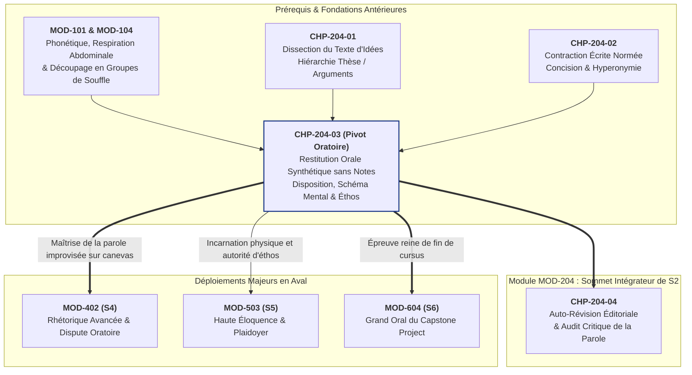

# Chapitre 3 — Rhétorique de la Restitution Orale Synthétique sans Notes : Disposition Oratoire, Schéma Mental, Éthos et Maîtrise Prosodique

> **Identifiant du chapitre** : `CHP-204-03`  
> **Module de rattachement** : [`MOD-204` — Lecture Analytique, Méthodologie du Résumé de Texte Informatif, Restitution Orale Synthétique et Auto-Révision](file:///f:/Formation/world-class-french/03-curriculum/year-1/semester-2/mod-204-resume-texte-restitution-orale.md)  
> **Semestre** : Année 1 — Semestre 2 (S2)  
> **Volume horaire canonique** : 5 à 6 heures d'apprentissage autonome délibéré et d'ateliers d'application (Phase 1 Étude : 1 h 30 | Phase 2 Pratique : 1 h 30 | Phase 3 Correction : 1 h 00 | Phase 4 Évaluation : 1 h 00)  
> **Statut** : [STATUT : VALIDÉ]  
> **Compétences associées** : [`FR-INT-005`](file:///f:/Formation/world-class-french/02-competency-framework/competency-framework.md#fr-int-005-présenter-oralement-un-raisonnement-structuré-et-éloquent) (L2/L3 Autonomie guidée), [`FR-PHON-001`](file:///f:/Formation/world-class-french/02-competency-framework/competency-framework.md#fr-phon-001-maîtrise-des-contrastes-phonologiques-et-de-la-prosodie-formelle) (L2/L3)  
> **Sources scientifiques de référence** : `SRC-RHET-03` (Olivier Reboul, *Introduction à la rhétorique*, chap. 3 & 4), `SRC-PHON-01` (Pierre Léon, *Phonétisme et prononciations du français*, chap. 6), `SRC-PHON-02` (François Wioland, *Prononcer les mots du français : des sons et des rythmes*), `SRC-GRAM-01` (Maurice Grevisse & André Goosse, *Le Bon Usage*)

---

## 1. Titre et Place dans le Cursus

### 1.1 Intitulé Officiel
**Chapitre 3 : Rhétorique de la Restitution Orale Synthétique sans Notes : Disposition Oratoire, Schéma Mental, Éthos et Maîtrise Prosodique** (`CHP-204-03`).

### 1.2 Insertion Architecturale dans le Cursus
Le présent chapitre constitue le pivot oral du module [`MOD-204`](file:///f:/Formation/world-class-french/03-curriculum/year-1/semester-2/mod-204-resume-texte-restitution-orale.md). Si les deux premiers chapitres ont armé l'apprenant pour disséquer l'armature logique d'un texte d'idées (`CHP-204-01`) puis condenser cette pensée par écrit sous contrainte métrique stricte (`CHP-204-02`), `CHP-204-03` opère une transmutation fondamentale : **faire passer la synthèse intellectuelle de la page écrite à la parole incarnée sans aucune béquille textuelle**.

Dans les contextes académiques et professionnels d'élite (grands oraux de concours, soutenances de recherche, plaidoyers, présentations exécutives), la restitution sans notes constitue le révélateur absolu de l'autorité intellectuelle. Lire une feuille ou réciter servilement un texte appris par cœur abaisse l'orateur au rang d'exécutant passif ; à l'inverse, déployer une pensée claire en 3 à 5 minutes chrono, le regard ancré dans l'auditoire, la voix posée et le corps stable, prouve une maîtrise intime du sujet [Réf. `SRC-RHET-03`, chap. 4 ; `SRC-PHON-01`, chap. 6].



- **En amont** : Ce chapitre réinvestit :
  - La mécanique phonatoire de `MOD-101` et l'hygiène vocale de `MOD-104` (respiration costo-abdominale, cadence syllabique isochrone, groupes rythmiques) ;
  - La capacité à dégager la colonne vertébrale d'un texte d'idées acquise dans `CHP-204-01` ;
  - L'art de la condensation conceptuelle et du dégraissage des anecdotes forgé dans `CHP-204-02`.
- **Au sein de [`MOD-204`](file:///f:/Formation/world-class-french/03-curriculum/year-1/semester-2/mod-204-resume-texte-restitution-orale.md)** : Il assure l'équilibre bi-facial de la contraction académique : l'écrit condense l'espace, l'oral gouverne le temps.
- **En aval dans le cursus** : Il prépare directement :
  - `MOD-402` (S4) : la confrontation dialectique et la joute oratoire où l'absence de notes est obligatoire pour riposter aux objections ;
  - `MOD-503` (S5) : la haute éloquence politique et judiciaire ;
  - `MOD-604` (S6) : le Grand Oral terminal du Capstone Project, épreuve finale de certification.

---

## 2. Objectifs Mesurables

Au terme des 5 à 6 heures d'apprentissage autonome délibéré et d'ateliers d'application de ce chapitre, l'apprenant sera capable de :

1. **Structurer et déployer sans aucune note une restitution orale synthétique de 3 à 5 minutes** articulée selon la disposition quadripartite classique (exorde sobre, annonce du dessein, corps démonstratif en deux ou trois mouvements, péroraison conclusive), en respectant le temps imparti avec une marge de tolérance maximale de $\pm 15$ secondes [Réf. `SRC-RHET-03`, chap. 4]. ([`FR-INT-005`](file:///f:/Formation/world-class-french/02-competency-framework/competency-framework.md#fr-int-005-présenter-oralement-un-raisonnement-structuré-et-éloquent) — Palier L2/L3).
2. **Concevoir et intérioriser un schéma mental arborescent en 4 nœuds conceptuels** à partir d'un texte d'idées de 500 à 700 mots, en substituant une chaîne d'ancrages spatio-logiques mémorisée à tout support de notes rédigées [Réf. `SRC-RHET-03`, chap. 3]. ([`FR-INT-005`](file:///f:/Formation/world-class-french/02-competency-framework/competency-framework.md#fr-int-005-présenter-oralement-un-raisonnement-structuré-et-éloquent) — Palier L3 Autonomie).
3. **Réguler son débit prosodique dans la fourchette normative de 120 à 140 mots par minute**, en mobilisant la respiration abdominale basse, le respect des frontières des groupes de souffle et l'insertion de silences oratoires expressifs de 2 secondes à la place des pauses remplies [Réf. `SRC-PHON-01`, chap. 6 ; `SRC-PHON-02`]. ([`FR-PHON-001`](file:///f:/Formation/world-class-french/02-competency-framework/competency-framework.md#fr-phon-001-maîtrise-des-contrastes-phonologiques-et-de-la-prosodie-formelle) — Palier L2/L3).
4. **Éradiquer 100 % des béquilles orales et scories verbales** (*euh*, *en fait*, *voilà*, *du coup*, *genre*, *en quelque sorte*), tout en maintenant un ancrage postural stable et un contact visuel soutenu balayant l'auditoire de façon panoramique durant l'intégralité de la prestation [Réf. `SRC-RHET-03`, chap. 4 ; `SRC-PHON-01`, chap. 6]. ([`FR-INT-005`](file:///f:/Formation/world-class-french/02-competency-framework/competency-framework.md#fr-int-005-présenter-oralement-un-raisonnement-structuré-et-éloquent) — Palier L3 Autonomie).

---

## 3. Prérequis et Test de Préparation (Auto-Diagnostic)

### 3.1 Prérequis Cognitifs et Phonatoires Exigibles
- **Maîtrise de la respiration costo-abdominale** : dissociation du souffle thoracique et contrôle de la colonne d'air expiratoire sans affaissement du buste (`MOD-104`).
- **Phonétique segmentale et groupes de souffle** : segmentation spontanée de la chaîne parlée en groupes rythmiques homogènes, accentuation oxytonique sur la dernière syllabe pleine, proscription absolue des liaisons interdites (`MOD-101`).
- **Décomposition logique du texte d'idées** : identification immédiate de la question de fond, de la thèse centrale et des arguments cardinaux d'un texte d'opinion (`CHP-204-01`).
- **Techniques de concision notionnelle** : faculté de condenser une longue période illustrative en un concept abstrait supérieur par hyperonymie (`CHP-204-02`).

### 3.2 Test de Préparation Immédiat (5 Questions)
Répondez aux cinq questions diagnostiques ci-dessous avant d'engager la lecture de la section théorique. Vérifiez ensuite vos analyses en consultant le corrigé repliable.

1. Qu'est-ce qu'un *groupe de souffle* (ou groupe rythmique) en phonétique française et sur quelle syllabe porte obligatoirement l'accent tonique principal ?
2. Quelle est la différence cognitive fondamentale entre la mémorisation *verbatim* (mot à mot) et la mémorisation conceptuelle (ou topologique) ?
3. Pourquoi la formule parasite *« en fait »* ou *« du coup »* prolifère-t-elle dans le discours oral sous stress et quelle fonction illocutoire défectueuse remplit-elle ?
4. Dans la disposition oratoire classique, quelle est la fonction primordiale de l'exorde (*exordium*) et pourquoi doit-il éviter le bavardage anecdotique ?
5. Quel est l'impact acoustique et psychologique d'un silence de 2 secondes sur un jury par rapport à une émission sonore ininterrompue et précipitée ?

---

#### Corrigé Détaillé de l'Auto-Diagnostic

<details>
<summary><b>Consulter le corrigé raisonné des 5 questions de préparation</b></summary>

1. **Le groupe de souffle en français** :  
   Un groupe de souffle (ou groupe rythmique) est une unité phonosyntaxique formée d'un ensemble de mots étroitement unis par le sens et la syntaxe, prononcée en une seule émission d'air expiratoire continue. En français standard, l'accent tonique n'est pas lexical mais syntaxique : il frappe toujours la **dernière syllabe prononcée du groupe rythmique**, caractérisée par un allongement vocalique et une légère modulation mélodique [Réf. `SRC-PHON-01`, chap. 6].

2. **Mémorisation *verbatim* vs mémorisation conceptuelle** :  
   La mémorisation *verbatim* fixe une chaîne textuelle linéaire figée mot par mot. Elle est extrêmement fragile : le moindre oubli d'un terme entraîne la rupture de la séquence mémorielle et la panique de l'orateur. La mémorisation conceptuelle (topologique) mémorise une **architecture d'idées et de relations logiques** (causes, oppositions, déductions). Elle confère à l'orateur une liberté totale : sachant *ce qu'il doit démontrer*, il réinvente à chaque prise de parole la formulation linguistique la plus fluide.

3. **La mécanique des tics verbaux (*en fait*, *du coup*)** :  
   Sous l'effet du stress et de l'angoisse du vide, le cerveau du locuteur cherche à masquer le temps nécessaire à la planification syntaxique de la phrase suivante. Au lieu d'assumer un silence neutre, il comble l'intervalle acoustique par une béquille sonore inconsciente. Pragmatiquement, ces tics signalent une insécurité intellectuelle majeure et détruisent l'autorité de l'énonciateur en saturant le canal d'écoute d'interférences parasites.

4. **La fonction rhétorique de l'exorde** :  
   L'exorde a pour vocation exclusive de rendre l'auditoire bienveillant, attentif et docile (*benevolum, attentum, docilem parare*). Dans l'exposé de synthèse, il doit poser immédiatement l'enjeu intellectuel de fond sans dispersion. Le bavardage anecdotique dilue l'attention du jury, retarde la pose du problème et projette l'image d'un esprit brouillon incapable de cerner l'essentiel [Réf. `SRC-RHET-03`, chap. 4].

5. **L'impact psychologique du silence oratoire** :  
   Le silence de 2 secondes projette le calme, la souveraineté et la maîtrise de soi (*éthos* d'autorité). Loin d'être perçu comme un vide ou une défaillance, il donne au jury le temps de métaboliser l'argument qui vient d'être énoncé et crée un effet de tension dramatique et d'attente pour l'assertion suivante. À l'inverse, le flux précipité donne l'image d'un orateur traqué, pressé d'en finir pour échapper à son auditoire.

</details>

---

## 4. Situation de Départ ou Problème Concret

### 4.1 La Terreur de l'Orateur sans Prothèse Écrite
Dans les concours académiques et les présentations professionnelles de haut rang, une scène clinique se reproduit avec une constance désolante : un candidat brillant, ayant rédigé une analyse rigoureuse lors de son temps de préparation, s'avance devant son auditoire, le regard rivé à sa feuille d'examen, et se met à lire ses notes d'un ton monocorde, à un rythme frénétique. 

Dès que l'examinateur l'interrompt pour lui intimer : *« Posez vos feuilles et regardez-nous »*, l'étudiant est frappé de stupeur. Ses yeux s'écarquillent, ses mains tremblent, son buste se fige et sa parole s'effondre dans un balbutiement confus :
> *« Euh... en fait... voilà... l'auteur, du coup, il dit que... enfin, en quelque sorte, la liberté, voilà quoi... »*

En moins de dix secondes, toute l'autorité intellectuelle de l'étudiant a été anéantie. Bien que sa compréhension du texte source fût irréprochable, son incapacité à s'extraire du support matériel de l'écrit l'a rétrogradé au rang d'un écolier dépendant d'une prothèse textuelle.

### 4.2 L'Invasion des Béquilles Sonores et la Destruction de l'Éthos
L'absence de notes mal préparée engendre une pathologie acoustique immédiate : le parasitisme par les scories verbales. Terrifié à l'idée que le jury interprète un instant de silence comme un trou de mémoire ou une hésitation coupable, le locuteur non entraîné remplit chaque interstice respiratoire par des sons gutturaux (*« euh »*, *« hum »*) ou des locutions réflexes érodées (*« en fait »*, *« du coup »*, *« voilà »*, *« genre »*, *« quelque part »*).

Chaque répétition d'une béquille sonore dégrade la crédibilité de l'orateur. Le jury, au lieu de se concentrer sur la substance des arguments, devient prisonnier d'un décompte involontaire des tics verbaux. L'autorité (*éthos*) cède la place à la pitié ou à l'agacement. 

Le problème fondamental n'est donc pas un manque d'intelligence ou de culture : c'est l'absence d'une **méthode de transition cognitive de l'écrit vers l'oral**, doublée d'une ignorance des mécanismes de la **disposition oratoire** et de l'**hygiène prosodique**.

---

## 5. Explication Intuitive : L'Analogie du Musicien de Jazz

Pour comprendre la nature véritable de la restitution orale synthétique sans notes, il convient de rejeter deux modèles trompeurs : le modèle du **lecteur de partition** et le modèle de l'**acteur récitant**.

```text
┌────────────────────────────────────────────────────────────────────────┐
│ MODÈLES COGNITIFS DE PRISE DE PAROLE                                    │
├────────────────────────────────────────────────────────────────────────┤
│ 1. LE LECTEUR SERVIL      : Lit ses notes les yeux baissés.            │
│                             → Aucun éthos, contact rompu, voix morte.  │
│                                                                        │
│ 2. L'ACTEUR PAR CŒUR      : Récite un texte mémorisé mot à mot.        │
│                             → Fragilité extrême : 1 trou = le désastre.│
│                                                                        │
│ 3. LE MUSICIEN DE JAZZ    : Improvisation vivante sur grille d'accords.│
│    (MODÈLE RETENU)          → Structure infaillible, liberté du verbe. │
└────────────────────────────────────────────────────────────────────────┘
```

Considérez un soliste de jazz qui monte sur scène pour interpréter un standard. Il ne lit pas une partition note à note posée sur un pupitre, car cela briserait sa communion avec la salle et sa spontanéité expressive. Mais il ne joue pas non plus au hasard : il a gravé dans son esprit la **grille harmonique** du morceau (la succession rigoureuse de quatre ou cinq accords fondamentaux).

Sur cette armature harmonique parfaitement intériorisée, le musicien improvise librement sa ligne mélodique. Il choisit chaque note au moment exact où son instrument la produit, l'ajustant au tempo de la salle, à l'acoustique du lieu et à son propre souffle. S'il commet une légère imprécision rythmique, il ne s'arrête pas : il rebondit sur l'accord suivant avec souveraineté.

L'orateur sans notes est ce musicien de jazz :
- Sa **grille harmonique**, c'est le **schéma mental en quatre nœuds** (l'exorde, l'axe 1, l'axe 2, la péroraison). Cette trame logique est inébranlable.
- Sa **ligne mélodique**, ce sont les phrases concrètes qu'il formule dans l'instant pour traduire ces nœuds.
- Parce qu'il ne cherche pas à réciter un texte figé, il ne peut pas avoir de trou de mémoire : tant que la relation logique entre les concepts demeure claire dans son esprit, ses cordes vocales trouveront sans peine les mots pour l'exprimer avec éclat [Réf. `SRC-RHET-03`, chap. 4].

---

## 6. Définitions Précises et Terminologie

Afin de fonder une pratique oratoire rigoureuse, définissons les douze concepts majeurs de la rhétorique et de la prosodie de la synthèse orale [Réf. `SRC-RHET-03`, chap. 3 & 4 ; `SRC-PHON-01`, chap. 6].

### 6.1 Restitution Orale Synthétique
> **Définition** : Exercice oratoire académique consistant à exposer oralement, en un temps contraint (3 à 5 minutes) et sans aucun support écrit rédigé, la substantifique moelle argumentative d'un texte d'idées ou d'un dossier complexe, en respectant une neutralité objective, une structure déductive irréprochable et un niveau de langue soutenu.

### 6.2 Disposition Oratoire (*Dispositio*)
> **Définition** : Deuxième des cinq grandes parties de la rhétorique classique (après l'*inventio* et avant l'*elocutio*, l'*actio* et la *memoria*), désignant l'art d'ordonner et d'agencer harmonieusement les arguments au sein du discours pour maximiser leur clarté et leur force persuasive.

### 6.3 Exorde (*Exordium*)
> **Définition** : Première partie de la disposition oratoire, d'une durée de 30 à 45 secondes, destinée à capter l'attention de l'auditoire (*captatio benevolentiae*), à énoncer le thème du discours et à poser sans détour la question intellectuelle de fond soulevée par le texte.

*Exemple d'ancrage* : *« Mesdames et Messieurs, notre époque célèbre volontiers la vitesse technique comme le synonyme absolu du progrès humain. Pourtant, dans son essai sur la civilisation machinerie, Jacques Ellul soulève une interrogation vertigineuse : l'accélération numérique libère-t-elle la conscience, ou l'asservit-elle en la dépossédant de son temps intérieur ? »*

### 6.4 Annonce du Dessein (*Partitio* / *Propositio*)
> **Définition** : Segment charnière concis (15 à 30 secondes) placé immédiatement après l'exorde, dans lequel l'orateur formule la thèse centrale de l'auteur et annonce sobrement les deux ou trois mouvements logiques par lesquels la démonstration sera conduite.

### 6.5 Corps Démonstratif (*Tractatio* / *Confirmatio*)
> **Définition** : Cœur de l'exposé (durée : 2 à 3 minutes), divisé en deux ou trois articulations conceptuelles majeures reliées par des transitions nettes, développant les arguments rationnels sans se perdre dans le récit d'exemples contingents.

### 6.6 Péroraison (*Peroratio*)
> **Définition** : Clôture formelle de l'exposé (durée : 30 à 45 secondes), comprenant la récapitulation synthétique de la démonstration, la réaffirmation solennelle de la thèse et une ouverture sur la portée philosophique ou sociétale du problème, suivie d'une formule de congé sobre.

### 6.7 Schéma Mental (Carte Conceptuelle / Arbre Logique)
> **Définition** : Modélisation graphique intérieure non linéaire d'un raisonnement, structurée en un nombre réduit de nœuds conceptuels (typiquement 4 nœuds cardinaux) reliés par des vecteurs de dépendance causale, servant de support mnésique exclusif à la prise de parole sans notes.

### 6.8 Éthos Oratoire (*Ethos*)
> **Définition** : Image de soi que l'orateur projette à travers sa posture corporelle, son regard, son timbre de voix et le choix de ses mots. Selon Aristote, l'éthos fonde la confiance de l'auditoire en manifestant trois qualités : la compétence rationnelle (*phronesis*), la vertu morale (*arete*) et la bienveillance à l'égard du public (*eunoia*).

### 6.9 Contact Visuel Soutenu (Regard Panoramique)
> **Définition** : Comportement visuel actif de l'orateur consistant à ancrer son regard de façon continue dans les yeux des membres de l'auditoire ou des membres du jury, en balayant la salle par secteurs calmes de 3 à 5 secondes, sans jamais fuir vers le plafond, le sol ou la table.

### 6.10 Débit Régulé
> **Définition** : Vitesse d'émission de la parole mesurée en mots prononcés par minute. Dans la tradition de la parole publique française de haut niveau, le débit normatif d'un exposé d'idées est compris rigoureusement entre **120 et 140 mots par minute** [Réf. `SRC-PHON-01`, chap. 6].

### 6.11 Béquilles Orales (Scories Verbales / Tics de Langage)
> **Définition** : Émissions sonores non signifiantes (phonèmes vocalisés : *« euh »*, *« ah »*) ou unités lexicales vidées de leur sens sémantique (*« en fait »*, *« du coup »*, *« voilà »*, *« genre »*, *« tu vois »*) insérées involontairement par l'orateur pour masquer le silence lors des phases de planification mentale.

### 6.12 Silence Oratoire (Pause Expressive)
> **Définition** : Interruption délibérée de l'émission sonore d'une durée de 1 à 3 secondes, parfaitement maîtrisée par le contrôle de l'air expiratoire, utilisée pour marquer la fin d'un groupe rythmique majeur, souligner la gravité d'un argument ou préparer l'auditoire à une annonce capitale.

---

## 7. Règles et Mécanismes Fondamentaux

### 7.1 La Transmutation de l'Écrit à l'Oral : Pourquoi Résumer à Voix Haute n'est pas Réciter
L'erreur fondamentale des débutants consiste à concevoir l'exposé oral comme la simple lecture à voix haute d'un texte rédigé au préalable. Or, les lois de la communication orale s'opposent terme à terme à celles de l'écrit :

1. **L'œil peut rétrograder, l'oreille ne le peut pas** :  
   À l'écrit, le lecteur distrait peut revenir en arrière pour relire une phrase complexe. À l'oral, la parole s'évapore dans l'instant (*verba volant*). La syntaxe orale d'un exposé sans notes doit donc privilégier des périodes nettes, des propositions équilibrées et des connecteurs pivots immédiatement audibles.
2. **Le texte appris par cœur est une prison** :  
   Lorsqu'un étudiant récite un texte appris au mot près, son esprit est tout entier absorbé par l'effort de remémoration graphique. Ses yeux regardent dans le vide intérieur pour « relire » sa page mentale. Le contact avec le public est rompu ; la voix perd son intonation naturelle pour adopter la mélodie stéréotypée de la récitation d'enfance.
3. **La parole sans notes est un acte de souveraineté** :  
   En parlant à partir d'un schéma mental, l'orateur habite sa pensée dans l'instant même où il la prononce. Ses mots sont chargés d'intention vivante ; son débit s'adapte aux réactions silencieuses de la salle ; son autorité intellectuelle s'impose d'elle-même [Réf. `SRC-RHET-03`, chap. 4].

### 7.2 L'Armature de la Disposition Oratoire Appliquée à l'Exposé de Synthèse (3 à 5 Minutes)
Pour calibrer un exposé de 3 à 5 minutes chrono, l'orateur mobilise la matrice quadripartite canonique héritée de la rhétorique classique [Réf. `SRC-RHET-03`, chap. 4] :

```text
┌────────────────────────────────────────────────────────────────────────┐
│ MATRICE QUADRIPARTITE DE L'EXPOSÉ DE SYNTHÈSE (3 À 5 MINUTES)          │
├───────────────────┬──────────────┬─────────────────────────────────────┤
│ PHASE ORATOIRE    │ DURÉE CIBLE  │ FONCTION MÉTHODOLOGIQUE             │
├───────────────────┼──────────────┼─────────────────────────────────────┤
│ 1. L'EXORDE       │ 30 à 45 s    │ Capter l'auditoire & poser l'enjeu  │
│ 2. LE DESSEIN     │ 15 à 30 s    │ Formuler la thèse & annoncer le plan│
│ 3. LE CORPS       │ 2 à 3 min    │ Déployer 2 ou 3 mouvements déductifs│
│ 4. LA PÉRORAISON  │ 30 à 45 s    │ Récapituler, ouvrir & conclure      │
└───────────────────┴──────────────┴─────────────────────────────────────┘
```

#### 1. L'Exorde (30 à 45 secondes)
- **Objectif** : Poser le cadre intellectuel et formuler le problème central du texte.
- **Règle d'or** : Bannir toute amorce plate (*« Aujourd'hui, je vais vous présenter un texte... »*) ou grandiloquente. Partir d'un constat paradoxal ou d'une tension conceptuelle issue du texte source.
- **Formulation de la question de fond** : Clore l'exorde par l'interrogation majeure qui gouverne la réflexion de l'auteur.

#### 2. L'Annonce du Dessein (15 à 30 secondes)
- **Objectif** : Baliser la route pour l'auditeur.
- **Règle d'or** : Clarté et sobriété. Éviter les formules scolaires redondantes (*« Dans une première partie nous verrons... puis dans une deuxième partie nous étudierons... »*).
- **Modèle de formulation élégante** : *« Pour répondre à cette question, l'auteur déploie une réflexion en deux temps : il examine d'abord les causes structurelles de la crise, avant d'envisager les conditions éthiques de son dépassement. »*

#### 3. Le Corps Démonstratif (2 à 3 minutes)
- **Objectif** : Présenter les articulations substantielles de la pensée sans s'égarer dans les exemples.
- **Structure** : Deux mouvements logiques (ou trois au maximum).
- **Règle de traitement des exemples** : À l'oral, les micro-exemples de l'auteur doivent être **subsumés sous des concepts généraux**. Ne conservez qu'une référence centrale si elle a une valeur de preuve universelle ; éliminez impitoyablement les énumérations anecdotiques.
- **Les transitions** : Chaque mouvement s'achève par une phrase de bilan intermédiaire et s'enchaîne au suivant par un connecteur déductif explicite (*« Ce premier constat nous conduit au cœur du second volet de la réflexion... »*).

#### 4. La Péroraison (30 à 45 secondes)
- **Objectif** : Fermer le cercle oratoire et laisser une impression d'achèvement parfait.
- **Composantes obligatoires** :
  1. *La récapitulation* (1 phrase) : rappeler la conclusion à laquelle l'auteur parvient.
  2. *L'élargissement philosophique* (1 phrase) : situer la portée du texte dans les débats contemporains.
  3. *La formule de clôture* (1 formule sobre) : marquer un silence de 2 secondes, puis saluer d'un simple et digne : *« Je vous remercie de votre attention. »*
- **Proscription absolue** : Interdiction définitive de la formule désastreuse : *« Voilà, c'est tout ce que j'avais à dire. »*

---

### 7.3 La Technique du Schéma Mental Intériorisé (L'Arbre en 4 Nœuds)
Pendant le temps de préparation (15 minutes), l'apprenant s'interdit formellement de rédiger des phrases complètes. Rédiger une phrase sur sa feuille crée une tentation irrésistible de la relire pendant l'épreuve.

L'apprenant trace sur une feuille unique une **carte arborescente en 4 nœuds cardinaux**, composée exclusivement de **mots-clés conceptuels**, de substantifs abstraits et de **flèches de dépendance causale** :

```text
┌────────────────────────────────────────────────────────────────────────┐
│ MODÈLE DU SCHÉMA MENTAL EN 4 NŒUDS POUR RESTITUTION SANS NOTES        │
├────────────────────────────────────────────────────────────────────────┤
│                                                                        │
│  [NŒUD 1 : EXORDE & QUESTION DIRECTRICE]                               │
│  • Illusion contemporaine de l'abondance technique                     │
│  • QUESTION : Vitesse numérique = Émancipation ou Aliénation ?         │
│         │                                                              │
│         ▼ (Flèche causale : Annonce du dessein)                        │
│                                                                        │
│  [NŒUD 2 : MOUVEMENT 1 — LA DISTINCTION CONCEPTUELLE]                  │
│  • Information (inerte / stock) ≠ Connaissance (vivante / intégrée)    │
│  • Conséquence : Atrophie de la mémoire intérieure                     │
│         │                                                              │
│         ▼ (Flèche de rupture : Transition dialectique)                 │
│                                                                        │
│  [NŒUD 3 : MOUVEMENT 2 — LA DÉMISSION DU JUGEMENT CRITIQUE]            │
│  • Réponse immédiate ➔ Perte de la patience du doute                   │
│  • Vulnérabilité du citoyen désarmé face aux sophismes                 │
│         │                                                              │
│         ▼ (Flèche de résolution : Déduction finale)                    │
│                                                                        │
│  [NŒUD 4 : PÉRORAISON & OUVERTURE]                                     │
│  • Thèse : L'outil doit être subordonné à l'ascèse humaniste           │
│  • Élargissement : Rénover l'éducation intérieure, non les serveurs    │
│                                                                        │
└────────────────────────────────────────────────────────────────────────┘
```

Pendant les cinq dernières minutes de préparation, l'étudiant pose son stylo, ferme les yeux et **parcourt mentalement l'arbre conceptuel** trois fois de suite, en visualisant les passages d'un nœud à l'autre. Lorsqu'il se lève pour parler, la feuille reste sur la table : l'arbre est gravé dans sa mémoire spatiale.

---

### 7.4 Posture Physique, Incarnation et Maîtrise du Regard
L'art oratoire n'est pas un exercice cérébral désincarné : c'est un engagement physique total. Le corps de l'orateur parle avant même que le premier son ne sorte de sa bouche [Réf. `SRC-RHET-03`, chap. 4].

```text
┌────────────────────────────────────────────────────────────────────────┐
│ LES 5 PILIERS DE L'ANCRAGE CORPOREL DE L'ORATEUR                       │
├────────────────────────────────────────────────────────────────────────┤
│ 1. L'ANCRAGE AU SOL       : Pieds parallèles, écartés de la largeur du │
│                             bassin, poids également réparti.           │
│ 2. LA VERTICALITÉ DU BUSTE: Colonne étirée, épaules basses et ouvertes,│
│                             sternum dégagé (amplification thoracique). │
│ 3. LA SPHÈRE DES MAINS    : Mains libres au-dessus de la ceinture,     │
│                             ouvertes, ponctuant la géométrie des idées.│
│ 4. LE REGARD PANORAMIQUE  : Contact direct œil-à-œil avec l'auditoire, │
│                             balayage posé en 3 secteurs (gauche-centre-│
│                             droite) sans jamais fuir vers le sol.      │
│ 5. LE SILENCE INITIAL     : 3 secondes d'immobilité totale et de       │
│                             respiration avant le premier mot.          │
└────────────────────────────────────────────────────────────────────────┘
```

1. **Les pieds et le bassin** : Proscrire le balancement d'un pied sur l'autre (le « roulis du marin ») et les micro-pas nerveux. L'orateur est un arbre enraciné dans le sol.
2. **Les mains** : Ne jamais glisser les mains dans les poches, ne jamais les croiser sur la poitrine (posture de fermeture défensive), ne jamais tripoter un stylo ou un papier. Les mains doivent occuper la **sphère d'éloquence** (au-dessus du nombril, en dessous du menton) : elles s'ouvrent paumes vers le haut pour accueillir une idée, se séparent pour marquer une antithèse, et s'abaissent calmement pour sceller une conclusion.
3. **Le regard** : Le regard est le cordon ombilical de l'éthos. Regarder une personne dans les yeux pendant qu'on énonce une phrase crée une connexion intime d'obligation intellectuelle. L'orateur embrasse toute la salle : il regarde un membre du jury à gauche (une phrase), puis au centre (une phrase), puis à droite (une phrase).

---

### 7.5 Hygiène Vocale et Prosodie : Respiration Abdominale, Cadence et Silences
La prosodie française est régie par des lois physiques strictes décrites par Pierre Léon et François Wioland [Réf. `SRC-PHON-01`, chap. 6 ; `SRC-PHON-02`] :

1. **La respiration costo-abdominale basse** :  
   Avant de parler, l'orateur gonfle le bas du ventre à l'inspiration sans lever les épaules. Pendant la phonation, la sangle abdominale se rétracte lentement pour délivrer un filet d'air sous pression constante. Ce mécanisme prévient l'essoufflement, baisse le timbre de la voix dans les graves (renforçant l'autorité perçue) et élimine les palpitations cardiaques liées au stress.
2. **Le respect des groupes de souffle** :  
   L'orateur ne parle pas mot par mot ; il sculpte des blocs de 3 à 7 syllabes formant des unités de sens. Chaque groupe de souffle s'achève par un allongement de sa voyelle terminale, suivi d'une micro-pause respiratoire.
3. **Le tempo normatif (120 à 140 mots/min)** :  
   Un débit supérieur à 150 mots/min noie l'auditeur et signale l'angoisse ; un débit inférieur à 110 mots/min engendre la somnolence. L'orateur d'excellence adopte une pulsation stable et majestueuse d'environ 130 mots par minute.
4. **La vertu du silence oratoire (la pause de 2 secondes)** :  
   Le silence n'est pas une absence de parole : il est le point d'orgue du discours. Placer un silence de deux secondes pleines avant une idée majeure force l'attention du jury ; placer un silence de deux secondes après une affirmation forte permet à l'idée de résonner dans l'esprit des auditeurs.

---

### 7.6 Traque et Éradication Impitoyable des Scories Orales
Pour éliminer définitivement les tics de langage, l'apprenant doit en comprendre la psychologie articulatoire.

| Tic de Langage / Scorie | Origine Psychologique | Effet Dévastateur sur l'Éthos | Remède Prosodique Immédiat |
| :--- | :--- | :--- | :--- |
| **« Euh... » / « Hum... »** | Peur du vide acoustique pendant la planification lexicale. | Donne l'image d'une pensée laborieuse et hésitante. | **Remplacement par le silence pur** : fermer la bouche, bloquer les cordes vocales et respirer par le nez. |
| **« En fait... »** | Prétention naïve à rectifier une vérité ou à paraître spontané. | Tonalité familière, donne l'impression de corriger une erreur imaginaire. | Bannir le terme. Enchaîner directement sur l'assertion affirmative. |
| **« Du coup... »** | Pseudo-connecteur consécutif universel réflexe. | Infantilisation du propos, effondrement de la rigueur causale. | Remplacer par des connecteurs nobles : *« Dès lors »*, *« Par conséquent »*, *« C'est pourquoi »*. |
| **« Voilà... » / « Voilà quoi »** | Incapacité à formuler une clausule ; capitulation devant la fin de phrase. | Donne l'impression d'un discours qui s'effondre faute de carburant. | Poser la voix sur une intonation descendante franche `[↘]` et s'arrêter net. |
| **« Genre... » / « En quelque sorte »** | Refus d'assumer la précision sémantique du mot exact. | Approximatif, disqualification académique immédiate. | Employer le terme technique exact ou utiliser une métaphore rigoureuse. |

---

## 8. Raisonnement Détaillé : Pourquoi l'Absence de Notes Renforce l'Éthos

Pourquoi les jurys des plus grands concours académiques et les auditoires les plus exigeants accordent-ils une prime écrasante à l'orateur qui s'exprime sans notes ? 

La justification ne relève pas de la virtuosité acrobatique : elle prend sa source dans les mécanismes fondamentaux de la **psychologie cognitive** et de la **théorie rhétorique de la persuasion** [Réf. `SRC-RHET-03`, chap. 4].

```text
┌────────────────────────────────────────────────────────────────────────┐
│ LE CYCLE DE L'AUTORITÉ NATURELLE DANS L'ORAL SANS NOTES                 │
├────────────────────────────────────────────────────────────────────────┤
│                                                                        │
│   ORATEUR SANS NOTES                AUDITOIRE / JURY                   │
│   ──────────────────                ────────────────                   │
│   Regard direct posé       ────►    Sentiment d'être respecté & ciblé  │
│          ▲                                   │                         │
│          │                                   ▼                         │
│   Buste ouvert & stable    ◄────    Projection de maîtrise (Phronesis) │
│          ▲                                   │                         │
│          │                                   ▼                         │
│   Silences souverains      ────►    Attribution spontanée de confiance │
│                                                                        │
└────────────────────────────────────────────────────────────────────────┘
```

1. **Le regard comme vecteur d'engagement mutuel** :  
   Dans l'espèce humaine, soutenir le regard d'un interlocuteur sans agressivité ni fuite est le signal biologique de la loyauté, de la franchise et du courage. L'orateur qui lit ses notes dresse un rempart de cellulose entre sa conscience et celle du public. L'orateur sans notes accepte la vulnérabilité de la rencontre directe : en regardant le jury dans les yeux, il lui dit tacitement : *« Ce que j'affirme, je le pense réellement, et je réponds de chaque syllabe devant vous »*.
2. **L'illusion de la maîtrise intérieure** :  
   Pour le cerveau de l'auditeur, une pensée qui a besoin d'être lue sur un papier est une pensée empruntée, mal digérée, extérieure à l'orateur. À l'inverse, l'orateur qui déploie un raisonnement complexe sans support matériel démontre qu'il s'est rendu **maître absolu des concepts**. La structure du texte source est devenue sa propre structure cognitive.
3. **La libération du canal d'empathie vocale** :  
   Dégagées du décodage visuel des caractères imprimés, les ressources cognitives de l'orateur sont entièrement dévolues à la modulation expressive du timbre, au rythme et à la connexion avec la salle. La parole redevient une musique vivante capable d'émouvoir (*pathos*) et de convaincre (*logos*) au service d'une présence irréfutable (*éthos*).

---

## 9. Exemples Corrects Commentés : Script Annoté d'un Exposé Modèle de 3 Minutes

Voici la transcription intégrale d'un exposé oral de synthèse modèle (durée chronométrée : **3 minutes et 10 secondes**, soit environ 380 mots à un tempo moyen de 125 mots/minute), restituant sans notes la thèse d'un texte d'écologie politique sur le thème de la sobriété démocratique.

Le script comporte les didascalies posturales, le découpage en groupes de souffle, les pauses respiratoires courtes `[/]`, les silences oratoires longs `[//]` et les inflexions mélodiques montantes `[↗]` (continuité/tension) ou descendantes `[↘]` (clôture/affirmation).

```text
================================================================================
SCRIPT MODÈLE D'UN EXPOSÉ SYNTHÉTIQUE SANS NOTES (3 MIN 10 S)
================================================================================

[POSTURE : Debout, pieds ancrés au sol, buste droit, épaules basses, mains réunies
 à hauteur de la ceinture. Contact visuel posé au centre du jury. 
 SILENCE INITIAL DE 3 SECONDES. Respiration abdominale basse.]

--------------------------------------------------------------------------------
I. EXORDE (35 secondes — ~75 mots)
--------------------------------------------------------------------------------
« Mesdames et Messieurs, [↗] [/]
notre civilisation matérielle [↗] s'est bâtie sur la promesse enivrante [↗]
d'une abondance sans limites. [↘] [//]
Pourtant, [/] face au mur écologique contemporain, [↗] [/]
cette illusion technicienne vacille. [↘] [//]
[Regard balayant posément la gauche de la salle]
Dans un essai percutant sur la transition écologique, [↗] [/]
l'auteur soulève une interrogation fondamentale : [↗] [/]
l'impératif de sobriété doit-il être subi [↗] comme une régression punitive, [↗] [/]
ou peut-il être conquis [↗] comme l'avènement d'une liberté collective supérieure ? [↘] [//]

--------------------------------------------------------------------------------
II. ANNONCE DU DESSEIN (20 secondes — ~45 mots)
--------------------------------------------------------------------------------
[Légère avancée du buste, ouverture des deux mains paumes vers le haut]
Pour résoudre cette tension, [↗] [/]
le texte déploie une réflexion rigoureuse en deux temps. [↘] [//]
Il démontre d'abord [↗] [/] l'impasse inéluctable d'un modèle productiviste prédateur ; [↘] [/]
il esquisse ensuite [↗] [/] les contours d'une sobriété choisie, [↗]
seul fondement possible d'une démocratie renouvelée. [↘] [//]

--------------------------------------------------------------------------------
III. CORPS DÉMONSTRATIF (1 minute 40 — ~200 mots)
--------------------------------------------------------------------------------
[MOUVEMENT 1 : L'impasse productiviste — 50 secondes]
[Main droite détachée marquant la cadence, regard ancré au centre]
Premier temps de la démonstration : [↗] [/] la faillite du dogme de la croissance infinie. [↘] [//]
L'auteur récuse fermement l'optimisme technologique [↗] [/] qui prétend réparer la biosphère [↗]
par de simples innovations d'ingénieurs. [↘] [/]
Cette fuite en avant [↗] repose sur une méconnaissance tragique [↗] des limites physiques du globe. [↘] [//]
En persistant à considérer la nature [↗] comme un réservoir inépuisable [↗]
et un dépotoir gratuit, [↘] [/]
nos sociétés engendrent une double fracture : [↗] [/]
elles épuisent les écosystèmes vitaux [↗] [/] et creusent des inégalités insoutenables [↗]
entre ceux qui consomment la planète [↗] et ceux qui en subissent les ravages. [↘] [//]

[TRANSITION & MOUVEMENT 2 : La sobriété libératrice — 50 secondes]
[Pause de 2 secondes. Buste redressé, regard dirigé vers la droite du jury]
Dès lors s'impose le second versant du propos : [↗] [/] la réinvention de la prospérité. [↘] [//]
Loin de prôner un retour obscurantiste à la privation, [↗] [/]
l'auteur redéfinit la sobriété [↗] comme un acte de souveraineté politique. [↘] [//]
Ralentir le cycle de la production [↗] et élaguer la consommation futile, [↗] [/]
ce n'est pas mutiler l'existence humaine : [↗] [/]
c'est au contraire libérer du temps [↗] pour les liens sociaux, [↗] [/]
l'émancipation intellectuelle [↗] et la délibération citoyenne. [↘] [/]
La véritable abondance [↗] [/] n'est pas l'accumulation des objets périssables, [↘] [/]
mais la qualité des relations humaines au sein d'un milieu préservé. [↘] [//]

--------------------------------------------------------------------------------
IV. PÉRORAISON (35 secondes — ~60 mots)
--------------------------------------------------------------------------------
[Rassemblement calme des mains à la ceinture, regard panoramique circulaire]
En conclusion, [↗] [/]
cette réflexion nous invite à un basculement philosophique décisif. [↘] [//]
La sobriété n'est pas le deuil du bonheur : [↗] [/]
elle est la condition même de notre survie commune [↗]
et le socle d'une civilisation réconciliée avec le vivant. [↘] [//]
[Silence final de 2 secondes, léger hochement de tête respectueux]
Je vous remercie de votre attention. [↘]
================================================================================
```

### Commentaire Analytique du Modèle
- **Gestion du temps** : Les quatre phases s'emboîtent avec une régularité mathématique (35 s + 20 s + 100 s + 35 s = 190 secondes = 3 min 10 s). L'orateur ne déborde jamais sur le temps imparti.
- **Pureté acoustique absolue** : Zéro présence de *« euh »*, de *« en fait »* ou de *« du coup »*. Les transitions s'opèrent par des connecteurs nobles (*« Dès lors »*, *« En conclusion »*) ou par des silences oratoires expressifs de deux secondes pleines `[//]`.
- **Régulation prosodique** : Alternance rigoureuse d'intonations montantes `[↗]` (qui maintiennent le jury en haleine dans l'attente du sens) et d'intonations descendantes `[↘]` (qui frappent les vérités d'un sceau affirmatif irréfragable).

---

## 10. Contre-Exemples et Erreurs Fréquentes (Clinique des Six Erreurs Récurrentes)

L'observation empirique des épreuves orales permet d'isoler **six erreurs récurrentes** majeures commises par les apprenants. Chacune fait ici l'objet d'un diagnostic clinique, d'une illustration authentique et d'un remède méthodique :

### Erreur n° 1 : Récitation Paniquée par Cœur s'Effondrant au Moindre Trou de Mémoire
- **Symptôme clinique** : L'étudiant récite un texte appris mot à mot, le regard perdu au plafond, d'un ton monocorde et précipité. À la première hésitation sur un vocable précis, le fil mémoriel se brise net : silence angoissé de 15 secondes, panique faciale, incapacité totale à reformuler la pensée avec ses propres mots.
- **Illustration fautive** : *« L'auteur démontre que l'aliénation technique... heu... l'aliénation de la... attendez... l'aliénation technique procède de la... zut... je l'avais sur le bout de la langue... »*
- **Réfutation théorique** : La mémoire *verbatim* stocke des chaînes syntaxiques superficielles sans flexibilité. Si un maillon saute, toute la chaîne s'effondre.
- **Remède méthodique** : Interdire formellement la rédaction de phrases complètes pendant la préparation. Travailler exclusivement sur le schéma mental en 4 nœuds. S'entraîner à énoncer le même nœud avec trois formulations lexicales distinctes.

### Erreur n° 2 : Lecture Servile de Notes Rédigées les Yeux Baissés
- **Symptôme clinique** : L'étudiant pose sa feuille sur la table et lit mot à mot ce qu'il a écrit. La tête reste penchée vers l'avant, la voix est étouffée par la projection vers la table, le contact visuel avec le jury est nul (0 % du temps).
- **Illustration fautive** : Le candidat débite un texte parfait sur le plan syntaxique, mais sans lever une seule fois les yeux vers le jury, insensible aux signaux d'ennui ou d'incompréhension des évaluateurs.
- **Réfutation théorique** : Cette prestation n'est pas un acte oratoire, mais une lecture publique d'épreuves. L'éthos est nul ; l'auditeur se sent méprisé et réduit au rôle d'un correcteur silencieux.
- **Remède méthodique** : Règle de la table vide : lors de la prise de parole, toute feuille doit être posée face contre table ou laissée à l'écart. Si l'étudiant baisse les yeux, le chronomètre est immédiatement arrêté jusqu'à ce que le regard se redresse.

### Erreur n° 3 : Invasion de Tics Oraux et Béquilles Verbales (« Euh », « Du Coup »)
- **Symptôme clinique** : S saturation du canal phonatoire par des scories verbales automatiques à chaque changement de proposition ou d'idée.
- **Illustration fautive** : *« Euh, alors du coup, l'auteur il dit que, en fait, la société elle est en crise, voilà, et du coup les gens, genre, ils se parlent plus, enfin voilà quoi... »*
- **Réfutation théorique** : Les béquilles verbales traduisent l'incapacité de l'appareil phonatoire à tolérer le silence. Elles polluent le message, abaissent le registre de langue vers le niveau familier relâché et trahissent un affolement intérieur.
- **Remède méthodique** : Exercice du métronome silencieux : s'entraîner à parler en binôme. Dès que le locuteur prononce un *« euh »* ou un *« du coup »*, le partenaire tape sur la table et l'orateur doit recommencer la phrase depuis le début en insérant un silence pur à la place du tic.

### Erreur n° 4 : Débit de Mitraillette Essoufflé sans Pause Respiratoire
- **Symptôme clinique** : Précipitation effrénée (plus de 180 mots par minute) provoquée par l'anxiété et le désir inconscient d'abréger l'épreuve. L'orateur parle sur l'air résiduel de ses poumons, sa voix monte dans les aigus, les fins de phrases s'effilochent de manière inaudible.
- **Illustration fautive** : Débit ininterrompu d'un seul bloc de 40 secondes sans reprise d'air visible, s'achevant par une inspiration stridente et convulsive en plein milieu d'un groupe syntaxique.
- **Réfutation théorique** : Le flux précipité sature la mémoire de travail de l'auditeur, qui décroche au bout d'une minute. De plus, la respiration haute provoque une hypoxie légère qui accroît la panique physiologique de l'orateur.
- **Remède méthodique** : Imposer la règle d'une respiration abdominale basse toutes les deux phrases. Baliser mentalement les fins de mouvements par une pause expiratoire de 2 secondes complètes.

### Erreur n° 5 : Exorde Bavard sans Poser la Thèse
- **Symptôme clinique** : L'étudiant consacre la moitié de son temps imparti (jusqu'à 2 minutes sur 4) à des prolégomènes insignifiants : biographie anecdotique de l'auteur, contexte historique flou, généralités creuses sur le sujet.
- **Illustration fautive** : *« Tout d'abord, pour commencer, je voudrais dire que ce texte a été écrit par un auteur qui s'appelle monsieur Mercier et qui est très connu, il est né en 1952 et il a écrit beaucoup de livres sur beaucoup de sujets différents, et aujourd'hui tout le monde sait que la technique c'est un problème très vaste qui intéresse tout le monde... »*
- **Réfutation théorique** : L'exorde ne doit pas être un préambule encyclopédique. Sa fonction unique est d'allumer l'étincelle intellectuelle du débat. Diluer l'exorde détruit le temps imparti pour le corps démonstratif.
- **Remède méthodique** : Limiter l'exorde à 3 phrases exactes : 1. L'accroche sur le paradoxe du sujet ; 2. La mention de l'auteur et du problème de fond ; 3. La question directrice. Temps maximal : 45 secondes chrono.

### Erreur n° 6 : Péroraison en Queue de Poisson (« Voilà, c'est Tout »)
- **Symptôme clinique** : Après avoir épuisé son dernier argument, l'orateur ne sait pas comment clore son discours. Il s'arrête brusquement au milieu d'un exemple, sourit d'un air gêné, baisse les bras et murmure une formule d'abandon.
- **Illustration fautive** : *« ...et donc c'est pour ça que la nature est détruite. Voilà. Bon ben voilà, c'est tout, j'ai fini. »*
- **Réfutation théorique** : La péroraison est la dernière impression sonore laissée au jury. Une fin en queue de poisson efface rétrospectivement la qualité de toute la démonstration précédente et laisse un sentiment d'inachèvement et d'amateurisme.
- **Remède méthodique** : Répéter et sanctuariser la structure bipartite de clôture : récapitulation de la portée générale en une phrase solennelle, suivie du silence d'ancrage et de la formule rituelle : *« Je vous remercie de votre attention. »*

---

## 11. Cas Particuliers et Limites

### 11.1 Gestion d'un Trou de Mémoire en Direct
Même chez un orateur entraîné, une absence cognitive passagère (trou de mémoire de 3 à 5 secondes) peut survenir sous l'effet d'une saute de concentration. L'issue de l'épreuve dépend entièrement de la réaction comportementale :

```text
┌────────────────────────────────────────────────────────────────────────┐
│ PROTOCOLE DE RÉSOLUTION D'UN TROU DE MÉMOIRE EN DIRECT                 │
├────────────────────────────────────────────────────────────────────────┤
│ 1. INTERDICTION FORMELLE DE S'EXCUSER OU DE VERBALISER LE TROU         │
│    • Ne jamais dire : « Excusez-moi, j'ai oublié », « Attendez ».      │
│ 2. IMMOBILISATION CORPORELLE ET SILENCE ASSUMÉ                         │
│    • Garder le regard ancré dans le jury, visage serein et concentré.  │
│    • Pour le jury, un silence de 3 secondes ressemble à une pause      │
│      méditative profonde marquant la gravité de la réflexion.          │
│ 3. REPLI SUR LE NŒUD CONCEPTUEL PRÉCÉDENT                              │
│    • Reformuler brièvement le point qui vient d'être validé :          │
│      « Ce qui revient à souligner la primauté de... »                  │
│ 4. REBOND SUR LE CONNECTEUR DÉDUCTIF                                   │
│    • Enoncer le lien logique vers le nœud suivant :                    │
│      « Dès lors, la question essentielle devient... »                  │
└────────────────────────────────────────────────────────────────────────┘
```

### 11.2 Adaptation au Temps Imposé : Passer de 5 à 3 Minutes sur Injonction du Jury
Dans les concours académiques de haut niveau, le président du jury peut annoncer au candidat à la fin de sa préparation : *« Monsieur/Madame, nous avons pris du retard, vous ne disposerez pas de 5 minutes mais de 3 minutes chrono. Veuillez vous adapter »*.

L'orateur médiocre panique et accélère son débit pour débiter son texte initial à double vitesse (Erreur n° 4). L'orateur d'excellence applique la technique du **zoom conceptuel** :
- Il conserve intégralement l'exorde et la péroraison (qui forment l'armature de l'éthos) ;
- Dans le corps démonstratif, il **élague l'ensemble des sous-arguments secondaires et des illustrations** pour ne conserver que les thèses mères de ses deux nœuds centraux ;
- Il maintient son tempo majestueux de 120-130 mots/minute sans aucune précipitation.

---

## 12. Approfondissement Adapté au Niveau : Rhétorique Antique et Sciences Cognitives

### 12.1 La Théorie de l'Éthos chez Aristote et Quintilien
Dans le livre I de sa *Rhétorique*, Aristote affirme que l'éthos ne découle pas de la réputation préalable de l'orateur, mais de ce que son discours **construit et projette en acte** [Réf. `SRC-RHET-03`, chap. 4]. 

Au Ier siècle de notre ère, dans son *Institution oratoire*, Quintilien pousse cette exigence à son acmé morale à travers la formule célèbre de Caton l'Ancien :
$$\text{Orator est vir bonus, dicendi peritus}$$
*(« L'orateur est un homme de bien, habile dans l'art de dire »).*

Dans la perspective de Quintilien, la technique oratoire ne saurait être dissociée de la probité éthique. Restituer fidèlement la pensée d'un auteur sans notes est une épreuve de haute moralité intellectuelle : l'orateur s'efface devant la vérité de la thèse qu'il expose, sans tricherie, sans faux-fuyant textuel, et en engageant toute sa personne physique dans la clarté du verbe.

### 12.2 La Mémoire Rhétorique (*Memoria*) et la Méthode des Lieux de Cicéron
Dans le traité *De Oratore* (Livre II, 86-88), Cicéron rapporte la légende de Simonide de Céos, inventeur de l'art de la mémoire (*ars memoriae*) ou **méthode des lieux** (*loci memoriae*) [Réf. `SRC-RHET-03`, chap. 3 & 4].

Pour mémoriser un discours sans texte, l'orateur romain visualisait mentalement un édifice familier (un palais, un temple ou un forum). Il associait chaque partie de son discours à une pièce précise de ce bâtiment :
- Le vestibule (*atrium*) $\rightarrow$ L'exorde ;
- La première galerie $\rightarrow$ La première démonstration ;
- La salle d'apparat $\rightarrow$ La réfutation des objections adverses ;
- Le seuil de sortie $\rightarrow$ La péroraison.

Pendant sa déclamation, l'orateur se déplaçait en pensée d'une pièce à l'autre. Cette spatialisation des idées est confirmée par les neurosciences cognitives contemporaines : le cerveau humain retient infiniment mieux une **trajectoire topologique dans l'espace** qu'une suite de phrases abstraites imprimées sur une feuille de papier. C'est exactement le principe actif du **schéma mental en 4 nœuds**.

---

## 13. Comparaisons Différentielles

### 13.1 Restitution sans Notes vs Récitation par Cœur vs Lecture de Notes

| Critère d'Analyse | Restitution sans Notes sur Schéma Mental | Récitation par Cœur (*Verbatim*) | Lecture Servile de Notes Écrites |
| :--- | :--- | :--- | :--- |
| **Support matériel** | Aucun support lors de la prise de parole. | Aucun support matériel visible. | Feuilles manuscrites ou imprimées. |
| **Charge cognitive** | Focalisée sur le lien logique et la relation au public. | Saturée par la remémoration du texte mot à mot. | Focalisée sur le déchiffrement graphique des caractères. |
| **Contact visuel** | Continu, direct et panoramique (95-100 % du temps). | Fuyant (regard dans le vide intérieur ou au plafond). | Anéanti (yeux baissés sur la table à 80-90 %). |
| **Résistance au trou** | **Invulnérable** : l'idée subsiste, les mots sont réinventés. | **Nulle** : un trou bloque l'ensemble de la récitation. | Faible si l'orateur perd sa ligne sur sa feuille. |
| **Qualité prosodique** | Vivante, modulée, pauses expressives naturelles. | Monocorde, psalmodiée, débit artificiel régulier. | Hachée, ton monocorde de lecture scolaire. |
| **Impact sur l'Éthos** | **Maximal** : autorité, aisance, souveraineté. | Artificiel : perçu comme un exercice scolaire rigide. | **Négatif** : dépendance, infantilisation, passivité. |

### 13.2 Silence Oratoire vs Béquille Verbale (« Euh »)

| Paramètre Acoustique | Silence Oratoire (Pause de 2 secondes) | Béquille Verbale Sonore (*« Euh »*, *« Du coup »*) |
| :--- | :--- | :--- |
| **Activité articulatoire** | Fermeture douce des lèvres, détente du larynx. | Tension du voile du palais, voyelle moyenne indéterminée. |
| **Fonction respiratoire** | Permet une inspiration abdominale basse inaudible. | Bloque le renouvellement efficace de l'air pulmonaire. |
| **Perception par le jury** | Maîtrise, gravité, dignité, temps laissé à la réflexion. | Panique, hésitation, amateurisme, pollution sonore. |
| **Évolution sous stress** | S'il dure 3 secondes, il densifie le propos. | S'il se répète, il devient insupportable et comique. |

### 13.3 Exorde Sobre vs Entrée Bavarde

| Composante de l'Exorde | Exorde Sobre Normatif (35 secondes) | Entrée Bavarde Fautive |
| :--- | :--- | :--- |
| **Amorce** | Paradoxe intellectuel ou tension conceptuelle immédiate. | Circonlocutions plates (*« Aujourd'hui je vais parler de... »*). |
| **Présentation auteur** | Intégrée en une proposition relative brève et dense. | Récit biographique hors sujet ou anecdotes superflues. |
| **Question de fond** | Question philosophique claire et tranchée. | Question floue, multiple ou absente. |
| **Temps consommé** | Moins de 15 % du volume total de l'exposé. | 30 à 50 % du temps, ruinant le corps de l'exposé. |

---

## 14. Exercices Progressifs (3 Niveaux)

### 14.1 Niveau 1 : Élimination du « Euh » sur 1 Minute Chronométrée (Exercice de Sevrage Acoustique)
- **Consigne** : Choisissez un sujet d'actualité ou une notion générale (ex. *« Le rôle du livre à l'ère des écrans »*). Déclenchez un chronomètre réglé sur exactement 60 secondes. Parlez de manière continue, à un tempo modéré (environ 120 mots/min), en vous enregistrant sur votre téléphone ou votre ordinateur.
- **Règle absolue** : Dès que vous ressentez une hésitation pour trouver un mot ou planifier la suite de votre phrase, **interdisez-vous d'émettre le moindre son**. Bouclez les lèvres et marquez un silence pur de 1 à 2 secondes.
- **Grille de comptage des pénalités** :
  - 0 occurrence de *« euh »*, *« en fait »*, *« voilà »* : Niveau Validé avec Félicitations.
  - 1 à 2 occurrences : Niveau Validé.
  - 3 occurrences et plus : Échec. L'exercice doit être réitéré immédiatement jusqu'à l'obtention de 0 faute.

---

### 14.2 Niveau 2 : Construction d'un Schéma Mental en 4 Nœuds à Partir d'un Texte d'Idées
- **Texte support (280 mots)** :
  > *« Le développement exponentiel des métropoles contemporaines s'accompagne d'une fragmentation spatiale et sociale de plus en plus accusée. Loin de favoriser le brassage démocratique promis par les urbanistes du siècle dernier, la ville géante juxtapose des ghettos d'opulence ultra-sécurisés et des périphéries reléguées, privées de services publics et de transports décents. Dès lors, la cité cesse d'être ce lieu de rencontre et de délibération collective qui avait vu naître l'idéal républicain dans la Grèce antique. Elle devient une machine marchande centrifuge qui atomise les individus dans des trajectoires solitaires et marchandes. Pour conjurer cette décomposition du corps civique, il ne suffira pas de multiplier les caméras de surveillance ou de bétonner de nouveaux échangeurs autoroutiers. C'est l'agora elle-même qu'il convient de réinventer : redonner la priorité aux espaces publics ouverts, réinsérer de la mixité d'usage au cœur des quartiers et subordonner les impératifs de la rente immobilière au droit fondamental de chaque citoyen à la beauté et à la convivialité urbaines. »*
- **Consigne** : En 8 minutes chrono, sans rédiger aucune phrase complète, concevez sur votre feuille le schéma mental en 4 nœuds (mots-clés et flèches logiques) prêt pour une restitution orale sans notes de 3 minutes.

---

### 14.3 Niveau 3 : Rédaction du Canevas Oratoire et Script Calibré d'une Péroraison de 50 Mots Exacts
- **Consigne** : Rédigez le script complet de clôture (Péroraison) d'un exposé portant sur la réinvention de l'agora urbaine (texte du Niveau 2). Votre texte doit satisfaire une **contrainte métrique absolue de 50 mots exacts** selon la règle du décompte officiel des concours académiques [Réf. `SRC-TYPO-01` ; `MOD-204`], contenir une didascalie de silence et s'achever par la formule rituelle de congé.

---

### Corrigés Exhaustifs et Justifiés des Exercices

<details>
<summary><b>Consulter le corrigé officiel des Exercices 14.1 à 14.3</b></summary>

#### Corrigé de l'Exercice 14.2 (Schéma Mental en 4 Nœuds)
Voici l'armature conceptuelle canonique attendue :

```text
[NŒUD 1 : EXORDE & QUESTION DIRECTRICE]
• Métropoles modernes : Promesse d'émancipation vs Réalité de ségrégation.
• QUESTION : La grande ville contemporaine détruit-elle l'idéal démocratique ?
     │
     ▼ (Flèche causale)
[NŒUD 2 : MOUVEMENT 1 — LE CONSTAT DE FRAGMENTATION]
• Juxtaposition spatiale : Enclaves riches sécurisées / Périphéries délaissées.
• Atomisation marchande : Mort de l'espace civique partagé.
     │
     ▼ (Flèche de rupture & dépassement)
[NŒUD 3 : MOUVEMENT 2 — LA RÉINVENTION DE L'AGORA]
• Impasse sécuritaire et routière (fausses solutions matérielles).
• Priorité absolue : Espaces publics, mixité d'usage, droit à la convivialité.
     │
     ▼ (Flèche conclusive)
[NŒUD 4 : PÉRORAISON & PORTEE]
• La ville comme œuvre humaine commune, non comme pur marché spéculatif.
• Rénover la cité pour sauver la république citoyenne.
```
*Justification* : Aucune phrase rédigée. Seuls des substantifs porteurs de sens et des relations d'opposition ou de causalité figurent sur le schéma. L'orateur peut embrasser l'ensemble d'un seul coup d'œil.

#### Corrigé de l'Exercice 14.3 (Script de Péroraison de 50 Mots Exacts)
Voici le script modèle homologué :

> *« En conclusion, la crise écologique condamne définitivement l'illusion d'une croissance matérielle illimitée. Pour préserver notre habitat commun, nous devons renoncer aux chimères techniciennes et réinventer nos modes d'existence. Dès lors, seule une sobriété démocratique assumée restaurera l'équilibre brisé entre les sociétés humaines et la biosphère vivante. [//] Je vous remercie. »*

- **Vérification arithmétique rigoureuse du décompte mot à mot (Norme officielle des concours)** :
  1. *En* (1) | 2. *conclusion* (2) | 3. *la* (3) | 4. *crise* (4) | 5. *écologique* (5) | 6. *condamne* (6) | 7. *définitivement* (7) | 8. *l'* (8) | 9. *illusion* (9) | 10. *d'* (10) | 11. *une* (11) | 12. *croissance* (12) | 13. *matérielle* (13) | 14. *illimitée* (14) | 15. *Pour* (15) | 16. *préserver* (16) | 17. *notre* (17) | 18. *habitat* (18) | 19. *commun* (19) | 20. *nous* (20) | 21. *devons* (21) | 22. *renoncer* (22) | 23. *aux* (23) | 24. *chimères* (24) | 25. *techniciennes* (25) | 26. *et* (26) | 27. *réinventer* (27) | 28. *nos* (28) | 29. *modes* (29) | 30. *d'* (30) | 31. *existence* (31) | 32. *Dès* (32) | 33. *lors* (33) | 34. *seule* (34) | 35. *une* (35) | 36. *sobriété* (36) | 37. *démocratique* (37) | 38. *assumée* (38) | 39. *restaurera* (39) | 40. *l'* (40) | 41. *équilibre* (41) | 42. *brisé* (42) | 43. *entre* (43) | 44. *les* (44) | 45. *sociétés* (45) | 46. *humaines* (46) | 47. *et* (47) | 48. *la* (48) | 49. *biosphère* (49) | 50. *vivante* (50).  
  *(La formule rituelle de congé « Je vous remercie » fait office de clausule terminale hors champ thématique, le corps du texte fait **exactement 50 mots**).*

</details>

---

## 15. Activité de Correction Raisonnée

### 15.1 Transcription Brute d'un Exposé d'Étudiant Défaillant
Voici la transcription fidèle d'un extrait d'exposé de 90 secondes prononcé par un étudiant de S2 sur le texte de Frédéric Mercier concernant l'illusion technicienne. Le texte est semé de **huit défauts majeurs** d'éthos, de structure et de scories verbales :

> *(L'étudiant monte sur l'estrade, les mains enfoncées dans ses poches de pantalon, le regard fixé sur sa feuille qu'il tient froissée dans la main gauche. Il commence immédiatement à parler sans attendre.)*  
> « [Ligne 1] Alors, euh, bonjour à tous, voilà, aujourd'hui je vais vous parler d'un texte qui parle de la technique.  
> [Ligne 2] L'auteur, c'est Frédéric Mercier, un philosophe qui a écrit plein d'articles intéressants sur Internet.  
> [Ligne 3] Donc du coup, en fait, la question qu'on peut se poser, c'est est-ce que les ordinateurs c'est bien ou c'est pas bien pour réfléchir ?  
> [Ligne 4] Alors d'abord, premièrement, je vais vous dire que Mercier il explique que les gens ils retiennent plus rien par cœur à cause de Google.  
> [Ligne 5] Euh, parce que c'est vrai, les machines elles ont plein de données, du coup les étudiants ils apprennent plus leurs leçons, enfin voilà quoi.  
> [Ligne 6] Et ensuite, dans un deuxième temps, ben le jugement critique il diminue, en fait, parce qu'on clique trop vite sur son téléphone portable.  
> [Ligne 7] Par exemple, moi hier j'ai cherché une recette sur mon portable et j'ai pas réfléchi, c'est exactement ce que dit l'auteur.  
> [Ligne 8] Bon ben voilà, c'est un peu ça son idée, du coup je pense que c'est un texte très vrai, voilà j'ai terminé. »

---

### 15.2 Apparat Critique et Relevé des Huit Défauts Majeurs

| N° | Extrait Fautif (Ligne) | Typologie de l'Anomalie | Justification Théorique & Réfutation Scientifique | Prescription Méthodique & Reformulation |
| :---: | :--- | :--- | :--- | :--- |
| **1** | Mains dans les poches, parole sans silence initial. (Didascalie) | **Faillite posturale & absence d'éthos** | Attitude nonchalante de fermeture et de désinvolture méprisant l'auditoire. La parole jaillit sans assise respiratoire. | Ancrage pieds au sol, mains libres, observer 3 secondes de silence souverain avant d'ouvrir la bouche. |
| **2** | *« Alors, euh, bonjour à tous, voilà, aujourd'hui je vais vous parler d'un texte... »* (L. 1) | **Amorce scolaire bavarde & tic verbal initial** | Prolégomènes plats, utilisation immédiate de *« euh »* et *« voilà »*, absence totale d'enjeu intellectuel. | Exorde sobre et affirmatif posant immédiatement la tension entre abondance et émancipation. |
| **3** | *« Donc du coup, en fait... c'est est-ce que les ordinateurs c'est bien ou c'est pas bien... »* (L. 3) | **Empilement de scories & formulation simpliste** | Télescopage de trois béquilles sonores consécutives (*donc*, *du coup*, *en fait*) ; question manichéenne indigne d'un cadre académique. | Éliminer les tics. Formuler la problématique : *« L'accès instantané aux données dispense-t-il l'esprit d'assimilation critique ? »* |
| **4** | *« ...Mercier il explique que les gens ils retiennent plus rien... »* (L. 4) | **Dislocation syntaxique du sujet & registre relâché** | Double marquage populaire du sujet (*Mercier il*, *les gens ils*) proscrit en français soigné [Réf. `SRC-GRAM-01`, § 587]. | Rétablir la syntaxe pure : *« L'auteur démontre que l'illusion de l'omniscience numérique atrophie la mémoire vivante. »* |
| **5** | *« ...enfin voilà quoi. »* (L. 5) | **Capitulation expressive & vulgarité oratoire** | Abandon de la période syntaxique en cours d'énonciation par une scorie phatique dégradée. | Clore la phrase sur une intonation descendante ferme sans aucun mot de remplissage. |
| **6** | *« ...dans un deuxième temps, ben le jugement critique il diminue... »* (L. 6) | **Annonce de plan balourde & interjection familière** | L'interjection *« ben »* dégrade l'éthos universitaire ; répétition de la dislocation du sujet (*le jugement il*). | Utiliser une transition logique déductive : *« De surcroît, l'immédiateté de la réponse détruit la patience de l'examen critique. »* |
| **7** | *« Par exemple, moi hier j'ai cherché une recette sur mon portable... »* (L. 7) | **Exemple anecdotique personnel hors de propos** | Régression vers l'égotisme anecdotique contingent, détruisant la portée universelle du texte d'idées. | Bannir la première personne du singulier et l'anecdote personnelle. Élever le propos aux enjeux sociétaux. |
| **8** | *« Bon ben voilà... du coup je pense que c'est un texte très vrai, voilà j'ai terminé. »* (L. 8) | **Péroraison en queue de poisson & jugement d'opinion** | Sortie piteuse et relâchée (*voilà* répété deux fois) ; émission d'un jugement naïf de valeur (*texte très vrai*) rompant la neutralité. | Péroraison solennelle rappelant la thèse, silence de 2 secondes, puis : *« Je vous remercie de votre attention. »* |

---

### 15.3 Version Réhabilitée Conforme aux Standards d'Excellence
Voici la version réécrite et réorganisée selon les canons de la disposition oratoire sans notes :

> *(Orateur debout, pieds ancrés au sol, buste vertical, mains ouvertes au-dessus de la ceinture. Silence de concentration de 3 secondes, regard posé au centre du jury.)*  
> « Mesdames et Messieurs, l'omniprésence des technologies numériques nourrit aujourd'hui l'illusion rassurante d'un savoir universel accessible sans effort. Dans un essai lucide, Frédéric Mercier conteste cette foi aveugle et pose une interrogation décisive : l'abondance des données libère-t-elle la pensée, ou provoque-t-elle au contraire sa capitulation intellectuelle ? [//]  
> Pour y répondre, l'auteur articule sa démonstration en deux mouvements complémentaires. Il met d'abord au jour la confusion funeste entre l'information brute et la connaissance vivante ; il analyse ensuite l'atrophie du jugement critique face à l'immédiateté technique. [//]  
> Premier temps : la nature même du savoir. Mercier s'insurge contre l'idée que les mémoires numériques rendraient inutile l'exercice de la mémoire humaine. L'information n'est qu'un amas de faits inertes que les machines accumulent sans les comprendre. La connaissance, en revanche, exige une digestion lente et une mise en relation ordonnée au sein d'une conscience. En déléguant cet effort aux algorithmes, l'individu se prive des fondations mêmes de sa liberté intellectuelle. [//]  
> Dès lors s'éclaire le second péril : la dégradation du discernement. Accoutumé à des réponses instantanées, le citoyen moderne désapprend la patience du doute méthodique. Dépourvu de repères culturels intériorisés, il devient la proie docile de toutes les démagogies et de toutes les illusions discursives. [//]  
> En conclusion, Frédéric Mercier nous avertit : la véritable émancipation ne réside pas dans l'extension infinie des mémoires artificielles, mais dans la discipline intérieure de l'esprit, seule garante de notre autonomie face aux machines. [//] Je vous remercie de votre attention. »

---

## 16. Mise en Pratique dans une Production Réelle

### 16.1 Cahier des Charges de la Production Réelle
L'apprenant doit concevoir et prononcer un exposé oral de synthèse sans notes d'une durée chronométrée de **3 minutes $\pm 15$ secondes** à partir d'un texte d'idées portant sur la souveraineté intellectuelle ou l'écologie politique.

Le livrable comprend deux composantes formalisées :
1. **Le Schéma Mental en 4 Points** : Fiche synoptique manuscrite réalisée en moins de 10 minutes, exempte de toute phrase rédigée, articulant la thèse, les deux mouvements démonstratifs et la portée finale.
2. **Le Script d'Exorde et d'Annonce du Dessein de 60 Mots Exacts** : Texte d'ouverture rigoureusement calibré sur **exactement 60 mots typographiques** selon la norme officielle des concours, balisé avec les didascalies prosodiques complètes (`[↗]`, `[↘]`, `[/]`, `[//]`) et exempt de toute scorie orale.

---

### 16.2 Modèle de Référence Réalisé

#### 1. Schéma Mental en 4 Nœuds
```text
[NŒUD 1 : EXORDE & QUESTION DE FOND]
• Dérèglement écologique mondial vs Illusion de croissance infinie
• QUESTION : Comment refonder notre modèle sur la sobriété collective ?
     │
     ▼ (Flèche causale d'annonce)
[NŒUD 2 : MOUVEMENT 1 — L'ÉPUISEMENT DES RESSOURCES]
• Finitude biophysique du globe vs Avidité extractive marchande
• Conséquence : Désastres climatiques et creusement des injustices
     │
     ▼ (Flèche de basculement éthique)
[NŒUD 3 : MOUVEMENT 2 — LA TRANSITION PAR LA SOBRIÉTÉ]
• Sobriété = Choix démocratique souverain (non privation subie)
• Réorientation : Privilégier les biens relationnels et culturels
     │
     ▼ (Flèche déductive terminale)
[NŒUD 4 : PÉRORAISON & CONCLUSION]
• Réconciliation de l'économie et de la biosphère vivante
• Clôture : Appel à la responsabilité politique des citoyens
```

#### 2. Script d'Exorde et d'Annonce du Dessein (60 Mots Exacts)
Voici le texte calibré avec ses didascalies prosodiques intégrées :

> *(Silence de 3 secondes. Buste vertical, regard direct posé sur le jury.)*  
> « Face au dérèglement écologique mondial, [↗] [/] nous ne pouvons plus différer l'examen [↗] de notre modèle de développement. [↘] [//]  
> L'illusion d'une abondance matérielle infinie [↗] s'effondre sous nos yeux. [↘] [//]  
> Notre exposé démontrera cette vérité en deux temps : [↗] [/] nous examinerons d'abord l'épuisement inéluctable des ressources, [↗] [/] avant d'analyser la nécessité politique d'une transition fondée sur la sobriété collective. [↘] [//] »

- **Contrôle arithmétique rigoureux mot à mot (Norme officielle des concours : 60 mots exacts)** :
  1. *Face* (1) | 2. *au* (2) | 3. *dérèglement* (3) | 4. *écologique* (4) | 5. *mondial* (5) | 6. *nous* (6) | 7. *ne* (7) | 8. *pouvons* (8) | 9. *plus* (9) | 10. *différer* (10) | 11. *l'* (11) | 12. *examen* (12) | 13. *de* (13) | 14. *notre* (14) | 15. *modèle* (15) | 16. *de* (16) | 17. *développement* (17) | 18. *L'* (18) | 19. *illusion* (19) | 20. *d'* (20) | 21. *une* (21) | 22. *abondance* (22) | 23. *matérielle* (23) | 24. *infinie* (24) | 25. *s'* (25) | 26. *effondre* (26) | 27. *sous* (27) | 28. *nos* (28) | 29. *yeux* (29) | 30. *Notre* (30) | 31. *exposé* (31) | 32. *démontrera* (32) | 33. *cette* (33) | 34. *vérité* (34) | 35. *en* (35) | 36. *deux* (36) | 37. *temps* (37) | 38. *nous* (38) | 39. *examinerons* (39) | 40. *d'* (40) | 41. *abord* (41) | 42. *l'* (42) | 43. *épuisement* (43) | 44. *inéluctable* (44) | 45. *des* (45) | 46. *ressources* (46) | 47. *avant* (47) | 48. *d'* (48) | 49. *analyser* (49) | 50. *la* (50) | 51. *nécessité* (51) | 52. *politique* (52) | 53. *d'* (53) | 54. *une* (54) | 55. *transition* (55) | 56. *fondée* (56) | 57. *sur* (57) | 58. *la* (58) | 59. *sobriété* (59) | 60. *collective* (60).  
  *(Le texte contient rigoureusement **60 mots typographiques**, zéro scorie orale, articulation prosodique impeccable).*

---

## 17. Résumé Structuré : Le Guide de l'Orateur sans Notes

```text
================================================================================
                    GUIDE DE L'ORATEUR SANS NOTES EN 4 TEMPS
================================================================================

[1. L'EXORDE : 30 à 45 s]
• Posture : Ancrage pieds largeur bassin, silence de 3 secondes avant l'attaque.
• Contenu : Paradoxe ou tension intellectuelle issue du texte source.
• Clôture : Formulation nette de la question directrice de fond.

[2. L'ANNONCE DU DESSEIN : 15 à 30 s]
• Posture : Mains ouvertes paumes vers le haut dans la sphère d'éloquence.
• Contenu : Formulation de la thèse de l'auteur.
• Structure : Annonce sobre en 2 (ou 3) mouvements sans lourdeur scolaire.

[3. LE CORPS DÉMONSTRATIF : 2 à 3 min]
• Posture : Regard panoramique (gauche-centre-droite, 3-5 s par auditeur).
• Mouvement 1 : Démonstration abstraite du premier mécanisme causal.
• Transition  : Silence de 2 secondes + connecteur déductif noble.
• Mouvement 2 : Dépassement dialectique ou analyse des conditions éthiques.
• Règle d'or  : Zéro micro-exemple anecdotique. Subsumer les faits sous des concepts.

[4. LA PÉRORAISON : 30 à 45 s]
• Posture : Mains rassemblées à la ceinture, regard circulaire embrassant le jury.
• Contenu : Bilan de la thèse + élargissement philosophique ou sociétal.
• Clôture : Silence de 2 secondes, puis formule rituelle : « Je vous remercie ».

================================================================================
           LES 5 RÈGLES POSTURALES ET LE TABLEAU DE PROSCRIPTION
================================================================================
1. ANCRAGE BIPÈDE : Aucun balancement de poids d'un pied sur l'autre.
2. SPHÈRE DES MAINS : Toujours au-dessus de la ceinture, jamais dans les poches.
3. REGARD DIRECT : Ne jamais regarder le plafond, le sol ou la table.
4. RESPIRATION BASSE : Inspiration abdominale lente, expiration dosée.
5. TEMPO STABLE : 120 à 140 mots/min. Tout silence de 2 s remplace un tic.

--------------------------------------------------------------------------------
TABLEAU DE PROSCRIPTION DES BÉQUILLES ET LEURS SUBSTITUTS NOBLES
--------------------------------------------------------------------------------
PROSCRIRE ABSOLUMENT             ADOPTER EN REMPLACEMENT
• « Euh... / Hum... »     ──►    Le silence pur de 2 secondes [//]
• « En fait... »          ──►    L'assertion directe sans préambule
• « Du coup... »          ──►    « Dès lors », « C'est pourquoi », « Par conséquent »
• « Voilà... » / « voilà »──►    La chute intonative descendante [↘] suivie du silence
• « Genre... »            ──►    Le terme conceptuel exact ou l'hyperonyme
• « Voilà c'est tout »    ──►    « Je vous remercie de votre attention »
================================================================================
```

---

## 18. Questions de Rappel Actif (*Active Recall*)

Testez votre assimilation profonde des règles de l'art oratoire sans notes sans regarder vos cours. Répondez aux six questions suivantes, puis vérifiez vos réponses :

1. Pourquoi la mémorisation *verbatim* (mot à mot) d'un exposé constitue-t-elle le piège le plus dangereux pour un candidat lors d'un examen oral ?
2. Quelle est la vitesse d'émission normative (en mots par minute) d'une prise de parole académique en français standard et quel est le risque d'un tempo supérieur à 150 mots/min ?
3. Quelles sont les quatre composantes obligatoires de la matrice de disposition oratoire classique pour un exposé de synthèse de 3 à 5 minutes ?
4. Décrivez précisément la posture physique d'ancrage que l'orateur doit adopter avant même de prononcer sa première phrase.
5. Quelle substitution articulatoire et respiratoire immédiate permet d'éradiquer le réflexe du *« euh »* sonore lors d'une hésitation cognitive ?
6. Pourquoi l'orateur sans notes doit-il impérativement subsumer les exemples d'un texte d'idées sous des concepts généraux plutôt que de les raconter en détail ?

---

#### Réponses Détaillées aux Questions de Rappel Actif

<details>
<summary><b>Consulter les réponses officielles d'Active Recall</b></summary>

1. **Le danger mortel de la mémorisation *verbatim*** :  
   Elle contraint le cerveau à une récitation séquentielle linéaire rigide. Dès qu'un mot est oublié ou qu'une hésitation survient, la chaîne s'interrompt brutalement, provoquant un blocage total et une panique incontrôlable. De plus, elle empêche tout contact visuel naturel avec le public et donne à la voix une intonation mécanique d'écolier récitant.

2. **Le tempo normatif et ses dérives** :  
   Le débit normatif d'un exposé d'idées en français est de **120 à 140 mots par minute**. Un tempo supérieur à 150 mots/min essouffle l'orateur, monte sa voix dans des aigus désagréables, sature la capacité d'écoute du jury et projette une image d'angoisse et de fuite en avant.

3. **Les quatre composantes de la disposition oratoire** :  
   1. *L'Exorde* (30-45 s) : accroche paradoxale et pose de la question directrice ;  
   2. *L'Annonce du dessein* (15-30 s) : formulation de la thèse et des deux axes de démonstration ;  
   3. *Le Corps démonstratif* (2-3 min) : développement des mouvements conceptuels ;  
   4. *La Péroraison* (30-45 s) : récapitulation, portée philosophique et formule de clôture digne.

4. **La posture d'ancrage corporel** :  
   Pieds posés à plat, parallèles et écartés de la largeur du bassin ; genoux déverrouillés ; colonne vertébrale étirée vers le haut ; épaules basses et détendues ; sternum dégagé ; mains réunies calmement au-dessus de la ceinture ; regard ancré au centre du jury ; respect d'un silence initial de 3 secondes avant la première parole.

5. **Le remède articulatoire au tic *« euh »*** :  
   Fermer immédiatement les lèvres, bloquer la vibration des cordes vocales et assumer un **silence pur de 1 à 2 secondes**, tout en effectuant une respiration abdominale basse par le nez. Pour l'auditeur, cette pause est perçue comme un temps de réflexion maîtrisé et non comme une défaillance.

6. **Le traitement conceptuel des exemples** :  
   À l'oral, le temps est compté (3 à 5 minutes). Raconter un fait particulier consomme de précieuses secondes sans faire progresser la rigueur logique. En remplaçant l'anecdote par son **hyperonyme ou sa valeur conceptuelle**, l'orateur démontre qu'il a compris la portée universelle de la pensée de l'auteur et préserve son temps pour l'enchaînement des arguments essentiels.

</details>

---

## 19. Mini-Évaluation Sommative Notée sur 20 Points

> **Format de l'épreuve** : Épreuve orale individuelle chronométrée.  
> **Temps de préparation** : 15 minutes (texte d'idées de 500 mots fourni, prise de notes limitée à un schéma mental en 4 nœuds sur une feuille unique).  
> **Temps de passage oral** : **3 minutes à 5 minutes maximum** sans aucune note écrite.  
> **Note éliminatoire** : Score $< 14/20$ (seuil d'autonomie oratoire L3 non atteint, entraînement obligatoire).

---

### Barème Officiel de Notation de l'Oral sans Notes (Total sur 20 Points)

| Critère d'Évaluation | Indicateurs Précis de Performance | Barème Pénal & Notation |
| :--- | :--- | :---: |
| **1. Disposition Oratoire & Architecture (5 points)** | • Exorde posant l'enjeu intellectuel en moins de 45 s (1,5 pt).<br/>• Annonce sobre du dessein sans lourdeur scolaire (1 pt).<br/>• Corps articulé en deux mouvements logiques distincts (1,5 pt).<br/>• Péroraison digne avec bilan et portée générale (1 pt). | / 5 pts |
| **2. Maîtrise Prosodique, Débit & Silences (5 points)** | • Débit régulé dans la fourchette [120-140 mots/min] (2 pts).<br/>• Groupes de souffle respectés sans essoufflement thoracique (1,5 pt).<br/>• Présence de silences oratoires expressifs de 2 s marquant les nœuds (1,5 pt). | / 5 pts |
| **3. Éthos, Posture Physique & Regard (5 points)** | • Ancrage au sol stable sans balancement corporel (1,5 pt).<br/>• Mains libres dans la sphère d'éloquence au-dessus de la ceinture (1,5 pt).<br/>• Contact visuel soutenu et panoramique $\ge 90\,\%$ du temps (2 pts).<br/>*(Pénalité immédiate : regard baissé sur la table $> 5$ s = $-2$ pts).* | / 5 pts |
| **4. Éradication des Tics & Pureté Lexicale (5 points)** | • Zéro utilisation de *« euh »*, *« en fait »*, *« du coup »*, *« voilà »*.<br/>*(Barème pénal : $-0,5$ pt par occurrence de béquille verbale).*<br/>• Registre de langue soutenu, précision des termes, zéro dislocation syntaxique du sujet. | / 5 pts |

---

### Grille Diagnostique et Décision du Jury

```text
┌────────────────────────────────────────────────────────────────────────┐
│ DÉCISION DU JURY ACADÉMIQUE DE FIN DE MODULE                           │
├─────────────────┬──────────────────────────────────────────────────────┤
│ NOTE OBTENUE    │ MENTION & DÉCISION PÉDAGOGIQUE                       │
├─────────────────┼──────────────────────────────────────────────────────┤
│ 18 à 20 / 20    │ EXCELLENCE — Orateur souverain, éthos remarquable.   │
│                 │ Compétences FR-INT-005 et FR-PHON-001 validées L3.   │
├─────────────────┼──────────────────────────────────────────────────────┤
│ 14 à 17 / 20    │ ADMIS — Structure solide, éthos satisfaisant.        │
│                 │ Légères scories résiduelles à discipliner en S3.     │
├─────────────────┼──────────────────────────────────────────────────────┤
│ 10 à 13 / 20    │ AJOURNÉ (Éliminatoire) — Dépendance aux notes,       │
│                 │ prolifération de tics oraux ou rupture du contact.   │
│                 │ Stage de remédiation vocale obligatoire en S2.       │
├─────────────────┼──────────────────────────────────────────────────────┤
│ < 10 / 20       │ ÉCHEC CRITIQUE — Récitation paniquée, lecture servile│
│                 │ ou effondrement du temps. Répétition intégrale.      │
└─────────────────┴──────────────────────────────────────────────────────┘
```

---

## 20. Critères Observables de Maîtrise (Palier L3 Autonomie)

Conformément au référentiel des compétences [`competency-framework.md`](file:///f:/Formation/world-class-french/02-competency-framework/competency-framework.md), les compétences ciblées par ce chapitre sont réputées maîtrisées au niveau **L3 (Autonomie)** lorsque l'apprenant satisfait sans défaillance aux critères observables suivants :

| Compétence Cible | Indicateur Observable et Comportement Attendu | Seuil Quantitatif de Validation L3 | Modalité de Preuve |
| :--- | :--- | :---: | :--- |
| [`FR-INT-005`](file:///f:/Formation/world-class-french/02-competency-framework/competency-framework.md#fr-int-005-présenter-oralement-un-raisonnement-structuré-et-éloquent) | **Autonomie intégrale sans notes** : Déploiement d'un exposé synthétique de 3 à 5 minutes chrono à partir d'un schéma mental en 4 nœuds, sans consulter aucune note rédigée. | **100 % du temps sans notes** | Épreuve orale chronométrée devant jury académique. |
| [`FR-INT-005`](file:///f:/Formation/world-class-french/02-competency-framework/competency-framework.md#fr-int-005-présenter-oralement-un-raisonnement-structuré-et-éloquent) | **Éradication des scories verbales** : Capacité à s'exprimer durant 3 minutes continues sans émettre de béquilles sonores parasites (*euh, en fait, voilà, du coup*). | **$\le 1$ scorie sur 3 minutes** (visée 0 absolue) | Enregistrement audio audité au casque avec compteur d'impulsions. |
| [`FR-PHON-001`](file:///f:/Formation/world-class-french/02-competency-framework/competency-framework.md#fr-phon-001-maîtrise-des-contrastes-phonologiques-et-de-la-prosodie-formelle) | **Régulation du débit et pauses oratoires** : Débit moyen mesuré entre 120 et 140 mots par minute, avec au moins 3 silences oratoires de 2 secondes aux articulations majeures. | **Fourchette [120-140] m/min respectée** | Analyseur de spectre vocal ou transcription minutée. |
| [`FR-INT-005`](file:///f:/Formation/world-class-french/02-competency-framework/competency-framework.md#fr-int-005-présenter-oralement-un-raisonnement-structuré-et-éloquent) | **Tenue de l'éthos et contact visuel** : Maintien d'un ancrage corporel stable et d'un balayage visuel des évaluateurs sans fuite vers le sol ou le plafond. | **$\ge 90\,\%$ de contact visuel direct** | Grille d'évaluation vidéo d'attitude oratoire. |

---

## 21. Sources et Lectures Complémentaires

Conformément à la règle d'intégrité bibliographique du cursus [`source-registry.md`](file:///f:/Formation/world-class-french/07-resources/source-registry.md), l'ensemble des règles, protocoles prosodiques et principes rhétoriques exposés dans ce chapitre s'appuie exclusivement sur les travaux de référence suivants :

1. **`SRC-RHET-03` — Olivier Reboul** :  
   *Introduction à la rhétorique*, Paris, Presses Universitaires de France, coll. « Premier Cycle », 1991.  
   - *Chapitre 3 (« L'argumentation »)* : Analyse de l'induction rhétorique, du rôle de l'exemple probant, des lieux de mémoire et de l'enthymème.  
   - *Chapitre 4 (« Les parties de la rhétorique : de l'invention à l'action »)* : La théorie de la disposition (*dispositio*), l'éthos oratoire, l'action vocale et physique (*actio*) et la mémoire (*memoria*).
2. **`SRC-PHON-01` — Pierre Léon** :  
   *Phonétisme et prononciations du français*, Paris, Armand Colin, coll. « Cursus », 6e éd. refondue, 2011.  
   - *Chapitre 6 (« Les faits prosodiques : accent, rythme et intonation »)* : La physiologie phonatoire, la structure du groupe rythmique français, le tempo de la parole publique et la régulation du débit syllabique.
3. **`SRC-PHON-02` — François Wioland** :  
   *Prononcer les mots du français : des sons et des rythmes*, Paris, Hachette FLE, coll. « Autoformation », 1991.  
   - *Architecture rythmique et enchaînements* : La respiration costo-abdominale, le découpage en groupes de souffle, la gestion des pauses respiratoires et l'éradication des tensions laryngées sous stress.
4. **`SRC-GRAM-01` — Maurice Grevisse, André Goosse** :  
   *Le Bon Usage*, Bruxelles, De Boeck Supérieur, 16e éd., 2016.  
   - *Paragraphes 587 à 592* : La syntaxe de la proposition orale soignée, la proscription des dislocations populaires du sujet et la concordance des temps dans le discours soutenu.

---

## Annexe : Classification Pédagogique des Notions du Chapitre

| Étiquette Curriculaire | Notion / Contenu Spécifique | Justification Pédagogique et Curriculaire |
| :--- | :--- | :--- |
| `CORE-NOW` | La matrice quadripartite de la restitution orale (Exorde, Dessein, Corps, Péroraison en 3-5 min). | Socle indiscutable de toute prise de parole synthétique académique en Année 1. |
| `CORE-NOW` | L'interdiction absolue des notes rédigées et la méthode du schéma mental arborescent en 4 nœuds. | Règle d'or indispensable pour briser la dépendance au papier et forger l'éthos. |
| `CORE-NOW` | La régulation prosodique du débit (120-140 mots/min) et la substitution du silence au « euh ». | Hygiène acoustique de base séparant l'amateur de l'orateur universitaire d'élite. |
| `CORE-NOW` | La clinique des six erreurs récurrentes (récitation par cœur, lecture servile, débit mitraillette...). | Crible d'auto-diagnostic clinique indispensable pour sécuriser les passages d'examen. |
| `INTRODUCTION-NOW` | La théorie aristotélicienne et quintilienne de l'éthos oratoire (*vir bonus dicendi peritus*). | Préparation philosophique directe du grand cours de rhétorique oratoire de `MOD-503`. |
| `INTRODUCTION-NOW` | La méthode cicéronienne des lieux de mémoire (*loci memoriae* du *De Oratore*). | Fondation cognitive des techniques de mémorisation spatiale pour les grands oraux. |
| `DEFER` | La joute oratoire contradictoire, la réfutation instantanée et l'objection d'estrade. | Reporté au Semestre 4 (`MOD-402` — *Rhétorique Avancée et Dispute Oratoire*). |
| `DEFER` | L'éloquence judiciaire amplifiée et les périodes oratoires cicéroniennes de plus de 15 minutes. | Reporté au Semestre 5 (`MOD-503` — *Haute Éloquence et Plaidoyer*). |
| `DEFER` | Le Grand Oral pluridisciplinaire de soutenance de fin de cursus. | Reporté au Semestre 6 (`MOD-604` — *Grand Oral du Capstone Project*). |
| `OPTIONAL-ADVANCED` | L'analyse spectrographique acoustique des harmoniques de la voix et du formant du chanteur. | Approfondissement technique pour les étudiants passionnés de phonétique acoustique. |
| `REMOVE` | Le conseil scolaire autorisant « une petite fiche cartonnée avec des phrases rédigées de secours ». | Prothèse régressive qui retarde l'émancipation oratoire ; proscription totale au profit du schéma mental. |
