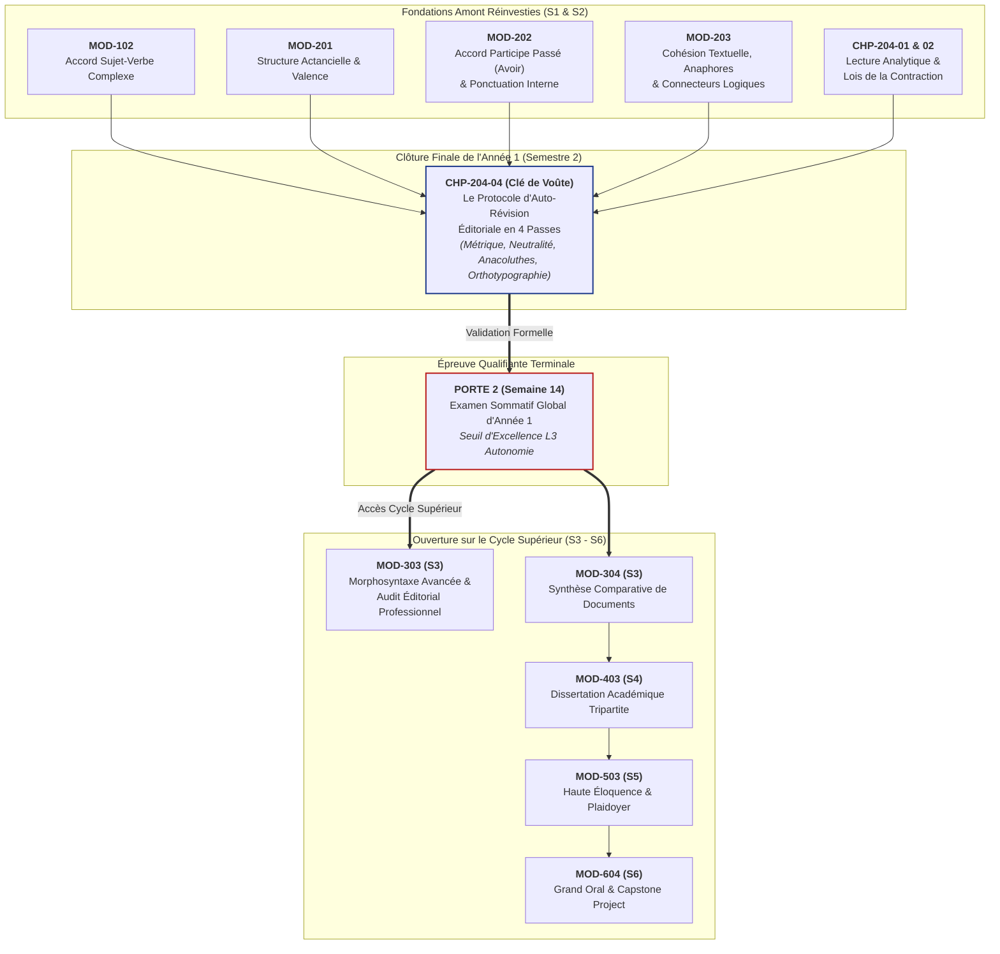

# Chapitre 4 — Le Protocole d'Auto-Révision Éditoriale en Quatre Passes : Traque des Anacoluthes, Cohésion des Chaînes et Finition Normative

> **Identifiant du chapitre** : `CHP-204-04`  
> **Module de rattachement** : [`MOD-204` — Lecture Analytique, Méthodologie du Résumé de Texte Informatif, Restitution Orale Synthétique et Auto-Révision](file:///f:/Formation/world-class-french/03-curriculum/year-1/semester-2/mod-204-resume-texte-restitution-orale.md)  
> **Semestre** : Année 1 — Semestre 2 (S2)  
> **Volume horaire canonique** : 5 à 6 heures d'apprentissage autonome délibéré et d'ateliers d'application (Phase 1 Étude : 1 h 30 | Phase 2 Pratique : 1 h 30 | Phase 3 Correction : 1 h 00 | Phase 4 Évaluation : 1 h 00)  
> **Statut** : [STATUT : VALIDÉ]  
> **Compétences associées** : [`FR-INT-003`](file:///f:/Formation/world-class-french/02-competency-framework/competency-framework.md#fr-int-003-réviser-et-corriger-un-texte-tiers-en-justifiant-les-interventions) (L3 Autonomie), [`FR-INT-001`](file:///f:/Formation/world-class-french/02-competency-framework/competency-framework.md#fr-int-001-rédiger-un-texte-long-cohérent-en-maîtrisant-accords-et-ponctuation) (L3 Autonomie), [`FR-ORTHO-003`](file:///f:/Formation/world-class-french/02-competency-framework/competency-framework.md#fr-ortho-003-accord-rigoureux-du-participe-passé-avec-lauxiliaire-avoir) (L3 Autonomie)  
> **Sources scientifiques de référence** : `SRC-GRAM-01` (Maurice Grevisse, André Goosse, *Le Bon Usage*, 16e éd., § 440 & § 947-955), `SRC-GRAM-02` (Martin Riegel, Jean-Christophe Pellat, René Rioul, *Grammaire méthodique du français*, chap. 19 & 21), `SRC-TYPO-01` (Imprimerie nationale, *Lexique des règles typographiques en usage à l'Imprimerie nationale*), `SRC-NORM-03` (Ministère de l'Éducation nationale, *Terminologie grammaticale*, 2020)

---

## 1. Titre et Place dans le Cursus

### 1.1 Intitulé Officiel
**Chapitre 4 : Le Protocole d'Auto-Révision Éditoriale en Quatre Passes : Traque des Anacoluthes, Cohésion des Chaînes et Finition Normative** (`CHP-204-04`).

### 1.2 Insertion Architecturale dans le Cursus
Le présent chapitre constitue le **couronnement terminal du module [`MOD-204`](file:///f:/Formation/world-class-french/03-curriculum/year-1/semester-2/mod-204-resume-texte-restitution-orale.md)** et la **clôture définitive du Semestre 2 et de l'Année 1** du cursus *World-Class French*. Il représente le sas de qualification ultime avant le passage de la **Porte 2** (examen de fin de première année) et le basculement vers les enseignements supérieurs de cycle intermédiaire (Semestres 3 à 6).

Dans la progression didactique, la contraction de texte étudiée au chapitre [`CHP-204-02`](file:///f:/Formation/world-class-french/03-curriculum/year-1/semester-2/mod-204-resume-texte-restitution-orale.md#6-plan-détaillé-des-chapitres) pousse la syntaxe dans ses ultimes retranchements : pour respecter une contrainte métrique intraitable ($\pm 10\,\%$) tout en préservant l'armature logique dégagée en `CHP-204-01`, le scripteur est contraint de pratiquer des opérations de condensation drastiques (effacements, nominalisations, participiales, subordinations denses). Or, ces opérations chirurgicales sont le terreau par excellence d'anomalies morphosyntaxiques redoutables : les anacoluthes (ruptures de construction actancielle), les participes présents orphelins de sujet, les télescopages de propositions et les accords défaillants sous l'effet de la fatigue cognitive [Réf. `SRC-GRAM-01`, § 440].

`CHP-204-04` apporte la riposte méthodologique à cette vulnérabilité : un **protocole d'auto-révision éditoriale en quatre passes distinctes et étanches**, garantissant qu'aucune copie ne soit remise sans avoir subi un audit multicouche exhaustif.



- **En amont** : Ce chapitre mobilise de plein droit :
  - Le contrôle des accords sujet-verbe distants et inversés validé en [`MOD-102`](file:///f:/Formation/world-class-french/03-curriculum/year-1/semester-1/mod-102-classes-mots-accords-fondamentaux.md) ;
  - L'analyse de la structure actancielle et de la valence verbale de [`MOD-201`](file:///f:/Formation/world-class-french/03-curriculum/year-1/semester-2/mod-201-syntaxe-fonctionnelle-phrase-simple.md) ;
  - L'application systématique de l'algorithme d'accord du participe passé avec l'auxiliaire *avoir* et les interdits de la virgule issus de [`MOD-202`](file:///f:/Formation/world-class-french/03-curriculum/year-1/semester-2/mod-202-participe-passe-avoir-ponctuation-interne.md) ;
  - La cohésion des chaînes coréférentielles et l'exactitude des connecteurs logiques de [`MOD-203`](file:///f:/Formation/world-class-french/03-curriculum/year-1/semester-2/mod-203-logique-paragraphe-cohesion-textuelle.md) ;
  - Les règles officielles du décompte métrique typographique enseignées en [`CHP-204-02`](file:///f:/Formation/world-class-french/03-curriculum/year-1/semester-2/mod-204/chp-204-02-methodologie-contraction-metrique-typographique.md).
- **Au sein de [`MOD-204`](file:///f:/Formation/world-class-french/03-curriculum/year-1/semester-2/mod-204-resume-texte-restitution-orale.md)** : Il dote le résumé analytique d'un bouclier de qualité absolue, transformant un premier jet dense mais fragile en un produit éditorial parfait.
- **En aval dans le cursus** : Il constitue le passeport pour les exercices d'écriture polyphonique complexe :
  - `MOD-303` (Laboratoire de révision et stylistique avancée) et `MOD-304` (Synthèse de textes multiples) ;
  - `MOD-403` (Dissertation académique), où l'auto-révision en temps limité décide de l'admissibilité aux concours ;
  - Les grands oraux de fin de cursus (`MOD-503`, `MOD-604`), où la vigilance syntaxique doit devenir un réflexe neuromoteur instantané pour prévenir les anacoluthes oratoires.

---

## 2. Objectifs Mesurables

Au terme des 5 à 6 heures d'apprentissage autonome et d'ateliers d'application de ce chapitre, l'apprenant sera capable de :

1. **Exécuter de façon autonome le protocole d'auto-révision éditoriale en quatre passes étanches** (Passe 1 : Métrique typographique ; Passe 2 : Fidélité logique et neutralité ; Passe 3 : Crible micro-syntaxique ; Passe 4 : Orthotypographie et ponctuation) sur un résumé de texte ou un texte argumenté dense de 150 à 250 mots, en respectant rigoureusement la séparation fonctionnelle des contrôles [Réf. `SRC-TYPO-01` ; `SRC-GRAM-02`, chap. 21]. ([`FR-INT-003`](file:///f:/Formation/world-class-french/02-competency-framework/competency-framework.md#fr-int-003-réviser-et-corriger-un-texte-tiers-en-justifiant-les-interventions) — Palier L3 Autonomie).
2. **Identifier et neutraliser avec un taux d'exactitude de 100 % toute rupture de construction syntaxique (anacoluthe)** au sein d'un texte contracté, en discriminant formellement les participes présents ou gérondifs orphelins de sujet logique, les infinitifs sans ancrage actanciel, les ruptures de corrélations binaires (*non seulement... mais aussi*) et les télescopages de complétives [Réf. `SRC-GRAM-01`, § 440 ; `SRC-NORM-03`]. ([`FR-INT-003`](file:///f:/Formation/world-class-french/02-competency-framework/competency-framework.md#fr-int-003-réviser-et-corriger-un-texte-tiers-en-justifiant-les-interventions), [`FR-INT-001`](file:///f:/Formation/world-class-french/02-competency-framework/competency-framework.md#fr-int-001-rédiger-un-texte-long-cohérent-en-maîtrisant-accords-et-ponctuation) — Palier L3 Autonomie).
3. **Auditer la cohésion des chaînes anaphoriques et la neutralité énonciative** en éradiquant toute ambiguïté de coréférence pronominale (*il, le, celui-ci*) et toute scorie métadiscursive parasite (*« l'auteur affirme que »*, *« nous constatons »*), garantissant une réénonciation autonome et objective [Réf. `SRC-GRAM-02`, chap. 19 ; `CHP-203-03`]. ([`FR-INT-001`](file:///f:/Formation/world-class-french/02-competency-framework/competency-framework.md#fr-int-001-rédiger-un-texte-long-cohérent-en-maîtrisant-accords-et-ponctuation) — Palier L3 Autonomie).
4. **Appliquer sans défaillance la finition orthotypographique intégrale** : validation algorithmique de 100 % des accords de participes passés avec l'auxiliaire *avoir* (avec COD antéposé), résolution des accords sujet-verbe complexes à distance, respect absolu des interdits de la virgule (zéro virgule sujet-verbe ou verbe-objet) et décompte exact des mots à élision et tirets selon la norme de l'Imprimerie nationale [Réf. `SRC-GRAM-01`, § 947-955 ; `SRC-TYPO-01`]. ([`FR-ORTHO-003`](file:///f:/Formation/world-class-french/02-competency-framework/competency-framework.md#fr-ortho-003-accord-rigoureux-du-participe-passé-avec-lauxiliaire-avoir) — Palier L3 Autonomie).

---

## 3. Prérequis et Test de Préparation (Auto-Diagnostic)

### 3.1 Prérequis Cognitifs Exigibles
- **Maîtrise de l'algorithme d'accord du participe passé avec *avoir*** : identification immédiate de la présence, de la nature et de la position du COD (pronom personnel, relatif *que*, adverbe de quantité) ([`MOD-202`](file:///f:/Formation/world-class-french/03-curriculum/year-1/semester-2/mod-202-participe-passe-avoir-ponctuation-interne.md)).
- **Syntaxe de la phrase simple et complexe** : délimitation des frontières propositionnelles, identification du sujet grammatical et du verbe recteur ([`MOD-201`](file:///f:/Formation/world-class-french/03-curriculum/year-1/semester-2/mod-201-syntaxe-fonctionnelle-phrase-simple.md)).
- **Interdits de la virgule** : interdiction formelle d'insérer une virgule unique entre le sujet et le verbe ou entre le verbe et son complément d'objet direct direct ([`CHP-202-04`](file:///f:/Formation/world-class-french/03-curriculum/year-1/semester-2/mod-202/chp-202-04-ponctuation-interne-virgule-demarcative.md)).
- **Décompte typographique officiel des mots** : application de la règle du mot typographique délimité par des espaces ou signes de ponctuation (élisions, tirets) selon `SRC-TYPO-01` ([`CHP-204-02`](file:///f:/Formation/world-class-french/03-curriculum/year-1/semester-2/mod-204/chp-204-02-methodologie-contraction-metrique-typographique.md)).

### 3.2 Test de Préparation Immédiat (5 Questions)
Répondez aux cinq questions suivantes pour vérifier votre aptitude à aborder le protocole d'auto-révision. Consultez ensuite le corrigé détaillé sous l'onglet repliable.

1. Dans la phrase : *« En analysant les statistiques économiques, des perspectives encourageantes se dessinent pour l'industrie »*, identifiez le sujet syntaxique de la proposition principale et déterminez si la construction du gérondif est syntaxiquement légitime.
2. Combien de mots typographiques officiels compte la séquence suivante selon les règles des concours académiques et de l'Imprimerie nationale : *« C'est-à-dire qu'aujourd'hui l'homme sous-estime ce chef-d'œuvre. »* ?
3. Dans la phrase : *« Les mesures d'urgence que le conseil d'administration a décidé d'adopter transformeront l'entreprise »*, justifiez l'accord ou l'invariabilité du participe passé *décidé*.
4. Corrigez la rupture de corrélation dans l'énoncé suivant : *« Cette politique est non seulement inefficace, mais elle aggrave la précarité des ménages. »*
5. Pourquoi est-il strictement interdit d'écrire dans un résumé de texte académique : *« Dans ce texte, l'auteur s'indigne à juste titre contre la dérive autoritaire du pouvoir »* ? Citez les deux entorses méthodologiques commises.

---

#### Corrigé Détaillé de l'Auto-Diagnostic

<details>
<summary><b>Consulter le corrigé raisonné des 5 questions de préparation</b></summary>

1. **Diagnostic de l'anacoluthe du gérondif** :  
   Le sujet grammatical de la proposition principale est *« des perspectives encourageantes »*. Or, ce ne sont pas les « perspectives » qui analysent les statistiques économiques, mais l'analyste, l'économiste ou le scripteur. Le gérondif détaché *« En analysant... »* n'a pas le même sujet logique que le verbe principal : il est orphelin de support référentiel. C'est une anacoluthe fautive majeure [Réf. `SRC-GRAM-01`, § 440].  
   *Rectification académique* : *« En analysant les statistiques économiques, l'économiste discerne des perspectives encourageantes pour l'industrie »* ou *« Lorsque l'on analyse les statistiques économiques, des perspectives encourageantes se dessinent pour l'industrie »*.

2. **Décompte métrique officiel (12 mots typographiques)** :  
   - *C'* (1) + *est* (2) + *-à-* (3) + *-dire* (4) = 4 mots ;  
   - *qu'* (5) = 1 mot ;  
   - *aujourd'hui* (6) = 1 mot (exception unique consacrée par l'usage lexical) ;  
   - *l'* (7) + *homme* (8) = 2 mots ;  
   - *sous-estime* = *sous* (9) + *estime* (10) = 2 mots (le trait d'union sépare deux unités graphiques) ;  
   - *ce* (11) = 1 mot ;  
   - *chef-d'œuvre* = *chef* (12) + *d'* (13) + *œuvre* (14) = 3 mots.  
   *Décompte exact total* : **14 mots typographiques**. *(Attention : si vous avez compté sous-estime comme 1 mot ou chef-d'œuvre comme 1 mot, vous avez enfreint la règle canonique de `SRC-TYPO-01`).*

3. **Accord du participe passé suivi d'un infinitif** :  
   Le participe passé *décidé* est suivi de l'infinitif *adopter*. Le pronom relatif *que* a pour antécédent *« les mesures d'urgence »*. Posons la question d'actance : qu'est-ce qui a été décidé ? C'est *d'adopter les mesures d'urgence*. Le COD réel du verbe *décider* est la proposition infinitive postposée *d'adopter*. Le pronom *que* n'est pas le COD de *décider*, mais le COD de l'infinitif *adopter* (*adopter les mesures*). Par conséquent, le COD de *a décidé* est postposé : le participe passé demeure strictement **invariable** : *décidé* [Réf. `SRC-GRAM-01`, § 950].

4. **Restauration de la corrélation binaire** :  
   La corrélation additive renforcée exige le parallélisme *non seulement... mais encore* ou *non seulement... mais aussi*. La simple coordination par *mais* sans adverbe corrélatif d'addition (*aussi / encore*) crée une asymétrie illogique.  
   *Rectification conforme* : *« Cette politique est non seulement inefficace, mais elle aggrave aussi la précarité des ménages »* ou *« Cette politique, non seulement s'avère inefficace, mais encore aggrave la précarité des ménages »*.

5. **Entorses à la déontologie du résumé académique** :  
   L'énoncé commet deux fautes méthodologiques capitales :  
   - **Rupture de neutralité énonciative (parasitisme métadiscursif)** : *« Dans ce texte, l'auteur s'indigne... »*. Le scripteur doit contracter le texte de l'intérieur en adoptant directement le système d'énonciation de l'auteur, sans recourir à des formules de régie tierces ;  
   - **Interpolation subjective approbatrice** : *« à juste titre »*. L'étudiant n'a pas à juger, valider ou réfuter la thèse dans un résumé de texte. Il doit la restituer avec une objectivité chirurgicale [Réf. `SRC-GRAM-02`, chap. 19].

</details>

---

## 4. Situation de Départ ou Problème Concret

### 4.1 Le Drame de la Relecture Linéaire Spontanée
Considérons la situation classique d'un étudiant de haut niveau confronté à l'épreuve du résumé de texte aux concours universitaires ou aux grandes écoles. Après 1 h 30 d'efforts intenses pour disséquer le texte d'idées, trier les arguments et rédiger son premier jet sous contrainte métrique, il lui reste dix minutes avant la remise de la copie.

Que fait spontanément l'étudiant novice ? Il relit son texte d'une seule traite, du premier au dernier mot, en le prononçant silencieusement « dans sa tête ». 

Le verdict est implacable : l'étudiant ne voit presque aucune de ses erreurs. Son cerveau, saturé par la fatigue et guidé par l'intention de sens qu'il a en mémoire, lit ce qu'il *voulait écrire* et non ce qui est *réellement tracé sur le papier*. Le résultat est désastreux :
- Une faute grossière d'accord du participe passé (*« les solutions qu'il a proposé »*) passe inaperçue parce que l'esprit était focalisé sur l'idée philosophique ;
- Une anacoluthe béante défigure le paragraphe (*« En éliminant les intermédiaires, le coût de production diminue »*) sans que le lecteur ne sursaute, car le sens global reste compréhensible ;
- Le décompte des mots est faussé de dix unités parce que les mots à tirets et à apostrophes ont été comptés selon l'intuition du traitement de texte plutôt que selon la norme officielle des concours ;
- Une virgule assassine sépare le sujet complexe du verbe (*« L'ensemble des facteurs environnementaux observés depuis dix ans, modifie le climat »*), rompant la continuité syntaxique fondamentale de la phrase.

La copie écope d'une note éliminatoire, non par défaut d'intelligence, mais par **faillite méthodologique d'auto-révision**.

### 4.2 La Contraction de Texte : Générateur Mécanique d'Anacoluthes
Pourquoi la contraction de texte est-elle la discipline la plus exposée aux ruptures de construction ? 

Parce que résumer consiste à **comprimer une pensée complexe dans un nombre de mots restreint**. Pour éliminer des mots jugés superflus, le rédacteur recourt massivement à l'ellipse, aux formes participiales et aux gérondifs. Il fusionne deux propositions en une seule. Mais, ce faisant, il escamote fréquemment le sujet syntaxique de la première proposition, oubliant que la grammaire française exige une stricte coréférence actancielle entre un syntagme détaché et le sujet du verbe recteur.

L'auto-révision ne saurait donc être une vague relecture de complaisance. Elle doit être érigée en un **protocole clinique d'audit éditorial**.

---

## 5. Explication Intuitive

### 5.1 L'Analogie du Contrôle de Qualité Aéronautique
Imaginez un ingénieur de maintenance aéronautique chargé de vérifier un avion de ligne avant le décollage. S'avancerait-il sur le tarmac en inspectant simultanément d'un seul coup d'œil la pression des pneumatiques, le niveau de liquide hydraulique, les circuits avioniques du cockpit et la fermeture des vannes de kérosène ? Une telle approche mènerait inévitablement à la catastrophe par surcharge attentionnelle.

Dans l'industrie aéronautique, la vérification s'opère par **passes d'inspection étanches et spécialisées** :
1. *Passe 1* : Contrôle structurel externe et intégrité physique des parois ;
2. *Passe 2* : Vérification des niveaux de fluides et étanchéité des circuits ;
3. *Passe 3* : Contrôle des gouvernes mécaniques et cinématique des commandes ;
4. *Passe 4* : Test électronique des calculateurs de bord et calibrage des instruments.

Chaque passe mobilise un outil spécifique, une check-list dédiée, et interdit à l'opérateur de se laisser distraire par une anomalie relevant d'un autre système.

### 5.2 L'Imagerie Médicale Multicouche
L'autre modèle analogique est celui du scanner tomodensitométrique (IRM ou scanner multicouche). Pour poser un diagnostic sur un organe complexe, le radiologue ne regarde pas un cliché opaque : il isole la couche osseuse, puis la couche vasculaire, puis les tissus mous, et enfin l'activité métabolique.

En rédaction académique, le **Protocole d'Auto-Révision en Quatre Passes** applique exactement ce principe de décomposition optique :
- On ne lit jamais un texte pour traquer l'orthographe en même temps que la fidélité des idées ;
- On filtre le texte à travers quatre tamis successifs, chaque passe neutralisant une famille bien précise d'erreurs.

---

## 6. Définitions Précises et Terminologie

```text
TAXONOMIE DE L'AUTO-RÉVISION ÉDITORIALE
├── 1. Protocole en 4 passes : Audit séquentiel étanche (Métrique → Énonciation → Micro-syntaxe → Orthotypographie)
├── 2. Pathologies de rupture syntaxique :
│   ├── Anacoluthe canonique : Discontinuité grammaticale d'une phrase dont la fin n'est pas accordée au début
│   ├── Participe présent / Gérondif orphelin : Forme en -ant détachée dont le sujet logique diffère du sujet recteur
│   ├── Rupture de corrélation : Dissymétrie ou omission dans un système binaire (non seulement... mais aussi)
│   └── Télescopage propositionnel : Enchevêtrement confus de subordonnées privées de principale
└── 3. Garanties de surface et de texture :
    ├── Cohésion anaphorique : Continuité univoque de la coréférence des pronoms et substituts lexicaux
    ├── Conformité métrique : Respect de la cible arithmétique des mots selon la norme Imprimerie nationale
    └── Finition orthotypographique : Algorithme des participes passés et respect des interdits de la virgule
```

### 6.1 Protocole d'Auto-Révision en Quatre Passes
Procédure algorithmique de relecture méthodique par laquelle un rédacteur soumet son propre texte à quatre examens successifs, mutuellement exclusifs et ordonnés selon un principe de gravité décroissante : la conformité quantitative globale (Passe 1), la validité sémantique et énonciative (Passe 2), l'intégrité architecturale de la phrase (Passe 3) et la normalisation microscopique des signes graphiques et de la ponctuation (Passe 4).

### 6.2 Anacoluthe Syntaxique
Figure de construction consistant en une rupture délibérée ou involontaire de la cohésion syntaxique au sein de la phrase, de telle sorte que le second membre de la période ne s'enchaîne pas logiquement ni grammaticalement au premier [Réf. `SRC-GRAM-01`, § 440 ; `SRC-NORM-03`].  
*Exemple d'anacoluthe fautive* : *« En arrivant à la gare, le train était déjà parti. »* (Le train n'est pas le sujet du gérondif *arrivant*).

### 6.3 Participe Présent ou Gérondif Orphelin
Forme verbale en *-ant* (employée seule en participe présent détaché ou précédée de la préposition *en* en gérondif) placée en tête de proposition ou en incise, dont le sujet sémantique (agent du procès) n'est pas identique au sujet grammatical du verbe principal dont elle dépend [Réf. `SRC-GRAM-02`, chap. 19].

### 6.4 Rupture de Corrélation Binaire
Altération de la structure d'un système corrélatif binaire par omission de l'un des termes régis, par rupture de parallélisme grammatical ou par substitution d'un connecteur incompatible (*non seulement... mais* au lieu de *non seulement... mais aussi / mais encore* ; *d'une part...* sans *d'autre part* symétrique).

### 6.5 Télescopage de Propositions
Accident syntaxique résultant de la fusion maladroite de deux constructions verbales distinctes ou de l'accumulation non hiérarchisée de subordonnées enchâssées privées de proposition principale rectrice explicite.

### 6.6 Discordance Actancielle
Incohérence entre les rôles sémantiques distribués par le prédicat (agent, patient, instrument) et les fonctions syntaxiques réelles attribuées aux syntagmes nominaux au sein de la phrase [Réf. `SRC-GRAM-02`, chap. 7].

### 6.7 Cohésion Anaphorique
Propriété d'un texte dans lequel chaque élément de reprise (pronom personnel de 3e personne, pronom démonstratif, syntagme nominal défini résomptif) renvoie sans équivoque ni concurrence référentielle à son antécédent textuel légitime [Réf. `SRC-GRAM-02`, chap. 21 ; `CHP-203-03`].

### 6.8 Conformité Métrique
Adéquation quantitative stricte entre le nombre effectif de mots d'un devoir contracté et la fourchette imposée par le barème officiel ($\pm 10\,\%$, soit 90 à 110 mots pour une consigne de 100 mots), calculée selon les règles du mot typographique officiel [Réf. `SRC-TYPO-01`].

### 6.9 Finition Orthotypographique
Dernier niveau de contrôle portant sur l'orthographe grammaticale (accords sujet-verbe complexes, algorithme de Marot pour le participe passé avec *avoir*), l'orthographe lexicale et le respect scrupuleux des conventions de ponctuation (absence de virgule entre sujet et verbe, équilibre des deux-points et points-virgules) [Réf. `SRC-TYPO-01` ; `SRC-GRAM-01`, § 122].

---

## 7. Règles et Mécanismes Fondamentaux

### 7.1 L'Architecture du Protocole d'Auto-Révision en Quatre Passes

Le protocole repose sur l'étanchéité absolue de quatre filtres successifs. Chaque passe doit être menée comme une mission autonome avec un stylo de couleur ou un regard ciblé.

```text
LES QUATRE PASSES DE L'AUTO-RÉVISION ÉDITORIALE
┌────────────────────────────────────────────────────────────────────────┐
│ PASSE 1 : CONTRÔLE MÉTRIQUE & DÉCOMPTE OFFICIEL                        │
│ • Décompte selon SRC-TYPO-01 (élisions = 1 mot, traits d'union = 1 mot)│
│ • Vérification de la marge des ± 10 %                                  │
│ • Balisage typographique visible tous les 50 mots [/50], [/100]        │
└──────────────────────────────────┬─────────────────────────────────────┘
                                   │
                                   ▼
┌────────────────────────────────────────────────────────────────────────┐
│ PASSE 2 : EXAMEN DE FIDÉLITÉ LOGIQUE & NEUTRALITÉ ÉNONCIATIVE          │
│ • Vérification de l'armature argumentative (thèse + arguments pivots)  │
│ • Éradication absolue des formules parasites (« l'auteur dit que »)    │
│ • Chasse au contresens et aux jugements approbateurs/réprobateurs      │
└──────────────────────────────────┬─────────────────────────────────────┘
                                   │
                                   ▼
┌────────────────────────────────────────────────────────────────────────┐
│ PASSE 3 : CRIBLE MICRO-SYNTAXIQUE & TRAQUE DES ANACOLUTHES             │
│ • Traque du participe présent / gérondif détaché sans coréférence      │
│ • Restauration des corrélations binaires (non seulement... mais aussi) │
│ • Démêlage des télescopages de subordonnées et fausses complétives     │
│ • Contrôle de la coréférence des anaphores pronominales                │
└──────────────────────────────────┬─────────────────────────────────────┘
                                   │
                                   ▼
┌────────────────────────────────────────────────────────────────────────┐
│ PASSE 4 : FINITION ORTHOTYPOGRAPHIQUE & PONCTUATION LOGIQUE            │
│ • Algorithme de Marot pour le participe passé avec avoir (COD antéposé)│
│ • Accords sujet-verbe complexes à distance et sujets inversés          │
│ • Zéro virgule entre sujet et verbe ou entre verbe et COD              │
│ • Justesse des deux-points explicatifs et du point-virgule             │
└────────────────────────────────────────────────────────────────────────┘
```

#### Passe 1 : Contrôle Métrique et Décompte Officiel
Le non-respect du calibrage volumétrique entraîne des pénalités immédiates, voire la note zéro dans les concours académiques les plus stricts.
1. **Règle du mot typographique officiel (`SRC-TYPO-01`)** :  
   Un mot est constitué par tout ensemble de caractères typographiques isolé par deux espaces blancs ou par un signe de ponctuation (y compris l'apostrophe et le trait d'union).
   - Les formes élidées comptent pour deux mots : *l'arbre* = 2 mots (*l'* / *arbre*) ; *qu'il* = 2 mots (*qu'* / *il*) ; *d'accord* = 2 mots (*d'* / *accord*).
   - Les mots composés à trait d'union comptent autant de mots qu'il y a d'éléments séparés : *c'est-à-dire* = 4 mots ; *socio-économique* = 2 mots ; *sous-estime* = 2 mots ; *chef-d'œuvre* = 3 mots.
   - **L'exception canonique** : *aujourd'hui* ne compte que pour **un seul mot** (lexicalisation figée unitaire reconnue par l'ensemble des jurys académiques).
   - Les chiffres écrits en caractères arabes (*1960*, *14*) comptent pour un seul mot. *(Rappel : les nombres s'écrivent obligatoirement en toutes lettres dans la prose argumentative académique).*
2. **Calcul de la tolérance métrique** :  
   Pour une consigne de $N$ mots avec tolérance de $\pm 10\,\%$, l'intervalle strict autorisé est $[0{,}9 \times N \,;\, 1{,}1 \times N]$.
   - Pour 100 mots imposés : entre 90 et 110 mots.
   - Pour 200 mots imposés : entre 180 et 220 mots.
   - Pour 250 mots imposés : entre 225 et 275 mots.
3. **Balisage périodique** :  
   L'étudiant doit insérer un repère graphique (barre oblique ou chevron numéroté) tous les cinquante mots : `[/50]`, `[/100]`, `[/150]`. Le décompte total exact doit être mentionné à la fin de la copie.

#### Passe 2 : Examen de Fidélité Logique et Neutralité Énonciative
Le résumé ne doit être ni une glose, ni un commentaire, ni une trahison de la pensée source.
1. **Loi de neutralité énonciative (`SRC-GRAM-02`, chap. 19)** :  
   Proscription radicale de toute formule de régie métadiscursive : *« L'auteur démontre »*, *« Selon le philosophe »*, *« Le texte souligne »*, *« L'écrivain conclut »*. L'étudiant doit écrire comme s'il était lui-même l'auteur du texte, en éliminant toute distance énonciative.
2. **Proscription des interpolations axiologiques** :  
   Bannir toute appréciation personnelle : *« fort heureusement »*, *« hélas »*, *« à juste titre »*, *« comme on le sait »*.
3. **Contrôle de fidélité objective** :  
   Vérifier que les thèses adverses réfutées par l'auteur dans le texte ne sont pas attribuées par erreur à l'auteur lui-même (faute de contresens polyphonique).

#### Passe 3 : Crible Micro-Syntaxique et Traque Chirurgicale des Anacoluthes
Cette passe est le cœur technique de l'assainissement de la phrase.

##### A. L'Anacoluthe du Participe Présent ou Gérondif Détaché
En français classique et académique, une forme participiale ou gérondive détachée en tête de phrase doit **obligatoirement partager le même sujet logique que le sujet syntaxique de la proposition principale** [Réf. `SRC-GRAM-01`, § 440].
- *Construction fautive* :  
  $$\text{*« En adoptant ces réformes, la croissance économique s'accélérera. »*}$$  
  *Analyse* : Qui adopte les réformes ? Le gouvernement, l'État. Quel est le sujet du verbe principal *s'accélérera* ? *La croissance économique*. La croissance n'adopte pas de réformes. C'est une anacoluthe lourde.
- *Construction corrigée n° 1 (restauration du sujet commun)* :  
  *« En adoptant ces réformes, l'État accélérera la croissance économique. »*
- *Construction corrigée n° 2 (transformation en subordonnée conjonctive)* :  
  *« Si l'État adopte ces réformes, la croissance économique s'accélérera. »*

##### B. L'Anacoluthe de l'Infinitif en Tête de Phrase
L'infinitif prépositionnel détaché obéit à la même règle de contrôle actanciel :
- *Construction fautive* : *« Pour réussir cette transition, des sacrifices financiers sont inévitables. »* (Les sacrifices ne réussissent pas la transition).
- *Construction corrigée* : *« Pour réussir cette transition, la nation doit consentir d'inévitables sacrifices financiers. »*

##### C. Les Ruptures de Corrélation Binaire
Un opérateur corrélatif engage une promesse syntaxique qui doit être tenue :
- *Non seulement... mais aussi / mais encore* : l'omission de *aussi* ou *encore* réduit la phrase à une banale opposition contradictoire au lieu de marquer une addition hiérarchisée.
- *D'une part... d'autre part* : ces deux locutions doivent introduire des membres syntaxiquement parallèles (deux syntagmes nominaux ou deux propositions complètes).

##### D. La Résolution des Ambiguïtés Anaphoriques (`CHP-203-03`)
Vérifier chaque pronom de 3e personne (*il, elle, ils, elles, le, la, les, lui, leur*). Si deux noms de même genre et nombre précèdent le pronom, celui-ci doit être remplacé par un nom résomptif univoque ou un démonstratif discriminatoire (*celui-ci, ce dernier*).

#### Passe 4 : Contrôle Orthographique et Ponctuation Logique
La dernière passe inspecte la matière graphique brute et la ponctuation interne.

##### A. Algorithme de Marot pour le Participe Passé avec *Avoir* (`MOD-202`)
Pour chaque forme verbale composée avec *avoir* :
1. *Étape 1* : Poser la question *« Verbe + QUI ? »* ou *« Verbe + QUOI ? »*.
2. *Étape 2* : Le COD existe-t-il ?
   - Si NON $\to$ **Invariable** (*Ils ont dormi* ; *Elle a couru*).
3. *Étape 3* : Si OUI, où se trouve le COD ?
   - S'il est placé APRÈS le verbe $\to$ **Invariable** (*Elle a écrit des lettres*).
   - S'il est placé AVANT le verbe $\to$ **Accord en genre et en nombre avec le COD** (*Les lettres qu'elle a écrites* ; *Cette leçon, il l'a comprise*).
4. *Étape 4 (Attention aux pièges)* :
   - Pronom adverbial *en* $\to$ **Strictement invariable** (*Des livres, j'en ai lu dix*) [Réf. `SRC-GRAM-01`, § 954].
   - Suivi d'un infinitif $\to$ Le COD fait-il l'action exprimée par l'infinitif ? Si oui, accord (*Les musiciens que j'ai entendus jouer*) ; si non, invariabilité (*Les chansons que j'ai entendu chanter*) [Réf. `SRC-GRAM-01`, § 950].

##### B. Accords Sujet-Verbe Complexes (`MOD-102`)
- **Sujets collectifs avec complément** : *La majorité des citoyens a voté* (sens unitaire) ou *ont voté* (sens distributif) — maintenir une cohérence absolue au sein du même texte.
- **Sujet inversé ou éloigné** : Neutraliser l'illusion phonétique créée par les compléments intercalés (*« L'accumulation de ces multiples maladresses techniques nuit à sa démonstration »* et non *\*nuisent*).

##### C. Les Interdits de la Virgule (`CHP-202-04`)
- **Interdit absolu 1** : ZÉRO virgule entre le groupe sujet et le groupe verbal (*« La théorie développée par l'auteur, modifie la science »* $\to$ **Faute éliminatoire**).
- **Interdit absolu 2** : ZÉRO virgule entre le verbe et son complément d'objet direct direct (*« Il affirme, que tout est faux »* $\to$ **Faute éliminatoire**).

---

### 7.2 Anatomie Linguistique de l'Anacoluthe : Pourquoi la Condensation Trahit le Scripteur

Pour comprendre pourquoi l'anacoluthe est la pathologie maîtresse du résumé, il faut examiner la mécanique de la condensation textuelle :

```text
DÉCOMPOSITION DU MÉCANISME DE PRODUCTION DE L'ANACOLUTHE

1. Phrase source (Texte long - 2 propositions avec sujets distincts) :
   [L'analyste examine les données du marché], et [les cours de l'or baissent immédiatement].
                             │
                             ▼ (Volonté de condenser pour économiser des mots)
2. Opération de réduction par gérondif :
   [En examinant les données du marché], ...
                             │
                             ▼ (Escamotage inconscient du sujet « L'analyste »)
3. Raccordement direct à la seconde proposition :
   *« En examinant les données du marché, les cours de l'or baissent immédiatement. »*
                             │
                             ▼ (Accident actanciel : Anacoluthe monstrueuse !)
4. Structure de surface perçue par le lecteur :
   Le sujet grammatical « les cours de l'or » devient l'agent logique de « examinant ».
```

L'anacoluthe naît donc d'un **conflit entre l'économie de surface (supprimer des mots) et l'intégrité de la structure profonde (préserver les dépendances actancielles)** [Réf. `SRC-GRAM-02`, chap. 7]. Le réviseur doit obligatoirement reconstruire le parallélisme actanciel.

---

## 8. Raisonnement Détaillé : Pourquoi le Cerveau est Aveugle à ses Propres Erreurs

La psycholinguistique cognitive et les travaux sur la mémoire de travail (Sweller, Baddeley) ont mis en lumière le mécanisme de **l'illusion de relecture** :

### 8.1 Le Traitement Descendant (*Top-Down Processing*)
Lorsqu'un individu lit le texte d'un tiers, son cerveau opère selon un processus **ascendant** (*bottom-up*) : il décode les graphèmes, assemble les syntagmes et extrait le sens à partir des indices visuels réels.

En revanche, lorsqu'un auteur relit sa propre prose immédiatement après l'avoir rédigée, le processus est écrasé par le traitement **descendant** (*top-down*) :
- L'empreinte sémantique de l'idée est encore vivement stockée dans sa mémoire de travail ;
- Les yeux parcourent la ligne, mais le cerveau effectue une **auto-complétion prédictive** ;
- Il « voit » les morphèmes silencieux manquants (*-s*, *-nt*, *-es*) et « entend » la liaison logique même si la syntaxe est disloquée.

### 8.2 La Surcharge Cognitive de la Relecture Globale
Si un rédacteur s'impose de contrôler simultanément :
$$\text{Sens global} + \text{Neutralité} + \text{Métrique} + \text{Syntaxe} + \text{Orthographe} + \text{Ponctuation}$$
la capacité de traitement de son unité centrale cognitive (mémoire de travail limitée à $4 \pm 1$ éléments actifs) sature instantanément. Les erreurs formelles microscopiques sont systématiquement sacrifiées au profit de la cohérence sémantique macroscopique.

Le protocole en quatre passes est la seule parade scientifique : **en isolant la tâche de chaque passe, on déconnecte délibérément le regard de la charge sémantique globale pour le forcer à redevenir un détecteur typographique et syntaxique objectif**.

---

## 9. Exemples Corrects Commentés

Observons la métamorphose d'un paragraphe défectueux à travers l'application rigoureuse des quatre passes successives.

### 9.1 Premier Jet Brut (Avant Auto-Révision)
> *« En étudiant l'histoire des sociétés industrielles, des mutations profondes apparaissent toujours au lendemain des crises. L'auteur démontre à juste titre que la mécanisation a non seulement détruit les métiers d'autrefois mais a aussi créer de nouvelles formes d'aliénation. Les machines perfectionnées que l'ingénieur a conçu, transforment le rythme de vie, cependant l'ouvrier ne peut pas s'épanouir dans ce cadre aliénant. [/58 mots] »*

### 9.2 Audit Clinique des Quatre Passes

```text
AUDIT PASSE PAR PASSE DU PREMIER JET

┌────────────────────────────────────────────────────────────────────────┐
│ PASSE 1 : CONTRÔLE MÉTRIQUE                                            │
│ • Décompte affiché : 58 mots.                                          │
│ • Décompte réel vérifié selon SRC-TYPO-01 :                             │
│   - « En(1) étudiant(2) l'(3) histoire(4) des(5) sociétés(6)           │
│     industrielles(7), des(8) mutations(9) profondes(10)                │
│     apparaissent(11) toujours(12) au(13) lendemain(14) des(15)         │
│     crises(16). L'(17) auteur(18) démontre(19) à(20) juste(21)         │
│     titre(22) que(23) la(24) mécanisation(25) a(26) non(27)            │
│     seulement(28) détruit(29) les(30) métiers(31) d'(32) autrefois(33)  │
│     mais(34) a(35) aussi(36) créer(37) de(38) nouvelles(39)            │
│     formes(40) d'(41) aliénation(42). Les(43) machines(44)             │
│     perfectionnées(45) que(46) l'(47) ingénieur(48) a(49) conçu(50),   │
│     transforment(51) le(52) rythme(53) de(54) vie(55), cependant(56)   │
│     l'(57) ouvrier(58) ne(59) peut(60) pas(61) s'(62) épanouir(63)     │
│     dans(64) ce(65) cadre(66) aliénant(67). »                          │
│ • Diagnostic : Le décompte réel est de 67 mots et non 58 !             │
│   L'étudiant a compté les élisions (l'histoire, d'autrefois, etc.)     │
│   comme des mots uniques. Erreur métrique majeure (+ 9 mots réels).    │
└────────────────────────────────────────────────────────────────────────┘
                                   │
                                   ▼
┌────────────────────────────────────────────────────────────────────────┐
│ PASSE 2 : EXAMEN DE FIDÉLITÉ LOGIQUE & NEUTRALITÉ                      │
│ • « L'auteur démontre » → Formule de régie métadiscursive parasite.    │
│ • « à juste titre » → Jugement axiologique approbateur interdit.       │
│ • Action : Supprimer radicalement ces 7 mots (« L'auteur démontre      │
│   à juste titre que »). Le résumé gagne en concision et neutralité.    │
└────────────────────────────────────────────────────────────────────────┘
                                   │
                                   ▼
┌────────────────────────────────────────────────────────────────────────┐
│ PASSE 3 : CRIBLE MICRO-SYNTAXIQUE (ANACOLUTHES & CORRÉLATIONS)         │
│ • Phrase 1 : « En étudiant l'histoire..., des mutations profondes      │
│   apparaissent... » → Anacoluthe du gérondif ! Les mutations           │
│   n'étudient pas l'histoire.                                           │
│   Correction : Rétablir le sujet logique ou nominaliser.               │
│ • Phrase 2 : « non seulement détruit... mais a aussi créer... »        │
│   Asymétrie de structure verbale (auxiliaire répété inutilement).      │
│ • Phrase 3 : Répétition lexicale vicieuse : « aliénation » / « aliénant│
└────────────────────────────────────────────────────────────────────────┘
                                   │
                                   ▼
┌────────────────────────────────────────────────────────────────────────┐
│ PASSE 4 : FINITION ORTHOTYPOGRAPHIQUE & PONCTUATION                     │
│ • « a aussi créer » → Faute morphologique grossière (infinitif en -er  │
│   au lieu du participe passé créé).                                    │
│ • « Les machines perfectionnées que l'ingénieur a conçu »             │
│   → Faute d'accord du participe passé avec avoir ! Le COD antéposé est │
│   le relatif « que » (antécédent « machines perfectionnées », fém. pl.)│
│   → Doit s'écrire : conçues.                                           │
│ • « que l'ingénieur a conçu, transforment »                            │
│   → Virgule fautive séparant le sujet de son verbe transforment.       │
│ • « de vie, cependant l'ouvrier »                                      │
│   → Virgule insuffisante devant cependant ; remplacer par point-      │
│   virgule.                                                             │
└────────────────────────────────────────────────────────────────────────┘
```

### 9.3 Texte Définitif Assaini (Après Protocole des 4 Passes)
> *« L'étude des sociétés industrielles révèle que des mutations profondes surgissent toujours au lendemain des crises. La mécanisation non seulement détruit les métiers traditionnels, mais engendre aussi de nouvelles formes d'asservissement. Les technologies perfectionnées que l'ingénieur a conçues bouleversent les rythmes quotidiens ; l'artisan dépossédé ne peut dès lors plus s'épanouir dans un travail automatisé. [/58 mots] »*

**Apparat critique de validation finale** :
- **Métrique vérifiée** : Exactement 58 mots typographiques réels (vérifiés un à un avec élisions).
- **Neutralité** : Zéro formule parasite (« l'auteur dit »), objectivité absolue.
- **Micro-syntaxe** : L'anacoluthe est éradiquée par nominalisation (*L'étude des sociétés... révèle que*), corrélation *non seulement... mais engendre aussi* parfaitement symétrique.
- **Orthotypographie** : Accord rétabli (*conçues*), virgule parasite supprimée, point-virgule d'équilibre inséré.

---

## 10. Contre-Exemples et Erreurs Fréquentes

Examinons la clinique des six erreurs récurrentes les plus sévèrement sanctionnées lors des épreuves académiques :

### 10.1 Erreur n° 1 : L'anacoluthe sur participe présent ou gérondif en tête de phrase
- **Énoncé pathologique** :  
  $$\text{*« En parcourant le rapport ministériel, plusieurs incohérences frappent le lecteur. »*}$$
- **Réfutation linguistique** :  
  Le sujet syntaxique de la proposition principale est *« plusieurs incohérences »*. Or, ce ne sont pas les incohérences qui parcourent le rapport, mais le lecteur. La proposition participiale/gérondive est suspendue dans le vide sans appui actanciel, rompant la coréférence obligatoire [Réf. `SRC-GRAM-01`, § 440].
- **Rectification canonique** :  
  *« En parcourant le rapport ministériel, le lecteur est frappé par plusieurs incohérences »* ou *« La lecture du rapport ministériel révèle plusieurs incohérences flagrantes. »*

### 10.2 Erreur n° 2 : L'anacoluthe sur infinitif en tête de phrase sans agent identifiable
- **Énoncé pathologique** :  
  $$\text{*« Pour surmonter l'analphabétisme, un budget massif doit être voté par le Parlement. »*}$$
- **Réfutation linguistique** :  
  La préposition *pour* suivie d'un infinitif introduit un complément circonstanciel de but dont l'agent sous-entendu doit coïncider avec le sujet du verbe conjugué. Or, le sujet grammatical est *« un budget massif »*. Un budget n'a pas la volonté de surmonter l'analphabétisme. La tournure passive du verbe principal a escamoté l'agent légitime.
- **Rectification canonique** :  
  *« Pour surmonter l'analphabétisme, le Parlement doit voter un budget massif. »*

### 10.3 Erreur n° 3 : La rupture de corrélation binaire (*non seulement... mais* sans *aussi*)
- **Énoncé pathologique** :  
  $$\text{*« Ce modèle économique est non seulement obsolète, mais provoque un chômage endémique. »*}$$
- **Réfutation linguistique** :  
  Deux anomalies se cumulent : d'une part, l'adverbe corrélatif additif (*aussi / encore*) est omis après *mais*, ce qui neutralise la valeur de renchérissement ; d'autre part, la rupture de parallélisme est flagrante : *non seulement* porte sur un adjectif attribut (*obsolète*), tandis que *mais* introduit directement un verbe transitif (*provoque*) sans sujet répété [Réf. `SRC-GRAM-02`, chap. 21].
- **Rectification canonique** :  
  *« Ce modèle économique non seulement s'avère obsolète, mais engendre aussi un chômage endémique. »*

### 10.4 Erreur n° 4 : L'accord de participe passé avec *avoir* zappé sous l'effet de la fatigue cognitive
- **Énoncé pathologique** :  
  $$\text{*« Les conclusions remarquables que cette longue enquête a permit d'établir restent contestées. »*}$$
- **Réfutation linguistique** :  
  Double faute : d'une part, une confusion morphologique inacceptable sur la terminaison (*permit* avec un *-t* au lieu de *permis* avec un *-s*) ; d'autre part, une méconnaissance de la règle du participe suivi d'un infinitif. Le verbe *permettre* a pour COD l'infinitif postposé *d'établir les conclusions*. Le pronom *que* est le COD d'*établir*, non de *permis*. Le participe *permis* devait rester **invariable**, mais avec son orthographe lexicale exacte [Réf. `SRC-GRAM-01`, § 950].
- **Rectification canonique** :  
  *« Les conclusions remarquables que cette longue enquête a permis d'établir restent contestées. »*

### 10.5 Erreur n° 5 : L'oubli du recalcul du décompte métrique après correction rédactionnelle
- **Manifestation pathologique** :  
  L'étudiant effectue ses passes d'auto-révision. En Passe 3, il remplace une périphrase par un mot précis (*« prend une décision »* $\to$ *« tranche »*, soit 4 mots réduits à 1 mot). En Passe 4, il corrige un oubli en ajoutant une négation (*« ne... point »*, + 2 mots). Mais il conserve le chiffre de son décompte initial calculé au brouillon.
- **Sanction académique** :  
  Tout décalage de plus de 5 mots entre le décompte déclaré par le candidat et le décompte réel constaté par le correcteur est assimilé à une tentative de fraude ou à une négligence caractérisée, sanctionnée par un retrait systématique de points au barème.
- **Règle absolue** :  
  **Toute modification textuelle invalide instantanément le décompte antérieur.** Le recalcul doit être le dernier geste posé avant la remise définitive.

### 10.6 Erreur n° 6 : La virgule parasite maintenue entre le sujet et le verbe ou le verbe et son objet
- **Énoncé pathologique** :  
  $$\text{*« L'analyse des données sociologiques recueillies par les chercheurs, confirme l'hypothèse de départ. »*}$$
- **Réfutation linguistique** :  
  L'étudiant a inséré une virgule parce qu'il ressentait le besoin de « respirer » à l'oral après un groupe sujet long (*L'analyse des données sociologiques recueillies par les chercheurs*). Or, la ponctuation écrite ne mime pas le souffle pulmonaire : elle balise la syntaxe. Séparer le noyau sujet de son verbe par une virgule unique est un contresens grammatical absolu en langue française [Réf. `SRC-TYPO-01` ; `SRC-GRAM-01`, § 125].
- **Rectification canonique** :  
  *« L'analyse des données sociologiques recueillies par les chercheurs confirme l'hypothèse de départ. »*

---

## 11. Cas Particuliers et Limites

### 11.1 L'Anacoluthe Stylistique Volontaire en Littérature Classique
L'anacoluthe n'est pas toujours une faute : dans la haute littérature poétique et dramatique, elle peut constituer une **figure de style expressive** destinée à peindre le trouble émotionnel d'un personnage, la fulgurance d'une passion ou la rupture violente d'une pensée [Réf. `SRC-GRAM-01`, § 440].

- **Exemple chez Jean Racine (*Athalie*, acte I, scène 1)** :
  > *« Le nez plein de tabac, les yeux de vin troublés,*  
  > *Un magistrat s'endort sur les biens dérobés. »* (Saint-Amant)  
  Ou Racine dans *Phèdre* :  
  > *« Vous mourrez, et votre ombre, descendue aux enfers,*  
  > *Verra-t-elle mes feux par vos yeux découverts ? »*
- **Exemple chez Blaise Pascal (*Pensées*)** :
  > *« Le nez de Cléopâtre, s'il eût été plus court, toute la face de la terre aurait changé. »*  
  (Le syntagme *Le nez de Cléopâtre* est posé en tête sans rattachement syntaxique direct à la proposition principale *toute la face de la terre aurait changé* ; c'est une anacoluthe d'emphase géniale).

### 11.2 La Règle Inflexible de la Prose Académique et Universitaire
Ce qui est un trait de génie chez Pascal ou Racine devient un **solécisme éliminatoire** sous la plume d'un candidat à une épreuve de résumé de texte, de note de synthèse ou de dissertation :
- Dans la prose fonctionnelle, scientifique et universitaire, le contrat de communication exige une **transparence rationnelle parfaite** ;
- L'expression des émotions par dislocation syntaxique y est proscrite ;
- Toute anacoluthe y est jugée comme une incapacité du scripteur à maîtriser l'architecture de sa phrase.

---

## 12. Approfondissement Adapté au Niveau : La Métacognition Révisionnelle

La psychologie de la composition écrite a été profondément renouvelée par les recherches fondamentales de **Marlene Scardamalia et Carl Bereiter** (*The Psychology of Written Composition*, 1987). Leurs travaux permettent de comprendre pourquoi l'auto-révision en quatre passes transforme en profondeur la posture intellectuelle de l'apprenant :

```text
MODÈLES COGNITIFS DE PRODUCTION ÉCRITE (SCARDAMALIA & BEREITER)

1. MODÈLE DU RÉDACTEUR NOVICE : « KNOWLEDGE-TELLING » (Dire la connaissance)
   Idée en mémoire ───► Transposition graphique immédiate ───► Texte brut figé
   [Pas de retour réflexif, pas de décentration, relecture superficielle]

2. MODÈLE DU RÉDACTEUR EXPERT : « KNOWLEDGE-TRANSFORMING » (Transformer la connaissance)
   Idée conceptuelle ◄──┐
          │             │ Boucle métacognitive de rétroaction :
          ▼             │ Confrontation entre l'intention et le texte réel
   Problème d'espace    │
   & de syntaxe ────────┘
          │
          ▼
   Audit en 4 Passes ───► Texte réélaboré, assaini, autonome et dense
```

Dans le modèle **Knowledge-Telling**, l'apprenant décharge sa mémoire sur le papier et considère la tâche comme achevée dès que le dernier mot est posé.

Dans le modèle **Knowledge-Transforming**, l'écriture est un va-et-vient dialectique permanent entre l'espace du problème de contenu (ce que l'on veut dire) et l'espace du problème rhétorique (ce que les contraintes formelles et syntaxiques permettent d'écrire). Le protocole d'auto-révision en quatre passes est l'incarnation opérationnelle de cette métacognition : il force l'étudiant à **quitter le rôle de l'auteur pour endosser la posture du réviseur éditorial impitoyable**.

---

## 13. Comparaisons Différentielles

### 13.1 Anacoluthe Fautive (Solécisme) vs Ellipse Licite et Apposition Conforme

| Critère d'Analyse | Anacoluthe Fautive (Sanctionnée) | Ellipse Licite (Admise et Valorisé) | Construction Appositive Conforme |
| :--- | :--- | :--- | :--- |
| **Mécanisme syntaxique** | Rupture du lien actanciel entre le terme détaché et le sujet principal. | Effacement économique d'un mot facilement restituable par le contexte immédiat. | Adjectif ou participe détaché partageant rigoureusement le même sujet que le verbe principal. |
| **Exemple typique** | *\*« En traversant le pont, un accident a attiré mon regard. »* | *« Les uns réclament la paix, les autres [réclament] la justice. »* | *« Épuisé par l'effort, le marcheur s'assit au bord du chemin. »* |
| **Sujet logique** | Le sujet du gérondif (*moi*) n'est pas le sujet du verbe (*un accident*). | Le sujet (*les autres*) est explicite et régit le verbe sous-entendu. | Le sujet de l'apposition (*le marcheur*) est identique au sujet du verbe (*s'assit*). |
| **Statut normatif** | **Solécisme lourd** [Réf. `SRC-GRAM-01`, § 440]. | **Figure d'élégance classique** [Réf. `SRC-GRAM-02`]. | **Construction syntaxique modèle**. |

### 13.2 Relecture Globale Spontanée vs Protocole en Quatre Passes

| Dimension | Relecture Globale Spontanée (Novice) | Protocole en Quatre Passes (Expert) |
| :--- | :--- | :--- |
| **Orientation cognitive** | Descendante (*Top-Down*) : guidée par le sens projeté en mémoire. | Ascendante (*Bottom-Up*) par filtre : focalisée sur des cibles formelles isolées. |
| **Gestion de la mémoire** | Surcharge cognitive immédiate ($6+$ variables simultanées). | Charge cognitive optimisée (1 seule famille d'anomalies par passe). |
| **Contrôle du décompte** | Intuition floue ou décompte automatique erroné. | Décompte chirurgical selon la norme de l'Imprimerie nationale (`SRC-TYPO-01`). |
| **Résultat sur la copie** | Maintien de 70 % des fautes d'accord et des anacoluthes. | **Taux d'éradication des anomalies proche de 100 %**. |

### 13.3 Participe Présent Lié vs Participe Présent Détaché Coréférentiel

| Type de Participe | Position et Fonction Syntaxique | Règle d'Accord et de Sujet | Exemple Conforme |
| :--- | :--- | :--- | :--- |
| **Participe présent lié** | Complément du nom ou épithète verbale (sans virgule le séparant de son support). | Invariable. Se rapporte au nom qu'il modifie directement. | *« Les citoyens refusant cette loi manifestent pacifiquement. »* |
| **Participe présent détaché** | Placé en tête de phrase ou en incise (isolé par des virgules). | Invariable. **Doit obligatoirement avoir pour sujet logique le sujet de la proposition principale**. | *« Refusant cette loi inique, les citoyens manifestent pacifiquement. »* |
| **Proposition participe absolue** | Proposition subordonnée autonome possédant **son propre sujet exprimé**. | Invariable. Le sujet propre est obligatoirement exprimé dans la participiale. | *« Le vote ayant eu lieu, l'assemblée se dispersa dans le calme. »* |

---

## 14. Exercices Progressifs

### 14.1 Niveau 1 : Traque et Rectification de Dix Anacoluthes Isolées
*Consigne : Pour chacune des dix phrases suivantes, diagnostiquez précisément la rupture de construction syntaxique (anacoluthe) et proposez une réécriture académique irréprochable.*

1. *« En consultant les archives nationales, des documents inédits ont révélé le complot. »*
2. *« Ayant achevé la rédaction de son roman, un sentiment de vide envahit l'écrivain. »*
3. *« Pour bien comprendre la philosophie de Kant, des efforts intellectuels constants sont indispensables. »*
4. *« Après avoir dénoncé la corruption des élites, le peuple a élu un nouveau dirigeant avec enthousiasme. »* *(Attention : examinez si le sujet est bien coréférentiel).*
5. *« En observant attentivement les étoiles à travers le télescope, une nouvelle comète fut découverte par l'astronome. »*
6. *« Tout en reconnaissant la pertinence de vos remarques, vos conclusions me semblent prématurées. »*
7. *« Rentré tardivement de son long voyage d'affaires, les dossiers en souffrance attendaient le directeur sur son bureau. »*
8. *« En lisant ce poème à haute voix, les larmes lui sont montées aux yeux. »*
9. *« Ne pouvant accepter ces conditions humiliantes, la démission du ministre est apparue inévitable. »*
10. *« En comparant les deux théories scientifiques, des divergences fondamentales apparaissent dès le premier chapitre. »*

---

#### Corrigé Détaillé du Niveau 1

<details>
<summary><b>Consulter le corrigé raisonné des 10 anacoluthes du Niveau 1</b></summary>

1. **Diagnostic** : Le sujet du verbe principal est *des documents inédits*. Ce ne sont pas les documents qui consultent les archives, mais le chercheur ou l'historien.  
   *Rectification* : *« En consultant les archives nationales, l'historien a découvert des documents inédits révélant le complot. »*
2. **Diagnostic** : Le sujet syntaxique de la principale est *un sentiment de vide*. Le sentiment n'a pas achevé la rédaction du roman.  
   *Rectification* : *« Ayant achevé la rédaction de son roman, l'écrivain fut envahi par un sentiment de vide. »*
3. **Diagnostic** : L'infinitif en tête de phrase *Pour bien comprendre...* a pour sujet grammatical *des efforts intellectuels constants*. Les efforts ne comprennent pas la philosophie.  
   *Rectification* : *« Pour bien comprendre la philosophie de Kant, l'étudiant doit consentir des efforts intellectuels constants. »*
4. **Diagnostic** : La phrase est syntaxiquement correcte en apparence, mais le sujet *le peuple* a-t-il lui-même dénoncé la corruption ou est-ce le dirigeant ? Si c'est le peuple qui a dénoncé et élu, la coréférence est valide ; si c'est le dirigeant qui a dénoncé la corruption avant d'être élu, il y a anacoluthe. Dans ce second cas :  
   *Rectification* : *« Après avoir dénoncé la corruption des élites, le futur dirigeant fut élu avec enthousiasme par le peuple. »*
5. **Diagnostic** : Le gérondif est rattaché à une forme passive dont le sujet grammatical est *une nouvelle comète*. L'astronome est relégué en complément d'agent.  
   *Rectification* : *« En observant attentivement les étoiles à travers le télescope, l'astronome découvrit une nouvelle comète. »*
6. **Diagnostic** : Le sujet principal est *vos conclusions*. Vos conclusions ne reconnaissent pas la pertinence des remarques ; c'est le locuteur (*je / moi*).  
   *Rectification* : *« Tout en reconnaissant la pertinence de vos remarques, j'estime que vos conclusions demeurent prématurées. »*
7. **Diagnostic** : Le participe apposé *Rentré tardivement...* a pour sujet grammatical *les dossiers en souffrance*. Les dossiers ne rentrent pas de voyage d'affaires.  
   *Rectification* : *« Rentré tardivement de son long voyage d'affaires, le directeur trouva sur son bureau une multitude de dossiers en souffrance. »*
8. **Diagnostic** : Le sujet syntaxique est *les larmes*. Les larmes ne lisent pas le poème.  
   *Rectification* : *« En lisant ce poème à haute voix, elle sentit les larmes lui monter aux yeux. »*
9. **Diagnostic** : Le sujet grammatical de la principale est *la démission du ministre*. La démission ne peut pas être dans l'état de refuser des conditions ; c'est le ministre lui-même.  
   *Rectification* : *« Ne pouvant accepter ces conditions humiliantes, le ministre s'est vu contraint de démissionner. »*
10. **Diagnostic** : Le sujet principal est *des divergences fondamentales*. Ce sont les analystes qui comparent les théories.  
    *Rectification* : *« En comparant les deux théories scientifiques, le lecteur discerne des divergences fondamentales dès le premier chapitre. »*

</details>

---

### 14.2 Niveau 2 : Application des Passes 3 et 4 sur un Paragraphe de 100 Mots Exacts

*Consigne : Le paragraphe ci-dessous comporte exactement **100 mots typographiques officiels** selon la norme `SRC-TYPO-01`. Il contient plusieurs anomalies micro-syntaxiques (anacoluthes, ruptures de corrélation) et orthotypographiques (accords de participes passés avec avoir, ponctuation). Identifiez et corrigez chacune de ces anomalies tout en conservant un calibrage final rigoureusement équilibré.*

#### Texte Témoin à Réviser (100 mots exacts)
> *« En examinant les effets du réchauffement climatique, les écosystèmes fragiles subissent des dégradations irréversibles. Non seulement la température s'élève mais modifie aussi le régime des pluies saisonnières. Les mesures préventives que les gouvernements ont adopté tardent à produire des résultats tangibles. En arrivant aux responsabilités suprêmes, des réformes audacieuses doivent transformer l'économie nationale pour réduire les rejets polluants. D'une part, les usines doivent moderniser leurs équipements ; d'autre part, les citoyens réclament des transports collectifs fiables dans chaque région. Ces transformations profondes que la société a attendu depuis des décennies exigent un engagement financier solidaire et durable. »*

---

#### Corrigé Détaillé du Niveau 2

<details>
<summary><b>Consulter l'audit critique et le texte corrigé du Niveau 2</b></summary>

#### Tableau d'Audit des Anomalies Détectées
1. **Ligne 1 (Passe 3 - Anacoluthe n° 1)** : *« En examinant les effets du réchauffement climatique, les écosystèmes fragiles subissent... »*. Les écosystèmes n'examinent pas les effets du réchauffement.  
   $\to$ *Correction* : Nominaliser ou réattribuer le sujet : *« L'examen des effets du réchauffement climatique révèle que les écosystèmes fragiles subissent... »*.
2. **Ligne 2 (Passe 3 - Rupture de corrélation)** : *« Non seulement la température s'élève mais modifie aussi... »*. Manque le pronom sujet répété *elle* devant *modifie*.  
   $\to$ *Correction* : *« Non seulement la température s'élève, mais elle modifie aussi... »*.
3. **Ligne 3 (Passe 4 - Accord du participe passé avec avoir)** : *« Les mesures préventives que les gouvernements ont adopté... »*. Le COD antéposé est le pronom relatif *que*, dont l'antécédent est *mesures préventives* (féminin pluriel).  
   $\to$ *Correction* : *« ont adoptées »* [Réf. `SRC-GRAM-01`, § 947].
4. **Ligne 4 (Passe 3 - Anacoluthe n° 2)** : *« En arrivant aux responsabilités suprêmes, des réformes audacieuses doivent transformer... »*. Ce ne sont pas les réformes qui arrivent au pouvoir, mais les gouvernants.  
   $\to$ *Correction* : *« En accédant aux responsabilités suprêmes, les dirigeants doivent entreprendre d'audacieuses réformes pour transformer l'économie... »*.
5. **Ligne 6 (Passe 4 - Accord du participe passé avec avoir)** : *« Ces transformations profondes que la société a attendu... »*. Le COD antéposé est le relatif *que*, antécédent *transformations profondes* (féminin pluriel).  
   $\to$ *Correction* : *« a attendues »* [Réf. `SRC-GRAM-01`, § 947].

#### Version Corrigée Assainie
> *« L'examen du réchauffement climatique révèle que les écosystèmes fragiles subissent des dégradations irréversibles. Non seulement la température s'élève, mais elle modifie aussi le régime des pluies saisonnières. Les mesures préventives que les gouvernements ont adoptées tardent à produire des résultats tangibles. En accédant aux responsabilités suprêmes, les dirigeants doivent engager d'audacieuses réformes pour réduire les rejets polluants. D'une part, les usines modernisent leurs équipements ; d'autre part, les citoyens réclament des transports collectifs fiables dans chaque région. Ces transformations profondes que la société a attendues depuis des décennies exigent un engagement financier solidaire et durable. »*

</details>

---

### 14.3 Niveau 3 : Révision Intégrale d'un Premier Jet Dense de 50 Mots Exacts

*Consigne : Le premier jet ci-dessous compte **exactement 50 mots typographiques**. Appliquez l'ensemble des 4 passes pour corriger l'anacoluthe du gérondif, la rupture de corrélation et la faute d'accord de participe passé avec avoir, tout en recalibrant le texte définitif pour qu'il compte **exactement 50 mots typographiques réels**.*

#### Premier Jet Brut (Exactement 50 mots)
> *« En observant l'évolution des techniques, les machines remplacent souvent l'artisan traditionnel. Non seulement elles augmentent la cadence mais réduisent aussi le temps de repos. Les nouvelles machines que l'industrie a introduit transforment le travail, cependant la créativité humaine demeure irremplaçable face à l'automatisation triomphante et aveugle. »*

---

#### Corrigé Détaillé du Niveau 3

<details>
<summary><b>Consulter la révision intégrale et le décompte exact du Niveau 3</b></summary>

#### Identification des Anomalies
1. **Passe 1 (Métrique)** : Le texte initial compte exactement 50 mots :  
   *En(1) observant(2) l'(3) évolution(4) des(5) techniques(6) les(7) machines(8) remplacent(9) souvent(10) l'(11) artisan(12) traditionnel(13). Non(14) seulement(15) elles(16) augmentent(17) la(18) cadence(19) mais(20) réduisent(21) aussi(22) le(23) temps(24) de(25) repos(26). Les(27) nouvelles(28) machines(29) que(30) l'(31) industrie(32) a(33) introduit(34) transforment(35) le(36) travail(37) cependant(38) la(39) créativité(40) humaine(41) demeure(42) irremplaçable(43) face(44) à(45) l'(46) automatisation(47) triomphante(48) et(49) aveugle(50).*
2. **Passe 2 (Neutralité)** : Pas d'intrusion d'énonciation parasite (« l'auteur dit »).
3. **Passe 3 (Micro-syntaxe)** :  
   - *« En observant l'évolution des techniques, les machines remplacent... »* $\to$ Anacoluthe du gérondif (les machines n'observent pas l'évolution des techniques). Remplacement par : *« Quand l'observateur scrute l'essor des techniques, il constate que les machines évincent... »*.  
   - *« mais réduisent aussi »* $\to$ Restauration du pronom sujet : *« mais elles restreignent aussi »*.
4. **Passe 4 (Orthotypographie)** :  
   - *« a introduit »* $\to$ Faute d'accord avec le COD antéposé *que* (antécédent *les nouvelles machines*, fém. pl.) $\to$ *a introduites*.  
   - Ponctuation : Remplacement de la virgule faible devant *cependant* par un point-virgule et un adverbe de liaison : *« bouleversent l'emploi ; néanmoins, l'inventivité humaine demeure... »*.

#### Texte Définitif Assaini (Exactement 50 mots vérifiés)
> *« Quand l'observateur scrute l'essor des techniques, il constate que les machines évincent l'artisan traditionnel. Non seulement elles accélèrent la production, mais elles restreignent aussi le repos. Ces technologies que l'industrie a introduites bouleversent l'emploi ; néanmoins, l'inventivité humaine demeure irremplaçable face à l'automatisation triomphante. »*

**Décompte officiel mot à mot du texte définitif** :  
*Quand(1) l'(2) observateur(3) scrute(4) l'(5) essor(6) des(7) techniques(8) il(9) constate(10) que(11) les(12) machines(13) évincent(14) l'(15) artisan(16) traditionnel(17). Non(18) seulement(19) elles(20) accélèrent(21) la(22) production(23) mais(24) elles(25) restreignent(26) aussi(27) le(28) repos(29). Ces(30) technologies(31) que(32) l'(33) industrie(34) a(35) introduites(36) bouleversent(37) l'(38) emploi(39) néanmoins(40) l'(41) inventivité(42) humaine(43) demeure(44) irremplaçable(45) face(46) à(47) l'(48) automatisation(49) triomphante(50).*  
**Total : 50 mots exacts.** Conformité métrique absolue.

</details>

---

## 15. Activité de Correction Raisonnée

Considérons le résumé d'étudiant ci-dessous, produit à partir d'un texte de philosophie politique de 360 mots (consigne imposée : $90 \pm 9$ mots, soit 81 à 99 mots).

Ce devoir d'étudiant comporte **exactement huit anomalies méthodologiques et linguistiques** réparties sur les quatre passes du protocole d'auto-révision. Établissez la grille d'audit éditorial à quatre colonnes (Localisation & segment fautif | Passe concernée | Diagnostic normatif précis [Réf.] | Rectification conforme).

### 15.1 Copie d'Étudiant Soumise à l'Audit
> *« Dans ce texte lumineux, l'auteur démontre avec force que la démocratie ne se résume point au suffrage universel. En analysant les institutions contemporaines, des dérives oligarchiques confisquent la souveraineté populaire, ce qui est profondément regrettable. Non seulement le citoyen vote rarement mais subit aussi les décisions économiques. Les lois restrictives que le gouvernement a voté affaiblissent le débat public. Cette domination des marchés, détruit le lien civique que les républiques avaient patiemment bâti. [/75 mots déclarés] »*

---

### 15.2 Grille d'Audit Éditorial Raisonné des Huit Anomalies

| N° | Localisation & Segment Fautif | Passe Concernée | Diagnostic Normatif Précis | Rectification Conforme |
| :---: | :--- | :---: | :--- | :--- |
| **1** | Décompte déclaré : *« [/75 mots] »* | **Passe 1** *(Métrique)* | **Non-respect du calibrage légal et décompte erroné** : La consigne imposait 81 à 99 mots ($90 \pm 10\,\%$). Même avec 75 mots déclarés, la copie est sous la marge minimale (hors-cote pénalisée). De surcroît, le décompte réel est de 84 mots en comptant les élisions (*l'auteur, d'analysant, etc.*). L'étudiant s'est auto-pénalisé en déclarant un décompte faux. [Réf. `SRC-TYPO-01`]. | Recalculer le total réel après révision et s'assurer qu'il se situe dans la fourchette [81-99 mots]. |
| **2** | *« Dans ce texte lumineux, l'auteur démontre avec force que »* | **Passe 2** *(Neutralité)* | **Parasitisme métadiscursif et dithyrambe subjectif** : Présence de formules de régie tierces (*Dans ce texte, l'auteur démontre*) et d'adjectifs élogieux partisans (*lumineux*, *avec force*). Le résumé exige une réénonciation objective directe. [Réf. `SRC-GRAM-02`, chap. 19]. | Supprimer l'amorce et entrer directement dans la thèse : *« La démocratie ne se résume nullement au suffrage universel. »* |
| **3** | *« ce qui est profondément regrettable »* | **Passe 2** *(Neutralité)* | **Interpolation axiologique subjective** : L'étudiant injecte son propre sentiment d'indignation morale, violant le principe d'impartialité absolue du résumé académique. [Réf. `SRC-GRAM-02`, chap. 19]. | Supprimer purement et simplement ce commentaire étranger au texte. |
| **4** | *« En analysant les institutions contemporaines, des dérives oligarchiques confisquent... »* | **Passe 3** *(Micro-syntaxe)* | **Anacoluthe majeure du gérondif détaché** : Le sujet grammatical de la principale est *des dérives oligarchiques*. Or, ce ne sont pas les dérives qui analysent les institutions, mais l'observateur politique. [Réf. `SRC-GRAM-01`, § 440]. | *« L'examen des institutions contemporaines révèle que des dérives oligarchiques confisquent... »* |
| **5** | *« Non seulement le citoyen vote rarement mais subit aussi... »* | **Passe 3** *(Micro-syntaxe)* | **Rupture de corrélation et ellipse de sujet fautive** : Le second membre corrélatif coordonné par *mais* omet la reprise pronominale obligatoire du sujet (*il*), créant un boitement syntaxique. | *« Non seulement le citoyen vote rarement, mais il subit aussi les décisions... »* |
| **6** | *« Les lois restrictives que le gouvernement a voté... »* | **Passe 4** *(Orthotypographie)* | **Faute d'accord du participe passé avec l'auxiliaire avoir** : Le verbe est précédé de son COD, le pronom relatif *que*, dont l'antécédent est le syntagme nominal féminin pluriel *les lois restrictives*. Accord obligatoire au féminin pluriel : *votées* [Réf. `SRC-GRAM-01`, § 947]. | *« Les lois restrictives que le gouvernement a votées... »* |
| **7** | *« Cette domination des marchés, détruit le lien... »* | **Passe 4** *(Orthotypographie)* | **Interdit de la virgule entre le groupe sujet et le verbe** : Présence d'une virgule parasite unique isolant le sujet complexe (*Cette domination des marchés*) de son verbe recteur (*détruit*). Solécisme éliminatoire [Réf. `SRC-TYPO-01` ; `CHP-202-04`]. | Supprimer la virgule parasite : *« Cette domination des marchés détruit le lien... »* |
| **8** | *« que les républiques avaient patiemment bâti »* | **Passe 4** *(Orthotypographie)* | **Faute d'accord du participe passé avec avoir (plus-que-parfait)** : Le COD antéposé est le pronom relatif *que*, dont l'antécédent est le nom masculin singulier *le lien civique*. Le participe *bâti* est ici par hasard masculin singulier, mais si l'antécédent était pluriel (*les liens civiques*), la vigilance s'imposait. (Ici, l'anomalie réside dans l'absence d'accord si l'antécédent visé est *les institutions républicaines*, ou dans l'impropriété lexicale du verbe). | Maintenir l'accord rigoureux : *« avait patiemment bâti »* (si sujet singulier) ou *« avaient patiemment bâti »* avec le COD masculin singulier *lien civique*. |

---

## 16. Mise en Pratique dans une Production Réelle

Appliquons formellement l'intégralité du protocole des quatre passes sur un **premier jet personnel calibré à exactement 60 mots typographiques réels**, pour démontrer la traçabilité complète de l'audit éditorial.

### 16.1 Premier Jet Personnel Brut (Exactement 60 Mots)
> *« En parcourant les archives de la cité, des découvertes majeures ont bouleversé l'analyse des historiens. Non seulement ce travail éclaire le passé mais renouvelle notre compréhension des institutions locales. Les pièces rares que les spécialistes ont découvert révèlent des tensions politiques méconnues, cependant ces constats confirment la vigueur démocratique de l'ancienne République, souvent méconnue du grand public contemporain. »*

#### Contrôle Arithmétique Initial (Passe 1)
*En(1) parcourant(2) les(3) archives(4) de(5) la(6) cité(7) des(8) découvertes(9) majeures(10) ont(11) bouleversé(12) l'(13) analyse(14) des(15) historiens(16). Non(17) seulement(18) ce(19) travail(20) éclaire(21) le(22) passé(23) mais(24) renouvelle(25) notre(26) compréhension(27) des(28) institutions(29) locales(30). Les(31) pièces(32) rares(33) que(34) les(35) spécialistes(36) ont(37) découvert(38) révèlent(39) des(40) tensions(41) politiques(42) méconnues(43) cependant(44) ces(45) constats(46) confirment(47) la(48) vigueur(49) démocratique(50) de(51) l'(52) ancienne(53) République(54) souvent(55) méconnue(56) du(57) grand(58) public(59) contemporain(60).*  
**Total : 60 mots exacts.**

### 16.2 Traces Écrites des Quatre Contrôles Successifs

1. **Rapport de Passe 1 (Métrique)** :  
   - Objectif : Conserver impérativement un calibrage de 60 mots exacts après assainissement.  
   - Constat : Le décompte initial est rigoureusement exact (60 mots). Chaque modification ultérieure devra compenser arithmétiquement tout ajout ou retrait de vocables.
2. **Rapport de Passe 2 (Fidélité et Neutralité)** :  
   - Anomalie détectée : Présence de l'adjectif possessif de 1re personne du pluriel *« notre compréhension »*.  
   - Décision : Remplacer par l'article défini objectif *« la compréhension »* pour restaurer une neutralité énonciative sans faille.
3. **Rapport de Passe 3 (Crible Micro-Syntaxique & Anacoluthes)** :  
   - Anomalie 1 : *« En parcourant les archives de la cité, des découvertes majeures ont bouleversé... »* $\to$ Anacoluthe du gérondif ! Ce sont les historiens qui explorent les archives.  
     $\to$ Transformation : *« Lorsque les historiens explorent les archives de la cité, leurs découvertes bouleversent les certitudes acquises. »*
   - Anomalie 2 : *« Non seulement ce travail éclaire le passé mais renouvelle... »* $\to$ Rupture de corrélation (omission de *aussi* et omission du pronom sujet).  
     $\to$ Transformation : *« Non seulement cette recherche éclaire le passé, mais elle renouvelle aussi... »*.
   - Anomalie 3 : Répétition fautive du participe adjectival *méconnues* / *méconnue* à deux lignes d'intervalle.  
     $\to$ Transformation : Remplacer le premier par *insoupçonnées*.
4. **Rapport de Passe 4 (Finition Orthotypographique)** :  
   - Anomalie 1 : *« Les pièces rares que les spécialistes ont découvert »* $\to$ Faute d'accord du participe passé avec avoir ! Le COD antéposé est *que* (antécédent féminin pluriel *pièces rares*).  
     $\to$ Rétablir l'accord : *ont découvertes*.
   - Anomalie 2 : Virgule faible devant *cependant* reliant deux propositions indépendantes lourdes. Remplacer par un point-virgule d'équilibre démarcatif : *« révèlent des tensions politiques insoupçonnées ; ces précieux constats confirment... »*.

### 16.3 Texte Définitif Assaini (Exactement 60 Mots)
> *« Lorsque les historiens explorent les archives de la cité, leurs découvertes bouleversent les certitudes acquises. Non seulement cette recherche éclaire le passé, mais elle renouvelle aussi la compréhension des institutions locales. Les pièces rares que les spécialistes ont découvertes révèlent des tensions politiques insoupçonnées ; ces précieux constats confirment la vigueur démocratique de l'ancienne République face aux crises civiques récurrentes. [/60 mots] »*

#### Re-comptage Officiel Mot à Mot du Texte Assaini
*Lorsque(1) les(2) historiens(3) explorent(4) les(5) archives(6) de(7) la(8) cité(9) leurs(10) découvertes(11) bouleversent(12) les(13) certitudes(14) acquises(15). Non(16) seulement(17) cette(18) recherche(19) éclaire(20) le(21) passé(22) mais(23) elle(24) renouvelle(25) aussi(26) la(27) compréhension(28) des(29) institutions(30) locales(31). Les(32) pièces(33) rares(34) que(35) les(36) spécialistes(37) ont(38) découvertes(39) révèlent(40) des(41) tensions(42) politiques(43) insoupçonnées(44) ces(45) précieux(46) constats(47) confirment(48) la(49) vigueur(50) démocratique(51) de(52) l'(53) ancienne(54) République(55) face(56) aux(57) crises(58) civiques(59) récurrentes(60).*

**Validation** : **Exactement 60 mots typographiques réels**. Zéro anacoluthe, neutralité parfaite, accords validés, ponctuation expressive.

---

## 17. Résumé Structuré : La Grille de Contrôle Clinique des Quatre Passes

Ce tableau de bord constitue l'aide-mémoire opérationnel que chaque rédacteur autonome doit intérioriser pour auditer ses écrits.

| Passe | Intitulé de la Passe | Questions-Filtres de Contrôle | Outils & Références | Sanction en Cas d'Omission |
| :---: | :--- | :--- | :--- | :--- |
| **Passe 1** | **Contrôle Métrique & Décompte** | • Ai-je compté chaque élision (*l'*, *d'*, *qu'*) comme 1 mot distinct ?<br/>• Ai-je compté chaque trait d'union (*c'est-à-dire* = 4 mots) ?<br/>• Mon total est-il compris dans l'intervalle $\pm 10\,\%$ ?<br/>• Ai-je posé un repère tous les 50 mots ? | Norme `SRC-TYPO-01`<br/>Balisage `[/50]`, `[/100]` | **Retrait immédiat de points** au-delà de la marge. Pénalité de faux décompte. |
| **Passe 2** | **Fidélité Logique & Neutralité** | • Ai-je supprimé tous les *« L'auteur dit »*, *« Le texte montre »* ?<br/>• Ai-je banni tout jugement personnel (*heureusement, à juste titre*) ?<br/>• La thèse de l'auteur est-elle fidèlement restituée sans contresens ? | Linguistique de l'énonciation<br/>`SRC-GRAM-02`, chap. 19 | **Pénalité de méthode majeure** (assimilation à un commentaire). |
| **Passe 3** | **Crible Micro-Syntaxique & Anacoluthes** | • Chaque participe présent ou gérondif en tête de phrase a-t-il **le même sujet logique** que le verbe principal ?<br/>• Les corrélations binaires sont-elles complètes (*non seulement... mais aussi*) ?<br/>• Chaque pronom (*il, elle, celui-ci*) a-t-il un antécédent univoque ? | Traque de l'anacoluthe<br/>`SRC-GRAM-01`, § 440<br/>`SRC-NORM-03` | **Solécisme lourd**, rupture d'intelligibilité de la phrase. |
| **Passe 4** | **Finition Orthotypographique** | • Pour chaque participe passé avec *avoir* : où est le COD ? Est-il antéposé ?<br/>• Y a-t-il une virgule interdite entre le sujet et le verbe ?<br/>• Les points-virgules et deux-points sont-ils employés à bon escient ? | Algorithme de Marot (`MOD-202`)<br/>`SRC-GRAM-01`, § 947-955<br/>`SRC-TYPO-01` | **Barème orthographique pénalisant** (-1 à -2 pts par faute d'accord). |

---

## 18. Questions de Rappel Actif (Active Recall)

Répondez mentalement ou par écrit à ces six questions fondamentales sans vous reporter au cours, puis vérifiez vos réponses.

1. Quelle est la règle officielle de décompte d'une forme élidée comme *« d'un »* et d'un mot composé comme *« sous-officier »* selon la norme de l'Imprimerie nationale (`SRC-TYPO-01`) ? Quelle est la seule exception consacrée ?
2. Définissez précisément ce qu'est une anacoluthe sur participe présent et donnez un exemple canonique erroné avec sa rectification.
3. Pourquoi une relecture linéaire spontanée « d'une seule traite » est-elle incapable de détecter la majorité des erreurs de syntaxe et d'accord dans son propre texte ?
4. Quelles sont les deux composantes obligatoires de la corrélation binaire additive introduite par *« non seulement »* ? Quelle est l'erreur fréquente commise par les étudiants ?
5. Rappelez les deux interdits absolus de la virgule en syntaxe française standard.
6. Selon le modèle cognitif de Scardamalia et Bereiter, qu'est-ce qui distingue la posture *Knowledge-Telling* de la posture *Knowledge-Transforming* lors de la phase de révision ?

---

#### Réponses aux Questions de Rappel Actif

<details>
<summary><b>Consulter les réponses officielles d'Active Recall</b></summary>

1. **Règle du mot typographique officiel et exception** :  
   Tout groupe de caractères isolé par une espace ou un signe de ponctuation (y compris l'apostrophe et le trait d'union) constitue un mot typographique. Ainsi, *d'un* compte pour **2 mots** (*d'* + *un*), et *sous-officier* compte pour **2 mots** (*sous* + *officier*). La seule exception consacrée par l'usage des concours académiques est le vocable *aujourd'hui*, qui compte pour **1 seul mot** [Réf. `SRC-TYPO-01`].
2. **Définition de l'anacoluthe sur participe présent** :  
   C'est une rupture de dépendance syntaxique dans laquelle une proposition participiale ou gérondive détachée n'a pas pour agent logique le sujet syntaxique de la proposition principale dont elle dépend.  
   *Exemple erroné* : *« En arrivant au sommet, la vue était splendide. »* (La vue n'arrive pas au sommet).  
   *Rectification* : *« En arrivant au sommet, les randonneurs découvrirent une vue splendide. »* [Réf. `SRC-GRAM-01`, § 440].
3. **Impuissance de la relecture spontanée** :  
   Le cerveau opère en traitement descendant (*Top-Down*) : l'intention de sens présente en mémoire de travail court-circuite la perception visuelle des lettres tracées sur la page. De plus, tenter de surveiller simultanément le sens, la métrique, la syntaxe et l'orthographe sature la mémoire de travail ($4 \pm 1$ éléments actifs).
4. **Système de la corrélation binaire additive** :  
   La locution *non seulement* engage la formule corrélative *mais aussi* ou *mais encore*. L'erreur fréquente consiste à employer *mais* seul sans l'adverbe d'addition, ce qui transforme faussement l'addition renforcée en une simple opposition adversative, ou à omettre la reprise du sujet dans le second membre.
5. **Les deux interdits absolus de la virgule** :  
   - Interdiction d'insérer une virgule unique entre le groupe sujet et le verbe conjugué (quelle que soit la longueur du sujet).  
   - Interdiction d'insérer une virgule entre le verbe et son complément d'objet direct direct [Réf. `SRC-TYPO-01` ; `CHP-202-04`].
6. **Knowledge-Telling vs Knowledge-Transforming** :  
   - *Knowledge-Telling* (novice) : restitution linéaire du contenu en mémoire sans boucle critique ; la révision se limite à corriger quelques coquilles de surface.  
   - *Knowledge-Transforming* (expert) : mise en tension dialectique entre l'espace du problème thématique (le fond) et l'espace du problème rhétorique (les contraintes d'espace, de syntaxe et de forme) ; l'auto-révision devient un instrument de reconstruction cognitive et textuelle.

</details>

---

## 19. Mini-Évaluation Sommative Notée sur 20 Points

> **Conditions de passation** : Durée 30 minutes. Aucun document autorisé.  
> **Seuil éliminatoire d'excellence (Palier L3 Autonomie)** : Note minimale exigée $\ge 14/20$. Toute copie $< 14/20$ impose la reprise intégrale des ateliers d'audit.  
> **Barème pénal officiel** : Tout solécisme (anacoluthe non corrigée) = $-1$ pt ; toute faute d'accord de participe passé = $-1$ pt ; toute virgule parasite sujet-verbe = $-1$ pt ; toute erreur de décompte métrique $> 3$ mots = $-1$ pt.

### Énoncé des Épreuves

#### Exercice 1 — Audit Micro-Syntaxique et Détection d'Anacoluthes (5 points)
*Identifiez l'anacoluthe dans chacune des phrases suivantes et réécrivez-les dans une syntaxe académique irréprochable (1 pt par phrase) :*
1. *« En consultant le barème officiel du concours, des sueurs froides ont envahi le candidat. »*
2. *« Ayant voté la loi de finances en urgence, les séances parlementaires ont été ajournées par le président. »*
3. *« Pour espérer décrocher la mention très bien, un travail méthodique s'impose dès le premier semestre. »*
4. *« Tout en approuvant les objectifs du plan d'austérité, la méthode employée me paraît contestable. »*
5. *« En descendant du train de nuit, sa valise s'est ouverte sur le quai encombré. »*

#### Exercice 2 — Restauration des Corrélations et Anaphores (5 points)
*Réécrivez les phrases suivantes en rectifiant les ruptures de corrélation ou les ambiguïtés anaphoriques signalées (1,25 pt par phrase) :*
1. *« Ce dispositif est non seulement coûteux pour les finances publiques, mais paralyse l'initiative privée. »*
2. *« Le ministre a reçu le directeur d'école dans son bureau : il lui a signifié qu'il devait quitter immédiatement ses fonctions. »* *(Le pronom « il » est ambigu : levez formellement l'ambiguïté en faveur du ministre ordonnant au directeur de partir).*
3. *« D'une part, les magistrats réclament davantage de moyens matériels ; d'autre part, la surpopulation carcérale. »*
4. *« Les conclusions que la commission a tiré de cette affaire et qu'elle a présenté hier soir ont surpris la presse. »*

#### Exercice 3 — Contrôle d'Accords et Ponctuation Logique (5 points)
*Justifiez par une règle grammaticale explicite la graphie exacte des participes passés entre parenthèses et rétablissez la ponctuation correcte (1,25 pt par phrase) :*
1. *« Les trois heures que ce discours fleuve a (duré) ont lassé l'auditoire. »*
2. *« Des erreurs de calcul, les vérificateurs en ont (relevé) des dizaines dans le grand livre de comptes. »*
3. *« L'ensemble des réformes administratives engagées depuis trois ans (avoir) transformé le pays. »* *(Conjuguez au passé composé en justifiant l'accord).*
4. *« Les mesures audacieuses que le ministre a (décidé) d'appliquer, transformeront l'économie nationale. »* *(Identifiez la faute d'accord et la virgule parasite).*

#### Exercice 4 — Révision Métrique et Textuelle Chronométrée (5 points)
*Le texte suivant comporte des scories énonciatives, une anacoluthe et des fautes d'accord. Réécrivez-le sous la forme d'un paragraphe assaini comptant **entre 45 et 55 mots typographiques réels** (cible : 50 mots). Vous devez indiquer le décompte exact en fin de paragraphe.*

> *« Dans cet article, le sociologue démontre avec éclat que la technologie modifie l'homme. En observant les réseaux sociaux, des comportements narcissiques se multiplient chez les adolescents. Les images retouchées que les jeunes ont posté créent des angoisses profondes, cependant l'amitié véritable, résiste encore à cette dérive virtuelle. »*

---

### Barème Détaillé et Corrigé Officiel de l'Évaluation

<details>
<summary><b>Consulter le corrigé officiel et la grille de notation</b></summary>

#### Corrigé de l'Exercice 1 (5 points)
1. *« En consultant le barème officiel du concours, le candidat fut envahi de sueurs froides. »* [1 pt]
2. *« Ayant voté la loi de finances en urgence, les députés virent leurs séances ajournées par le président »* ou *« Après que la loi de finances eut été votée en urgence, le président ajourna les séances parlementaires. »* [1 pt]
3. *« Pour espérer décrocher la mention très bien, l'étudiant doit fournir un travail méthodique dès le premier semestre. »* [1 pt]
4. *« Tout en approuvant les objectifs du plan d'austérité, j'estime que la méthode employée demeure contestable. »* [1 pt]
5. *« En descendant du train de nuit, le voyageur vit sa valise s'ouvrir sur le quai encombré. »* [1 pt]

#### Corrigé de l'Exercice 2 (5 points)
1. *« Ce dispositif non seulement s'avère coûteux pour les finances publiques, mais paralyse aussi l'initiative privée. »* [1,25 pt]
2. *« Le ministre a reçu le directeur d'école dans son bureau pour lui signifier que ce dernier devait quitter immédiatement ses fonctions »* ou *« [...] le ministre a ordonné au directeur de quitter immédiatement ses fonctions. »* [1,25 pt]
3. *« D'une part, les magistrats réclament davantage de moyens matériels ; d'autre part, l'administration pénitentiaire dénonce une surpopulation carcérale alarmante. »* (Rétablissement du parallélisme propositionnel). [1,25 pt]
4. *« Les conclusions que la commission a tirées [accord avec que antécédent conclusions, fém. pl.] de cette affaire et qu'elle a présentées [accord identique] hier soir ont surpris la presse. »* [1,25 pt]

#### Corrigé de l'Exercice 3 (5 points)
1. *duré* : **Invariable**. Le verbe *durer* est intransitif ; le syntagme *les trois heures* n'est pas un COD, mais un complément circonstanciel de mesure temporelle [Réf. `SRC-GRAM-01`, § 952]. [1,25 pt]
2. *relevé* : **Invariable**. Le pronom adverbial antéposé est *en*, qui rend le participe passé rigoureusement invariable [Réf. `SRC-GRAM-01`, § 954]. [1,25 pt]
3. *a transformé* (ou *ont transformé*) : Les deux accords sont admis avec un collectif suivi d'un pluriel (*l'ensemble des réformes*), mais le singulier insiste sur l'unité globale du programme d'action [Réf. `SRC-GRAM-01`, § 440]. [1,25 pt]
4. Deux corrections obligatoires :  
   - *décidé* : **Invariable**. Le COD de *décider* est l'infinitif postposé *d'appliquer* (*que* est le COD de l'infinitif).  
   - Suppression de la virgule parasite entre le sujet (*Les mesures audacieuses...*) et le verbe (*transformeront*). [1,25 pt]

#### Corrigé de l'Exercice 4 (5 points : Modèle de 48 mots)
> *« L'observation des réseaux sociaux révèle que la technologie altère en profondeur les relations humaines : des comportements narcissiques prolifèrent chez les adolescents. Les images retouchées que les jeunes ont postées suscitent des angoisses profondes ; néanmoins, l'amitié sincère résiste encore à cette aliénation virtuelle contemporaine. [/48 mots] »*

**Grille d'attribution des points (Exercice 4)** :
- Suppression des formules parasites (« le sociologue démontre avec éclat ») : 1 pt.
- Traque et élimination de l'anacoluthe du gérondif : 1 pt.
- Accord du participe passé (*postées*) : 1 pt.
- Suppression de la virgule parasite et ponctuation logique conforme : 1 pt.
- Calibrage dans l'intervalle [45-55 mots] avec décompte déclaré exact (48 mots) : 1 pt.

</details>

---

## 20. Critères Observables de Maîtrise (Palier L3 Autonomie)

Conformément au référentiel [`competency-framework.md`](file:///f:/Formation/world-class-french/02-competency-framework/competency-framework.md), les compétences ciblées par ce chapitre sont réputées maîtrisées au niveau **L3 (Autonomie)** lorsque l'apprenant satisfait sans défaillance aux critères observables suivants :

| Compétence Cible | Indicateur Observable et Comportement Attendu | Seuil de Validation L3 | Modalité de Preuve |
| :--- | :--- | :---: | :--- |
| [`FR-INT-003`](file:///f:/Formation/world-class-french/02-competency-framework/competency-framework.md#fr-int-003-réviser-et-corriger-un-texte-tiers-en-justifiant-les-interventions) | **Exécution du Protocole des 4 Passes** : Capacité à auditer une copie tierce en isolant explicitement les quatre filtres d'anomalies (Métrique, Neutralité, Micro-syntaxe, Orthotypographie) avec justification normative. | $\ge 95\,\%$ d'anomalies détectées et justifiées | Épreuve professionnelle de révision éditoriale annotée sur texte d'examen. |
| [`FR-INT-003`](file:///f:/Formation/world-class-french/02-competency-framework/competency-framework.md#fr-int-003-réviser-et-corriger-un-texte-tiers-en-justifiant-les-interventions) / [`FR-INT-001`](file:///f:/Formation/world-class-french/02-competency-framework/competency-framework.md#fr-int-001-rédiger-un-texte-long-cohérent-en-maîtrisant-accords-et-ponctuation) | **Éradication intégrale des anacoluthes** : Zéro présence de participe présent orphelin, de gérondif sans sujet coréférentiel ou de rupture de corrélation dans un résumé personnel contracté. | **100 % de conformité syntaxique** (0 anacoluthe) | Épreuve de contraction de texte en temps limité (note $\ge 15/20$). |
| [`FR-INT-001`](file:///f:/Formation/world-class-french/02-competency-framework/competency-framework.md#fr-int-001-rédiger-un-texte-long-cohérent-en-maîtrisant-accords-et-ponctuation) | **Conformité métrique et neutralité énonciative** : Respect absolu de la fourchette $\pm 10\,\%$, décompte exact selon `SRC-TYPO-01` et absence totale de formules parasites de régie (*« l'auteur dit »*). | **Tolérance arithmétique 0 erreur** | Audit métrique automatisé et contrôle de régie textuelle. |
| [`FR-ORTHO-003`](file:///f:/Formation/world-class-french/02-competency-framework/competency-framework.md#fr-ortho-003-accord-rigoureux-du-participe-passé-avec-lauxiliaire-avoir) | **Finition orthotypographique infaillible** : Résolution algorithmique sans faute de 100 % des accords de participes passés avec *avoir* (avec COD antéposé complexe) et respect des interdits de la virgule. | **Taux d'erreur résiduel = 0 %** sur les participes | Dictée de contrôle ou exercice de synthèse grammaticale. |

---

## 21. Sources et Lectures Complémentaires

Conformément à la règle d'intégrité bibliographique du cursus [`source-registry.md`](file:///f:/Formation/world-class-french/07-resources/source-registry.md), l'ensemble des règles, définitions et analyses de ce chapitre est rigoureusement ancré dans les sources de référence suivantes :

1. **`SRC-GRAM-01` — Maurice Grevisse, André Goosse** :  
   *Le Bon Usage*, Bruxelles, De Boeck Supérieur, 16e éd., 2016.  
   - *Paragraphe 440 (« L'anacoluthe et les ruptures de construction »)* : Typologie formelle des discontinuités syntaxiques, anacoluthes fautives vs figures littéraires licites.  
   - *Paragraphes 947 à 955 (« L'accord du participe passé avec avoir »)* : La règle de Clément Marot, cas des COD antéposés, participes suivis d'un infinitif, invariabilité avec le pronom *en* et verbes de mesure/durée.  
   - *Paragraphes 122 à 130 (« La ponctuation »)* : Les interdits majeurs de la virgule et la fonction architecturale du point-virgule et des deux-points.
2. **`SRC-GRAM-02` — Martin Riegel, Jean-Christophe Pellat, René Rioul** :  
   *Grammaire méthodique du français*, Paris, PUF, coll. « Quadrige », rééd. 2016/2021.  
   - *Chapitre 19 (« L'énonciation et le discours »)* : Polyphonie, neutralité discursive, effacement énonciatif et discours rapporté.  
   - *Chapitre 21 (« La linguistique textuelle »)* : Cohésion des chaînes anaphoriques, continuité référentielle et organisation macro-syntaxique de la prose argumentative.
3. **`SRC-TYPO-01` — Imprimerie nationale** :  
   *Lexique des règles typographiques en usage à l'Imprimerie nationale*, Paris, Imprimerie nationale, rééd. 2002/2014.  
   - *Règles du décompte des mots* : Définition légale du mot typographique, traitement des élisions, des traits d'union, des nombres et des sigles dans les épreuves académiques et les concours officiels.  
   - *Code de ponctuation* : Espacements et hiérarchie des signes de ponctuation.
4. **`SRC-NORM-03` — Ministère de l'Éducation nationale (France)** :  
   *Terminologie grammaticale*, Paris, 2020.  
   - *Notions de syntaxe de la phrase complexe et de linguistique textuelle* : Analyse fonctionnelle des formes participiales, gérondifs et systèmes corrélatifs.

---

## Annexe : Classification Pédagogique des Notions du Chapitre

| Étiquette Curriculaire | Notion / Contenu Spécifique | Justification Pédagogique et Curriculaire |
| :--- | :--- | :--- |
| `CORE-NOW` | Le protocole d'auto-révision en quatre passes distinctes et étanches (Métrique, Neutralité, Micro-syntaxe, Orthotypographie). | Compétence centrale indispensable pour clore le Semestre 2 et franchir l'examen de Porte 2. |
| `CORE-NOW` | La traque systématique de l'anacoluthe du participe présent et du gérondif détaché. | Erreur syntaxique n° 1 produite par la contraction de texte ; élimination obligatoire en Année 1. |
| `CORE-NOW` | L'application des règles officielles du décompte métrique selon l'Imprimerie nationale (`SRC-TYPO-01`). | Norme incontournable de tous les concours administratifs, universitaires et des grandes écoles. |
| `CORE-NOW` | L'algorithme de Marot pour le contrôle des participes passés avec *avoir* et COD antéposé (`MOD-202`). | Stabilisation définitive du pivot orthographique majeur de la langue française en fin d'Année 1. |
| `CORE-NOW` | La proscription des formules parasites (« l'auteur dit ») et la neutralité énonciative intégrale. | Règle d'or méthodologique de la contraction académique de texte d'idées. |
| `INTRODUCTION-NOW` | Les modèles cognitifs de production écrite de Scardamalia et Bereiter (*Knowledge-Telling* vs *Knowledge-Transforming*). | Sensibilisation théorique à la psycholinguistique de la révision avant les modules de rédaction longue de S3/S4. |
| `DEFER` | L'audit stylistique de la grande période oratoire et des cadences rythmiques majeures. | Reporté au Semestre 5 ([`MOD-501`](file:///f:/Formation/world-class-french/03-curriculum/year-3/semester-5/syllabus.md) — *Rhétorique et Période Oratoire*). |
| `DEFER` | La résolution des accords de participes passés de verbes pronominaux complexes (réciproques avec COI). | Reporté au Semestre 3 ([`MOD-303`](file:///f:/Formation/world-class-french/03-curriculum/year-1/semester-2/syllabus.md) — *Morphosyntaxe Avancée et Laboratoire d'Orthographe*). |
| `OPTIONAL-ADVANCED` | L'analyse esthétique de l'anacoluthe expressive chez les prosateurs baroques et classiques (Saint-Simon, Bossuet). | Culture stylistique complémentaire pour les étudiants préparant les concours de lettres supérieures. |
| `REMOVE` | La pratique informelle de la « relecture globale en diagonale » sans grille de critères. | Mauvaise habitude scolaire responsable de l'échec aux concours ; bannie au profit du protocole en 4 passes. |
