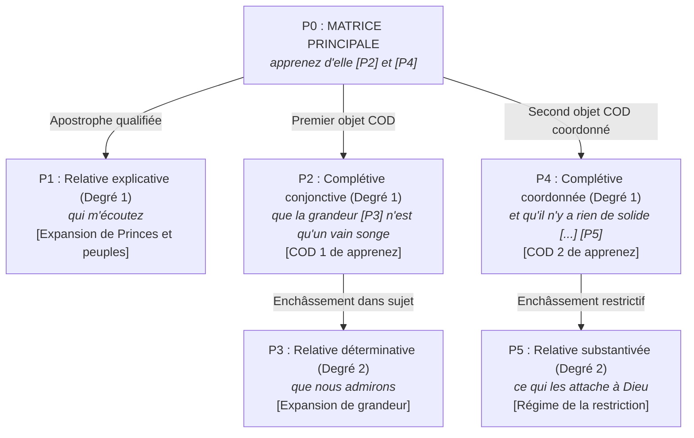

# Fiche Pédagogique Opérationnelle — Module MOD-301

> **Identifiant** : `MOD-301`  
> **Titre** : *Architecture de la Subordination : Complétives Conjonctives, Interrogatives Indirectes, Infinitives et Relatives Complexes*  
> **Semestre** : Année 2 — Semestre 3 (S3)  
> **Domaines mobilisés** : DOM-03 (Grammaire et analyse grammaticale), DOM-04 (Conjugaison et syntaxe)  
> **Volume horaire estimé** : 18 heures (Étude théorique : 5 h 30 | Pratique délibérée : 6 h 30 | Correction raisonnée : 3 h 30 | Révision active : 2 h 30)  
> **Statut** : [STATUT : PROPOSÉ — EN ATTENTE DE VALIDATION]  
> **Alignement** : [`syllabus.md` (S3)](file:///f:/Formation/world-class-french/03-curriculum/year-2/semester-3/syllabus.md), [`academic-structure.md`](file:///f:/Formation/world-class-french/01-architecture/academic-structure.md), [`dependency-graph.md`](file:///f:/Formation/world-class-french/01-architecture/dependency-graph.md), [`competency-framework.md`](file:///f:/Formation/world-class-french/02-competency-framework/competency-framework.md), [`source-registry.md`](file:///f:/Formation/world-class-french/07-resources/source-registry.md)

---

## 1. Présentation et Intérêt du Module

Le module `MOD-301` inaugure l'Année 2 et marque l'entrée décisive dans la **macro-syntaxe et l'architecture de la phrase complexe** [Réf. `SRC-NORM-03`, p. 44 ; `SRC-GRAM-02`, chap. 14]. Si le Semestre 2 a consolidé la prédication unitaire, la délimitation des syntagmes et l'intégration de la relative simple dans le groupe nominal (`MOD-201`), le Semestre 3 confronte l'apprenant à l'organisation hiérarchique d'énoncés multipropositionnels denses.

En français savant et littéraire, la pensée ne se déploie pas sous forme d'une juxtaposition d'énoncés courts, mais sous la forme de constructions arborescentes où des propositions viennent occuper les positions actancielles majeures (sujet, objet direct, complément prépositionnel) ou qualifier un actant avec une précision rigoureuse. Ce module a pour vocation :

1. D'établir la **définition formelle et linguistique de la subordination** : substituer à l'intuition floue la distinction rigoureuse entre la **matrice rectrice** (proposition principale gouvernante) et la **proposition régie** (proposition subordonnée enchâssée), en décrivant le mécanisme d'emboîtement à degrés multiples [Réf. `SRC-GRAM-02`, chap. 14] ;
2. D'analyser en profondeur les **propositions complétives conjonctives pures en *que*** :
   - Démontrer que la conjonction *que* est un morphème subordonnant pur, asémantique et sans fonction anaphorique, à l'opposé absolu du pronom relatif ;
   - Classifier les complétives selon leur position actancielle : complétives compléments d'objet direct (verbes de déclaration, d'opinion, de volonté, de sentiment), complétives sujets en tête de phrase (*Qu'il refuse est inacceptable*) ou extraposées sous recteur impersonnel (*Il est inacceptable qu'il refuse*), et complétives régies par des substantifs ou adjectifs ;
3. De disséquer le fonctionnement de l'**interrogation et de l'exclamation indirectes** :
   - Neutraliser le calque de l'interrogation directe en interdisant formellement l'inversion clitique sujet-verbe et la présence du point d'interrogation en fin de phrase déclarative ;
   - Recenser et manier avec exactitude les opérateurs interrogatifs (*si*, déterminants et pronoms *quel, qui, ce que, ce qui*, adverbes *pourquoi, comment, où, quand, combien*) ;
4. D'identifier le statut syntaxique singulier de la **proposition subordonnée infinitive** : reconnaître son existence formelle uniquement lorsqu'elle dispose d'un **sujet syntaxique propre**, distinct du sujet de la matrice rectrice (après verbes de perception et certains causatifs) [Réf. `SRC-GRAM-01`, § 1105 ; `SRC-GRAM-02`, chap. 14] ;
5. D'amener à une maîtrise experte des **propositions relatives complexes** :
   - Manier la flexion complète des pronoms relatifs composés (*lequel, laquelle, lesquels, lesquelles*) et de leurs amalgames prépositionnels (*auquel, duquel, auxquels, desquelles*) ;
   - Résoudre les ambiguïtés d'antécédent par les marques de genre et de nombre ;
   - Construire des syntagmes prépositionnels complexes régissant le pronom relatif (*au milieu desquels, à l'issue de laquelle, en vertu desquelles*) ;
6. D'éradiquer définitivement les **anacoluthes de construction**, les télescopages de subordonnants et les ruptures d'accord qui détruisent la clarté et l'élégance de la prose universitaire et professionnelle.

Ce module constitue le socle direct du module `MOD-302` (qui abordera les subordonnées circonstancielles, le subjonctif et la concordance des temps) et conditionne l'accès aux grandes périodes oratoires de l'Année 3 (`MOD-501`).

---

## 2. Place dans le Cursus

- **Position séquentielle** : Premier module d'enseignement de l'Année 2 / Semestre 3 (Semaines 2 à 4), succédant immédiatement à la semaine de réactivation active S3-S1.
- **Rôle architectural** : Goulet d'étranglement structural du Cycle 2 (Maîtrise et Perfectionnement).
- **Relations amont/aval** (d'après le graphe des dépendances [`dependency-graph.md`](file:///f:/Formation/world-class-french/01-architecture/dependency-graph.md#24-axe-syntaxe-complexe--rhétorique-de-la-phrase-simple-à-la-période-oratoire)) :
  - *En amont* :
    - `MOD-201` (**Prérequis indispensable / Hard Prerequisite [DEP-PRD-01]**) : la délimitation de la phrase simple, l'identification du sujet, du COD et du COI, ainsi que l'introduction à la relative simple constituent le socle sans lequel l'analyse de l'enchâssement produit des phrases sans verbe recteur ou des anacoluthes.
    - `MOD-202` : la maîtrise de la rection et de la ponctuation interne (démarcation logique).
  - *En aval* :
    - `MOD-302` (**Prérequis bloquant [DEP-VRB-02]**) : l'étude des subordonnées circonstancielles et la sélection modale (indicatif vs subjonctif) présupposent la délimitation exacte de la matrice rectrice et de la proposition régie acquise dans `MOD-301`.
    - `MOD-304` : la synthèse comparative de documents requiert une syntaxe dense articulant de multiples propositions sans rupture thématique.
    - `MOD-401` : le discours indirect libre et la polyphonie énonciative s'appuient sur l'interrogation indirecte et les complétives de déclaration.
    - `MOD-501` (**Horizon à long terme [DEP-PRD-02]**) : la construction de la période oratoire de Bossuet ou Chateaubriand (protase, acmé, apodose) mobilise l'empilement maîtrisé d'au moins trois degrés de subordination.

---

## 3. Prérequis et Diagnostic

### 3.1 Prérequis Exigibles
- Validation certifiée du Semestre 2 (Porte 2) avec une note supérieure ou égale à 14/20.
- Maîtrise éprouvée des fonctions de base dans la phrase simple : sujet, COD, COI, COS, attribut du sujet/COD [`MOD-201`].
- Maniement des 4 pronoms relatifs simples invariables (*qui, que, dont, où*) et distinction nette entre relative déterminative (restrictive) et relative explicative (appositive) [`MOD-201`].
- Règle d'or de la virgule : interdiction formelle de séparer par une virgule isolée le sujet du verbe ou le verbe de son COD [`MOD-202`].

### 3.2 Protocole Diagnostique d'Entrée (Semaine 2 — Durée : 40 minutes)
Le diagnostic initial soumet l'apprenant à quatre tests formels évaluant sa capacité à repérer la hiérarchie propositionnelle :

1. **Test de discrimination de la nature de *que*** :  
   Dans les phrases suivantes, indiquer si le mot *que* est un **pronom relatif**, une **conjonction de subordination** ou un **adverbe exclamatif/restrictif** :
   - *a)* *L'hypothèse que vous avancez semble recevable.*
   - *b)* *Il est évident que vous avancez sans précaution.*
   - *c)* *Que de temps perdu à hésiter !*
   - *d)* *Il ne formule que des objections fondées.*
2. **Test d'analyse d'interrogative indirecte** :  
   Transformer l'interrogation directe *« Pourquoi ces négociations ont-elles échoué ? »* en subordonnée régie par *« La commission d'enquête ignore... »*. Évaluer l'ordre des mots et la ponctuation finale.
3. **Test de l'infinitive avec sujet propre** :  
   Comparer *« Le magistrat ordonne de consigner les pièces »* et *« Le magistrat entend les témoins murmurer »*. Identifier dans quelle phrase se trouve une proposition subordonnée infinitive véritable et justifier par l'analyse actancielle.
4. **Test d'arbitrage de pronoms relatifs composés** :  
   Insérer le pronom composé adéquat : *« Il existe des règlements à l'observation [______] nul ne peut déroger. »*

*Seuil d'alerte* : Moins de 75 % de réponses valides impose un module de remédiation accélérée sur l'analyse de la phrase simple avant d'engager le Chapitre 2.

---

## 4. Objectifs Pédagogiques Mesurables

Au terme des 18 heures d'apprentissage, l'apprenant doit être capable de :

1. **Délimiter et étiqueter formellement** toute proposition subordonnée au sein d'une période complexe en identifiant son terme introducteur, sa proposition rectrice et son degré d'enchâssement (niveau 1, niveau 2, niveau 3) [Réf. `SRC-GRAM-02`, chap. 14].
2. **Distinguer sans hésitation** la conjonction de subordination complétive *que* (invariable, sans antécédent, sans fonction interne) du pronom relatif *que* (anaphorique, avec antécédent nominal, fonction COD dans la subordonnée) avec un taux de réussite de 100 %.
3. **Construire et analyser des complétives conjonctives** occupant les fonctions de COD, de sujet réel/apparent, de complément du nom (*la crainte qu'il ne parte*) ou de complément de l'adjectif (*fier qu'il ait réussi*).
4. **Transposer une interrogation directe en interrogation indirecte** sans commettre d'inversion fautive du sujet (*Je me demande où va Pierre* et non **Je me demande où va-t-il*) et sans point d'interrogation final erroné, en sélectionnant l'opérateur normé (*si*, *ce qui*, *ce que*, *pourquoi*).
5. **Démontrer la présence d'une proposition subordonnée infinitive** par le critère du sujet actanciel distinct régi par un verbe de perception ou causatif, et la différencier du simple syntagme verbal infinitif coréférentiel [Réf. `SRC-GRAM-01`, § 1105].
6. **Maniérer avec précision les pronoms relatifs composés** (*lequel, laquelle, lesquels, lesquelles*) sous toutes leurs formes fléchies et amalgamées (*auquel, duquel*), et construire des syntagmes prépositionnels complexes (*à l'abri desquels, au vu desquelles*).
7. **Détecter et corriger immédiatement** toute anacoluthe de construction (rupture de sujet, coordination asymétrique, télescopage de subordonnants, répétition fautive de *que* sans reprise par *et que*).
8. **Dresser l'arbre syntaxique complet** d'une phrase littéraire de 60 mots comportant au moins 4 propositions enchâssées.

---

## 5. Compétences Visées et Niveaux de Maîtrise Attendus

| Identifiant | Intitulé de la Compétence | Palier Entrée | Palier Cible MOD-301 | Preuve Observable Spécifique |
| :--- | :--- | :---: | :---: | :--- |
| [`FR-SYNTAX-002`](file:///f:/Formation/world-class-french/02-competency-framework/competency-framework.md#fr-syntax-002-architecture-de-la-subordination-complexe) | **Architecture de la subordination complexe** | L2 (Relative simple maîtrisée) | **L3 (Autonomie)** | Délimitation, hiérarchisation et étiquetage exacts de 4 propositions subordonnées enchâssées dans une phrase classique ; éradication totale des anacoluthes et ruptures d'enchâssement. |
| [`FR-INT-002`](file:///f:/Formation/world-class-french/02-competency-framework/competency-framework.md#fr-int-002-analyser-formellement-la-syntaxe-dune-phrase-complexe) | **Analyse syntaxique formelle intégrée** | L2 (Application guidée phrase simple) | **L2/L3 (Transition autonomie)** | Élaboration d'un schéma arborescent exhaustif d'une période de Bossuet ou Proust de 50 à 60 mots, précisant la valence de chaque verbe, la nature de chaque mot subordonnant et les fonctions internes. |

---

## 6. Plan Détaillé des Chapitres

```text
ARCHITECTURE PÉDAGOGIQUE DU MODULE MOD-301 (18 HEURES)
├── CHAPITRE 1 : THÉORIE DE LA SUBORDINATION ET DE L'ENCHÂSSEMENT (2 h 30)
│   ├── 1.1 Définition linguistique : matrice rectrice (principale) vs proposition subordonnée (régie).
│   ├── 1.2 La notion d'enchâssement (embedding) et les degrés de subordination (degré 1, 2, 3).
│   ├── 1.3 Typologie des termes subordonnants : conjonctions pures, pronoms relatifs, mots interrogatifs.
│   └── 1.4 La frontière syntaxique : pourquoi une proposition subordonnée assume la fonction d'un constituant de phrase.
├── CHAPITRE 2 : LES COMPLÉTIVES CONJONCTIVES PURES EN QUE (3 h 30)
│   ├── 2.1 Statut linguistique de la conjonction "que" : morphème vide vs anaphore pronominale.
│   ├── 2.2 Les complétives COD régies par des verbes :
│   │   ├── Verbes de déclaration et d'assertion (*dire, affirmer, certifier*).
│   │   ├── Verbes d'opinion et de croyance (*penser, croire, juger, estimer*).
│   │   └── Verbes de volonté, d'obligation et d'attente (*vouloir, exiger, souhaiter*).
│   ├── 2.3 Les complétives sujets :
│   │   ├── En position initiale canonique (*Qu'il refuse nous surprend*).
│   │   └── Extraposées sous recteur impersonnel neutre (*Il est capital que vous veniez*).
│   ├── 2.4 Complétives compléments de nom (*la preuve que...*) et d'adjectif (*sûr que...*).
│   └── 2.5 Règles de coordination des complétives : proscription de l'omission de "que" et reprise obligatoire par "et que".
├── CHAPITRE 3 : L'INTERROGATION ET L'EXCLAMATION INDIRECTES (3 h 00)
│   ├── 3.1 Statut syntaxique : proposition complétive interrogative régie par un verbe d'ignorance ou de demande.
│   ├── 3.2 L'interrogation indirecte totale : la conjonction "si" (interdiction formelle du conditionnel après *si* temporel/interrogatif vs hypothétique).
│   ├── 3.3 L'interrogation indirecte partielle et ses opérateurs :
│   │   ├── Pronoms et déterminants interrogatifs : *qui, que, ce qui, ce que, quel, lequel*.
│   │   └── Adverbes interrogatifs : *pourquoi, comment, où, quand, combien*.
│   ├── 3.4 Les deux interdits normatifs cardinaux :
│   │   ├── Proscription de l'inversion clitique sujet-verbe (*Je sais qui est venu* / *Je sais où va le train* mais non **Je sais où va-t-il*).
│   │   └── Proscription du point d'interrogation final lorsque la proposition rectrice est assertive.
│   └── 3.5 La proposition subordonnée exclamative indirecte (*Il admire comme elle est gracieuse ; il sait combien cela coûte*).
├── CHAPITRE 4 : LA PROPOSITION SUBORDONNÉE INFINITIVE VÉRITABLE (2 h 30)
│   ├── 4.1 Critère linguistique strict : la présence d'un sujet actanciel propre distinct de la matrice.
│   ├── 4.2 Les verbes recteurs de perception : *entendre, voir, écouter, sentir, regarder*.
│   ├── 4.3 Les verbes causatifs et factitifs : *laisser, faire, envoyer*.
│   ├── 4.4 Distinction capitale : proposition subordonnée infinitive vs syntagme verbal infinitif (Sujet coréférentiel).
│   └── 4.5 Pronominalisation et déplacement du sujet de l'infinitif (*Je vois les enfants courir* -> *Je les vois courir*).
├── CHAPITRE 5 : LES PROPOSITIONS RELATIVES COMPLEXES (3 h 30)
│   ├── 5.1 Morphologie des pronoms relatifs composés : *lequel, laquelle, lesquels, lesquelles*.
│   ├── 5.2 Les formes amalgamées avec prépositions : *auquel, duquel, auxquels, desquelles*.
│   ├── 5.3 Insertion dans des locutions prépositionnelles complexes (*au moyen duquel, à l'issue de laquelle, en vertu desquels*).
│   ├── 5.4 Levée des ambiguïtés sémantiques et désambiguïsation de l'antécédent grâce à l'accord en genre et en nombre.
│   └── 5.5 Syntaxe interne de la relative complexe : fonction du pronom composé (COI, complément du nom, complément circonstanciel).
└── CHAPITRE 6 : PATHOLOGIE SYNTAXIQUE : CHASSE AUX ANACOLUTHES ET RUPTURES D'ENCHÂSSEMENT (3 h 00)
    ├── 6.1 L'anacoluthe de construction : définition rhétorique vs faute de syntaxe universitaire.
    ├── 6.2 Les ruptures de sujet participial et infinitif (*En entrant dans la salle, le tableau m'a frappé*).
    ├── 6.3 Le télescopage de conjonctions et subordonnants non résolus.
    ├── 6.4 Les coordinations asymétriques (coordonner une complétive et un syntagme nominal).
    └── 6.5 Protocole méthodique de révision et de soudure syntaxique.
```

---

## 7. Concepts Fondamentaux et Notions Avancées

### 7.1 Concepts Fondamentaux

- **Matrice rectrice et proposition régie** :  
  Une phrase complexe n'est pas un alignement horizontal de propositions équivalentes. La **proposition rectrice** (ou matrice) constitue le sommet hiérarchique de l'énoncé. Elle gouverne une ou plusieurs **propositions régies** (subordonnées) qui viennent remplir auprès de son prédicat verbal ou de ses syntagmes nominaux une fonction analogue à celle d'un constituant ordinaire [Réf. `SRC-GRAM-02`, chap. 14 ; `SRC-NORM-03`, p. 44].
  
- **L'enchâssement (Embedding)** :  
  Processus syntaxique par lequel une proposition tout entière est insérée à l'intérieur d'une autre proposition pour en occuper une case fonctionnelle. L'enchâssement peut être récursif : une proposition subordonnée de degré 1 peut devenir la matrice rectrice d'une proposition subordonnée de degré 2, et ainsi de suite.

- **Conjonction pure (*que*) vs Pronom relatif anaphorique (*que*)** :  
  C'est la distinction cardinale de la syntaxe française :
  - La **conjonction de subordination complétive *que*** est un pur outil de liaison hiérarchique. Elle est dépourvue d'antécédent nominal, ne renvoie à aucun référent externe et n'assume **aucune fonction syntaxique interne** au sein de la subordonnée qu'elle introduit. Elle se contente d'indiquer la dépendance actancielle de la complétive par rapport au verbe régissant [Réf. `SRC-GRAM-01`, § 1060].
  - Le **pronom relatif *que*** est un substitut anaphorique. Il reprend un antécédent nominal ou pronominal de la matrice dont il hérite le genre et le nombre, et il assume **obligatoirement une fonction syntaxique interne propre** (toujours Complément d'Objet Direct) par rapport au verbe de la relative [Réf. `SRC-GRAM-01`, § 703].

- **L'interrogation indirecte** :  
  Structure de subordination où un acte de questionnement est rapporté sous la dépendance d'un verbe régissant exprimant l'ignorance, la recherche, le doute ou l'information (*ignorer, demander, chercher, savoir au négatif, examiner*). Elle se caractérise par la fermeture syntaxique de l'énoncé et la transposition des déictiques [Réf. `SRC-GRAM-02`, chap. 15].

### 7.2 Notions Avancées

- **Le statut syntaxique de la proposition subordonnée infinitive véritable** :  
  Tous les infinitifs ne forment pas une proposition subordonnée. La tradition grammaticale moderne réserve l'appellation de **proposition subordonnée infinitive** aux seules structures satisfaisant deux conditions cumulatives rigoureuses [Réf. `SRC-GRAM-01`, § 1105 ; `SRC-GRAM-02`, chap. 14] :
  1. Le verbe à l'infinitif doit posséder un **sujet syntaxique propre et explicite**, différent du sujet du verbe recteur ;
  2. Ce sujet ne doit pas être relié au verbe recteur par une préposition imposée par une rection d'objet indirect.
  
  *Exemple canonique* :  
  Dans *« J'entends les cloches sonner au loin »*, *J'entends* est le verbe recteur (sujet : *Je*). L'infinitif *sonner* a pour sujet actanciel explicite *les cloches*. L'ensemble *les cloches sonner au loin* forme une **proposition subordonnée infinitive**, complément d'objet direct global du verbe *entendre*.  
  *Contre-exemple absolu* :  
  Dans *« Le voyageur désire partir à l'aube »*, il n'y a pas de proposition infinitive : le sujet de *partir* est coréférentiel à celui de *désire* (*Le voyageur*). *Partir à l'aube* est simplement un **syntagme verbal infinitif (GVinf)** fonctionnant comme COD du verbe *désirer*.

- **Pronoms relatifs composés et syntagmes prépositionnels complexes** :  
  Lorsque la relation syntaxique interne requiert une préposition autre que *à* ou *de* simples (ou lorsque *de* est intégré dans une locution prépositionnelle), le pronom relatif invariable *dont* devient agrammatical. L'emploi des formes composées (*lequel, duquel, auquel*) s'impose alors de façon absolue [Réf. `SRC-GRAM-01`, § 710] :
  - *« Le traité en vertu duquel nous agissons »* (et non **dont nous agissons*) ;
  - *« La falaise au pied de laquelle s'étend la mer »* (et non **dont la mer s'étend au pied*).  
  De surcroît, le pronom composé permet de **désambiguïser l'antécédent** lorsque deux noms de genres ou nombres différents coexistent : dans *« J'ai consulté la secrétaire du directeur, laquelle m'a confirmé la décision »*, *laquelle* renvoie indiscutablement à *la secrétaire* (féminin singulier), dissipant l'équivoque que le pronom *qui* aurait laissée planer.

- **La reprise des complétives par "et que"** :  
  En français soutenu, lorsque deux propositions subordonnées complétives sont coordonnées par *et*, la conjonction de subordination *que* doit être **obligatoirement répétée** devant la seconde proposition. L'ellipse de la conjonction après le coordonnant constitue une faute de construction sanctionnée aux examens universitaires [Réf. `SRC-GRAM-01`, § 1063] :
  - *Correct* : *« Le procureur soutient que l'accusé a prémédité son acte et qu'il disposait de complices. »*
  - *Fautif* : *« *Le procureur soutient que l'accusé a prémédité son acte et disposait de complices. »* (Si le sujet est omis ou si la structure est asymétrique).

- **L'anacoluthe de sujet participial (Sujet fantôme)** :  
  L'anacoluthe est une rupture formelle du lien syntaxique régulier. L'erreur la plus fréquente en rédaction académique consiste à détacher en tête de phrase un participe présent, un gérondif ou un adjectif dont le sujet sous-entendu ne coïncide pas avec le sujet grammatical de la proposition principale [Réf. `SRC-GRAM-02`, chap. 14] :
  - *Énoncé fautif* : *« *En consultant les archives départementales, de nombreuses incohérences sont apparues au chercheur. »*  
    (Le sujet grammatical du verbe principal est *de nombreuses incohérences* ; or, ce ne sont pas les incohérences qui consultent les archives, mais le chercheur !)
  - *Rectification normée* : *« En consultant les archives départementales, le chercheur a décelé de nombreuses incohérences. »* (Le sujet du gérondif est parfaitement coréférentiel au sujet grammatical de la principale).

---

## 8. Erreurs et Confusions Fréquentes

| Forme fautive ou analyse erronée | Analyse linguistique de la faille cognitive | Forme correcte et justification | Source de référence |
| :--- | :--- | :--- | :--- |
| *« Je me demande où va-t-il ? »* ou *« Dis-moi quelle heure est-il. »* | Calque mécanique de l'interrogation directe. L'apprenant maintient l'inversion clitique du pronom et le point d'interrogation dans une subordonnée régie. | *« Je me demande où il va. »* / *« Dis-moi quelle heure il est. »* Dans l'interrogation indirecte, l'ordre des mots redevient canonique (Sujet + Verbe) ; le point final est déterminé par la phrase matrice (point simple si la matrice est déclarative ou impérative). | [Réf. `SRC-GRAM-01`, § 1108 ; `SRC-NORM-03`, p. 46] |
| *« C'est un principe que j'ai toujours cru qu'il était indispensable. »* | Rupture d'enchâssement et redondance pronominale fautive. Télescopage entre une proposition relative en *que* et une complétive en *que*. | *« C'est un principe que j'ai toujours cru indispensable »* (avec attribut du COD) ou *« C'est un principe dont j'ai toujours cru qu'il était indispensable »*. | [Réf. `SRC-GRAM-01`, § 710 ; `SRC-GRAM-02`, chap. 16] |
| *« Le ministre affirme qu'il viendra et présentera son plan. »* (avec rupture de construction) | Omission fautive de la conjonction *que* après le coordonnant lors de la coordination de deux complétives dépendant du même verbe recteur. | *« Le ministre affirme qu'il viendra et qu'il présentera son plan. »* La répétition de *que* est obligatoire pour gouverner la seconde proposition subordonnée complétive. | [Réf. `SRC-GRAM-01`, § 1063] |
| *« La décision que vous m'avez parlé »* ou *« Le dossier auquel je m'intéresse dont vous connaissez »* | Confusion totale des pronoms relatifs simples et composés sous l'effet d'une méconnaissance de la rection verbale interne. | *« La décision dont vous m'avez parlé »* (*parler de* régit *dont*) ; *« Le dossier auquel je m'intéresse et que vous connaissez »*. | [Réf. `SRC-GRAM-01`, § 704-712] |
| *« Le bâtiment au milieu dont nous nous trouvons »* | Emploi erroné du pronom invariable *dont* à l'intérieur d'un syntagme prépositionnel complexe. *Dont* ne peut jamais être régi par une locution prépositionnelle. | *« Le bâtiment au milieu duquel nous nous trouvons »*. Les locutions prépositionnelles composées (*au milieu de, à l'issue de, en vertu de*) exigent impérativement le pronom composé fléchi. | [Réf. `SRC-GRAM-01`, § 708] |
| *« En arrivant au sommet, la vue était magnifique. »* | Anacoluthe de construction : le participe présent/gérondif en tête de phrase est privé de son sujet logique, car le sujet syntaxique de la principale est *la vue*. | *« Quand nous sommes arrivés au sommet, la vue était magnifique »* ou *« En arrivant au sommet, les randonneurs ont contemplé une vue magnifique »*. | [Réf. `SRC-GRAM-02`, chap. 14] |
| Dans *« La certitude que tu viendras me rassure »*, qualifier *que tu viendras* de proposition subordonnée relative. | Confusion entre *que* pronom relatif et *que* conjonction complétive du nom. L'apprenant voit un substantif (*certitude*) et conclut automatiquement à une relative. | *Que tu viendras* est une **complétive du nom**. Test formel : *que* n'a aucune fonction interne dans la subordonnée (*tu viendras* est complet, sans COD vacant) ; on ne peut pas remplacer *que* par *laquelle*. | [Réf. `SRC-GRAM-02`, chap. 14 ; `SRC-NORM-03`, p. 45] |

---

## 9. Exemples Progressifs

### 9.1 Niveau Simple (Structures Canoniques Bipropositionnelles)

- **Complétive conjonctive COD canonique** :  
  *« L'ambassadeur annonce que le traité sera signé demain matin. »*  
  - Matrice rectrice : *L'ambassadeur annonce [quelque chose]* (Verbe transitif direct de déclaration).  
  - Subordonnée régie : *que le traité sera signé demain matin* (Proposition subordonnée complétive conjonctive, COD de *annonce*).  
  - Mot subordonnant : *que* (Conjonction de subordination pure, morphème vide, sans fonction interne).

- **Complétive sujet extraposée avec impersonnel** :  
  *« Il importe que chacun garde son calme. »*  
  - Matrice : *Il importe* (Verbe unipersonnel/impersonnel).  
  - Subordonnée : *que chacun garde son calme* (Proposition subordonnée complétive, sujet réel ou séquence postposée de *importe*).

- **Interrogation indirecte totale en *si*** :  
  *« Le conseil examine si la séance doit être ajournée. »*  
  - Matrice : *Le conseil examine [quelque chose]*.  
  - Subordonnée : *si la séance doit être ajournée* (Proposition subordonnée interrogative indirecte totale, COD de *examine*).  
  - Mot subordonnant : *si* (Conjonction de subordination interrogative). Ponctuation : point final simple.

- **Relative complexe simple à pronom composé** :  
  *« Voici la clause en vertu de laquelle le contrat est résilié. »*  
  - Matrice : *Voici la clause*.  
  - Subordonnée : *en vertu de laquelle le contrat est résilié* (Proposition subordonnée relative, expansion de l'antécédent nominal *clause*).  
  - Pronom relatif composé : *de laquelle* (Féminin singulier accordé avec *clause*, intégré dans la locution prépositionnelle *en vertu de*, fonction interne : complément circonstanciel de cause de *est résilié*).

---

### 9.2 Niveau Intermédiaire (Enchâssement à Deux Degrés et Subordonnée Infinitive)

- **Subordonnée infinitive véritable vs complétive** :  
  *« Du haut du balcon, nous regardions la foule s'amasser sur l'esplanade. »*  
  - Matrice : *Du haut du balcon, nous regardions [quelque chose]* (Sujet : *nous*, Verbe : *regardions*).  
  - Subordonnée régie : *la foule s'amasser sur l'esplanade* (Proposition subordonnée infinitive, COD global de *regardions*).  
  - Analyse interne : l'infinitif *s'amasser* a son sujet actanciel propre explicite : *la foule* (distinct de *nous*).

- **Complétive régie par un nom abstrait (Complétive du nom)** :  
  *« Le général nourrissait l'espoir secret que les renforts arriveraient avant la nuit. »*  
  - Matrice : *Le général nourrissait l'espoir secret*.  
  - Subordonnée régie : *que les renforts arriveraient avant la nuit* (Proposition subordonnée complétive du nom, complément du substantif *espoir*).  
  - *Preuve distributionnelle* : *que* est une conjonction pure (*arriveraient* est intransitif, *les renforts* est sujet ; *que* n'a aucune fonction interne, la proposition n'est pas une relative).

- **Enchâssement à deux degrés (Matrice -> Complétive -> Relative complexe)** :  
  *« Le magistrat a reconnu que les dossiers au sujet desquels le public s'interroge contiennent des pièces confidentielles. »*  
  - **Degré 0 (Matrice)** : *Le magistrat a reconnu [P1]*.  
  - **Degré 1 (Complétive)** : *que les dossiers [...] contiennent des pièces confidentielles* (COD du verbe *a reconnu*).  
  - **Degré 2 (Relative complexe)** : *au sujet desquels le public s'interroge* (Proposition subordonnée relative enchâssée dans la complétive, expansion du nom sujet *dossiers*).  
  - *Analyse du pronom* : *desquels* (masculin pluriel, accordé avec *dossiers*, régime de la locution prépositionnelle *au sujet de*, fonction interne : COI de *s'interroge*).

---

### 9.3 Niveau Complexe (Analyse Arborescente Intégrale d'une Période Littéraire)

Examinons la célèbre période de **Bossuet** (*Oraison funèbre d'Henriette-Anne d'Angleterre*, 1670) :

> *« Princes et peuples, qui m'écoutez, apprenez d'elle que la grandeur que nous admirons n'est qu'un vain songe, et qu'il n'y a rien de solide parmi les hommes que ce qui les attache à Dieu. »*

#### Découpage Propositionnel et Hiérarchie des Enchâssements :

```text
P0 [MATRICE IMPÉRATIVE] : « [Princes et peuples] apprenez d'elle [P2] et [P4] »
├── P1 [SUBORDONNÉE RELATIVE - Degré 1] : « qui m'écoutez »
│   └── Antécédent : « Princes et peuples » (Apostrophe / Vocatif)
│   └── Pronom relatif : « qui » (Sujet interne de « écoutez »)
│   └── Fonction de P1 : Expansion du nom antécédent (relative explicative)
│
├── P2 [SUBORDONNÉE COMPLÉTIVE CONJONCTIVE - Degré 1] : « que la grandeur [P3] n'est qu'un vain songe »
│   └── Verbe recteur : « apprenez » (P0)
│   └── Mot subordonnant : « que » (Conjonction de subordination pure)
│   └── Fonction de P2 : Premier COD coordonné du verbe « apprenez »
│   │
│   └── P3 [SUBORDONNÉE RELATIVE - Degré 2] : « que nous admirons »
│       └── Antécédent : « la grandeur » (Sujet de P2)
│       └── Pronom relatif : « que » (COD interne du verbe « admirons »)
│       └── Fonction de P3 : Expansion déterminative du nom « grandeur »
│
└── P4 [SUBORDONNÉE COMPLÉTIVE CONJONCTIVE COORDONNÉE - Degré 1] : « et qu'il n'y a rien de solide parmi les hommes [P5] »
    └── Verbe recteur : « apprenez » (P0)
    └── Connecteurs : « et » (coordination) + « que » (reprise obligatoire de la conjonction)
    └── Fonction de P4 : Second COD coordonné du verbe « apprenez »
    │
    └── P5 [SUBORDONNÉE RELATIVE SUBSTANTIVÉE À VALEUR RESTRICTIVE - Degré 2] : « que ce qui les attache à Dieu »
        └── Mot d'amorce : « que » (adverbe restrictif corrélé à « rien »)
        └── Proposition : « ce qui les attache à Dieu » (Relative sans antécédent nominal plein, pronom démonstratif neutre « ce » support du relatif sujet « qui »)
```

#### Schéma Arborescent Textuel (Mermaid) :



---

## 10. Activités d'Observation et de Découverte

### Activité 1 : Le Détecteur Formel « Que Conjonctif » vs « Que Relatif »
- **Objectif** : Établir une procédure de décision algorithmique pour ne plus jamais confondre conjonction et pronom relatif.
- **Corpus d'étude** (5 énoncés authentiques) :
  1. *L'ordre que le préfet a signé suspend toutes les manifestations.*
  2. *Le préfet a ordonné que toutes les manifestations soient suspendues.*
  3. *L'assurance que le préfet a donnée a rassuré les organisateurs.*
  4. *L'assurance que toutes les manifestations seraient protégées a été confirmée.*
  5. *Il n'est pas douteux que la réunion aura lieu.*
- **Protocole d'investigation** :
  L'apprenant applique la grille de test à 3 critères :
  - *Critère 1 (Présence d'un antécédent)* : Le mot *que* est-il immédiatement précédé d'un nom dont il reprend le contenu ? (Si non $\rightarrow$ Conjonction).
  - *Critère 2 (Complétude de la subordonnée)* : Si l'on isole la subordonnée en retirant le mot *que*, manque-t-il un actant (COD) au verbe subordonné ? (Si oui $\rightarrow$ *Que* comble ce vide, donc Pronom relatif).
  - *Critère 3 (Commutation avec lequel/laquelle)* : Peut-on substituer *lequel/laquelle* à *que* sans détruire la phrase ? (Si oui $\rightarrow$ Pronom relatif ; si impossible $\rightarrow$ Conjonction).
- **Synthèse rédigée** : Les phrases 1 et 3 comportent un **pronom relatif** (*que* COD de *a signé* et *a donnée*) ; les phrases 2, 4 et 5 comportent une **conjonction complétive** (phrase 2 : COD de *ordonné* ; phrase 4 : complétive du nom *assurance* ; phrase 5 : sujet réel extraposé de *n'est pas douteux*).

---

### Activité 2 : Le Laboratoire de l'Interrogation Indirecte
- **Objectif** : Identifier et déconstruire les trois erreurs spontanées commises lors du passage au discours indirect.
- **Exercice de détection** : Examiner ces 4 énoncés issus de rédactions d'étudiants :
  - *Énoncé A* : *Je voudrais savoir pourquoi avez-vous pris cette décision ?*
  - *Énoncé B* : *Le président demande si nous pourrions voter immédiatement.*
  - *Énoncé C* : *La commission ignore qu'est-ce qui a provoqué l'accident.*
  - *Énoncé D* : *Expliquez-moi comment vous comptez procéder.*
- **Tâche** :
  1. Identifier les anomalies normatives dans A, B et C.
  2. Corriger en formulant la règle savante violée :
     - Dans A : double faute (inversion clitique *avez-vous* + point d'interrogation final sous recteur affirmatif). Rectification : *« Je voudrais savoir pourquoi vous avez pris cette décision. »*
     - Dans B : confusion de temps/mode après *si* interrogatif (emploi abusif du conditionnel au lieu du présent ou futur de l'indicatif : *« si nous pouvons voter »*).
     - Dans C : emploi du tour familier direct *qu'est-ce qui* au lieu de l'opérateur indirect normé *ce qui* : *« La commission ignore ce qui a provoqué l'accident. »*
     - Constater que D est parfaitement irréprochable.

---

### Activité 3 : La Traque de l'Anacoluthe
- **Objectif** : Développer une sensibilité immédiate à la rupture du fil syntaxique.
- **Mise en situation** : Soit l'extrait suivant :  
  *« Ayant achevé la rédaction de son mémoire, la soutenance fut fixée au mois de juin par le jury. »*  
  - Pourquoi cette phrase fait-elle bondir un jury d'agrégation ou de concours administratif ?  
  - Quel est le sujet grammatical de la proposition principale ? (*la soutenance*).  
  - Qui a achevé la rédaction du mémoire ? Est-ce la soutenance ? Non, c'est l'étudiant !  
  - *Formulation de la loi* : **Le sujet d'une proposition participiale ou d'un participe détaché en tête de phrase doit impérativement être identique au sujet grammatical du verbe principal.**  
  - *Correction* : *« Ayant achevé la rédaction de son mémoire, l'étudiant a vu sa soutenance fixée au mois de juin par le jury »* ou *« Lorsque l'étudiant eut achevé la rédaction de son mémoire, la soutenance fut fixée [...] »*.

---

## 11. Exercices Progressifs (3 Niveaux)

### Niveau 1 : Consolidation et Discrimination Morphosyntaxique (6 Exercices)

1. **Identification de la nature de *que*** :  
   Dans 10 phrases fournies, étiqueter chaque occurrence de *que* : pronom relatif (indiquer la fonction interne et l'antécédent), conjonction de subordination complétive (indiquer le verbe recteur et la fonction de la complétive), ou adverbe/béquille de négation.
2. **Transformation en interrogation indirecte** :  
   Transposer 8 interrogations directes en subordonnées régies par *« Le conseil cherche à comprendre... »* ou *« Nous ignorons... »* :
   - *« Combien de membres ont voté contre le projet ? »*
   - *« À quel moment précis l'alerte a-t-elle été donnée ? »*
   - *« Qu'est-ce qui justifie de tels délais ? »* $\rightarrow$ *« Nous ignorons ce qui justifie... »*
3. **Accord du pronom relatif composé** :  
   Remplacer les pointillés par la forme fléchie exacte de *lequel* (*auquel, duquel, pour lesquelles*, etc.) :
   - *« Les dispositions législatives en application [______] nous statuons sont caduques. »* (*desquelles*)
   - *« Le décret et l'ordonnance ministérielle à la lumière [______] les faits ont été jugés. »* (*desquels*)
4. **Détection du sujet de l'infinitif** :  
   Indiquer pour chaque phrase si elle contient une proposition subordonnée infinitive véritable ou un simple syntagme verbal infinitif :
   - *a) Nous avons vu les troupes évacuer la forteresse.* (Infinitive : sujet *les troupes* distinct de *nous*).
   - *b) Les troupes voulaient évacuer la forteresse.* (Syntagme verbal infinitif coréférentiel).
   - *c) Le directeur écoute la sonnerie retentir dans la cour.* (Infinitive).
   - *d) Le directeur promet d'écouter les doléances.* (Syntagme verbal infinitif).
5. **Complétive sujet vs Complétive COD** :  
   Transformer 5 complétives COD en complétives sujets en tête de phrase, puis en complétives extraposées sous recteur impersonnel :
   - *« Tout le monde constate que la situation empire. »*  
     $\rightarrow$ *« Que la situation empire crève les yeux. »*  
     $\rightarrow$ *« Il est évident que la situation empire. »*
6. **Ponctuation et démarcation** :  
   Rétablir la ponctuation exacte (virgules, point final) dans 6 phrases complexes comportant des interrogatives indirectes et des complétives, en éliminant les points d'interrogation et virgules fautifs.

---

### Niveau 2 : Entraînement et Maîtrise des Enchâssements Multiples (6 Exercices)

1. **Reprise par "et que" et coordination de subordonnées** :  
   Réécrire 6 phrases comportant des coordinations de complétives défectueuses en appliquant rigoureusement la répétition de *que* et la concordance des modes :
   - *« Il certifie qu'il a déposé le brevet à temps et le document est authentique. »*  
     $\rightarrow$ *« Il certifie qu'il a déposé le brevet à temps et que le document est authentique. »*
2. **Construction avec syntagmes prépositionnels complexes** :  
   Relier deux phrases indépendantes en une phrase complexe en employant une locution prépositionnelle suivie d'un pronom relatif composé (*au moyen duquel, à l'issue de laquelle, en considération de quoi*) :
   - *Proposition A : Le gouvernement a promulgué une loi exceptionnelle.*  
   - *Proposition B : En vertu de cette loi exceptionnelle, les pouvoirs de police sont élargis.*  
   $\rightarrow$ *« Le gouvernement a promulgué une loi exceptionnelle en vertu de laquelle les pouvoirs de police sont élargis. »*
3. **Éradication des télescopages de subordonnants** :  
   Restructurer 5 phrases alambiquées présentant un télescopage agrammatical (*« C'est une affaire que quand on l'examine on s'aperçoit que... »* $\rightarrow$ *« L'examen de cette affaire révèle que... »* ou *« C'est une affaire dont l'examen révèle que... »*).
4. **Correction chirurgicale d'anacoluthes de concours** :  
   Identifier la rupture de construction dans 5 phrases d'annales et proposer deux réécritures normées (l'une en conservant le gérondif/participe et en modifiant le sujet principal, l'autre par une subordonnée circonstancielle temporelle).
5. **Hiérarchisation d'enchâssement à 3 propositions** :  
   À partir de trois propositions simples données, rédiger une phrase complexe unique respectant un schéma de dépendance prescrit : Matrice $\rightarrow$ Complétive COD $\rightarrow$ Relative complexe $\rightarrow$ Complétive de nom.
6. **Désambiguïsation d'antécédent** :  
   À l'aide des pronoms composés *lequel, laquelle, lesquels, lesquelles*, réécrire des phrases ambiguës pour orienter expressément la référence anaphorique :
   - *« J'ai rencontré l'avocat de la plaignante qui paraissait très troublé. »* (Rendre indiscutable le fait que c'est la plaignante qui est troublée $\rightarrow$ *« ... de la plaignante, laquelle paraissait très troublée »*).

---

### Niveau 3 : Approfondissement et Épreuves de Concours (4 Exercices)

1. **Dissection syntaxique de texte classique (Corneille / Pascal)** :  
   Isoler et analyser toutes les propositions subordonnées dans une réplique de *Cinna* ou un fragment des *Pensées*. Remplir un tableau synoptique précisant : proposition délimitée, verbe recteur, nature formelle du terme subordonnant, fonction syntaxique globale et fonction interne.
2. **Analyse arborescente intégrale d'une période proustienne** :  
   Soit une phrase de 65 mots extraite de *Du côté de chez Swann*. Établir l'arbre syntaxique hiérarchisé de la phrase, justifier chaque niveau d'enchâssement et caractériser les éventuelles incises.
3. **Épreuve de correction éditoriale sous contrainte de temps (30 minutes)** :  
   Corriger un texte juridique fictif de 350 mots truffé de 12 fautes de subordination (inversion dans l'interrogative indirecte, anacoluthes, *auquel* au mauvais genre, absence de répétition de *que*, *dont* après locution prépositionnelle). Justifier chaque intervention en citant le paragraphe du *Bon Usage* ou de la *Grammaire méthodique*.
4. **Composition stylistique sous contrainte architecturale** :  
   Rédiger un paragraphe argumentatif soutenu de 150 mots composé d'une unique période oratoire intégrant : une matrice principale déclarative, deux complétives coordonnées reprises par *et que*, une subordonnée relative complexe introduite par *au terme desquels*, et une subordonnée infinitive de perception.

---

## 12. Ateliers de Correction et de Révision

### Atelier 1 : La Clinique des Anacoluthes et des Ruptures Syntaxiques (Durée : 1 h 45)
- **Modalité pédagogique** : Travail en binôme sur un corpus de 15 phrases fautives extraites de copies de concours universitaires.
- **Protocole d'intervention en 4 étapes** :
  1. *Étape 1 (Diagnostic actanciel)* : Identifier le sujet réel du constituant initial détaché (participe, gérondif, infinitif, adjectif).
  2. *Étape 2 (Vérification du pivot)* : Relever le sujet grammatical du verbe principal.
  3. *Étape 3 (Constat de conformité)* : Établir l'adéquation ou l'hétérogénéité des deux sujets.
  4. *Étape 4 (Soudure syntaxique)* : Proposer une reformulation élégante rétablissant l'alignement actanciel sans alourdir la phrase.

### Atelier 2 : Le Banc d'Essai de l'Interrogation et de l'Exclamation Indirectes (Durée : 1 h 45)
- **Modalité pédagogique** : Exercice de rétro-traduction et de transposition simultanée.
- **Dispositif** : L'enseignant projette 10 questions directes de rhétorique parlementaire ou judiciaire. L'apprenant doit instantanément insérer ces questions sous la régie de verbes matrices variés (*se demander, ignorer, ne pas concevoir, chercher à établir, mesurer*), en appliquant les trois verrous de sécurité :
  - Verrou 1 : Ordre Sujet-Verbe strict (zéro inversion pronominale clitique).
  - Verrou 2 : Neutralisation du point d'interrogation.
  - Verrou 3 : Sélection du mot interrogatif soutenu (*ce qui / ce que* en lieu et place de *qu'est-ce qui / qu'est-ce que*).

---

## 13. Production Intégratrice

### Épreuve de Production Intégrative : Dissection et Modélisation Arborescente d'une Grande Période Classique

- **Intitulé de l'épreuve** : *Analyse syntaxique exhaustive et cartographie arborescente d'une période de Bossuet (62 mots, 4 degrés d'enchâssement).*
- **Consigne** :  
  L'apprenant reçoit le texte suivant, extrait de l'*Oraison funèbre de Louis de Bourbon, prince de Condé* (1687) de Jacques-Bénigne Bossuet :

> *« Quand nous voyons ce grand capitaine examiner avec tant de soin les desseins secrets des ennemis, dont il prévoyait les démarches, nous devons reconnaître que la prudence que le ciel lui avait départie surpassait encore cette intrépidité héroïque par laquelle il s'était rendu célèbre dans toute l'Europe. »*

#### Livrables obligatoires exigés de l'apprenant :

1. **Tableau analytique de délimitation propositionnelle** :  
   Pour chacune des 6 propositions constitutives de la période :
   - Délimitation exacte (crochets et bornes de texte) ;
   - Qualification statutaire : Matrice rectrice principale, Subordonnée complétive, Subordonnée relative, Subordonnée circonstancielle, ou Subordonnée infinitive ;
   - Terme subordonnant introducteur : identification de sa nature catégorielle exacte (conjonction pure, pronom relatif simple, pronom relatif composé, adverbe) ;
   - Proposition immédiatement rectrice dont elle dépend (degré 0, 1, 2 ou 3) ;
   - Fonction syntaxique assumée par la proposition au sein de la matrice.

2. **Analyse micro-syntaxique des termes subordonnants et fonctions internes** :
   - Analyser le statut de la séquence *« ce grand capitaine examiner avec tant de soin les desseins secrets »* : démontrer s'il s'agit d'une subordonnée infinitive ou d'un syntagme verbal infinitif régulier, et expliciter la fonction de *ce grand capitaine* ;
   - Analyser la fonction interne de *dont* par rapport à *prévoyait* ;
   - Analyser le statut de *que* dans *« que la prudence [...] surpassait »* vs *« que le ciel lui avait départie »* ;
   - Analyser la forme composée *par laquelle* : genre, nombre, antécédent, et fonction interne au sein de la proposition finale.

3. **Représentation graphique arborescente normée** :  
   Produire le schéma arborescent complet (en diagramme arborescent ou format textuel indenté conforme) reliant chaque proposition régie à sa matrice rectrice avec l'étiquetage des fonctions.

---

## 14. Évaluation et Barème

L'évaluation sommative terminale du module `MOD-301` est notée sur **20 points**. Conformément au niveau d'exigence du cursus World-Class French, le seuil de validation minimale sans obligation de remédiation est fixé à **14/20 (70 %)**. Toute note inférieure à 14/20 impose un sas de remédiation obligatoire de 10 jours avant de pouvoir aborder `MOD-302`.

### Grille d'Évaluation Sommative Normée

| Composante de l'épreuve | Critères d'évaluation précis | Barème | Seuil éliminatoire |
| :--- | :--- | :---: | :---: |
| **Partie 1 : Maîtrise théorique et discrimination formelle (6 questions)** | • Distinction infaillible *que* conjonctif vs *que* relatif (2 pts)<br/>• Critères de la proposition infinitive véritable (1,5 pt)<br/>• Typologie des interrogatives indirectes et règles d'ordre des mots (1,5 pt)<br/>• Rection des pronoms relatifs composés (1 pt)<br/>*Pénalité* : -0,5 pt par confusion nature/fonction. | **/ 6 points** | $< 4/6$ |
| **Partie 2 : Exercices d'application et rectification chirurgicale (5 questions)** | • Transposition irréprochable en interrogation indirecte (1,5 pt)<br/>• Répétition obligatoire de *que* et coordination (1 pt)<br/>• Éradication d'anacoluthes de construction (1,5 pt)<br/>• Accord et insertion de pronoms relatifs composés dans locutions prépositionnelles (1 pt) | **/ 5 points** | $< 3,5/5$ |
| **Partie 3 : Production intégratrice (Analyse de la période classique)** | • Découpage exact des 6 propositions sans omission ni chevauchement (2 pts)<br/>• Tableau d'analyse des dépendances et fonctions (3 pts)<br/>• Justification micro-syntaxique des subordonnants et fonctions internes (2 pts)<br/>• Schéma arborescent hiérarchisé conforme (2 pts) | **/ 9 points** | $< 6,5/9$ |
| **TOTAL GÉNÉRAL** | **Note globale sommative sur le module MOD-301** | **/ 20 points** | **Note éliminatoire < 14/20** |

---

## 15. Critères de Maîtrise (Palier L3 Autonomie)

La compétence [`FR-SYNTAX-002`](file:///f:/Formation/world-class-french/02-competency-framework/competency-framework.md#fr-syntax-002-architecture-de-la-subordination-complexe) est officiellement certifiée au palier **L3 (Autonomie)** lorsque l'apprenant démontre de manière constante les comportements observables suivants :

- **Rigueur architecturale infaillible** : Face à une phrase de plus de 50 mots, il identifie immédiatement le verbe principal de la matrice rectrice et ne produit jamais de phrase bancale privée de proposition principale.
- **Zéro anacoluthe** : Il contrôle systématiquement le sujet logique des participes présents, gérondifs et infinitifs détachés en tête de phrase pour s'assurer de leur stricte identité avec le sujet de la proposition principale.
- **Maîtrise absolue du discours indirect** : Il ne laisse subsister aucune inversion clitique (*où va-t-il*) ni aucun point d'interrogation fautif dans une subordonnée interrogative indirecte.
- **Distinction catégorielle immédiate** : Il distingue sans hésiter une complétive du nom (*la certitude qu'il viendra*) d'une proposition relative (*la certitude qu'il a exprimée*), et justifie cette distinction par la présence ou l'absence d'une fonction interne assumée par le connecteur.
- **Maniement aisé des pronoms relatifs composés** : Il sélectionne instantanément la forme fléchie exacte (*auxquelles, duquel, à l'égard de laquelle*) et sait mobiliser le pronom composé pour lever une équivoque d'antécédent.
- **Répétition ordonnée des subordonnants** : Il applique réflexivement la répétition de la conjonction *que* lors de la coordination de propositions complétives.

---

## 16. Révisions Espacées Recommandées

Pour ancrer de façon pérenne l'automatisation de l'analyse hiérarchique et la prophylaxie des anacoluthes, le protocole suivant de répétition espacée (*spaced retrieval*) est programmé :

```text
CALENDRIER DES RÉVISIONS ESPACÉES (SPACED RETRIEVAL)
├── J+3 après le module : Test flash de 10 min sur la discrimination "que" conjonctif vs relatif (10 phrases).
├── J+8 : Drill de 15 min de transposition en interrogation indirecte et maniement de "lequel / auquel / duquel".
├── J+20 : Réactivation intensive dans le cadre de MOD-302 (Sélection indicatif vs subjonctif dans les complétives).
├── J+40 : Atelier d'intégration dans MOD-304 (Vérification de l'absence totale d'anacoluthes dans les synthèses rédigées).
├── Semaine 7 : Évaluation sommative de mi-parcours S3 (Analyse d'une période de 3 propositions sous contrainte de temps).
├── Semaine 13 : Révision cumulative pré-Porte 3 (Dissection de phrases complexes et accords pronominaux).
└── Semestre 4 (J+120) : Réactivation dans MOD-401 (Discours indirect libre et subordination polyphonique).
```

---

## 17. Sources de Référence Vérifiées

Toutes les définitions linguistiques, règles de rection, analyses de subordination et principes d'analyse arborescente exposés dans ce module reposent exclusivement sur les ouvrages savants et cadres institutionnels faisant autorité :

1. **Grevisse, Maurice & Goosse, André (2016)**. *Le Bon Usage* (16e éd.). Bruxelles : De Boeck Supérieur [Réf. `SRC-GRAM-01`].  
   - Les propositions subordonnées complétives conjonctives en *que* (§ 1060 à § 1075) ;  
   - Les propositions interrogatives et exclamatives indirectes (§ 1106 à § 1110) ;  
   - La proposition subordonnée infinitive et ses critères définitoires (§ 1105) ;  
   - Les pronoms relatifs composés *lequel, auquel, duquel* et l'accord avec l'antécédent (§ 708 à § 715) ;  
   - L'anacoluthe et les ruptures d'enchâssement syntaxique (§ 312 et § 1063).

2. **Riegel, Martin, Pellat, Jean-Christophe & Rioul, René (2016)**. *Grammaire méthodique du français*. Paris : PUF, coll. « Quadrige » [Réf. `SRC-GRAM-02`].  
   - Chapitre 14 : La phrase complexe et les propositions subordonnées complétives (complétives COD, complétives sujets, complétives du nom et de l'adjectif, propositions infinitives) ;  
   - Chapitre 15 : L'interrogation indirecte totale et partielle et l'exclamation indirecte ;  
   - Chapitre 16 : La proposition subordonnée relative : pronoms relatifs simples et composés, syntaxe interne et fonctions.

3. **Ministère de l'Éducation nationale (2020)**. *Terminologie grammaticale*. Paris : Réseau Canopé [Réf. `SRC-NORM-03`].  
   - Cadre normatif officiel de la phrase complexe : matrice, proposition principale, proposition subordonnée régie (p. 44-48) ;  
   - La proposition subordonnée complétive conjonctive et ses fonctions actancielles (p. 44-46) ;  
   - L'interrogation indirecte et l'absence d'inversion clitique (p. 46-47) ;  
   - La subordonnée relative complexe et le pronom composé (p. 48-51).

4. **Imprimerie nationale (2002)**. *Lexique des règles typographiques en usage à l'Imprimerie nationale*. Paris : Imprimerie nationale [Réf. `SRC-TYPO-01`].  
   - Règles de ponctuation de l'interrogation indirecte : interdiction absolue du point d'interrogation lorsque la matrice est assertive ou injonctive (p. 143).

---

## 18. Liens avec les Modules Précédents et Suivants

```mermaid
flowchart TD
    subgraph Semestre 2 [Semestre 2 : Socle de la Phrase Simple]
        MOD201["<b>MOD-201</b><br/>Syntaxe Fonctionnelle de la Phrase Simple<br/>& Relative Simple (*qui, que, dont, où*)"]
        MOD202["<b>MOD-202</b><br/>Participe Passé avec Avoir<br/>& Ponctuation Interne Démarcative"]
    end

    subgraph Semestre 3 [Semestre 3 : Architecture de la Subordination]
        MOD301["<b>MOD-301</b><br/>Architecture de la Subordination :<br/>Complétives, Interrogatives, Infinitives & Relatives Complexes"]
        MOD302["<b>MOD-302</b><br/>Subordonnées Circonstancielles, Système Modal<br/>(Subjonctif) & Concordance des Temps"]
        MOD304["<b>MOD-304</b><br/>Synthèse Comparative de Documents d'Idées<br/>(Macro-syntaxe & Argumentation)"]
    end

    subgraph Semestre 4 & 5 [Semestres 4 & 5 : Période & Énonciation]
        MOD401["<b>MOD-401</b><br/>Pragmatique, Énonciation,<br/>Discours Rapportés & Polyphonie"]
        MOD501["<b>MOD-501</b><br/>Macro-syntaxe, Architecture Périodique<br/>& Grande Période Oratoire"]
    end

    %% Relations directes de dépendance
    MOD201 ==>|<b>DEP-PRD-01 (Hard)</b><br/>De la phrase simple à l'enchâssement complexe| MOD301
    MOD202 -.->|Balisage logique par la ponctuation| MOD301
    MOD301 ==>|<b>DEP-VRB-02 (Hard)</b><br/>Délimitation de la régie avant sélection du mode| MOD302
    MOD301 -->|Construction de phrases denses sans anacoluthe| MOD304
    MOD301 -->|Discours indirect et interrogation rapportée| MOD401
    MOD301 ==>|<b>DEP-PRD-02 (Hard)</b><br/>Socle de la grande période oratoire| MOD501

    classDef hard stroke:#b91c1c,stroke-width:2px;
    classDef soft stroke:#2563eb,stroke-width:2px;
    class MOD201,MOD301,MOD302,MOD501 hard;
    class MOD202,MOD304,MOD401 soft;
```

### Explicitation Détaillée des Passerelles Conceptuelles

- **Passerelle `MOD-201` $\rightarrow$ `MOD-301`** :  
  L'identification des constituants de la phrase simple (`MOD-201`) est la condition *sine qua non* de l'analyse de la phrase complexe. Une proposition subordonnée complétive n'est rien d'autre qu'un constituant actanciel expansé (un COD ou un sujet sous forme propositionnelle). Si l'apprenant ne maîtrise pas la distinction entre COD et attribut du sujet dans la phrase simple, il est incapable d'identifier la fonction d'une complétive ou la nature d'un verbe recteur. Par ailleurs, la relative simple invariable introduite en `MOD-201` sert de tremplin immédiat pour aborder les relatives complexes à pronoms composés fléchis en `MOD-301`.

- **Passerelle `MOD-301` $\rightarrow$ `MOD-302`** :  
  Le module `MOD-302` est consacré au système modal (sélection de l'indicatif vs subjonctif) et aux subordonnées circonstancielles. Or, le choix du mode dépend entièrement de la nature sémantique du verbe recteur dans la matrice (verbes de déclaration vs verbes de volonté ou de doute) et de la délimitation exacte de la proposition régie. Sans la maîtrise de l'armature de la subordination posée par `MOD-301`, l'enseignement du subjonctif et de la concordance des temps dégénère en un automatisme phonétique stérile et fautif.

- **Passerelle `MOD-301` $\rightarrow$ `MOD-304`** :  
  La rédaction d'une synthèse comparative de documents (`MOD-304`) impose de condenser la pensée de deux auteurs dans des phrases denses et hiérarchisées. La maîtrise des complétives déclaratives (*L'essayiste affirme que... tandis que le second auteur démontre que...*) et des relatives complexes garantit une fluidité rédactionnelle absolue, exempte de toute anacoluthe ou phrase bancale.

- **Passerelle `MOD-301` $\rightarrow$ `MOD-501`** :  
  La composition de la grande période oratoire classique en Semestre 5 (protase ascendante, acmé, apodose descendante) requiert d'orchestrer simultanément trois à cinq propositions subordonnées enchâssées sans jamais perdre le contrôle de la concordance temporelle et de l'accord sujet-verbe. `MOD-301` fournit les fondations structurales indispensables à cet accomplissement stylistique supérieur.
